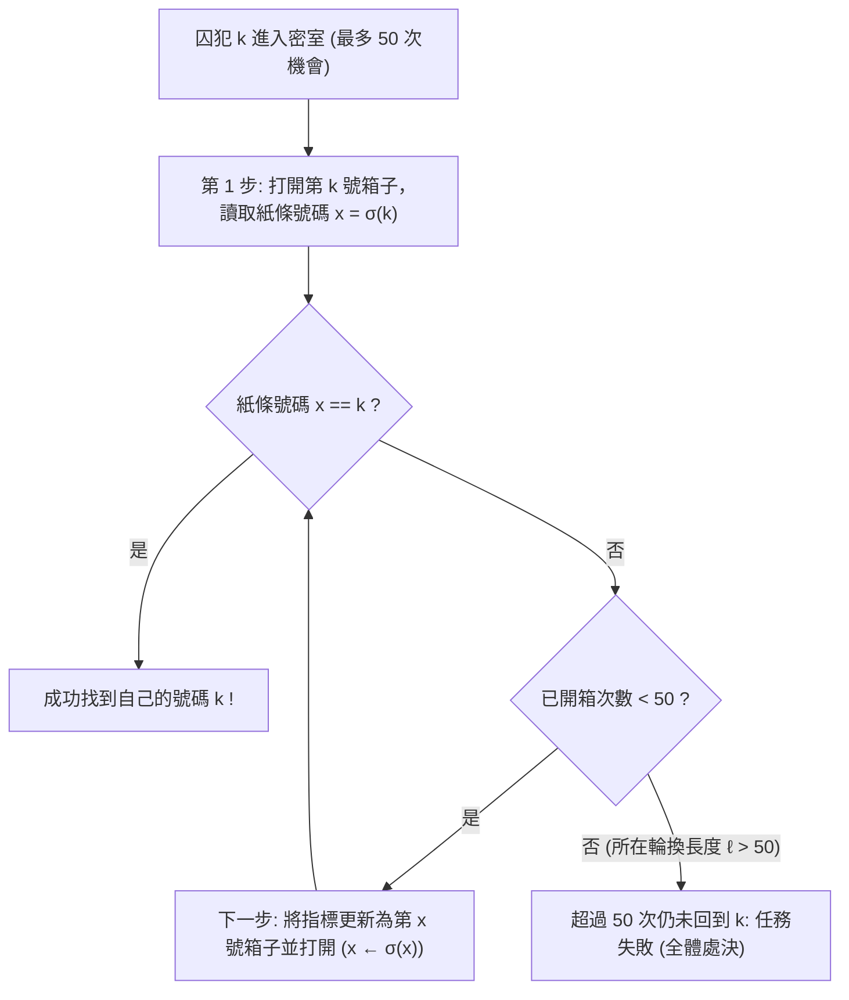
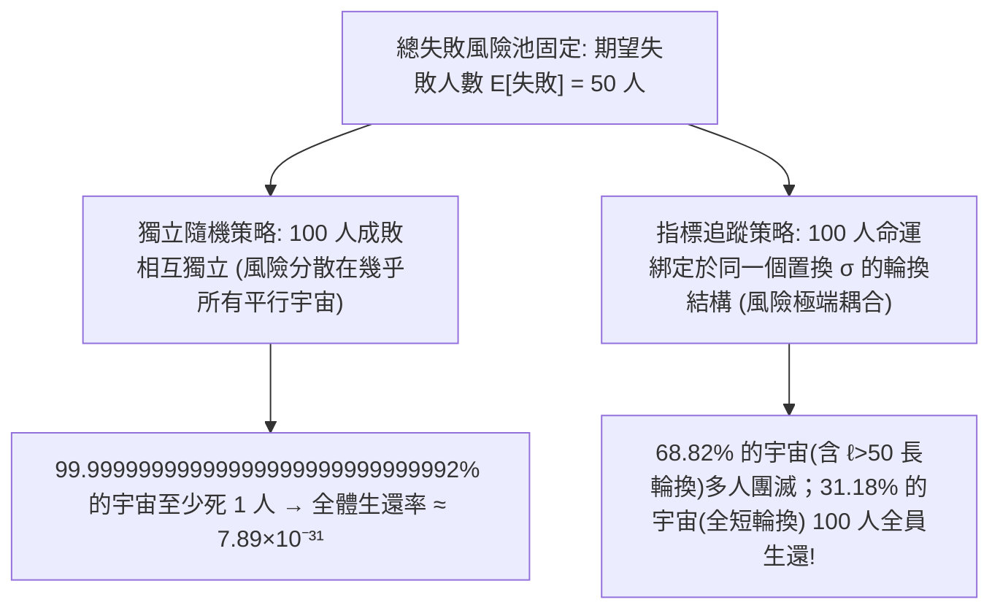

## 引言：機率論中最反直覺的奇蹟

2003年，丹麥電腦科學家<strong>彼得·布羅·米爾特森（Peter Bro Miltersen）</strong>提出了一個轟動數學界的智力謎題——<strong>100名囚犯問題（100 Prisoners Problem）</strong>：
- 監獄裡有編號為 $1$ 到 $100$ 的 $100$ 名死刑犯。典獄長在一個密室裡放了 $100$ 個抽屜（箱子），箱子外側貼著 $1$ 到 $100$ 的編號；箱子內部隨機放入了寫有 $1$ 到 $100$ 號碼的紙條（每個箱子一張，構成 $1$ 到 $100$ 的隨機排列）。
- <strong>規則</strong>：每名囚犯依次獨自進入密室，最多可以打開 <strong>$50$ 個箱子</strong>尋找寫有自己編號的紙條。離開時必須將所有箱子恢復原狀，且一旦遊戲開始，<strong>囚犯之間絕對禁止任何形式的資訊傳遞或暗示</strong>（但在遊戲開始前可以共同商定策略）。
- <strong>生死判定</strong>：只有當 <strong>全部 $100$ 名囚犯都找到自己的號碼</strong> 時，所有人才能被無罪釋放；哪怕只有 <strong>$1$ 人失敗</strong>，全體 $100$ 人立即處決。

如果每名囚犯都各自隨機打開 $50$ 個箱子（<strong>獨立隨機策略</strong>），單人成功率為 $50/100 = 1/2$。由於各人成敗相互獨立，全體生還的機率是令人絕望的：

$$\mathbb{P}(\text{全體生還})_{\text{獨立}} = \left(\frac{1}{2}\right)^{100} = \frac{1}{1,\!267,\!650,\!600,\!228,\!229,\!401,\!496,\!703,\!205,\!376} \approx 7.89 \times 10^{-31}$$

然而，米爾特森的同事<strong>斯文·斯카이姆（Sven Skyum）</strong>發現了一個極為簡單的<strong>指標追蹤策略（Pointer-Following Strategy）</strong>，在不傳遞任何1位元資訊的前提下，將全體生還率一舉提升到了 <strong>$31.18\%$（超過三分之一）</strong>！

---

## 第一章：指標追蹤策略與置換群的輪換分解

斯文·斯카이姆提出的策略只有三步（設囚犯自己的編號為 $k \in \{1, \dots, 100\}$）：
1. <strong>第1步</strong>：進入密室後，首先打開外側標有自己編號的 <strong>第 $k$ 號箱子</strong>。
2. <strong>第2步</strong>：若箱內紙條號碼 $x_1 = k$，則成功；若 $x_1 \neq k$，下一步就去打開 <strong>第 $x_1$ 號箱子</strong>。
3. <strong>第3步</strong>：讀取新箱子裡的號碼 $x_2$，再去打開第 $x_2$ 號箱子……以此類推，沿著鏈條 $k \mapsto \sigma(k) \mapsto \sigma^2(k) \mapsto \cdots$ 追蹤，直到找到號碼 $k$ 或用完 $50$ 次機會。

為什麼這個動作能創造奇蹟？在代數學中，箱子編號與內部紙條的對應關係是 $2n = 100$ 元<strong>對稱群 $S_{2n}$</strong> 中的一個雙射置換 $\sigma$。由群論基本定理，<strong>任意有限置換 $\sigma \in S_{2n}$ 都可以唯一地分解為若干個不相交輪換（Disjoint Cycles）的乘積</strong>：

$$\sigma = C_1 \circ C_2 \circ \cdots \circ C_m, \qquad \sum_{i=1}^m |C_i| = 2n = 100$$

因為 $\sigma$ 是雙射，從箱子 $k$ 出發沿著指標追蹤，絕不會陷入旁支死胡同，而必定沿著包含 $k$ 的唯一閉合輪換繞行一週，最終<strong>必然回到起點箱子 $k$</strong>（因為指向箱子 $k$ 的那張寫有號碼 $k$ 的紙條正是輪換中 $k$ 的前驅 $\sigma^{-1}(k)$）！因此：
- 囚犯 $k$ 能否在 $50$ 步內找到號碼 $k$，等價於<strong>包含 $k$ 的那個輪換的長度 $\ell$ 是否滿足 $\ell \le 50$</strong>。
- <strong>全體 $100$ 名囚犯全部生還，當且僅當置換 $\sigma \in S_{100}$ 的輪換分解中沒有任何一個輪換的長度超過 $50$（即最大輪換長度 $L_{\max}(\sigma) \le 50$）！</strong>

---

## 第二章：長輪換計數定理與調和數 $1 - \ln 2$ 的嚴密推導

設總人數為 $2n$（此處 $2n = 100, n = 50$）。如果一個置換 $\sigma \in S_{2n}$ 含有長度嚴格大於 $n$ 的長輪換（$\ell \in \{n+1, \dots, 2n\}$），由於兩個長度都大於 $n$ 的不相交輪換之和至少為 $(n+1)+(n+1) = 2n+2 > 2n$，<strong>在同一個置換中，長度 $\ell > n$ 的長輪換最多只能存在唯一一個！</strong>

這意味著事件 $E_\ell := \{\text{置換 }\sigma\text{ 含有長度為 }\ell\text{ 的輪換}\}$ 對 $\ell = n+1, n+2, \dots, 2n$ 是<strong>兩兩互斥（Mutually Exclusive）</strong>的！我們來精確計算滿足 $E_\ell$ 的置換個數：
1. 從 $2n$ 個元素中選出構成該長輪換的 $\ell$ 個元素，共有 $\binom{2n}{\ell}$ 種選法；
2. 將這 $\ell$ 個元素排成一個單一的閉合圓周輪換，共有 $(\ell - 1)!$ 種排法（圓排列）；
3. 剩下的 $2n - \ell$ 個元素可以任意排列，共有 $(2n - \ell)!$ 種排法。

將三者相乘，階乘發生驚人的約分：

$$|E_\ell| = \binom{2n}{\ell} \cdot (\ell - 1)! \cdot (2n - \ell)! = \frac{(2n)!}{\ell! \, (2n - \ell)!} \cdot (\ell - 1)! \, (2n - \ell)! = \frac{(2n)!}{\ell}$$

除以總排列數 $|S_{2n}| = (2n)!$，得到含有長度為 $\ell > n$ 的輪換的精確機率僅為 <strong>$\mathbb{P}(E_\ell) = \frac{1}{\ell}$</strong>！利用互斥事件的可加性與<strong>調和數（Harmonic Number）</strong> $H_N = \sum_{k=1}^N \frac{1}{k}$，全體生還機率為：

$$\boxed{P_{\text{success}}(2n) = 1 - \sum_{\ell = n+1}^{2n} \frac{1}{\ell} = 1 - \left(H_{2n} - H_n\right) \xrightarrow{n \to \infty} 1 - \int_1^2 \frac{dx}{x} = 1 - \ln 2 \approx 30.685\%}$$

對 $2n = 100, n = 50$，精確生還率為 $P_{\text{success}}(100) = 1 - (H_{100} - H_{50}) \approx 1 - 0.688172 = \mathbf{31.1828\%}$！

---

## 第三章：為什麼沒有傳遞資訊卻能逆天改命？——風險的完美耦合

為什麼單人成功率明明始終是 $50\%$（成功人數的數學期望在兩種策略下完全相同：$\mathbb{E}[\sum I_k] = 100 \times 0.5 = 50$），全體生還率卻暴漲了 $3.95 \times 10^{29}$ 倍？

| 比較維度 | ① 獨立隨機策略 | ② 指標追蹤（輪換）策略 |
| :--- | :--- | :--- | :--- |
| <strong>單人成功機率 $\mathbb{P}(A_k)$</strong> | $50.00\%$ | $50.00\%$（完全不變） |
| <strong>期望成功人數 $\mathbb{E}[X]$</strong> | $50$ 人 | $50$ 人（完全不變） |
| <strong>囚犯間相關性</strong> | 零相關（相互獨立） | <strong>透過共享環境 $\sigma$ 的輪換結構強正相關</strong> |
| <strong>$100$ 人全體生還率</strong> | $(1/2)^{100} \approx 7.89 \times 10^{-31}$ | <strong>$1 - (H_{100} - H_{50}) \approx 31.18\%$</strong> |
| <strong>$n \to \infty$ 漸近下界</strong> | $0$（指數級歸零） | <strong>$1 - \ln 2 \approx 30.685\%$（恆定正常數）</strong> |

1. <strong>機率論中的耦合（Coupling）與團滅換生機</strong>：在規則「哪怕1人失敗即全員處決」下，失敗1人和失敗51人的懲罰完全相同。獨立策略把失敗風險均勻撒在所有樣本路徑上，導致幾乎每條路徑都有約50人失敗；而指標追蹤策略將所有人的命運<strong>耦合（Coupled）</strong>在同一個置換 $\sigma$ 的拓撲結構上——把所有的失敗高度濃縮進那 $68.82\%$ 含有 $\ell > 50$ 長輪換的排列裡（一旦失敗至少51人一起失敗），從而把整整 <strong>$31.18\%$ 的樣本空間徹底清空為「零失敗淨土」</strong>！
2. <strong>如果典獄長惡意排布紙條怎麼辦？</strong> 如果典獄長故意把紙條排成一個長度為 $100$ 的大輪換，生還率將降為 $0$。但囚犯們只需在進場前秘密商定一個隨機的<strong>重命名雙射 $\tau \in S_{100}$</strong>，將箱子 $x$ 視為 $\tau(x)$，則新置換 $\tau \sigma \tau^{-1}$ 的輪換結構被完全隨機化，無論典獄長如何做手腳，生還率依然嚴格保持 <strong>$31.18\%$</strong>！
