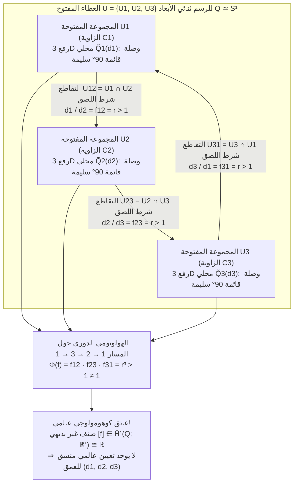
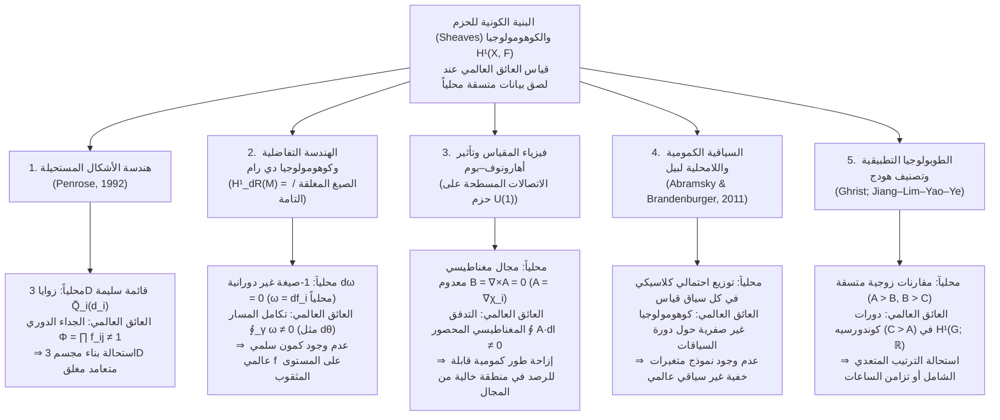

باستخدام ورقة بيضاء وقلم رصاص ومسطرة فقط، يستطيع أي شخص في دقائق معدودة رسم <strong>مثلث بنروز (Penrose Tribar / Penrose Triangle)</strong>: ثلاث عوارض مستقيمة ذات مقطع مربع تلتقي مثنى مثنى بزاوية قائمة ($90^\circ$)، لتشكّل ما يبدو وكأنه إطار مثلث مغلق وصلب. أو لنتأمل سُلَّم الدير الشهير في الطبعة الحجرية *صعود وهبوط* (*Ascending and Descending*، 1960) للفنان الهولندي <strong>موريتس كورنيليس إيشر (M.C. Escher، 1898–1972)</strong>: صفّان من الرهبان يصعدون ويهبطون بلا توقف على درج حجري رباعي الأضلاع، يتسلقون باستمرار في حلقة مغلقة ومع ذلك يعودون إلى نفس الارتفاع الذي بدأوا منه.

عندما نحدّق في هذه <strong>الأشكال المستحيلة (Impossible Figures / Impossible Objects)</strong>، تصاب القشرة البصرية لدينا بدوار إدراكي فريد. انظر فقط إلى الزاوية العلوية لمثلث بنروز: إنها وصلة خشبية ثلاثية الأبعاد بزاوية قائمة ($90^\circ$) عادية تماماً وسليمة فيزيائياً. انقل بصرك إلى الزاوية السفلية اليسرى أو اليمنى: لا يوجد أي خرق لقوانين الهندسة الإقليدية. غير أنه في اللحظة التي تتتبع فيها عيناك العوارض الثلاث بشكل متصل حول المحيط المغلق، ينفجر تناقض شامل — <strong>إذ تمر العارضة الأقرب إلى عين المشاهد عند أحد طرفيها خلف عارضة أبعد منها عند الطرف الآخر دون أي انقطاع</strong>.

كيف يمكن لليد البشرية أن ترسم بسهولة على مستوى ثنائي الأبعاد جسماً <strong>متسقاً محلياً في كل جزء من أجزائه، لكنه مستحيل البناء عالمياً في الفضاء الإقليدي ثلاثي الأبعاد $\mathbb{R}^3$</strong>؟ وكيف تصوغ الرياضيات الحديثة الآلية الدقيقة التي يفشل بها <strong>الاتساق المحلي (Local Consistency)</strong> في التجمع لتكوين <strong>وجود عالمي (Global Realizability)</strong>؟

في عام 1992، نشر الفيزيائي الرياضي والحائز على جائزة نوبل <strong>السير روجر بنروز (Sir Roger Penrose)</strong> ورقته البحثية الرائدة *"On the Cohomology of Impossible Figures"*. وباستخدام <strong>نظرية الحزم (Sheaf Theory)</strong> و<strong>كوهومولوجيا تشيخ (Čech Cohomology)</strong>، أثبت بنروز أن الشكل المستحيل ليس مجرد خدعة بصرية، بل هو تجسيد بصري مباشر <strong>لصنف كوهومولوجيا غير بديهي في زمرة كوهومولوجيا تشيخ الأولى $\check{H}^1(Q; \mathbb{R}^+)$</strong>.

في هذا المقال، نتتبع تاريخ الأشكال المستحيلة من أوسكار رويترسفارد إلى الأب والابن بنروز وإيشر، ونحلل كيف يطمس الإسقاط المنظوري $\pi: \mathbb{R}^3 \to \mathbb{R}^2$ ألياف العمق وكيف يعمل حساب وسم الخطوط لهوفمان–كلوز، ونبني صياغة بنروز الكوهومولوجية خطوة بخطوة، ونكشف الجبر الخطي وراء منحوتات «الحركة المستحيلة» لكوكيتشي سوغيهارا، ونوضح كيف يحكم نفس العائق الكوهومولوجي كوهومولوجيا دي رام، وتأثير أهارونوف–بوم، والسياقية الكمومية.

---

## 1. رسم ما لا يمكن بناؤه: رويترسفارد، وبنروز، وإيشر

### 1.1 من هجاء المنظور إلى المفارقة الهندسية الخالصة

على الرغم من ظهور انتهاكات متعمدة لقواعد المنظور في لوحة ويليام هوغارث *Satire on False Perspective* (1754)، فإن الرائد الحقيقي للأشكال المستحيلة الهندسية الخالصة هو الفنان السويدي <strong>أوسكار رويترسفارد (Oscar Reutersvärd، 1915–2002)</strong>. ففي عام 1934، وبينما كان طالباً في الثامنة عشرة من عمره خلال حصة للغة اللاتينية، رسم تسعة مكعبات بإسقاط متساوي القياس تشكّل حلقة مثلثة يتناقض عمقها دورياً (*Opus 1*). وقد أبدع خلال حياته أكثر من 2,500 شكل مستحيل كرّمتها السويد بإصدار طوابع بريدية عام 1982.

### 1.2 فبراير 1958: الورقة التاريخية للايونيل وروجر بنروز

بشكل مستقل، وبعد زيارة معرض لأعمال <strong>إيشر</strong> خلال المؤتمر الدولي لعلماء الرياضيات (ICM) في أمستردام عام 1954، استخلص عالم الرياضيات الشاب في كامبريدج <strong>روجر بنروز (1931–)</strong> جوهر المفارقة المكانية في أبسط هيكل هندسي ممكن: <strong>مثلث بنروز (Penrose Tribar)</strong>، بينما صمم والده عالم الوراثة والطب النفسي <strong>لايونيل بنروز (Lionel S. Penrose، 1898–1972)</strong> <strong>سُلَّم بنروز اللانهائي (Penrose Endless Staircase)</strong>.

في فبراير 1958، نشر الأب والابن في مجلة *British Journal of Psychology* (المجلد 49، ص 31–33) بحثهما الشهير <strong>*"Impossible Objects: A Special Type of Visual Illusion"*</strong>:

> *"هنا يكون كل جزء من البنية مقبولاً بوصفه تمثيلاً لجسم صلب عادي، لكن الكارثة تقع نتيجة الوصلات الخاطئة بين الأجزاء (false connexions of the parts)..."*

بعد أن أرسل بنروز نسخة من البحث إلى إيشر، أبدع الأخير ثلاثيته الخالدة: *بلفيدير* (*Belvedere*، مايو 1958)، و*صعود وهبوط* (*Ascending and Descending*، مارس 1960)، و*الشلال* (*Waterfall*، أكتوبر 1961، الذي يربط ثلاثة مثلثات لبنروز في قناة مائية دائمة الحركة).

---

## 2. هندسة الإبصار: كيف يمحو الإسقاط $\pi: \mathbb{R}^3 \to \mathbb{R}^2$ بُعد العمق؟

### 2.1 الإسقاط المركزي والإسقاط المتوازي وأليافهما أحادية البعد (Fibers)

لنضع المركز البصري لعين المشاهد عند نقطة الأصل $\mathbf{0} = (0,0,0) \in \mathbb{R}^3$. يقوم <strong>الإسقاط المركزي (المنظوري)</strong> $\pi: \mathbb{R}^3 \setminus \{\mathbf{0}\} \to \mathbb{R}^2$ (أو على كرة الاتجاهات $S^2$) بإسقاط كل نقطة $\mathbf{r} = (x, y, z)$ في نصف الفضاء الأمامي $z > 0$ على مستوى الصورة عند البعد البؤري $f > 0$:

$$\pi(x, y, z) = \left( f \frac{x}{z}, \; f \frac{y}{z} \right), \qquad \text{أو} \qquad \pi(\mathbf{r}) = \frac{\mathbf{r}}{\|\mathbf{r}\|}$$

ما هي <strong>الصورة العكسية (الليف / Fiber)</strong> $\pi^{-1}(p)$ لنقطة ثنائية الأبعاد $p = \pi(\mathbf{r}_0)$؟ بما أن ضرب المتجه $\mathbf{r}_0$ في أي عدد حقيقي موجب $\lambda \in \mathbb{R}^+ = (0, \infty)$ يحافظ على اتجاه شعاع الرؤية ($\pi(\lambda \mathbf{r}_0) = \pi(\mathbf{r}_0) = p$)، فإن الليف فوق كل نقطة $p$ هو نصف مستقيم مفتوح أحادي البعد معلَّم بزمرة الأعداد الحقيقية الموجبة الضربية $\mathbb{R}^+ = ((0, \infty), \times)$:

$$\pi^{-1}(\pi(\mathbf{r}_0)) = \{ \lambda \mathbf{r}_0 \in \mathbb{R}^3 \setminus \{\mathbf{0}\} \mid \lambda \in \mathbb{R}^+ \}$$

ويترتب على ذلك نتيجة هندسية حاسمة: <strong>إذا طبّقنا على أي قطعة صلبة ثلاثية الأبعاد $\tilde{Q}_i \subset \mathbb{R}^3 \setminus \{\mathbf{0}\}$ تحاكياً شعاعياً $\mathbf{r} \mapsto \lambda \mathbf{r}$ مركزه العين ($\lambda \in \mathbb{R}^+$)، فإن جميع زواياها القائمة ($90^\circ$) تظل محفوظة، كما أن صورتها الشبكية ثنائية الأبعاد $\pi(\lambda \tilde{Q}_i) = \pi(\tilde{Q}_i)$ تبقى متطابقة بنسبة 100%!</strong> وفي الإسقاط المتوازي $\pi_{\text{orth}}(x,y,z) = (x,y)$، تقابل هذه الحرية إزاحة في العمق $z \mapsto z + c$ تحكمها الزمرة الجمعية $(\mathbb{R}, +)$ المتشاكلة قانونياً مع $(\mathbb{R}^+, \times)$ عبر اللوغاريتم $\ln: (\mathbb{R}^+, \times) \xrightarrow{\sim} (\mathbb{R}, +)$.

### 2.2 حساب وسم الخطوط لهوفمان–كلوز (1971)

لحل المسألة العكسية ثلاثية الأبعاد، يفرض النظام البصري ثلاث مسلّمات قبلية: <strong>استواء الوجوه</strong>، و<strong>التعامد ($90^\circ$)</strong>، و<strong>فرضية زاوية الرؤية العامة</strong>. وفي عام 1971، صاغ <strong>ديفيد هوفمان (David A. Huffman)</strong> و<strong>ماكس كلوز (Max B. Clowes)</strong> خوارزمية وسم حواف متعدّدات السطوح بأربعة رموز: $+$ (حافة محدبة)، $-$ (حافة مقعرة)، و$\rightarrow, \leftarrow$ (حافة حجب).

والمفاجأة المذهلة هي أن <strong>مثلث بنروز يجتاز اختبار هوفمان–كلوز التوافقي بنسبة 100%!</strong> فكل رأس فيه صالح محلياً. إذن، لا تكمن استحالة مثلث بنروز في تناقض توافقي محلي، بل في <strong>الفشل العالمي (الكوهومولوجي) لإغلاق إحداثيات العمق المتصلة حول مسار طوبولوجي غير قابل للانكماش</strong>.

| مستوى الاتساق | الإطار الرياضي | الشرط الهندسي المختبَر | النتيجة في مثلث بنروز |
| :--- | :--- | :--- | :--- |
| <strong>المستوى 1: قابلية تحقق الرؤوس محلياً</strong> | دليل الرؤوس ثلاثية الوجوه (Guzmán, 1968) | هل يمكن لكل تقاطع $v_i$ منفرد أن يمثل زاوية 3D؟ | <strong>ناجح</strong> (كل زاوية هي وصلة قائمة $90^\circ$ سليمة) |
| <strong>المستوى 2: وسم الحواف التوافقي</strong> | حساب هوفمان–كلوز (1971) | هل يمكن تعيين $+, -, \rightarrow, \leftarrow$ بتوافق على جميع الحواف؟ | <strong>ناجح</strong> (يقبل وسماً متسقاً عالمياً) |
| <strong>المستوى 3: اللصق الصلب للقطع المحلية</strong> | <strong>كوهومولوجيا الحزم (Penrose, 1992)</strong> | هل تحقق نسب العمق $f_{ij}$ الشرط $\prod f_{ij} = 1$ حول كل دورة؟ | <strong>فاشل</strong> (صنف غير بديهي $[f] \in \check{H}^1(Q; \mathbb{R}^+) \neq 0$) |
| <strong>المستوى 4: متعدد سطوح عام بوجوه مستوية</strong> | النظام الخطي لسوغيهارا (1986) | بالتخلي عن شرط $90^\circ$، هل يقبل النظام $A\mathbf{w}=\mathbf{0}, B\mathbf{w}>\mathbf{0}$ حلاً؟ | <strong>ناجح</strong> (قابل للبناء في 3D باستخدام وجوه شبه منحرفة مائلة!) |

---

## 3. الاتساق المحلي مقابل التناقض العالمي: اللصق عبر غطاء مفتوح

ليكن $Q \subset \mathbb{R}^2$ الرسم ثنائي الأبعاد لمثلث بنروز، وهو مكافئ هوموتوبياً للدائرة ($Q \simeq S^1$). نغطي $Q$ بثلاث مجموعات مفتوحة $\mathcal{U} = \{U_1, U_2, U_3\}$، تحتوي كل منها على إحدى الزوايا $C_1, C_2, C_3$ ومعظم العارضتين المتصلتين بها:

1. كل مجموعة مفتوحة $U_i$ ($i=1,2,3$) بسيطة الترابط (قابلة للانكماش / Contractible).
2. التقاطعات الثنائية $U_{12} = U_1 \cap U_2$ و$U_{23} = U_2 \cap U_3$ و$U_{31} = U_3 \cap U_1$ هي قطع غير خالية قابلة للانكماش في منتصف كل عارضة.
3. التقاطع الثلاثي خالٍ: $U_1 \cap U_2 \cap U_3 = \emptyset$. ومن ثم فإن <strong>عصب الغطاء (Nerve of the Cover)</strong> $N(\mathcal{U})$ هو محيط مثلث $\partial \Delta^2 \cong S^1$.

فوق كل مجموعة $U_i$، نختار نموذجاً ثلاثي الأبعاد قياسياً $\tilde{Q}_i^{\text{std}}$، بحيث يُعطى أي رفع ثلاثي الأبعاد صلب صالح بالعلاقة $\tilde{Q}_i(d_i) = d_i \cdot \tilde{Q}_i^{\text{std}}$ مع معامل مقياس عمق موجب $d_i \in \mathbb{R}^+$.

ولكي تلتحم القطعتان $\tilde{Q}_1(d_1)$ و$\tilde{Q}_2(d_2)$ بسلاسة فوق منطقة التداخل $U_{12} = U_1 \cap U_2$، يفرض المنظور نسبة ثابتة $f_{12} = r > 1$. وبحكم التناظر الدوراني الثلاثي، يجب أن يتحقق على التداخلات الثلاثة:

$$\frac{d_1}{d_2} = f_{12} = r > 1, \qquad \frac{d_2}{d_3} = f_{23} = r > 1, \qquad \frac{d_3}{d_1} = f_{31} = r > 1$$

بضرب هذه المعادلات الثلاث حول المسار المغلق $1 \to 2 \to 3 \to 1$، تختزل المعاملات $d_i$ ويظهر التناقض الجبري الفوري:

$$1 = \frac{d_1}{d_2} \cdot \frac{d_2}{d_3} \cdot \frac{d_3}{d_1} = f_{12} \cdot f_{23} \cdot f_{31} = r^3 > 1 \quad (\text{تناقض!})$$

---

## 4. صياغة السير روجر بنروز (1992): الحزم وكوهومولوجيا تشيخ

في ورقته *"On the Cohomology of Impossible Figures"* (1992)، عرّف روجر بنروز <strong>زمرة الغموض (Ambiguity Group) $G = (\mathbb{R}^+, \times)$</strong> وبنى معقد سلاسل تشيخ المصاحبة للحزمة الثابتة محلياً $\mathcal{F}$ على الغطاء الجيد $\mathcal{U} = \{U_1, U_2, U_3\}$:

$$C^0(\mathcal{U}, \mathbb{R}^+) \xrightarrow{\;\delta^0\;} C^1(\mathcal{U}, \mathbb{R}^+) \xrightarrow{\;\delta^1\;} C^2(\mathcal{U}, \mathbb{R}^+)$$

- <strong>سلاسل تشيخ من الرتبة 0 ($C^0(\mathcal{U}, \mathbb{R}^+) = (\mathbb{R}^+)^3$)</strong>: تعيينات العمق المحلية $d = (d_1, d_2, d_3)$.
- <strong>سلاسل تشيخ من الرتبة 1 ($C^1(\mathcal{U}, \mathbb{R}^+)$)</strong>: نسب الانتقال $f = (f_{12}, f_{23}, f_{31})$ على التقاطعات $U_{ij}$ مع الشرط $f_{ji} = f_{ij}^{-1}$.
- <strong>مؤثرات الحدود المصاحبة (Coboundary Operators)</strong>: $(\delta^0 d)_{ij} = d_i / d_j$ و$(\delta^1 f)_{ijk} = f_{ij} f_{jk} f_{ki}$، حيث يتحقق دائماً $\delta^1 \circ \delta^0 = 1$.

وبما أن $U_1 \cap U_2 \cap U_3 = \emptyset$، فإن كل 1-سلسلة مصاحبة هي تلقائياً <strong>1-دورة مصاحبة (1-Cocycle)</strong> ($Z^1(\mathcal{U}, \mathbb{R}^+) = \ker \delta^1 \cong (\mathbb{R}^+)^3$). ويكون الجسم ثلاثي الأبعاد قابلاً للتحقق عالمياً إذا وفقط إذا كانت $f$ <strong>1-حداً مصاحباً (1-Coboundary)</strong> ($f \in B^1(\mathcal{U}, \mathbb{R}^+) = \operatorname{Im} \delta^0$)، أي $f_{ij} = d_i / d_j$.

تُعرَّف <strong>زمرة كوهومولوجيا تشيخ الأولى</strong> بأنها زمرة خارج القسمة:

$$\check{H}^1(Q; \mathbb{R}^+) \cong \frac{Z^1(\mathcal{U}, \mathbb{R}^+)}{B^1(\mathcal{U}, \mathbb{R}^+)} = \frac{\ker \delta^1}{\operatorname{Im} \delta^0} \xrightarrow[\;\sim\;]{\;\Phi\;} \mathbb{R}^+ \xrightarrow[\;\sim\;]{\;\ln\;} \mathbb{R}$$

حيث يكون كيرنل تشاكل الهولونومي $\Phi(f) = f_{12} f_{23} f_{31}$ مساوياً تماماً لزمرة الحدود المصاحبة $B^1(\mathcal{U}, \mathbb{R}^+)$. وفي مثلث بنروز لدينا $\Phi(f) = r^3 \neq 1$ ($\ln \Phi(f) = 3\ln r \neq 0$)، مما يثبت <strong>مبرهنة بنروز (1992)</strong>: <strong>الشكل المستحيل هو حرفياً عنصر غير بديهي $[f] \neq 1$ في زمرة كوهومولوجيا تشيخ الأولى $\check{H}^1(Q; G)$!</strong>

وعند قطع المثلث في نقطة واحدة، يتحول الفضاء إلى فترة قابلة للانكماش $Q_{\text{cut}} \simeq [0, 1]$ تنعدم كوهومولوجيتها ($\check{H}^1([0, 1]; \mathbb{R}^+) = \{1\}$). ولهذا السبب يمكن بناء المنحوتات الواقعية (مثل منحوتة إيست بيرث في أستراليا) كخطاف ثلاثي الأبعاد مفتوح يتطابق طرفاه المنفصلان في العمق على شعاع بصري واحد $\pi^{-1}(p)$ من زاوية رؤية عرضية وحيدة.

---

## 5. منحوتات كوكيتشي سوغيهارا والنموذج الكوني للكوهومولوجيا في العلوم

### 5.1 الجبر الخطي لـ «الحركة المستحيلة» عند كوكيتشي سوغيهارا

أثبت عالم الرياضيات الياباني <strong>كوكيتشي سوغيهارا (Kokichi Sugihara، 杉原厚吉)</strong> في كتابه *Machine Interpretation of Line Drawings* (MIT Press, 1986) أن الرسم الخطي قابل للتحقق كمتعدد سطوح ثلاثي الأبعاد متصل بوجوه مستوية إذا وفقط إذا كان نظام المعادلات الخطية للوقوع ومتباينات العمق

$$A \mathbf{w} = \mathbf{0}, \qquad B \mathbf{w} > \mathbf{0}$$

يقبل حلاً $\mathbf{w}$. فبينما يضيف الدماغ البشري لاشعورياً معادلات التعامد $C_{\text{rect}} \mathbf{w} = \mathbf{0}$ (مما يجعل النظام مستحيلاً مع $\check{H}^1 \neq 0$)، يستبعد سوغيهارا الشرط $C_{\text{rect}} \mathbf{w} = \mathbf{0}$ ويبني مجسمات ثلاثية الأبعاد حقيقية ومغلقة $\mathbf{w}^*$ من وجوه شبه منحرفة مائلة. ولأن القشرة البصرية تصر على فرض زاوية $90^\circ$، فإنها تدرك المنحدر المائل فيزيائياً <strong>إلى الأسفل</strong> وكأنه مائل <strong>إلى الأعلى</strong>، فتبدو الكرات الخشبية وكأنها تتدحرج صعوداً ضد الجاذبية!

### 5.2 النموذج الكوني للحزم والكوهومولوجيا عبر العلوم

| المجال العلمي | فضاء الأساس $X$ والغطاء $\{U_i\}$ | المقطع المحلي $s_i \in \mathcal{F}(U_i)$ | شرط اللصق على $U_i \cap U_j$ | القابلية العالمية للتحقق ($\check{H}^1 = 0$) | معنى الكوهومولوجيا غير الصفرية $\check{H}^1(X, \mathcal{F}) \neq 0$ |
| :--- | :--- | :--- | :--- | :--- | :--- |
| <strong>الأشكال المستحيلة</strong> (Penrose, 1992) | رسم 2D $Q \simeq S^1$ والزوايا $\{U_i\}$ | مقياس العمق الثلاثي الأبعاد المحلي $d_i \in \mathbb{R}^+$ | نسبة العمق $f_{ij} = d_i / d_j$ | الجداء الدوري $\Phi = \prod f_{ij} = 1$ (مجسم 3D) | <strong>مثلث بنروز / سُلَّم إيشر</strong> (غير قابل للبناء في 3D متعامد) |
| <strong>الهندسة التفاضلية</strong> (كوهومولوجيا دي رام) | متعدد طيات أملس $M$ (مثل $\mathbb{R}^2 \setminus \{0\}$) | كمون محلي $f_i$ لصيغة مغلقة $\omega = df_i$ | فرق الكمون $f_i - f_j = c_{ij}$ | تكامل مغلق صفري $\oint_\gamma \omega = 0$ (صيغة تامة) | <strong>الصيغة الزاوية $\omega = d\theta$</strong> (سُلَّم إيشر المتصل بلا كمون عالمي) |
| <strong>فيزياء المقياس</strong> (Aharonov–Bohm, 1959) | منطقة خالية من المجال $M \simeq S^1$ خارج الملف | طور مقياس محلي $\chi_i$ حيث $\mathbf{A} = \nabla \chi_i$ ($\mathbf{B}=\mathbf{0}$) | تحويل $U(1)$ $g_{ij} = e^{ie(\chi_i-\chi_j)/\hbar}$ | حلقة ويلسون بديهية $\exp(\frac{ie}{\hbar}\oint \mathbf{A}\cdot d\mathbf{l}) = 1$ | <strong>إزاحة طور أهارونوف–بوم الكمومية</strong> في مجال مغناطيسي صفري |
| <strong>أسس ميكانيكا الكم</strong> (Abramsky et al., 2011) | مجموعة المرصودات $X$ والسياقات $\{U_i\}$ | احتمالات كلاسيكية محلية لكل سياق قياس | تطابق الاحتمالات الهامشية (No-Signaling) | وجود نموذج متغيرات خفية عالمي | <strong>السياقية الكمومية ولامحلية بيل</strong> (Kochen–Specker / Hardy) |
| <strong>الطوبولوجيا التطبيقية</strong> (Ghrist; HodgeRank) | بيان المقارنات $G = (V, E)$ | التقييم العالمي / توقيت العقدة $d_i \in \mathbb{R}$ | فرق التقييم الزوجي $f_{ij} = d_i - d_j$ | مجموع دوري صفري حول كل دورة (التعدي) | <strong>مفارقة كوندورسيه (دورات حجر-ورقة-مقص)</strong> |

إن تلك الدهشة التي تنتابنا عندما تتجول أعيننا حول مثلث بنروز أو سُلَّم إيشر لهي البرهان الحي على أن قشرتنا البصرية تحسب نقلاً موازياً حول مسار مغلق وتكتشف في الوقت الفعلي <strong>صنف كوهومولوجيا غير بديهي في $\check{H}^1(Q; \mathbb{R}^+)$</strong>.

---

## المراجع

1. <strong>Penrose, L. S., & Penrose, R.</strong> (1958). "Impossible Objects: A Special Type of Visual Illusion." *British Journal of Psychology*, 49(1), 31–33.
2. <strong>Penrose, R.</strong> (1992). "On the Cohomology of Impossible Figures." *Structural Topology*, 17, 11–16.
3. <strong>Huffman, D. A.</strong> (1971). "Impossible Objects as Nonsense Sentences." *Machine Intelligence*, 6, 295–323.
4. <strong>Sugihara, K.</strong> (1986). *Machine Interpretation of Line Drawings*. MIT Press.
5. <strong>Abramsky, S., & Brandenburger, A.</strong> (2011). "The Sheaf-Theoretic Structure of Non-Locality and Contextuality." *New Journal of Physics*, 13(11), 113036.
