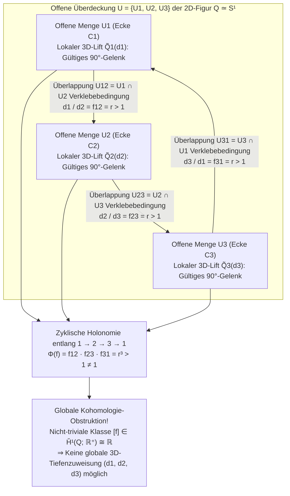
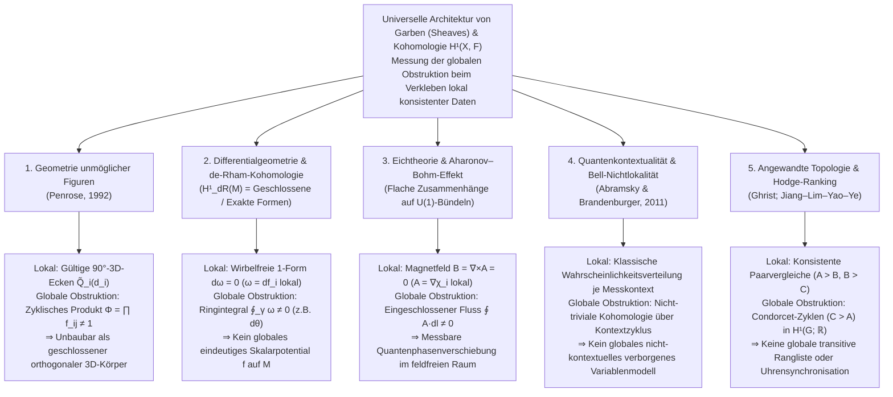

Mit nichts weiter als einem Blatt Papier, einem Bleistift und einem Lineal kann jeder in wenigen Minuten ein <strong>Penrose-Dreieck (Penrose Tribar)</strong> zeichnen: Drei gerade Balken mit quadratischem Querschnitt treffen paarweise im rechten Winkel ($90^\circ$) aufeinander und bilden scheinbar einen geschlossenen, starren Dreiecksrahmen. Oder denken wir an die berühmte Klostertreppe in <strong>M.C. Eschers</strong> Lithografie *Treppauf und Treppab* (*Ascending and Descending*, 1960): Zwei Reihen von Mönchen schreiten unaufhörlich eine viereckige Steintreppe hinauf bzw. hinab, steigen immer weiter nach oben und kehren doch nahtlos auf dieselbe Ausgangshöhe zurück.

Wenn wir solche <strong>unmöglichen Figuren (Impossible Figures / Impossible Objects)</strong> betrachten, erlebt unser visueller Kortex einen eigentümlichen kognitiven Schwindel. Betrachten wir nur die obere Ecke des Penrose-Dreiecks: Es ist eine völlig gewöhnliche, physikalisch einwandfreie dreidimensionale $90^\circ$-Holzverbindung. Wandert der Blick zur linken unteren oder rechten unteren Ecke, ist auch dort jedes Detail lokal vollkommen konsistent mit der euklidischen Geometrie. Doch sobald das Auge den Balken einmal ringsum entlang der geschlossenen Schleife folgt, bricht ein globaler Widerspruch auf: <strong>Ein Balken, der sich am einen Ende eindeutig näher am Betrachter befindet, verläuft am anderen Ende plötzlich hinter einem weiter entfernten Balken</strong>.

Wie ist es möglich, dass die menschliche Hand auf einer zweidimensionalen Ebene mühelos ein Objekt zeichnen kann, das <strong>überall lokal konsistent, aber global im dreidimensionalen euklidischen Raum $\mathbb{R}^3$ unmöglich konstruierbar</strong> ist? Und wie beschreibt die moderne Mathematik den exakten Übergang von <strong>lokaler Konsistenz (Local Consistency)</strong> zu <strong>globaler Unmöglichkeit (Global Contradiction)</strong>?

Im Jahr 1992 veröffentlichte der spätere Nobelpreisträger und mathematische Physiker <strong>Sir Roger Penrose</strong> seine wegweisende Arbeit *"On the Cohomology of Impossible Figures"*. Darin bewies er mithilfe der <strong>Garbentheorie (Sheaf Theory)</strong> und der <strong>Čech-Kohomologie (Čech Cohomology)</strong>, dass unmögliche Figuren weit mehr sind als bloße optische Täuschungen: Eine unmögliche Figur ist die direkte visuelle Darstellung einer <strong>nicht-trivialen Kohomologieklasse in der ersten Čech-Kohomologiegruppe $\check{H}^1(Q; \mathbb{R}^+)$</strong>.

In diesem Artikel untersuchen wir die Geschichte unmöglicher Figuren von Oscar Reutersvärd über Lionel und Roger Penrose bis zu M.C. Escher, analysieren den Verlust der Tiefendimension durch die Zentralprojektion $\pi: \mathbb{R}^3 \to \mathbb{R}^2$ und das Huffman–Clowes-Linienkalkül, entwickeln Penroses garbentheoretische Kohomologie-Formulierung Schritt für Schritt und schlagen den Bogen zu Kokichi Sugiharas real gebauten „Impossible Motion“-Skulpturen sowie zur de-Rham-Kohomologie, dem Aharonov–Bohm-Effekt und der Quantenkontextualität.

---

## 1. Das Zeichenbare, aber Unbaubare: Reutersvärd, Penrose und Escher

### 1.1 Von der Perspektivsatire zum reinen geometrischen Paradoxon

Während frühe Kunstwerke wie William Hogarths Kupferstich *Satire on False Perspective* (1754) komplexe Verdeckungen in ganzen Landschaftsszenen nutzten, schuf der schwedische Künstler <strong>Oscar Reutersvärd (1915–2002)</strong> im Jahr 1934 als 18-jähriger Schüler während einer Lateinstunde das erste reine unmögliche Objekt (*Opus 1*): Neun Würfel in isometrischer Parallelprojektion, die ein Dreieck bilden, dessen Tiefe sich zyklisch widerspricht. Reutersvärd zeichnete im Laufe seines Lebens über 2.500 solcher Figuren, die 1982 auf schwedischen Briefmarken gewürdigt wurden.

### 1.2 Februar 1958: Der Meilenstein von Lionel und Roger Penrose

Unabhängig von Reutersvärd besuchte der junge Cambridger Mathematiker <strong>Roger Penrose (1931–)</strong> während des Internationalen Mathematikerkongresses (ICM) 1954 in Amsterdam eine Ausstellung von <strong>M.C. Escher (1898–1972)</strong>. Fasziniert von Eschers Raumillusionen reduzierte Roger Penrose das Paradoxon auf seine reinste geometrische Essenz: den aus drei rechtwinklig verbundenen Vierkantbalken bestehenden <strong>Penrose-Dreiecksrahmen (Penrose Tribar)</strong>. Sein Vater, der Psychiater und Genetiker <strong>Lionel S. Penrose (1898–1972)</strong>, entwarf als Antwort darauf die <strong>endlose Penrose-Treppe (Penrose Endless Staircase)</strong>.

Im Februar 1958 veröffentlichten Vater und Sohn im *British Journal of Psychology* (Bd. 49, S. 31–33) ihren berühmten dreiseitigen Aufsatz <strong>*"Impossible Objects: A Special Type of Visual Illusion"*</strong>:

> *"Hier ist jeder einzelne Teil der Struktur als Darstellung eines normalen festen Körpers akzeptabel, doch die Katastrophe entsteht durch falsche Verbindungen der Teile (false connexions of the parts)..."*

Als die Penroses einen Sonderdruck an Escher schickten, schuf dieser seine berühmtesten Meisterwerke: *Belvedere* (Mai 1958), *Treppauf und Treppab* (*Ascending and Descending*, März 1960, basierend auf der Penrose-Treppe) und *Wasserfall* (*Waterfall*, Oktober 1961, aufgebaut aus drei verketteten Penrose-Dreiecken).

---

## 2. Geometrie des Sehens: Wie die Projektion $\pi: \mathbb{R}^3 \to \mathbb{R}^2$ die Tiefe auslöscht

### 2.1 Zentralprojektion, Parallelprojektion und ihre 1D-Fasern

Befindet sich das Auge des Betrachters (das optische Zentrum) im Ursprung $\mathbf{0} = (0,0,0) \in \mathbb{R}^3$, so bildet die <strong>Zentralprojektion (Perspektivprojektion)</strong> $\pi: \mathbb{R}^3 \setminus \{\mathbf{0}\} \to \mathbb{R}^2$ (bzw. auf die Richtungssphäre $S^2$) jeden Raumpunkt $\mathbf{r} = (x, y, z)$ mit $z > 0$ auf die Bildebene im Abstand $f > 0$ ab:

$$\pi(x, y, z) = \left( f \frac{x}{z}, \; f \frac{y}{z} \right), \qquad \text{bzw.} \qquad \pi(\mathbf{r}) = \frac{\mathbf{r}}{\|\mathbf{r}\|}$$

Was ist das <strong>Urbild (die Faser / Fiber)</strong> $\pi^{-1}(p)$ eines einzelnen 2D-Bildpunktes $p = \pi(\mathbf{r}_0)$? Da jede Streckung um einen positiven Skalenfaktor $\lambda \in \mathbb{R}^+ = (0, \infty)$ entlang des Sehstrahls die Richtung unverändert lässt ($\pi(\lambda \mathbf{r}_0) = \pi(\mathbf{r}_0) = p$), ist die Faser über jedem Punkt $p$ ein eindimensionaler offener Halbstrahl, parametrisiert durch die multiplikative Gruppe der positiven reellen Zahlen $\mathbb{R}^+ = ((0, \infty), \times)$:

$$\pi^{-1}(\pi(\mathbf{r}_0)) = \{ \lambda \mathbf{r}_0 \in \mathbb{R}^3 \setminus \{\mathbf{0}\} \mid \lambda \in \mathbb{R}^+ \}$$

Daraus folgt eine fundamentale geometrische Eigenschaft: <strong>Skaliert man ein beliebiges starres 3D-Bauteil $\tilde{Q}_i \subset \mathbb{R}^3 \setminus \{\mathbf{0}\}$ vom Ursprung aus um den Faktor $\lambda \in \mathbb{R}^+$ ($\mathbf{r} \mapsto \lambda \mathbf{r}$), so bleiben sowohl sämtliche 3D-Winkel ($90^\circ$) als auch das 2D-Netzhautbild $\pi(\lambda \tilde{Q}_i) = \pi(\tilde{Q}_i)$ exakt identisch!</strong> Unter orthographischer Parallelprojektion $\pi_{\text{orth}}(x,y,z) = (x,y)$ entspricht dieser Freiheit eine Tiefenverschiebung $z \mapsto z + c$ durch die additive Gruppe $(\mathbb{R}, +)$, die über den Logarithmus $\ln: (\mathbb{R}^+, \times) \xrightarrow{\sim} (\mathbb{R}, +)$ kanonisch isomorph zu $\mathbb{R}^+$ ist.

### 2.2 Das Huffman–Clowes-Linienkalkül (1971)

Um aus einer 2D-Linienzeichnung einen 3D-Körper zu rekonstruieren, nutzt das visuelle System starke A-priori-Annahmen: <strong>Ebenheit der Flächen (Planarity)</strong>, <strong>Rechtwinkligkeit (Orthogonality, $90^\circ$-Prior)</strong> und die <strong>Annahme eines allgemeinen Blickpunkts (General Viewpoint Assumption)</strong>.

1971 entwickelten <strong>David A. Huffman</strong> und <strong>Max B. Clowes</strong> unabhängig voneinander das <strong>Huffman–Clowes-Linienkalkül</strong>, das jeder Kante einer Polyederzeichnung eines von vier Labels zuweist: $+$ (konvexe Kante), $-$ (konkave Kante) sowie $\rightarrow, \leftarrow$ (verdeckende Umrisskante, bei der die sichtbare Fläche rechts des Pfeils liegt).

Bemerkenswerterweise <strong>besteht das Penrose-Dreieck den kombinatorischen Huffman–Clowes-Test zu 100 %!</strong> Jede einzelne Ecke (L-, Y/Fork-, Arrow- und T-Kreuzung) besitzt eine physikalisch gültige 3D-Interpretation. Das Scheitern des Penrose-Dreiecks liegt also nicht in einer lokalen kombinatorischen Unverträglichkeit, sondern im <strong>Nicht-Schließen kontinuierlicher Tiefenkoordinaten entlang einer topologisch nicht-kontrahierbaren Schleife</strong>.

| Konsistenzebene | Mathematischer Rahmen | Geprüfte geometrische Bedingung | Ergebnis für das Penrose-Dreieck |
| :--- | :--- | :--- | :--- |
| <strong>Ebene 1: Lokale Ecken-Realisierbarkeit</strong> | Trihedraler Eckenkatalog (Guzmán, 1968) | Ist jede einzelne Kreuzung $v_i$ lokal als 3D-Ecke realisierbar? | <strong>BESTANDEN</strong> (Jede Ecke ist ein gültiges $90^\circ$-Gelenk) |
| <strong>Ebene 2: Kombinatorisches Kanten-Labeling</strong> | Huffman–Clowes-Kalkül (1971) | Lassen sich $+, -, \rightarrow, \leftarrow$ global widerspruchsfrei zuweisen? | <strong>BESTANDEN</strong> (Global konsistentes Labeling existiert) |
| <strong>Ebene 3: Starres Verkleben lokaler Patches</strong> | <strong>Penroses Garbenkohomologie (1992)</strong> | Erfüllen die Tiefenverhältnisse $f_{ij}$ rechtwinkliger 3D-Teile $\prod f_{ij} = 1$? | <strong>GESCHEITERT</strong> (Nicht-triviale Klasse $[f] \in \check{H}^1(Q; \mathbb{R}^+) \neq 0$) |
| <strong>Ebene 4: Allgemeine ebene Polyeder-Realisierung</strong> | Sugiharas lineares System (1986) | Besitzt $A\mathbf{w}=\mathbf{0}, B\mathbf{w}>\mathbf{0}$ ohne $90^\circ$-Zwänge eine 3D-Lösung? | <strong>BESTANDEN</strong> (Mit schiefen Trapezflächen real in 3D baubar!) |

---

## 3. Lokale Konsistenz vs. Globaler Widerspruch: Das Verkleben über einer offenen Überdeckung

Sei $Q \subset \mathbb{R}^2$ die 2D-Zeichnung des Penrose-Dreiecks, die topologisch zum Kreis $S^1$ homotopieäquivalent ist ($Q \simeq S^1$). Wir überdecken $Q$ mit drei offenen Mengen $\mathcal{U} = \{U_1, U_2, U_3\}$, wobei jedes $U_i$ eine der drei rechtwinkligen Ecken $C_i$ samt den angrenzenden Balkenabschnitten enthält:

1. Jedes $U_i$ ($i=1,2,3$) ist einfach zusammenhängend (kontrahierbar).
2. Die paarweisen Durchschnitte $U_{12} = U_1 \cap U_2$, $U_{23} = U_2 \cap U_3$ und $U_{31} = U_3 \cap U_1$ liegen in der Mitte der drei Balken und sind nicht-leer und kontrahierbar.
3. Der Dreifachdurchschnitt ist leer: $U_1 \cap U_2 \cap U_3 = \emptyset$. Der <strong>Nerv der Überdeckung</strong> $N(\mathcal{U})$ ist somit der Dreiecksrand $\partial \Delta^2 \cong S^1$.

Über jedem $U_i$ existiert ein eindeutiges standardisiertes 3D-Eckenmodell $\tilde{Q}_i^{\text{std}}$, und jeder gültige lokale 3D-Lift über $U_i$ hat die Form $\tilde{Q}_i(d_i) = d_i \cdot \tilde{Q}_i^{\text{std}}$ mit einem positiven Tiefenskalenfaktor $d_i \in \mathbb{R}^+$.

Damit auf dem Überlappungsbereich $U_{12} = U_1 \cap U_2$ die beiden 3D-Teile $\tilde{Q}_1(d_1)$ und $\tilde{Q}_2(d_2)$ nahtlos ineinander übergehen, erzwingt die perspektivische Verkürzung des Balkens ein festes Verhältnis $f_{12} = r > 1$. Wegen der dreizähligen Rotationssymmetrie gilt auf allen drei Überlappungen:

$$\frac{d_1}{d_2} = f_{12} = r > 1, \qquad \frac{d_2}{d_3} = f_{23} = r > 1, \qquad \frac{d_3}{d_1} = f_{31} = r > 1$$

Multipliziert man diese drei Gleichungen entlang des geschlossenen Zyklus $1 \to 2 \to 3 \to 1$, kürzen sich alle $d_i$ heraus und es folgt der globale Widerspruch:

$$1 = \frac{d_1}{d_2} \cdot \frac{d_2}{d_3} \cdot \frac{d_3}{d_1} = f_{12} \cdot f_{23} \cdot f_{31} = r^3 > 1 \quad (\text{Widerspruch!})$$

---

## 4. Sir Roger Penroses Formulierung (1992): Garben und Čech-Kohomologie

In *"On the Cohomology of Impossible Figures"* (1992) fasste Roger Penrose die Skalierungsfreiheit in der abelschen <strong>Ambiguitätsgruppe (Ambiguity Group) $G = (\mathbb{R}^+, \times)$</strong> zusammen und betrachtete den Čech-Kokettenkomplex der lokal konstanten Garbe $\mathcal{F}$ mit Werten in $G$:

$$C^0(\mathcal{U}, \mathbb{R}^+) \xrightarrow{\;\delta^0\;} C^1(\mathcal{U}, \mathbb{R}^+) \xrightarrow{\;\delta^1\;} C^2(\mathcal{U}, \mathbb{R}^+)$$

- <strong>0-Koketten $C^0(\mathcal{U}, \mathbb{R}^+) = (\mathbb{R}^+)^3$</strong>: Familien $d = (d_1, d_2, d_3)$ lokaler Tiefenskalierungen.
- <strong>1-Koketten $C^1(\mathcal{U}, \mathbb{R}^+)$</strong>: Übergangsverhältnisse $f = (f_{12}, f_{23}, f_{31})$ auf den Durchschnitten $U_{ij}$ mit $f_{ji} = f_{ij}^{-1}$.
- <strong>Korandoperatoren (Coboundary Operators)</strong>: $(\delta^0 d)_{ij} = d_i / d_j$ und $(\delta^1 f)_{ijk} = f_{ij} f_{jk} f_{ki}$, wobei $\delta^1 \circ \delta^0 = 1$ gilt.

Da $U_1 \cap U_2 \cap U_3 = \emptyset$ ist, ist jede 1-Kokette automatisch ein <strong>1-Kozyklus</strong> ($Z^1(\mathcal{U}, \mathbb{R}^+) = \ker \delta^1 \cong (\mathbb{R}^+)^3$). Eine global konsistente 3D-Realisierung existiert genau dann, wenn $f$ ein <strong>1-Korand</strong> ist ($f \in B^1(\mathcal{U}, \mathbb{R}^+) = \operatorname{Im} \delta^0$), also $f_{ij} = d_i / d_j$ für ein globales $(d_1, d_2, d_3)$ gilt.

Die <strong>erste Čech-Kohomologiegruppe</strong> ist die Faktorgruppe:

$$\check{H}^1(Q; \mathbb{R}^+) \cong \frac{Z^1(\mathcal{U}, \mathbb{R}^+)}{B^1(\mathcal{U}, \mathbb{R}^+)} = \frac{\ker \delta^1}{\operatorname{Im} \delta^0} \xrightarrow[\;\sim\;]{\;\Phi\;} \mathbb{R}^+ \xrightarrow[\;\sim\;]{\;\ln\;} \mathbb{R}$$

Der surjektive Holonomie-Homomorphismus $\Phi(f) = f_{12} f_{23} f_{31}$ besitzt genau die Koränder $B^1(\mathcal{U}, \mathbb{R}^+)$ als Kern ($\ker \Phi = B^1$). Für das Penrose-Dreieck gilt $\Phi(f) = r^3 \neq 1$ ($\ln \Phi(f) = 3\ln r \neq 0$). Damit lautet <strong>Penroses Hauptsatz über unmögliche Figuren (1992)</strong>: <strong>Die globale 3D-Unbaubarkeit einer lokal konsistenten Zeichnung $Q$ wird exakt durch ein nicht-triviales Element $[f] \neq 1$ in der ersten Čech-Kohomologiegruppe $\check{H}^1(Q; G)$ gemessen!</strong>

Schneidet man das Dreieck an einer Stelle auf, wird der Raum zu einem kontrahierbaren Intervall $Q_{\text{cut}} \simeq [0, 1]$, dessen Kohomologie verschwindet ($\check{H}^1([0, 1]; \mathbb{R}^+) = \{1\}$). Deshalb lassen sich reale Skulpturen (wie in East Perth, Australien) als offener Haken in 3D bauen, dessen räumlich getrennte Enden nur aus einem einzigen <strong>zufälligen Blickwinkel (Accidental Viewpoint)</strong> entlang desselben Sehstrahls $\pi^{-1}(p)$ im 2D-Bild zu $S^1$ verschmelzen!

---

## 5. Kokichi Sugiharas „Impossible Motion“-Körper und die Universalität der Garbenkohomologie

### 5.1 Kokichi Sugiharas lineare Algebra unmöglicher Festkörper

Der japanische Mathematiker <strong>Kokichi Sugihara (杉原厚吉)</strong> zeigte in seinem Werk *Machine Interpretation of Line Drawings* (MIT Press, 1986), dass eine Linienzeichnung genau dann als allgemeines 3D-Polyeder mit ebenen Flächen realisierbar ist, wenn das lineare Gleichungs- und Ungleichungssystem

$$A \mathbf{w} = \mathbf{0}, \qquad B \mathbf{w} > \mathbf{0}$$

für den Vektor $\mathbf{w}$ aller Eckentiefen $z_k$ und Ebenengleichungsparameter $(a_m, b_m, c_m)$ eine Lösung besitzt. Während das menschliche Gehirn unbewusst zusätzliche Rechtwinkligkeitsbedingungen $C_{\text{rect}} \mathbf{w} = \mathbf{0}$ erzwingt (was auf $\check{H}^1 \neq 0$ und Unlösbarkeit führt), ließ Sugihara $C_{\text{rect}} \mathbf{w} = \mathbf{0}$ weg und berechnete reale, lückenlos geschlossene 3D-Körper $\mathbf{w}^*$ aus schiefen Trapezflächen. Da unser Gehirn beim Betrachten weiterhin den $90^\circ$-Prior erzwingt, interpretiert es eine physikalisch <strong>bergab</strong> geneigte Rampe als <strong>bergauf</strong> führend – sodass Holzkugeln scheinbar entgegen der Schwerkraft nach oben rollen!

### 5.2 Das universelle Paradigma der Kohomologie in Mathematik, Physik und Informatik

| Wissenschaftsgebiet | Basisraum $X$ & Überdeckung $\{U_i\}$ | Lokaler Schnitt (Lokale Lösung) $s_i \in \mathcal{F}(U_i)$ | Verklebebedingung auf $U_i \cap U_j$ | Globale Lösbarkeit ($\check{H}^1 = 0$) | Bedeutung von $\check{H}^1(X, \mathcal{F}) \neq 0$ |
| :--- | :--- | :--- | :--- | :--- | :--- |
| <strong>Unmögliche Figuren</strong> (Penrose, 1992) | 2D-Zeichnung $Q \simeq S^1$ & Ecken $\{U_i\}$ | Lokale 3D-Tiefenskalierung $d_i \in \mathbb{R}^+$ | Balken-Tiefenverhältnis $f_{ij} = d_i / d_j$ | Zyklisches Produkt $\Phi = \prod f_{ij} = 1$ (3D-Körper) | <strong>Penrose-Dreieck / Escher-Treppe</strong> (Unbaubar als geschlossener $90^\circ$-Körper) |
| <strong>Differentialgeometrie</strong> (de-Rham-Kohomologie) | Mannigfaltigkeit $M$ (z.B. $\mathbb{R}^2 \setminus \{0\}$) | Lokales Potential $f_i$ einer geschlossenen 1-Form $\omega = df_i$ | Potentialdifferenz $f_i - f_j = c_{ij}$ | Ringintegral $\oint_\gamma \omega = 0$ (Exakte 1-Form $\omega = df$) | <strong>Winkelform $\omega = d\theta$</strong> (Kontinuierliche Escher-Treppe ohne globales Potential) |
| <strong>Eichtheorie & Quantenphysik</strong> (Aharonov–Bohm, 1959) | Feldfreier Außenraum $M \simeq S^1$ einer Spule | Lokale Eichphase $\chi_i$ mit $\mathbf{A} = \nabla \chi_i$ ($\mathbf{B}=\mathbf{0}$) | $U(1)$-Eichtransformation $g_{ij} = e^{ie(\chi_i-\chi_j)/\hbar}$ | Trivialer Wilson-Loop $\exp(\frac{ie}{\hbar}\oint \mathbf{A}\cdot d\mathbf{l}) = 1$ | <strong>Aharonov–Bohm-Phasenverschiebung</strong> im magnetfeldfreien Raum |
| <strong>Quantengrundlagen</strong> (Abramsky et al., 2011) | Observablenmenge $X$ & Messkontexte $\{U_i\}$ | Lokale klassische Wahrscheinlichkeitsverteilung | Übereinstimmung der Randverteilungen (No-Signaling) | Existenz eines globalen nicht-kontextuellen Modells | <strong>Quantenkontextualität & Bell-Nichtlokalität</strong> (Kochen–Specker / Hardy) |
| <strong>Angewandte Topologie</strong> (Ghrist; HodgeRank) | Vergleichsgraph $G = (V, E)$ | Globales Rating / Knotenzeit $d_i \in \mathbb{R}$ | Paarweise Bewertungsdifferenz $f_{ij} = d_i - d_j$ | Zyklensumme gleich $0$ auf allen Kreisen (Transitivität) | <strong>Condorcet-Paradoxon (Schere-Stein-Papier-Zyklen)</strong> |

Das Staunen, das uns beim Betrachten von Eschers endloser Treppe oder des Penrose-Dreiecks ergreift, ist nichts Geringeres als der unmittelbare Erfahrungsbeweis dafür, dass unser visueller Kortex entlang geschlossener Pfade eine Parallelverschiebung integriert und in Echtzeit eine <strong>nicht-triviale Kohomologieklasse in $\check{H}^1(Q; \mathbb{R}^+)$</strong> detektiert.

---

## Literaturverzeichnis

1. <strong>Penrose, L. S., & Penrose, R.</strong> (1958). "Impossible Objects: A Special Type of Visual Illusion." *British Journal of Psychology*, 49(1), 31–33.
2. <strong>Penrose, R.</strong> (1992). "On the Cohomology of Impossible Figures." *Structural Topology*, 17, 11–16.
3. <strong>Huffman, D. A.</strong> (1971). "Impossible Objects as Nonsense Sentences." *Machine Intelligence*, 6, 295–323.
4. <strong>Sugihara, K.</strong> (1986). *Machine Interpretation of Line Drawings*. MIT Press.
5. <strong>Abramsky, S., & Brandenburger, A.</strong> (2011). "The Sheaf-Theoretic Structure of Non-Locality and Contextuality." *New Journal of Physics*, 13(11), 113036.
