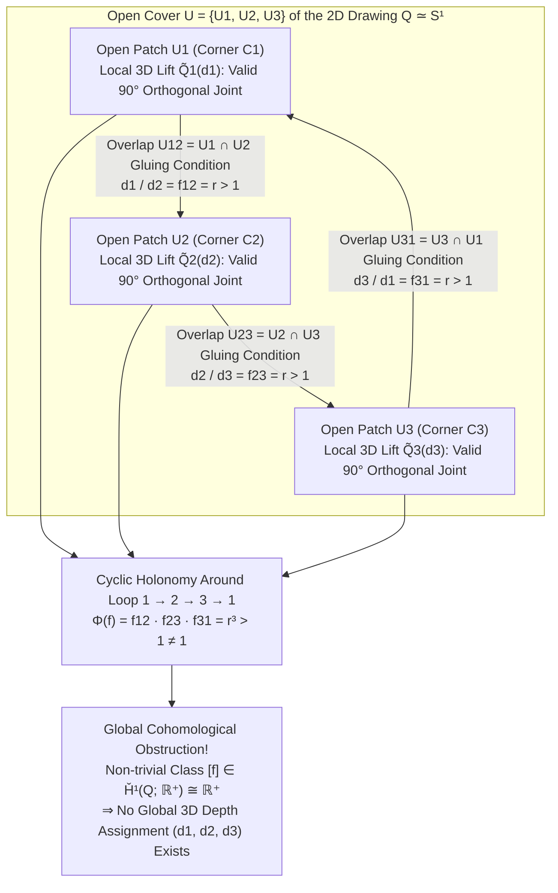
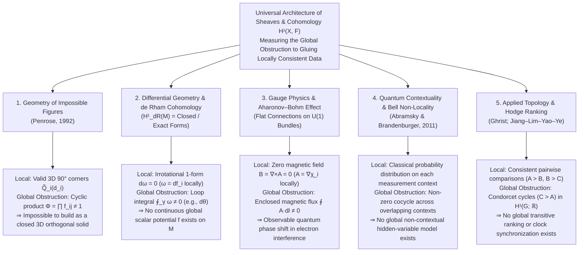

With nothing more than a sheet of paper, a pencil, and a straightedge, anyone can draw a <strong>Penrose Tribar (Penrose Triangle)</strong> in a matter of minutes. Three straight beams of square cross-section meet pairwise at right angles ($90^\circ$), forming what appears to be a rigid, closed triangular frame. Or consider the iconic rooftop cloister in <strong>M.C. Escher's</strong> 1960 lithograph *Ascending and Descending* (*Klimmen en dalen*): two lines of robed monks trudge tirelessly up and down a four-sided stone staircase, forever climbing in a closed loop yet returning seamlessly to the exact elevation from which they started.

When we gaze at such <strong>Impossible Figures (Impossible Objects)</strong>, our visual cortex experiences a peculiar kind of cognitive vertigo. Look solely at the top corner of the Penrose Tribar: it is an utterly ordinary, physically impeccable three-dimensional right-angle wooden joint that any carpenter could saw and glue together in ten minutes. Shift your gaze to the bottom-left corner: again, a completely valid, orthodox $90^\circ$ junction of two square beams. Inspect the bottom-right corner: not a single law of Euclidean geometry or classical mechanics is violated. Yet the instant your eyes trace the beams continuously around the closed perimeter, a global catastrophe erupts—<strong>a beam that is undeniably closer to your eye at one end seamlessly passes behind a beam that is farther away at the other end</strong>.

How is it possible that a human hand can effortlessly draw on a flat two-dimensional plane an object that is <strong>locally consistent everywhere, yet globally impossible to construct anywhere in three-dimensional Euclidean space $\mathbb{R}^3$</strong>? And how does modern mathematics formalize the exact mechanism by which <strong>local validity (Local Consistency)</strong> fails to assemble into <strong>global existence (Global Realizability)</strong>?

In 1992, the Nobel Prize-winning mathematical physicist <strong>Sir Roger Penrose</strong>—who, together with his father Lionel Penrose, had introduced the Penrose Tribar and the Endless Staircase to the scientific world in 1958—published a jewel of a paper titled *"On the Cohomology of Impossible Figures."* In it, Penrose demonstrated that impossible figures are far more than charming optical illusions or artistic sleights of hand. Mathematically, an impossible figure is a direct visual manifestation of a <strong>non-trivial cohomology class in the First Čech Cohomology Group $\check{H}^1(Q; \mathbb{R}^+)$</strong> of a sheaf defined over the drawing.

In this comprehensive exploration, we will trace the intellectual lineage of impossible figures from Oscar Reutersvärd, Lionel and Roger Penrose, and M.C. Escher; dissect the projective geometry of how perspective projection $\pi: \mathbb{R}^3 \to \mathbb{R}^2$ destroys depth fibers; examine the Huffman–Clowes line labeling calculus in computer vision; build Sir Roger Penrose's sheaf-theoretic and Čech-cohomological formulation from first principles; uncover the linear algebra behind Kokichi Sugihara's physical "Impossible Motion" sculptures; and reveal how the exact same local-to-global cohomological obstruction governs differential geometry, the Aharonov–Bohm effect in gauge physics, quantum contextuality, and discrete Hodge ranking theory.

---

## 1. Drawing the Unbuildable: Reutersvärd, the Penroses, and M.C. Escher

### 1.1 From Satirical Perspective to Pure Geometric Paradox

Deliberate subversions of perspective cues have appeared sporadically in Western art ever since linear perspective was codified in Renaissance Italy. A celebrated early example is William Hogarth's 1754 engraving *Satire on False Perspective*, commissioned as the frontispiece to Joshua Kirby's treatise on linear perspective. Hogarth crammed the rural scene with deliberate visual blunders: a fisherman in the foreground holds a rod whose line drops behind a boat in the middle distance; a woman leaning out of an upstairs window lights the pipe of a traveller standing on a distant hill; trees grow larger the farther away they recede.

Yet Hogarth's engraving relies on cluttered scene-level occlusions rather than a single, self-contained geometric solid. The true pioneer of pure, autonomous impossible objects was the Swedish artist <strong>Oscar Reutersvärd (1915–2002)</strong>.

In 1934, while sitting through a tedious Latin grammar class as an 18-year-old secondary school student in Stockholm, Reutersvärd doodled a six-pointed star in the margin of his textbook and surrounded it with small perspective cubes. To his astonishment, he realized he had arranged nine cubes into a triangular ring (*Opus 1*) in which each side of the triangle receded in depth relative to the next, creating a paradoxical spatial loop. Over the next six decades, Reutersvärd systematically explored over 2,500 impossible figures rendered in strict parallel (isometric or Japanese) projection—work honored in 1982 when the Swedish Post Office issued a famous series of postage stamps depicting his impossible constructions.

### 1.2 February 1958: Lionel and Roger Penrose's Landmark Paper

Independently of Reutersvärd, the mathematical and psychological essence of impossible figures was discovered and formalized in the mid-1950s by the British psychiatrist and geneticist <strong>Lionel S. Penrose (1898–1972)</strong> and his son <strong>Roger Penrose (1931–)</strong>, then a young researcher in algebraic geometry and mathematical physics at Cambridge.

The catalyst was the 1954 International Congress of Mathematicians (ICM) in Amsterdam. Then a 23-year-old graduate student, Roger Penrose wandered into an exhibition of prints by the Dutch graphic artist <strong>Maurits Cornelis Escher (1898–1972)</strong> at the Stedelijk Museum. Captivated by Escher's enigmatic spatial tessellations and paradoxical architecture, Roger returned to England determined to invent a brand-new geometric impossibility of his own.

Experimenting with perspective drawings of beams that overlapped one another cyclically, Roger distilled the configuration down to its irreducible minimum: three straight square-section bars meeting at right angles, which we now call the <strong>Penrose Tribar (or Penrose Triangle)</strong>. When he showed the drawing to his father Lionel, Lionel immediately responded by designing an architectural variation: a four-flight quadrilateral staircase that ascends continuously in a closed loop—the <strong>Penrose Endless Staircase</strong>.

In February 1958, father and son published a concise, three-page paper titled <strong>*"Impossible Objects: A Special Type of Visual Illusion"*</strong> in the *British Journal of Psychology* (Vol. 49, Part 1, pp. 31–33). Their opening diagnosis remains the clearest summary of the phenomenon ever written:

> *"Here each part of the structure is acceptable as representing a normal solid object, but the catastrophe occurs as a result of false connexions of the parts... As the eye pursues the lines of the figure, sudden changes in the interpretation of distance of the object from the observer are necessary."*
> — L. S. Penrose & R. Penrose (1958), *British Journal of Psychology*

### 1.3 The Dialogue with Escher and the Immortal Lithographs

Lionel and Roger Penrose mailed a reprint of their 1958 paper to M.C. Escher in Baarn, the Netherlands. Escher was electrified. Over the next three years, he translated the mathematical skeletons discovered by the Penroses into three of the most famous graphic works of the twentieth century:

1. <strong>*Belvedere* (May 1958)</strong>: Inspired by the reversible Necker cube, Escher drew a classical Italianate loggia whose stone pillars connect the front railing of the lower story to the rear railing of the upper story, twisting the building by $90^\circ$ in mid-air while its top roof remains tranquil and orthogonal. At the foot of the prison stairs sits a page boy holding a physical model of an impossible cuboid while staring at an instruction sheet on the ground containing a drawing of a doubly crossed cube.
2. <strong>*Ascending and Descending* (*Klimmen en dalen*, March 1960)</strong>: In January 1960, Escher wrote an enthusiastic letter to Lionel Penrose explaining that he had spent weeks embedding their continuous staircase into the roof of a sprawling monastery. Two sects of monks walk in opposite directions along the same four-flight staircase—one group condemned to climb forever upward, the other descending forever downward, on the exact same steps.
3. <strong>*Waterfall* (*Waterval*, October 1961)</strong>: Directly utilizing Roger Penrose's Tribar, Escher stacked three interlinked Penrose triangles vertically to support a brick aqueduct. Although the water channel appears to slope gently away from the viewer at every corner, traversing the three tribars brings the end of the channel directly above the waterwheel at its source, creating an apparent gravitational perpetual-motion waterfall.

This feedback loop—from mathematician to artist and back to mathematician—culminated in 1992 when Roger Penrose returned to the tribar to ask a deeply foundational question: <strong>What is the exact algebraic-topological invariant that distinguishes a drawing of a possible 3D object from a drawing of an impossible one?</strong>

---

## 2. The Geometry of Vision: How Perspective Projection $\pi: \mathbb{R}^3 \to \mathbb{R}^2$ Erases Depth

To formulate Penrose's cohomology theory rigorously, we must first examine the exact mathematical structure of the projection map that maps three-dimensional space onto a two-dimensional retinal or canvas plane.

### 2.1 Central Projection, Orthographic Projection, and Their 1D Fibers

Place the observer's single pinhole eye (optical center) at the origin $\mathbf{0} = (0, 0, 0) \in \mathbb{R}^3$. Any point $\mathbf{r} = (x, y, z) \in \mathbb{R}^3 \setminus \{\mathbf{0}\}$ in the forward half-space $z > 0$ projects along a straight ray from the origin onto an image plane $I = \{ (X, Y, f) \in \mathbb{R}^3 \} \cong \mathbb{R}^2$ at focal distance $f > 0$ via the <strong>Central (Perspective) Projection Map</strong>:

$$\pi: \mathbb{R}^3 \setminus \{\mathbf{0}\} \longrightarrow \mathbb{R}^2 \quad (\text{or } S^2), \qquad \pi(x, y, z) = \left( f \frac{x}{z}, \; f \frac{y}{z} \right) = (X, Y)$$

More intrinsically, viewing rays through the origin $\mathbf{0}$ form the direction sphere $S^2 = \{ \mathbf{u} \in \mathbb{R}^3 \mid \|\mathbf{u}\| = 1 \}$ (or the real projective plane $\mathbb{R}\mathbb{P}^2$), and $\pi(\mathbf{r}) = \mathbf{r} / \|\mathbf{r}\|$.

Now ask: given a single 2D image point $p = \pi(\mathbf{r}_0) \in S^2$, what is its <strong>preimage (fiber)</strong> $\pi^{-1}(p) \subset \mathbb{R}^3 \setminus \{\mathbf{0}\}$? Because scaling any vector $\mathbf{r}_0$ by a positive real number $\lambda \in \mathbb{R}^+ = (0, \infty)$ leaves its direction unchanged:

$$\pi(\lambda \mathbf{r}_0) = \frac{\lambda \mathbf{r}_0}{\|\lambda \mathbf{r}_0\|} = \frac{\lambda \mathbf{r}_0}{\lambda \|\mathbf{r}_0\|} = \pi(\mathbf{r}_0) = p$$

the fiber over every 2D image point $p$ is an open half-line (ray) parameterized by the multiplicative group of positive real numbers $\mathbb{R}^+ = ((0, \infty), \times)$:

$$\pi^{-1}(p) = \{ \lambda \mathbf{r}_0 \in \mathbb{R}^3 \setminus \{\mathbf{0}\} \mid \lambda \in \mathbb{R}^+ \}$$

This simple equation carries a profound geometric consequence: <strong>if you take any rigid 3D piece of an object $\tilde{Q}_i \subset \mathbb{R}^3 \setminus \{\mathbf{0}\}$ and apply a radial homothety $\mathbf{r} \mapsto \lambda \mathbf{r}$ centered at the observer's eye ($\lambda > 0$)—moving the piece $\lambda$ times farther away while scaling its physical dimensions by $\lambda$—its 2D perspective image $\pi(\lambda \tilde{Q}_i) = \pi(\tilde{Q}_i)$ on the retina remains 100% identical!</strong> Moreover, because $\mathbf{r} \mapsto \lambda \mathbf{r}$ is a similarity transformation of $\mathbb{R}^3$, all dihedral angles ($90^\circ$ corners) and aspect ratios of the 3D piece are strictly preserved.

What if the drawing is rendered in <strong>Orthographic or Isometric (Parallel) Projection</strong> $\pi_{\text{orth}}(x, y, z) = (x, y)$, representing the limit where the eye recedes to infinity along the $z$-axis? Then the fiber over $(x, y) \in \mathbb{R}^2$ is the vertical line $\{ (x, y, z + c) \mid c \in \mathbb{R} \}$, and the transformation of $\mathbb{R}^3$ that preserves both the 2D projection and all 3D angles/sizes of a rigid piece is a depth translation $z \mapsto z + c$ governed by the additive group $(\mathbb{R}, +)$. Since the natural logarithm and exponential maps

$$\ln: (\mathbb{R}^+, \times) \xrightarrow{\;\sim\;} (\mathbb{R}, +), \qquad \exp: (\mathbb{R}, +) \xrightarrow{\;\sim\;} (\mathbb{R}^+, \times)$$

define a canonical isomorphism of 1-dimensional Lie groups, perspective scaling ($\lambda \in \mathbb{R}^+$) and parallel depth shifting ($c = \ln \lambda \in \mathbb{R}$) are mathematically isomorphic.

### 2.2 Inverse Vision and the Huffman–Clowes Line Labeling Calculus

Because $\pi: \mathbb{R}^3 \setminus \{\mathbf{0}\} \to \mathbb{R}^2$ compresses a 3-dimensional world into a 2-dimensional image by collapsing a 1-dimensional fiber $\mathbb{R}^+$ over every point, reconstructing a 3D scene from a 2D line drawing is a massively underdetermined inverse problem. To solve it instantaneously, the human visual system imposes strong <strong>geometric regularity priors</strong>:

1. <strong>Planarity of Faces</strong>: Regions bounded by closed cycles of straight lines in 2D correspond to flat planar faces in 3D, not twisted ruled surfaces.
2. <strong>Orthogonality (Rectangularity Prior)</strong>: Three edges meeting at a vertex in 2D are interpreted wherever possible as three mutually perpendicular axes ($90^\circ$ trihedral corners) in 3D.
3. <strong>General Viewpoint Assumption</strong>: The camera is not positioned at a pathological "accidental viewpoint." If two lines meet at a vertex in the 2D image, their 3D counterparts actually touch in 3D space; if a line is unbroken in 2D, it represents a single continuous 3D edge.

In 1971, <strong>David A. Huffman</strong> and <strong>Max B. Clowes</strong> independently pioneered the formal analysis of polyhedral line drawings in artificial intelligence by introducing the <strong>Huffman–Clowes Line Labeling Calculus</strong>. In a line drawing of trihedral polyhedra (solids where exactly three planar faces meet at every vertex), every visible line segment must belong to one of four physical categories:

- <strong>$+$ (Convex Edge)</strong>: Both faces meeting at the edge are visible to the observer, and the dihedral angle toward the observer is convex (an outward ridge).
- <strong>$-$ (Concave Edge)</strong>: Both faces meeting at the edge are visible to the observer, forming an inward valley.
- <strong>$\rightarrow$ or $\leftarrow$ (Occluding Contour Edge)</strong>: Only one of the two faces meeting at the edge is visible; the other face is folded behind the solid out of sight. Moving along the direction of the arrow, the <strong>visible continuous surface lies to the right</strong>, while the region to the left belongs to a background surface located farther away across a discontinuous depth jump.

At any degree-2 or degree-3 junction in a general-viewpoint drawing (classified by geometry into <strong>L-junctions</strong>, <strong>Fork/Y-junctions</strong>, <strong>Arrow/W-junctions</strong>, and <strong>T-junctions</strong>), physical 3D geometry restricts the $4^3 = 64$ naive combinations of labels down to just <strong>16 physically realizable vertex configurations</strong> (6 L-types, 5 Fork-types, 3 Arrow-types, and 4 T-types, first cataloged following Adolfo Guzmán's work).

Here we encounter a remarkable fact that surprised early AI researchers: <strong>the Penrose Tribar completely passes the Huffman–Clowes line labeling test!</strong> Every single edge of the Penrose Tribar can be assigned a valid label ($+$, $-$, $\rightarrow$, or $\leftarrow$) such that every L-junction, Fork-junction, Arrow-junction, and T-junction in the drawing belongs to the catalog of physically valid 3D trihedral vertices!

Why does the Huffman–Clowes algorithm fail to detect the impossibility of the Penrose Tribar? Because combinatorial edge labels only check <strong>local topological compatibility of adjacent faces and edges</strong>. They have no mechanism to track <strong>continuous metric depth values ($d_i \in \mathbb{R}^+$) accumulated around a non-contractible topological cycle</strong>.

The table below contrasts the four mathematical levels of consistency in interpreting 2D line drawings as 3D objects:

| Level of Consistency | Mathematical Framework | Geometric Condition Checked | Result on the Penrose Tribar |
| :--- | :--- | :--- | :--- |
| <strong>Level 1: Local Junction Realizability</strong> | Trihedral Vertex Catalog (Guzmán, 1968) | Can each individual junction $v_i$ be realized in isolation as a 3D corner? | <strong>PASS</strong> (Every corner is a valid $90^\circ$ joint) |
| <strong>Level 2: Combinatorial Edge Labeling</strong> | Huffman–Clowes Calculus (1971) | Do valid edge labels ($+, -, \rightarrow, \leftarrow$) match compatibly along every edge? | <strong>PASS</strong> (Admits a globally consistent Huffman–Clowes labeling) |
| <strong>Level 3: Rigid Patch Gluing (Metric Closure)</strong> | <strong>Penrose's Sheaf Cohomology (1992)</strong> | Do the local depth scale factors $d_i$ of orthogonal corners satisfy $\prod f_{ij} = 1$ around every loop? | <strong>FAIL</strong> (Non-trivial cohomology class $[f] \in \check{H}^1(Q; \mathbb{R}^+) \neq 0$) |
| <strong>Level 4: General Planar Polyhedral Realizability</strong> | Sugihara's Linear Algebraic System (1986) | Dropping $90^\circ$ orthogonality, does the linear system $A\mathbf{w}=\mathbf{0}, B\mathbf{w}>\mathbf{0}$ admit a solution? | <strong>PASS</strong> (Buildable in 3D using skewed non-rectangular planes!) |

---

## 3. Local Consistency vs. Global Contradiction: Gluing Local 3D Lifts

Before writing down the formal cochain complexes of Čech cohomology, let us trace the exact geometric breakdown of the Penrose Tribar by decomposing the drawing into local patches and attempting to glue their 3D reconstructions together.

### 3.1 The Open Cover $\mathcal{U} = \{U_1, U_2, U_3\}$ and Local 3D Reconstructions

Let $Q \subset \mathbb{R}^2$ denote the 2D drawing of the Penrose Tribar. Topologically, $Q$ is a planar region with a single central hole—it is homotopy equivalent to the circle ($Q \simeq S^1$).

We cover $Q$ with three open sets $\mathcal{U} = \{U_1, U_2, U_3\}$, each containing one of the three right-angled corners $C_1, C_2, C_3$ together with the two straight beams extending from that corner past their midpoints:

- <strong>$U_1$</strong>: An open L-shaped neighborhood containing corner $C_1$ and most of Beam $12$ and Beam $31$.
- <strong>$U_2$</strong>: An open L-shaped neighborhood containing corner $C_2$ and most of Beam $23$ and Beam $12$.
- <strong>$U_3$</strong>: An open L-shaped neighborhood containing corner $C_3$ and most of Beam $31$ and Beam $23$.

Observe the topological structure of this open cover $\mathcal{U} = \{U_1, U_2, U_3\}$:

1. Each individual patch $U_i$ ($i \in \{1, 2, 3\}$) is <strong>simply connected (contractible)</strong>—it contains only a single corner and no closed loops.
2. Each pairwise intersection $U_{12} = U_1 \cap U_2$, $U_{23} = U_2 \cap U_3$, and $U_{31} = U_3 \cap U_1$ is a non-empty, contractible segment lying in the middle of one of the three straight beams.
3. The triple intersection is empty: $U_{123} = U_1 \cap U_2 \cap U_3 = \emptyset$.

In algebraic topology, a cover whose sets and all finite intersections are contractible is called a <strong>good open cover (or Leray cover)</strong>. The combinatorial skeleton of $\mathcal{U}$—its <strong>nerve $N(\mathcal{U})$</strong>, which has a vertex for each $U_i$ and an edge for each non-empty overlap $U_{ij}$—is a triangle graph $\partial \Delta^2 \cong S^1$, faithfully capturing the homotopy type of $Q$.

Now, restrict your visual attention solely to the open set $U_1$. Because $U_1$ depicts a single, unambiguous orthogonal corner of two square beams, we can construct a concrete, rigid 3D solid $\tilde{Q}_1^{\text{std}} \subset \mathbb{R}^3 \setminus \{\mathbf{0}\}$ whose perspective projection is $\pi(\tilde{Q}_1^{\text{std}}) = U_1$. By Section 2.1, the complete family of valid rigid 3D lifts over $U_1$ with the same orientation and retinal image is parameterized by a single positive scale/depth coordinate $d_1 \in \mathbb{R}^+$:

$$\tilde{Q}_1(d_1) = \{ d_1 \cdot \mathbf{r} \mid \mathbf{r} \in \tilde{Q}_1^{\text{std}} \}, \qquad d_1 \in \mathbb{R}^+ = (0, \infty)$$

In the exact same way, over $U_2$ and $U_3$ we choose standard reference models $\tilde{Q}_2^{\text{std}}$ and $\tilde{Q}_3^{\text{std}}$ (related to $\tilde{Q}_1^{\text{std}}$ by $120^\circ$ rotation around the viewing axis), so that their general 3D lifts are $\tilde{Q}_2(d_2) = d_2 \cdot \tilde{Q}_2^{\text{std}}$ and $\tilde{Q}_3(d_3) = d_3 \cdot \tilde{Q}_3^{\text{std}}$ for positive numbers $d_2, d_3 \in \mathbb{R}^+$.

### 3.2 Overlap Matching Ratios $f_{ij}$ and the Cyclic Breakdown

What happens when we try to glue $\tilde{Q}_1(d_1)$ and $\tilde{Q}_2(d_2)$ seamlessly over their overlap region $U_{12} = U_1 \cap U_2$ in the middle of Beam 12?

In the standard reference model $\tilde{Q}_1^{\text{std}}$, Beam 12 extends away from the viewer (or toward the viewer, depending on handedness) as we move from corner $C_1$ toward corner $C_2$. Consequently, over the overlap $U_{12}$, the cross-section of $\tilde{Q}_1^{\text{std}}$ lies at a greater radial distance from the eye than the corresponding cross-section of $\tilde{Q}_2^{\text{std}}$ by a fixed geometric ratio $r > 1$ determined by the foreshortening angle of the beam.

Therefore, for the scaled 3D piece $\tilde{Q}_1(d_1)$ and the scaled 3D piece $\tilde{Q}_2(d_2)$ to meet at the <strong>exact same 3D depth</strong> over $U_{12} = U_1 \cap U_2$, their scale factors $d_1$ and $d_2$ must satisfy a strict multiplicative transition condition:

$$\frac{d_1}{d_2} = f_{12} = r > 1$$

Because the Penrose Tribar possesses 3-fold rotational symmetry in the 2D image plane, the exact same geometric analysis applies to the overlap $U_{23} = U_2 \cap U_3$ along Beam 23 and the overlap $U_{31} = U_3 \cap U_1$ along Beam 31:

$$\frac{d_2}{d_3} = f_{23} = r > 1, \qquad \frac{d_3}{d_1} = f_{31} = r > 1$$

Can we find three positive real numbers $(d_1, d_2, d_3) \in (\mathbb{R}^+)^3$ that satisfy all three gluing equations simultaneously? Multiplying the three equations together around the closed loop $1 \to 2 \to 3 \to 1$ yields an immediate algebraic contradiction:

$$1 = \frac{d_1}{d_2} \cdot \frac{d_2}{d_3} \cdot \frac{d_3}{d_1} = f_{12} \cdot f_{23} \cdot f_{31} = r^3 > 1 \quad (\text{Contradiction!})$$

Figure 1 illustrates this local-to-global gluing architecture and the resulting cyclic holonomy obstruction.

---

## 4. Sir Roger Penrose's 1992 Formulation: Sheaves and Čech Cohomology of Impossible Figures

In his 1992 paper *"On the Cohomology of Impossible Figures"* (*Structural Topology*, No. 17, pp. 11–16; first presented in 1990 at the International Symposium on Structures in Mathematical Theories in San Sebastián), Sir Roger Penrose elevated the gluing argument of Section 3 into a crystalline application of <strong>Sheaf Theory (Théorie des Faisceaux)</strong> and <strong>Čech Cohomology</strong>.

While sheaves and cohomology are often introduced in graduate textbooks through layers of homological algebra, Penrose's impossible figures turn every abstract definition—presheaves, sheaves, cochains, coboundary operators, cocycles, coboundaries, and cohomology classes—into something you can literally see with your naked eye. Let us construct the entire apparatus step by step.

### 4.1 The Ambiguity Group $G$ and the Sheaf of Local 3D Interpretations $\mathcal{F}$

Let $Q \subset \mathbb{R}^2$ be the topological space occupied by a 2D line drawing. Suppose that locally, on sufficiently small connected open subsets $V \subset Q$, the drawing admits a rigid 3D geometric interpretation $\tilde{V} \subset \mathbb{R}^3 \setminus \{\mathbf{0}\}$ whose orientation is fixed by local perspective or orthogonality rules.

As established in Section 2.1, the freedom remaining in positioning the rigid 3D lift $\tilde{V}$ without altering its 2D projection $\pi(\tilde{V}) = V$ is governed by an abelian <strong>Ambiguity Group $G$</strong>:

- Under <strong>central (perspective) projection</strong>, $G = (\mathbb{R}^+, \times)$ acting by radial scaling $\mathbf{r} \mapsto \lambda \mathbf{r}$ ($\lambda > 0$).
- Under <strong>orthographic / isometric (parallel) projection</strong>, $G = (\mathbb{R}, +)$ acting by depth translation $z \mapsto z + c$ ($c \in \mathbb{R}$).

Following Penrose (1992), we work with the multiplicative group $G = (\mathbb{R}^+, \times)$ (taking logarithms $\ln: \mathbb{R}^+ \xrightarrow{\sim} \mathbb{R}$ converts all multiplicative formulas into additive ones).

We define the <strong>locally constant sheaf $\mathcal{F}$</strong> (with stalks isomorphic to $G = \mathbb{R}^+$) over the topological space $Q$:

- For any open subset $U \subset Q$, the set of <strong>sections $\mathcal{F}(U)$</strong> consists of locally constant assignments of a positive depth scale factor $d \in \mathbb{R}^+$ to the local 3D reconstruction over each connected component of $U$.
- Whenever $V \subset U$ is a smaller open subset, the <strong>restriction map $\operatorname{res}_{U,V}: \mathcal{F}(U) \to \mathcal{F}(V)$</strong> simply restricts the 3D position assignment from $U$ to $V$.

The defining property of a <strong>Sheaf</strong> is the <strong>Gluing Axiom</strong>: given an open cover $\{U_i\}$ of $Q$ and a family of local sections $s_i \in \mathcal{F}(U_i)$ that agree on every pairwise overlap ($\operatorname{res}_{U_i, U_i \cap U_j}(s_i) = \operatorname{res}_{U_j, U_i \cap U_j}(s_j)$), there exists a <strong>unique global section $s \in \mathcal{F}(Q)$</strong> whose restriction to each $U_i$ is $s_i$.

In an impossible figure, we begin with chosen reference 3D lifts $\tilde{Q}_i^{\text{std}}$ over each open set $U_i$ of a good cover $\mathcal{U} = \{U_1, \dots, U_n\}$. On each non-empty overlap $U_{ij} = U_i \cap U_j$, comparing the two reference lifts yields a relative depth ratio $f_{ij} \in \mathbb{R}^+$. To glue the pieces into a global 3D object, we must rescale each reference lift $\tilde{Q}_i^{\text{std}}$ by some positive number $d_i \in \mathbb{R}^+$ so that the rescaled pieces match across every overlap. Whether such a rescaling $\{d_i\}$ exists is precisely the question answered by the <strong>Čech cochain complex</strong>.

### 4.2 The Čech Cochain Complex: $C^0$, $C^1$, $C^2$, and the Coboundary Operator $\delta$

Let $\mathcal{U} = \{U_1, U_2, \dots, U_n\}$ be a good open cover of $Q$ such that each $U_i$ is unambiguously realizable as a rigid 3D piece. We define the sequence of abelian <strong>Čech cochain groups</strong> with coefficients in $G = (\mathbb{R}^+, \times)$:

#### (1) The Group of 0-Cochains $C^0(\mathcal{U}, \mathbb{R}^+)$
A <strong>0-cochain</strong> $d = (d_1, d_2, \dots, d_n) \in C^0(\mathcal{U}, \mathbb{R}^+)$ assigns a positive depth scaling factor $d_i \in \mathbb{R}^+$ to each open set $U_i \in \mathcal{U}$:

$$C^0(\mathcal{U}, \mathbb{R}^+) = \prod_{i=1}^n \mathbb{R}^+ = (\mathbb{R}^+)^n$$

Under componentwise multiplication $(d \cdot d')_i = d_i d'_i$, $C^0(\mathcal{U}, \mathbb{R}^+)$ is an abelian group.

#### (2) The Group of 1-Cochains $C^1(\mathcal{U}, \mathbb{R}^+)$
A <strong>1-cochain</strong> $f = \{f_{ij}\} \in C^1(\mathcal{U}, \mathbb{R}^+)$ assigns a positive transition ratio $f_{ij} \in \mathbb{R}^+$ to every ordered pair $(i, j)$ whose intersection $U_{ij} = U_i \cap U_j \neq \emptyset$ is non-empty, subject to the alternating (antisymmetry) relation:

$$f_{ji} = f_{ij}^{-1} = \frac{1}{f_{ij}}, \qquad f_{ii} = 1$$

Geometrically, $f_{ij}$ is the <strong>gluing ratio</strong> dictated by the 2D drawing on the overlap $U_i \cap U_j$: it tells us the ratio $d_i / d_j$ required for piece $\tilde{Q}_i(d_i)$ and piece $\tilde{Q}_j(d_j)$ to join without a depth discontinuity across $U_i \cap U_j$.

#### (3) The Group of 2-Cochains $C^2(\mathcal{U}, \mathbb{R}^+)$ and Coboundary Homomorphisms $\delta^p$
A <strong>2-cochain</strong> $g = \{g_{ijk}\} \in C^2(\mathcal{U}, \mathbb{R}^+)$ assigns a positive number $g_{ijk} \in \mathbb{R}^+$ to every non-empty triple overlap $U_{ijk} = U_i \cap U_j \cap U_k \neq \emptyset$.

These cochain groups are connected by the <strong>Čech coboundary operators</strong> $\delta^p: C^p(\mathcal{U}, \mathbb{R}^+) \to C^{p+1}(\mathcal{U}, \mathbb{R}^+)$:

$$C^0(\mathcal{U}, \mathbb{R}^+) \xrightarrow{\;\delta^0\;} C^1(\mathcal{U}, \mathbb{R}^+) \xrightarrow{\;\delta^1\;} C^2(\mathcal{U}, \mathbb{R}^+)$$

- <strong>The 0-th Coboundary Operator $\delta^0$</strong>: Maps a 0-cochain $d = (d_1, \dots, d_n) \in C^0(\mathcal{U}, \mathbb{R}^+)$ to the 1-cochain $\delta^0 d \in C^1(\mathcal{U}, \mathbb{R}^+)$ of pairwise depth ratios:
  $$(\delta^0 d)_{ij} = \frac{d_i}{d_j} \qquad \text{for each } U_i \cap U_j \neq \emptyset$$
- <strong>The 1-st Coboundary Operator $\delta^1$</strong>: Maps a 1-cochain $f = \{f_{ij}\} \in C^1(\mathcal{U}, \mathbb{R}^+)$ to the 2-cochain $\delta^1 f \in C^2(\mathcal{U}, \mathbb{R}^+)$ defined on each triple overlap $U_i \cap U_j \cap U_k \neq \emptyset$ by:
  $$(\delta^1 f)_{ijk} = f_{ij} \cdot f_{jk} \cdot f_{ki} = f_{ij} \cdot f_{jk} \cdot f_{ik}^{-1}$$

Notice what happens when we apply $\delta^1$ to the image of $\delta^0$: for any $d \in C^0(\mathcal{U}, \mathbb{R}^+)$,

$$(\delta^1(\delta^0 d))_{ijk} = \frac{d_i}{d_j} \cdot \frac{d_j}{d_k} \cdot \frac{d_k}{d_i} = 1$$

Thus, the fundamental identity of homological algebra holds identically:

$$\delta^1 \circ \delta^0 = 1 \qquad (\text{or } \delta^2 = 0 \text{ in additive notation})$$

### 4.3 1-Cocycles $Z^1$, 1-Coboundaries $B^1$, and the First Čech Cohomology Group $\check{H}^1$

From the cochain complex $C^0 \xrightarrow{\delta^0} C^1 \xrightarrow{\delta^1} C^2$, we extract two fundamental subgroups of $C^1(\mathcal{U}, \mathbb{R}^+)$:

1. <strong>The Group of 1-Cocycles $Z^1(\mathcal{U}, \mathbb{R}^+) = \ker \delta^1$</strong>:
   $$Z^1(\mathcal{U}, \mathbb{R}^+) = \{ f \in C^1(\mathcal{U}, \mathbb{R}^+) \mid (\delta^1 f)_{ijk} = f_{ij} f_{jk} f_{ki} = 1 \text{ on all } U_i \cap U_j \cap U_k \neq \emptyset \}$$
   A 1-cocycle represents a family of local gluing instructions that is <strong>locally self-consistent on all triple overlaps</strong>.
   For the 3-patch cover $\mathcal{U} = \{U_1, U_2, U_3\}$ of the Penrose Tribar, the triple intersection $U_1 \cap U_2 \cap U_3 = \emptyset$ is empty! Thus $C^2(\mathcal{U}, \mathbb{R}^+) = \{1\}$, which means the condition $\delta^1 f = 1$ is vacuously satisfied and <strong>every 1-cochain $f = (f_{12}, f_{23}, f_{31})$ is automatically a 1-cocycle</strong>:
   $$Z^1(\mathcal{U}, \mathbb{R}^+) = C^1(\mathcal{U}, \mathbb{R}^+) \cong (\mathbb{R}^+)^3$$

2. <strong>The Group of 1-Coboundaries $B^1(\mathcal{U}, \mathbb{R}^+) = \operatorname{Im} \delta^0$</strong>:
   $$B^1(\mathcal{U}, \mathbb{R}^+) = \left\{ f \in C^1(\mathcal{U}, \mathbb{R}^+) \;\middle|\; \exists d = (d_1, \dots, d_n) \in C^0(\mathcal{U}, \mathbb{R}^+) \text{ such that } f_{ij} = \frac{d_i}{d_j} \right\}$$
   A 1-cocycle $f$ belongs to the coboundary subgroup $B^1(\mathcal{U}, \mathbb{R}^+)$ <strong>if and only if there exists a globally consistent 3D depth assignment $d = (d_1, \dots, d_n)$ that realizes all gluing ratios $f_{ij} = d_i / d_j$ simultaneously</strong>!

Because $\delta^1 \circ \delta^0 = 1$, every 1-coboundary is a 1-cocycle: $B^1(\mathcal{U}, \mathbb{R}^+) \subset Z^1(\mathcal{U}, \mathbb{R}^+)$. We define the <strong>First Čech Cohomology Group</strong> as the quotient group:

$$\check{H}^1(\mathcal{U}, \mathbb{R}^+) = \frac{Z^1(\mathcal{U}, \mathbb{R}^+)}{B^1(\mathcal{U}, \mathbb{R}^+)} = \frac{\ker \delta^1}{\operatorname{Im} \delta^0}$$

By Leray's Theorem, because $\mathcal{U}$ is a good cover (all $U_i$ and $U_{ij}$ are contractible), $\check{H}^1(\mathcal{U}, \mathbb{R}^+)$ is canonically isomorphic to the sheaf cohomology group $\check{H}^1(Q; \mathbb{R}^+)$, an intrinsic topological invariant of the drawing $Q$ independent of how we slice it into open patches!

### 4.4 Computing the Holonomy Invariant $\Phi(f)$ and Penrose's Cohomology Theorem

Let us explicitly compute $\check{H}^1(Q; \mathbb{R}^+)$ for the Penrose Tribar $Q \simeq S^1$ covered by $\mathcal{U} = \{U_1, U_2, U_3\}$.

Suppose we change our arbitrary choice of standard reference models $\tilde{Q}_i^{\text{std}}$ by rescaling each $\tilde{Q}_i^{\text{std}}$ by some positive factor $c_i \in \mathbb{R}^+$. Then the gluing ratios $f_{ij}$ transform into an equivalent 1-cocycle $f'_{ij} = f_{ij} \cdot (c_i / c_j)$ belonging to the same cohomology class $[f] = [f'] \in \check{H}^1(Q; \mathbb{R}^+)$.

Notice that the cyclic product of the transition ratios around the closed loop $1 \to 2 \to 3 \to 1$ is completely invariant under any such rescaling:

$$\Phi(f') = f'_{12} \cdot f'_{23} \cdot f'_{31} = \left(f_{12}\frac{c_1}{c_2}\right)\left(f_{23}\frac{c_2}{c_3}\right)\left(f_{31}\frac{c_3}{c_1}\right) = f_{12} \cdot f_{23} \cdot f_{31} = \Phi(f)$$

Let us check the kernel of the surjective group homomorphism $\Phi: Z^1(\mathcal{U}, \mathbb{R}^+) \to \mathbb{R}^+$ defined by $\Phi(f_{12}, f_{23}, f_{31}) = f_{12} f_{23} f_{31}$:

- If $f \in B^1(\mathcal{U}, \mathbb{R}^+)$, then $f_{ij} = d_i / d_j$ for some $(d_1, d_2, d_3) \in (\mathbb{R}^+)^3$, so $\Phi(f) = (d_1/d_2)(d_2/d_3)(d_3/d_1) = 1$.
- Conversely, if $\Phi(f) = f_{12} f_{23} f_{31} = 1$, we can pick any $d_1 > 0$ (fixing the overall distance of the whole 3D object from the eye) and explicitly define:
  $$d_2 = \frac{d_1}{f_{12}}, \qquad d_3 = \frac{d_2}{f_{23}} = \frac{d_1}{f_{12} f_{23}} = d_1 f_{31}$$
  Then $d_1 / d_2 = f_{12}$, $d_2 / d_3 = f_{23}$, and $d_3 / d_1 = f_{31}$, proving that $f = \delta^0 d \in B^1(\mathcal{U}, \mathbb{R}^+)$!

Therefore, $\ker \Phi = B^1(\mathcal{U}, \mathbb{R}^+)$ exactly! By the First Isomorphism Theorem of group theory, $\Phi$ induces a group isomorphism:

$$\check{H}^1(Q; \mathbb{R}^+) = \frac{Z^1(\mathcal{U}, \mathbb{R}^+)}{B^1(\mathcal{U}, \mathbb{R}^+)} \xrightarrow[\;\sim\;]{\;\Phi\;} \mathbb{R}^+ \xrightarrow[\;\sim\;]{\;\ln\;} \mathbb{R}$$

In logarithmic (additive) coordinates $\Delta z_{ij} = \ln f_{ij} \in \mathbb{R}$, the cohomology class is simply the loop sum $\ln \Phi(f) = \ln f_{12} + \ln f_{23} + \ln f_{31} \in \mathbb{R}$.

For the <strong>Penrose Tribar</strong>, each beam steps in the same depth direction around the cycle ($f_{12} = r > 1$, $f_{23} = r > 1$, $f_{31} = r > 1$), giving:

$$\Phi(f) = f_{12} \cdot f_{23} \cdot f_{31} = r^3 > 1 \neq 1 \quad \Longleftrightarrow \quad \ln \Phi(f) = 3 \ln r > 0 \neq 0$$

This establishes <strong>Penrose's Fundamental Theorem of Impossible Figures (1992)</strong>:

> <strong>Theorem (Penrose, 1992):</strong> *A locally valid 2D drawing $Q$ with ambiguity group $G$ is globally realizable as a continuous 3D structure in $\mathbb{R}^3$ if and only if its induced cohomology class $[f] \in \check{H}^1(Q; G)$ is the trivial identity element. An impossible figure is a drawing whose local 3D interpretations define a non-trivial cohomology class $[f] \neq 1$ in $\check{H}^1(Q; G)$.*

Notice that even when a drawing IS globally realizable ($[f] = 1$), there remains a global 1-parameter freedom in placing the entire 3D object closer or farther from the eye. In sheaf cohomology, that global freedom is measured by the <strong>Zeroth Čech Cohomology Group $\check{H}^0(Q; \mathbb{R}^+) = \ker \delta^0$</strong>:

$$\check{H}^0(Q; \mathbb{R}^+) = \{ (d_1, d_2, d_3) \in (\mathbb{R}^+)^3 \mid d_1/d_2 = 1, \; d_2/d_3 = 1, \; d_3/d_1 = 1 \} = \{ (\lambda, \lambda, \lambda) \mid \lambda \in \mathbb{R}^+ \} \cong \mathbb{R}^+$$

Thus, $\check{H}^0(Q; G) \cong G$ captures the <strong>global rigid scaling freedom of a connected 3D object</strong>, while $\check{H}^1(Q; G)$ captures the <strong>topological obstruction to gluing local 3D pieces around closed loops</strong>!

### 4.5 Why Physical "Split Models" of the Penrose Tribar Work: Killing $\check{H}^1$ by Cutting the Loop

In East Perth, Australia, stands a famous giant sculpture of the Penrose Tribar; likewise, the psychologist Richard Gregory constructed a famous handheld wooden model that photographs as a seamless Penrose Tribar. How can such physical 3D sculptures exist in $\mathbb{R}^3$ if $\check{H}^1(Q; \mathbb{R}^+) \neq 0$ forbids them?

If you walk 10 degrees to the side of the East Perth sculpture, the secret is revealed immediately: <strong>in 3D space, the sculpture is NOT a closed loop!</strong> It is an open, 3-segment cantilevered hook $\tilde{Q}_{\text{cut}} \subset \mathbb{R}^3$ whose two free ends are separated along the line of sight by a huge depth gap of ratio $\Phi(f) = r^3$.

Mathematically, cutting the circle $Q \simeq S^1$ at one point turns the underlying topological space into a contractible interval $Q_{\text{cut}} \simeq [0, 1]$, deleting the overlap $U_{31} = U_3 \cap U_1$ from the nerve of the cover. Because $[0, 1]$ is contractible (simply connected), its first Čech cohomology group vanishes identically:

$$\check{H}^1(Q_{\text{cut}}; \mathbb{R}^+) = \check{H}^1([0, 1]; \mathbb{R}^+) = \{1\}$$

With no closed loops in $Q_{\text{cut}}$, the cohomological obstruction vanishes and the open 3D solid $\tilde{Q}_{\text{cut}}$ is 100% buildable! Then, when a viewer stands at the <strong>unique accidental viewpoint</strong> where the near open end and the far open end lie on the exact same optical ray $\pi^{-1}(p)$, the projection map $\pi: \mathbb{R}^3 \to \mathbb{R}^2$ glues the two endpoints back together in the 2D image ($Q = \pi(\tilde{Q}_{\text{cut}}) \simeq S^1$), tricking the brain's General Viewpoint Assumption into perceiving a closed topological circle with non-zero cohomology $\check{H}^1(Q; \mathbb{R}^+) \neq 0$!

---

## 5. Higher Betti Numbers, Attneave's Triangle, and Kokichi Sugihara's "Impossible Motion" Sculptures

### 5.1 Multiply-Connected Impossible Figures and the First Betti Number $b_1$

What happens when an impossible figure contains multiple interconnected loops, as in M.C. Escher's *Waterfall* or a lattice of linked Penrose tribars?

Suppose the 2D figure $Q \subset \mathbb{R}^2$ is a connected planar region with $b_1$ holes—meaning its <strong>First Betti Number</strong> is $b_1 = \operatorname{rank} H_1(Q; \mathbb{Z})$, and $Q$ is homotopy equivalent to a wedge sum (bouquet) of $b_1$ circles, $Q \simeq \bigvee_{k=1}^{b_1} S^1$. By the Universal Coefficient Theorem for cohomology, the First Čech Cohomology Group with coefficients in the abelian group $G = \mathbb{R}^+$ is naturally isomorphic to the group of homomorphisms from the first homology group $H_1(Q; \mathbb{Z}) \cong \mathbb{Z}^{b_1}$ into $\mathbb{R}^+$:

$$\check{H}^1(Q; \mathbb{R}^+) \cong \operatorname{Hom}(H_1(Q; \mathbb{Z}), \mathbb{R}^+) \cong (\mathbb{R}^+)^{b_1} \cong \mathbb{R}^{b_1}$$

Concretely, each independent fundamental loop $\gamma_k \in H_1(Q; \mathbb{Z})$ ($k = 1, \dots, b_1$) in the drawing possesses its own independent cyclic holonomy invariant $\Phi(\gamma_k) = \prod_{(i,j)\in\gamma_k} f_{ij} \in \mathbb{R}^+$. In Escher's *Waterfall*, three stacked tribars form $b_1 = 3$ coupled cycles sharing horizontal struts; the cohomology class $[f] \in \check{H}^1(Q; \mathbb{R}^+) \cong \mathbb{R}^3$ has non-zero components across all three cycles, compounding the depth discrepancy so that the bottom of the waterfall reconnects to the top of the mill!

Furthermore, in the second half of his 1992 paper, Penrose analyzed figures like <strong>Fred Attneave's Triangle</strong> and the <strong>Impossible Trident (Blivet / Devil's Tuning Fork)</strong>, where individual patches do not have fixed 3D orientations known in advance. When a local patch $U_i$ is only constrained to be a planar or polyhedral relief of unknown slant, its ambiguity group $G$ enlarges from the 1-parameter scaling group $\mathbb{R}^+$ to the <strong>3-parameter or 4-parameter Bas-Relief Affine Transformation Group $G_{\text{aff}}$</strong> (incorporating depth scaling plus two tilt gradients $(p, q) = (\partial z/\partial x, \partial z/\partial y)$). Even in this generalized setting, the obstruction to global 3D realizability resides in the cohomology set $\check{H}^1(Q; G_{\text{aff}})$.

### 5.2 Kokichi Sugihara's Continuous 3D "Impossible Motion" Sculptures

At this point, a natural question arises: <strong>Is cutting the loop (leaving a hidden depth gap) the ONLY way to build a physical 3D object that projects to the Penrose Tribar or the Endless Staircase?</strong>

Remarkably, the answer is <strong>NO</strong>! Starting in the 1980s and culminating in his world-famous winners of the *Best Illusion of the Year Contest* (2010, 2013, 2015, 2016), the Japanese mathematical engineer <strong>Kokichi Sugihara (杉原厚吉, Meiji University / University of Tokyo)</strong> discovered how to construct <strong>completely continuous, unbroken, gap-free 3D solids</strong> that look identical to impossible figures from a specific viewpoint—and on which wooden balls appear to roll <strong>uphill against gravity</strong>!

How did Sugihara bypass Penrose's cohomological obstruction $\check{H}^1(Q; \mathbb{R}^+) \neq 0$ without cutting the loop? By exploiting the crucial distinction between <strong>Level 3 (Orthogonal Rigid Gluing)</strong> and <strong>Level 4 (General Planar Polyhedral Realizability)</strong> in his seminal treatise *Machine Interpretation of Line Drawings* (MIT Press, 1986).

Let a 2D line drawing have $n_v$ vertices with fixed 2D image coordinates $(x_k, y_k)$ and unknown depths $z_k$ ($k = 1, \dots, n_v$), and $n_f$ planar faces $F_m$ described in 3D by the plane equations:

$$a_m x + b_m y + z + c_m = 0 \qquad (m = 1, \dots, n_f)$$

Collect all unknown 3D depths and plane parameters into a single state vector:

$$\mathbf{w} = (z_1, \dots, z_{n_v}, \; a_1, b_1, c_1, \dots, a_{n_f}, b_{n_f}, c_{n_f})^T \in \mathbb{R}^{n_v + 3n_f}$$

1. <strong>Planar Incidence Equations ($A \mathbf{w} = \mathbf{0}$)</strong>: Whenever vertex $v_k$ lies on face $F_m$, its coordinates satisfy the linear equation $x_k a_m + y_k b_m + z_k + c_m = 0$. Stacking these across all vertex-face incidences yields a homogeneous linear system:
   $$A \mathbf{w} = \mathbf{0}$$
2. <strong>Relative Depth & Convexity Inequalities ($B \mathbf{w} > \mathbf{0}$)</strong>: Every convex ($+$), concave ($-$), or occluding ($\rightarrow$) edge label imposes a strict linear inequality between the depths of adjacent or occluded vertices and faces:
   $$B \mathbf{w} > \mathbf{0}$$

Sugihara proved a foundational theorem: <strong>A 2D line drawing is realizable as a genuine, unbroken 3D polyhedron bounded by flat planar faces if and only if the linear programming system $A \mathbf{w} = \mathbf{0}, \; B \mathbf{w} > \mathbf{0}$ admits a feasible solution $\mathbf{w}^*$.</strong>

When Sugihara ran this linear feasibility test on the Penrose Tribar and the Endless Staircase (after subtly resolving a single vertex alignment or allowing non-rectangular faces), he discovered that <strong>$A \mathbf{w} = \mathbf{0}, \; B \mathbf{w} > \mathbf{0}$ DOES possess valid, continuous 3D solutions $\mathbf{w}^*$!</strong>

Why then does the human brain judge the figure impossible? Because the human visual cortex automatically appends an extra system of <strong>Orthogonality / Rectangularity Equations</strong>:

$$C_{\text{rect}} \mathbf{w} = \mathbf{0}$$

which demand that all corners meet at $90^\circ$ right angles and all vertical posts be parallel to gravity.

- <strong>The Brain's Overconstrained System</strong>:
  $$A \mathbf{w} = \mathbf{0}, \quad B \mathbf{w} > \mathbf{0}, \quad C_{\text{rect}} \mathbf{w} = \mathbf{0} \quad \Longrightarrow \quad \text{Infeasible! (Penrose Cohomology } \check{H}^1(Q; \mathbb{R}^+) \neq 0\text{)}$$
- <strong>Sugihara's Relaxed Polyhedral System</strong>:
  $$A \mathbf{w} = \mathbf{0}, \quad B \mathbf{w} > \mathbf{0} \quad (\text{dropping } C_{\text{rect}} \mathbf{w} = \mathbf{0}) \quad \Longrightarrow \quad \text{Feasible 3D Solid } \mathbf{w}^* \text{ Exists!}$$

In Sugihara's physical sculptures, the actual 3D faces are <strong>non-rectangular skewed trapezoids and parallelograms</strong>, and the supporting columns are <strong>tilted at sharp angles</strong>. Viewed from the designated camera position, this skewed 3D solid produces the *exact same* 2D retinal projection $A \mathbf{w}^* = \mathbf{0}$ as an impossible orthogonal structure. Because the human brain stubbornly refuses to give up its rectangularity prior $C_{\text{rect}} \mathbf{w} = \mathbf{0}$, it perceives a physical ramp that actually slopes <strong>downward</strong> in 3D space as sloping <strong>upward</strong>! When a wooden ball is placed on the ramp, ordinary gravity pulls it downhill—which the viewer's brain experiences as an astonishing, gravity-defying ascent!

---

## 6. The Universal Paradigm of Sheaves and Cohomology Across Science

What makes Sir Roger Penrose's 1992 analysis of impossible figures an immortal classic of mathematical exposition is that it illuminates the deepest unifying concept of twentieth- and twenty-first-century mathematics: <strong>Sheaf Cohomology as the universal calculus of local-to-global obstructions</strong>.

Invented by the French mathematician <strong>Jean Leray</strong> in the 1940s (remarkably, while lecturing on algebraic topology in a German prisoner-of-war camp, Oflag XVII-A) and developed into the bedrock of algebraic geometry and complex analysis by <strong>Henri Cartan</strong>, <strong>Jean-Pierre Serre</strong>, and <strong>Alexander Grothendieck</strong>, sheaf theory always asks the same two-stage question:

1. <strong>Local Stage (Sections of a Sheaf $\mathcal{F}$)</strong>: Can we solve our problem locally on small open neighborhoods $U_i \subset X$?
2. <strong>Global Stage (Cohomology Group $H^k(X, \mathcal{F})$)</strong>: Given local solutions $s_i \in \mathcal{F}(U_i)$ that are compatible on overlaps $U_i \cap U_j$, can we glue them into a global solution $s \in \mathcal{F}(X)$ over the entire space $X$? Whenever $H^1(X, \mathcal{F}) \neq 0$, a topological obstruction prevents global gluing!

Figure 2 illustrates how this exact mathematical blueprint governs five landmark domains across geometry, physics, quantum mechanics, and computer science.

Let us examine each of these profound parallels in detail.

### 6.1 Differential Geometry and de Rham Cohomology $H^1_{\text{dR}}(M)$: The Continuous Escher Staircase

Consider the punctured plane $M = \mathbb{R}^2 \setminus \{(0, 0)\} \simeq S^1$ and the smooth differential 1-form (representing a planar vector field $\mathbf{F} = \left(\frac{-y}{x^2+y^2}, \frac{x}{x^2+y^2}\right)$):

$$\omega = \frac{-y\,dx + x\,dy}{x^2 + y^2}$$

In polar coordinates $(r, \theta)$, $\omega$ is simply the exterior derivative of the polar angle, $\omega = d\theta$.

1. <strong>Local Consistency ($d\omega = 0$, Locally Exact)</strong>:
   At every point $(x, y) \in M$, computing the exterior derivative (or 2D curl) yields $d\omega = \left(\frac{\partial}{\partial x}\frac{x}{x^2+y^2} - \frac{\partial}{\partial y}\frac{-y}{x^2+y^2}\right) dx \wedge dy = 0$. By the Poincaré Lemma, on every simply connected open patch $U_i \subset M$, $\omega|_{U_i} = d\theta_i$ is the exact gradient of a smooth <strong>local height (potential) function $\theta_i: U_i \to \mathbb{R}$</strong>. Locally, walking in the direction of $\omega$ is simply walking steadily uphill on a well-defined slope $z = \theta_i(x, y)$!
2. <strong>Global Contradiction ($\omega \neq df$ Globally)</strong>:
   Does there exist a single smooth global height function $f: M \to \mathbb{R}$ over the entire punctured plane such that $\omega = df$ everywhere? Integrate $\omega$ around the closed unit circle $\gamma = S^1$ enclosing the puncture at the origin:
   $$\oint_\gamma \omega = \int_0^{2\pi} d\theta = 2\pi \neq 0$$
   If a global potential $f: M \to \mathbb{R}$ existed, the Fundamental Theorem of Calculus for line integrals would force $\oint_\gamma df = f(\gamma(2\pi)) - f(\gamma(0)) = 0$.

Thus, <strong>the differential 1-form $\omega = d\theta$ on $\mathbb{R}^2 \setminus \{(0,0)\}$ is literally the continuous differential-geometric incarnation of Escher's Endless Staircase!</strong> Locally, every patch $U_i$ has a consistent height function $\theta_i$; on overlaps $U_i \cap U_j$, two local height branches differ by a constant $c_{ij} = \theta_i - \theta_j$; yet traversing the closed loop around the central hole accumulates a net height mismatch of $\sum c_{ij} = 2\pi \neq 0$. By <strong>de Rham's Theorem</strong>, the first de Rham cohomology group of closed 1-forms modulo exact 1-forms is canonically isomorphic to the first Čech cohomology group:

$$H^1_{\text{dR}}(M) = \frac{\ker(d: \Omega^1(M) \to \Omega^2(M))}{\operatorname{Im}(d: \Omega^0(M) \to \Omega^1(M))} \cong \check{H}^1(M; \mathbb{R}) \cong \mathbb{R}$$

### 6.2 Gauge Theory and the Aharonov–Bohm Effect in Quantum Mechanics

In 1959, Yakir Aharonov and David Bohm discovered one of the deepest phenomena in quantum physics. Imagine an infinitely long cylindrical solenoid carrying an internal magnetic flux $\Phi_B$, while in the exterior region $M = \mathbb{R}^3 \setminus (\text{solenoid}) \simeq S^1$, the <strong>magnetic field vanishes identically everywhere ($\mathbf{B} = \nabla \times \mathbf{A} = \mathbf{0}$)</strong>.

An electron beam is split into two paths that travel entirely inside the field-free region $M$ around opposite sides of the solenoid before recombining at a detector screen.

- <strong>Local Triviality</strong>: Inside any simply connected patch $U_i \subset M$ outside the solenoid, because $\mathbf{B} = \nabla \times \mathbf{A} = \mathbf{0}$, the electromagnetic vector potential $\mathbf{A}$ is a pure gauge gradient $\mathbf{A}|_{U_i} = \nabla \chi_i$, which can be transformed to zero by a local $U(1)$ gauge transformation $\psi_i \mapsto \exp\left(-\frac{ie}{\hbar}\chi_i\right)\psi_i$. Locally, the electron experiences zero Lorentz force!
- <strong>Global Cohomological Phase</strong>: On each overlap $U_i \cap U_j$, the local gauge potentials are related by a transition function $g_{ij} = \exp\left(\frac{ie}{\hbar}(\chi_i - \chi_j)\right) \in U(1)$. Multiplying these transition functions around the closed loop encircling the solenoid yields a non-trivial $U(1)$ Čech cohomology invariant (the <strong>Wilson Loop / Holonomy</strong>):
  $$\Phi_{\text{AB}} = \prod_{\text{cycle}} g_{ij} = \exp\left( \frac{ie}{\hbar} \oint_\gamma \mathbf{A} \cdot d\mathbf{l} \right) = \exp\left( \frac{ie \Phi_B}{\hbar} \right) \in \check{H}^1(M; U(1)) \cong U(1)$$

Just as our visual cortex detects the non-trivial cohomology class $[f] \in \check{H}^1(Q; \mathbb{R}^+)$ when tracing around the central hole of the Penrose Tribar, the quantum electron detects the non-trivial cohomology class $\Phi_{\text{AB}} \in \check{H}^1(M; U(1))$ when its wavefunction wraps around the inaccessible magnetic flux tube!

### 6.3 Quantum Contextuality and Bell's Theorem: The Abramsky–Brandenburger Sheaf Framework

Perhaps the most breathtaking modern application of Penrose's impossible-figure paradigm appeared in 2011, when computer scientists <strong>Samson Abramsky</strong> and <strong>Adam Brandenburger</strong> published *"The Sheaf-Theoretic Structure of Non-Locality and Contextuality"* (*New Journal of Physics*, 13, 113036), followed by cohomological extensions with Shane Mansfield and Rui Soares Barbosa.

In quantum mechanics, let $X$ be a finite set of physical observables (measurements), and let $\mathcal{U} = \{U_1, U_2, \dots, U_n\}$ be the cover of $X$ by <strong>measurement contexts</strong>—subsets $U_i \subset X$ of mutually commuting observables that can be measured simultaneously in a single experiment.

- <strong>Local Consistency (No-Signaling / Local Classicality)</strong>: Over each individual context $U_i$, quantum mechanics predicts a perfectly valid classical joint probability distribution $e_i \in \mathcal{E}(U_i)$ over measurement outcomes. Furthermore, on every overlap $U_i \cap U_j$ between two contexts sharing common observables, their marginal probability distributions agree completely ($\operatorname{res}_{U_i, U_i \cap U_j}(e_i) = \operatorname{res}_{U_j, U_i \cap U_j}(e_j)$).
- <strong>Global Contradiction (Quantum Contextuality / Bell Non-Locality)</strong>: A <strong>non-contextual hidden-variable model</strong> (classical realism) demands the existence of a <strong>global section $d \in \mathcal{E}(X)$</strong>—a single global joint probability distribution over all observables in $X$ simultaneously, whose restriction to each context $U_i$ reproduces the empirical quantum probabilities $e_i$.

Abramsky and his collaborators proved that in famous quantum paradoxes—such as <strong>Bell's CHSH inequality</strong>, <strong>Hardy's Paradox</strong>, <strong>GHZ states</strong>, and the <strong>Kochen–Specker Theorem</strong>—the obstructions to constructing a global hidden-variable assignment are rigorously captured by <strong>non-vanishing Čech cohomology classes in $\check{H}^1(\mathcal{U}, \mathcal{F}) \neq 0$</strong>! In fact, in their papers on Hardy's paradox and Kochen–Specker configurations, they explicitly draw the support tables of quantum probabilities as a <strong>Penrose Impossible Triangle</strong>: locally, along each side of the measurement cycle, deterministic outcome assignments exist and agree on overlaps, yet following them around the closed cycle of contexts leads to a logical contradiction!

### 6.4 Applied Sheaf Theory, Sensor Synchronization, and HodgeRank in Data Science

Finally, in contemporary computer science and applied topology (pioneered by <strong>Robert Ghrist</strong> in *Elementary Applied Topology* and by <strong>Jiang, Lim, Yao, and Ye</strong> in *Statistical Ranking and Combinatorial Hodge Theory*), Čech cohomology on graphs resolves fundamental problems in distributed systems and machine learning:

- <strong>Clock Synchronization & Sensor Networks</strong>: Autonomous robots or wireless sensors measure relative time offsets or relative spatial bearings $f_{ij}$ between neighboring nodes $(i, j) \in E$. Locally, every pair is consistent ($f_{ji} = -f_{ij}$), yet noise or adversarial spoofing creates non-zero cyclic sums $\sum_{(i,j)\in\gamma} f_{ij} \neq 0$ in $\check{H}^1(G; \mathbb{R})$ that prevent global synchronization.
- <strong>Condorcet Cycles in Ranking & Social Choice (HodgeRank)</strong>: When aggregating pairwise preferences across voters or tournament matches (e.g., Player A beats Player B, Player B beats Player C, Player C beats Player A), a globally consistent rating vector $d = (d_1, \dots, d_n) \in C^0(G, \mathbb{R})$ exists if and only if the pairwise edge flow $f_{ij}$ is a coboundary $f = \delta^0 d$. By the <strong>Discrete Hodge Decomposition Theorem</strong>, any pairwise comparison dataset decomposes orthogonally into three parts:
  $$C^1(G, \mathbb{R}) = \underbrace{\operatorname{Im}(\delta^0)}_{\text{Global Gradient Rankings}} \oplus \underbrace{\operatorname{Im}((\delta^1)^*)}_{\text{Local Triangle Curl}} \oplus \underbrace{\ker(\Delta_1) \cong \check{H}^1(G; \mathbb{R})}_{\text{Global Harmonic / Condorcet Cycles}}$$
  Thus, persistent "Rock-Paper-Scissors" intransitivities across a global tournament network are literally non-trivial cohomology classes in $\check{H}^1(G; \mathbb{R})$!

The table below synthesizes this grand unification across all five disciplines:

| Scientific Domain | Base Space $X$ & Open Cover $\{U_i\}$ | Local Section (Local Solution) $s_i \in \mathcal{F}(U_i)$ | Overlap Gluing Condition on $U_i \cap U_j$ | Global Realizability ($\check{H}^1 = 0$) | Meaning of Non-Zero Cohomology $\check{H}^1(X, \mathcal{F}) \neq 0$ |
| :--- | :--- | :--- | :--- | :--- | :--- |
| <strong>Geometry of Impossible Figures</strong> (Penrose, 1992) | 2D drawing $Q \simeq S^1$ & corner patches $\{U_i\}$ | Local 3D right-angle corner depth scale $d_i \in \mathbb{R}^+$ | Beam overlap depth ratio $f_{ij} = d_i / d_j$ | Cyclic product $\Phi = \prod f_{ij} = 1$ (Buildable 3D solid) | <strong>Penrose Tribar / Escher Staircase</strong> (Unbuildable as a closed orthogonal 3D solid) |
| <strong>Differential Geometry</strong> (de Rham Cohomology) | Smooth manifold $M$ (e.g., $\mathbb{R}^2 \setminus \{0\}$) | Local scalar potential $f_i$ for closed 1-form $\omega = df_i$ ($d\omega=0$) | Potential shift $f_i - f_j = c_{ij}$ | Zero loop circulation $\oint_\gamma \omega = 0$ (Exact form $\omega = df$) | <strong>Angle 1-form $d\theta$ / Vortex Circulation</strong> (No single-valued global height potential) |
| <strong>Gauge Physics</strong> (Aharonov–Bohm, 1959) | Field-free region $M \simeq S^1$ outside solenoid | Local pure-gauge phase $\chi_i$ where $\mathbf{A} = \nabla \chi_i$ ($\mathbf{B}=\mathbf{0}$) | $U(1)$ gauge transition $g_{ij} = e^{ie(\chi_i-\chi_j)/\hbar}$ | Trivial Wilson loop $\exp(\frac{ie}{\hbar}\oint \mathbf{A}\cdot d\mathbf{l}) = 1$ | <strong>Aharonov–Bohm Quantum Phase Shift</strong> (Interference shift in zero magnetic field) |
| <strong>Quantum Foundations</strong> (Abramsky et al., 2011) | Observable set $X$ & commuting contexts $\{U_i\}$ | Local classical probability distribution $e_i \in \mathcal{E}(U_i)$ | Agreement of marginal probabilities (No-Signaling) | Existence of a global non-contextual hidden-variable model | <strong>Quantum Contextuality & Bell Non-Locality</strong> (Failure of classical local realism) |
| <strong>Applied Topology & ML</strong> (Ghrist; HodgeRank) | Comparison graph $G = (V, E)$ | Node potential / global skill rating $d_i \in \mathbb{R}$ | Pairwise score difference $f_{ij} = d_i - d_j$ | Zero cyclic sum around all graph cycles (Transitive total order) | <strong>Condorcet Cycles (Rock-Paper-Scissors)</strong> & unsynchronizable sensor loops |

---

## 7. Conclusion: Seeing Cohomology with the Naked Eye

Why do M.C. Escher's endlessly marching monks and Roger Penrose's impossible triangle continue to entrance mathematicians, artists, and cognitive scientists more than sixty-five years after their creation? Because they are not products of sloppy perception or visual incompetence.

Quite the opposite: when you look at the Penrose Tribar, your visual cortex is performing a triumph of local geometric inference. Over every open neighborhood $U_i$, your brain accurately solves the inverse projective problem for $\pi: \mathbb{R}^3 \to \mathbb{R}^2$ under the orthogonality prior, constructing a valid local section of the sheaf of 3D interpretations. Yet because central projection collapses the 1-dimensional depth fiber $G = \mathbb{R}^+$, a draughtsman on a 2D sheet of paper is free to prescribe transition ratios $f_{ij} \in \mathbb{R}^+$ around a non-contractible loop $S^1$ that violate the global coboundary condition $\Phi(f) = f_{12} f_{23} f_{31} = 1$.

That sudden jolt of cognitive dissonance you feel as your eyes complete a circuit around the Penrose Tribar or Escher's staircase is nothing less than <strong>your visual cortex computing a parallel transport holonomy around a closed cycle and detecting a non-zero cohomology class $[f] \neq 1$ in the First Čech Cohomology Group $\check{H}^1(Q; \mathbb{R}^+)$</strong>. In three simple beams drawn on a flat page, art and algebraic topology become one—allowing human beings to literally see the cohomology of space with the naked eye.

---

## References & Primary Literature

1. <strong>Penrose, L. S., & Penrose, R.</strong> (1958). "Impossible Objects: A Special Type of Visual Illusion." *British Journal of Psychology*, 49(1), 31–33.
2. <strong>Penrose, R.</strong> (1992). "On the Cohomology of Impossible Figures." *Structural Topology / Topologie Structurale*, 17, 11–16. (Originally presented at the Symposium on Structures in Mathematical Theories, San Sebastián, 1990).
3. <strong>Huffman, D. A.</strong> (1971). "Impossible Objects as Nonsense Sentences." *Machine Intelligence*, 6, 295–323.
4. <strong>Clowes, M. B.</strong> (1971). "On Seeing Things." *Artificial Intelligence*, 2(1), 79–116.
5. <strong>Sugihara, K.</strong> (1986). *Machine Interpretation of Line Drawings*. MIT Press.
6. <strong>Sugihara, K.</strong> (2014). "Design of Solids for Antigravity Motion Illusion." *Computational Geometry*, 47(6), 675–682.
7. <strong>Abramsky, S., & Brandenburger, A.</strong> (2011). "The Sheaf-Theoretic Structure of Non-Locality and Contextuality." *New Journal of Physics*, 13(11), 113036.
8. <strong>Abramsky, S., Mansfield, S., & Barbosa, R. S.</strong> (2012). "The Cohomology of Non-Locality and Contextuality." *Electronic Proceedings in Theoretical Computer Science (EPTCS)*, 95, 1–14.
9. <strong>Ghrist, R.</strong> (2014). *Elementary Applied Topology*. Createspace.
10. <strong>Jiang, X., Lim, L.-H., Yao, Y., & Ye, Y.</strong> (2011). "Statistical Ranking and Combinatorial Hodge Theory." *Mathematical Programming*, 127(1), 203–244.
