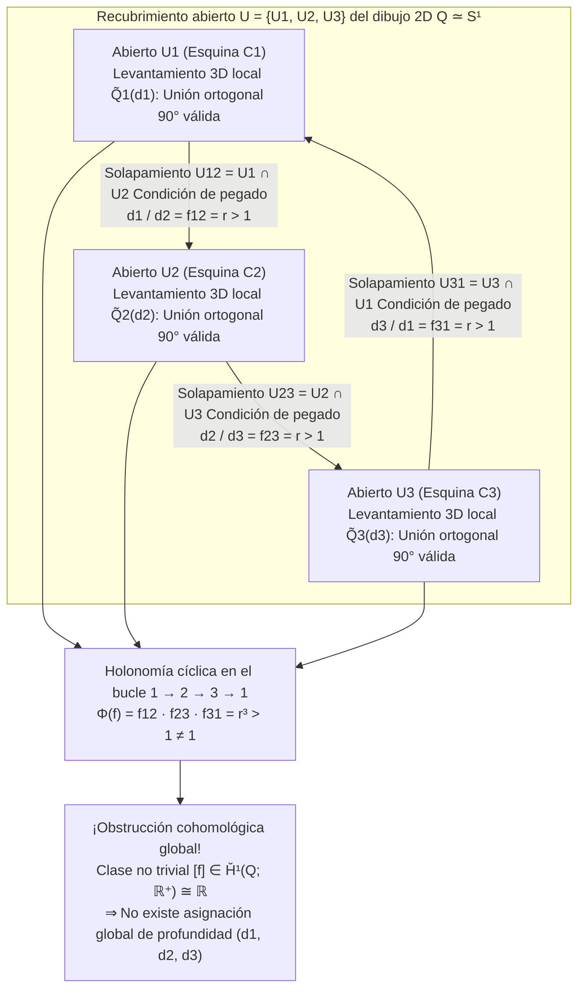
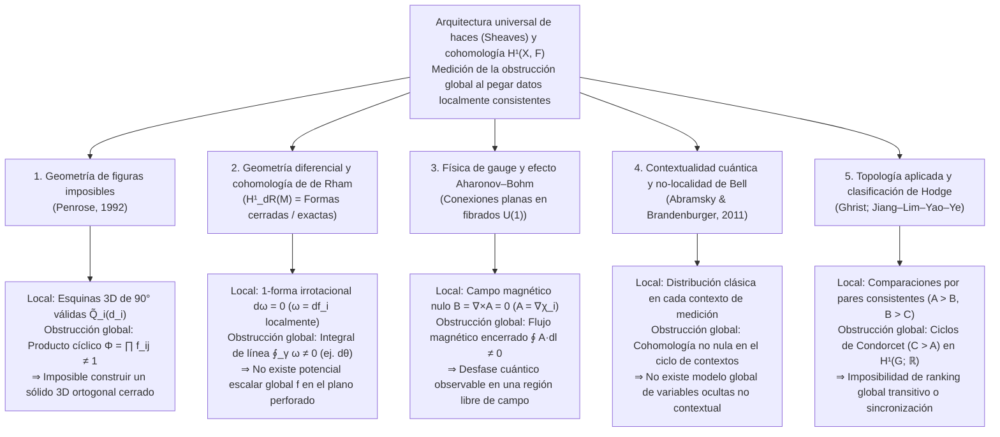

Con solo una hoja de papel, un lápiz y una regla, cualquiera puede dibujar en pocos minutos un <strong>triángulo de Penrose (tribarra de Penrose / Penrose Tribar)</strong>: tres vigas rectas de sección cuadrada que se unen de dos en dos en ángulo recto ($90^\circ$), formando lo que parece ser un marco triangular cerrado y rígido. O pensemos en la célebre escalera del monasterio en la litografía *Ascendente y Descendente* (*Ascending and Descending*, 1960) del artista neerlandés <strong>Maurits Cornelis Escher (1898–1972)</strong>: dos filas de monjes suben y bajan incansablemente por una escalera cuadrangular, ascendiendo perpetuamente y regresando, sin embargo, exactamente a la misma altura de partida.

Cuando contemplamos estas <strong>figuras imposibles (Impossible Figures / Impossible Objects)</strong>, nuestra corteza visual experimenta un peculiar vértigo cognitivo. Si observamos únicamente la esquina superior del triángulo de Penrose, vemos un ensamble tridimensional en ángulo recto completamente ordinario y físicamente impecable. Si desplazamos la mirada hacia la esquina inferior izquierda o hacia la esquina inferior derecha, tampoco se viola ninguna ley de la geometría euclidiana. Sin embargo, en el instante en que el ojo recorre de forma continua el perímetro cerrado de las tres vigas, estalla una catástrofe global: <strong>una viga que en un extremo está indiscutiblemente más cerca del observador pasa sin interrupción por detrás de una viga que se encuentra más lejos en el otro extremo</strong>.

¿Cómo es posible que la mano humana dibuje sin esfuerzo sobre un plano bidimensional un objeto que es <strong>localmente consistente en todas partes, pero globalmente imposible de construir en el espacio euclidiano tridimensional $\mathbb{R}^3$</strong>? ¿Y cómo formaliza la matemática moderna el mecanismo exacto mediante el cual la <strong>consistencia local (Local Consistency)</strong> fracasa al intentar ensamblarse en una <strong>existencia global (Global Realizability)</strong>?

En 1992, el físico matemático y premio Nobel <strong>Sir Roger Penrose</strong> publicó su brillante artículo *"On the Cohomology of Impossible Figures"*. Utilizando la <strong>teoría de haces (Sheaf Theory)</strong> y la <strong>cohomología de Čech (Čech Cohomology)</strong>, Penrose demostró que una figura imposible no es un simple truco pictórico, sino la manifestación visual directa de una <strong>clase de cohomología no trivial en el primer grupo de cohomología de Čech $\check{H}^1(Q; \mathbb{R}^+)$</strong>.

En este artículo recorremos la historia de las figuras imposibles desde Oscar Reutersvärd hasta los Penrose y Escher, analizamos cómo la proyección en perspectiva $\pi: \mathbb{R}^3 \to \mathbb{R}^2$ destruye las fibras de profundidad y cómo opera el cálculo de etiquetado de líneas de Huffman–Clowes, desarrollamos paso a paso la formulación cohomológica de Penrose, explicamos el álgebra lineal detrás de las esculturas de «movimiento imposible» de Kokichi Sugihara y revelamos cómo esta misma obstrucción cohomológica gobierna la cohomología de de Rham, el efecto Aharonov–Bohm y la contextualidad cuántica.

---

## 1. Dibujar lo inconstruible: Reutersvärd, los Penrose y M.C. Escher

### 1.1 De la sátira de la perspectiva a la paradoja geométrica pura

Aunque las transgresiones deliberadas de la perspectiva aparecen ya en el grabado *Satire on False Perspective* (1754) de William Hogarth, el verdadero pionero de los objetos imposibles geométricamente puros fue el artista sueco <strong>Oscar Reutersvärd (1915–2002)</strong>. En 1934, siendo un estudiante de 18 años durante una clase de latín, dibujó nueve cubos en proyección isométrica dispuestos en un anillo triangular cuya profundidad se contradecía cíclicamente (*Opus 1*). A lo largo de su vida creó más de 2.500 figuras imposibles, inmortalizadas en 1982 en los sellos postales de Suecia.

### 1.2 Febrero de 1958: El artículo histórico de Lionel y Roger Penrose

De manera independiente, tras visitar una exposición de <strong>M.C. Escher</strong> durante el Congreso Internacional de Matemáticos (ICM) de Ámsterdam en 1954, el joven matemático de Cambridge <strong>Roger Penrose (1931–)</strong> destiló la paradoja espacial hasta su mínima expresión geométrica: la <strong>tribarra de Penrose (Penrose Tribar)</strong>. Su padre, el psiquiatra y genetista <strong>Lionel S. Penrose (1898–1972)</strong>, respondió diseñando la <strong>escalera infinita de Penrose (Penrose Endless Staircase)</strong>.

En febrero de 1958, padre e hijo publicaron en el *British Journal of Psychology* (vol. 49, págs. 31–33) su célebre artículo <strong>*"Impossible Objects: A Special Type of Visual Illusion"*</strong>:

> *"Aquí cada parte de la estructura es aceptable como representación de un objeto sólido normal, pero la catástrofe ocurre como resultado de falsas conexiones entre las partes (false connexions of the parts)..."*

Tras recibir una separata enviada por los Penrose, Escher creó sus tres litografías más famosas: *Belvedere* (mayo de 1958), *Ascendente y Descendente* (marzo de 1960, incorporando la escalera infinita) y *Cascada* (*Waterfall*, octubre de 1961, encadenando tres triángulos de Penrose en un acueducto de movimiento perpetuo).

---

## 2. Geometría de la visión: Cómo la proyección $\pi: \mathbb{R}^3 \to \mathbb{R}^2$ elimina la profundidad

### 2.1 Proyección central, proyección paralela y sus fibras unidimensionales

Situemos el centro óptico del ojo del observador en el origen $\mathbf{0} = (0,0,0) \in \mathbb{R}^3$. La <strong>proyección central (en perspectiva)</strong> $\pi: \mathbb{R}^3 \setminus \{\mathbf{0}\} \to \mathbb{R}^2$ (o sobre la esfera de direcciones $S^2$) proyecta cada punto $\mathbf{r} = (x, y, z)$ con $z > 0$ sobre el plano de imagen a distancia focal $f > 0$:

$$\pi(x, y, z) = \left( f \frac{x}{z}, \; f \frac{y}{z} \right), \qquad \text{o bien} \qquad \pi(\mathbf{r}) = \frac{\mathbf{r}}{\|\mathbf{r}\|}$$

¿Cuál es la <strong>preimagen (la fibra / Fiber)</strong> $\pi^{-1}(p)$ de un punto bidimensional $p = \pi(\mathbf{r}_0)$? Dado que reescalar el vector $\mathbf{r}_0$ por cualquier número real positivo $\lambda \in \mathbb{R}^+ = (0, \infty)$ preserva su dirección ($\pi(\lambda \mathbf{r}_0) = \pi(\mathbf{r}_0) = p$), la fibra sobre cada punto $p$ es una semirrecta abierta parametrizada por el grupo multiplicativo de los reales positivos $\mathbb{R}^+ = ((0, \infty), \times)$:

$$\pi^{-1}(\pi(\mathbf{r}_0)) = \{ \lambda \mathbf{r}_0 \in \mathbb{R}^3 \setminus \{\mathbf{0}\} \mid \lambda \in \mathbb{R}^+ \}$$

De aquí se desprende una consecuencia geométrica crucial: <strong>si aplicamos a cualquier pieza rígida tridimensional $\tilde{Q}_i \subset \mathbb{R}^3 \setminus \{\mathbf{0}\}$ una homotecia radial $\mathbf{r} \mapsto \lambda \mathbf{r}$ centrada en el ojo ($\lambda \in \mathbb{R}^+$), no solo se conservan todos sus ángulos rectos ($90^\circ$), sino que su imagen retiniana $\pi(\lambda \tilde{Q}_i) = \pi(\tilde{Q}_i)$ permanece 100 % idéntica!</strong> Bajo proyección paralela ortográfica $\pi_{\text{orth}}(x,y,z) = (x,y)$, esta libertad corresponde a una traslación en profundidad $z \mapsto z + c$ gobernada por el grupo aditivo $(\mathbb{R}, +)$, canónicamente isomorfo a $(\mathbb{R}^+, \times)$ mediante $\ln: (\mathbb{R}^+, \times) \xrightarrow{\sim} (\mathbb{R}, +)$.

### 2.2 El cálculo de etiquetado de líneas de Huffman–Clowes (1971)

Para resolver el problema inverso de reconstrucción 3D, el sistema visual impone tres supuestos a priori: <strong>planaridad de las caras</strong>, <strong>ortogonalidad ($90^\circ$)</strong> y <strong>supuesto de punto de vista general</strong>. En 1971, <strong>David A. Huffman</strong> y <strong>Max B. Clowes</strong> formalizaron el análisis de dibujos poliédricos asignando a cada arista una de cuatro etiquetas: $+$ (arista convexa), $-$ (arista cóncava) y $\rightarrow, \leftarrow$ (contorno oclusivo, dejando la cara visible a la derecha de la flecha).

Sorprendentemente, <strong>¡el triángulo de Penrose supera al 100 % la prueba combinatoria de Huffman–Clowes!</strong> Cada vértice (en L, en Y/Fork, en Flecha y en T) es localmente válido. La imposibilidad del triángulo de Penrose no reside en una contradicción combinatoria local, sino en el <strong>fracaso global (cohomológico) al cerrar las coordenadas continuas de profundidad alrededor de un bucle topológico no contráctil</strong>.

| Nivel de consistencia | Marco matemático | Condición geométrica verificada | Resultado en el triángulo de Penrose |
| :--- | :--- | :--- | :--- |
| <strong>Nivel 1: Realizabilidad local de vértices</strong> | Catálogo triédrico (Guzmán, 1968) | ¿Puede cada unión $v_i$ aislarse como una esquina 3D válida? | <strong>APROBADO</strong> (Cada esquina es una unión ortogonal de $90^\circ$ válida) |
| <strong>Nivel 2: Etiquetado combinatorio</strong> | Cálculo de Huffman–Clowes (1971) | ¿Pueden asignarse $+, -, \rightarrow, \leftarrow$ compatiblemente en todas las aristas? | <strong>APROBADO</strong> (Admite un etiquetado globalmente consistente) |
| <strong>Nivel 3: Pegado rígido de parches</strong> | <strong>Cohomología de haces (Penrose, 1992)</strong> | ¿Cumplen las razones de profundidad $f_{ij}$ la condición $\prod f_{ij} = 1$ en cada ciclo? | <strong>FALLIDO</strong> (Clase no trivial $[f] \in \check{H}^1(Q; \mathbb{R}^+) \neq 0$) |
| <strong>Nivel 4: Poliedro general de caras planas</strong> | Sistema lineal de Sugihara (1986) | Sin exigir ángulos de $90^\circ$, ¿admite solución el sistema $A\mathbf{w}=\mathbf{0}, B\mathbf{w}>\mathbf{0}$? | <strong>APROBADO</strong> (¡Construible en 3D usando trapecios inclinados!) |

---

## 3. Consistencia local frente a contradicción global: Pegado sobre un recubrimiento abierto

Sea $Q \subset \mathbb{R}^2$ el dibujo 2D del triángulo de Penrose, homotópicamente equivalente al círculo ($Q \simeq S^1$). Cubrimos $Q$ con tres conjuntos abiertos $\mathcal{U} = \{U_1, U_2, U_3\}$, cada uno de los cuales contiene una de las tres esquinas $C_1, C_2, C_3$ y la mayor parte de las dos vigas adyacentes:

1. Cada abierto $U_i$ ($i=1,2,3$) es simplemente conexo (contráctil).
2. Las intersecciones dos a dos $U_{12} = U_1 \cap U_2$, $U_{23} = U_2 \cap U_3$ y $U_{31} = U_3 \cap U_1$ son segmentos contráctiles no vacíos en el centro de cada viga.
3. La intersección triple es vacía: $U_1 \cap U_2 \cap U_3 = \emptyset$. El <strong>nervio del recubrimiento</strong> $N(\mathcal{U})$ es el borde de un triángulo $\partial \Delta^2 \cong S^1$.

Sobre cada $U_i$, elegimos un modelo 3D estándar $\tilde{Q}_i^{\text{std}}$, de modo que cualquier levantamiento 3D rígido válido viene dado por $\tilde{Q}_i(d_i) = d_i \cdot \tilde{Q}_i^{\text{std}}$ con un factor de escala de profundidad $d_i \in \mathbb{R}^+$.

Para pegar sin discontinuidades $\tilde{Q}_1(d_1)$ y $\tilde{Q}_2(d_2)$ sobre el solapamiento $U_{12} = U_1 \cap U_2$, el escorzo de la viga exige una razón fija $f_{12} = r > 1$. Por la simetría rotacional de orden 3 en el plano, en los tres solapamientos se requiere:

$$\frac{d_1}{d_2} = f_{12} = r > 1, \qquad \frac{d_2}{d_3} = f_{23} = r > 1, \qquad \frac{d_3}{d_1} = f_{31} = r > 1$$

Multiplicando las tres ecuaciones alrededor del ciclo cerrado $1 \to 2 \to 3 \to 1$, los factores $d_i$ se cancelan y emerge la contradicción global:

$$1 = \frac{d_1}{d_2} \cdot \frac{d_2}{d_3} \cdot \frac{d_3}{d_1} = f_{12} \cdot f_{23} \cdot f_{31} = r^3 > 1 \quad (\text{¡Contradicción!})$$

---

## 4. La formulación de Sir Roger Penrose (1992): Haces y cohomología de Čech

En *"On the Cohomology of Impossible Figures"* (1992), Roger Penrose define el <strong>grupo de ambigüedad (Ambiguity Group) $G = (\mathbb{R}^+, \times)$</strong> y construye el complejo de cocadenas de Čech del haz localmente constante $\mathcal{F}$ sobre el buen recubrimiento $\mathcal{U} = \{U_1, U_2, U_3\}$:

$$C^0(\mathcal{U}, \mathbb{R}^+) \xrightarrow{\;\delta^0\;} C^1(\mathcal{U}, \mathbb{R}^+) \xrightarrow{\;\delta^1\;} C^2(\mathcal{U}, \mathbb{R}^+)$$

- <strong>0-cocadenas $C^0(\mathcal{U}, \mathbb{R}^+) = (\mathbb{R}^+)^3$</strong>: Asignaciones de profundidad $d = (d_1, d_2, d_3)$ para cada parche.
- <strong>1-cocadenas $C^1(\mathcal{U}, \mathbb{R}^+)$</strong>: Razones de transición $f = (f_{12}, f_{23}, f_{31})$ en cada solapamiento $U_{ij}$ con $f_{ji} = f_{ij}^{-1}$.
- <strong>Operadores coborde (Coboundary Operators)</strong>: $(\delta^0 d)_{ij} = d_i / d_j$ y $(\delta^1 f)_{ijk} = f_{ij} f_{jk} f_{ki}$, cumpliendo $\delta^1 \circ \delta^0 = 1$.

Como $U_1 \cap U_2 \cap U_3 = \emptyset$, toda 1-cocadena es automáticamente un <strong>1-cociclo</strong> ($Z^1(\mathcal{U}, \mathbb{R}^+) = \ker \delta^1 \cong (\mathbb{R}^+)^3$). Una estructura 3D globalmente consistente existe si y solo si $f$ es un <strong>1-coborde</strong> ($f \in B^1(\mathcal{U}, \mathbb{R}^+) = \operatorname{Im} \delta^0$), es decir, $f_{ij} = d_i / d_j$.

El <strong>primer grupo de cohomología de Čech</strong> es el grupo cociente:

$$\check{H}^1(Q; \mathbb{R}^+) \cong \frac{Z^1(\mathcal{U}, \mathbb{R}^+)}{B^1(\mathcal{U}, \mathbb{R}^+)} = \frac{\ker \delta^1}{\operatorname{Im} \delta^0} \xrightarrow[\;\sim\;]{\;\Phi\;} \mathbb{R}^+ \xrightarrow[\;\sim\;]{\;\ln\;} \mathbb{R}$$

donde el homomorfismo de holonomía $\Phi(f) = f_{12} f_{23} f_{31}$ tiene por núcleo exactamente $B^1(\mathcal{U}, \mathbb{R}^+)$. En el triángulo de Penrose, $\Phi(f) = r^3 \neq 1$ ($\ln \Phi(f) = 3\ln r \neq 0$), estableciendo el <strong>Teorema de Penrose (1992)</strong>: <strong>¡una figura imposible es literalmente un elemento no trivial $[f] \neq 1$ del primer grupo de cohomología de Čech $\check{H}^1(Q; G)$!</strong>

Al cortar el triángulo en un punto, el espacio pasa a ser un intervalo contráctil $Q_{\text{cut}} \simeq [0, 1]$ cuya cohomología se anula ($\check{H}^1([0, 1]; \mathbb{R}^+) = \{1\}$). Por ello, las esculturas físicas (como la de East Perth en Australia) pueden construirse como un gancho 3D abierto cuyos extremos separados en profundidad se alinean sobre un mismo rayo visual $\pi^{-1}(p)$ desde un único punto de vista accidental.

---

## 5. Las esculturas de Kokichi Sugihara y el paradigma universal de la cohomología

### 5.1 El álgebra lineal del «movimiento imposible» de Kokichi Sugihara

El matemático japonés <strong>Kokichi Sugihara (杉原厚吉)</strong> demostró en *Machine Interpretation of Line Drawings* (MIT Press, 1986) que un dibujo lineal es realizable como un poliedro 3D continuo de caras planas si y solo si el sistema lineal de ecuaciones de incidencia y desigualdades de profundidad

$$A \mathbf{w} = \mathbf{0}, \qquad B \mathbf{w} > \mathbf{0}$$

admite solución $\mathbf{w}$. Mientras que el cerebro humano añade inconscientemente restricciones de ortogonalidad $C_{\text{rect}} \mathbf{w} = \mathbf{0}$ (haciendo el sistema incompatible con $\check{H}^1 \neq 0$), Sugihara elimina $C_{\text{rect}} \mathbf{w} = \mathbf{0}$ y construye sólidos 3D reales y cerrados $\mathbf{w}^*$ mediante caras trapezoidales oblicuas. Como nuestra corteza visual sigue imponiendo el supuesto de ángulos rectos, percibe una rampa físicamente <strong>descendente</strong> como si fuera <strong>ascendente</strong>, haciendo que bolas de madera parezcan rodar cuesta arriba desafiando la gravedad.

### 5.2 El paradigma universal de haces y cohomología en la ciencia

| Dominio científico | Espacio base $X$ y recubrimiento $\{U_i\}$ | Sección local (Solución local) $s_i \in \mathcal{F}(U_i)$ | Condición de pegado en $U_i \cap U_j$ | Realizabilidad global ($\check{H}^1 = 0$) | Significado de la cohomología no nula $\check{H}^1(X, \mathcal{F}) \neq 0$ |
| :--- | :--- | :--- | :--- | :--- | :--- |
| <strong>Figuras imposibles</strong> (Penrose, 1992) | Dibujo 2D $Q \simeq S^1$ y esquinas $\{U_i\}$ | Escala de profundidad 3D local $d_i \in \mathbb{R}^+$ | Razón de profundidad $f_{ij} = d_i / d_j$ | Producto cíclico $\Phi = \prod f_{ij} = 1$ (Sólido 3D) | <strong>Triángulo de Penrose / Escalera de Escher</strong> (Inconstruible en 3D ortogonal) |
| <strong>Geometría diferencial</strong> (Cohomología de de Rham) | Variedad suave $M$ (ej. $\mathbb{R}^2 \setminus \{0\}$) | Potencial local $f_i$ de 1-forma cerrada $\omega = df_i$ | Diferencia de potencial $f_i - f_j = c_{ij}$ | Circulación nula $\oint_\gamma \omega = 0$ (Forma exacta) | <strong>1-forma angular $\omega = d\theta$</strong> (Escalera de Escher continua sin potencial global) |
| <strong>Física de gauge</strong> (Aharonov–Bohm, 1959) | Región sin campo $M \simeq S^1$ fuera de solenoide | Fase de gauge local $\chi_i$ donde $\mathbf{A} = \nabla \chi_i$ ($\mathbf{B}=\mathbf{0}$) | Transición $U(1)$ $g_{ij} = e^{ie(\chi_i-\chi_j)/\hbar}$ | Lazo de Wilson trivial $\exp(\frac{ie}{\hbar}\oint \mathbf{A}\cdot d\mathbf{l}) = 1$ | <strong>Desfase cuántico de Aharonov–Bohm</strong> en campo magnético cero |
| <strong>Fundamentos cuánticos</strong> (Abramsky et al., 2011) | Conjunto de observables $X$ y contextos $\{U_i\}$ | Probabilidad clásica local en cada contexto | Igualdad de marginales (No-Signaling) | Existencia de modelo global de variables ocultas | <strong>Contextualidad cuántica y no-localidad de Bell</strong> (Kochen–Specker / Hardy) |
| <strong>Topología aplicada</strong> (Ghrist; HodgeRank) | Grafo de comparación $G = (V, E)$ | Puntuación global / reloj local $d_i \in \mathbb{R}$ | Diferencia por pares $f_{ij} = d_i - d_j$ | Suma cíclica cero en todo ciclo (Transitividad) | <strong>Paradoja de Condorcet (Ciclos Piedra-Papel-Tijera)</strong> |

Ese asombro que experimentamos al recorrer con la vista el triángulo de Penrose o la escalera de Escher es la prueba viviente de que nuestra corteza visual calcula un transporte paralelo alrededor de un bucle cerrado y detecta en tiempo real una <strong>clase de cohomología no trivial en $\check{H}^1(Q; \mathbb{R}^+)$</strong>.

---

## Referencias

1. <strong>Penrose, L. S., & Penrose, R.</strong> (1958). "Impossible Objects: A Special Type of Visual Illusion." *British Journal of Psychology*, 49(1), 31–33.
2. <strong>Penrose, R.</strong> (1992). "On the Cohomology of Impossible Figures." *Structural Topology*, 17, 11–16.
3. <strong>Huffman, D. A.</strong> (1971). "Impossible Objects as Nonsense Sentences." *Machine Intelligence*, 6, 295–323.
4. <strong>Sugihara, K.</strong> (1986). *Machine Interpretation of Line Drawings*. MIT Press.
5. <strong>Abramsky, S., & Brandenburger, A.</strong> (2011). "The Sheaf-Theoretic Structure of Non-Locality and Contextuality." *New Journal of Physics*, 13(11), 113036.
