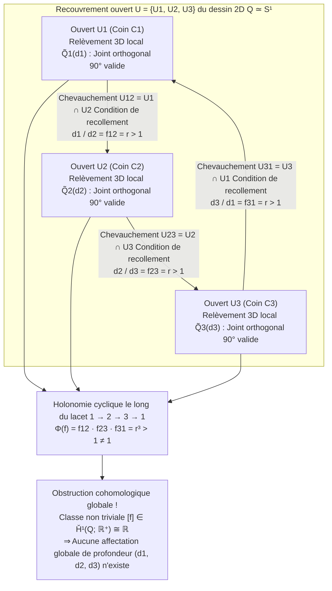
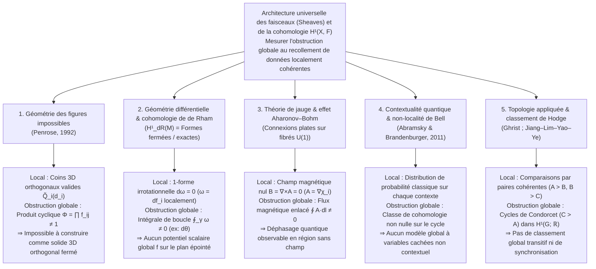

Avec une simple feuille de papier, un crayon et une règle, n'importe qui peut tracer en quelques minutes une <strong>tripoutre de Penrose (triangle de Penrose / Penrose Tribar)</strong> : trois poutres droites à section carrée se rencontrent deux à deux à angle droit ($90^\circ$) pour former ce qui semble être un cadre triangulaire fermé et rigide. Songeons encore au célèbre cloître de la lithographie *Montée et Descente* (*Ascending and Descending*, 1960) du graveur néerlandais <strong>Maurits Cornelis Escher (1898–1972)</strong> : deux files de moines gravissent et descendent sans relâche un escalier quadrangulaire, montant perpétuellement tout en revenant exactement à leur altitude de départ.

Face à ces <strong>figures impossibles (Impossible Figures / Impossible Objects)</strong>, notre cortex visuel éprouve un singulier vertige cognitif. Regardez uniquement le coin supérieur du triangle de Penrose : c'est un assemblage de menuiserie tridimensionnel à angle droit parfaitement banal et physiquement irréprochable. Portez le regard sur le coin inférieur gauche, puis sur le coin inférieur droit : là encore, aucune loi de la géométrie euclidienne n'est transgressée. Pourtant, dès que l'œil parcourt le périmètre fermé des trois poutres, une catastrophe globale surgit — <strong>une poutre située indubitablement au premier plan à une extrémité passe sans discontinuité derrière une poutre située à l'arrière-plan à l'autre extrémité</strong>.

Comment la main humaine peut-elle dessiner sur un plan bidimensionnel un objet qui est <strong>localement cohérent partout, mais globalement impossible à réaliser dans l'espace euclidien tridimensionnel $\mathbb{R}^3$</strong> ? Et comment les mathématiques contemporaines formalisent-elles le passage exact de la <strong>cohérence locale (Local Consistency)</strong> à la <strong>contradiction globale (Global Contradiction)</strong> ?

En 1992, le physicien mathématicien et futur lauréat du prix Nobel <strong>Sir Roger Penrose</strong> a publié un article fondateur intitulé *"On the Cohomology of Impossible Figures"*. En mobilisant la <strong>théorie des faisceaux (Sheaf Theory / Théorie des faisceaux)</strong> créée par Jean Leray et la <strong>cohomologie de Čech (Čech Cohomology)</strong>, Penrose a démontré qu'une figure impossible n'est nullement une simple illusion d'optique : c'est la manifestation visuelle directe d'une <strong>classe de cohomologie non triviale dans le premier groupe de cohomologie de Čech $\check{H}^1(Q; \mathbb{R}^+)$</strong>.

Dans cet article, nous retraçons l'histoire des figures impossibles d'Oscar Reutersvärd à Escher et aux Penrose, analysons la géométrie projective de la perte de profondeur sous la projection $\pi: \mathbb{R}^3 \to \mathbb{R}^2$ ainsi que le calcul d'étiquetage de Huffman–Clowes, construisons pas à pas la cohomologie de Čech de Penrose, dévoilons l'algèbre linéaire des sculptures à « mouvement impossible » de Kokichi Sugihara et montrons comment cette même obstruction cohomologique régit la cohomologie de de Rham, l'effet Aharonov–Bohm, la contextualité quantique et la théorie de Hodge sur les graphes.

---

## 1. Dessiner l'inconstructible : Reutersvärd, les Penrose et M.C. Escher

### 1.1 De la satire de la perspective au paradoxe géométrique pur

Si des transgressions délibérées des règles de la perspective linéaire apparaissent dès la gravure *Satire on False Perspective* (1754) de William Hogarth, le véritable père des figures géométriques impossibles pures est l'artiste suédois <strong>Oscar Reutersvärd (1915–2002)</strong>. En 1934, alors lycéen de 18 ans s'ennuyant pendant un cours de latin, il dessina dans la marge de son manuel neuf cubes disposés en anneau triangulaire paradoxal (*Opus 1*). Il réalisa au cours de sa vie plus de 2 500 figures impossibles en projection axonométrique, célébrées en 1982 par une série de timbres-poste suédois.

### 1.2 Février 1958 : L'article historique de Lionel et Roger Penrose

Indépendamment de Reutersvärd, lors du Congrès international des mathématiciens (ICM) d'Amsterdam en 1954, le jeune mathématicien de Cambridge <strong>Roger Penrose (1931–)</strong> découvrit avec fascination une exposition de <strong>M.C. Escher</strong>. De retour en Angleterre, il chercha à distiller l'essence pure d'un paradoxe spatial et inventa la <strong>tripoutre de Penrose (Penrose Tribar)</strong>, tandis que son père, le psychiatre et généticien <strong>Lionel S. Penrose (1898–1972)</strong>, conçut l'<strong>escalier sans fin de Penrose (Penrose Endless Staircase)</strong>.

En février 1958, père et fils publièrent dans le *British Journal of Psychology* (vol. 49, p. 31–33) leur célèbre note <strong>*"Impossible Objects: A Special Type of Visual Illusion"*</strong> :

> *"Ici, chaque partie de la structure est acceptable comme représentant un objet solide normal, mais la catastrophe survient en raison de fausses connexions entre les parties (false connexions of the parts)..."*

Après avoir reçu un tiré à part de cet article envoyé par les Penrose, Escher créa sa trilogie immortelle : *Belvédère* (mai 1958), *Montée et Descente* (mars 1960, intégrant l'escalier des Penrose) et *Chute d'eau* (*Waterfall*, octobre 1961, enchaînant trois triangles de Penrose en un aqueduc perpétuel).

---

## 2. Géométrie de la vision : Comment la projection $\pi: \mathbb{R}^3 \to \mathbb{R}^2$ écrase les fibres de profondeur

### 2.1 Projection centrale, projection parallèle et leurs fibres unidimensionnelles

Plaçons le centre optique de l'œil de l'observateur à l'origine $\mathbf{0} = (0,0,0) \in \mathbb{R}^3$. La <strong>projection centrale (perspective)</strong> $\pi: \mathbb{R}^3 \setminus \{\mathbf{0}\} \to \mathbb{R}^2$ (ou vers la sphère des directions visuelles $S^2$) projette tout point $\mathbf{r} = (x, y, z)$ du demi-espace $z > 0$ sur le plan rétinien situé à la distance focale $f > 0$ :

$$\pi(x, y, z) = \left( f \frac{x}{z}, \; f \frac{y}{z} \right), \qquad \text{ou} \qquad \pi(\mathbf{r}) = \frac{\mathbf{r}}{\|\mathbf{r}\|}$$

Quelle est l'<strong>image réciproque (la fibre / Fiber)</strong> $\pi^{-1}(p)$ d'un point d'image bidimensionnel $p = \pi(\mathbf{r}_0)$ ? Puisque toute homothétie radiale $\mathbf{r}_0 \mapsto \lambda \mathbf{r}_0$ par un réel strictement positif $\lambda \in \mathbb{R}^+ = (0, \infty)$ conserve la direction du rayon visuel ($\pi(\lambda \mathbf{r}_0) = \pi(\mathbf{r}_0) = p$), la fibre au-dessus de chaque point $p$ est une demi-droite ouverte paramétrée par le groupe multiplicatif $\mathbb{R}^+ = ((0, \infty), \times)$ :

$$\pi^{-1}(\pi(\mathbf{r}_0)) = \{ \lambda \mathbf{r}_0 \in \mathbb{R}^3 \setminus \{\mathbf{0}\} \mid \lambda \in \mathbb{R}^+ \}$$

Il en découle une propriété géométrique fondamentale : <strong>si l'on applique à n'importe quel fragment rigide tridimensionnel $\tilde{Q}_i \subset \mathbb{R}^3 \setminus \{\mathbf{0}\}$ une homothétie $\mathbf{r} \mapsto \lambda \mathbf{r}$ centrée sur l'œil ($\lambda \in \mathbb{R}^+$), non seulement tous ses angles dièdres ($90^\circ$) sont strictement préservés, mais son image rétinienne bidimensionnelle $\pi(\lambda \tilde{Q}_i) = \pi(\tilde{Q}_i)$ demeure rigoureusement identique !</strong> En projection parallèle orthographique $\pi_{\text{orth}}(x,y,z) = (x,y)$, cette liberté correspond à une translation de profondeur $z \mapsto z + c$ gouvernée par le groupe additif $(\mathbb{R}, +)$, canoniquement isomorphe à $(\mathbb{R}^+, \times)$ via le logarithme $\ln: (\mathbb{R}^+, \times) \xrightarrow{\sim} (\mathbb{R}, +)$.

### 2.2 Le calcul d'étiquetage des lignes de Huffman–Clowes (1971)

Pour résoudre le problème inverse mal posé de la reconstruction 3D, le cortex visuel impose des a priori de régularité : <strong>planéité des faces</strong>, <strong>orthogonalité ($90^\circ$)</strong> et <strong>hypothèse de point de vue général</strong>. En 1971, <strong>David A. Huffman</strong> et <strong>Max B. Clowes</strong> ont formalisé l'interprétation des dessins polyédriques en attribuant à chaque arête l'une des quatre étiquettes physiques : $+$ (arête convexe), $-$ (arête concave), et $\rightarrow, \leftarrow$ (contour d'occultation, la face visible se trouvant à droite de la flèche).

Or, fait remarquable, <strong>le triangle de Penrose réussit à 100 % le test combinatoire de Huffman–Clowes !</strong> Chaque jonction (L, Y/Fork, Flèche, T) possède une interprétation 3D valide. L'impossibilité du triangle de Penrose ne provient donc pas d'une incompatibilité combinatoire locale, mais d'une <strong>obstruction globale (cohomologique) au recollement des coordonnées continues de profondeur le long d'un lacet non contractile</strong>.

| Niveau de cohérence | Cadre mathématique | Condition géométrique vérifiée | Résultat sur le triangle de Penrose |
| :--- | :--- | :--- | :--- |
| <strong>Niveau 1 : Réalisabilité locale des sommets</strong> | Catalogue triédrique (Guzmán, 1968) | Chaque jonction $v_i$ isolée peut-elle exister comme coin 3D ? | <strong>SUCCÈS</strong> (Chaque coin est un joint orthogonal à $90^\circ$ valide) |
| <strong>Niveau 2 : Étiquetage combinatoire</strong> | Calcul de Huffman–Clowes (1971) | Peut-on affecter $+, -, \rightarrow, \leftarrow$ de façon compatible sur chaque arête ? | <strong>SUCCÈS</strong> (Admet un étiquetage globalement cohérent) |
| <strong>Niveau 3 : Recollement rigide de patchs</strong> | <strong>Cohomologie des faisceaux (Penrose, 1992)</strong> | Les rapports d'échelle $f_{ij}$ vérifient-ils $\prod f_{ij} = 1$ sur tout cycle ? | <strong>ÉCHEC</strong> (Classe non triviale $[f] \in \check{H}^1(Q; \mathbb{R}^+) \neq 0$) |
| <strong>Niveau 4 : Polyèdre général à faces planes</strong> | Système linéaire de Sugihara (1986) | En relaxant l'orthogonalité $90^\circ$, le système $A\mathbf{w}=\mathbf{0}, B\mathbf{w}>\mathbf{0}$ a-t-il une solution ? | <strong>SUCCÈS</strong> (Constructible en 3D avec des trapèzes inclinés !) |

---

## 3. Cohérence locale et contradiction globale : Le recollement sur un recouvrement ouvert

Soit $Q \subset \mathbb{R}^2$ le dessin bidimensionnel du triangle de Penrose, qui a le type d'homotopie du cercle ($Q \simeq S^1$). Recouvrons $Q$ par trois ouverts $\mathcal{U} = \{U_1, U_2, U_3\}$, chacun contenant l'un des trois coins $C_1, C_2, C_3$ ainsi que la majeure partie des deux poutres adjacentes :

1. Chaque ouvert $U_i$ ($i=1,2,3$) est simplement connexe (contractile).
2. Les intersections deux à deux $U_{12} = U_1 \cap U_2$, $U_{23} = U_2 \cap U_3$ et $U_{31} = U_3 \cap U_1$ sont des segments contractiles non vides situés au milieu de chaque poutre.
3. L'intersection triple est vide : $U_1 \cap U_2 \cap U_3 = \emptyset$. Le <strong>nerf du recouvrement</strong> $N(\mathcal{U})$ est donc exactement le bord du triangle $\partial \Delta^2 \cong S^1$.

Au-dessus de chaque ouvert $U_i$, on dispose d'un relèvement 3D standard $\tilde{Q}_i^{\text{std}}$, et tout relèvement rigide valide s'écrit $\tilde{Q}_i(d_i) = d_i \cdot \tilde{Q}_i^{\text{std}}$ où $d_i \in \mathbb{R}^+$ désigne le facteur d'échelle de profondeur du coin $C_i$.

Pour recoller continûment $\tilde{Q}_1(d_1)$ et $\tilde{Q}_2(d_2)$ sur la zone de chevauchement $U_{12} = U_1 \cap U_2$, le raccourci perspectif de la poutre impose un rapport fixe $f_{12} = r > 1$. Par symétrie de rotation d'ordre 3, les trois conditions de recollement s'écrivent :

$$\frac{d_1}{d_2} = f_{12} = r > 1, \qquad \frac{d_2}{d_3} = f_{23} = r > 1, \qquad \frac{d_3}{d_1} = f_{31} = r > 1$$

En multipliant ces trois relations le long du lacet fermé $1 \to 2 \to 3 \to 1$, les facteurs $d_i$ s'éliminent et révèlent une contradiction algébrique immédiate :

$$1 = \frac{d_1}{d_2} \cdot \frac{d_2}{d_3} \cdot \frac{d_3}{d_1} = f_{12} \cdot f_{23} \cdot f_{31} = r^3 > 1 \quad (\text{Contradiction !})$$

---

## 4. La formulation de Sir Roger Penrose (1992) : Faisceaux et cohomologie de Čech

Dans son article *"On the Cohomology of Impossible Figures"* (1992), Roger Penrose définit le <strong>groupe d'ambiguïté (Ambiguity Group) $G = (\mathbb{R}^+, \times)$</strong> et considère le faisceau localement constant $\mathcal{F}$ de fibre $G$ sur $Q$. Le complexe de cochaînes de Čech associé au bon recouvrement $\mathcal{U} = \{U_1, U_2, U_3\}$ s'écrit :

$$C^0(\mathcal{U}, \mathbb{R}^+) \xrightarrow{\;\delta^0\;} C^1(\mathcal{U}, \mathbb{R}^+) \xrightarrow{\;\delta^1\;} C^2(\mathcal{U}, \mathbb{R}^+)$$

- <strong>0-cochaînes $C^0(\mathcal{U}, \mathbb{R}^+) = (\mathbb{R}^+)^3$</strong> : Assignations d'échelles de profondeur locales $d = (d_1, d_2, d_3)$.
- <strong>1-cochaînes $C^1(\mathcal{U}, \mathbb{R}^+)$</strong> : Rapports de transition $f = (f_{12}, f_{23}, f_{31})$ sur les intersections $U_{ij}$ avec $f_{ji} = f_{ij}^{-1}$.
- <strong>Opérateurs cobord (Coboundary Operators)</strong> : $(\delta^0 d)_{ij} = d_i / d_j$ et $(\delta^1 f)_{ijk} = f_{ij} f_{jk} f_{ki}$, vérifiant $\delta^1 \circ \delta^0 = 1$.

Puisque $U_1 \cap U_2 \cap U_3 = \emptyset$, toute 1-cochaîne est un <strong>1-cocycle</strong> ($Z^1(\mathcal{U}, \mathbb{R}^+) = \ker \delta^1 \cong (\mathbb{R}^+)^3$). Le dessin est globalement réalisable en 3D si et seulement si $f$ est un <strong>1-cobord</strong> ($f \in B^1(\mathcal{U}, \mathbb{R}^+) = \operatorname{Im} \delta^0$), c'est-à-dire s'il existe $d \in C^0$ tel que $f_{ij} = d_i / d_j$.

Le <strong>premier groupe de cohomologie de Čech</strong> est le groupe quotient :

$$\check{H}^1(Q; \mathbb{R}^+) \cong \frac{Z^1(\mathcal{U}, \mathbb{R}^+)}{B^1(\mathcal{U}, \mathbb{R}^+)} = \frac{\ker \delta^1}{\operatorname{Im} \delta^0} \xrightarrow[\;\sim\;]{\;\Phi\;} \mathbb{R}^+ \xrightarrow[\;\sim\;]{\;\ln\;} \mathbb{R}$$

Le morphisme d'holonomie $\Phi(f) = f_{12} f_{23} f_{31}$ a pour noyau exactement $B^1(\mathcal{U}, \mathbb{R}^+)$. Pour le triangle de Penrose, $\Phi(f) = r^3 \neq 1$ ($\ln \Phi(f) = 3\ln r \neq 0$), d'où le <strong>théorème de Penrose (1992)</strong> : <strong>l'obstruction à la réalisabilité 3D globale d'un dessin localement valide $Q$ est exactement caractérisée par une classe de cohomologie non triviale $[f] \neq 1$ dans $\check{H}^1(Q; G)$ !</strong>

Si l'on coupe le triangle en un point, l'espace devient un intervalle contractile $Q_{\text{cut}} \simeq [0, 1]$ dont la cohomologie s'annule ($\check{H}^1([0, 1]; \mathbb{R}^+) = \{1\}$). C'est pourquoi les sculptures physiques (comme celle d'East Perth en Australie) sont en réalité des crochets 3D ouverts dont les deux extrémités décalées en profondeur s'alignent sur un même rayon visuel $\pi^{-1}(p)$ depuis un unique point de vue accidentel !

---

## 5. Les sculptures à « mouvement impossible » de Kokichi Sugihara et l'universalité de la cohomologie

### 5.1 L'algèbre linéaire des solides impossibles de Kokichi Sugihara

Le mathématicien japonais <strong>Kokichi Sugihara (杉原厚吉)</strong> a démontré dans *Machine Interpretation of Line Drawings* (MIT Press, 1986) qu'un dessin linéaire est réalisable comme polyèdre 3D à faces planes si et seulement si le système linéaire d'équations d'incidence et d'inégalités de profondeur

$$A \mathbf{w} = \mathbf{0}, \qquad B \mathbf{w} > \mathbf{0}$$

admet une solution $\mathbf{w}$. Alors que le cerveau humain ajoute inconsciemment des équations d'orthogonalité $C_{\text{rect}} \mathbf{w} = \mathbf{0}$ (rendant le système incompatible avec $\check{H}^1 \neq 0$), Sugihara supprime $C_{\text{rect}} \mathbf{w} = \mathbf{0}$ et construit de vrais solides 3D continus $\mathbf{w}^*$ composés de trapèzes inclinés. Trompé par son a priori d'orthogonalité, notre cerveau perçoit une pente physiquement <strong>descendante</strong> comme une rampe <strong>montante</strong>, donnant l'illusion stupéfiante que des billes en bois remontent la pente contre la gravité !

### 5.2 Le paradigme universel des faisceaux et de la cohomologie à travers les sciences

| Domaine scientifique | Espace de base $X$ & recouvrement $\{U_i\}$ | Section locale (Solution locale) $s_i \in \mathcal{F}(U_i)$ | Condition de recollement sur $U_i \cap U_j$ | Réalisabilité globale ($\check{H}^1 = 0$) | Signification d'une cohomologie non nulle $\check{H}^1(X, \mathcal{F}) \neq 0$ |
| :--- | :--- | :--- | :--- | :--- | :--- |
| <strong>Figures impossibles</strong> (Penrose, 1992) | Dessin 2D $Q \simeq S^1$ & coins $\{U_i\}$ | Échelle de profondeur 3D locale $d_i \in \mathbb{R}^+$ | Rapport de profondeur $f_{ij} = d_i / d_j$ | Produit cyclique $\Phi = \prod f_{ij} = 1$ (Solide 3D) | <strong>Triangle de Penrose / Escalier d'Escher</strong> (Inconstructible en 3D orthogonal) |
| <strong>Géométrie différentielle</strong> (Cohomologie de de Rham) | Variété lisse $M$ (ex: $\mathbb{R}^2 \setminus \{0\}$) | Potentiel local $f_i$ d'une 1-forme fermée $\omega = df_i$ | Différence de potentiel $f_i - f_j = c_{ij}$ | Circulation nulle $\oint_\gamma \omega = 0$ (Forme exacte) | <strong>1-forme angulaire $\omega = d\theta$</strong> (Escalier d'Escher continu sans potentiel global) |
| <strong>Physique de jauge</strong> (Aharonov–Bohm, 1959) | Région sans champ $M \simeq S^1$ hors du solénoïde | Phase de jauge locale $\chi_i$ où $\mathbf{A} = \nabla \chi_i$ ($\mathbf{B}=\mathbf{0}$) | Transition de jauge $U(1)$ $g_{ij} = e^{ie(\chi_i-\chi_j)/\hbar}$ | Boucle de Wilson triviale $\exp(\frac{ie}{\hbar}\oint \mathbf{A}\cdot d\mathbf{l}) = 1$ | <strong>Déphasage quantique d'Aharonov–Bohm</strong> en champ magnétique nul |
| <strong>Fondements quantiques</strong> (Abramsky et al., 2011) | Ensemble d'observables $X$ & contextes $\{U_i\}$ | Probabilité classique locale sur chaque contexte | Accord des probabilités marginales (No-Signaling) | Existence d'un modèle global à variables cachées | <strong>Contextualité quantique & non-localité de Bell</strong> (Kochen–Specker / Hardy) |
| <strong>Topologie appliquée</strong> (Ghrist ; HodgeRank) | Graphe de comparaison $G = (V, E)$ | Score global / horloge locale $d_i \in \mathbb{R}$ | Écart de score par paire $f_{ij} = d_i - d_j$ | Somme cyclique nulle sur tout cycle (Transitivité) | <strong>Paradoxe de Condorcet (Cycles Pierre-Papier-Ciseaux)</strong> |

Ce vertige qui nous saisit lorsque notre regard parcourt le triangle de Penrose ou l'escalier d'Escher est la preuve directe que notre cortex visuel effectue un transport parallèle le long d'un lacet fermé et détecte en temps réel une <strong>classe de cohomologie non triviale dans $\check{H}^1(Q; \mathbb{R}^+)$</strong>.

---

## Références

1. <strong>Penrose, L. S., & Penrose, R.</strong> (1958). "Impossible Objects: A Special Type of Visual Illusion." *British Journal of Psychology*, 49(1), 31–33.
2. <strong>Penrose, R.</strong> (1992). "On the Cohomology of Impossible Figures." *Structural Topology*, 17, 11–16.
3. <strong>Huffman, D. A.</strong> (1971). "Impossible Objects as Nonsense Sentences." *Machine Intelligence*, 6, 295–323.
4. <strong>Sugihara, K.</strong> (1986). *Machine Interpretation of Line Drawings*. MIT Press.
5. <strong>Abramsky, S., & Brandenburger, A.</strong> (2011). "The Sheaf-Theoretic Structure of Non-Locality and Contextuality." *New Journal of Physics*, 13(11), 113036.
