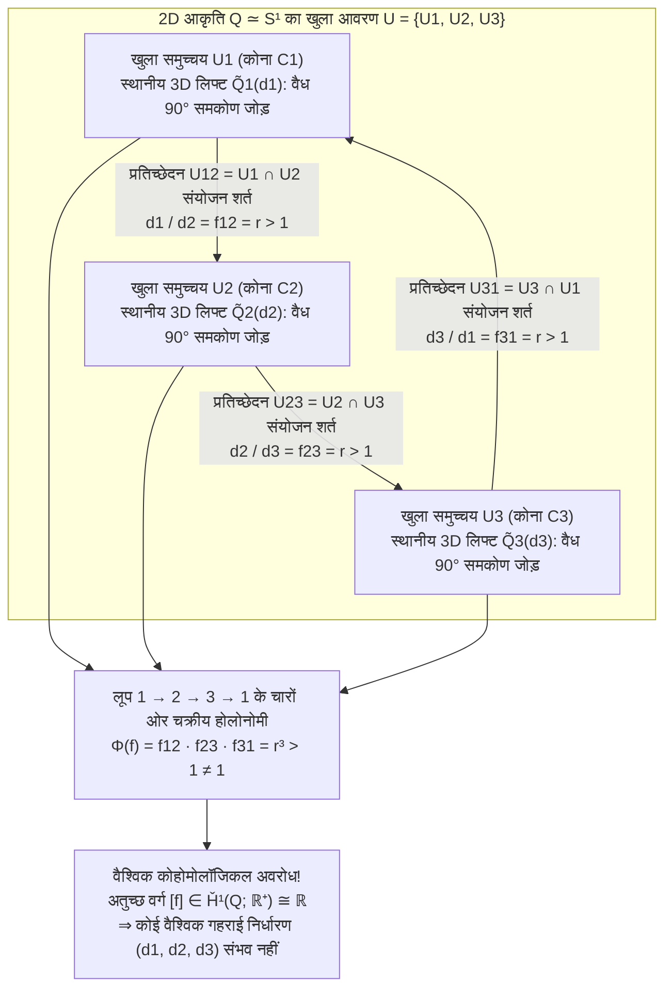
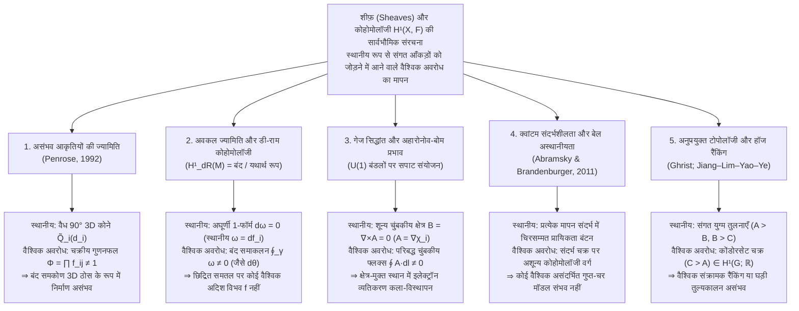

केवल एक कागज़, पेंसिल और पैमाने (ruler) की सहायता से कोई भी व्यक्ति कुछ ही मिनटों में <strong>पेनरोज़ त्रिभुज (Penrose Tribar / Penrose Triangle)</strong> बना सकता है: वर्गाकार अनुप्रस्थ काट (square cross-section) वाली तीन सीधी धरनें (beams) तीनों शीर्षों पर एक-दूसरे से समकोण ($90^\circ$) पर मिलती हैं और दिखने में एक बंद, ठोस त्रिभुजाकार ढाँचा बनाती हैं। अथवा डच कलाकार <strong>मॉरिट्स कॉर्नेलिस एशर (M.C. Escher, 1898–1972)</strong> के 1960 के प्रसिद्ध लिथोग्राफ़ *आरोहण और अवरोहण* (*Ascending and Descending*) में बनी मठ की छत की सीढ़ियों को याद कीजिए: भिक्षुओं की दो कतारें चार भुजाओं वाली पत्थर की सीढ़ियों पर अनवरत ऊपर या नीचे चल रही हैं—वे लगातार ऊपर चढ़ते जाते हैं, फिर भी बिना किसी रुकावट के ठीक उसी प्रारंभिक ऊँचाई पर लौट आते हैं।

जब हम ऐसी <strong>असंभव आकृतियों (Impossible Figures / Impossible Objects)</strong> को देखते हैं, तो हमारा दृष्टिपटल और मस्तिष्क एक विचित्र संज्ञानात्मक चक्कर (cognitive vertigo) का अनुभव करता है। पेनरोज़ त्रिभुज के केवल ऊपरी कोने को देखिए: यह लकड़ी की दो धरनों का एक साधारण, भौतिक रूप से पूर्णतः वैध त्रिविमीय ($90^\circ$) समकोण जोड़ है। अपनी दृष्टि बाएँ निचले कोने या दाएँ निचले कोने पर ले जाइए: वहाँ भी यूक्लिडीय ज्यामिति के किसी नियम का उल्लंघन नहीं होता। किंतु जैसे ही आपकी आँखें तीनों धरनों के बंद परिपथ का एक पूरा चक्कर लगाती हैं, एक वैश्विक विरोधाभास फूट पड़ता है—<strong>जो धरन एक सिरे पर निस्संदेह प्रेक्षक के अधिक निकट है, वही दूसरे सिरे पर बिना टूटे पीछे वाली धरन के पीछे से गुज़र जाती है</strong>।

मानव हाथ द्विविमीय समतल कागज़ पर ऐसी आकृति कैसे खींच लेता है जो <strong>प्रत्येक स्थानीय भाग (Local) में पूर्णतः संगत है, किंतु समग्र रूप से (Global) त्रिविमीय यूक्लिडीय समष्टि $\mathbb{R}^3$ में अस्तित्व ही नहीं रख सकती</strong>? और आधुनिक गणित <strong>'स्थानीय संगति (Local Consistency)'</strong> से <strong>'वैश्विक विरोधाभास (Global Contradiction)'</strong> के इस तंत्र को कैसे परिभाषित करता है?

1992 में, नोबेल पुरस्कार विजेता गणितीय भौतिकीविद् <strong>सर रोजर पेनरोज़ (Sir Roger Penrose)</strong> ने अपना ऐतिहासिक शोधपत्र *"On the Cohomology of Impossible Figures"* प्रकाशित किया। 20वीं सदी के उच्च गणित के दो शक्तिशाली स्तंभों—<strong>शीफ़ सिद्धांत (Sheaf Theory)</strong> और <strong>चेक कोहोमोलॉजी (Čech Cohomology)</strong>—का उपयोग करते हुए पेनरोज़ ने सिद्ध किया कि असंभव आकृतियाँ मात्र दृष्टिभ्रम नहीं हैं; वे आकृति की समष्टि पर परिभाषित <strong>प्रथम चेक कोहोमोलॉजी समूह $\check{H}^1(Q; \mathbb{R}^+)$ में एक अतुच्छ कोहोमोलॉजी वर्ग (Non-trivial Cohomology Class) का प्रत्यक्ष दृश्य रूप</strong> हैं।

इस लेख में हम ऑस्कर रॉयटर्सवार्ड, पेनरोज़ पिता-पुत्र और एशर के इतिहास से लेकर परिप्रेक्ष्य प्रक्षेपण $\pi: \mathbb{R}^3 \to \mathbb{R}^2$ द्वारा गहराई के तंतुओं (depth fibers) के विलोपन, हफ़मैन-क्लाउज़ (Huffman–Clowes) रेखा लेबलिंग कलन, पेनरोज़ के शीफ़ व कोहोमोलॉजी सूत्रण, कोकिची सुगिहारा की 'असंभव गति (Impossible Motion)' वाली 3D मूर्तियों के रैखिक बीजगणित और डी-राम कोहोमोलॉजी, अहारोनोव-बोम प्रभाव तथा क्वांटम संदर्भशीलता तक की सार्वभौमिक संरचना का गहन विश्लेषण करेंगे।

---

## 1. जिसे खींचा जा सके पर बनाया न जा सके: रॉयटर्सवार्ड, पेनरोज़ और एशर

### 1.1 परिप्रेक्ष्य व्यंग्य से शुद्ध ज्यामितीय विरोधाभास तक

यद्यपि परिप्रेक्ष्य के नियमों का जानबूझकर उल्लंघन विलियम होगार्थ के 1754 के उत्कीर्णन *Satire on False Perspective* में देखा जा सकता है, किंतु शुद्ध ज्यामितीय असंभव आकृतियों के वास्तविक जनक स्वीडिश कलाकार <strong>ऑस्कर रॉयटर्सवार्ड (Oscar Reutersvärd, 1915–2002)</strong> थे। 1934 में, 18 वर्ष की आयु में लैटिन की कक्षा के दौरान उन्होंने अपनी पुस्तक के हाशिए पर सममितीय प्रक्षेपण (isometric projection) में नौ घनों की एक ऐसी त्रिभुजाकार शृंखला (*Opus 1*) बनाई जिसकी गहराई चक्रीय रूप से विरोधाभासी थी। उन्होंने अपने जीवनकाल में 2,500 से अधिक असंभव आकृतियाँ बनाईं, जिन्हें 1982 में स्वीडिश डाक टिकटों पर सम्मानित किया गया।

### 1.2 फ़रवरी 1958: लियोनेल और रोजर पेनरोज़ का ऐतिहासिक शोधपत्र

रॉयटर्सवार्ड से स्वतंत्र रूप से, 1954 में एम्स्टर्डम में अंतर्राष्ट्रीय गणितज्ञ कांग्रेस (ICM) के दौरान युवा कैम्ब्रिज गणितज्ञ <strong>रोजर पेनरोज़ (1931–)</strong> ने <strong>एम.सी. एशर</strong> की प्रदर्शनी देखी। उससे प्रेरित होकर रोजर ने त्रिविमीय विरोधाभास को उसके न्यूनतम ज्यामितीय सार में ढाला: <strong>पेनरोज़ ट्राइबार (Penrose Tribar)</strong>। इसके प्रत्युत्तर में उनके पिता, मनोचिकित्सक व आनुवंशिकीविद् <strong>लियोनेल पेनरोज़ (Lionel S. Penrose, 1898–1972)</strong> ने <strong>पेनरोज़ की अनंत सीढ़ियों (Penrose Endless Staircase)</strong> की रचना की।

फ़रवरी 1958 में पिता और पुत्र ने *British Journal of Psychology* (खंड 49, पृ. 31–33) में अपना प्रसिद्ध तीन-पृष्ठीय शोधपत्र <strong>*"Impossible Objects: A Special Type of Visual Illusion"*</strong> प्रकाशित किया:

> *"यहाँ संरचना का प्रत्येक अलग भाग एक सामान्य ठोस वस्तु के निरूपण के रूप में पूर्णतः स्वीकार्य है, किंतु भागों के मिथ्या संयोजनों (false connexions of the parts) के परिणामस्वरूप समग्र रूप में विनाशकारी विरोधाभास उत्पन्न होता है..."*

पेनरोज़ द्वारा भेजी गई प्रति को पढ़कर एशर ने अपनी तीन अमर कृतियाँ रचीं: *बेलवेडेर* (*Belvedere*, मई 1958), *आरोहण और अवरोहण* (*Ascending and Descending*, मार्च 1960), और *जलप्रपात* (*Waterfall*, अक्टूबर 1961, जिसमें तीन पेनरोज़ त्रिभुजों को जोड़कर गुरुत्वीय शाश्वत गति की नहर बनाई गई है)।

---

## 2. दृष्टि की ज्यामिति: प्रक्षेपण $\pi: \mathbb{R}^3 \to \mathbb{R}^2$ गहराई को कैसे मिटाता है?

### 2.1 केंद्रीय प्रक्षेपण, समांतर प्रक्षेपण और उनके एकविमीय तंतु (1D Fibers)

मान लीजिए प्रेक्षक की आँख (पिनहोल कैमरे का प्रकाशिक केंद्र) त्रिविमीय यूक्लिडीय समष्टि $\mathbb{R}^3$ के मूलबिंदु $\mathbf{0} = (0,0,0)$ पर स्थित है। <strong>केंद्रीय (परिप्रेक्ष्य) प्रक्षेपण</strong> $\pi: \mathbb{R}^3 \setminus \{\mathbf{0}\} \to \mathbb{R}^2$ (अथवा दिशा गोले $S^2$ पर) अग्र अर्ध-समष्टि $z > 0$ के प्रत्येक बिंदु $\mathbf{r} = (x, y, z)$ को फोकस दूरी $f > 0$ पर स्थित छवि समतल पर प्रतिचित्रित करता है:

$$\pi(x, y, z) = \left( f \frac{x}{z}, \; f \frac{y}{z} \right), \qquad \text{अथवा} \qquad \pi(\mathbf{r}) = \frac{\mathbf{r}}{\|\mathbf{r}\|}$$

किसी एकल द्विविमीय छवि बिंदु $p = \pi(\mathbf{r}_0)$ का <strong>पूर्व-प्रतिबिंब (तंतु / Fiber)</strong> $\pi^{-1}(p)$ क्या है? चूँकि किसी भी धनात्मक वास्तविक संख्या $\lambda \in \mathbb{R}^+ = (0, \infty)$ से सदिश $\mathbf{r}_0$ को गुणित करने पर दृष्टि-किरण की दिशा अपरिवर्तित रहती है ($\pi(\lambda \mathbf{r}_0) = \pi(\mathbf{r}_0) = p$), इसलिए प्रत्येक बिंदु $p$ के ऊपर तंतु धनात्मक वास्तविक संख्याओं के गुणात्मक समूह $\mathbb{R}^+ = ((0, \infty), \times)$ द्वारा प्राचलित एक खुली अर्ध-रेखा है:

$$\pi^{-1}(\pi(\mathbf{r}_0)) = \{ \lambda \mathbf{r}_0 \in \mathbb{R}^3 \setminus \{\mathbf{0}\} \mid \lambda \in \mathbb{R}^+ \}$$

इसका एक अत्यंत महत्वपूर्ण ज्यामितीय परिणाम है: <strong>यदि हम किसी भी दृढ़ 3D टुकड़े $\tilde{Q}_i \subset \mathbb{R}^3 \setminus \{\mathbf{0}\}$ पर आँख के सापेक्ष $\mathbf{r} \mapsto \lambda \mathbf{r}$ ($\lambda \in \mathbb{R}^+$) का अरीय विस्तार लागू करें, तो न केवल उसके सभी समकोण ($90^\circ$) सुरक्षित रहते हैं, बल्कि रेटिना पर उसकी 2D छवि $\pi(\lambda \tilde{Q}_i) = \pi(\tilde{Q}_i)$ भी 100% अपरिवर्तित रहती है!</strong> समांतर प्रक्षेपण $\pi_{\text{orth}}(x,y,z) = (x,y)$ में यह स्वतंत्रता गहराई में स्थानांतरण $z \mapsto z + c$ अर्थात योज्य समूह $(\mathbb{R}, +)$ द्वारा दी जाती है, जो लघुगणक $\ln: (\mathbb{R}^+, \times) \xrightarrow{\sim} (\mathbb{R}, +)$ के माध्यम से $(\mathbb{R}^+, \times)$ के समरूपी है।

### 2.2 हफ़मैन-क्लाउज़ रेखा लेबलिंग कलन (1971)

2D रेखाचित्र से 3D वस्तु के पुनर्निर्माण के लिए हमारा मस्तिष्क तीन पूर्व-मान्यताओं का उपयोग करता है: <strong>फलकों की समतलीयता</strong>, <strong>समकोणता ($90^\circ$)</strong>, और <strong>सामान्य दृष्टिकोण की मान्यता</strong>। 1971 में <strong>डेविड हफ़मैन (David A. Huffman)</strong> और <strong>मैक्स क्लाउज़ (Max B. Clowes)</strong> ने बहुफलकीय रेखाचित्रों के प्रत्येक किनारे को चार भौतिक लेबलों में से एक देकर विश्लेषण किया: $+$ (उत्तल किनारा), $-$ (अवतल किनारा), और $\rightarrow, \leftarrow$ (आच्छादन सीमा)।

आश्चर्यजनक तथ्य यह है कि <strong>पेनरोज़ त्रिभुज हफ़मैन-क्लाउज़ के संयोजन परीक्षण को 100% उत्तीर्ण कर लेता है!</strong> इसका अर्थ है कि पेनरोज़ त्रिभुज की असंभवता किसी स्थानीय शीर्ष के दोष में नहीं, बल्कि <strong>एक अ-संकुचनशील बंद लूप के चारों ओर सतत गहराई निर्देशांकों के बंद न हो पाने (कोहोमोलॉजिकल अवरोध)</strong> में निहित है।

| संगति का स्तर | गणितीय ढाँचा | जाँची गई ज्यामितीय शर्त | पेनरोज़ त्रिभुज पर परिणाम |
| :--- | :--- | :--- | :--- |
| <strong>स्तर 1: स्थानीय शीर्ष वास्तविकता</strong> | त्रिफलकीय शीर्ष कैटलॉग (Guzmán, 1968) | क्या प्रत्येक जंक्शन $v_i$ अलग से 3D कोने के रूप में संभव है? | <strong>उत्तीर्ण</strong> (प्रत्येक कोना एक वैध $90^\circ$ जोड़ है) |
| <strong>स्तर 2: संयोजनात्मक किनारा लेबलिंग</strong> | हफ़मैन-क्लाउज़ कलन (1971) | क्या $+, -, \rightarrow, \leftarrow$ लेबल सभी किनारों पर संगत रूप से लगाए जा सकते हैं? | <strong>उत्तीर्ण</strong> (वैश्विक रूप से संगत लेबलिंग विद्यमान है) |
| <strong>स्तर 3: स्थानीय टुकड़ों का दृढ़ संयोजन</strong> | <strong>पेनरोज़ की शीफ़ कोहोमोलॉजी (1992)</strong> | क्या समकोण टुकड़ों के गहराई अनुपात $f_{ij}$ बंद लूप में $\prod f_{ij} = 1$ को संतुष्ट करते हैं? | <strong>अनुत्तीर्ण</strong> (अतुच्छ वर्ग $[f] \in \check{H}^1(Q; \mathbb{R}^+) \neq 0$) |
| <strong>स्तर 4: सामान्य समतल बहुफलकीय निर्माण</strong> | सुगिहारा का रैखिक निकाय (1986) | $90^\circ$ की शर्त हटाकर क्या $A\mathbf{w}=\mathbf{0}, B\mathbf{w}>\mathbf{0}$ का हल संभव है? | <strong>उत्तीर्ण</strong> (तिरछे समलंब फलकों द्वारा 3D में वास्तव में निर्माण योग्य!) |

---

## 3. स्थानीय संगति बनाम वैश्विक विरोधाभास: खुले आवरण पर संयोजन की विफलता

मान लीजिए $Q \subset \mathbb{R}^2$ पेनरोज़ त्रिभुज का 2D आरेख है, जो वृत्त $S^1$ के समस्थैतिक तुल्यांकी ($Q \simeq S^1$) है। हम $Q$ को तीन खुले समुच्चयों $\mathcal{U} = \{U_1, U_2, U_3\}$ से ढकते हैं, जिनमें से प्रत्येक में एक कोना $C_1, C_2, C_3$ तथा उससे जुड़ी दोनों धरनों का अधिकांश भाग शामिल है:

1. प्रत्येक खुला समुच्चय $U_i$ ($i=1,2,3$) एकल संबद्ध (संकुचनशील / Contractible) है।
2. युग्म प्रतिच्छेदन $U_{12} = U_1 \cap U_2$, $U_{23} = U_2 \cap U_3$ और $U_{31} = U_3 \cap U_1$ तीनों धरनों के मध्य भाग हैं जो अरिक्त और संकुचनशील हैं।
3. तिहरा प्रतिच्छेदन रिक्त है: $U_1 \cap U_2 \cap U_3 = \emptyset$। अतः आवरण का <strong>नर्व (Nerve of the Cover)</strong> $N(\mathcal{U})$ त्रिभुज की परिधि $\partial \Delta^2 \cong S^1$ है।

प्रत्येक $U_i$ के ऊपर एक मानक 3D समकोण मॉडल $\tilde{Q}_i^{\text{std}}$ चुनने पर, कोई भी वैध 3D लिफ्ट $\tilde{Q}_i(d_i) = d_i \cdot \tilde{Q}_i^{\text{std}}$ होती है, जहाँ $d_i \in \mathbb{R}^+$ कोने $C_i$ का गहराई पैमाना गुणांक है।

अतिव्यापन क्षेत्र $U_{12} = U_1 \cap U_2$ पर $\tilde{Q}_1(d_1)$ और $\tilde{Q}_2(d_2)$ को बिना अंतराल के जोड़ने के लिए परिप्रेक्ष्य कोण एक निश्चित अनुपात $f_{12} = r > 1$ की माँग करता है। 3-गुना घूर्णन सममिति के कारण तीनों प्रतिच्छेदनों पर यही शर्त लागू होती है:

$$\frac{d_1}{d_2} = f_{12} = r > 1, \qquad \frac{d_2}{d_3} = f_{23} = r > 1, \qquad \frac{d_3}{d_1} = f_{31} = r > 1$$

बंद लूप $1 \to 2 \to 3 \to 1$ के अनुदिश तीनों समीकरणों को गुणा करने पर $d_i$ कट जाते हैं और वैश्विक बीजगणितीय विरोधाभास प्रकट होता है:

$$1 = \frac{d_1}{d_2} \cdot \frac{d_2}{d_3} \cdot \frac{d_3}{d_1} = f_{12} \cdot f_{23} \cdot f_{31} = r^3 > 1 \quad (\text{विरोधाभास!})$$

---

## 4. सर रोजर पेनरोज़ का 1992 का सूत्रण: शीफ़ और चेक कोहोमोलॉजी

*"On the Cohomology of Impossible Figures"* (1992) में रोजर पेनरोज़ ने <strong>अस्पष्टता समूह (Ambiguity Group) $G = (\mathbb{R}^+, \times)$</strong> परिभाषित किया और अच्छे आवरण $\mathcal{U} = \{U_1, U_2, U_3\}$ पर स्थानीय रूप से अचर शीफ़ $\mathcal{F}$ की चेक कोचेन सम्मिश्र (Čech Cochain Complex) का निर्माण किया:

$$C^0(\mathcal{U}, \mathbb{R}^+) \xrightarrow{\;\delta^0\;} C^1(\mathcal{U}, \mathbb{R}^+) \xrightarrow{\;\delta^1\;} C^2(\mathcal{U}, \mathbb{R}^+)$$

- <strong>0-कोचेन $C^0(\mathcal{U}, \mathbb{R}^+) = (\mathbb{R}^+)^3$</strong>: प्रत्येक भाग के लिए स्थानीय गहराई गुणांक $d = (d_1, d_2, d_3)$।
- <strong>1-कोचेन $C^1(\mathcal{U}, \mathbb{R}^+)$</strong>: प्रतिच्छेदनों $U_{ij}$ पर संक्रमण अनुपात $f = (f_{12}, f_{23}, f_{31})$ जहाँ $f_{ji} = f_{ij}^{-1}$।
- <strong>कोबाउंड्री संकारक (Coboundary Operators)</strong>: $(\delta^0 d)_{ij} = d_i / d_j$ तथा $(\delta^1 f)_{ijk} = f_{ij} f_{jk} f_{ki}$, जो सर्वदा $\delta^1 \circ \delta^0 = 1$ को संतुष्ट करते हैं।

चूँकि $U_1 \cap U_2 \cap U_3 = \emptyset$, प्रत्येक 1-कोचेन स्वतः एक <strong>1-कोसाइकिल (1-Cocycle)</strong> है ($Z^1(\mathcal{U}, \mathbb{R}^+) = \ker \delta^1 \cong (\mathbb{R}^+)^3$)। आकृति 3D में वैश्विक रूप से तभी बन सकती है जब $f$ एक <strong>1-कोबाउंड्री (1-Coboundary)</strong> हो ($f \in B^1(\mathcal{U}, \mathbb{R}^+) = \operatorname{Im} \delta^0$), अर्थात $f_{ij} = d_i / d_j$।

<strong>प्रथम चेक कोहोमोलॉजी समूह</strong> भागफल समूह के रूप में परिभाषित होता है:

$$\check{H}^1(Q; \mathbb{R}^+) \cong \frac{Z^1(\mathcal{U}, \mathbb{R}^+)}{B^1(\mathcal{U}, \mathbb{R}^+)} = \frac{\ker \delta^1}{\operatorname{Im} \delta^0} \xrightarrow[\;\sim\;]{\;\Phi\;} \mathbb{R}^+ \xrightarrow[\;\sim\;]{\;\ln\;} \mathbb{R}$$

जहाँ होलोनोमी समरूपता $\Phi(f) = f_{12} f_{23} f_{31}$ का कर्नेल ठीक $B^1(\mathcal{U}, \mathbb{R}^+)$ है। पेनरोज़ त्रिभुज के लिए $\Phi(f) = r^3 \neq 1$ ($\ln \Phi(f) = 3\ln r \neq 0$), जिससे <strong>पेनरोज़ का प्रमेय (1992)</strong> सिद्ध होता है: <strong>एक असंभव आकृति प्रथम चेक कोहोमोलॉजी समूह $\check{H}^1(Q; G)$ का एक अतुच्छ अवयव $[f] \neq 1$ है!</strong>

यदि त्रिभुज को एक बिंदु पर काट दिया जाए, तो समष्टि एक संकुचनशील अंतराल $Q_{\text{cut}} \simeq [0, 1]$ बन जाती है जिसकी कोहोमोलॉजी शून्य होती है ($\check{H}^1([0, 1]; \mathbb{R}^+) = \{1\}$)। यही कारण है कि ऑस्ट्रेलिया के ईस्ट पर्थ की विशाल मूर्ति एक खुले 3D हुक के रूप में बनाई जा सकी है, जिसके दोनों खुले सिरे केवल एक विशेष दृष्टि-बिंदु से एक ही किरण $\pi^{-1}(p)$ पर संरेखित होकर बंद त्रिभुज का भ्रम देते हैं।

---

## 5. कोकिची सुगिहारा की 'असंभव गति' मूर्तियाँ और कोहोमोलॉजी का सार्वभौमिक प्रतिमान

### 5.1 कोकिची सुगिहारा का रैखिक बीजगणित और गुरुत्वाकर्षण-विरोधी भ्रम

जापानी गणितज्ञ <strong>कोकिची सुगिहारा (Kokichi Sugihara, 杉原厚吉)</strong> ने अपनी पुस्तक *Machine Interpretation of Line Drawings* (MIT Press, 1986) में सिद्ध किया कि कोई रेखाचित्र समतल फलकों वाले सतत 3D बहुफलक के रूप में तभी निर्मित हो सकता है जब आपतन समीकरणों और गहराई असमिकाओं का रैखिक निकाय

$$A \mathbf{w} = \mathbf{0}, \qquad B \mathbf{w} > \mathbf{0}$$

एक हल $\mathbf{w}$ रखता हो। जहाँ मानव मस्तिष्क अनजाने में समकोणता की शर्तें $C_{\text{rect}} \mathbf{w} = \mathbf{0}$ जोड़ देता है (जिससे $\check{H}^1 \neq 0$ के कारण कोई हल नहीं मिलता), वहीं सुगिहारा ने $C_{\text{rect}} \mathbf{w} = \mathbf{0}$ को हटाकर तिरछे समलंब फलकों से वास्तविक, बिना कटे 3D मॉडल $\mathbf{w}^*$ बनाए। मस्तिष्क के समकोण पूर्वाग्रह के कारण भौतिक रूप से <strong>नीचे ढलान वाला</strong> रास्ता <strong>ऊपर चढ़ता हुआ</strong> दिखाई देता है, जिससे लकड़ी की गेंदें गुरुत्वाकर्षण के विरुद्ध ऊपर चढ़ती हुई प्रतीत होती हैं!

### 5.2 विज्ञान में शीफ़ और कोहोमोलॉजी का सार्वभौमिक प्रतिमान

| वैज्ञानिक क्षेत्र | आधार समष्टि $X$ व आवरण $\{U_i\}$ | स्थानीय काट $s_i \in \mathcal{F}(U_i)$ | $U_i \cap U_j$ पर संयोजन शर्त | वैश्विक वास्तविकता ($\check{H}^1 = 0$) | अशून्य कोहोमोलॉजी $\check{H}^1(X, \mathcal{F}) \neq 0$ का अर्थ |
| :--- | :--- | :--- | :--- | :--- | :--- |
| <strong>असंभव आकृतियाँ</strong> (Penrose, 1992) | 2D आरेख $Q \simeq S^1$ व कोने $\{U_i\}$ | स्थानीय 3D गहराई पैमाना $d_i \in \mathbb{R}^+$ | गहराई अनुपात $f_{ij} = d_i / d_j$ | चक्रीय गुणनफल $\Phi = \prod f_{ij} = 1$ (3D ठोस) | <strong>पेनरोज़ त्रिभुज / एशर की सीढ़ियाँ</strong> (3D समकोण निर्माण असंभव) |
| <strong>अवकल ज्यामिति</strong> (डी-राम कोहोमोलॉजी) | निष्कोण मैनिफोल्ड $M$ ($\mathbb{R}^2 \setminus \{0\}$) | बंद 1-फॉर्म $\omega = df_i$ का स्थानीय विभव $f_i$ | विभव अंतर $f_i - f_j = c_{ij}$ | शून्य परिसंचरण $\oint_\gamma \omega = 0$ (यथार्थ फॉर्म) | <strong>कोण 1-फॉर्म $\omega = d\theta$</strong> (सतत एशर सीढ़ी, वैश्विक विभव अनुपस्थित) |
| <strong>गेज भौतिकी</strong> (Aharonov–Bohm, 1959) | परिनालिका के बाहर क्षेत्र-मुक्त $M \simeq S^1$ | स्थानीय गेज कला $\chi_i$ जहाँ $\mathbf{A} = \nabla \chi_i$ ($\mathbf{B}=\mathbf{0}$) | $U(1)$ संक्रमण $g_{ij} = e^{ie(\chi_i-\chi_j)/\hbar}$ | तुच्छ विल्सन लूप $\exp(\frac{ie}{\hbar}\oint \mathbf{A}\cdot d\mathbf{l}) = 1$ | <strong>अहारोनोव-बोम क्वांटम कला विस्थापन</strong> (शून्य चुंबकीय क्षेत्र में) |
| <strong>क्वांटम आधार</strong> (Abramsky et al., 2011) | प्रेक्षणीय समुच्चय $X$ व संदर्भ $\{U_i\}$ | प्रत्येक संदर्भ पर स्थानीय चिरसम्मत प्रायिकता | सीमांत प्रायिकताओं की समानता (No-Signaling) | वैश्विक गुप्त-चर मॉडल का अस्तित्व | <strong>क्वांटम संदर्भशीलता व बेल अस्थानीयता</strong> (Kochen–Specker / Hardy) |
| <strong>अनुप्रयुक्त टोपोलॉजी</strong> (Ghrist; HodgeRank) | तुलना ग्राफ़ $G = (V, E)$ | वैश्विक रेटिंग / नोड समय $d_i \in \mathbb{R}$ | युग्म स्कोर अंतर $f_{ij} = d_i - d_j$ | सभी चक्रों पर योग शून्य (संक्रामकता) | <strong>कोंडोरसेट विरोधाभास (पत्थर-कागज़-कैंची चक्र)</strong> |

पेनरोज़ त्रिभुज या एशर की सीढ़ियों को देखते समय हमें जो विस्मय होता है, वह इस बात का प्रत्यक्ष प्रमाण है कि हमारा दृष्टिपटल बंद लूप के चारों ओर समांतर परिवहन (parallel transport) की गणना कर रहा है और वास्तविक समय में <strong>$\check{H}^1(Q; \mathbb{R}^+)$ के अतुच्छ कोहोमोलॉजी वर्ग</strong> को पकड़ रहा है।

---

## संदर्भ

1. <strong>Penrose, L. S., & Penrose, R.</strong> (1958). "Impossible Objects: A Special Type of Visual Illusion." *British Journal of Psychology*, 49(1), 31–33.
2. <strong>Penrose, R.</strong> (1992). "On the Cohomology of Impossible Figures." *Structural Topology*, 17, 11–16.
3. <strong>Huffman, D. A.</strong> (1971). "Impossible Objects as Nonsense Sentences." *Machine Intelligence*, 6, 295–323.
4. <strong>Sugihara, K.</strong> (1986). *Machine Interpretation of Line Drawings*. MIT Press.
5. <strong>Abramsky, S., & Brandenburger, A.</strong> (2011). "The Sheaf-Theoretic Structure of Non-Locality and Contextuality." *New Journal of Physics*, 13(11), 113036.
