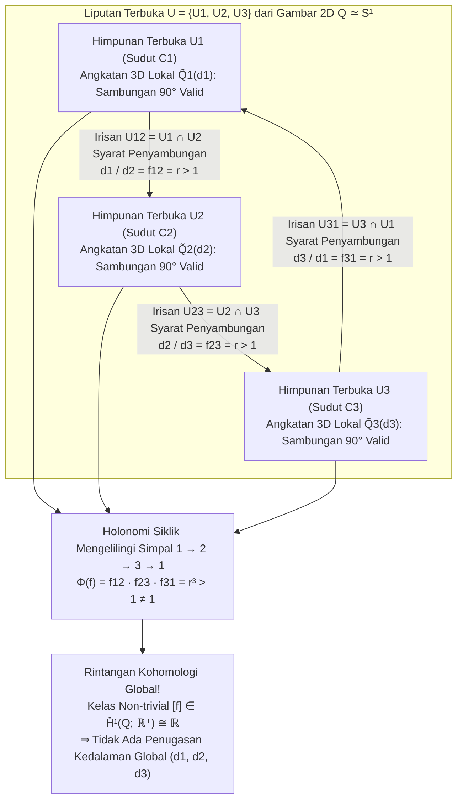
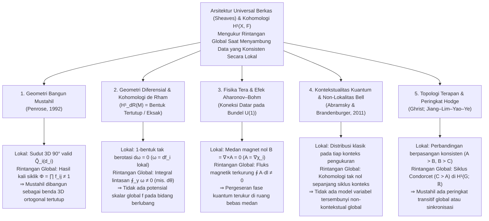

Hanya dengan selembar kertas, pensil, dan penggaris, siapa pun dapat menggambar <strong>Segitiga Penrose (Penrose Tribar / Penrose Triangle)</strong> dalam hitungan menit: tiga balok lurus berpenampang persegi bertemu berpasangan membentuk sudut siku-siku ($90^\circ$), menciptakan apa yang tampak seperti kerangka segitiga tertutup yang kokoh. Atau bayangkan tangga biara ikonik dalam litografi karya seniman grafis Belanda <strong>Maurits Cornelis Escher (1898–1972)</strong> berjudul *Naik dan Turun* (*Ascending and Descending*, 1960): dua barisan biarawan berjalan tanpa henti menaiki dan menuruni tangga batu empat sisi, terus mendaki dalam putaran tertutup namun kembali tepat ke ketinggian awal.

Saat kita menatap <strong>bangun mustahil (Impossible Figures / Impossible Objects)</strong> semacam itu, korteks visual kita mengalami vertigo kognitif yang unik. Perhatikan hanya sudut atas Segitiga Penrose: itu adalah sambungan kayu siku-siku tiga dimensi yang sangat wajar dan mematuhi hukum fisika. Alihkan pandangan ke sudut kiri bawah atau kanan bawah: tidak ada satu pun aksioma geometri Euklides yang dilanggar. Namun, begitu mata Anda menelusuri ketiga balok secara kontinu mengelilingi lintasan tertutup, bencana global meledak—<strong>sebuah balok yang di satu ujung jelas berada lebih dekat ke mata pengamat, secara mulus melintas di belakang balok yang berada lebih jauh di ujung lainnya</strong>.

Bagaimana mungkin tangan manusia dapat dengan mudah menggambar di atas bidang dua dimensi suatu objek yang <strong>konsisten secara lokal di setiap bagiannya, tetapi mustahil diwujudkan secara global di ruang Euklides tiga dimensi $\mathbb{R}^3$</strong>? Dan bagaimana matematika modern memformulasikan mekanisme tepat ketika <strong>konsistensi lokal (Local Consistency)</strong> gagal dirakit menjadi <strong>keberadaan global (Global Realizability)</strong>?

Pada tahun 1992, fisikawan matematika peraih Nobel <strong>Sir Roger Penrose</strong> menerbitkan makalah klasik berjudul *"On the Cohomology of Impossible Figures"*. Dengan menggunakan <strong>teori berkas (Sheaf Theory)</strong> dan <strong>kohomologi Čech (Čech Cohomology)</strong>, Penrose membuktikan bahwa bangun mustahil bukan sekadar trik ilusi optik, melainkan manifestasi visual langsung dari <strong>kelas kohomologi non-trivial dalam grup kohomologi Čech pertama $\check{H}^1(Q; \mathbb{R}^+)$</strong>.

Dalam artikel ini, kita menelusuri sejarah bangun mustahil dari Oscar Reutersvärd hingga keluarga Penrose dan Escher, menganalisis bagaimana proyeksi perspektif $\pi: \mathbb{R}^3 \to \mathbb{R}^2$ menghapus serat kedalaman serta kalkulus pelabelan garis Huffman–Clowes, membangun formulasi kohomologi Čech Penrose langkah demi langkah, mengungkap aljabar linear di balik patung "Impossible Motion" karya Kokichi Sugihara, dan melihat bagaimana rintangan kohomologi yang sama mengatur kohomologi de Rham, efek Aharonov–Bohm, hingga kontekstualitas kuantum.

---

## 1. Menggambar yang Tak Terbangun: Reutersvärd, Penrose, dan M.C. Escher

### 1.1 Dari Satire Perspektif ke Paradoks Geometri Murni

Meskipun pelanggaran aturan perspektif secara sengaja telah muncul dalam ukiran William Hogarth *Satire on False Perspective* (1754), pelopor sejati bangun mustahil geometris murni adalah seniman Swedia <strong>Oscar Reutersvärd (1915–2002)</strong>. Pada tahun 1934, saat berusia 18 tahun di tengah pelajaran bahasa Latin, ia menggambar sembilan kubus dalam proyeksi isometrik yang membentuk cincin segitiga dengan kedalaman yang saling bertentangan secara siklik (*Opus 1*). Sepanjang hidupnya ia menciptakan lebih dari 2.500 bangun mustahil yang diabadikan pada prangko nasional Swedia tahun 1982.

### 1.2 Februari 1958: Makalah Bersejarah Lionel dan Roger Penrose

Secara independen, setelah mengunjungi pameran <strong>M.C. Escher</strong> saat Kongres Matematikawan Internasional (ICM) 1954 di Amsterdam, matematikawan muda Cambridge <strong>Roger Penrose (1931–)</strong> menyarikan paradoks spasial ke bentuk paling murni: <strong>Tribar Penrose (Penrose Tribar)</strong>. Ayahnya, psikiater dan ahli genetika <strong>Lionel S. Penrose (1898–1972)</strong>, merespons dengan merancang <strong>Tangga Tak Berujung Penrose (Penrose Endless Staircase)</strong>.

Pada Februari 1958, ayah dan anak ini menerbitkan makalah tiga halaman terkenal berjudul <strong>*"Impossible Objects: A Special Type of Visual Illusion"*</strong> dalam *British Journal of Psychology* (vol. 49, hlm. 31–33):

> *"Di sini setiap bagian struktur dapat diterima sebagai representasi objek padat normal, tetapi bencana terjadi akibat sambungan palsu antarbagian (false connexions of the parts)..."*

Setelah menerima cetak ulang makalah tersebut dari keluarga Penrose, Escher menciptakan trilogi abadi: *Belvedere* (Mei 1958), *Ascending and Descending* (Maret 1960, mengadopsi tangga tak berujung Penrose), dan *Waterfall* (Oktober 1961, merangkai tiga segitiga Penrose menjadi saluran air gerak abadi).

---

## 2. Geometri Penglihatan: Bagaimana Proyeksi $\pi: \mathbb{R}^3 \to \mathbb{R}^2$ Menghapus Kedalaman

### 2.1 Proyeksi Sentral, Proyeksi Paralel, dan Serat 1D (Fibers)

Tempatkan pusat optik mata pengamat di titik asal $\mathbf{0} = (0,0,0) \in \mathbb{R}^3$. <strong>Proyeksi sentral (perspektif)</strong> $\pi: \mathbb{R}^3 \setminus \{\mathbf{0}\} \to \mathbb{R}^2$ (atau ke bola arah $S^2$) memetakan setiap titik $\mathbf{r} = (x, y, z)$ di setengah ruang depan $z > 0$ ke bidang citra pada jarak fokus $f > 0$:

$$\pi(x, y, z) = \left( f \frac{x}{z}, \; f \frac{y}{z} \right), \qquad \text{atau} \qquad \pi(\mathbf{r}) = \frac{\mathbf{r}}{\|\mathbf{r}\|}$$

Apakah <strong>prapeta (serat / Fiber)</strong> $\pi^{-1}(p)$ dari satu titik citra 2D $p = \pi(\mathbf{r}_0)$? Karena penskalaan radial $\mathbf{r}_0 \mapsto \lambda \mathbf{r}_0$ oleh bilangan real positif $\lambda \in \mathbb{R}^+ = (0, \infty)$ tidak mengubah arah sinar ($\pi(\lambda \mathbf{r}_0) = \pi(\mathbf{r}_0) = p$), serat di atas setiap titik $p$ adalah sinar terbuka berdimensi satu yang diparameterisasi oleh grup perkalian bilangan real positif $\mathbb{R}^+ = ((0, \infty), \times)$:

$$\pi^{-1}(\pi(\mathbf{r}_0)) = \{ \lambda \mathbf{r}_0 \in \mathbb{R}^3 \setminus \{\mathbf{0}\} \mid \lambda \in \mathbb{R}^+ \}$$

Hal ini membawa konsekuensi geometris mendasar: <strong>jika kita menerapkan dilatasi radial $\mathbf{r} \mapsto \lambda \mathbf{r}$ yang berpusat di mata ($\lambda \in \mathbb{R}^+$) pada potongan kaku 3D $\tilde{Q}_i \subset \mathbb{R}^3 \setminus \{\mathbf{0}\}$, seluruh sudut siku-siku ($90^\circ$) tetap terjaga dan bayangan retinanya $\pi(\lambda \tilde{Q}_i) = \pi(\tilde{Q}_i)$ tetap 100% identik!</strong> Dalam proyeksi paralel ortografis $\pi_{\text{orth}}(x,y,z) = (x,y)$, kebebasan ini berupa translasi kedalaman $z \mapsto z + c$ oleh grup penjumlahan $(\mathbb{R}, +)$, yang isomorfik secara kanonik dengan $(\mathbb{R}^+, \times)$ melalui logaritma $\ln: (\mathbb{R}^+, \times) \xrightarrow{\sim} (\mathbb{R}, +)$.

### 2.2 Kalkulus Pelabelan Garis Huffman–Clowes (1971)

Untuk memecahkan masalah invers 3D, sistem visual menerapkan tiga asumsi: <strong>planaritas permukaan</strong>, <strong>ortogonalitas ($90^\circ$)</strong>, dan <strong>asumsi sudut pandang umum</strong>. Pada tahun 1971, <strong>David A. Huffman</strong> dan <strong>Max B. Clowes</strong> memformulasikan analisis gambar polihedral dengan memberi setiap tepi salah satu dari empat label: $+$ (tepi cembung), $-$ (tepi cekung), dan $\rightarrow, \leftarrow$ (kontur oklusi).

Secara mengejutkan, <strong>Segitiga Penrose lulus 100% uji kombinatorial Huffman–Clowes!</strong> Setiap titik temu (L, Y/Fork, Arrow, dan T) valid secara lokal. Kemustahilan Segitiga Penrose bukan berasal dari kontradiksi kombinatorial lokal, melainkan dari <strong>kegagalan global (kohomologis) dalam menutup koordinat kedalaman kontinu mengelilingi lintasan tertutup tak terkontraksi</strong>.

| Tingkat Konsistensi | Kerangka Matematika | Kondisi Geometris yang Diuji | Hasil pada Segitiga Penrose |
| :--- | :--- | :--- | :--- |
| <strong>Tingkat 1: Realisabilitas Titik Temu Lokal</strong> | Katalog Trihedral (Guzmán, 1968) | Apakah setiap titik temu $v_i$ dapat diwujudkan sebagai sudut 3D? | <strong>LULUS</strong> (Setiap sudut adalah sambungan $90^\circ$ yang valid) |
| <strong>Tingkat 2: Pelabelan Tepi Kombinatorial</strong> | Kalkulus Huffman–Clowes (1971) | Dapatkah label $+, -, \rightarrow, \leftarrow$ dipasang secara kompatibel di semua tepi? | <strong>LULUS</strong> (Memiliki pelabelan yang konsisten secara global) |
| <strong>Tingkat 3: Penyambungan Kaku Lokal</strong> | <strong>Kohomologi Berkas (Penrose, 1992)</strong> | Apakah rasio kedalaman $f_{ij}$ memenuhi $\prod f_{ij} = 1$ di sepanjang siklus? | <strong>GAGAL</strong> (Kelas non-trivial $[f] \in \check{H}^1(Q; \mathbb{R}^+) \neq 0$) |
| <strong>Tingkat 4: Polihedron Bidang Umum</strong> | Sistem Linear Sugihara (1986) | Tanpa syarat $90^\circ$, apakah sistem $A\mathbf{w}=\mathbf{0}, B\mathbf{w}>\mathbf{0}$ punya solusi? | <strong>LULUS</strong> (Dapat dibangun dalam 3D dengan bidang trapesium miring!) |

---

## 3. Konsistensi Lokal vs. Kontradiksi Global: Penyambungan pada Liputan Terbuka

Misalkan $Q \subset \mathbb{R}^2$ adalah gambar 2D Segitiga Penrose yang ekuivalen homotopi dengan lingkaran ($Q \simeq S^1$). Kita tutupi $Q$ dengan tiga himpunan terbuka $\mathcal{U} = \{U_1, U_2, U_3\}$, masing-masing memuat satu sudut $C_1, C_2, C_3$ beserta sebagian besar dua balok di dekatnya:

1. Setiap $U_i$ ($i=1,2,3$) terhubung sederhana (terkontraksi / Contractible).
2. Irisan berpasangan $U_{12} = U_1 \cap U_2$, $U_{23} = U_2 \cap U_3$, dan $U_{31} = U_3 \cap U_1$ adalah segmen terkontraksi tak kosong di tengah setiap balok.
3. Irisan rangkap tiga kosong: $U_1 \cap U_2 \cap U_3 = \emptyset$. Maka <strong>saraf liputan (Nerve of the Cover)</strong> $N(\mathcal{U})$ adalah batas segitiga $\partial \Delta^2 \cong S^1$.

Di atas setiap $U_i$, terdapat model 3D standar $\tilde{Q}_i^{\text{std}}$, dan setiap angkatan 3D kaku yang valid berbentuk $\tilde{Q}_i(d_i) = d_i \cdot \tilde{Q}_i^{\text{std}}$ dengan faktor skala kedalaman positif $d_i \in \mathbb{R}^+$.

Agar $\tilde{Q}_1(d_1)$ dan $\tilde{Q}_2(d_2)$ menyambung mulus pada irisan $U_{12} = U_1 \cap U_2$, perspektif balok menuntut rasio tetap $f_{12} = r > 1$. Berdasarkan simetri rotasi lipat tiga, pada ketiga irisan berlaku:

$$\frac{d_1}{d_2} = f_{12} = r > 1, \qquad \frac{d_2}{d_3} = f_{23} = r > 1, \qquad \frac{d_3}{d_1} = f_{31} = r > 1$$

Mengalikan ketiga persamaan mengelilingi siklus tertutup $1 \to 2 \to 3 \to 1$ menghasilkan kontradiksi aljabar langsung:

$$1 = \frac{d_1}{d_2} \cdot \frac{d_2}{d_3} \cdot \frac{d_3}{d_1} = f_{12} \cdot f_{23} \cdot f_{31} = r^3 > 1 \quad (\text{Kontradiksi!})$$

---

## 4. Formulasi Sir Roger Penrose (1992): Berkas dan Kohomologi Čech

Dalam *"On the Cohomology of Impossible Figures"* (1992), Roger Penrose mendefinisikan <strong>grup ambiguitas (Ambiguity Group) $G = (\mathbb{R}^+, \times)$</strong> dan membangun kompleks korantai Čech dari berkas konstan lokal $\mathcal{F}$ pada liputan baik $\mathcal{U} = \{U_1, U_2, U_3\}$:

$$C^0(\mathcal{U}, \mathbb{R}^+) \xrightarrow{\;\delta^0\;} C^1(\mathcal{U}, \mathbb{R}^+) \xrightarrow{\;\delta^1\;} C^2(\mathcal{U}, \mathbb{R}^+)$$

- <strong>0-korantai $C^0(\mathcal{U}, \mathbb{R}^+) = (\mathbb{R}^+)^3$</strong>: Penugasan kedalaman lokal $d = (d_1, d_2, d_3)$.
- <strong>1-korantai $C^1(\mathcal{U}, \mathbb{R}^+)$</strong>: Rasio transisi $f = (f_{12}, f_{23}, f_{31})$ pada irisan $U_{ij}$ dengan $f_{ji} = f_{ij}^{-1}$.
- <strong>Operator kobatas (Coboundary Operators)</strong>: $(\delta^0 d)_{ij} = d_i / d_j$ dan $(\delta^1 f)_{ijk} = f_{ij} f_{jk} f_{ki}$, memenuhi $\delta^1 \circ \delta^0 = 1$.

Karena $U_1 \cap U_2 \cap U_3 = \emptyset$, setiap 1-korantai otomatis merupakan <strong>1-kosiklus</strong> ($Z^1(\mathcal{U}, \mathbb{R}^+) = \ker \delta^1 \cong (\mathbb{R}^+)^3$). Objek 3D global yang konsisten ada jika dan hanya jika $f$ adalah <strong>1-kobatas</strong> ($f \in B^1(\mathcal{U}, \mathbb{R}^+) = \operatorname{Im} \delta^0$), yaitu $f_{ij} = d_i / d_j$.

<strong>Grup Kohomologi Čech Pertama</strong> didefinisikan sebagai grup kuosien:

$$\check{H}^1(Q; \mathbb{R}^+) \cong \frac{Z^1(\mathcal{U}, \mathbb{R}^+)}{B^1(\mathcal{U}, \mathbb{R}^+)} = \frac{\ker \delta^1}{\operatorname{Im} \delta^0} \xrightarrow[\;\sim\;]{\;\Phi\;} \mathbb{R}^+ \xrightarrow[\;\sim\;]{\;\ln\;} \mathbb{R}$$

di mana homomorfisme holonomi $\Phi(f) = f_{12} f_{23} f_{31}$ memiliki kernel tepat $B^1(\mathcal{U}, \mathbb{R}^+)$. Pada Segitiga Penrose, $\Phi(f) = r^3 \neq 1$ ($\ln \Phi(f) = 3\ln r \neq 0$), yang membuktikan <strong>Teorema Penrose (1992)</strong>: <strong>bangun mustahil secara harfiah adalah elemen non-trivial $[f] \neq 1$ dalam grup kohomologi Čech pertama $\check{H}^1(Q; G)$!</strong>

Jika segitiga dipotong di satu titik, ruang menjadi interval terkontraksi $Q_{\text{cut}} \simeq [0, 1]$ yang kohomologinya lenyap ($\check{H}^1([0, 1]; \mathbb{R}^+) = \{1\}$). Itulah sebabnya patung fisik (seperti di East Perth, Australia) dapat dibangun sebagai kait 3D terbuka yang kedua ujungnya berimpit pada satu sinar pandang $\pi^{-1}(p)$ dari satu sudut pandang aksidental.

---

## 5. Patung Kokichi Sugihara dan Paradigma Universal Kohomologi

### 5.1 Aljabar Linear "Impossible Motion" Kokichi Sugihara

Matematikawan Jepang <strong>Kokichi Sugihara (杉原厚吉)</strong> membuktikan dalam *Machine Interpretation of Line Drawings* (MIT Press, 1986) bahwa gambar garis dapat diwujudkan sebagai polihedron 3D kontinu berbidang datar jika dan hanya jika sistem persamaan linear insidensi dan pertidaksamaan kedalaman

$$A \mathbf{w} = \mathbf{0}, \qquad B \mathbf{w} > \mathbf{0}$$

memiliki solusi $\mathbf{w}$. Sementara otak manusia secara tak sadar menambahkan syarat kesikuan $C_{\text{rect}} \mathbf{w} = \mathbf{0}$ (sehingga sistem tak punya solusi karena $\check{H}^1 \neq 0$), Sugihara membuang $C_{\text{rect}} \mathbf{w} = \mathbf{0}$ dan membangun benda padat 3D tertutup $\mathbf{w}^*$ dari bidang trapesium miring. Karena korteks visual tetap memaksakan asumsi sudut siku-siku, bidang miring yang secara fisik <strong>menurun</strong> dipersepsikan <strong>menanjak</strong>, sehingga bola kayu tampak menggelinding naik melawan gravitasi!

### 5.2 Paradigma Universal Berkas dan Kohomologi dalam Sains

| Ranah Ilmiah | Ruang Dasar $X$ & Liputan $\{U_i\}$ | Penampang Lokal $s_i \in \mathcal{F}(U_i)$ | Syarat Sambungan pada $U_i \cap U_j$ | Realisabilitas Global ($\check{H}^1 = 0$) | Makna Kohomologi Tak Nol $\check{H}^1(X, \mathcal{F}) \neq 0$ |
| :--- | :--- | :--- | :--- | :--- | :--- |
| <strong>Bangun Mustahil</strong> (Penrose, 1992) | Gambar 2D $Q \simeq S^1$ & sudut $\{U_i\}$ | Skala kedalaman 3D lokal $d_i \in \mathbb{R}^+$ | Rasio kedalaman $f_{ij} = d_i / d_j$ | Hasil kali siklik $\Phi = \prod f_{ij} = 1$ (Benda 3D) | <strong>Segitiga Penrose / Tangga Escher</strong> (Tak terbangun dalam 3D ortogonal) |
| <strong>Geometri Diferensial</strong> (Kohomologi de Rham) | Manifol mulus $M$ (mis. $\mathbb{R}^2 \setminus \{0\}$) | Potensial lokal $f_i$ dari 1-bentuk tertutup $\omega = df_i$ | Selisih potensial $f_i - f_j = c_{ij}$ | Sirkulasi nol $\oint_\gamma \omega = 0$ (Bentuk eksak) | <strong>1-bentuk sudut $\omega = d\theta$</strong> (Tangga Escher kontinu tanpa potensial global) |
| <strong>Fisika Tera</strong> (Aharonov–Bohm, 1959) | Ruang bebas medan $M \simeq S^1$ di luar solenoida | Fase tera lokal $\chi_i$ di mana $\mathbf{A} = \nabla \chi_i$ ($\mathbf{B}=\mathbf{0}$) | Transisi $U(1)$ $g_{ij} = e^{ie(\chi_i-\chi_j)/\hbar}$ | Simpal Wilson trivial $\exp(\frac{ie}{\hbar}\oint \mathbf{A}\cdot d\mathbf{l}) = 1$ | <strong>Pergeseran Fase Kuantum Aharonov–Bohm</strong> di medan magnet nol |
| <strong>Fondasi Kuantum</strong> (Abramsky et al., 2011) | Himpunan observabel $X$ & konteks $\{U_i\}$ | Probabilitas klasik lokal pada tiap konteks | Kesamaan marginal (No-Signaling) | Adanya model variabel tersembunyi global | <strong>Kontekstualitas Kuantum & Non-Lokalitas Bell</strong> (Kochen–Specker / Hardy) |
| <strong>Topologi Terapan</strong> (Ghrist; HodgeRank) | Graf perbandingan $G = (V, E)$ | Skor global / waktu simpul $d_i \in \mathbb{R}$ | Selisih skor berpasangan $f_{ij} = d_i - d_j$ | Jumlah siklik nol di semua siklus (Transitivitas) | <strong>Paradoks Condorcet (Siklus Batu-Gunting-Kertas)</strong> |

Rasa takjub saat mata kita mengelilingi Segitiga Penrose atau tangga Escher adalah bukti nyata bahwa korteks visual kita menghitung transpor paralel mengelilingi simpal tertutup dan mendeteksi secara langsung <strong>kelas kohomologi non-trivial dalam $\check{H}^1(Q; \mathbb{R}^+)$</strong>.

---

## Referensi

1. <strong>Penrose, L. S., & Penrose, R.</strong> (1958). "Impossible Objects: A Special Type of Visual Illusion." *British Journal of Psychology*, 49(1), 31–33.
2. <strong>Penrose, R.</strong> (1992). "On the Cohomology of Impossible Figures." *Structural Topology*, 17, 11–16.
3. <strong>Huffman, D. A.</strong> (1971). "Impossible Objects as Nonsense Sentences." *Machine Intelligence*, 6, 295–323.
4. <strong>Sugihara, K.</strong> (1986). *Machine Interpretation of Line Drawings*. MIT Press.
5. <strong>Abramsky, S., & Brandenburger, A.</strong> (2011). "The Sheaf-Theoretic Structure of Non-Locality and Contextuality." *New Journal of Physics*, 13(11), 113036.
