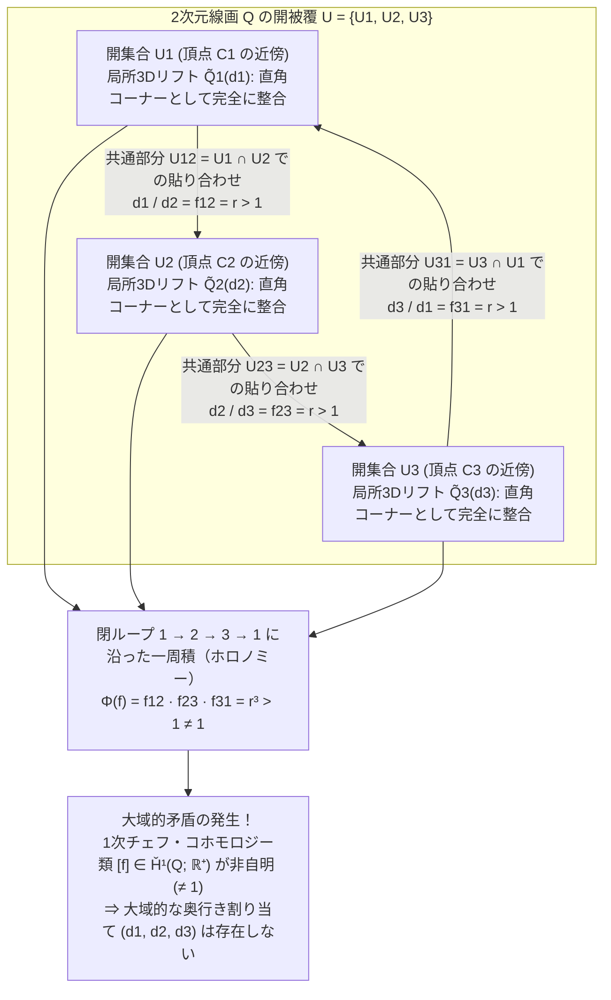
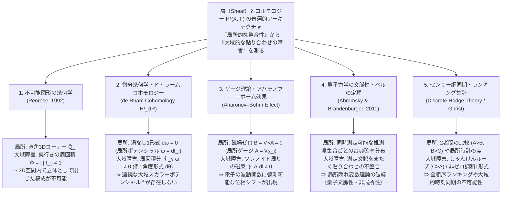

紙と鉛筆、そして定規さえあれば、誰でも数分で<strong>「ペンローズの三角形（Penrose Tribar）」</strong>を描くことができる。四角い断面をもつ3本のまっすぐな角材が、それぞれの頂点で互いに直角（$90^\circ$）に組み合わさり、全体として正三角形のような閉じた枠を形作っている図形だ。あるいは、オランダの版画家<strong>マウリッツ・コルネリス・エッシャー（M.C. Escher, 1898–1972）</strong>が1960年の傑作リトグラフ『上昇と下降（Ascending and Descending）』で描いた修道院の屋上階段を思い浮かべてもよい。修道士たちはただひたすら同じ方向に階段を上り続けているのに、いつの間にか出発点と同じ高さに戻ってきてしまう。

これらの図形——<strong>不可能図形（Impossible Figures / Impossible Objects）</strong>——を前にしたとき、私たちの視覚野は奇妙な認知的めまいに襲われる。図形の左上隅を見る。何の変哲もない、大工が木材を直角に継いだだけの完全にまっとうな三次元構造だ。右上隅に視線を移す。そこも完全に合理的で物理法則に従っている。下端の角を見る。やはり一点の曇りもなく立体として成立している。にもかかわらず、視線を三角形の周囲に沿ってぐるりと一周させた瞬間、<strong>「手前にあるはずの柱が奥の柱の後ろに回り込んでいる」</strong>という絶対的な空間的矛盾が立ち現れるのである。

なぜ人間の手は、二次元の平面上に「どの局所（パーツ）を見ても立体として完全に正しいのに、全体（グローバル）としては三次元ユークリッド空間 $\mathbb{R}^3$ に絶対に存在し得ない図形」を描くことができるのだろうか？ そして、<strong>「局所的な整合性（Local Consistency）」から「大域的な矛盾（Global Contradiction）」が生じるメカニズム</strong>を、現代数学はどのように記述するのだろうか？

1992年、ノーベル物理学賞受賞者でもある数理物理学者<strong>ロジャー・ペンローズ（Sir Roger Penrose）</strong>は、自身が父ライオネルとともに1958年に世に送り出したこの視覚的パラドックスを、20世紀数学の最高峰の概念である<strong>「層（Sheaf / シーフ）」</strong>と<strong>「チェフ・コホモロジー（Čech Cohomology）」</strong>を用いて見事に定式化した。結論を先取りすれば、不可能図形とは単なる目の錯覚や絵画のトリックではない。それは<strong>「空間の1次チェフ・コホモロジー群 $\check{H}^1(Q; \mathbb{R}^+)$ における非自明なコホモロジー類（Non-trivial Cohomology Class）の視覚化」</strong>そのものなのである。

本稿では、ロイテルスッキョルドやペンローズ親子、エッシャーによる不可能図形の歴史から出発し、透視投影 $\pi: \mathbb{R}^3 \to \mathbb{R}^2$ が奥行き情報を破壊する幾何学的構造、コンピュータビジョンにおけるハフマン＝クロウズの線画ラベリング理論、ペンローズによる層とコホモロジーの厳密な構成、さらには明治大学の杉原厚吉教授による「実在する不可能立体（Impossible Motion）」の数理と、微分幾何学・ゲージ理論・量子力学の文脈性に至る「局所と大域」の普遍的パラダイムを徹底的に解き明かす。

---

## 1. 描けるのに作れない立体：ロイテルスッキョルド、ペンローズ、エッシャーの系譜

### 1.1 遠近法の破壊から純粋な幾何学的パラドックスへ

絵画の歴史において、二次元平面上の奥行き手がかり（Depth Cues）を意図的に操作して矛盾を生じさせる試み自体は、ルネサンス以降の透視図法（遠近法）の確立とともに散発的に現れていた。たとえば18世紀イギリスの画家ウィリアム・ホガース（William Hogarth）が1754年に制作した銅版画『誤った遠近法への風刺（Satire on False Perspective）』では、前景の釣り人の竿がはるか遠景の川面に届いていたり、手前の建物の看板が奥の教会の背後に隠れていたりする無数の視覚的ジョークが詰め込まれている。

しかし、ホガースの版画は風景全体の複雑な遮蔽関係を利用した戯画であり、単一の剛体オブジェクトとしての「純粋な幾何学的不可能性」を抽出したものではなかった。史上初めて、余計な装飾を一切排した純粋な幾何学的立体として不可能図形を創造したのは、スウェーデンの芸術家<strong>オスカー・ロイテルスッキョルド（Oscar Reutersvärd, 1915–2002）</strong>である。

1934年、当時18歳の高校生だったロイテルスッキョルドは、退屈なラテン語の授業中に教科書の余白へ六芒星を描き、その周囲に立方体を並べていくうちに、<strong>9個の立方体が三角形のループ状に並びながら、奥行き方向が循環的に矛盾する立体配置（『Opus 1』）</strong>を偶然発見した。彼はその後、生涯にわたって2,500点を超える不可能図形を等角投影図（アイソメトリック図法）で描き続け、「不可能図形の父」と呼ばれることになる（1982年にはスウェーデン政府が彼の不可能三角形をモチーフにした記念切手を発行している）。

### 1.2 1958年：ペンローズ親子の歴史的論文『Impossible Objects』

ロイテルスッキョルドとは独立に、不可能図形を視覚心理学および数学の対象として決定的に定式化したのが、イギリスの精神医学者・遺伝学者<strong>ライオネル・ペンローズ（Lionel S. Penrose, 1898–1972）</strong>と、その息子で当時ケンブリッジ大学の若き数学者だった<strong>ロジャー・ペンローズ（Roger Penrose, 1931–）</strong>である。

きっかけは1954年、アムステルダムで開催された国際数学者会議（ICM）だった。当時23歳の大学院生だったロジャー・ペンローズは、会場近くの市立美術館で開催されていたM.C.エッシャーの展覧会を偶然訪れ、その幾何学的世界に強い衝撃を受けた。イギリスへ帰国したロジャーは、「自分でもエッシャーを驚かせるような新しい幾何学的パラドックスを作れないか」と考え、父ライオネルとともに試行錯誤を重ねた。

ロジャーが考案したのが、3本の角材を直角に接合した<strong>「ペンローズの三角形（Penrose Tribar / Triangle）」</strong>であり、父ライオネルがそれに応えて考案したのが、4つの角で折れ曲がりながら無限に上昇（または下降）し続ける<strong>「ペンローズの無限階段（Penrose Endless Staircase）」</strong>であった。二人は1958年2月、イギリスの心理学誌『British Journal of Psychology』（第49巻、31〜33頁）に、わずか3ページの短い、しかし歴史的な論文<strong>『Impossible Objects: A Special Type of Visual Illusion（不可能物体：ある特殊な視覚的錯覚）』</strong>を発表した。

この1958年論文の中で、ペンローズ親子はすでに問題の核心をきわめて正確に射抜いていた。

> 「ここに示された図形の各部分（individual parts）は、三次元空間内の通常の物体を表現するものとして完全に受け入れ可能である。それにもかかわらず、図形全体が示す物体は、局所的な表現の誤った結合（false connexions of the parts）ゆえに不可能なものとなっている。」
> — L. S. Penrose & R. Penrose (1958), *Impossible Objects: A Special Type of Visual Illusion*

### 1.3 エッシャーとの往復書簡と不朽の三部作

ペンローズ親子はこの論文の別刷りを、敬意を込めてオランダのエッシャーのもとへ郵送した。論文を読んだエッシャーは深く感銘を受け、直ちに自らの版画制作へとそのアイデアを昇華させた。

1. <strong>『物見の塔（Belvedere）』（1958年5月）</strong>：ネッカーの立方体（Necker Cube）の表裏反転を建築構造に応用し、1階と2階の間で柱が手前と奥へ斜めにねじれながら、3階の屋根自体は水平を保っている不可能な展望台を描いた。建物の足元にあるベンチには、手の中の「不可能な立方体」を不思議そうに見つめる少年が座っており、その傍らの床には構造の種明かしとなる線画が落ちている。
2. <strong>『上昇と下降（Ascending and Descending）』（1960年3月）</strong>：ライオネル・ペンローズの「無限階段」を直接採用した作品である。エッシャーは1960年1月にライオネル・ペンローズへ宛てた手紙の中で、「あなたの息子さんとあなたが発表された階段の図に魅了され、ここ数週間、それを主題とした新しいリトグラフの制作に没頭しています」と記している。
3. <strong>『滝（Waterfall）』（1961年10月）</strong>：ロジャー・ペンローズの「ペンローズの三角形」を3個ジグザグに連結した構造体の上に水路を走らせた傑作である。水路は観察者の目には遠ざかりながら緩やかに下っているように見えるが、3つのペンローズ三角形を通り抜けた終端は、なんと出発点である水車の真上に位置している。結果として、高所から落下した水が水車を回し、そのまま同じ水路を通って再び落下地点へと戻る「重力永久機関」が視覚的に成立してしまう。

こうして、数学者（ペンローズ）が芸術家（エッシャー）に触発されて純粋な幾何学的構造を抽出し、それが再び芸術家の手に渡って人類史上最も有名な視覚芸術となり、そして34年後の1992年、再びロジャー・ペンローズ自身によって<strong>代数的位相幾何学（Algebraic Topology）と層理論（Sheaf Theory）の言葉で完全に数学化される</strong>という、科学史と芸術史の奇跡的なキャッチボールが実現したのである。

---

## 2. 視覚の幾何学：なぜ透視投影 $\pi: \mathbb{R}^3 \to \mathbb{R}^2$ は奥行きを消去するのか

不可能図形がなぜ成立するのかを数学的に理解するための第一歩は、<strong>「三次元空間の物体を二次元の平面（網膜または紙面）に写し取る写像」</strong>がもつ情報損失の構造を正確に定式化することである。

### 2.1 中心投影（透視投影）と平行投影のファイバー構造

私たちの目（またはピンホールカメラ）の光学中心を、三次元ユークリッド空間 $\mathbb{R}^3$ の原点 $\mathbf{0} = (0, 0, 0)$ に置こう。観察者は $z > 0$ の前方半空間を見つめており、焦点距離 $f > 0$ の位置にある平面 $I = \{ (X, Y, f) \in \mathbb{R}^3 \}\cong \mathbb{R}^2$ を「画像平面（網膜またはキャンバス）」とする。

このとき、原点以外の空間領域 $W = \{ (x, y, z) \in \mathbb{R}^3 \mid z > 0 \}$ から画像平面 $I \cong \mathbb{R}^2$ への<strong>中心投影（Central / Perspective Projection）</strong> $\pi: W \to \mathbb{R}^2$ は、次の非線形写像で与えられる。

$$\pi(x, y, z) = \left( f \frac{x}{z}, \; f \frac{y}{z} \right) = (X, Y)$$

より本質的には、原点 $\mathbf{0}$ から出る半直線（視線レイ）のなす空間は実射影平面 $\mathbb{R}\mathbb{P}^2$（向きを考慮すれば単位球面 $S^2$）と同一視でき、投影写像 $\pi: \mathbb{R}^3 \setminus \{\mathbf{0}\} \to S^2$ は

$$\pi(\mathbf{r}) = \frac{\mathbf{r}}{\|\mathbf{r}\|} \qquad (\mathbf{r} \in \mathbb{R}^3 \setminus \{\mathbf{0}\})$$

という商写像にほかならない。

ここで決定的に重要な幾何学的事実がある。二次元画像上の1点 $p \in S^2$（または $(X, Y) \in \mathbb{R}^2$）に対して、その<strong>逆像（ファイバー / Fiber）</strong> $\pi^{-1}(p)$ はどのような集合になるだろうか？ 原点から発する半直線上のすべての点は、任意の正の実数 $\lambda \in \mathbb{R}^+ = (0, \infty)$ によるスカラー倍 $\mathbf{r} \mapsto \lambda \mathbf{r}$ に対して

$$\pi(\lambda \mathbf{r}) = \frac{\lambda \mathbf{r}}{\|\lambda \mathbf{r}\|} = \frac{\lambda \mathbf{r}}{\lambda \|\mathbf{r}\|} = \pi(\mathbf{r})$$

を満たす。すなわち、画像平面上の1点 $p = \pi(\mathbf{r}_0)$ のファイバーは、正の実数の乗法群 $\mathbb{R}^+ = ((0, \infty), \times)$ によってパラメータ付けられる1次元の半直線（視線レイ）全体となる。

$$\pi^{-1}(\pi(\mathbf{r}_0)) = \{ \lambda \mathbf{r}_0 \in \mathbb{R}^3 \setminus \{\mathbf{0}\} \mid \lambda \in \mathbb{R}^+ \}$$

これは次の驚くべき帰結を意味する。<strong>三次元空間内のいかなる立体パーツ $\tilde{Q}_i \subset \mathbb{R}^3 \setminus \{\mathbf{0}\}$ であっても、それを原点（観察者の目）を中心として $\lambda$ 倍に拡大しながら距離も $\lambda$ 倍遠ざける変換 $\mathbf{r} \mapsto \lambda \mathbf{r}$ （$\lambda \in \mathbb{R}^+$）を施すと、二次元の網膜像 $\pi(\lambda \tilde{Q}_i) = \pi(\tilde{Q}_i)$ は1ミリたりとも変化せず、完全に同一の線画を与える</strong>のである！

同様に、無限遠点から眺めた極限である<strong>平行投影（Orthographic / Isometric Projection）</strong> $\pi_{\text{orth}}(x, y, z) = (x, y)$ においては、視線方向（$z$ 軸方向）への任意の平行移動 $(x, y, z) \mapsto (x, y, z + c)$ （$c \in \mathbb{R}$）に対して投影像が不変となる。この場合、各点上のファイバーの自由度は実数の加法群 $(\mathbb{R}, +)$ によって与えられる。対数関数と指数関数

$$\ln: (\mathbb{R}^+, \times) \xrightarrow{\sim} (\mathbb{R}, +), \qquad \exp: (\mathbb{R}, +) \xrightarrow{\sim} (\mathbb{R}^+, \times)$$

が群の同型写像（より正確には1次元リー群の同型）を与えるため、中心投影における乗法的スケール不定性 $\lambda \in \mathbb{R}^+$ と、平行投影における加法的奥行きシフト不定性 $c = \ln \lambda \in \mathbb{R}$ は、代数的・位相的に<strong>完全に同型な構造</strong>をもっている。

### 2.2 逆問題としての立体復元とハフマン＝クロウズの線画ラベリング

投影写像 $\pi: \mathbb{R}^3 \to \mathbb{R}^2$ が各点で1次元のファイバー（奥行き $\lambda \in \mathbb{R}^+$ または $c \in \mathbb{R}$）を潰してしまう以上、二次元の線画 $Q \subset \mathbb{R}^2$ から元の三次元立体 $\tilde{Q} \subset \mathbb{R}^3$ を復元する問題は、数学的には解が一意に定まらない<strong>不良設定逆問題（Ill-posed Inverse Problem）</strong>である。

それにもかかわらず、私たちが普段、立方体の線画や建築物のスケッチを見て瞬時に三次元形状を知覚できるのはなぜだろうか？ それは人間の視覚系が、無限に存在する数学的逆像の中から、以下のような<strong>局所的な構造的事前知識（Structural Priors）</strong>を無意識のうちに課して奥行きを決定しているからである。

1. <strong>平面性（Planarity）</strong>：線画の閉じた領域（面）は、三次元空間内でねじれた曲面ではなく平坦な平面である。
2. <strong>直交性（Orthogonality / Rectangularity）</strong>：3本の線分が交わる頂点（Y字接合や矢印型接合、L字接合）は、三次元空間内で互いに $90^\circ$ に直交する直方体の角（コーナー）である。
3. <strong>一般視点の仮定（General Viewpoint Assumption）</strong>：三次元空間内で離れた2つの頂点や辺が、たまたま一本の視線上で重なって1つの頂点や直線に見えている（偶然の一致）のではなく、二次元画像での接続関係は三次元空間での実際の物理的接触・接続をそのまま反映している。

1971年、情報理論のハフマン符号で知られる<strong>デイヴィッド・ハフマン（David A. Huffman）</strong>と人工知能研究者の<strong>マックス・クロウズ（Max B. Clowes）</strong>はそれぞれ独立に、多面体の線画が三次元物体として解釈可能かどうかを判定する組合せ論的アルゴリズム——<strong>ハフマン＝クロウズの線画ラベリング理論（Huffman–Clowes Line Labeling Calculus）</strong>——を構築した。

この理論では、線画のすべての辺（線分）に対して、以下の4種類の3次元的な物理的意味（ラベル）のいずれかを割り当てる。

- <strong>$+$（凸辺 / Convex Edge）</strong>：その辺を挟む2つの面がともに観察者から見えており、手前に突き出た尾根（山折り）をなしている。
- <strong>$-$（凹辺 / Concave Edge）</strong>：その辺を挟む2つの面がともに観察者から見えており、奥へ引っ込んだ谷（谷折り）をなしている。
- <strong>$\rightarrow$ または $\leftarrow$（遮蔽輪郭辺 / Occluding Boundary Edge）</strong>：一方の面だけが見えており、もう一方の面は裏側に回り込んで見えない外縁である。矢印の向きに沿って歩いたとき、<strong>右側に見える面が手前にあり、左側の領域は背景（奥側へ不連続に離れた別の面）である</strong>ことを表す。

3つの面が交わる「三面頂点（Trihedral Vertex）」を一般視点から投影すると、二次元画像上の頂点（Junction）の形状は、線分のなす角度に応じて以下の4種類に分類される。

1. <strong>L字型頂点（L-junction）</strong>：2本の線分が交わる角（6通りの有効なラベル配置）。
2. <strong>Y字型／フォーク型頂点（Fork / Y-junction）</strong>：3本の線分がすべて $180^\circ$ 未満の角度で交わる頂点（3本とも $+$ の凸頂点、3本とも $-$ の凹頂点など、計5通りの有効なラベル配置）。
3. <strong>矢印型頂点（Arrow / W-junction）</strong>：3本の線分のうち1つの角度が $180^\circ$ を超える頂点（両脇が $\rightarrow, \leftarrow$ で中央が $+$、または両脇が $-$ で中央が $+$ など、計3通りの有効なラベル配置）。
4. <strong>T字型頂点（T-junction）</strong>：1本の直線の途中に別の線分が突き当たる頂点。これは手前の面（Tの横棒）が奥の辺（Tの縦棒）を遮蔽している箇所を表す（4通りの有効なラベル配置）。

3本の線が交わる頂点に対して、4種類のラベル（$+, -, \rightarrow, \leftarrow$）を単純に割り当てると $4^3 = 64$ 通りの組合せがあるが、実際の三次元空間の三面頂点として物理的に実現可能なものは、そのわずか4分の1以下（Y字で5通り、矢印型で3通り）にすぎない。

では、<strong>ペンローズの三角形にハフマン＝クロウズのラベリングを適用するとどうなるだろうか？</strong> 驚くべきことに、ペンローズの三角形は<strong>すべての頂点およびすべての辺において、ハフマン＝クロウズの組合せ論的ラベリング条件を100%完璧にパスしてしまう</strong>のである！

各角材の3つの見えている長辺のうち、内側の辺と外側の輪郭辺には遮蔽ラベル（$\rightarrow$）、2つの見えている面が接する中央の稜線には凸ラベル（$+$）、そして角材同士が内側で食い込むT字接合やL字接合には凹ラベル（$-$）や遮蔽ラベルを矛盾なく割り当てることができる。これが意味するのは極めて重大な事実だ。<strong>ペンローズの三角形の不可能性は、頂点ごとの「位相的・組合せ論的な凹凸や遮蔽の矛盾」ではなく、連続的な実数値としての「奥行き座標（メトリック／スケール）を閉曲線に沿って一周積分したときに生じる大域的（コホモロジー的）なズレ」に起因している</strong>のである。

二次元線画の三次元実現可能性をめぐる4つの階層を整理すると、以下の表のようになる。

| 整合性の階層 | 数学的モデル・理論 | 判定される条件 | ペンローズの三角形の判定結果 |
| :--- | :--- | :--- | :--- |
| <strong>第1階層：局所頂点実現性</strong> | 三面頂点カタログ（Guzman, 1968） | 個々の頂点 $v_i$ の近傍が3Dの角として存在できるか | <strong>合格（すべての角が正しい直交接合）</strong> |
| <strong>第2階層：組合せ論的辺ラベリング</strong> | ハフマン＝クロウズ理論（Huffman–Clowes, 1971） | 全ての辺に $+, -, \rightarrow, \leftarrow$ を隣接頂点間で矛盾なく付与できるか | <strong>合格（大域的に有効なラベル付けが存在）</strong> |
| <strong>第3階層：局所パッチの剛体貼り合わせ</strong> | <strong>ペンローズの層コホモロジー（Penrose, 1992）</strong> | 直交性を保った局所3Dパーツのスケール比 $f_{ij}$ が閉ループで $\prod f_{ij} = 1$ を満たすか | <strong>不合格（$\check{H}^1(Q; \mathbb{R}^+) \neq 0$ により破綻）</strong> |
| <strong>第4階層：一般平面多面体としての実現性</strong> | 杉原の線形計画判定（Sugihara, 1986） | 直交性の仮定を外し、平面方程式と遮蔽不等式 $Aw=0, Bw>0$ の解が存在するか | <strong>合格（非直角の歪んだ平面を使えば実在可能！）</strong> |

---

## 3. 局所的な整合性と大域的な矛盾：開被覆による貼り合わせの破綻

ロジャー・ペンローズの1992年の理論に入る前に、ペンローズの三角形 $Q \subset \mathbb{R}^2$ において「局所的には完全に正しい3つのパーツが、なぜ全体として貼り合わせられないのか」を幾何学的に追跡してみよう。

### 3.1 開被覆 $\mathcal{U} = \{U_1, U_2, U_3\}$ と局所的3Dリフト

二次元平面上に描かれたペンローズの三角形 $Q \subset \mathbb{R}^2$ を考える。位相空間として見れば、$Q$ は中央に穴が1つ開いた円環領域（アニュラス）、すなわち円周 $S^1$ とホモトピー同値（$Q \simeq S^1$）な連結空間である。

いま、この図形 $Q$ を、3つの頂点（コーナー）$C_1, C_2, C_3$ をそれぞれ含む3つの開集合 $U_1, U_2, U_3 \subset Q$ で覆う（<strong>開被覆 / Open Cover</strong> $\mathcal{U} = \{U_1, U_2, U_3\}$）。

- <strong>$U_1$</strong>：頂点 $C_1$ と、そこから伸びる2本の角材（ビーム12およびビーム31）の途中までを含むL字型の領域。
- <strong>$U_2$</strong>：頂点 $C_2$ と、そこから伸びる2本の角材（ビーム23およびビーム12）の途中までを含むL字型の領域。
- <strong>$U_3$</strong>：頂点 $C_3$ と、そこから伸びる2本の角材（ビーム31およびビーム23）の途中までを含むL字型の領域。

この開被覆 $\mathcal{U} = \{U_1, U_2, U_3\}$ の交わり（共通部分）の構造を確認しよう。

1. 各開集合 $U_i$ （$i = 1, 2, 3$）自体は穴をもたない単連結（可縮 / Contractible）な領域である。
2. 2つの開集合の共通部分 $U_{12} = U_1 \cap U_2$、$U_{23} = U_2 \cap U_3$、$U_{31} = U_3 \cap U_1$ は、それぞれ3本のまっすぐな角材の中央部分に相当する、空でない連結な領域である。
3. 3つすべての共通部分は空集合である：$U_{123} = U_1 \cap U_2 \cap U_3 = \emptyset$。

この開被覆の組合せ論的な骨格（各 $U_i$ を頂点、空でない交わり $U_{ij}$ を辺とする単体的複体）を、位相幾何学では<strong>被覆の脈体（Nerve of the Cover）</strong> $N(\mathcal{U})$ と呼ぶ。明らかに、$N(\mathcal{U})$ は3つの頂点と3つの辺からなる三角形の周 $\partial \Delta^2 \cong S^1$ である。

さて、人間の視覚野が $U_1$ だけを見つめたとしよう。$U_1$ に描かれているのは、2本の角材が直角（$90^\circ$）に接合された単なるL字型の木組みである。したがって、$U_1$ の上には、投影すると正確に $U_1$ に一致するような<strong>局所的な三次元立体モデル（局所リフト / Local 3D Lift）</strong> $\tilde{Q}_1 \subset \mathbb{R}^3 \setminus \{\mathbf{0}\}$ が完全に矛盾なく構成できる。同様に、$U_2$ の上にも直角L字パーツ $\tilde{Q}_2$ が、$U_3$ の上にも直角L字パーツ $\tilde{Q}_3$ が、それぞれ三次元空間内の剛体として完璧に構成できる。

### 3.2 共通部分 $U_i \cap U_j$ における奥行きの比較と不一致の蓄積

では、局所パーツ $\tilde{Q}_1, \tilde{Q}_2, \tilde{Q}_3$ にはどれだけの自由度が残されているだろうか？
第2.1節で証明した通り、各パーツの形状（直角に交わる正方断面の角材）と姿勢が線画から決まっているとき、網膜像 $\pi(\tilde{Q}_i) = U_i$ を一切変えずに三次元空間内で $\tilde{Q}_i$ を動かす唯一の自由度は、<strong>観察者の目（原点）からの全体的な距離（スケール係数） $d_i \in \mathbb{R}^+$ の選択</strong>だけである。

つまり、基準となる標準的な3Dコーナーモデル $\tilde{Q}_i^{\text{std}}$ を1つ固定すれば、任意の有効な3Dリフトは

$$\tilde{Q}_i(d_i) = d_i \cdot \tilde{Q}_i^{\text{std}} \qquad (d_i > 0)$$

と表される。直観的には、$d_i$ は「コーナー $C_i$ が観察者の目からどれだけ遠くに置かれているか」を表す正の実数座標である。

いま、コーナー1からコーナー2へ向かう角材の中央部分 $U_{12} = U_1 \cap U_2$ に注目しよう。ペンローズの三角形の図を観察すると、コーナー1（$U_1$）では手前側を向いている面が、角材に沿ってコーナー2（$U_2$）へ進むにつれて<strong>観察者から遠ざかる方向（奥行きが増す方向）</strong>へと伸びており、コーナー2において別の角材の裏側へと接合されている（あるいは逆に手前へ迫り出している）。

もし基準モデル $\tilde{Q}_1^{\text{std}}, \tilde{Q}_2^{\text{std}}, \tilde{Q}_3^{\text{std}}$ を、すべて3回回転対称性によって同じ基準距離に正規化して選んだとしよう。すると、共通部分 $U_{12} = U_1 \cap U_2$ において2つの3Dパーツ $\tilde{Q}_1(d_1)$ と $\tilde{Q}_2(d_2)$ が段差や食い違いなくピタリと1本の角材としてつながるためには、コーナー1のスケール $d_1$ とコーナー2のスケール $d_2$ の間に、図形の遠近角によって一意に決まる<strong>正の比率 $f_{12} \in \mathbb{R}^+$</strong> が成り立たなければならない。

$$\frac{d_1}{d_2} = f_{12} > 1$$

（ここで $f_{12} > 1$ は、角材 $1 \to 2$ に沿って進むと奥行き距離が縮む、すなわち $d_1 > d_2$ でなければならないことを意味する。逆向きに回れば $f_{12} < 1$ となるが、議論はまったく同じである）。

まったく同じことが、残りの2本の角材の上でも起こる！ ペンローズの三角形は二次元平面上で $120^\circ$ の回転対称性をもっているため、コーナー2とコーナー3を貼り合わせる共通部分 $U_{23} = U_2 \cap U_3$ でも

$$\frac{d_2}{d_3} = f_{23} > 1 \quad (\text{すなわち } d_2 > d_3)$$

が要求され、さらにコーナー3とコーナー1を貼り合わせる共通部分 $U_{31} = U_3 \cap U_1$ でも

$$\frac{d_3}{d_1} = f_{31} > 1 \quad (\text{すなわち } d_3 > d_1)$$

が要求される。

さあ、この3つの局所的な貼り合わせ条件を同時に満たす正の実数の組 $(d_1, d_2, d_3) \in (\mathbb{R}^+)^3$ は存在するだろうか？ 不等式を連結してみると、直ちに論理的破綻が露呈する。

$$d_1 > d_2 > d_3 > d_1 \quad \Longrightarrow \quad d_1 > d_1 \quad (\text{矛盾！})$$

以下の図1は、この開被覆 $\mathcal{U} = \{U_1, U_2, U_3\}$ 上の局所3Dリフトと、共通部分での貼り合わせ比 $f_{ij}$ が閉ループを一周したときに生じる大域的矛盾（ホロノミー／モノドロミーの不一致）を視覚化したものである。

---

## 4. ロジャー・ペンローズの1992年理論：層（シーフ）とチェフ・コホモロジーによる厳密な定式化

1990年にスペインのサン・セバスティアンで開催された国際シンポジウムで講演し、1992年に学術誌『Structural Topology（構造位相幾何学）』（第17号、11〜16頁）に掲載された論文<strong>『On the Cohomology of Impossible Figures（不可能図形のコホモロジーについて）』</strong>において、ロジャー・ペンローズは前節の直観的な貼り合わせの議論を、代数的位相幾何学の<strong>チェフ・コホモロジー（Čech Cohomology）</strong>の枠組みへと昇華させた。

数学の専門書では極めて抽象的に定義されることが多い「層（Sheaf）」と「コホモロジー（Cohomology）」だが、ペンローズの三角形を題材にすると、そのすべての定義が驚くほど具体的かつ視覚的な意味をもって立ち現れる。順を追って厳密に構築しよう。

### 4.1 曖昧さ群（Ambiguity Group）$G$ と局所定数層 $\mathcal{F}$

二次元平面上に描かれた連結な図形（位相空間）を $Q \subset \mathbb{R}^2$ とする。私たちが図形 $Q$ の小さな連結開集合 $V \subset Q$ を見て、それを三次元空間 $\mathbb{R}^3 \setminus \{\mathbf{0}\}$ 内の「角度や直交性などの局所幾何学的制約を満たす剛体構造」として解釈するとき、その三次元的な位置決定には<strong>投影写像 $\pi$ のファイバー方向に沿った曖昧さ（不定性）</strong>が残る。

ペンローズは、この「網膜上の投影像および局所的な立体解釈を不変に保つ三次元空間の変換群」を<strong>曖昧さ群（Ambiguity Group） $G$</strong> と呼んだ。

- <strong>中心投影（透視投影）の場合</strong>：各パーツの三次元的な向き（角度）が既知であれば、残る自由度は原点からの距離スケール倍 $\mathbf{r} \mapsto \lambda \mathbf{r}$ のみであるため、曖昧さ群は正の実数の乗法群である。
  $$G = (\mathbb{R}^+, \times)$$
- <strong>平行投影（等角投影）の場合</strong>：残る自由度は視線方向の平行移動 $z \mapsto z + c$ のみであるため、曖昧さ群は実数の加法群である。
  $$G = (\mathbb{R}, +)$$

以下ではペンローズの原論文に従い、乗法群 $G = (\mathbb{R}^+, \times)$ を用いる（すべての積・商を和・差に置き換えれば加法群 $(\mathbb{R}, +)$ の式になる）。

このとき、位相空間 $Q$ 上に<strong>局所定数層（Locally Constant Sheaf） $\mathcal{F}$</strong>（または局所的な三次元奥行き割り当ての層）を次のように定義できる。

- $Q$ の任意の開集合 $U \subset Q$ に対して、その上の<strong>切断（Section）</strong> $s \in \mathcal{F}(U)$ とは、$U$ 上の各連結成分に剛体としての奥行きスケール係数 $d \in \mathbb{R}^+$ を局所的に一定（連続）に割り当てる操作である。
- より小さな開集合 $V \subset U$ への<strong>制限写像（Restriction Map）</strong> $\operatorname{res}_{U,V}: \mathcal{F}(U) \to \mathcal{F}(V)$ は、$U$ 上で決めた三次元パーツの配置をそのまま部分領域 $V$ 上に制限する自然な写像である。

層（Sheaf）が満たすべき最も本質的な公理は<strong>「貼り合わせの公理（Gluing Axiom）」</strong>である。すなわち、開集合の族 $\{U_i\}$ のそれぞれの上で局所的な切断 $s_i \in \mathcal{F}(U_i)$ が与えられ、すべての共通部分 $U_i \cap U_j$ 上でそれらの制限が一致する（$\operatorname{res}_{U_i, U_i \cap U_j}(s_i) = \operatorname{res}_{U_j, U_i \cap U_j}(s_j)$）ならば、それらすべてを貼り合わせた<strong>ただ一つの大域的切断（Global Section） $s \in \mathcal{F}(Q)$</strong> が存在しなければならない。

では、不可能図形では何が起きているのか？ 各開集合 $U_i$ 上で「標準的な基準モデル $\tilde{Q}_i^{\text{std}}$」を勝手に1つずつ選んだ段階では、共通部分 $U_i \cap U_j$ 上で基準モデル同士がまだ噛み合っておらず、そのズレが変換比 $f_{ij} \in G$ として現れる。このズレ $f_{ij}$ を、各パーツのスケール調整 $d_i \in G$ によって一斉に解消し、大域的切断を作れるかどうかを判定する代数的装置こそが<strong>チェフ・コホモロジー</strong>なのである！

### 4.2 チェフ双対鎖複体：$0$-コチェイン、$1$-コチェイン、コバウンダリ作用素 $\delta$

図形 $Q$ を、それぞれの上では曖昧なく単一の3Dパーツとして解釈できるような可縮な開集合の有限族 $\mathcal{U} = \{U_1, U_2, \dots, U_n\}$ で被覆する（このような被覆を<strong>ルレイ被覆 / Leray Cover</strong> または<strong>良い開被覆 / Good Open Cover</strong> と呼ぶ）。ペンローズの三角形では $n = 3$ であり、$\mathcal{U} = \{U_1, U_2, U_3\}$ である。

この開被覆 $\mathcal{U}$ とアーベル群 $G = (\mathbb{R}^+, \times)$ に対して、<strong>チェフ・コチェイン群（Čech Cochain Groups）</strong>を順に定義しよう。

#### (1) $0$-コチェイン群 $C^0(\mathcal{U}, \mathbb{R}^+)$
$0$-コチェインとは、各開集合 $U_i$ に対して、その局所3Dモデルを原点からどれだけ拡大・移動させるかを表す正の実数 $d_i \in \mathbb{R}^+$ を1つずつ割り当てる族 $d = \{d_i\}_{i \in I}$ のことである。

$$C^0(\mathcal{U}, \mathbb{R}^+) = \prod_{i} \mathbb{R}^+ = \{ (d_1, d_2, \dots, d_n) \mid d_i \in \mathbb{R}^+ \}$$

成分ごとの積 $(d \cdot d')_i = d_i d'_i$ によって、$C^0(\mathcal{U}, \mathbb{R}^+)$ はアーベル群をなす。

#### (2) $1$-コチェイン群 $C^1(\mathcal{U}, \mathbb{R}^+)$
$1$-コチェインとは、空でない各共通部分 $U_{ij} = U_i \cap U_j \neq \emptyset$ に対して、正の実数 $f_{ij} \in \mathbb{R}^+$ を割り当てる族 $f = \{f_{ij}\}$ であり、添字の入れ替えに対して逆元をとる<strong>交代条件（Alternating Condition）</strong>

$$f_{ji} = f_{ij}^{-1} = \frac{1}{f_{ij}}, \qquad f_{ii} = 1$$

を満たすものの全体である。不可能図形の文脈において、$f_{ij}$ は<strong>「共通部分 $U_i \cap U_j$ において、局所パーツ $i$ と局所パーツ $j$ が三次元空間内でぴったり連続につながるために要求される、$d_i$ と $d_j$ の間の遷移比（Transition Ratio / Gluing Data）」</strong>そのものである。

#### (3) $2$-コチェイン群 $C^2(\mathcal{U}, \mathbb{R}^+)$ とコバウンダリ作用素 $\delta$
同様に、3つの開集合の空でない共通部分 $U_{ijk} = U_i \cap U_j \cap U_k \neq \emptyset$ に対して正の実数 $g_{ijk} \in \mathbb{R}^+$ を交代的に割り当てる族のなす群を $C^2(\mathcal{U}, \mathbb{R}^+)$ とする。

これらのコチェイン群の間には、次のような<strong>コバウンダリ作用素（Coboundary Operator / 余境界作用素）</strong> $\delta^p: C^p(\mathcal{U}, \mathbb{R}^+) \to C^{p+1}(\mathcal{U}, \mathbb{R}^+)$ が自然に定義される。

$$C^0(\mathcal{U}, \mathbb{R}^+) \xrightarrow{\;\delta^0\;} C^1(\mathcal{U}, \mathbb{R}^+) \xrightarrow{\;\delta^1\;} C^2(\mathcal{U}, \mathbb{R}^+)$$

- <strong>第0コバウンダリ作用素 $\delta^0$</strong>：$0$-コチェイン $d = \{d_i\} \in C^0(\mathcal{U}, \mathbb{R}^+)$ に対して、そのコバウンダリ $\delta^0 d \in C^1(\mathcal{U}, \mathbb{R}^+)$ を、各共通部分 $U_i \cap U_j \neq \emptyset$ 上での比として定義する。
  $$(\delta^0 d)_{ij} = \frac{d_i}{d_j}$$
- <strong>第1コバウンダリ作用素 $\delta^1$</strong>：$1$-コチェイン $f = \{f_{ij}\} \in C^1(\mathcal{U}, \mathbb{R}^+)$ に対して、そのコバウンダリ $\delta^1 f \in C^2(\mathcal{U}, \mathbb{R}^+)$ を、3重共通部分 $U_i \cap U_j \cap U_k \neq \emptyset$ 上での巡回積として定義する。
  $$(\delta^1 f)_{ijk} = f_{ij} \cdot f_{jk} \cdot f_{ki} = f_{ij} \cdot f_{jk} \cdot f_{ik}^{-1}$$

ここで、任意の $0$-コチェイン $d = \{d_i\}$ に対して $\delta^1(\delta^0 d)$ を計算すると、

$$(\delta^1(\delta^0 d))_{ijk} = \frac{d_i}{d_j} \cdot \frac{d_j}{d_k} \cdot \frac{d_k}{d_i} = 1$$

となり、常に群の単位元 $1$ に潰れる！ すなわち、ホモロジー・コホモロジー代数の最も根本的な恒等式である

$$\delta^1 \circ \delta^0 = 1 \quad (\text{加法表記では } \delta^2 = 0)$$

が厳密に成り立つ。

### 4.3 $1$-コサイクル $Z^1$、$1$-コバウンダリ $B^1$、そして1次チェフ・コホモロジー群 $\check{H}^1$

コバウンダリ作用素 $\delta^0, \delta^1$ を用いると、図形の「局所的整合性」と「大域的実現可能性」は、驚くほど鮮やかな2つの部分群として特徴づけられる。

1. <strong>$1$-コサイクル群（Group of 1-Cocycles） $Z^1(\mathcal{U}, \mathbb{R}^+) = \ker \delta^1$</strong>：
   $$Z^1(\mathcal{U}, \mathbb{R}^+) = \{ f \in C^1(\mathcal{U}, \mathbb{R}^+) \mid \delta^1 f = 1 \}$$
   3つの開集合が1点で重なる任意の3重交差 $U_i \cap U_j \cap U_k \neq \emptyset$ において、$f_{ij} f_{jk} f_{ki} = 1$ が成り立つ $1$-コチェインを<strong>$1$-コサイクル（1-Cocycle）</strong>と呼ぶ。これは「3つのパーツが同時に重なる局所領域において、貼り合わせ条件が矛盾しない」という<strong>局所的整合性条件</strong>を表す。
   特にペンローズの三角形の開被覆 $\mathcal{U} = \{U_1, U_2, U_3\}$ では、そもそも3重交差が存在しない（$U_1 \cap U_2 \cap U_3 = \emptyset$）ため、$C^2(\mathcal{U}, \mathbb{R}^+) = \{1\}$ であり、<strong>すべての $1$-コチェイン $f = (f_{12}, f_{23}, f_{31})$ が自動的に $1$-コサイクル条件を満たす</strong>（$Z^1(\mathcal{U}, \mathbb{R}^+) = C^1(\mathcal{U}, \mathbb{R}^+) \cong (\mathbb{R}^+)^3$）。

2. <strong>$1$-コバウンダリ群（Group of 1-Coboundaries） $B^1(\mathcal{U}, \mathbb{R}^+) = \operatorname{Im} \delta^0$</strong>：
   $$B^1(\mathcal{U}, \mathbb{R}^+) = \left\{ f \in C^1(\mathcal{U}, \mathbb{R}^+) \;\middle|\; \exists d = (d_1, \dots, d_n) \in C^0(\mathcal{U}, \mathbb{R}^+) \text{ s.t. } f_{ij} = \frac{d_i}{d_j} \right\}$$
   ある大域的な奥行き割り当て $d = (d_1, \dots, d_n)$ の比 $\delta^0 d$ として書けるような $1$-コサイクルを<strong>$1$-コバウンダリ（1-Coboundary）</strong>と呼ぶ。
   図形 $Q$ が三次元空間内の実在する立体として<strong>大域的に構成可能（Globally Realizable）であるための必要十分条件は、図形が定める貼り合わせデータ $f = \{f_{ij}\}$ が $1$-コバウンダリであること、すなわち $f \in B^1(\mathcal{U}, \mathbb{R}^+)$ であること</strong>にほかならない！

$\delta^1 \circ \delta^0 = 1$ より、常に $B^1(\mathcal{U}, \mathbb{R}^+) \subset Z^1(\mathcal{U}, \mathbb{R}^+)$ が成り立つ。そこで、局所的に整合的な貼り合わせ全体の群 $Z^1$ を、大域的に実現可能な貼り合わせの群 $B^1$ で割った商群（Quotient Group）として、<strong>1次チェフ・コホモロジー群（First Čech Cohomology Group）</strong>が定義される。

$$\check{H}^1(\mathcal{U}, \mathbb{R}^+) = \frac{Z^1(\mathcal{U}, \mathbb{R}^+)}{B^1(\mathcal{U}, \mathbb{R}^+)} = \frac{\ker \delta^1}{\operatorname{Im} \delta^0}$$

（ルレイの定理により、各 $U_i$ およびその有限交差がすべて可縮な「良い開被覆」であれば、この群 $\check{H}^1(\mathcal{U}, \mathbb{R}^+)$ は被覆 $\mathcal{U}$ の選び方に一切依存せず、位相空間 $Q$ のみの位相不変量 $\check{H}^1(Q; \mathbb{R}^+)$ と同型になる）。

### 4.4 コホモロジー類 $[f]$ の計算とペンローズの基本定理

では、ペンローズの三角形 $Q \simeq S^1$ に対して、商群 $\check{H}^1(Q; \mathbb{R}^+)$ を具体的に決定しよう。
2つの $1$-コサイクル $f = (f_{12}, f_{23}, f_{31})$ と $f' = (f'_{12}, f'_{23}, f'_{31})$ が同じコホモロジー類に属する（$[f] = [f'] \in \check{H}^1(Q; \mathbb{R}^+)$）とは、ある $0$-コチェイン $d = (d_1, d_2, d_3) \in (\mathbb{R}^+)^3$ が存在して

$$f'_{12} = f_{12} \frac{d_1}{d_2}, \qquad f'_{23} = f_{23} \frac{d_2}{d_3}, \qquad f'_{31} = f_{31} \frac{d_3}{d_1}$$

と書けることである（これは各局所パーツの基準モデル $\tilde{Q}_i^{\text{std}}$ の初期スケールを $d_i$ 倍に取り直しても、図形そのものの本質的な不可能性は変わらないことを意味する）。

上式の3つを辺々掛け合わせてみよう。すると、右辺の $d_1, d_2, d_3$ がすべて魔法のように約分されて消え去る！

$$f'_{12} \cdot f'_{23} \cdot f'_{31} = \left( f_{12} \frac{d_1}{d_2} \right) \left( f_{23} \frac{d_2}{d_3} \right) \left( f_{31} \frac{d_3}{d_1} \right) = f_{12} \cdot f_{23} \cdot f_{31}$$

すなわち、閉ループ $1 \to 2 \to 3 \to 1$ に沿った遷移比の巡回積（ホロノミー／モノドロミー写像）

$$\Phi: Z^1(\mathcal{U}, \mathbb{R}^+) \longrightarrow \mathbb{R}^+, \qquad \Phi(f) = f_{12} \cdot f_{23} \cdot f_{31}$$

は、基準モデルの選び方（コバウンダリ $B^1(\mathcal{U}, \mathbb{R}^+)$ の作用）に全く依存しない<strong>完全なコホモロジー不変量</strong>なのである！

実際、$\Phi(f) = 1$ であれば、任意の $d_1 > 0$ を1つ固定し、

$$d_2 = \frac{d_1}{f_{12}}, \qquad d_3 = \frac{d_2}{f_{23}} = \frac{d_1}{f_{12} f_{23}} = d_1 f_{31}$$

と置くことで、$d_1/d_2 = f_{12}$、$d_2/d_3 = f_{23}$、$d_3/d_1 = f_{31}$ をすべて同時に満たす大域的奥行き割り当て $d = (d_1, d_2, d_3) \in C^0(\mathcal{U}, \mathbb{R}^+)$ が具体的に構成できる。したがって、全射準同型 $\Phi: Z^1(\mathcal{U}, \mathbb{R}^+) \to \mathbb{R}^+$ の核（Kernel）は正確にコバウンダリ群 $B^1(\mathcal{U}, \mathbb{R}^+)$ に一致する（$\ker \Phi = B^1(\mathcal{U}, \mathbb{R}^+)$）。群の第一同型定理により、次の同型が厳密に証明された。

$$\check{H}^1(Q; \mathbb{R}^+) = \frac{Z^1(\mathcal{U}, \mathbb{R}^+)}{B^1(\mathcal{U}, \mathbb{R}^+)} \xrightarrow[\sim]{\;\Phi\;} \mathbb{R}^+ \xrightarrow[\sim]{\;\ln\;} \mathbb{R}$$

加法的表記（対数をとった奥行き変位 $\Delta z_{ij} = \ln f_{ij} \in \mathbb{R}$）で書けば、コホモロジー類は一周の奥行き変位の総和

$$\ln \Phi(f) = \ln f_{12} + \ln f_{23} + \ln f_{31} = \Delta z_{12} + \Delta z_{23} + \Delta z_{31} \in \mathbb{R}$$

にほかならない。

- <strong>普通の実現可能な三角形（正三角形の枠など）の場合</strong>：一周して元の頂点に戻ると奥行き変位の総和はゼロになるため、$\Phi(f) = 1$（$\ln \Phi(f) = 0$）であり、そのコホモロジー類 $[f]$ は群の単位元（自明な類）である。
- <strong>ペンローズの三角形やエッシャーの無限階段の場合</strong>：各辺に沿って同じ向きに奥行きが増加（$f_{ij} = r > 1$）し続けるため、
  $$\Phi(f) = r^3 \neq 1 \qquad (\ln \Phi(f) = 3 \ln r \neq 0)$$
  となり、そのコホモロジー類 $[f] \in \check{H}^1(Q; \mathbb{R}^+)$ は<strong>非自明な元（Non-trivial Element）</strong>となる。

ここに、ロジャー・ペンローズが到達した記念碑的な結論がある。<strong>「二次元線画 $Q$ が局所的には至るところ三次元立体として整合的であるにもかかわらず、大域的に三次元空間内で構成不可能であるという現象は、空間 $Q$ の1次チェフ・コホモロジー群 $\check{H}^1(Q; G)$ における非自明なコホモロジー類 $[f] \neq 1$（大域的障害 / Topological Obstruction）として完全に特徴づけられる。」</strong>

### 4.5 なぜ「1箇所だけ切断した模型」は実在できるのか？——位相の破壊によるコホモロジーの消滅

美術館や科学館、あるいはオーストラリアのイースト・パース（East Perth）の街角には、巨大な「ペンローズの三角形の立体彫刻」が実在しており、特定の1点（カメラ位置）から覗き込むと、完璧なペンローズの三角形に見える。また、視覚心理学者リチャード・グレゴリー（Richard Gregory）が作った木製の模型も有名だ。

先ほど「三次元空間には絶対に作れない（$\check{H}^1(Q; \mathbb{R}^+) \neq 0$）」と証明したはずなのに、なぜこれらの立体模型は存在できるのだろうか？ コホモロジー理論はその理由も一瞬で説明してくれる。

イースト・パースの彫刻やグレゴリーの模型を横から回り込んで見ると、その立体 $\tilde{Q}_{\text{cut}} \subset \mathbb{R}^3$ は<strong>閉じた三角形のループではなく、1箇所が大きく離れた「開いた3本折れのフック（位相的には線分 $[0, 1]$）」</strong>になっているのである！

図形の1箇所を切り開いて空間を $Q_{\text{cut}} \simeq [0, 1]$（可縮な単連結空間）に変えると、被覆の脈体 $N(\mathcal{U})$ から辺 $U_{31}$ が消滅し、閉ループがなくなる。可縮な空間 $[0, 1]$ の1次チェフ・コホモロジー群は恒等的にゼロ（自明な群）である。

$$\check{H}^1(Q_{\text{cut}}; \mathbb{R}^+) = \check{H}^1([0, 1]; \mathbb{R}^+) = \{1\}$$

コホモロジー群が自明になった瞬間、貼り合わせの障害は完全に消滅し、$d_1 / d_2 = r$、$d_2 / d_3 = r$ を満たす三次元の開いた立体 $\tilde{Q}_{\text{cut}}$ が三次元空間内に何の矛盾もなく構成できる。このとき、切り離された両端の間の奥行き比はちょうどコホモロジー不変量 $\Phi(f) = d_1 / d_3 = r^2$（または1周分の $r^3$）だけ前後にズレている。しかし、観察者が<strong>その前後に離れた2つの端点がちょうど一本の視線レイ $\pi^{-1}(p)$ 上に重なる唯一の視点（Accidental Viewpoint）</strong>に立つと、投影写像 $\pi: \mathbb{R}^3 \to \mathbb{R}^2$ がその奥行きギャップ $\Delta d$ を1点 $p$ に潰してしまうため、網膜上では再び閉じた円周 $Q \simeq S^1$ が現出し、非自明なコホモロジー類が復活するのである！

---

## 5. 多重ループ・アットニーヴの三角形・そして杉原厚吉の「不可能立体」の数理

### 5.1 多重連結な不可能図形とベッチ数 $b_1$：エッシャーの『滝』のコホモロジー

図形 $Q$ が1つのループ（$Q \simeq S^1$）ではなく、エッシャーの『滝（Waterfall）』や、複数のペンローズ三角形を鎖状に連結した複合不可能図形である場合はどうなるだろうか？

位相空間 $Q$ が $b_1$ 個の独立な穴（閉ループ）をもつ場合——すなわち1次ホモロジー群 $H_1(Q; \mathbb{Z})$ の階数（<strong>第1ベッチ数 / First Betti Number</strong>）が $b_1$ であり、$Q$ が $b_1$ 個の円周のブーケ $\bigvee_{k=1}^{b_1} S^1$ とホモトピー同値である場合——普遍係数定理（Universal Coefficient Theorem）により、1次チェフ・コホモロジー群は基本群 $\pi_1(Q)$（または1次ホモロジー群 $H_1(Q; \mathbb{Z})$）から曖昧さ群 $G = \mathbb{R}^+$ への群準同型全体の空間と同型になる。

$$\check{H}^1(Q; \mathbb{R}^+) \cong \operatorname{Hom}(H_1(Q; \mathbb{Z}), \mathbb{R}^+) \cong (\mathbb{R}^+)^{b_1} \cong \mathbb{R}^{b_1}$$

これは、図形 $Q$ 内の独立な各基本サイクル $\gamma_1, \gamma_2, \dots, \gamma_{b_1} \in H_1(Q; \mathbb{Z})$ ごとに、それぞれ独立なホロノミー不変量（コホモロジー座標）

$$\Phi(\gamma_k) = \prod_{(i, j) \in \gamma_k} f_{ij} \in \mathbb{R}^+ \qquad (k = 1, 2, \dots, b_1)$$

が定義されることを意味する。エッシャーの『滝』では、ジグザグに積み重なった3つのペンローズ三角形が共通の支柱を共有しながら3つの独立した閉ループ（$b_1 = 3$）を形成しており、コホモロジー空間 $\check{H}^1(Q; \mathbb{R}^+) \cong \mathbb{R}^3$ 内の非ゼロベクトル $(\ln \Phi(\gamma_1), \ln \Phi(\gamma_2), \ln \Phi(\gamma_3)) \neq (0, 0, 0)$ が、水路全体の落差の矛盾を増幅させているのである。

また、ペンローズは1992年論文の後半で、各局所パーツの「三次元的な傾き（姿勢）」まで未知であるような線画（たとえば<strong>フレッド・アットニーヴ（Fred Attneave）の三角形</strong>や、丸みを帯びた<strong>不可能フォーク／悪魔の音叉（Blivet / Devil's Tuning Fork）</strong>）についても考察している。各パーツの傾きに自由度がある場合、曖昧さ群 $G$ は1次元の $\mathbb{R}^+$ から、奥行きスケールと2方向の傾き勾配 $(p, q) = (\partial z/\partial x, \partial z/\partial y)$ を含む<strong>3次元（または4次元）のアフィン変換群（レリーフ変換群 / Bas-relief Ambiguity Group） $G_{\text{aff}}$</strong> へと拡大される。このときもまったく同様に、図形の不可能性は非可換または可換な係数群をもつ1次コホモロジー群 $\check{H}^1(Q; G_{\text{aff}})$ の非自明な元として記述される。

### 5.2 杉原厚吉の「実在する不可能立体」と「ありえない動き（Impossible Motion）」の代数方程式

さて、ここまでの議論で読者はこう思うかもしれない。「視線を1箇所で切り離すトリック（ギャップ隠蔽）を使わない限り、連続的につながった閉じたペンローズの三角形や無限階段を三次元空間で作ることは絶対に不可能なのだな」と。

ところが2010年代に入り、日本の数理工学者である<strong>杉原厚吉（Kokichi Sugihara、東京大学名誉教授・明治大学特任教授）</strong>は、世界中の視覚科学者と数学者を驚愕させる立体模型を次々と発表した。

- 1箇所も切断されておらず、すべての角材が物理的に連続してつながっているのに、正面から見ると完璧なペンローズの三角形や無限階段に見える立体。
- 4本の滑り台が中央に向かって上り坂になっているように見える立体の上に木のボールを置くと、<strong>ボールが重力に逆らってひとりでに坂道を駆け上がっていく（ように見える）立体『Impossible Motion: Magnet-Like Slopes』</strong>（2010年「ベスト錯視コンテスト（Best Illusion of the Year Contest）」世界第1位優勝）。

なぜ、コホモロジー群 $\check{H}^1(Q; \mathbb{R}^+) \neq 0$ の壁を破って、切断のない連続的な立体が作れたのだろうか！？
その秘密は、杉原が1980年代に確立した<strong>「多面体線画の代数的再構成理論（Machine Interpretation of Line Drawings, MIT Press, 1986）」</strong>にある。

二次元平面上に描かれた多面体の線画が、$n_v$ 個の頂点 $v_k$ （画像座標 $(x_k, y_k)$ は既知、奥行き座標 $z_k$ は未知）と、$n_f$ 個の平面状の面 $F_m$ から構成されているとしよう。三次元空間内の各面 $F_m$ は、未知の勾配パラメータ $(a_m, b_m, c_m)$ を用いて次の平面方程式で表される。

$$a_m x + b_m y + z + c_m = 0$$

頂点 $v_k = (x_k, y_k, z_k)$ が面 $F_m$ 上に乗っているという<strong>接続条件（Incidence Condition）</strong>は、未知数ベクトル

$$\mathbf{w} = (z_1, \dots, z_{n_v}, \; a_1, b_1, c_1, \dots, a_{n_f}, b_{n_f}, c_{n_f})^T \in \mathbb{R}^{n_v + 3n_f}$$

に関する<strong>斉次線形方程式系</strong>を与える。

$$A \mathbf{w} = \mathbf{0} \qquad \bigl(\text{各成分は } x_k a_m + y_k b_m + z_k + c_m = 0\bigr)$$

さらに、各辺におけるハフマン＝クロウズの凸（$+$）・凹（$-$）・遮蔽（$\rightarrow$）ラベルが表す「どちらの面が手前にあるか」という条件は、未知数ベクトル $\mathbf{w}$ に関する<strong>狭義の線形不等式系</strong>を与える。

$$B \mathbf{w} > \mathbf{0}$$

杉原の基本定理によれば、<strong>二次元線画が（角度の直交性などを問わずに）「平面で囲まれた一般の三次元多面体」として物理的に実在可能であるための必要十分条件は、連立線形方程式・不等式系 $A \mathbf{w} = \mathbf{0}, \; B \mathbf{w} > \mathbf{0}$ が解 $\mathbf{w}$ をもつこと</strong>である！

ここで、ペンローズの三角形や無限階段の線画に対して杉原の方程式 $A \mathbf{w} = \mathbf{0}, \; B \mathbf{w} > \mathbf{0}$ を立てて解いてみると、何が起きるか？
実は、<strong>方程式 $A \mathbf{w} = \mathbf{0}, \; B \mathbf{w} > \mathbf{0}$ 自体は、解 $\mathbf{w}$ を無数にもつ（解空間が空でない）</strong>のである！

では、なぜ人間の脳（そして第4節のペンローズのコホモロジー理論）はそれを「不可能だ」と判定したのか？
それは人間の脳が、線画を見た瞬間に<strong>「すべての角材は直角（$90^\circ$）に交わっており、断面は正方形であり、支柱は鉛直である」という追加の直交性制約（Rectangularity Constraint） $C_{\text{rect}} \mathbf{w} = \mathbf{0}$</strong> を無意識のうちに連立させてしまうからである！

- <strong>人間の脳が解こうとするシステム</strong>：
  $$A \mathbf{w} = \mathbf{0}, \quad B \mathbf{w} > \mathbf{0}, \quad C_{\text{rect}} \mathbf{w} = \mathbf{0} \quad \Longrightarrow \quad \text{解なし（コホモロジー障害 } \check{H}^1(Q; \mathbb{R}^+) \neq 0\text{）}$$
- <strong>杉原厚吉が解いたシステム</strong>：
  $$A \mathbf{w} = \mathbf{0}, \quad B \mathbf{w} > \mathbf{0} \quad (\text{直交性制約 } C_{\text{rect}} \mathbf{w} = \mathbf{0} \text{ を撤廃！}) \quad \Longrightarrow \quad \text{実在する3D解 } \mathbf{w}^* \text{ が存在！}$$

杉原はこの解 $\mathbf{w}^*$ をコンピュータで計算し、<strong>実際には直角ではなく激しく歪んだ台形や平行四辺形の平面と、斜めに傾いた支柱</strong>を組み合わせて三次元立体を工作した。特定の視点からこの立体を眺めると、網膜像 $A \mathbf{w}^* = \mathbf{0}$ は直角の角材からなる図形と完全に一致する。すると人間の視覚野は、「歪んだ台形の立体がある」とは解釈せず、強固な「直交性バイアス（$C_{\text{rect}} \mathbf{w} = \mathbf{0}$）」を無理やり適用して、<strong>実際には下り坂になっている斜面を「上り坂である」と誤認してしまう</strong>のである！ その結果、ただ重力に従って下り坂を転がり落ちているだけの木のボールが、人間の目には「重力を無視して上り坂を駆け上がっている」という驚異の現象として知覚されるのだ。

---

## 6. 数学・物理学・情報科学を貫く「層とコホモロジー」の普遍的パラダイム

ロジャー・ペンローズが不可能図形を通じて示した<strong>「局所的には解が存在するのに、それらを大域的に貼り合わせようとすると閉ループ上で障害（コホモロジー類）が生じる」</strong>という構造は、決して視覚パズルだけの話ではない。1940年代にジャン・ルレイ（Jean Leray）が偏微分方程式論と位相幾何学の研究から「層（Faisceau / Sheaf）」と「スペクトル系列」を創始し、アンリ・カルタン（Henri Cartan）、ジャン＝ピエール・セール（Jean-Pierre Serre）、そしてアレクサンドル・グロタンディーク（Alexander Grothendieck）が現代数学の共通言語へと鍛え上げて以来、層とコホモロジーは自然科学と情報科学のあらゆる分野で<strong>「局所と大域のギャップ」を測る普遍的な物差し</strong>として君臨している。

図2は、ペンローズの不可能図形から微分幾何学、量子力学、社会選択理論に至る5つの領域において、層とコホモロジーがまったく同一の数学的アーキテクチャで機能していることを示した統合ダイアグラムである。

これら5つの領域の数学的対応関係を詳細に見比べてみよう。

### 6.1 微分幾何学とド・ラーム・コホモロジー $H^1_{\text{dR}}(M)$：連続版「エッシャーの無限階段」

原点 $(0, 0)$ を除いた穴あき平面 $M = \mathbb{R}^2 \setminus \{(0, 0)\} \simeq S^1$ の上で、次の1次微分形式（またはベクトル場 $\mathbf{F} = \left(\frac{-y}{x^2+y^2}, \frac{x}{x^2+y^2}\right)$）を考えよう。

$$\omega = \frac{-y\,dx + x\,dy}{x^2 + y^2}$$

極座標 $(r, \theta)$ を用いれば、これは偏角 $\theta$ の微分 $\omega = d\theta$ にほかならない。

1. <strong>局所的な整合性（閉形式 / Closed Form: $d\omega = 0$）</strong>：
   $M$ の任意の単連結な開集合 $U_i \subset M$ の上では、外微分を計算すると $d\omega = 0$（ベクトル場の回転 $\operatorname{curl} \mathbf{F} = \frac{\partial F_y}{\partial x} - \frac{\partial F_x}{\partial y} = 0$）が至るところ厳密に成り立っている。ポアンカレの補題により、各局所領域 $U_i$ 上では $\omega|_{U_i} = df_i$ を満たす滑らかな<strong>局所ポテンシャル関数（高さ関数） $f_i = \theta_i: U_i \to \mathbb{R}$</strong> が完全に存在する。
2. <strong>大域的な矛盾（完全形式でない / Not Exact: $\omega \neq df$）</strong>：
   では、$M = \mathbb{R}^2 \setminus \{(0, 0)\}$ 全体で定義された滑らかな大域ポテンシャル関数（エッシャーの階段の「絶対的な高さ」） $f: M \to \mathbb{R}$ で $\omega = df$ を満たすものは存在するだろうか？ 原点の周りを反時計回りに1周する単位円 $\gamma = S^1$ に沿って $\omega$ を線積分すると、
   $$\oint_\gamma \omega = \int_0^{2\pi} d\theta = 2\pi \neq 0$$
   となる！ もし大域的な高さ関数 $f$ が存在すれば、ストークスの定理（微積分学の基本定理）により $\oint_\gamma df = f(\text{終点}) - f(\text{始点}) = 0$ とならなければならない。

すなわち、<strong>微分形式 $\omega = d\theta$ は「どの局所を見ても一定の勾配で上り続けている（$\omega = df_i$）のに、原点の周りを1周すると高さが $2\pi$ だけズレてしまい、大域的な高さ関数 $f$ が存在しない」という、エッシャーの無限階段の完全な微分幾何学的対応物</strong>なのである！ ド・ラームの定理（de Rham's Theorem）が教える通り、閉形式の空間を完全形式の空間で割った1次ド・ラーム・コホモロジー群 $H^1_{\text{dR}}(M)$ は、チェフ・コホモロジー群 $\check{H}^1(M; \mathbb{R})$ と自然に同型である。

$$H^1_{\text{dR}}(M) = \frac{\ker(d: \Omega^1(M) \to \Omega^2(M))}{\operatorname{Im}(d: \Omega^0(M) \to \Omega^1(M))} \cong \check{H}^1(M; \mathbb{R}) \cong \mathbb{R}$$

### 6.2 ゲージ理論とアハラノフ＝ボーム効果（Aharonov–Bohm Effect）

1959年にヤキール・アハラノフとデイヴィッド・ボームが予言した量子力学の<strong>アハラノフ＝ボーム効果</strong>もまた、ペンローズの三角形とまったく同じコホモロジー構造をもっている。

細長いソレノイドコイルの内部にだけ磁束 $\Phi_B$ を閉じ込め、ソレノイドの外部空間 $M = \mathbb{R}^3 \setminus (\text{ソレノイド}) \simeq S^1$ では<strong>磁場が至るところ完全にゼロ（$\mathbf{B} = \nabla \times \mathbf{A} = \mathbf{0}$）</strong>であるとする。

ソレノイド外部の任意の可縮な局所領域 $U_i \subset M$ においては、磁場 $\mathbf{B} = \mathbf{0}$ であるため、電磁ベクトルポテンシャル $\mathbf{A}$ はある局所スカラー関数 $\chi_i$ の勾配 $\mathbf{A}|_{U_i} = \nabla \chi_i$ として書け、ゲージ変換によって局所的には電磁ポテンシャルを完全にゼロに消し去ることができる（局所的には何の力も働かない！）。

しかし、共通部分 $U_i \cap U_j$ における電子の波動関数の位相変換因子（遷移関数） $g_{ij} = \exp\left(\frac{ie}{\hbar}(\chi_i - \chi_j)\right) \in U(1)$ をソレノイドの周りで1周貼り合わせると、そのホロノミー（ウィルソン・ループ）は

$$\Phi_{\text{AB}} = \exp\left( \frac{ie}{\hbar} \oint_\gamma \mathbf{A} \cdot d\mathbf{l} \right) = \exp\left( \frac{ie \Phi_B}{\hbar} \right) \in \check{H}^1(M; U(1))$$

となり、単位元 $1$ にならない！ この結果、電子は磁場 $\mathbf{B}$ が全く存在しない領域だけを通過しているにもかかわらず、空間の大域的なコホモロジー類 $\Phi_{\text{AB}} \neq 1$ を感知して干渉縞をシフトさせるのである。

### 6.3 量子力学の文脈性（Quantum Contextuality）：アブラムスキーとブランデンバーガーの層理論的定式化

2011年、オックスフォード大学の計算機科学者<strong>サムソン・アブラムスキー（Samson Abramsky）</strong>と<strong>アダム・ブランデンバーガー（Adam Brandenburger）</strong>は、量子力学における<strong>ベルの非局所性（Bell Non-locality）</strong>および<strong>コッヘン＝シュペッカーの文脈性（Kochen–Specker Contextuality）</strong>を、層理論とチェフ・コホモロジーによって完全に統一する画期的な論文を発表した（*New Journal of Physics*, 2011）。

量子力学では、すべての物理量（エルミート演算子）の集合 $X$ のうち、同時に測定可能な（互いに可換な）物理量の部分集合 $U_i \subset X$ を<strong>測定文脈（Measurement Context）</strong>と呼ぶ。

- <strong>局所的な古典性</strong>：個々の測定文脈 $U_i$ の内部だけで実験を行う限り、測定結果の確率分布 $e_i \in \mathcal{E}(U_i)$ は完全に通常の古典確率論（ボルンの規則）に従っており、決定論的な局所隠れ変数モデルで100%説明できる。また、2つの測定文脈が重なる共通部分 $U_i \cap U_j$ でも、周辺確率分布は完全に一致する（無信号条件 / No-Signaling Condition、すなわち整合性条件）。
- <strong>大域的な矛盾（量子文脈性）</strong>：ところが、すべての測定文脈 $U_1, U_2, \dots, U_n$ 上の局所確率分布を貼り合わせて、全物理量 $X$ の上に単一の「文脈に依存しない大域的な古典確率分布（非文脈的隠れ変数モデル）」 $d \in \mathcal{E}(X)$ を作ろうとすると、ハーディのパラドックスやGHZ状態、コッヘン＝シュペッカーの配置において<strong>コホモロジー障害 $[\{f_{ij}\}] \in \check{H}^1(\mathcal{U}, \mathcal{F}) \neq 0$ が発生し、大域的な貼り合わせが破綻する</strong>！

驚くべきことに、アブラムスキーらは実際、コッヘン＝シュペッカーのパラドックスやベル不等式の破れを<strong>「量子状態の確率テーブルが描くペンローズの不可能三角形」</strong>として視覚化できることを証明した（のちにロジャー・ペンローズ自身も、スピン3/2粒子の量子文脈性幾何学を不可能図形と結びつけて論じている）。ミクロな量子世界が古典物理学の常識を拒絶する仕方は、エッシャーの階段が三次元ユークリッド空間の常識を拒絶する仕方と、数学的に同型だったのである。

### 6.4 応用トポロジー：センサーネットワークとランキング集計のホッジ理論

さらに現代のデータサイエンスや応用トポロジー（ロバート・グリスト Robert Ghrist らの<strong>応用層理論 Applied Sheaf Theory</strong> や、Jiang–Lim–Yao–Ye による<strong>統計的ランキングのホッジ分解 HodgeRank</strong>）においても、同じ構造が活躍している。

たとえば、スポーツのリーグ戦や消費者の選好調査において、2者間の局所的な比較データ（ペアワイズ比較）を集めたとしよう。「AはBより強い（$U_1 \cap U_2$）」「BはCより強い（$U_2 \cap U_3$）」という局所データはそれぞれ完全に合理的だが、「CはAより強い（$U_3 \cap U_1$）」というデータが加わると、<strong>コンドルセのパラドックス（じゃんけんループ / 三すくみ）</strong>が発生し、全員を一列に並べる大域的な実数値スコア（ポテンシャル $d_1, d_2, d_3$）が存在しなくなる。グラフ上の離散ホッジ理論において、この「大域的ランキングを不可能にする三すくみの循環成分」は、まさに比較グラフの<strong>1次コホモロジー群（調和1形式空間） $\check{H}^1(G; \mathbb{R})$ の非ゼロ成分</strong>として定量的に抽出されるのである。

これら5つの分野における「層とコホモロジー」の対応関係を一覧表にまとめよう。

| 領域・現象 | 底空間 $X$ と開被覆 $\{U_i\}$ | 局所切断（局所解） $s_i \in \mathcal{F}(U_i)$ | 共通部分 $U_i \cap U_j$ の遷移条件 | 大域解の存在条件（$\check{H}^1 = 0$） | 非ゼロ・コホモロジー $\check{H}^1(X, \mathcal{F}) \neq 0$ の意味 |
| :--- | :--- | :--- | :--- | :--- | :--- |
| <strong>不可能図形の幾何学</strong> （Penrose, 1992） | 2次元線画 $Q \simeq S^1$ とコーナー近傍 $\{U_i\}$ | 局所3D直角モデルの奥行きスケール $d_i \in \mathbb{R}^+$ | ビーム上での奥行きスケール比 $f_{ij} = d_i / d_j$ | 周回積 $\Phi = \prod f_{ij} = 1$（実在する3D立体） | <strong>ペンローズの三角形・エッシャーの無限階段</strong>（3D空間内で構成不能） |
| <strong>微分幾何学</strong> （de Rham Cohomology） | 多様体 $M$（例: $\mathbb{R}^2 \setminus \{0\}$）と単連結開集合 | 渦なし場 $d\omega = 0$ の局所ポテンシャル $\omega = df_i$ | 局所ポテンシャル差 $f_i - f_j = c_{ij}$ | 周回積分 $\oint_\gamma \omega = 0$（保存力場・完全形式） | <strong>角度形式 $d\theta$・渦糸周りの非保存循環</strong>（大域スカラーポテンシャル不在） |
| <strong>ゲージ理論・量子物理</strong> （Aharonov–Bohm, 1959） | ソレノイド外部空間 $M \simeq S^1$ | 磁場ゼロ領域の局所ゲージ位相 $\mathbf{A} = \nabla \chi_i$ | ゲージ変換 $g_{ij} = e^{ie(\chi_i-\chi_j)/\hbar} \in U(1)$ | ウィルソンループ $\exp(\frac{ie}{\hbar}\oint \mathbf{A}\cdot d\mathbf{l}) = 1$ | <strong>アハラノフ＝ボーム位相シフト</strong>（磁場ゼロ領域を通る電子の干渉縞移動） |
| <strong>量子情報・基礎論</strong> （Abramsky et al., 2011） | 観測量の集合 $X$ と同時測定可能な文脈 $\{U_i\}$ | 各測定文脈 $U_i$ 上の局所古典確率分布 | 共通観測量に対する周辺確率の一致（無信号条件） | 非文脈的な大域隠れ変数モデルの存在 | <strong>量子文脈性・ベル不等式の破れ</strong>（古典的実在論の破綻） |
| <strong>データ科学・社会選択</strong> （HodgeRank / Ghrist） | 比較ネットワーク $G=(V,E)$ | 各頂点の局所スコア（格付け・時刻） $d_i \in \mathbb{R}$ | ペアワイズ比較差 $f_{ij} \approx d_i - d_j$ | すべてのサイクルに沿って差の和が $0$（一貫した全順序） | <strong>コンドルセの三すくみ（じゃんけんループ）</strong>・センサー網の同期不能成分 |

---

## 7. 結び：目の錯覚の背後にある、空間のトポロジー

エッシャーの版画の中で永遠に階段を上り続ける修道士たちや、ペンローズの三角形の3本の角材が私たちの視覚を魅了してやまないのは、それが単なる「脳のバグ」や「不注意による見間違い」ではないからである。

むしろ逆だ。私たちの視覚野は、二次元の網膜像から三次元世界を復元するために、各局所領域 $U_i$ で極めて精巧かつ論理的な幾何学推論（直交性の復元と局所切断の生成）を正しく実行している。しかし、二次元への投影 $\pi: \mathbb{R}^3 \to \mathbb{R}^2$ がファイバー方向の奥行き自由度 $G = \mathbb{R}^+$ を潰してしまっているがゆえに、描画者は二次元平面上の閉ループ $S^1$ に沿って、三次元空間の大域的コバウンダリ条件（$\Phi(f) = 1$）を満たさない $1$-コサイクル $f = \{f_{ij}\}$ を自由に書き込むことができる。

私たちがペンローズの三角形を見て「何かがおかしい、ありえない！」と驚くあの感覚は、<strong>人間の視覚野が図形の周囲に沿って無意識に平行移動（接続の積分）を行い、1次チェフ・コホモロジー群 $\check{H}^1(Q; \mathbb{R}^+)$ の非自明なコホモロジー類 $[f] \neq 1$ をリアルタイムで計算・検出していることの紛れもない証拠</strong>なのである。

1枚の紙の上に描かれた3本の角材のパラドックスは、こうして「局所的には正しいものが、なぜ全体として破綻するのか」を問う現代数学の核心——<strong>層とコホモロジーの幾何学</strong>——へと、私たちをまっすぐに導いてくれるのである。

---

## 参考文献・原典論文

1. <strong>Penrose, L. S., & Penrose, R.</strong> (1958). "Impossible Objects: A Special Type of Visual Illusion." *British Journal of Psychology*, 49(1), 31–33.
2. <strong>Penrose, R.</strong> (1992). "On the Cohomology of Impossible Figures." *Structural Topology / Topologie Structurale*, 17, 11–16. (Originally presented at the Symposium on Structures in Mathematical Theories, San Sebastián, 1990).
3. <strong>Huffman, D. A.</strong> (1971). "Impossible Objects as Nonsense Sentences." *Machine Intelligence*, 6, 295–323.
4. <strong>Clowes, M. B.</strong> (1971). "On Seeing Things." *Artificial Intelligence*, 2(1), 79–116.
5. <strong>Sugihara, K. (杉原厚吉)</strong> (1986). *Machine Interpretation of Line Drawings*. MIT Press.
6. <strong>Sugihara, K. (杉原厚吉)</strong> (2014). "Design of Solids for Antigravity Motion Illusion." *Computational Geometry*, 47(6), 675–682.
7. <strong>Abramsky, S., & Brandenburger, A.</strong> (2011). "The Sheaf-Theoretic Structure of Non-Locality and Contextuality." *New Journal of Physics*, 13(11), 113036.
8. <strong>Ghrist, R.</strong> (2014). *Elementary Applied Topology*. Createspace.
9. <strong>Jiang, X., Lim, L.-H., Yao, Y., & Ye, Y.</strong> (2011). "Statistical Ranking and Combinatorial Hodge Theory." *Mathematical Programming*, 127(1), 203–244.
