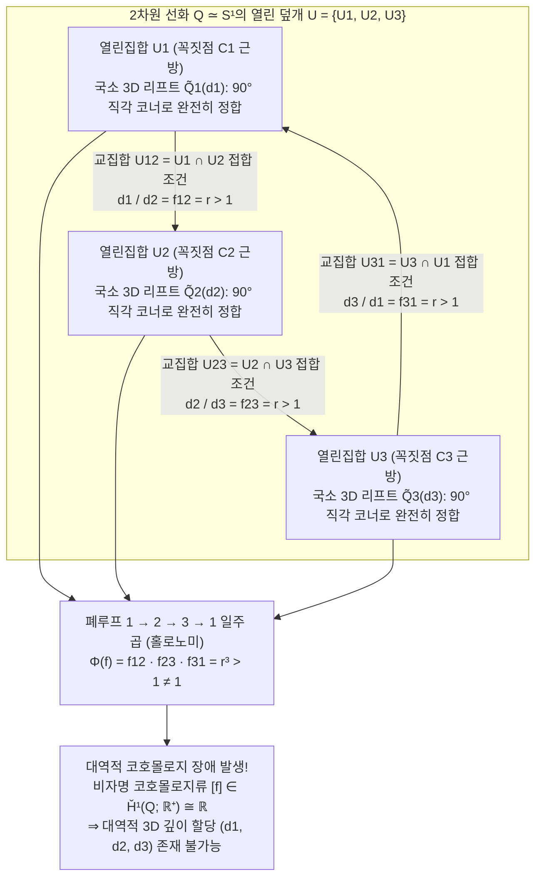
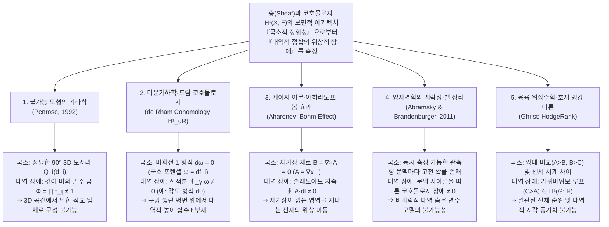

종이와 연필, 그리고 자만 있으면 누구나 몇 분 만에 <strong>'펜로즈 삼각형(Penrose Tribar / Penrose Triangle)'</strong>을 그릴 수 있다. 정사각형 단면을 가진 세 개의 곧은 각재가 각 꼭짓점에서 서로 직각($90^\circ$)으로 맞물려, 전체적으로 정삼각형처럼 닫힌 틀을 이루는 도형이다. 혹은 네덜란드의 판화가 <strong>마우리츠 코르넬리스 에셔(M.C. Escher, 1898–1972)</strong>가 1960년 걸작 석판화 《올라가기와 내려가기(Ascending and Descending)》에서 그린 수도원 옥상 계단을 떠올려 보자. 수도사들은 단지 같은 방향으로 끝없이 계단을 오르고 있는데도, 어느새 출발점과 똑같은 높이로 되돌아와 버린다.

이러한 <strong>불가능 도형(Impossible Figures / Impossible Objects)</strong>을 마주할 때 우리의 시각 피질은 기묘한 인지적 현기증을 느낀다. 삼각형의 왼쪽 위 모서리만 바라보자. 목수가 각재를 직각으로 짜 맞춘 지극히 평범하고 물리적으로 완벽한 3차원 구조다. 오른쪽 위 모서리로 시선을 옮겨도, 아래쪽 모서리를 보아도 물리 법칙이나 유클리드 기하학의 어떠한 위배도 없다. 그럼에도 불구하고 시선을 삼각형의 둘레를 따라 한 바퀴 돌리는 순간, <strong>"분명히 관찰자 쪽(앞쪽)에 있어야 할 기둥이 뒤쪽 기둥의 등 뒤로 파고드는"</strong> 절대적인 공간적 모순이 폭발한다.

왜 인간의 손은 2차원 평면 위에 "어느 국소(Local)를 보아도 입체로서 완벽히 타당하지만, 전체(Global)로서는 3차원 유클리드 공간 $\mathbb{R}^3$에 절대로 존재할 수 없는 도형"을 그릴 수 있는 것일까? 그리고 <strong>'국소적 정합성(Local Consistency)'에서 '대역적 모순(Global Contradiction)'이 발생하는 메커니즘</strong>을 현대 수학은 어떻게 기술할까?

1992년, 노벨 물리학상 수상자이자 수리물리학자인 <strong>로저 펜로즈 경(Sir Roger Penrose)</strong>은 자신이 아버지 라이오넬과 함께 1958년 학계에 발표한 이 시각적 역설을 20세기 수학의 핵심 개념인 <strong>'층(Sheaf)'</strong>과 <strong>'체흐 코호몰로지(Čech Cohomology)'</strong>를 사용해 완벽하게 정식화했다. 결론부터 말하자면, 불가능 도형은 단순한 착시나 그림 트릭이 아니다. 그것은 <strong>"도형 공간의 1차 체흐 코호몰로지 군 $\check{H}^1(Q; \mathbb{R}^+)$에 존재하는 비자명 코호몰로지류(Non-trivial Cohomology Class)의 직접적인 시각화"</strong>다.

본고에서는 로이테르스베르드와 펜로즈 부자, 에셔로 이어지는 불가능 도형의 역사에서 출발하여, 투시 투영 $\pi: \mathbb{R}^3 \to \mathbb{R}^2$가 깊이 섬유(Fiber)를 소거하는 기하학적 구조, 컴퓨터 비전의 허프먼-클라우즈(Huffman–Clowes) 선화 라벨링 이론, 펜로즈의 층과 코호몰로지 구성, 나아가 메이지 대학 스기하라 고키치(杉原厚吉) 교수의 '실재하는 불가능 입체(Impossible Motion)'의 선형대수학과 미분기하학·게이지 이론·양자 맥락성에 이르는 보편적 패러다임을 철저히 해명한다.

---

## 1. 그릴 수는 있지만 만들 수 없는 입체: 로이테르스베르드, 펜로즈, 에셔

### 1.1 원근법의 풍자에서 순수 기하학적 역설로

회화사에서 원근법의 단서를 의도적으로 조작해 모순을 일으키려는 시도는 1754년 영국 화가 윌리엄 호가스(William Hogarth)의 동판화 《잘못된 원근법에 대한 풍자(Satire on False Perspective)》 등에서 찾아볼 수 있다. 그러나 배경의 복잡한 가림(Occlusion)에 의존하지 않고 단일 강체 구조로서 순수한 기하학적 불가능성을 최초로 창조한 인물은 스웨덴의 예술가 <strong>오스카르 로이테르스베르드(Oscar Reutersvärd, 1915–2002)</strong>였다.

1934년, 18세의 고교생이던 로이테르스베르드는 지루한 라틴어 수업 중 교과서 여백에 육각별을 그리고 그 둘레에 정육면체들을 배열하다가, <strong>9개의 정육면체가 삼각형 루프를 이루면서 깊이가 순환적으로 모순되는 입체 배치(《Opus 1》)</strong>를 우연히 발견했다. 이후 그는 평생 2,500점이 넘는 불가능 도형을 등각 투영도(평행 투영)로 남겼으며, 1982년 스웨덴 정부는 그의 불가능 삼각형을 기념우표로 발행했다.

### 1.2 1958년: 펜로즈 부자의 역사적 논문 《Impossible Objects》

로이테르스베르드와는 독립적으로, 영국의 정신의학자·유전학자 <strong>라이오넬 펜로즈(Lionel S. Penrose, 1898–1972)</strong>와 당시 케임브리지 대학의 젊은 수학자였던 아들 <strong>로저 펜로즈(Roger Penrose, 1931–)</strong>는 1954년 암스테르담 세계수학자대회(ICM) 기간 중 M.C. 에셔의 전시회를 관람하고 깊은 영감을 받았다. 영국으로 돌아온 로저는 세 개의 각재를 직각으로 접합한 <strong>'펜로즈 삼각형(Penrose Tribar)'</strong>을 고안했고, 아버지 라이오넬은 네 모퉁이를 돌며 무한히 올라가는 <strong>'펜로즈의 무한 계단(Penrose Endless Staircase)'</strong>을 설계했다.

부자는 1958년 2월 《영국 심리학 저널(British Journal of Psychology)》(제49권, 31–33쪽)에 3쪽짜리 논문 <strong>《Impossible Objects: A Special Type of Visual Illusion》</strong>을 발표하며 문제의 핵심을 정확히 꿰뚫었다.

> "여기에 제시된 구조의 각 개별 부분은 정상적인 3차원 물체를 나타내는 것으로 완전히 수용 가능하다. 그럼에도 불구하고 도형 전체가 나타내는 물체는 각 부분의 잘못된 연결(false connexions of the parts)로 인해 불가능한 것이 된다."

### 1.3 에셔와의 서신 교류와 불후의 3부작

펜로즈 부자가 보낸 논문 별쇄본을 읽은 에셔는 깊은 감명을 받아 인류 시각 예술사상 가장 유명한 세 작품을 탄생시켰다.

1. <strong>《벨베데레(Belvedere, 전망대)》(1958년 5월)</strong>: 네커의 정육면체(Necker Cube)를 건축 구조에 응용하여 1층과 2층 사이의 기둥이 앞뒤로 비틀려 연결된 전망대를 그렸다.
2. <strong>《올라가기와 내려가기(Ascending and Descending)》(1960년 3월)</strong>: 라이오넬 펜로즈의 무한 계단을 수도원 지붕에 직접 구현하여 영원히 계단을 행진하는 수도사들을 묘사했다.
3. <strong>《폭포(Waterfall)》(1961년 10월)</strong>: 로저 펜로즈의 삼각형 3개를 지그재그로 연결한 수로 위를 흐르는 물이 멀어지며 내려가는 듯 보이지만, 종착점이 출발점인 물레방아 바로 위에 도달하는 '중력 영구기관'을 완성했다.

---

## 2. 시각의 기하학: 왜 투시 투영 $\pi: \mathbb{R}^3 \to \mathbb{R}^2$는 깊이를 지우는가

### 2.1 중심 투영과 평행 투영의 1차원 섬유(Fiber) 구조

관찰자의 눈(핀홀 카메라 광학 중심)을 3차원 유클리드 공간 $\mathbb{R}^3$의 원점 $\mathbf{0} = (0,0,0)$에 두자. 전방 반공간 $z > 0$의 점 $\mathbf{r} = (x, y, z)$를 초점 거리 $f > 0$인 이미지 평면 $I \cong \mathbb{R}^2$(또는 단위 방향 구면 $S^2$)로 보내는 <strong>중심 투영(투시 투영, Perspective Projection)</strong> 사상 $\pi: \mathbb{R}^3 \setminus \{\mathbf{0}\} \to S^2$는 다음과 같이 주어진다.

$$\pi(x, y, z) = \left( f \frac{x}{z}, \; f \frac{y}{z} \right), \qquad \pi(\mathbf{r}) = \frac{\mathbf{r}}{\|\mathbf{r}\|}$$

2차원 이미지 위의 한 점 $p = \pi(\mathbf{r}_0)$에 대하여 그 <strong>역상(섬유 / Fiber)</strong> $\pi^{-1}(p)$는 어떤 집합일까? 원점에서 뻗어 나가는 반직선 위의 모든 점은 임의의 양의 실수 $\lambda \in \mathbb{R}^+ = (0, \infty)$에 의한 스칼라배 변환 $\mathbf{r}_0 \mapsto \lambda \mathbf{r}_0$에 대해 $\pi(\lambda \mathbf{r}_0) = \pi(\mathbf{r}_0) = p$를 만족한다. 즉, 각 점 위의 섬유는 양의 실수의 곱셈군 $\mathbb{R}^+ = ((0, \infty), \times)$에 의해 매개변수화되는 1차원 반직선 전체다.

$$\pi^{-1}(\pi(\mathbf{r}_0)) = \{ \lambda \mathbf{r}_0 \in \mathbb{R}^3 \setminus \{\mathbf{0}\} \mid \lambda \in \mathbb{R}^+ \}$$

이는 결정적인 기하학적 귀결을 뜻한다. <strong>3차원 공간 내의 어떠한 강체 부품 $\tilde{Q}_i \subset \mathbb{R}^3 \setminus \{\mathbf{0}\}$이라도, 그것을 원점(관찰자의 눈)을 중심으로 $\lambda$배 확대하면서 동시에 거리도 $\lambda$배 멀리 이동시키는 변환 $\mathbf{r} \mapsto \lambda \mathbf{r}$($\lambda \in \mathbb{R}^+$)를 가하면, 모든 3차원 직각($90^\circ$)이 그대로 보존될 뿐만 아니라 2차원 망막 투영 이미지 $\pi(\lambda \tilde{Q}_i) = \pi(\tilde{Q}_i)$도 완벽하게 일치한다!</strong>

마찬가지로 무한원점에서 바라본 극한인 <strong>평행 투영(Orthographic / Isometric Projection)</strong> $\pi_{\text{orth}}(x, y, z) = (x, y)$에서는 시선 방향($z$축)으로의 평행이동 $(x, y, z) \mapsto (x, y, z + c)$($c \in \mathbb{R}$)에 대해 투영상이 불변이며, 그 자유도는 실수의 덧셈군 $(\mathbb{R}, +)$로 주어진다. 로그 함수와 지수 함수 $\ln: (\mathbb{R}^+, \times) \xrightarrow{\sim} (\mathbb{R}, +)$가 리 군(Lie Group) 동형사상을 이루므로 두 구조는 대수위상적으로 완전히 동형이다.

### 2.2 역문제와 허프먼-클라우즈(Huffman–Clowes) 선화 라벨링 이론

투영 사상 $\pi$가 각 점에서 1차원 깊이 섬유 $\mathbb{R}^+$를 뭉개버리기 때문에 2차원 선화에서 3차원 입체를 복원하는 것은 불량 설정 역문제(Ill-posed Inverse Problem)다. 인간의 시각계는 무의식적으로 <strong>평면성(Planarity)</strong>, <strong>직교성(Orthogonality, $90^\circ$ 가정)</strong>, 그리고 <strong>일반 시점 가정(General Viewpoint Assumption)</strong>을 부과하여 깊이를 추론한다.

1971년 <strong>데이비드 허프먼(David A. Huffman)</strong>과 <strong>맥스 클라우즈(Max B. Clowes)</strong>는 독립적으로 다면체 선화의 모든 모서리에 4가지 물리적 라벨($+$ 볼록 모서리, $-$ 오목 모서리, $\rightarrow, \leftarrow$ 가림 윤곽선 모서리)을 부여하는 조합론적 판정 알고리즘을 구축했다. 놀랍게도 <strong>펜로즈 삼각형은 모든 꼭짓점과 모서리에서 허프먼-클라우즈의 라벨링 조건을 100% 완벽하게 통과한다!</strong> 이는 펜로즈 삼각형의 불가능성이 국소적인 위상·조합론적 모순이 아니라, <strong>연속적인 깊이 좌표를 닫힌 곡선을 따라 일주 적분했을 때 발생하는 대역적(코호몰로지적) 불일치</strong>에 기인함을 보여준다.

| 정합성 계층 | 수학적 모델 및 이론 | 판정하는 기하학적 조건 | 펜로즈 삼각형 판정 결과 |
| :--- | :--- | :--- | :--- |
| <strong>제1계층: 국소 꼭짓점 실현성</strong> | 삼면체 꼭짓점 카탈로그 (Guzmán, 1968) | 개별 꼭짓점 $v_i$의 근방이 3D 모서리로 존재 가능한가? | <strong>통과</strong> (모든 모서리가 정당한 $90^\circ$ 직교 접합) |
| <strong>제2계층: 조합론적 모서리 라벨링</strong> | 허프먼-클라우즈 이론 (Huffman–Clowes, 1971) | 모든 변에 $+, -, \rightarrow, \leftarrow$를 인접 꼭짓점 간 모순 없이 부여 가능한가? | <strong>통과</strong> (대역적으로 유효한 라벨링 존재) |
| <strong>제3계층: 국소 패치의 강체 이어붙이기</strong> | <strong>펜로즈의 층 코호몰로지 (Penrose, 1992)</strong> | 직교성을 유지한 국소 3D 부품의 스케일 비 $f_{ij}$가 폐루프에서 $\prod f_{ij} = 1$을 만족하는가? | <strong>실패</strong> ($\check{H}^1(Q; \mathbb{R}^+) \neq 0$에 의해 대역적 파탄) |
| <strong>제4계층: 일반 평면 다면체 실현성</strong> | 스기하라의 선형계획 판정 (Sugihara, 1986) | 직교성 가정을 제거하고 평면 방정식·가림 부등식 $A\mathbf{w}=\mathbf{0}, B\mathbf{w}>\mathbf{0}$의 해가 존재하는가? | <strong>통과</strong> (비직각의 왜곡된 평면을 사용하면 3D 실재 가능!) |

---

## 3. 국소적 정합성과 대역적 모순: 열린 덮개(Open Cover)에서의 접합 파탄

2차원 평면 위의 펜로즈 삼각형 $Q \subset \mathbb{R}^2$는 위상적으로 가운데 구멍이 하나 뚫린 원환 영역으로, 원주 $S^1$과 호모토피 동치($Q \simeq S^1$)다.

이제 $Q$를 세 꼭짓점 $C_1, C_2, C_3$를 각각 포함하는 세 개의 열린집합 $\mathcal{U} = \{U_1, U_2, U_3\}$로 덮자(<strong>열린 덮개 / Open Cover</strong>). 각 $U_i$는 구멍이 없는 축약 가능(Contractible)한 영역이고, 두 열린집합의 교집합 $U_{12} = U_1 \cap U_2$, $U_{23} = U_2 \cap U_3$, $U_{31} = U_3 \cap U_1$은 각 각재의 중앙 부분이며, 삼중 교집합은 공집합($U_1 \cap U_2 \cap U_3 = \emptyset$)이다. 따라서 덮개의 신경(Nerve) $N(\mathcal{U})$는 삼각형의 둘레 $\partial \Delta^2 \cong S^1$이다.

각 열린집합 $U_i$ 위에서는 직각으로 만나는 표준 3D 모서리 모델 $\tilde{Q}_i^{\text{std}}$가 완벽히 구성되며, 망막 투영상 $\pi(\tilde{Q}_i) = U_i$를 바꾸지 않는 일반 3D 리프트는 관찰자로부터의 양의 거리 스케일 인수 $d_i \in \mathbb{R}^+$에 의해 $\tilde{Q}_i(d_i) = d_i \cdot \tilde{Q}_i^{\text{std}}$로 주어진다.

그러나 교집합 $U_{12} = U_1 \cap U_2$에서 두 3D 부품 $\tilde{Q}_1(d_1)$과 $\tilde{Q}_2(d_2)$가 단차 없이 하나의 각재로 이어지려면 원근 각도에 의해 결정되는 비율 $f_{12} = r > 1$을 만족해야 한다. 3회 회전 대칭성에 의해 세 교집합 모두에서 다음이 요구된다.

$$\frac{d_1}{d_2} = f_{12} = r > 1, \qquad \frac{d_2}{d_3} = f_{23} = r > 1, \qquad \frac{d_3}{d_1} = f_{31} = r > 1$$

세 식을 폐루프 $1 \to 2 \to 3 \to 1$을 따라 곱하면 즉시 모순이 드러난다.

$$1 = \frac{d_1}{d_2} \cdot \frac{d_2}{d_3} \cdot \frac{d_3}{d_1} = f_{12} \cdot f_{23} \cdot f_{31} = r^3 > 1 \quad (\text{모순!})$$

---

## 4. 로저 펜로즈(1992)의 층(Sheaf)과 체흐 코호몰로지 정식화

1992년 논문 《On the Cohomology of Impossible Figures》에서 로저 펜로즈는 투영의 섬유 방향 자유도를 <strong>모호성 군(Ambiguity Group) $G = (\mathbb{R}^+, \times)$</strong>로 정의하고, 도형 $Q$ 위의 국소 상수층(Locally Constant Sheaf) $\mathcal{F}$에 대한 체흐 공쇄 복합체(Čech Cochain Complex)를 구축했다.

$$C^0(\mathcal{U}, \mathbb{R}^+) \xrightarrow{\;\delta^0\;} C^1(\mathcal{U}, \mathbb{R}^+) \xrightarrow{\;\delta^1\;} C^2(\mathcal{U}, \mathbb{R}^+)$$

- <strong>$0$-공쇄군 $C^0(\mathcal{U}, \mathbb{R}^+) = (\mathbb{R}^+)^3$</strong>: 각 $U_i$에 양의 깊이 스케일 $d_i \in \mathbb{R}^+$를 할당하는 족 $d = (d_1, d_2, d_3)$.
- <strong>$1$-공쇄군 $C^1(\mathcal{U}, \mathbb{R}^+)$</strong>: 각 교집합 $U_{ij} = U_i \cap U_j \neq \emptyset$에 전이 비율 $f_{ij} \in \mathbb{R}^+$($f_{ji} = f_{ij}^{-1}$)를 할당하는 족 $f = (f_{12}, f_{23}, f_{31})$.
- <strong>공경계 작용소(Coboundary Operators)</strong>: $(\delta^0 d)_{ij} = d_i / d_j$ 및 $(\delta^1 f)_{ijk} = f_{ij} f_{jk} f_{ki}$. 자명하게 $\delta^1 \circ \delta^0 = 1$이 성립한다.

삼중 교집합 $U_1 \cap U_2 \cap U_3 = \emptyset$이므로 모든 $1$-공쇄는 자동적으로 <strong>$1$-공순환(1-Cocycle, $Z^1(\mathcal{U}, \mathbb{R}^+) = \ker \delta^1$)</strong>이다. 반면 도형이 3차원 공간에서 대역적으로 실현 가능하려면 $f_{ij} = d_i / d_j$를 만족하는 대역적 깊이 $d \in C^0$가 존재해야 하므로, $f$가 <strong>$1$-공경계(1-Coboundary, $B^1(\mathcal{U}, \mathbb{R}^+) = \operatorname{Im} \delta^0$)</strong>여야 한다.

따라서 <strong>1차 체흐 코호몰로지 군(First Čech Cohomology Group)</strong>은 몫군으로 정의된다.

$$\check{H}^1(Q; \mathbb{R}^+) \cong \frac{Z^1(\mathcal{U}, \mathbb{R}^+)}{B^1(\mathcal{U}, \mathbb{R}^+)} = \frac{\ker \delta^1}{\operatorname{Im} \delta^0} \xrightarrow[\;\sim\;]{\;\Phi\;} \mathbb{R}^+ \xrightarrow[\;\sim\;]{\;\ln\;} \mathbb{R}$$

여기서 홀로노미 준동형사상 $\Phi(f) = f_{12} f_{23} f_{31}$의 핵(Kernel)이 정확히 $B^1(\mathcal{U}, \mathbb{R}^+)$와 일치한다. 펜로즈 삼각형에서는 $\Phi(f) = r^3 \neq 1$(로그 표기로 $\ln f_{12} + \ln f_{23} + \ln f_{31} = 3\ln r \neq 0$)이므로, <strong>불가능 도형이란 정확히 1차 체흐 코호몰로지 군 $\check{H}^1(Q; G)$의 비자명 원소 $[f] \neq 1$이다!</strong>

또한 호주 이스트 퍼스(East Perth)의 거대 조각상이나 리처드 그레고리의 모형이 특정 시점에서만 성립하는 이유도 즉시 설명된다. 한 곳을 절단한 열린 입체 $Q_{\text{cut}} \simeq [0, 1]$은 축약 가능 공간이므로 코호몰로지가 소멸($\check{H}^1([0, 1]; \mathbb{R}^+) = \{1\}$)하여 3차원에서 제작 가능하며, 끊어진 두 끝점이 정확히 한 시선 광선 $\pi^{-1}(p)$ 위에 겹치는 우연한 시점(Accidental Viewpoint)에서 볼 때만 2차원 투영상에서 루프 $S^1$이 닫히며 비자명 코호몰로지가 부활하는 것이다.

---

## 5. 스기하라 고키치의 '불가능 입체'와 현대 과학을 관통하는 층 코호몰로지

### 5.1 스기하라 고키치(杉原厚吉)의 대수 방정식과 반중력 착시

루프를 끊지 않고도 연속적인 3차원 펜로즈 계단을 만들 수 있을까? 일본 메이지 대학의 <strong>스기하라 고키치</strong> 교수는 다면체 선화의 대수적 재구성 이론(《Machine Interpretation of Line Drawings》, 1986)을 통해 이를 실현하고, 공이 오르막길을 스스로 굴러 올라가는 듯 보이는 《Impossible Motion》으로 세계 착시 콘테스트 우승을 차지했다.

꼭짓점 깊이들과 평면 방정식 계수들을 모은 미지수 벡터 $\mathbf{w}$에 대해, 꼭짓점-평면 결합 조건은 선형방정식 $A\mathbf{w} = \mathbf{0}$을, 모서리의 볼록·오목·가림 조건은 선형부등식 $B\mathbf{w} > \mathbf{0}$을 형성한다.

- <strong>인간의 뇌가 푸는 시스템</strong>: 뇌는 무의식적으로 '모든 모서리가 $90^\circ$ 직각'이라는 직교 제약 $C_{\text{rect}}\mathbf{w} = \mathbf{0}$을 추가하여 해가 없는 상태($\check{H}^1 \neq 0$)에 빠진다.
- <strong>스기하라 교수가 푼 시스템</strong>: 직교 제약 $C_{\text{rect}}\mathbf{w} = \mathbf{0}$을 제거하면 $A\mathbf{w} = \mathbf{0}, B\mathbf{w} > \mathbf{0}$은 무수히 많은 연속 3D 다면체 해 $\mathbf{w}^*$를 갖는다! 비직각 사다리꼴 평면으로 제작된 입체를 특정 시점에서 보면 뇌가 강제로 직각 제약을 적용해 실제 내리막길을 오르막길로 착각하게 된다.

### 5.2 수학·물리학·정보과학을 관통하는 보편적 패러다임

| 과학 분야 및 현상 | 밑공간 $X$와 열린 덮개 $\{U_i\}$ | 국소 단면(국소해) $s_i \in \mathcal{F}(U_i)$ | 교집합 $U_i \cap U_j$의 전이 조건 | 대역해 존재 조건 ($\check{H}^1 = 0$) | 비자명 코호몰로지 $\check{H}^1(X, \mathcal{F}) \neq 0$의 의미 |
| :--- | :--- | :--- | :--- | :--- | :--- |
| <strong>불가능 도형 기하학</strong> (Penrose, 1992) | 2차원 선화 $Q \simeq S^1$과 코너 근방 $\{U_i\}$ | 국소 3D 직각 모델의 깊이 스케일 $d_i \in \mathbb{R}^+$ | 빔 중첩부의 깊이 비율 $f_{ij} = d_i / d_j$ | 일주 곱 $\Phi = \prod f_{ij} = 1$ (실재하는 3D 입체) | <strong>펜로즈 삼각형 / 에셔의 무한 계단</strong> (3D 공간 내 구성 불가능) |
| <strong>미분기하학</strong> (드람 코호몰로지) | 다양체 $M$ (예: $\mathbb{R}^2 \setminus \{0\}$) | 닫힌 1-형식 $d\omega=0$의 국소 포텐셜 $\omega = df_i$ | 국소 포텐셜 차 $f_i - f_j = c_{ij}$ | 일주 적분 $\oint_\gamma \omega = 0$ (보존장·완전 형식) | <strong>각도 형식 $\omega = d\theta$</strong> (연속판 에셔 계단, 대역 포텐셜 부재) |
| <strong>게이지 이론·양자물리</strong> (Aharonov–Bohm, 1959) | 솔레노이드 외부 무자기장 영역 $M \simeq S^1$ | $\mathbf{B}=\mathbf{0}$ 영역의 국소 게이지 위상 $\mathbf{A} = \nabla \chi_i$ | $U(1)$ 게이지 변환 $g_{ij} = e^{ie(\chi_i-\chi_j)/\hbar}$ | 윌슨 루프 $\exp(\frac{ie}{\hbar}\oint \mathbf{A}\cdot d\mathbf{l}) = 1$ | <strong>아하라노프-봄 위상 이동</strong> (무자기장 영역의 전자 간섭 이동) |
| <strong>양자 기초론·정보</strong> (Abramsky 외, 2011) | 관측량 집합 $X$와 가환 측정 문맥 $\{U_i\}$ | 각 측정 문맥 위의 국소 고전 확률분포 | 주변 확률 분포의 일치 (무신호 조건) | 비맥락적 대역 숨은 변수 모델의 존재 | <strong>양자 맥락성(Kochen–Specker / Hardy 역설)</strong> |
| <strong>응용 위상·데이터 과학</strong> (Ghrist; HodgeRank) | 비교 네트워크 그래프 $G=(V,E)$ | 각 노드의 대역 평점·시각 $d_i \in \mathbb{R}$ | 쌍대 비교 점수 차 $f_{ij} = d_i - d_j$ | 모든 사이클을 따른 합이 $0$ (추이적 전순서) | <strong>콩도르세 투표 역설(가위바위보 루프)</strong> 및 센서 동기화 불능 |

우리가 펜로즈 삼각형이나 에셔의 계단을 보며 느끼는 경이로움은, 인간의 시각 피질이 닫힌 루프를 따라 평행이동을 수행하며 <strong>1차 체흐 코호몰로지 군 $\check{H}^1(Q; \mathbb{R}^+)$의 비자명 코호몰로지류 $[f] \neq 1$을 실시간으로 검출</strong>하고 있다는 생생한 증거다.

---

## 참고문헌

1. <strong>Penrose, L. S., & Penrose, R.</strong> (1958). "Impossible Objects: A Special Type of Visual Illusion." *British Journal of Psychology*, 49(1), 31–33.
2. <strong>Penrose, R.</strong> (1992). "On the Cohomology of Impossible Figures." *Structural Topology*, 17, 11–16.
3. <strong>Huffman, D. A.</strong> (1971). "Impossible Objects as Nonsense Sentences." *Machine Intelligence*, 6, 295–323.
4. <strong>Sugihara, K.</strong> (1986). *Machine Interpretation of Line Drawings*. MIT Press.
5. <strong>Abramsky, S., & Brandenburger, A.</strong> (2011). "The Sheaf-Theoretic Structure of Non-Locality and Contextuality." *New Journal of Physics*, 13(11), 113036.
