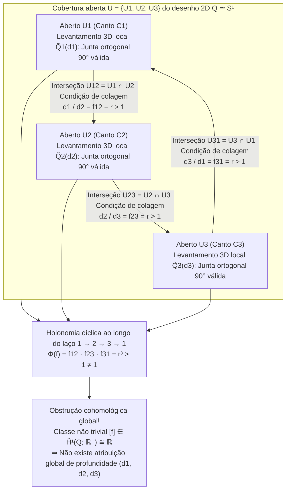
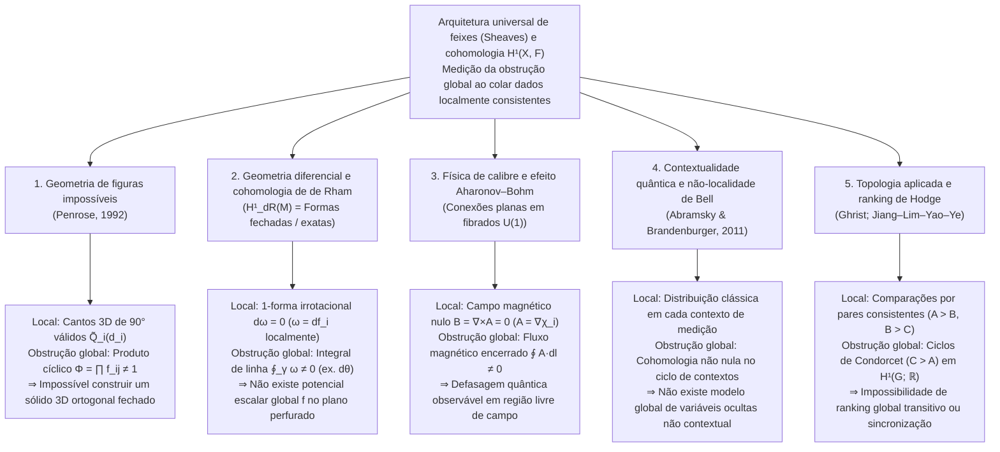

Com apenas uma folha de papel, um lápis e uma régua, qualquer pessoa pode desenhar em poucos minutos um <strong>triângulo de Penrose (tribarra de Penrose / Penrose Tribar)</strong>: três vigas retas de seção quadrada que se encontram duas a duas em ângulo reto ($90^\circ$), formando o que parece ser uma moldura triangular fechada e rígida. Ou pensemos na célebre escadaria da litografia *Subindo e Descendo* (*Ascending and Descending*, 1960) do artista gráfico holandês <strong>Maurits Cornelis Escher (1898–1972)</strong>: duas filas de monges sobem e descem incessantemente uma escada quadrangular no topo de um mosteiro, subindo perpetuamente e, ainda assim, retornando exatamente à mesma altura de partida.

Ao contemplarmos essas <strong>figuras impossíveis (Impossible Figures / Impossible Objects)</strong>, nosso córtex visual experimenta uma peculiar vertigem cognitiva. Olhe apenas para o canto superior do triângulo de Penrose: é uma junção tridimensional em ângulo reto perfeitamente comum e fisicamente impecável. Desloque o olhar para o canto inferior esquerdo ou para o canto inferior direito: nenhuma lei da geometria euclidiana é violada. Contudo, no instante em que os olhos percorrem continuamente o perímetro fechado das três vigas, explode uma catástrofe global — <strong>uma viga que em uma extremidade está inquestionavelmente mais próxima do observador passa sem interrupção por trás de uma viga que está mais distante na outra extremidade</strong>.

Como é possível que a mão humana desenhe sem esforço em um plano bidimensional um objeto que é <strong>localmente consistente em toda parte, mas globalmente impossível de construir no espaço euclidiano tridimensional $\mathbb{R}^3$</strong>? E como a matemática moderna formaliza o mecanismo exato pelo qual a <strong>consistência local (Local Consistency)</strong> falha ao tentar se unir em uma <strong>existência global (Global Realizability)</strong>?

Em 1992, o físico-matemático e ganhador do Prêmio Nobel <strong>Sir Roger Penrose</strong> publicou seu brilhante artigo *"On the Cohomology of Impossible Figures"*. Utilizando a <strong>teoria de feixes (Sheaf Theory)</strong> e a <strong>cohomologia de Čech (Čech Cohomology)</strong>, Penrose demonstrou que uma figura impossível não é um mero truque de ilusão óptica: ela é a manifestação visual direta de uma <strong>classe de cohomologia não trivial no primeiro grupo de cohomologia de Čech $\check{H}^1(Q; \mathbb{R}^+)$</strong>.

Neste artigo, traçamos a história das figuras impossíveis de Oscar Reutersvärd aos Penrose e a Escher, analisamos como a projeção em perspectiva $\pi: \mathbb{R}^3 \to \mathbb{R}^2$ destrói as fibras de profundidade e como funciona o cálculo de rotulagem de linhas de Huffman–Clowes, construímos passo a passo a formulação cohomológica de Penrose, revelamos a álgebra linear por trás das esculturas de «movimento impossível» de Kokichi Sugihara e mostramos como essa mesma obstrução cohomológica governa a cohomologia de de Rham, o efeito Aharonov–Bohm e a contextualidade quântica.

---

## 1. Desenhando o inconstruível: Reutersvärd, os Penrose e M.C. Escher

### 1.1 Da sátira da perspectiva ao paradoxo geométrico puro

Embora transgressões deliberadas da perspectiva apareçam já na gravura *Satire on False Perspective* (1754) de William Hogarth, o verdadeiro pioneiro dos objetos impossíveis geometricamente puros foi o artista sueco <strong>Oscar Reutersvärd (1915–2002)</strong>. Em 1934, como estudante de 18 anos durante uma aula de latim, ele desenhou nove cubos em projeção isométrica formando um anel triangular cuja profundidade se contradizia ciclicamente (*Opus 1*). Ao longo da vida, criou mais de 2.500 figuras impossíveis, homenageadas em 1982 em selos postais suecos.

### 1.2 Fevereiro de 1958: O artigo histórico de Lionel e Roger Penrose

Independentemente de Reutersvärd, após visitar uma exposição de <strong>M.C. Escher</strong> durante o Congresso Internacional de Matemáticos (ICM) em Amsterdã em 1954, o jovem matemático de Cambridge <strong>Roger Penrose (1931–)</strong> reduziu o paradoxo espacial ao seu esqueleto geométrico mínimo: a <strong>tribarra de Penrose (Penrose Tribar)</strong>. Seu pai, o psiquiatra e geneticista <strong>Lionel S. Penrose (1898–1972)</strong>, respondeu projetando a <strong>escada infinita de Penrose (Penrose Endless Staircase)</strong>.

Em fevereiro de 1958, pai e filho publicaram no *British Journal of Psychology* (vol. 49, pp. 31–33) seu famoso artigo <strong>*"Impossible Objects: A Special Type of Visual Illusion"*</strong>:

> *"Aqui cada parte da estrutura é aceitável como representação de um objeto sólido normal, mas a catástrofe ocorre como resultado de falsas conexões das partes (false connexions of the parts)..."*

Após receber uma separata enviada pelos Penrose, Escher criou sua trilogia imortal: *Belvedere* (maio de 1958), *Subindo e Descendo* (março de 1960, incorporando a escada infinita) e *Queda d'Água* (*Waterfall*, outubro de 1961, encadeando três triângulos de Penrose em um aqueduto de movimento perpétuo).

---

## 2. Geometria da visão: Como a projeção $\pi: \mathbb{R}^3 \to \mathbb{R}^2$ apaga a profundidade

### 2.1 Projeção central, projeção paralela e suas fibras unidimensionais

Coloquemos o centro óptico do olho do observador na origem $\mathbf{0} = (0,0,0) \in \mathbb{R}^3$. A <strong>projeção central (em perspectiva)</strong> $\pi: \mathbb{R}^3 \setminus \{\mathbf{0}\} \to \mathbb{R}^2$ (ou sobre a esfera de direções $S^2$) projeta cada ponto $\mathbf{r} = (x, y, z)$ com $z > 0$ no plano de imagem à distância focal $f > 0$:

$$\pi(x, y, z) = \left( f \frac{x}{z}, \; f \frac{y}{z} \right), \qquad \text{ou} \qquad \pi(\mathbf{r}) = \frac{\mathbf{r}}{\|\mathbf{r}\|}$$

Qual é a <strong>pré-imagem (a fibra / Fiber)</strong> $\pi^{-1}(p)$ de um ponto bidimensional $p = \pi(\mathbf{r}_0)$? Como o escalonamento radial $\mathbf{r}_0 \mapsto \lambda \mathbf{r}_0$ por qualquer número real positivo $\lambda \in \mathbb{R}^+ = (0, \infty)$ preserva sua direção ($\pi(\lambda \mathbf{r}_0) = \pi(\mathbf{r}_0) = p$), a fibra sobre cada ponto $p$ é uma semirreta aberta parametrizada pelo grupo multiplicativo dos reais positivos $\mathbb{R}^+ = ((0, \infty), \times)$:

$$\pi^{-1}(\pi(\mathbf{r}_0)) = \{ \lambda \mathbf{r}_0 \in \mathbb{R}^3 \setminus \{\mathbf{0}\} \mid \lambda \in \mathbb{R}^+ \}$$

Isso implica uma consequência geométrica fundamental: <strong>se aplicarmos a qualquer peça rígida tridimensional $\tilde{Q}_i \subset \mathbb{R}^3 \setminus \{\mathbf{0}\}$ uma homotetia radial $\mathbf{r} \mapsto \lambda \mathbf{r}$ centrada no olho ($\lambda \in \mathbb{R}^+$), não apenas todos os seus ângulos retos ($90^\circ$) são preservados, mas sua imagem retiniana $\pi(\lambda \tilde{Q}_i) = \pi(\tilde{Q}_i)$ permanece 100% idêntica!</strong> Sob projeção paralela ortográfica $\pi_{\text{orth}}(x,y,z) = (x,y)$, essa liberdade corresponde a uma translação de profundidade $z \mapsto z + c$ pelo grupo aditivo $(\mathbb{R}, +)$, canonicamente isomorfo a $(\mathbb{R}^+, \times)$ via $\ln: (\mathbb{R}^+, \times) \xrightarrow{\sim} (\mathbb{R}, +)$.

### 2.2 O cálculo de rotulagem de linhas de Huffman–Clowes (1971)

Para resolver o problema inverso de reconstrução 3D, o sistema visual aplica três premissas a priori: <strong>planaridade das faces</strong>, <strong>ortogonalidade ($90^\circ$)</strong> e <strong>hipótese de ponto de vista geral</strong>. Em 1971, <strong>David A. Huffman</strong> e <strong>Max B. Clowes</strong> formalizaram a análise de desenhos poliédricos atribuindo a cada aresta um de quatro rótulos: $+$ (aresta convexa), $-$ (aresta côncava) e $\rightarrow, \leftarrow$ (contorno de oclusão, mantendo a face visível à direita da seta).

Surpreendentemente, <strong>o triângulo de Penrose passa 100% no teste combinatório de Huffman–Clowes!</strong> Cada junção (em L, Y/Fork, Seta e T) é localmente válida. A impossibilidade do triângulo de Penrose não reside em uma contradição combinatória local, mas na <strong>falha global (cohomológica) em fechar as coordenadas contínuas de profundidade ao redor de um laço topológico não contrátil</strong>.

| Nível de consistência | Estrutura matemática | Condição geométrica verificada | Resultado no triângulo de Penrose |
| :--- | :--- | :--- | :--- |
| <strong>Nível 1: Realizabilidade local de vértices</strong> | Catálogo triédrico (Guzmán, 1968) | Cada junção $v_i$ isolada pode existir como um canto 3D válido? | <strong>APROVADO</strong> (Cada canto é uma junta ortogonal de $90^\circ$ válida) |
| <strong>Nível 2: Rotulagem combinatória</strong> | Cálculo de Huffman–Clowes (1971) | Os rótulos $+, -, \rightarrow, \leftarrow$ são compatíveis ao longo de todas as arestas? | <strong>APROVADO</strong> (Admite uma rotulagem globalmente consistente) |
| <strong>Nível 3: Colagem rígida de partes</strong> | <strong>Cohomologia de feixes (Penrose, 1992)</strong> | As razões de profundidade $f_{ij}$ satisfazem $\prod f_{ij} = 1$ em cada ciclo? | <strong>REPROVADO</strong> (Classe não trivial $[f] \in \check{H}^1(Q; \mathbb{R}^+) \neq 0$) |
| <strong>Nível 4: Poliedro geral de faces planas</strong> | Sistema linear de Sugihara (1986) | Relaxando os ângulos de $90^\circ$, o sistema $A\mathbf{w}=\mathbf{0}, B\mathbf{w}>\mathbf{0}$ possui solução? | <strong>APROVADO</strong> (Construível em 3D usando trapézios inclinados!) |

---

## 3. Consistência local vs. Contradição global: Colagem sobre uma cobertura aberta

Seja $Q \subset \mathbb{R}^2$ o desenho 2D do triângulo de Penrose, homotopicamente equivalente ao círculo ($Q \simeq S^1$). Cobrimos $Q$ com três conjuntos abertos $\mathcal{U} = \{U_1, U_2, U_3\}$, cada um contendo um dos três cantos $C_1, C_2, C_3$ e a maior parte das duas vigas adjacentes:

1. Cada aberto $U_i$ ($i=1,2,3$) é simplesmente conexo (contrátil).
2. As interseções dois a dois $U_{12} = U_1 \cap U_2$, $U_{23} = U_2 \cap U_3$ e $U_{31} = U_3 \cap U_1$ são segmentos contráteis não vazios no meio de cada viga.
3. A interseção tripla é vazia: $U_1 \cap U_2 \cap U_3 = \emptyset$. O <strong>nervo da cobertura</strong> $N(\mathcal{U})$ é a fronteira de um triângulo $\partial \Delta^2 \cong S^1$.

Sobre cada $U_i$, escolhemos um modelo 3D padrão $\tilde{Q}_i^{\text{std}}$, de modo que qualquer levantamento 3D rígido válido é dado por $\tilde{Q}_i(d_i) = d_i \cdot \tilde{Q}_i^{\text{std}}$ com um fator de escala de profundidade $d_i \in \mathbb{R}^+$.

Para colar continuamente $\tilde{Q}_1(d_1)$ e $\tilde{Q}_2(d_2)$ sobre a interseção $U_{12} = U_1 \cap U_2$, o escorço da viga exige uma razão fixa $f_{12} = r > 1$. Pela simetria rotacional de ordem 3, nas três interseções exige-se:

$$\frac{d_1}{d_2} = f_{12} = r > 1, \qquad \frac{d_2}{d_3} = f_{23} = r > 1, \qquad \frac{d_3}{d_1} = f_{31} = r > 1$$

Multiplicando as três equações ao longo do ciclo fechado $1 \to 2 \to 3 \to 1$, os fatores $d_i$ se cancelam e surge a contradição global:

$$1 = \frac{d_1}{d_2} \cdot \frac{d_2}{d_3} \cdot \frac{d_3}{d_1} = f_{12} \cdot f_{23} \cdot f_{31} = r^3 > 1 \quad (\text{Contradição!})$$

---

## 4. A formulação de Sir Roger Penrose (1992): Feixes e cohomologia de Čech

Em *"On the Cohomology of Impossible Figures"* (1992), Roger Penrose define o <strong>grupo de ambiguidade (Ambiguity Group) $G = (\mathbb{R}^+, \times)$</strong> e constrói o complexo de cocadeias de Čech do feixe localmente constante $\mathcal{F}$ sobre a boa cobertura $\mathcal{U} = \{U_1, U_2, U_3\}$:

$$C^0(\mathcal{U}, \mathbb{R}^+) \xrightarrow{\;\delta^0\;} C^1(\mathcal{U}, \mathbb{R}^+) \xrightarrow{\;\delta^1\;} C^2(\mathcal{U}, \mathbb{R}^+)$$

- <strong>0-cocadeias $C^0(\mathcal{U}, \mathbb{R}^+) = (\mathbb{R}^+)^3$</strong>: Atribuições de profundidade $d = (d_1, d_2, d_3)$ para cada aberto.
- <strong>1-cocadeias $C^1(\mathcal{U}, \mathbb{R}^+)$</strong>: Razões de transição $f = (f_{12}, f_{23}, f_{31})$ em cada interseção $U_{ij}$ com $f_{ji} = f_{ij}^{-1}$.
- <strong>Operadores cobordo (Coboundary Operators)</strong>: $(\delta^0 d)_{ij} = d_i / d_j$ e $(\delta^1 f)_{ijk} = f_{ij} f_{jk} f_{ki}$, satisfazendo $\delta^1 \circ \delta^0 = 1$.

Como $U_1 \cap U_2 \cap U_3 = \emptyset$, toda 1-cocadeia é automaticamente um <strong>1-cociclo</strong> ($Z^1(\mathcal{U}, \mathbb{R}^+) = \ker \delta^1 \cong (\mathbb{R}^+)^3$). Uma estrutura 3D globalmente consistente existe se e somente se $f$ for um <strong>1-cobordo</strong> ($f \in B^1(\mathcal{U}, \mathbb{R}^+) = \operatorname{Im} \delta^0$), isto é, $f_{ij} = d_i / d_j$.

O <strong>primeiro grupo de cohomologia de Čech</strong> é o grupo quociente:

$$\check{H}^1(Q; \mathbb{R}^+) \cong \frac{Z^1(\mathcal{U}, \mathbb{R}^+)}{B^1(\mathcal{U}, \mathbb{R}^+)} = \frac{\ker \delta^1}{\operatorname{Im} \delta^0} \xrightarrow[\;\sim\;]{\;\Phi\;} \mathbb{R}^+ \xrightarrow[\;\sim\;]{\;\ln\;} \mathbb{R}$$

onde o homomorfismo de holonomia $\Phi(f) = f_{12} f_{23} f_{31}$ tem como núcleo exatamente $B^1(\mathcal{U}, \mathbb{R}^+)$. No triângulo de Penrose, $\Phi(f) = r^3 \neq 1$ ($\ln \Phi(f) = 3\ln r \neq 0$), estabelecendo o <strong>Teorema de Penrose (1992)</strong>: <strong>uma figura impossível é literalmente um elemento não trivial $[f] \neq 1$ do primeiro grupo de cohomologia de Čech $\check{H}^1(Q; G)$!</strong>

Ao cortar o triângulo em um ponto, o espaço torna-se um intervalo contrátil $Q_{\text{cut}} \simeq [0, 1]$ cuja cohomologia se anula ($\check{H}^1([0, 1]; \mathbb{R}^+) = \{1\}$). Por isso, esculturas físicas (como a de East Perth, na Austrália) podem ser construídas como um gancho 3D aberto cujas extremidades separadas em profundidade se alinham sobre um mesmo raio visual $\pi^{-1}(p)$ a partir de um único ponto de vista acidental.

---

## 5. As esculturas de Kokichi Sugihara e o paradigma universal da cohomologia

### 5.1 A álgebra linear do «movimento impossível» de Kokichi Sugihara

O matemático japonês <strong>Kokichi Sugihara (杉原厚吉)</strong> demonstrou em *Machine Interpretation of Line Drawings* (MIT Press, 1986) que um desenho linear é realizável como um poliedro 3D contínuo de faces planas se e somente se o sistema linear de equações de incidência e desigualdades de profundidade

$$A \mathbf{w} = \mathbf{0}, \qquad B \mathbf{w} > \mathbf{0}$$

admitir solução $\mathbf{w}$. Enquanto o cérebro humano adiciona inconscientemente restrições de ortogonalidade $C_{\text{rect}} \mathbf{w} = \mathbf{0}$ (tornando o sistema incompatível com $\check{H}^1 \neq 0$), Sugihara remove $C_{\text{rect}} \mathbf{w} = \mathbf{0}$ e constrói sólidos 3D reais e fechados $\mathbf{w}^*$ usando faces trapezoidais oblíquas. Como nosso córtex visual continua impondo o pressuposto de ângulos retos, ele percebe uma rampa fisicamente <strong>descendente</strong> como se fosse <strong>ascendente</strong>, fazendo com que bolas de madeira pareçam rolar ladeira acima desafiando a gravidade.

### 5.2 O paradigma universal de feixes e cohomologia na ciência

| Domínio científico | Espaço base $X$ e cobertura $\{U_i\}$ | Seção local (Solução local) $s_i \in \mathcal{F}(U_i)$ | Condição de colagem em $U_i \cap U_j$ | Realizabilidade global ($\check{H}^1 = 0$) | Significado da cohomologia não nula $\check{H}^1(X, \mathcal{F}) \neq 0$ |
| :--- | :--- | :--- | :--- | :--- | :--- |
| <strong>Figuras impossíveis</strong> (Penrose, 1992) | Desenho 2D $Q \simeq S^1$ e cantos $\{U_i\}$ | Escala de profundidade 3D local $d_i \in \mathbb{R}^+$ | Razão de profundidade $f_{ij} = d_i / d_j$ | Produto cíclico $\Phi = \prod f_{ij} = 1$ (Sólido 3D) | <strong>Triângulo de Penrose / Escada de Escher</strong> (Inconstruível em 3D ortogonal) |
| <strong>Geometria diferencial</strong> (Cohomologia de de Rham) | Variedade suave $M$ (ex. $\mathbb{R}^2 \setminus \{0\}$) | Potencial local $f_i$ de 1-forma fechada $\omega = df_i$ | Diferença de potencial $f_i - f_j = c_{ij}$ | Circulação nula $\oint_\gamma \omega = 0$ (Forma exata) | <strong>1-forma angular $\omega = d\theta$</strong> (Escada de Escher contínua sem potencial global) |
| <strong>Física de calibre</strong> (Aharonov–Bohm, 1959) | Região sem campo $M \simeq S^1$ fora do solenoide | Fase de calibre local $\chi_i$ onde $\mathbf{A} = \nabla \chi_i$ ($\mathbf{B}=\mathbf{0}$) | Transição $U(1)$ $g_{ij} = e^{ie(\chi_i-\chi_j)/\hbar}$ | Laço de Wilson trivial $\exp(\frac{ie}{\hbar}\oint \mathbf{A}\cdot d\mathbf{l}) = 1$ | <strong>Defasagem quântica de Aharonov–Bohm</strong> em campo magnético zero |
| <strong>Fundamentos quânticos</strong> (Abramsky et al., 2011) | Conjunto de observáveis $X$ e contextos $\{U_i\}$ | Probabilidade clássica local em cada contexto | Igualdade de marginais (No-Signaling) | Existência de modelo global de variáveis ocultas | <strong>Contextualidade quântica e não-localidade de Bell</strong> (Kochen–Specker / Hardy) |
| <strong>Topologia aplicada</strong> (Ghrist; HodgeRank) | Grafo de comparação $G = (V, E)$ | Pontuação global / relógio local $d_i \in \mathbb{R}$ | Diferença por pares $f_{ij} = d_i - d_j$ | Soma cíclica zero em todo ciclo (Transitividade) | <strong>Paradoxo de Condorcet (Ciclos Pedra-Papel-Tesoura)</strong> |

Esse espanto que sentimos ao percorrer com os olhos o triângulo de Penrose ou a escada de Escher é a prova viva de que nosso córtex visual calcula um transporte paralelo ao redor de um laço fechado e detecta em tempo real uma <strong>classe de cohomologia não trivial em $\check{H}^1(Q; \mathbb{R}^+)$</strong>.

---

## Referências

1. <strong>Penrose, L. S., & Penrose, R.</strong> (1958). "Impossible Objects: A Special Type of Visual Illusion." *British Journal of Psychology*, 49(1), 31–33.
2. <strong>Penrose, R.</strong> (1992). "On the Cohomology of Impossible Figures." *Structural Topology*, 17, 11–16.
3. <strong>Huffman, D. A.</strong> (1971). "Impossible Objects as Nonsense Sentences." *Machine Intelligence*, 6, 295–323.
4. <strong>Sugihara, K.</strong> (1986). *Machine Interpretation of Line Drawings*. MIT Press.
5. <strong>Abramsky, S., & Brandenburger, A.</strong> (2011). "The Sheaf-Theoretic Structure of Non-Locality and Contextuality." *New Journal of Physics*, 13(11), 113036.
