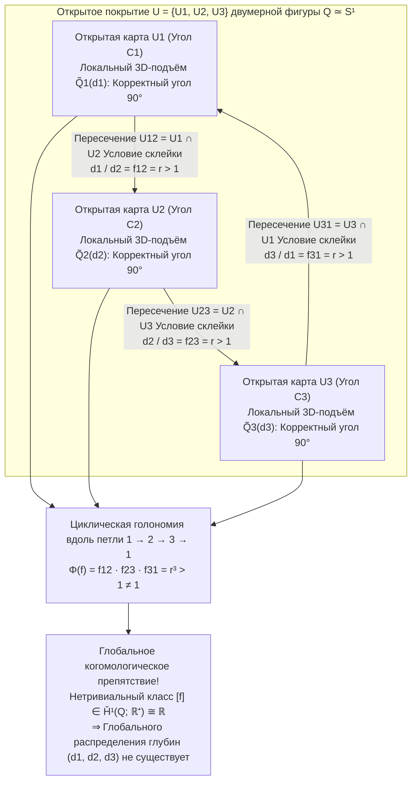
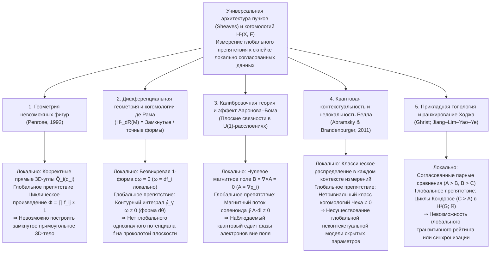

Имея под рукой лишь лист бумаги, карандаш и линейку, любой человек может за несколько минут начертить <strong>треугольник Пенроуза (трибар Пенроуза / Penrose Tribar)</strong>: три прямых бруса квадратного сечения соединяются попарно под прямыми углами ($90^\circ$), образуя то, что кажется замкнутой жёсткой треугольной рамой. Или вспомним знаменитую монастырскую лестницу на литографии нидерландского художника <strong>Морица Корнелиса Эшера (M.C. Escher, 1898–1972)</strong> *«Восхождение и спуск»* (*Ascending and Descending*, 1960): две шеренги монахов бесконечно шагают вверх и вниз по четырёхмаршевой каменной лестнице, непрерывно поднимаясь и тем не менее возвращаясь точно в исходную точку на той же высоте.

Когда мы смотрим на подобные <strong>невозможные фигуры (Impossible Figures / Impossible Objects)</strong>, наша зрительная кора испытывает особое когнитивное головокружение. Посмотрите только на верхний угол треугольника Пенроуза: перед нами совершенно обычное, физически безупречное трёхмерное соединение двух брусьев под углом $90^\circ$. Переведите взгляд на левый нижний или правый нижний угол: там тоже не нарушен ни один закон евклидовой геометрии. Однако в тот самый миг, когда взгляд обходит все три бруса по замкнутому контуру, возникает глобальная катастрофа — <strong>брус, который на одном конце заведомо находится ближе к наблюдателю, на другом конце непрерывно проходит позади более удалённого бруса</strong>.

Как человеческая рука может легко изобразить на двумерной плоскости объект, который <strong>локально непротиворечив всюду, но глобально не может существовать в трёхмерном евклидовом пространстве $\mathbb{R}^3$</strong>? И как современная математика формализует переход от <strong>локальной согласованности (Local Consistency)</strong> к <strong>глобальному противоречию (Global Contradiction)</strong>?

В 1992 году математический физик и будущий нобелевский лауреат <strong>сэр Роджер Пенроуз (Sir Roger Penrose)</strong> опубликовал блестящую работу *"On the Cohomology of Impossible Figures"*. Используя <strong>теорию пучков (Sheaf Theory)</strong> и <strong>когомологии Чеха (Čech Cohomology)</strong>, Пенроуз доказал, что невозможная фигура — это отнюдь не просто оптический обман зрения, а прямая визуализация <strong>нетривиального класса когомологий в первой группе когомологий Чеха $\check{H}^1(Q; \mathbb{R}^+)$</strong>.

В этой статье мы проследим историю невозможных фигур от Оскара Рейтерсверда до отца и сына Пенроузов и Эшера, разберём проективную геометрию потери глубины при отображении $\pi: \mathbb{R}^3 \to \mathbb{R}^2$ и алгоритм разметки линий Хаффмана–Клоуза, построим когомологическую теорию Пенроуза, раскроем линейную алгебру «невозможного движения» в скульптурах Кокити Сугихары и покажем, как то же самое когомологическое препятствие управляет когомологиями де Рама, эффектом Ааронова–Бома и квантовой контекстуальностью.

---

## 1. Нарисовать неповторимое в камне: Рейтерсверд, Пенроузы и М.К. Эшер

### 1.1 От сатиры на перспективу к чистому геометрическому парадоксу

Хотя намеренные нарушения правил линейной перспективы встречались ещё в гравюре Уильяма Хогарта *Satire on False Perspective* (1754), истинным отцом чистых геометрических невозможных фигур стал шведский художник <strong>Оскар Рейтерсверд (Oscar Reutersvärd, 1915–2002)</strong>. В 1934 году, будучи 18-летним гимназистом, на скучном уроке латыни он нарисовал на полях учебника девять кубиков в параллельной (изометрической) проекции, образующих треугольное кольцо с циклически противоречивой глубиной (*Opus 1*). За свою жизнь он создал более 2 500 невозможных фигур, увековеченных в 1982 году на почтовых марках Швеции.

### 1.2 Февраль 1958 года: Историческая статья Лайонела и Роджера Пенроузов

Независимо от Рейтерсверда, посетив выставку <strong>М.К. Эшера</strong> во время Международного конгресса математиков (ICM) в Амстердаме в 1954 году, молодой кембриджский математик <strong>Роджер Пенроуз (1931–)</strong> свёл пространственный парадокс к его минимальному геометрическому ядру — <strong>трибару Пенроуза (Penrose Tribar)</strong>, а его отец, психиатр и генетик <strong>Лайонел Пенроуз (Lionel S. Penrose, 1898–1972)</strong>, разработал <strong>бесконечную лестницу Пенроуза (Penrose Endless Staircase)</strong>.

В феврале 1958 года отец и сын опубликовали в *British Journal of Psychology* (т. 49, с. 31–33) знаменитую трёхстраничную статью <strong>*"Impossible Objects: A Special Type of Visual Illusion"*</strong>:

> *«Здесь каждая отдельная часть структуры приемлема как изображение нормального твёрдого тела, но катастрофа возникает в результате ложных соединений между частями (false connexions of the parts)...»*

Получив оттиск статьи от Пенроузов, Эшер создал свою бессмертную трилогию: *«Бельведер»* (май 1958), *«Восхождение и спуск»* (март 1960, воплотившую бесконечную лестницу) и *«Водопад»* (*Waterfall*, октябрь 1961, где три соединённых треугольника Пенроуза образуют вечный гравитационный акведук).

---

## 2. Геометрия зрения: Как проекция $\pi: \mathbb{R}^3 \to \mathbb{R}^2$ уничтожает волокна глубины

### 2.1 Центральная проекция, параллельная проекция и их одномерные слои (Fibers)

Поместим оптический центр глаза наблюдателя в начало координат $\mathbf{0} = (0,0,0) \in \mathbb{R}^3$. <strong>Центральная (перспективная) проекция</strong> $\pi: \mathbb{R}^3 \setminus \{\mathbf{0}\} \to \mathbb{R}^2$ (или на сферу направлений $S^2$) отображает каждую точку $\mathbf{r} = (x, y, z)$ полупространства $z > 0$ на плоскость изображения на фокусном расстоянии $f > 0$:

$$\pi(x, y, z) = \left( f \frac{x}{z}, \; f \frac{y}{z} \right), \qquad \text{или} \qquad \pi(\mathbf{r}) = \frac{\mathbf{r}}{\|\mathbf{r}\|}$$

Каков <strong>прообраз (слой / Fiber)</strong> $\pi^{-1}(p)$ одной точки двумерного изображения $p = \pi(\mathbf{r}_0)$? Поскольку умножение вектора $\mathbf{r}_0$ на любое положительное вещественное число $\lambda \in \mathbb{R}^+ = (0, \infty)$ не меняет направления луча зрения ($\pi(\lambda \mathbf{r}_0) = \pi(\mathbf{r}_0) = p$), слоем над каждой точкой $p$ является открытый луч, параметризованный мультипликативной группой положительных вещественных чисел $\mathbb{R}^+ = ((0, \infty), \times)$:

$$\pi^{-1}(\pi(\mathbf{r}_0)) = \{ \lambda \mathbf{r}_0 \in \mathbb{R}^3 \setminus \{\mathbf{0}\} \mid \lambda \in \mathbb{R}^+ \}$$

Отсюда следует фундаментальный геометрический факт: <strong>если подвергнуть любой жёсткий трёхмерный фрагмент $\tilde{Q}_i \subset \mathbb{R}^3 \setminus \{\mathbf{0}\}$ гомотетии $\mathbf{r} \mapsto \lambda \mathbf{r}$ с центром в глазу наблюдателя ($\lambda \in \mathbb{R}^+$), то не только все его прямые углы ($90^\circ$) сохранятся, но и его двумерная проекция на сетчатке $\pi(\lambda \tilde{Q}_i) = \pi(\tilde{Q}_i)$ останется абсолютно неизменной!</strong> При ортографической параллельной проекции $\pi_{\text{orth}}(x,y,z) = (x,y)$ эта свобода отвечает сдвигу по глубине $z \mapsto z + c$ аддитивной группы $(\mathbb{R}, +)$, изоморфной $(\mathbb{R}^+, \times)$ посредством логарифма $\ln: (\mathbb{R}^+, \times) \xrightarrow{\sim} (\mathbb{R}, +)$.

### 2.2 Исчисление разметки линий Хаффмана–Клоуза (1971)

Чтобы решить некорректно поставленную обратную задачу 3D-реконструкции, зрительная система опирается на априорные гипотезы: <strong>компланарность граней</strong>, <strong>ортогональность углов ($90^\circ$)</strong> и <strong>гипотезу общего положения точки наблюдения</strong>. В 1971 году <strong>Дэвид Хаффман (David A. Huffman)</strong> и <strong>Макс Клоуз (Max B. Clowes)</strong> независимо создали комбинаторное исчисление разметки рёбер многогранников четырьмя символами: $+$ (выпуклое ребро), $-$ (вогнутое ребро) и $\rightarrow, \leftarrow$ (контур заслонения, где видимая грань лежит справа по ходу стрелки).

Удивительный факт состоит в том, что <strong>треугольник Пенроуза на 100 % проходит комбинаторный тест Хаффмана–Клоуза!</strong> Каждая его вершина (L-, Y-, стреловидного и T-типа) локально реализуема в 3D. Следовательно, невозможная природа трибара кроется не в локальной комбинаторике рёбер, а в <strong>глобальном (когомологическом) несовпадении непрерывных координат глубины при обходе вокруг нестягиваемого цикла</strong>.

| Уровень согласованности | Математический аппарат | Проверяемое условие | Результат для треугольника Пенроуза |
| :--- | :--- | :--- | :--- |
| <strong>Уровень 1: Локальная реализуемость вершин</strong> | Каталог трёхгранных углов (Guzmán, 1968) | Может ли каждая вершина $v_i$ отдельно быть 3D-углом? | <strong>ПРОЙДЕН</strong> (Каждый угол — корректное соединение под $90^\circ$) |
| <strong>Уровень 2: Комбинаторная разметка рёбер</strong> | Алгоритм Хаффмана–Клоуза (1971) | Можно ли непротиворечиво приписать рёбрам метки $+, -, \rightarrow, \leftarrow$? | <strong>ПРОЙДЕН</strong> (Существует глобально допустимая разметка) |
| <strong>Уровень 3: Жёсткая склейка локальных карт</strong> | <strong>Когомологии пучков (Penrose, 1992)</strong> | Равно ли произведение отношений глубин $\prod f_{ij} = 1$ вдоль замкнутого цикла? | <strong>ПРОВАЛЕН</strong> (Нетривиальный класс $[f] \in \check{H}^1(Q; \mathbb{R}^+) \neq 0$) |
| <strong>Уровень 4: Общий многогранник с плоскими гранями</strong> | Линейная система Сугихары (1986) | Имеет ли решение система $A\mathbf{w}=\mathbf{0}, B\mathbf{w}>\mathbf{0}$ при отказе от углов $90^\circ$? | <strong>ПРОЙДЕН</strong> (Реализуем в 3D из косых трапециевидных граней!) |

---

## 3. Локальная непротиворечивость и глобальное противоречие: Склейка над открытым покрытием

Пусть $Q \subset \mathbb{R}^2$ — двумерный рисунок треугольника Пенроуза, гомотопически эквивалентный окружности ($Q \simeq S^1$). Покроем $Q$ тремя открытыми множествами $\mathcal{U} = \{U_1, U_2, U_3\}$, каждое из которых содержит один из углов $C_1, C_2, C_3$ и прилегающие части балок:

1. Каждое $U_i$ ($i=1,2,3$) односвязно (стягиваемо).
2. Попарные пересечения $U_{12} = U_1 \cap U_2$, $U_{23} = U_2 \cap U_3$ и $U_{31} = U_3 \cap U_1$ — непустые стягиваемые участки посередине каждой балки.
3. Тройное пересечение пусто: $U_1 \cap U_2 \cap U_3 = \emptyset$. Тем самым <strong>нерв покрытия</strong> $N(\mathcal{U})$ представляет собой границу треугольника $\partial \Delta^2 \cong S^1$.

Над каждой картой $U_i$ выберем эталонную 3D-модель прямого угла $\tilde{Q}_i^{\text{std}}$; тогда любой допустимый локальный 3D-подъём имеет вид $\tilde{Q}_i(d_i) = d_i \cdot \tilde{Q}_i^{\text{std}}$, где $d_i \in \mathbb{R}^+$ — масштабный коэффициент глубины угла $C_i$.

Чтобы модели $\tilde{Q}_1(d_1)$ и $\tilde{Q}_2(d_2)$ непрерывно склеились над пересечением $U_{12} = U_1 \cap U_2$, перспективный ракурс балки требует фиксированного отношения $f_{12} = r > 1$. В силу поворотной симметрии 3-го порядка на всех трёх перекрытиях имеем:

$$\frac{d_1}{d_2} = f_{12} = r > 1, \qquad \frac{d_2}{d_3} = f_{23} = r > 1, \qquad \frac{d_3}{d_1} = f_{31} = r > 1$$

Перемножая эти три равенства вдоль замкнутого цикла $1 \to 2 \to 3 \to 1$, получаем немедленное противоречие:

$$1 = \frac{d_1}{d_2} \cdot \frac{d_2}{d_3} \cdot \frac{d_3}{d_1} = f_{12} \cdot f_{23} \cdot f_{31} = r^3 > 1 \quad (\text{Противоречие!})$$

---

## 4. Формулировка сэра Роджера Пенроуза (1992): Пучки и когомологии Чеха

В работе *"On the Cohomology of Impossible Figures"* (1992) Роджер Пенроуз вводит абелеву <strong>группу неоднозначности (Ambiguity Group) $G = (\mathbb{R}^+, \times)$</strong> и рассматривает коцепной комплекс Чеха локально постоянного пучка $\mathcal{F}$ со слоем $G$ над хорошим покрытием $\mathcal{U} = \{U_1, U_2, U_3\}$:

$$C^0(\mathcal{U}, \mathbb{R}^+) \xrightarrow{\;\delta^0\;} C^1(\mathcal{U}, \mathbb{R}^+) \xrightarrow{\;\delta^1\;} C^2(\mathcal{U}, \mathbb{R}^+)$$

- <strong>0-коцепи $C^0(\mathcal{U}, \mathbb{R}^+) = (\mathbb{R}^+)^3$</strong>: наборы локальных масштабов глубины $d = (d_1, d_2, d_3)$.
- <strong>1-коцепи $C^1(\mathcal{U}, \mathbb{R}^+)$</strong>: переходные отношения $f = (f_{12}, f_{23}, f_{31})$ на пересечениях $U_{ij}$ с условием $f_{ji} = f_{ij}^{-1}$.
- <strong>Кограничные операторы (Coboundary Operators)</strong>: $(\delta^0 d)_{ij} = d_i / d_j$ и $(\delta^1 f)_{ijk} = f_{ij} f_{jk} f_{ki}$, причём $\delta^1 \circ \delta^0 = 1$.

Так как $U_1 \cap U_2 \cap U_3 = \emptyset$, любая 1-коцепь автоматически является <strong>1-коциклом</strong> ($Z^1(\mathcal{U}, \mathbb{R}^+) = \ker \delta^1 \cong (\mathbb{R}^+)^3$). Глобально согласованный 3D-объект существует тогда и только тогда, когда $f$ является <strong>1-кограницей</strong> ($f \in B^1(\mathcal{U}, \mathbb{R}^+) = \operatorname{Im} \delta^0$), то есть $f_{ij} = d_i / d_j$.

<strong>Первая группа когомологий Чеха</strong> определяется как факторгруппа:

$$\check{H}^1(Q; \mathbb{R}^+) \cong \frac{Z^1(\mathcal{U}, \mathbb{R}^+)}{B^1(\mathcal{U}, \mathbb{R}^+)} = \frac{\ker \delta^1}{\operatorname{Im} \delta^0} \xrightarrow[\;\sim\;]{\;\Phi\;} \mathbb{R}^+ \xrightarrow[\;\sim\;]{\;\ln\;} \mathbb{R}$$

где ядро гомоморфизма голономии $\Phi(f) = f_{12} f_{23} f_{31}$ в точности совпадает с подгруппой кограниц $B^1(\mathcal{U}, \mathbb{R}^+)$. Для треугольника Пенроуза $\Phi(f) = r^3 \neq 1$ ($\ln \Phi(f) = 3\ln r \neq 0$), что доказывает <strong>теорему Пенроуза (1992)</strong>: <strong>невозможная фигура — это в точности нетривиальный элемент $[f] \neq 1$ первой группы когомологий Чеха $\check{H}^1(Q; G)$!</strong>

Если разрезать треугольник в одной точке, пространство превращается в стягиваемый отрезок $Q_{\text{cut}} \simeq [0, 1]$, когомологии которого тривиальны ($\check{H}^1([0, 1]; \mathbb{R}^+) = \{1\}$). Именно поэтому реальные скульптуры (например, в Ист-Перте, Австралия) представляют собой разомкнутый в глубину 3D-крюк, два свободных конца которого совмещаются на одном луче зрения $\pi^{-1}(p)$ лишь из единственной случайной точки обзора.

---

## 5. Скульптуры Кокити Сугихары и универсальная парадигма когомологий в науке

### 5.1 Линейная алгебра «невозможного движения» Кокити Сугихары

Японский математик <strong>Кокити Сугихара (Kokichi Sugihara, 杉原厚吉)</strong> в монографии *Machine Interpretation of Line Drawings* (MIT Press, 1986) доказал, что линейный чертёж реализуем в виде непрерывного 3D-многогранника с плоскими гранями тогда и только тогда, когда совместна линейная система уравнений инцидентности и неравенств глубины

$$A \mathbf{w} = \mathbf{0}, \qquad B \mathbf{w} > \mathbf{0}$$

В то время как мозг человека бессознательно добавляет уравнения прямоугольности $C_{\text{rect}} \mathbf{w} = \mathbf{0}$ (делая систему несовместной при $\check{H}^1 \neq 0$), Сугихара отбрасывает $C_{\text{rect}} \mathbf{w} = \mathbf{0}$ и строит реальные замкнутые 3D-тела $\mathbf{w}^*$ из косых трапециевидных граней. Поскольку зрительная кора упрямо навязывает гипотезу прямых углов, физически <strong>наклонённый вниз</strong> желоб воспринимается как <strong>поднимающийся вверх</strong>, и деревянные шарики под действием обычной гравитации кажутся катящимися вверх по склону!

### 5.2 Универсальная архитектура пучков и когомологий в естествознании

| Научная область | Базовое пространство $X$ и покрытие $\{U_i\}$ | Локальное сечение $s_i \in \mathcal{F}(U_i)$ | Условие склейки на $U_i \cap U_j$ | Глобальная реализуемость ($\check{H}^1 = 0$) | Смысл нетривиальных когомологий $\check{H}^1(X, \mathcal{F}) \neq 0$ |
| :--- | :--- | :--- | :--- | :--- | :--- |
| <strong>Невозможные фигуры</strong> (Penrose, 1992) | 2D-рисунок $Q \simeq S^1$ и углы $\{U_i\}$ | Локальный 3D-масштаб глубины $d_i \in \mathbb{R}^+$ | Отношение глубин $f_{ij} = d_i / d_j$ | Циклическое произведение $\Phi = \prod f_{ij} = 1$ | <strong>Треугольник Пенроуза / Лестница Эшера</strong> (Нереализуемость в 3D) |
| <strong>Дифференциальная геометрия</strong> (Когомологии де Рама) | Многообразие $M$ (напр. $\mathbb{R}^2 \setminus \{0\}$) | Локальный потенциал $f_i$ замкнутой 1-формы $\omega = df_i$ | Разность потенциалов $f_i - f_j = c_{ij}$ | Нулевая циркуляция $\oint_\gamma \omega = 0$ (Точная форма) | <strong>Угловая 1-форма $\omega = d\theta$</strong> (Непрерывная лестница Эшера) |
| <strong>Калибровочная физика</strong> (Aharonov–Bohm, 1959) | Область вне соленоида $M \simeq S^1$ ($\mathbf{B}=\mathbf{0}$) | Локальная калибровочная фаза $\chi_i$ ($\mathbf{A} = \nabla \chi_i$) | $U(1)$-переход $g_{ij} = e^{ie(\chi_i-\chi_j)/\hbar}$ | Тривиальная петля Вильсона $\exp(\frac{ie}{\hbar}\oint \mathbf{A}\cdot d\mathbf{l}) = 1$ | <strong>Фазовый сдвиг Ааронова–Бома</strong> в области нулевого поля |
| <strong>Квантовые основания</strong> (Abramsky et al., 2011) | Множество наблюдаемых $X$ и контексты $\{U_i\}$ | Локальное классическое распределение вероятностей | Совпадение маргиналов (No-Signaling) | Существование глобальной модели скрытых параметров | <strong>Квантовая контекстуальность и нелокальность Белла</strong> |
| <strong>Прикладная топология</strong> (Ghrist; HodgeRank) | Граф парных сравнений $G = (V, E)$ | Глобальный рейтинг / время узла $d_i \in \mathbb{R}$ | Разность оценок $f_{ij} = d_i - d_j$ | Нулевая сумма вдоль всех циклов (Транзитивность) | <strong>Парадокс Кондорсе (циклы «камень-ножницы-бумага»)</strong> |

То чувство изумления, которое охватывает нас при взгляде на треугольник Пенроуза или лестницу Эшера, есть прямое свидетельство того, что наша зрительная кора выполняет параллельный перенос вдоль замкнутого контура и в реальном времени обнаруживает <strong>нетривиальный класс когомологий в $\check{H}^1(Q; \mathbb{R}^+)$</strong>.

---

## Литература

1. <strong>Penrose, L. S., & Penrose, R.</strong> (1958). "Impossible Objects: A Special Type of Visual Illusion." *British Journal of Psychology*, 49(1), 31–33.
2. <strong>Penrose, R.</strong> (1992). "On the Cohomology of Impossible Figures." *Structural Topology*, 17, 11–16.
3. <strong>Huffman, D. A.</strong> (1971). "Impossible Objects as Nonsense Sentences." *Machine Intelligence*, 6, 295–323.
4. <strong>Sugihara, K.</strong> (1986). *Machine Interpretation of Line Drawings*. MIT Press.
5. <strong>Abramsky, S., & Brandenburger, A.</strong> (2011). "The Sheaf-Theoretic Structure of Non-Locality and Contextuality." *New Journal of Physics*, 13(11), 113036.
