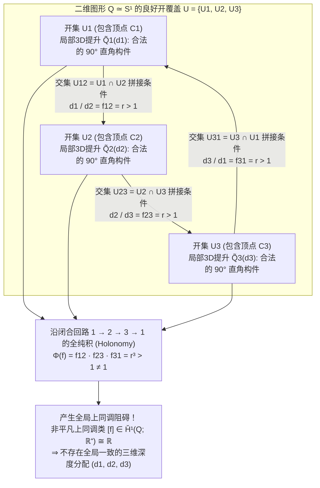
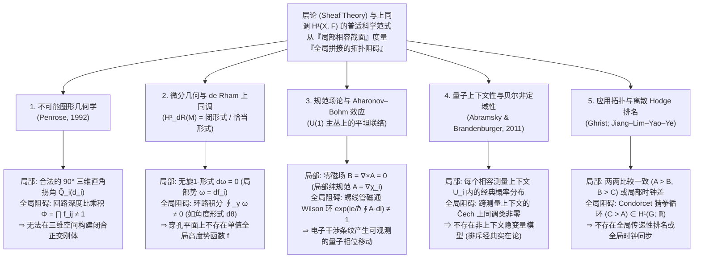

只需一张白纸、一支铅笔和一把直尺，任何人都可以在几分钟内画出著名的<strong>“彭罗斯三角形（Penrose Tribar / Penrose Triangle）”</strong>：三根具有正方形截面的笔直横梁在三个顶点处两两成直角（$90^\circ$）相交，在纸面上围成一个看似坚固的等边三角形框架。或者想象荷兰版画大师<strong>莫里茨·科内利斯·埃舍尔（M.C. Escher，1898–1972）</strong>在1960年的传世石版画《上升与下降》（*Ascending and Descending*）中所描绘的修道院屋顶阶梯：两列僧侣沿着四段相连的石阶永无止境地向上攀登或向下行走，明明一直在爬升，却不知不觉回到了出发时的同一高度。

当我们凝视这类<strong>不可能图形（Impossible Figures / Impossible Objects）</strong>时，人类的视觉皮层会陷入一种奇妙的认知眩晕。只看三角形的左上角：那是一个完全符合欧几里得几何与木工常理的三维直角榫接结构；把视线移到右上角：同样是一个无可挑剔的 $90^\circ$ 刚体拐角；再看底部的角：依然没有任何物理破绽。然而，一旦你的目光沿着三根横梁组成的闭合回路巡视一圈，一场全局性的空间灾难便骤然爆发——<strong>原本位于观察者近端的一根横梁，竟毫无断裂地穿过了远端横梁的背后</strong>。

为什么人类的双手可以在二维平面上轻易画出“每一个局部（Local）都完全合理，但在整体（Global）上却绝对无法存在于三维欧几里得空间 $\mathbb{R}^3$ 中”的物体？现代数学又是如何精确刻画从<strong>“局部相容性（Local Consistency）”</strong>到<strong>“整体矛盾（Global Contradiction）”</strong>这一拓扑机制的？

1992年，诺贝尔物理学奖得主、数学物理学家<strong>罗杰·彭罗斯爵士（Sir Roger Penrose）</strong>发表了经典论文《论不可能图形的上同调》（*On the Cohomology of Impossible Figures*）。他利用20世纪纯粹数学最核心的工具——<strong>层论（Sheaf Theory）</strong>与<strong>Čech上同调（Čech Cohomology）</strong>——证明了一个深刻的定理：不可能图形绝非单纯的视觉欺骗或绘画把戏，它是二维图形空间上<strong>第一Čech上同调群 $\check{H}^1(Q; \mathbb{R}^+)$ 中非平凡上同调类（Non-trivial Cohomology Class）的直接视觉化呈现</strong>。

本文将从不可能图形的艺术与科学史出发，严格推导透视投影 $\pi: \mathbb{R}^3 \to \mathbb{R}^2$ 的深度纤维结构、计算机视觉中的Huffman–Clowes线图标记演算、彭罗斯的层与Čech上同调公理化构造、明治大学杉原厚吉教授“反重力不可能立体（Impossible Motion）”的线性代数原理，以及这一“局部到整体”的上同调阻碍在微分几何、Aharonov–Bohm规范场效应、量子上下文性与离散Hodge排名理论中的普适共鸣。

---

## 1. 画得出却造不出的立体：路德斯瓦德、彭罗斯父子与埃舍尔

### 1.1 从透视讽刺画到纯粹的几何悖论

在西方艺术史上，刻意违反透视法则的尝试可追溯至18世纪英国画家威廉·霍加斯（William Hogarth）于1754年创作的铜版画《错误透视的讽刺》（*Satire on False Perspective*）。然而霍加斯的作品依赖繁杂风景中的遮挡错位，而非单一刚体结构的纯粹几何矛盾。

历史上第一位创造出纯粹几何不可能图形的先驱，是瑞典艺术家<strong>奥斯卡·路德斯瓦德（Oscar Reutersvärd，1915–2002）</strong>。1934年，年仅18岁的路德斯瓦德在枯燥的拉丁语课上于课本边缘随手画了一个六角星，并在周围排列小立方体，意外画出了由9个立方体组成的循环矛盾三角形（《Opus 1》）。此后他一生创作了超过2,500幅等轴测投影（平行投影）的不可能图形，并于1982年荣登瑞典国家纪念邮票。

### 1.2 1958年：彭罗斯父子的划时代论文《Impossible Objects》

与路德斯瓦德独立地，英国精神病学家与遗传学家<strong>莱昂内尔·彭罗斯（Lionel S. Penrose，1898–1972）</strong>与他当时在剑桥大学研究代数几何与数学物理的儿子<strong>罗杰·彭罗斯（Roger Penrose，1931–）</strong>在1954年阿姆斯特丹国际数学家大会（ICM）期间参观了埃舍尔的画展。深受震撼的罗杰回国后，尝试将三维空间的视觉矛盾浓缩到最简洁的几何骨架中，发明了由三根直角横梁构成的<strong>“彭罗斯三杆 / 彭罗斯三角形（Penrose Tribar）”</strong>；父亲莱昂内尔则在此基础上设计了四段循环上升的<strong>“彭罗斯无限阶梯（Penrose Endless Staircase）”</strong>。

1958年2月，父子二人在《英国心理学杂志》（*British Journal of Psychology*，第49卷，第31–33页）共同发表了题为<strong>《Impossible Objects: A Special Type of Visual Illusion》</strong>的著名短文。他们在文中一针见血地指出：

> “结构的每一个独立部分都可以作为代表正常三维实体的图形而被接受，然而由于各部分之间的错误连接（false connexions of the parts），整体却引发了几何灾难……当眼睛沿着图形的线条追随下去时，观察者被迫对物体到眼睛的距离做出突然而矛盾的重新解释。”

### 1.3 与埃舍尔的书信往来及三大不朽石版画

彭罗斯父子将论文单行本寄给了埃舍尔。埃舍尔读后欣喜若狂，在随后的三年间创作了人类视觉艺术史上最负盛名的三部曲：

1. <strong>《瞭望台》（*Belvedere*，1958年5月）</strong>：将奈克尔立方体（Necker Cube）的双稳态翻转嵌入古典建筑，一楼与二楼之间的石柱斜向交错连接了前排与后排的栏杆，而建筑底座旁坐着的少年手中正拿着一个不可能立方体模型。
2. <strong>《上升与下降》（*Ascending and Descending*，1960年3月）</strong>：直接采用莱昂内尔·彭罗斯的无限阶梯，将其构筑在修道院顶层，让僧侣们在闭合的四方回廊上陷入永恒的攀登或下降。
3. <strong>《瀑布》（*Waterfall*，1961年10月）</strong>：将三个罗杰·彭罗斯的三角形呈之字形垂直串联成引水渡槽。水流看似沿着远离观察者的方向缓缓向下流淌，但经过三个彭罗斯三角形的转折后，水渠末端竟精准地悬在起点水车的正上方，形成一座视觉上的“重力永动机”。

---

## 2. 视觉几何学：为什么透视投影 $\pi: \mathbb{R}^3 \to \mathbb{R}^2$ 会抹除深度？

### 2.1 中心投影与平行投影的一维纤维（Fiber）结构

设观察者的眼睛（针孔相机光心）位于三维欧几里得空间 $\mathbb{R}^3$ 的原点 $\mathbf{0} = (0,0,0)$，注视着前方半空间 $z > 0$，成像平面（视网膜或画布）位于焦距 $f > 0$ 处的平面 $I = \{(X, Y, f)\} \cong \mathbb{R}^2$。<strong>中心投影（透视投影）</strong>映射 $\pi: \mathbb{R}^3 \setminus \{\mathbf{0}\} \to \mathbb{R}^2$（或单位方向球面 $S^2$）定义为：

$$\pi(x, y, z) = \left( f \frac{x}{z}, \; f \frac{y}{z} \right), \qquad \text{或} \qquad \pi(\mathbf{r}) = \frac{\mathbf{r}}{\|\mathbf{r}\|}$$

对于二维图像上的任意一点 $p = \pi(\mathbf{r}_0)$，它在三维空间中的<strong>原像（纤维 / Fiber）</strong> $\pi^{-1}(p)$ 是什么？由于对任意正实数 $\lambda \in \mathbb{R}^+ = (0, \infty)$，沿视线方向的径向缩放变换 $\mathbf{r}_0 \mapsto \lambda \mathbf{r}_0$ 都满足 $\pi(\lambda \mathbf{r}_0) = \pi(\mathbf{r}_0) = p$，因此每一点上的纤维都是由正实数乘法群 $\mathbb{R}^+ = ((0, \infty), \times)$ 参数化的一维开射线：

$$\pi^{-1}(\pi(\mathbf{r}_0)) = \{ \lambda \mathbf{r}_0 \in \mathbb{R}^3 \setminus \{\mathbf{0}\} \mid \lambda \in \mathbb{R}^+ \}$$

这揭示了一个极其关键的几何事实：<strong>对于三维空间中的任何刚体局部构件 $\tilde{Q}_i \subset \mathbb{R}^3 \setminus \{\mathbf{0}\}$，如果我们将它相对于原点（人眼）放大 $\lambda$ 倍并同时推远 $\lambda$ 倍（即相似变换 $\mathbf{r} \mapsto \lambda \mathbf{r}$），不仅它的所有三维直角（$90^\circ$）保持严格不变，而且它在视网膜上的二维投影图像 $\pi(\lambda \tilde{Q}_i) = \pi(\tilde{Q}_i)$ 也分毫不差地完全重合！</strong>

同理，在无穷远视点极限下的<strong>正交/等轴测平行投影</strong> $\pi_{\text{orth}}(x, y, z) = (x, y)$ 中，保持二维图像与三维角度不变的变换是沿视线方向（$z$ 轴）的深度平移 $(x, y, z) \mapsto (x, y, z + c)$，其自由度由实数加法群 $(\mathbb{R}, +)$ 给出。由于对数与指数映射 $\ln: (\mathbb{R}^+, \times) \xrightarrow{\sim} (\mathbb{R}, +)$ 是群同构，透视投影的乘法尺度群 $\mathbb{R}^+$ 与平行投影的加法平移群 $\mathbb{R}$ 在代数拓扑上完全等价。

### 2.2 逆问题与 Huffman–Clowes 线图标记演算（1971）

由于投影映射 $\pi$ 在每一点都坍缩了一维深度纤维 $\mathbb{R}^+$，从二维线图恢复三维立体是一个典型的病态逆问题。人类视觉系统通过无意识地施加<strong>表面平坦性（Planarity）</strong>、<strong>直角正交性（Orthogonality，$90^\circ$ 假设）</strong>以及<strong>一般视点假设（General Viewpoint Assumption）</strong>来求解该逆问题。

1971年，信息论先驱<strong>大卫·霍夫曼（David A. Huffman）</strong>与人工智能学者<strong>马克斯·克洛斯（Max B. Clowes）</strong>独立建立了多面体线图的组合判定理论——<strong>Huffman–Clowes 线图标记演算</strong>。该理论将线图中的每一条边标记为四类物理边之一：

- <strong>$+$（凸边 / Convex Edge）</strong>：相邻两面均可见，且向观察者凸出成脊；
- <strong>$-$（凹边 / Concave Edge）</strong>：相邻两面均可见，且向内凹陷成谷；
- <strong>$\rightarrow, \leftarrow$（遮挡轮廓边 / Occluding Boundary）</strong>：仅一侧表面可见，沿着箭头方向前进时，<strong>右侧为近处可见表面，左侧为深度发生不连续跳跃的远处背景</strong>。

令人惊讶的是，<strong>彭罗斯三角形能够 100% 完美通过 Huffman–Clowes 组合标记检验！</strong> 它的每一个 L 型、Y 型（Fork）、箭头型（Arrow）和 T 型顶点都属于物理合法的三面体顶点目录。这说明：彭罗斯三角形的不可能性绝非局部顶点的组合拓扑矛盾，而是<strong>连续深度坐标在绕行非可缩闭合回路一周时产生的度量/射影闭合失败</strong>。

| 一致性层级 | 数学框架与理论 | 检验的几何条件 | 彭罗斯三角形的判定结果 |
| :--- | :--- | :--- | :--- |
| <strong>第1层：局部顶点可实现性</strong> | 三面体顶点目录（Guzmán, 1968） | 单个顶点 $v_i$ 的邻域能否作为三维多面体角存在？ | <strong>通过</strong>（每个角都是合法的 $90^\circ$ 直角连接） |
| <strong>第2层：组合边标记相容性</strong> | Huffman–Clowes 演算（1971） | 能否为所有边赋予 $+, -, \rightarrow, \leftarrow$ 标签且在顶点处相容？ | <strong>通过</strong>（存在全局自洽的边标签分配） |
| <strong>第3层：刚性局部片粘贴</strong> | <strong>彭罗斯层上同调理论（Penrose, 1992）</strong> | 保持直角的局部3D构件的深度比 $f_{ij}$ 沿回路乘积是否为 $1$？ | <strong>失败</strong>（$\check{H}^1(Q; \mathbb{R}^+) \neq 0$，产生非平凡上同调阻碍） |
| <strong>第4层：一般平面多面体实现</strong> | 杉原厚吉线性规划系统（Sugihara, 1986） | 放弃 $90^\circ$ 正交假设，线性系统 $A\mathbf{w}=\mathbf{0}, B\mathbf{w}>\mathbf{0}$ 是否有解？ | <strong>通过</strong>（利用倾斜非矩形平面可在3D中真实制造！） |

---

## 3. 局部相容性与整体矛盾：开覆盖上的三维提升粘贴

设二维平面上的彭罗斯三角形图形为拓扑空间 $Q \subset \mathbb{R}^2$。在拓扑上，$Q$ 是一个中间带有一个孔的环形区域，与圆周 $S^1$ 同伦等价（$Q \simeq S^1$）。

我们用三个开集 $\mathcal{U} = \{U_1, U_2, U_3\}$ 覆盖图形 $Q$，其中每个开集 $U_i$ 包含三角形的一个直角顶点 $C_i$ 以及从该顶点延伸出的两根横梁的大部分：

1. 每个开集 $U_i$（$i=1,2,3$）自身都是单连通（可缩 / Contractible）的 L 型区域，不包含任何闭合回路；
2. 两两交集 $U_{12} = U_1 \cap U_2$、$U_{23} = U_2 \cap U_3$、$U_{31} = U_3 \cap U_1$ 分别位于三根直横梁的中段，是非空的可缩区域；
3. 三重交集为空集：$U_1 \cap U_2 \cap U_3 = \emptyset$。因此，开覆盖的<strong>神经复形（Nerve of the Cover）</strong> $N(\mathcal{U})$ 恰好是三角形边界 $\partial \Delta^2 \cong S^1$。

在每个局部开集 $U_i$ 上，视觉系统都能毫无矛盾地构建一个标准的三维直角构件 $\tilde{Q}_i^{\text{std}} \subset \mathbb{R}^3 \setminus \{\mathbf{0}\}$，使得 $\pi(\tilde{Q}_i^{\text{std}}) = U_i$。根据第2.1节，在不改变二维投影图像与三维直角的前提下，$U_i$ 上所有合法的三维提升（Local 3D Lifts）由单个正实数深度尺度因子 $d_i \in \mathbb{R}^+$ 唯一参数化：

$$\tilde{Q}_i(d_i) = d_i \cdot \tilde{Q}_i^{\text{std}}, \qquad d_i \in \mathbb{R}^+ = (0, \infty)$$

现在考察重叠区 $U_{12} = U_1 \cap U_2$。由于横梁 $1 \to 2$ 在透视上向远离（或靠近）观察者的方向倾斜，为了使局部构件 $\tilde{Q}_1(d_1)$ 与 $\tilde{Q}_2(d_2)$ 在 $U_{12}$ 处无缝拼接成同一根连续横梁，两者的深度尺度必须满足一个固定的正比例常数 $f_{12} = r > 1$：

$$\frac{d_1}{d_2} = f_{12} = r > 1$$

由彭罗斯三角形在平面上的 $120^\circ$ 三重旋转对称性，在另外两个重叠区 $U_{23}$ 和 $U_{31}$ 上同样必须满足：

$$\frac{d_2}{d_3} = f_{23} = r > 1, \qquad \frac{d_3}{d_1} = f_{31} = r > 1$$

将这三个局部粘贴方程沿闭合回路 $1 \to 2 \to 3 \to 1$ 相乘，左侧的 $d_1, d_2, d_3$ 全部抵消，立即导出整体代数矛盾：

$$1 = \frac{d_1}{d_2} \cdot \frac{d_2}{d_3} \cdot \frac{d_3}{d_1} = f_{12} \cdot f_{23} \cdot f_{31} = r^3 > 1 \quad (\text{矛盾！})$$

---

## 4. 罗杰·彭罗斯（1992）的层论与Čech上同调严格定式化

在1992年的经典论文《On the Cohomology of Impossible Figures》中，罗杰·彭罗斯将上述几何粘贴问题严格表述为拓扑空间 $Q$ 上取值于<strong>模糊群（Ambiguity Group） $G = (\mathbb{R}^+, \times)$</strong> 的<strong>局部常值层（Locally Constant Sheaf） $\mathcal{F}$</strong> 的Čech上同调理论。

### 4.1 Čech上链复形（Cochain Complex）与上边缘算子 $\delta$

给定 $Q$ 的良好开覆盖 $\mathcal{U} = \{U_1, U_2, U_3\}$，定义系数在阿贝尔群 $G = \mathbb{R}^+$ 中的Čech上链群序列：

$$C^0(\mathcal{U}, \mathbb{R}^+) \xrightarrow{\;\delta^0\;} C^1(\mathcal{U}, \mathbb{R}^+) \xrightarrow{\;\delta^1\;} C^2(\mathcal{U}, \mathbb{R}^+)$$

1. <strong>$0$-上链群 $C^0(\mathcal{U}, \mathbb{R}^+)$</strong>：为每个局部片 $U_i$ 分配正深度尺度因子 $d = (d_1, d_2, d_3) \in (\mathbb{R}^+)^3$。
2. <strong>$1$-上链群 $C^1(\mathcal{U}, \mathbb{R}^+)$</strong>：为每个非空两两交集 $U_{ij} = U_i \cap U_j$ 分配转移比（粘贴数据） $f = (f_{12}, f_{23}, f_{31}) \in (\mathbb{R}^+)^3$，且满足交错条件 $f_{ji} = f_{ij}^{-1}, \; f_{ii} = 1$。
3. <strong>第0上边缘算子（0-Coboundary Operator） $\delta^0$</strong>：将全局深度分配 $d = (d_1, d_2, d_3)$ 映射为其两两之比：
   $$(\delta^0 d)_{ij} = \frac{d_i}{d_j}$$
4. <strong>第1上边缘算子 $\delta^1$</strong>：将 $1$-上链 $f = \{f_{ij}\}$ 映射为三重交集 $U_i \cap U_j \cap U_k$ 上的循环乘积 $(\delta^1 f)_{ijk} = f_{ij} f_{jk} f_{ki}$。显然恒有 $\delta^1 \circ \delta^0 = 1$（加法记号下即 $\delta^2 = 0$）。

### 4.2 $1$-上闭链 $Z^1$、$1$-上边缘 $B^1$ 与第一Čech上同调群 $\check{H}^1(Q; \mathbb{R}^+)$

- <strong>$1$-上闭链群（1-Cocycles） $Z^1(\mathcal{U}, \mathbb{R}^+) = \ker \delta^1$</strong>：满足局部三重重叠自洽条件 $\delta^1 f = 1$ 的粘贴族。由于彭罗斯三角形的开覆盖满足 $U_1 \cap U_2 \cap U_3 = \emptyset$，故 $C^2(\mathcal{U}, \mathbb{R}^+) = \{1\}$，从而<strong>每一个 $1$-上链都自动是 $1$-上闭链</strong>：$Z^1(\mathcal{U}, \mathbb{R}^+) = C^1(\mathcal{U}, \mathbb{R}^+) \cong (\mathbb{R}^+)^3$。
- <strong>$1$-上边缘群（1-Coboundaries） $B^1(\mathcal{U}, \mathbb{R}^+) = \operatorname{Im} \delta^0$</strong>：能够表示为某个全局三维深度分配之比 $f_{ij} = d_i / d_j$ 的粘贴族。<strong>图形 $Q$ 在三维空间中整体可实现（Globally Realizable），当且仅当 $f \in B^1(\mathcal{U}, \mathbb{R}^+)$！</strong>

定义<strong>第一Čech上同调群</strong>为商群：

$$\check{H}^1(Q; \mathbb{R}^+) \cong \check{H}^1(\mathcal{U}, \mathbb{R}^+) = \frac{Z^1(\mathcal{U}, \mathbb{R}^+)}{B^1(\mathcal{U}, \mathbb{R}^+)} = \frac{\ker \delta^1}{\operatorname{Im} \delta^0}$$

定义回路全纯同态（Holonomy Homomorphism） $\Phi: Z^1(\mathcal{U}, \mathbb{R}^+) \to \mathbb{R}^+$ 为：

$$\Phi(f) = f_{12} \cdot f_{23} \cdot f_{31}$$

容易验证，$\Phi(f) = 1$ 当且仅当存在 $(d_1, d_2, d_3)$ 使得 $f_{ij} = d_i / d_j$（即 $\ker \Phi = B^1(\mathcal{U}, \mathbb{R}^+)$）。由群同构第一定理，我们得到同构：

$$\check{H}^1(Q; \mathbb{R}^+) \xrightarrow[\;\sim\;]{\;\Phi\;} \mathbb{R}^+ \xrightarrow[\;\sim\;]{\;\ln\;} \mathbb{R}$$

对于彭罗斯三角形，$\Phi(f) = r^3 \neq 1$（或对数形式 $\ln f_{12} + \ln f_{23} + \ln f_{31} = 3 \ln r \neq 0$）。由此便严格证明了<strong>彭罗斯不可能图形定理（1992）</strong>：<strong>二维局部合法图形的三维全局不可实现性，完全等价于其第一Čech上同调类 $[f] \in \check{H}^1(Q; G)$ 非平凡（$[f] \neq 1$）！</strong>

这也完美解释了为什么澳大利亚东珀斯（East Perth）的巨型彭罗斯三角形雕塑或理查德·格雷戈里（Richard Gregory）的木制模型只能在<strong>唯一特定视角</strong>下成立：在三维空间中，该雕塑实际上是一个被切开的开区间 $Q_{\text{cut}} \simeq [0, 1]$，由于可缩空间的上同调群恒为零（$\check{H}^1([0, 1]; \mathbb{R}^+) = \{1\}$），因此切开后的三维钩状体可以毫无矛盾地建造出来；当观察者站在特定视角使前后错开的两端恰好落在同一条视线纤维 $\pi^{-1}(p)$ 上时，投影映射 $\pi$ 将两端重新粘合成二维圆周 $S^1$，从而在视网膜上复活了非平凡的上同调类！

---

## 5. 杉原厚吉的“反重力不可能立体”与跨越科学的层上同调范式

### 5.1 杉原厚吉（Kokichi Sugihara）如何打破上同调壁垒？

如果不切开回路，能否在三维空间中制造出真正连续闭合的彭罗斯阶梯？日本明治大学数学家<strong>杉原厚吉</strong>通过其名著《Machine Interpretation of Line Drawings》（MIT Press, 1986）中的线性代数理论给出了惊人的肯定回答，并凭《Impossible Motion》（小球看似违背重力自动滚上斜坡）多次斩获世界年度最佳错觉大赛冠军。

设多面体线图有 $n_v$ 个顶点（二维坐标 $(x_k, y_k)$ 已知，深度 $z_k$ 未知）和 $n_f$ 个平面面片 $F_m: a_m x + b_m y + z + c_m = 0$。将所有未知参数记为向量 $\mathbf{w} = (z_1, \dots, a_1, b_1, c_1, \dots)^T$。顶点在面上的关联条件给出齐次线性方程组 $A \mathbf{w} = \mathbf{0}$，而边的凹凸与遮挡关系给出严格线性不等式组 $B \mathbf{w} > \mathbf{0}$。

- <strong>人类大脑求解的超定系统</strong>：大脑无意识地附加了“所有转角均为 $90^\circ$ 直角、柱子完全铅直”的正交性方程 $C_{\text{rect}} \mathbf{w} = \mathbf{0}$，导致联立系统 $A\mathbf{w}=\mathbf{0}, B\mathbf{w}>\mathbf{0}, C_{\text{rect}}\mathbf{w}=\mathbf{0}$ 无解（即彭罗斯上同调阻碍 $\check{H}^1 \neq 0$）。
- <strong>杉原厚吉求解的松弛系统</strong>：去掉正交性约束 $C_{\text{rect}} \mathbf{w} = \mathbf{0}$，仅求解 $A\mathbf{w}=\mathbf{0}, B\mathbf{w}>\mathbf{0}$，则系统存在无穷多个连续的三维多面体解 $\mathbf{w}^*$！

杉原利用倾斜的梯形与平行四边形平面制造出真实的三维雕塑 $\mathbf{w}^*$。从特定视角观看时，其视网膜投影完全满足 $A\mathbf{w}^*=\mathbf{0}$，但大脑顽固地强加直角先验 $C_{\text{rect}}\mathbf{w}=\mathbf{0}$，从而把三维空间中实际上<strong>向下倾斜</strong>的滑道错觉为<strong>向上攀升</strong>的斜坡，让顺着重力滚落的小球呈现出“反重力上坡”的奇观！

### 5.2 贯穿现代科学的“层与上同调”大一统架构

彭罗斯三角形所展现的“局部相容但全局存在拓扑阻碍”的机制，在现代数学、物理学与计算机科学的五大核心领域中具有完全同构的数学结构：

| 科学领域与现象 | 底空间 $X$ 与开覆盖 $\{U_i\}$ | 局部截面（局部解） $s_i \in \mathcal{F}(U_i)$ | 交集 $U_i \cap U_j$ 上的拼接条件 | 全局解存在条件（$\check{H}^1 = 0$） | 非平凡上同调 $\check{H}^1(X, \mathcal{F}) \neq 0$ 的物理/数学意义 |
| :--- | :--- | :--- | :--- | :--- | :--- |
| <strong>不可能图形几何</strong> （Penrose, 1992） | 二维线图 $Q \simeq S^1$ 与拐角邻域 $\{U_i\}$ | 局部三维直角模型的深度尺度 $d_i \in \mathbb{R}^+$ | 横梁重叠处的深度比例 $f_{ij} = d_i / d_j$ | 回路乘积 $\Phi = \prod f_{ij} = 1$（可建造3D实体） | <strong>彭罗斯三角形 / 埃舍尔无限阶梯</strong>（无法在3D中闭合成型） |
| <strong>微分几何学</strong> （de Rham 上同调） | 光滑流形 $M$（如 $\mathbb{R}^2 \setminus \{0\}$） | 闭1-形式 $d\omega = 0$ 的局部原函数 $\omega = df_i$ | 局部势函数差 $f_i - f_j = c_{ij}$ | 环路积分 $\oint_\gamma \omega = 0$（保守场 / 恰当形式） | <strong>角微分形式 $\omega = d\theta$</strong>（连续版埃舍尔阶梯，无全局势函数） |
| <strong>规范场与量子物理</strong> （Aharonov–Bohm, 1959） | 螺线管外部无磁场区 $M \simeq S^1$ | 零磁场区 $\mathbf{B}=\mathbf{0}$ 的局部规范势 $\mathbf{A} = \nabla \chi_i$ | $U(1)$ 规范变换 $g_{ij} = e^{ie(\chi_i-\chi_j)/\hbar}$ | 磁通量量子化使 $\exp(\frac{ie}{\hbar}\oint \mathbf{A}\cdot d\mathbf{l}) = 1$ | <strong>Aharonov–Bohm 相移效应</strong>（电子在零磁场区感知拓扑磁通） |
| <strong>量子基础与信息</strong> （Abramsky 等, 2011） | 观测量集 $X$ 与对易测量上下文 $\{U_i\}$ | 单个测量上下文上的局部经典概率分布 | 边缘概率一致（无超光速信号条件） | 存在非上下文的全局经典隐变量分布 | <strong>量子上下文性（Kochen–Specker / Hardy 悖论）</strong> |
| <strong>应用拓扑与数据科学</strong> （Ghrist; HodgeRank） | 比较网络图 $G = (V, E)$ | 节点的全局评分或标准时间 $d_i \in \mathbb{R}$ | 两两比较得分差 $f_{ij} = d_i - d_j$ | 沿所有图回路的差值之和为 $0$（全局全序） | <strong>Condorcet 投票悖论（石头剪刀布循环）</strong>与传感器失步 |

当我们凝视埃舍尔石版画中永不停歇的僧侣或彭罗斯三角形时，我们大脑视觉皮层所感受到的那一瞬间惊奇，正是人类神经系统在沿着闭合路径执行平行移动积分，并实时探测到<strong>第一Čech上同调群 $\check{H}^1(Q; \mathbb{R}^+)$ 中的非零拓扑阻碍</strong>的直接证明。

---

## 参考文献

1. <strong>Penrose, L. S., & Penrose, R.</strong> (1958). "Impossible Objects: A Special Type of Visual Illusion." *British Journal of Psychology*, 49(1), 31–33.
2. <strong>Penrose, R.</strong> (1992). "On the Cohomology of Impossible Figures." *Structural Topology*, 17, 11–16.
3. <strong>Huffman, D. A.</strong> (1971). "Impossible Objects as Nonsense Sentences." *Machine Intelligence*, 6, 295–323.
4. <strong>Sugihara, K.</strong> (1986). *Machine Interpretation of Line Drawings*. MIT Press.
5. <strong>Abramsky, S., & Brandenburger, A.</strong> (2011). "The Sheaf-Theoretic Structure of Non-Locality and Contextuality." *New Journal of Physics*, 13(11), 113036.
