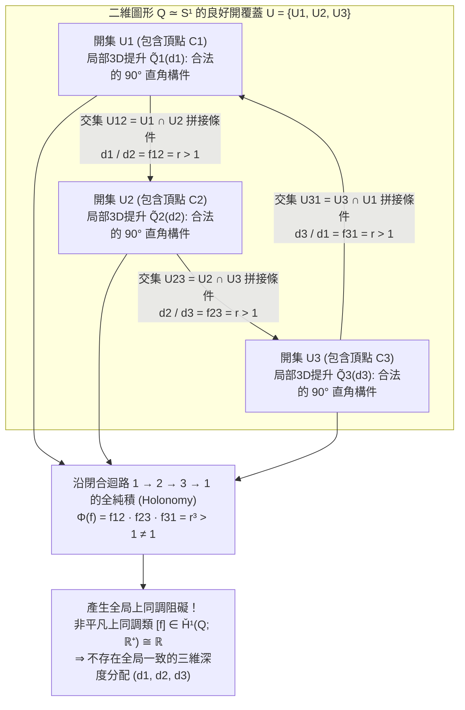
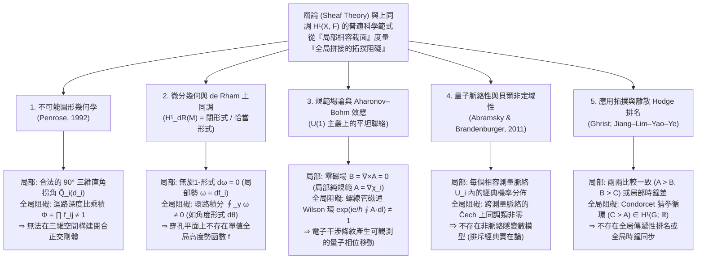

只需一張白紙、一支鉛筆和一把直尺，任何人都可以在幾分鐘內畫出著名的<strong>「潘洛斯三角形（Penrose Tribar / Penrose Triangle）」</strong>：三根具有正方形截面的筆直橫樑在三個頂點處兩兩成直角（$90^\circ$）相交，在紙面上圍成一個看似堅固的正三角形框架。或者想像荷蘭版畫大師<strong>莫里茨·科內利斯·艾雪（M.C. Escher，1898–1972）</strong>在1960年的傳世石版畫《上升與下降》（*Ascending and Descending*）中所描繪的修道院屋頂階梯：兩列僧侶沿著四段相連的石階永無止境地向上攀登或向下行走，明明一直在爬升，卻不知不覺回到了出發時的同一高度。

當我們凝視這類<strong>不可能圖形（Impossible Figures / Impossible Objects）</strong>時，人類的視覺皮層會陷入一種奇妙的認知眩暈。只看三角形的左上角：那是一個完全符合歐幾里得幾何與木工常理的三維直角榫接結構；把視線移到右上角：同樣是一個無可挑剔的 $90^\circ$ 剛體拐角；再看底部的角：依然沒有任何物理破綻。然而，一旦你的目光沿著三根橫樑組成的閉合迴路巡視一圈，一場全局性的空間災難便驟然爆發——<strong>原本位於觀察者近端的一根橫樑，竟毫無斷裂地穿過了遠端橫樑的背後</strong>。

為什麼人類的雙手可以在二維平面上輕易畫出「每一個局部（Local）都完全合理，但在整體（Global）上卻絕對無法存在於三維歐幾里得空間 $\mathbb{R}^3$ 中」的物體？現代數學又是如何精確刻畫從<strong>「局部相容性（Local Consistency）」</strong>到<strong>「整體矛盾（Global Contradiction）」</strong>這一拓撲機制的？

1992年，諾貝爾物理學獎得主、數學物理學家<strong>羅傑·潘洛斯爵士（Sir Roger Penrose）</strong>發表了經典論文《論不可能圖形的上同調》（*On the Cohomology of Impossible Figures*）。他利用20世紀純粹數學最核心的工具——<strong>層論（Sheaf Theory）</strong>與<strong>Čech上同調（Čech Cohomology）</strong>——證明了一個深刻的定理：不可能圖形絕非單純的視覺欺騙或繪畫把戲，它是二維圖形空間上<strong>第一Čech上同調群 $\check{H}^1(Q; \mathbb{R}^+)$ 中非平凡上同調類（Non-trivial Cohomology Class）的直接視覺化呈現</strong>。

本文將從不可能圖形的藝術與科學史出發，嚴格推導透視投影 $\pi: \mathbb{R}^3 \to \mathbb{R}^2$ 的深度纖維結構、電腦視覺中的Huffman–Clowes線圖標記演算、潘洛斯的層與Čech上同調公理化構造、明治大學杉原厚吉教授「反重力不可能立體（Impossible Motion）」的線性代數原理，以及這一「局部到整體」的上同調阻礙在微分幾何、Aharonov–Bohm規範場效應、量子脈絡性與離散Hodge排名理論中的普適共鳴。

---

## 1. 畫得出卻造不出的立體：路德斯瓦德、潘洛斯父子與艾雪

### 1.1 從透視諷刺畫到純粹的幾何悖論

在西方藝術史上，刻意違反透視法則的嘗試可追溯至18世紀英國畫家威廉·霍加斯（William Hogarth）於1754年創作的銅版畫《錯誤透視的諷刺》（*Satire on False Perspective*）。然而霍加斯的作品依賴繁雜風景中的遮擋錯位，而非單一剛體結構的純粹幾何矛盾。

歷史上第一位創造出純粹幾何不可能圖形的先驅，是瑞典藝術家<strong>奧斯卡·路德斯瓦德（Oscar Reutersvärd，1915–2002）</strong>。1934年，年僅18歲的路德斯瓦德在枯燥的拉丁語課上於課本邊緣隨手畫了一個六角星，並在周圍排列小立方體，意外畫出了由9個立方體組成的循環矛盾三角形（《Opus 1》）。此後他一生創作了超過2,500幅等軸測投影（平行投影）的不可能圖形，並於1982年榮登瑞典國家紀念郵票。

### 1.2 1958年：潘洛斯父子的劃時代論文《Impossible Objects》

與路德斯瓦德獨立地，英國精神病學家與遺傳學家<strong>萊昂內爾·潘洛斯（Lionel S. Penrose，1898–1972）</strong>與他當時在劍橋大學研究代數幾何與數學物理的兒子<strong>羅傑·潘洛斯（Roger Penrose，1931–）</strong>在1954年阿姆斯特丹國際數學家大會（ICM）期間參觀了艾雪的畫展。深受震撼的羅傑回國後，嘗試將三維空間的視覺矛盾濃縮到最簡潔的幾何骨架中，發明了由三根直角橫樑構成的<strong>「潘洛斯三桿 / 潘洛斯三角形（Penrose Tribar）」</strong>；父親萊昂內爾則在此基礎上設計了四段循環上升的<strong>「潘洛斯無限階梯（Penrose Endless Staircase）」</strong>。

1958年2月，父子二人在《英國心理學雜誌》（*British Journal of Psychology*，第49卷，第31–33頁）共同發表了題為<strong>《Impossible Objects: A Special Type of Visual Illusion》</strong>的著名短文。他們在文中一針見血地指出：

> 「結構的每一個獨立部分都可以作為代表正常三維實體的圖形而被接受，然而由於各部分之間的錯誤連接（false connexions of the parts），整體卻引發了幾何災難……當眼睛沿著圖形的線條追隨下去時，觀察者被迫對物體到眼睛的距離做出突然而矛盾的重新解釋。」

### 1.3 與艾雪的書信往來及三大不朽石版畫

潘洛斯父子將論文單行本寄給了艾雪。艾雪讀後欣喜若狂，在隨後的三年內創作了人類視覺藝術史上最負盛名的三部曲：

1. <strong>《瞭望台》（*Belvedere*，1958年5月）</strong>：將奈克爾立方體（Necker Cube）的雙穩態翻轉嵌入古典建築，一樓與二樓之間的石柱斜向交錯連接了前排與後排的欄杆，而建築底座旁坐著的少年手中正拿著一個不可能立方體模型。
2. <strong>《上升與下降》（*Ascending and Descending*，1960年3月）</strong>：直接採用萊昂內爾·潘洛斯的無限階梯，將其構築在修道院頂層，讓僧侶們在閉合的四方迴廊上陷入永恆的攀登或下降。
3. <strong>《瀑布》（*Waterfall*，1961年10月）</strong>：將三個羅傑·潘洛斯的三角形呈之字形垂直串聯成引水渡槽。水流看似沿著遠離觀察者的方向緩緩向下流淌，但經過三個潘洛斯三角形的轉折後，水渠末端竟精準地懸在起點水車的正上方，形成一座視覺上的「重力永動機」。

---

## 2. 視覺幾何學：為什麼透視投影 $\pi: \mathbb{R}^3 \to \mathbb{R}^2$ 會抹除深度？

### 2.1 中心投影與平行投影的一維纖維（Fiber）結構

設觀察者的眼睛（針孔相機光心）位於三維歐幾里得空間 $\mathbb{R}^3$ 的原點 $\mathbf{0} = (0,0,0)$，注視著前方半空間 $z > 0$，成像平面（視網膜或畫布）位於焦距 $f > 0$ 處的平面 $I = \{(X, Y, f)\} \cong \mathbb{R}^2$。<strong>中心投影（透視投影）</strong>映射 $\pi: \mathbb{R}^3 \setminus \{\mathbf{0}\} \to \mathbb{R}^2$（或單位方向球面 $S^2$）定義為：

$$\pi(x, y, z) = \left( f \frac{x}{z}, \; f \frac{y}{z} \right), \qquad \text{或} \qquad \pi(\mathbf{r}) = \frac{\mathbf{r}}{\|\mathbf{r}\|}$$

對於二維圖像上的任意一點 $p = \pi(\mathbf{r}_0)$，它在三維空間中的<strong>原像（纖維 / Fiber）</strong> $\pi^{-1}(p)$ 是什麼？由於對任意正實數 $\lambda \in \mathbb{R}^+ = (0, \infty)$，沿視線方向的徑向縮放變換 $\mathbf{r}_0 \mapsto \lambda \mathbf{r}_0$ 都滿足 $\pi(\lambda \mathbf{r}_0) = \pi(\mathbf{r}_0) = p$，因此每一點上的纖維都是由正實數乘法群 $\mathbb{R}^+ = ((0, \infty), \times)$ 參數化的一維開射線：

$$\pi^{-1}(\pi(\mathbf{r}_0)) = \{ \lambda \mathbf{r}_0 \in \mathbb{R}^3 \setminus \{\mathbf{0}\} \mid \lambda \in \mathbb{R}^+ \}$$

這揭示了一個極其關鍵的幾何事實：<strong>對於三維空間中的任何剛體局部構件 $\tilde{Q}_i \subset \mathbb{R}^3 \setminus \{\mathbf{0}\}$，如果我們將它相對於原點（人眼）放大 $\lambda$ 倍並同時推遠 $\lambda$ 倍（即相似變換 $\mathbf{r} \mapsto \lambda \mathbf{r}$），不僅它的所有三維直角（$90^\circ$）保持嚴格不變，而且它在視網膜上的二維投影圖像 $\pi(\lambda \tilde{Q}_i) = \pi(\tilde{Q}_i)$ 也分毫不差地完全重合！</strong>

同理，在無窮遠視點極限下的<strong>正交/等軸測平行投影</strong> $\pi_{\text{orth}}(x, y, z) = (x, y)$ 中，保持二維圖像與三維角度不變的變換是沿視線方向（$z$ 軸）的深度平移 $(x, y, z) \mapsto (x, y, z + c)$，其自由度由實數加法群 $(\mathbb{R}, +)$ 給出。由於對數與指數映射 $\ln: (\mathbb{R}^+, \times) \xrightarrow{\sim} (\mathbb{R}, +)$ 是群同構，透視投影的乘法尺度群 $\mathbb{R}^+$ 與平行投影的加法平移群 $\mathbb{R}$ 在代數拓撲上完全等價。

### 2.2 逆問題與 Huffman–Clowes 線圖標記演算（1971）

由於投影映射 $\pi$ 在每一點都坍縮了一維深度纖維 $\mathbb{R}^+$，從二維線圖恢復三維立體是一個典型的病態逆問題。人類視覺系統透過無意識地施加<strong>表面平坦性（Planarity）</strong>、<strong>直角正交性（Orthogonality，$90^\circ$ 假設）</strong>以及<strong>一般視點假設（General Viewpoint Assumption）</strong>來求解該逆問題。

1971年，資訊理論先驅<strong>大衛·霍夫曼（David A. Huffman）</strong>與人工智慧學者<strong>馬克斯·克洛斯（Max B. Clowes）</strong>獨立建立了多面體線圖的組合判定理論——<strong>Huffman–Clowes 線圖標記演算</strong>。該理論將線圖中的每一條邊標記為四類物理邊之一：

- <strong>$+$（凸邊 / Convex Edge）</strong>：相鄰兩面均為可見，且向觀察者凸出成脊；
- <strong>$-$（凹邊 / Concave Edge）</strong>：相鄰兩面均為可見，且向內凹陷成谷；
- <strong>$\rightarrow, \leftarrow$（遮擋輪廓邊 / Occluding Boundary）</strong>：僅一側表面可見，沿著箭頭方向前進時，<strong>右側為近處可見表面，左側為深度發生不連續跳躍的遠處背景</strong>。

令人驚訝的是，<strong>潘洛斯三角形能夠 100% 完美通過 Huffman–Clowes 組合標記檢驗！</strong> 它的每一個 L 型、Y 型（Fork）、箭頭型（Arrow）和 T 型頂點都屬於物理合法的三面體頂點目錄。這說明：潘洛斯三角形的不可能性絕非局部頂點的組合拓撲矛盾，而是<strong>連續深度座標在繞行非可縮閉合迴路一週時產生的度量/射影閉合失敗</strong>。

| 一致性層級 | 數學框架與理論 | 檢驗的幾何條件 | 潘洛斯三角形的判定結果 |
| :--- | :--- | :--- | :--- |
| <strong>第1層：局部頂點可實現性</strong> | 三面體頂點目錄（Guzmán, 1968） | 單個頂點 $v_i$ 的鄰域能否作為三維多面體角存在？ | <strong>通過</strong>（每個角都是合法的 $90^\circ$ 直角連接） |
| <strong>第2層：組合邊標記相容性</strong> | Huffman–Clowes 演算（1971） | 能否為所有邊賦予 $+, -, \rightarrow, \leftarrow$ 標籤且在頂點處相容？ | <strong>通過</strong>（存在全局自洽的邊標籤分配） |
| <strong>第3層：剛性局部片黏貼</strong> | <strong>潘洛斯層上同調理論（Penrose, 1992）</strong> | 保持直角的局部3D構件的深度比 $f_{ij}$ 沿迴路乘積是否為 $1$？ | <strong>失敗</strong>（$\check{H}^1(Q; \mathbb{R}^+) \neq 0$，產生非平凡上同調阻礙） |
| <strong>第4層：一般平面多面體實現</strong> | 杉原厚吉線性規劃系統（Sugihara, 1986） | 放棄 $90^\circ$ 正交假設，線性系統 $A\mathbf{w}=\mathbf{0}, B\mathbf{w}>\mathbf{0}$ 是否有解？ | <strong>通過</strong>（利用傾斜非矩形平面可在3D中真實製造！） |

---

## 3. 局部相容性與整體矛盾：開覆蓋上的三維提升黏貼

設二維平面上的潘洛斯三角形圖形為拓撲空間 $Q \subset \mathbb{R}^2$。在拓撲上，$Q$ 是一個中間帶有一個孔的環形區域，與圓周 $S^1$ 同倫等價（$Q \simeq S^1$）。

我們用三個開集 $\mathcal{U} = \{U_1, U_2, U_3\}$ 覆蓋圖形 $Q$，其中每個開集 $U_i$ 包含三角形的一個直角頂點 $C_i$ 以及從該頂點延伸出的兩根橫樑的大部分：

1. 每個開集 $U_i$（$i=1,2,3$）自身都是單連通（可縮 / Contractible）的 L 型區域，不包含任何閉合迴路；
2. 兩兩交集 $U_{12} = U_1 \cap U_2$、$U_{23} = U_2 \cap U_3$、$U_{31} = U_3 \cap U_1$ 分別位於三根直橫樑的中段，是非空的可縮區域；
3. 三重交集為空集：$U_1 \cap U_2 \cap U_3 = \emptyset$。因此，開覆蓋的<strong>神經複形（Nerve of the Cover）</strong> $N(\mathcal{U})$ 恰好是三角形邊界 $\partial \Delta^2 \cong S^1$。

在每個局部開集 $U_i$ 上，視覺系統都能毫無矛盾地構建一個標準的三維直角構件 $\tilde{Q}_i^{\text{std}} \subset \mathbb{R}^3 \setminus \{\mathbf{0}\}$，使得 $\pi(\tilde{Q}_i^{\text{std}}) = U_i$。根據第2.1節，在不改變二維投影圖像與三維直角的前提下，$U_i$ 上所有合法的三維提升（Local 3D Lifts）由單個正實數深度尺度因子 $d_i \in \mathbb{R}^+$ 唯一參數化：

$$\tilde{Q}_i(d_i) = d_i \cdot \tilde{Q}_i^{\text{std}}, \qquad d_i \in \mathbb{R}^+ = (0, \infty)$$

現在考察重疊區 $U_{12} = U_1 \cap U_2$。由於橫樑 $1 \to 2$ 在透視上向遠離（或靠近）觀察者的方向傾斜，為了使局部構件 $\tilde{Q}_1(d_1)$ 與 $\tilde{Q}_2(d_2)$ 在 $U_{12}$ 處無縫拼接成同一根連續橫樑，兩者的深度尺度必須滿足一個固定的正比例常數 $f_{12} = r > 1$：

$$\frac{d_1}{d_2} = f_{12} = r > 1$$

由潘洛斯三角形在平面上的 $120^\circ$ 三重旋轉對稱性，在另外兩個重疊區 $U_{23}$ 和 $U_{31}$ 上同樣必須滿足：

$$\frac{d_2}{d_3} = f_{23} = r > 1, \qquad \frac{d_3}{d_1} = f_{31} = r > 1$$

將這三個局部黏貼方程沿閉合迴路 $1 \to 2 \to 3 \to 1$ 相乘，左側的 $d_1, d_2, d_3$ 全部抵消，立即導出整體代數矛盾：

$$1 = \frac{d_1}{d_2} \cdot \frac{d_2}{d_3} \cdot \frac{d_3}{d_1} = f_{12} \cdot f_{23} \cdot f_{31} = r^3 > 1 \quad (\text{矛盾！})$$

---

## 4. 羅傑·潘洛斯（1992）的層論與Čech上同調嚴格定式化

在1992年的經典論文《On the Cohomology of Impossible Figures》中，羅傑·潘洛斯將上述幾何黏貼問題嚴格表述為拓撲空間 $Q$ 上取值於<strong>模糊群（Ambiguity Group） $G = (\mathbb{R}^+, \times)$</strong> 的<strong>局部常值層（Locally Constant Sheaf） $\mathcal{F}$</strong> 的Čech上同調理論。

### 4.1 Čech上鏈複形（Cochain Complex）與上邊緣算子 $\delta$

給定 $Q$ 的良好開覆蓋 $\mathcal{U} = \{U_1, U_2, U_3\}$，定義係數在阿貝爾群 $G = \mathbb{R}^+$ 中的Čech上鏈群序列：

$$C^0(\mathcal{U}, \mathbb{R}^+) \xrightarrow{\;\delta^0\;} C^1(\mathcal{U}, \mathbb{R}^+) \xrightarrow{\;\delta^1\;} C^2(\mathcal{U}, \mathbb{R}^+)$$

1. <strong>$0$-上鏈群 $C^0(\mathcal{U}, \mathbb{R}^+)$</strong>：為每個局部片 $U_i$ 分配正深度尺度因子 $d = (d_1, d_2, d_3) \in (\mathbb{R}^+)^3$。
2. <strong>$1$-上鏈群 $C^1(\mathcal{U}, \mathbb{R}^+)$</strong>：為每個非空兩兩交集 $U_{ij} = U_i \cap U_j$ 分配轉移比（黏貼數據） $f = (f_{12}, f_{23}, f_{31}) \in (\mathbb{R}^+)^3$，且滿足交錯條件 $f_{ji} = f_{ij}^{-1}, \; f_{ii} = 1$。
3. <strong>第0上邊緣算子（0-Coboundary Operator） $\delta^0$</strong>：將全局深度分配 $d = (d_1, d_2, d_3)$ 映射為其兩兩之比：
   $$(\delta^0 d)_{ij} = \frac{d_i}{d_j}$$
4. <strong>第1上邊緣算子 $\delta^1$</strong>：將 $1$-上鏈 $f = \{f_{ij}\}$ 映射為三重交集 $U_i \cap U_j \cap U_k$ 上的循環乘積 $(\delta^1 f)_{ijk} = f_{ij} f_{jk} f_{ki}$。顯然恆有 $\delta^1 \circ \delta^0 = 1$（加法記號下即 $\delta^2 = 0$）。

### 4.2 $1$-上閉鏈 $Z^1$、$1$-上邊緣 $B^1$ 與第一Čech上同調群 $\check{H}^1(Q; \mathbb{R}^+)$

- <strong>$1$-上閉鏈群（1-Cocycles） $Z^1(\mathcal{U}, \mathbb{R}^+) = \ker \delta^1$</strong>：滿足局部三重重疊自洽條件 $\delta^1 f = 1$ 的黏貼族。由於潘洛斯三角形的開覆蓋滿足 $U_1 \cap U_2 \cap U_3 = \emptyset$，故 $C^2(\mathcal{U}, \mathbb{R}^+) = \{1\}$，從而<strong>每一個 $1$-上鏈都自動是 $1$-上閉鏈</strong>：$Z^1(\mathcal{U}, \mathbb{R}^+) = C^1(\mathcal{U}, \mathbb{R}^+) \cong (\mathbb{R}^+)^3$。
- <strong>$1$-上邊緣群（1-Coboundaries） $B^1(\mathcal{U}, \mathbb{R}^+) = \operatorname{Im} \delta^0$</strong>：能夠表示為某個全局三維深度分配之比 $f_{ij} = d_i / d_j$ 的黏貼族。<strong>圖形 $Q$ 在三維空間中整體可實現（Globally Realizable），當且僅當 $f \in B^1(\mathcal{U}, \mathbb{R}^+)$！</strong>

定義<strong>第一Čech上同調群</strong>為商群：

$$\check{H}^1(Q; \mathbb{R}^+) \cong \check{H}^1(\mathcal{U}, \mathbb{R}^+) = \frac{Z^1(\mathcal{U}, \mathbb{R}^+)}{B^1(\mathcal{U}, \mathbb{R}^+)} = \frac{\ker \delta^1}{\operatorname{Im} \delta^0}$$

定義迴路全純同態（Holonomy Homomorphism） $\Phi: Z^1(\mathcal{U}, \mathbb{R}^+) \to \mathbb{R}^+$ 為：

$$\Phi(f) = f_{12} \cdot f_{23} \cdot f_{31}$$

容易驗證，$\Phi(f) = 1$ 當且僅當存在 $(d_1, d_2, d_3)$ 使得 $f_{ij} = d_i / d_j$（即 $\ker \Phi = B^1(\mathcal{U}, \mathbb{R}^+)$）。由群同構第一定理，我們得到同構：

$$\check{H}^1(Q; \mathbb{R}^+) \xrightarrow[\;\sim\;]{\;\Phi\;} \mathbb{R}^+ \xrightarrow[\;\sim\;]{\;\ln\;} \mathbb{R}$$

對於潘洛斯三角形，$\Phi(f) = r^3 \neq 1$（或對數形式 $\ln f_{12} + \ln f_{23} + \ln f_{31} = 3 \ln r \neq 0$）。由此便嚴格證明了<strong>潘洛斯不可能圖形定理（1992）</strong>：<strong>二維局部合法圖形的三維全局不可實現性，完全等價於其第一Čech上同調類 $[f] \in \check{H}^1(Q; G)$ 非平凡（$[f] \neq 1$）！</strong>

這也完美解釋了為什麼澳洲東珀斯（East Perth）的巨型潘洛斯三角形雕塑或理查德·格雷戈里（Richard Gregory）的木製模型只能在<strong>唯一特定視角</strong>下成立：在三維空間中，該雕塑實際上是一個被切開的開區間 $Q_{\text{cut}} \simeq [0, 1]$，由於可縮空間的上同調群恆為零（$\check{H}^1([0, 1]; \mathbb{R}^+) = \{1\}$），因此切開後的三維鉤狀體可以毫無矛盾地建造出來；當觀察者站在特定視角使前後錯開的兩端恰好落在同一條視線纖維 $\pi^{-1}(p)$ 上時，投影映射 $\pi$ 將兩端重新黏合成二維圓周 $S^1$，從而在視網膜上復活了非平凡的上同調類！

---

## 5. 杉原厚吉的「反重力不可能立體」與跨越科學的層上同調範式

### 5.1 杉原厚吉（Kokichi Sugihara）如何打破上同調壁壘？

如果不切開迴路，能否在三維空間中製造出真正連續閉合的潘洛斯階梯？日本明治大學數學家<strong>杉原厚吉</strong>透過其名著《Machine Interpretation of Line Drawings》（MIT Press, 1986）中的線性代數理論給出了驚人的肯定回答，並憑《Impossible Motion》（小球看似違背重力自動滾上斜坡）多次斬獲世界年度最佳錯覺大賽冠軍。

設多面體線圖有 $n_v$ 個頂點（二維座標 $(x_k, y_k)$ 已知，深度 $z_k$ 未知）和 $n_f$ 個平面面片 $F_m: a_m x + b_m y + z + c_m = 0$。將所有未知參數記為向量 $\mathbf{w} = (z_1, \dots, a_1, b_1, c_1, \dots)^T$。頂點在面上的關聯條件給出齊次線性方程組 $A \mathbf{w} = \mathbf{0}$，而邊的凹凸與遮擋關係給出嚴格線性不等式組 $B \mathbf{w} > \mathbf{0}$。

- <strong>人類大腦求解的超定系統</strong>：大腦無意識地附加了「所有轉角均為 $90^\circ$ 直角、柱子完全鉛直」的正交性方程 $C_{\text{rect}} \mathbf{w} = \mathbf{0}$，導致聯立系統 $A\mathbf{w}=\mathbf{0}, B\mathbf{w}>\mathbf{0}, C_{\text{rect}}\mathbf{w}=\mathbf{0}$ 無解（即潘洛斯上同調阻礙 $\check{H}^1 \neq 0$）。
- <strong>杉原厚吉求解的鬆弛系統</strong>：去掉正交性約束 $C_{\text{rect}} \mathbf{w} = \mathbf{0}$，僅求解 $A\mathbf{w}=\mathbf{0}, B\mathbf{w}>\mathbf{0}$，則系統存在無窮多個連續的三維多面體解 $\mathbf{w}^*$！

杉原利用傾斜的梯形與平行四邊形平面製造出真實的三維雕塑 $\mathbf{w}^*$。從特定視角觀看時，其視網膜投影完全滿足 $A\mathbf{w}^*=\mathbf{0}$，但大腦頑固地強加直角先驗 $C_{\text{rect}}\mathbf{w}=\mathbf{0}$，從而把三維空間中實際上<strong>向下傾斜</strong>的滑道錯覺為<strong>向上攀升</strong>的斜坡，讓順著重力滾落的小球呈現出「反重力上坡」的奇觀！

### 5.2 貫穿現代科學的「層與上同調」大一統架構

潘洛斯三角形所展現的「局部相容但全局存在拓撲阻礙」的機制，在現代數學、物理學與電腦科學的五大核心領域中具有完全同構的數學結構：

| 科學領域與現象 | 底空間 $X$ 與開覆蓋 $\{U_i\}$ | 局部截面（局部解） $s_i \in \mathcal{F}(U_i)$ | 交集 $U_i \cap U_j$ 上的拼接條件 | 全局解存在條件（$\check{H}^1 = 0$） | 非平凡上同調 $\check{H}^1(X, \mathcal{F}) \neq 0$ 的物理/數學意義 |
| :--- | :--- | :--- | :--- | :--- | :--- |
| <strong>不可能圖形幾何</strong> （Penrose, 1992） | 二維線圖 $Q \simeq S^1$ 與拐角鄰域 $\{U_i\}$ | 局部三維直角模型的深度尺度 $d_i \in \mathbb{R}^+$ | 橫樑重疊處的深度比例 $f_{ij} = d_i / d_j$ | 迴路乘積 $\Phi = \prod f_{ij} = 1$（可建造3D實體） | <strong>潘洛斯三角形 / 艾雪無限階梯</strong>（無法在3D中閉合成型） |
| <strong>微分幾何學</strong> （de Rham 上同調） | 光滑流形 $M$（如 $\mathbb{R}^2 \setminus \{0\}$） | 閉1-形式 $d\omega = 0$ 的局部原函數 $\omega = df_i$ | 局部勢函數差 $f_i - f_j = c_{ij}$ | 環路積分 $\oint_\gamma \omega = 0$（保守場 / 恰當形式） | <strong>角微分形式 $\omega = d\theta$</strong>（連續版艾雪階梯，無全局勢函數） |
| <strong>規範場與量子物理</strong> （Aharonov–Bohm, 1959） | 螺線管外部無磁場區 $M \simeq S^1$ | 零磁場區 $\mathbf{B}=\mathbf{0}$ 的局部規範勢 $\mathbf{A} = \nabla \chi_i$ | $U(1)$ 規範變換 $g_{ij} = e^{ie(\chi_i-\chi_j)/\hbar}$ | 磁通量量子化使 $\exp(\frac{ie}{\hbar}\oint \mathbf{A}\cdot d\mathbf{l}) = 1$ | <strong>Aharonov–Bohm 相移效應</strong>（電子在零磁場區感知拓撲磁通） |
| <strong>量子基礎與資訊</strong> （Abramsky 等, 2011） | 觀測量集 $X$ 與對易測量脈絡 $\{U_i\}$ | 單個測量脈絡上的局部經典機率分佈 | 邊緣機率一致（無超光速信號條件） | 存在非脈絡的全局經典隱變數分佈 | <strong>量子脈絡性（Kochen–Specker / Hardy 悖論）</strong> |
| <strong>應用拓撲與資料科學</strong> （Ghrist; HodgeRank） | 比較網路圖 $G = (V, E)$ | 節點的全局評分或標準時間 $d_i \in \mathbb{R}$ | 兩兩比較得分差 $f_{ij} = d_i - d_j$ | 沿所有圖迴路的差值之和為 $0$（全局全序） | <strong>Condorcet 投票悖論（剪刀石頭布循環）</strong>與感測器失步 |

當我們凝視艾雪石版畫中永不停歇的僧侶或潘洛斯三角形時，我們大腦視覺皮層所感受到的那一瞬間驚奇，正是人類神經系統在沿著閉合路徑執行平行移動積分，並即時探測到<strong>第一Čech上同調群 $\check{H}^1(Q; \mathbb{R}^+)$ 中的非零拓撲阻礙</strong>的直接證明。

---

## 參考文獻

1. <strong>Penrose, L. S., & Penrose, R.</strong> (1958). "Impossible Objects: A Special Type of Visual Illusion." *British Journal of Psychology*, 49(1), 31–33.
2. <strong>Penrose, R.</strong> (1992). "On the Cohomology of Impossible Figures." *Structural Topology*, 17, 11–16.
3. <strong>Huffman, D. A.</strong> (1971). "Impossible Objects as Nonsense Sentences." *Machine Intelligence*, 6, 295–323.
4. <strong>Sugihara, K.</strong> (1986). *Machine Interpretation of Line Drawings*. MIT Press.
5. <strong>Abramsky, S., & Brandenburger, A.</strong> (2011). "The Sheaf-Theoretic Structure of Non-Locality and Contextuality." *New Journal of Physics*, 13(11), 113036.
