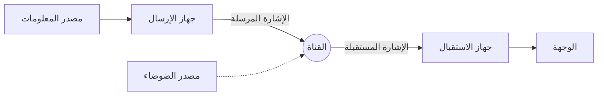

## 1. الفصل بين المعنى وعدم اليقين بشأن اختيار

تحمل الأخبار ورسائل الأصدقاء وتسلسلات الحمض النووي والإشارات الراديوية القادمة من الفضاء معلومات. لكن أهمية المحتوى وعدد البتات اللازمة لنقله كميتان مختلفتان.

فصل كلود شانون في بحثه المنشور عام 1948 بين تقييم المعنى ومسألة الاتصال الهندسية، ودرس حدود الضغط والاتصال باستخدام الاحتمالات. وتشير المقدمة، المتاحة في هذه [النسخة المعاد نشرها](https://wucj.lab.westlake.edu.cn/Others/shannon1948.pdf)، إلى أعمال نايكويست وهارتلي السابقة أيضًا. سنميز بين المعلومات الذاتية والإنتروبيا والضغط دون فقد والاتصال بوجود ضوضاء.

## 2. نموذج للاتصال

ينتج مصدر المعلومات رسالة، ويحوّلها جهاز الإرسال إلى إشارة تمر عبر قناة، ثم يعيد جهاز الاستقبال بناء الرسالة لتصل إلى وجهتها.



يستفيد ترميز المصدر من البنية الإحصائية لتقليل التكرار الزائد. أما ترميز القناة فيضيف تكرارًا زائدًا مناسبًا لمقاومة الضوضاء. كلاهما ترميز، لكن الهدفين مختلفان.

## 3. المعلومات الذاتية

لحدث <bdi dir="ltr">x</bdi> ذي احتمال موجب <bdi dir="ltr">P(x)</bdi>، نعرّف معلوماته الذاتية <bdi dir="ltr">I(x)</bdi> كما يلي. يعطي اللوغاريتم للأساس 2 وحدة البت.

$$
I(x)=-\log_2P(x)=\log_2\frac1{P(x)},\qquad 0<P(x)\le1
$$

تحصل الأحداث الأقل احتمالًا على قيم أكبر. لا يقيس ذلك المفاجأة النفسية أو قيمة المحتوى. ولا يخصص هذا التعريف معلومات ذاتية منتهية لحدث احتماله صفر؛ لذا يجب تحديد النموذج الاحتمالي ومجال التعريف.

لظهور الوجه عند رمي عملة عادلة:

$$
I=-\log_2(1/2)=1\ \mathrm{bit}
$$

## 4. الإنتروبيا هي القيمة المتوقعة للمعلومات الذاتية

ليكن <bdi dir="ltr">X</bdi> متغيرًا عشوائيًا يأخذ قيمًا من أبجدية منتهية تضم <bdi dir="ltr">m</bdi> رموز، مع <bdi dir="ltr">p_i=P(X=x_i)</bdi>. الاحتمالات غير سالبة ومجموعها واحد. إنتروبيا شانون هي القيمة المتوقعة للمعلومات الذاتية.

$$
H(X)=\mathbb E[I(X)]=-\sum_{i=1}^{m}p_i\log_2p_i,\qquad \sum_{i=1}^{m}p_i=1
$$

للحدود ذات الاحتمال الصفري، نستخدم الاصطلاح المتوافق مع النهاية <bdi dir="ltr">0log₂0=0</bdi>. الوحدة هي بت لكل رمز. ولأبجدية ثابتة تضم <bdi dir="ltr">m</bdi> رموز:

$$
0\le H(X)\le\log_2m
$$

تتحقق القيمة القصوى عند التوزيع المنتظم، والدنيا عندما يكون احتمال رمز واحد مساويًا للواحد. هذا تقييم لعدم اليقين ضمن النموذج الاحتمالي والمعلومات المتاحة. ولا يثبت عدم قابلية التنبؤ بالمعنى التشفيري، ولا يضمن أن طرفًا آخر لا يملك معلومات إضافية.

إذا كان احتمال الوجه هو <bdi dir="ltr">p</bdi>، تكون الإنتروبيا الثنائية الدالة الآتية. ويُطبق الاصطلاح نفسه للحدود ذات الاحتمال الصفري عند طرفي المجال.

$$
h_2(p)=-p\log_2p-(1-p)\log_2(1-p),\qquad 0\le p\le1
$$

يقبل مثال Python الآتي احتمالًا عدديًا مفردًا منتهيًا، ويرفض القيم خارج المجال. ويتطلب رسم المنحنى مكتبة Matplotlib.

```python
import math


def binary_entropy(p):
    if not math.isfinite(p) or not 0 <= p <= 1:
        raise ValueError("p must be finite and between 0 and 1")
    if p == 0 or p == 1:
        return 0.0
    return -p * math.log2(p) - (1 - p) * math.log2(1 - p)


if __name__ == "__main__":
    import matplotlib.pyplot as plt

    probabilities = [i / 100 for i in range(101)]
    entropies = [binary_entropy(p) for p in probabilities]
    plt.plot(probabilities, entropies)
    plt.title("Binary entropy")
    plt.xlabel("Probability of heads (p)")
    plt.ylabel("Entropy (bits per symbol)")
    plt.grid(True)
    plt.show()
```

القيمة صفر عند <bdi dir="ltr">p=0</bdi> و<bdi dir="ltr">p=1</bdi>، وتبلغ أقصاها، وهو بت واحد، عند <bdi dir="ltr">p=0.5</bdi>. المنحنى متماثل. وتشير التسميات الإنجليزية إلى الإنتروبيا الثنائية واحتمال ظهور الوجه والإنتروبيا بالبت لكل رمز.

## 5. ترميز المصدر: أي متوسط وتحت أي افتراضات؟

نخصص كلمات ترميز ثنائية لرموز أبجدية منتهية بحيث يمكن فك ترميز الكلمات المتتابعة على نحو وحيد. إذا كان طول كلمة الرمز <bdi dir="ltr">i</bdi> هو <bdi dir="ltr">ℓ_i</bdi>، فإن الطول المتوقع <bdi dir="ltr">L</bdi> يحقق الحد الآتي. الشفرة البادئية شفرة قابلة لفك الترميز على نحو وحيد، ولا تكون فيها أي كلمة ترميز بداية لكلمة أخرى.

$$
L=\sum_i p_i\ell_i,\qquad L\ge H(X)
$$

هذا حكم على قيمة متوقعة تحت توزيع محدد. ولا يعني أن كل ملف منفرد يجب ألا يقل طوله عن هذه القيمة. كما لا يمكن تحديد حد ضغط تسلسل مترابط اعتمادًا على التوزيع الهامشي لرمز واحد فقط.

### ترميز هوفمان وشروط الأمثلية

يبني [بحث ديفيد هوفمان لعام 1952](https://compression.ru/download/articles/huff/huffman_1952_minimum-redundancy-codes.pdf) شفرات بادئية تقلل الطول المتوقع لاحتمالات معطاة. في الحالة الثنائية، ندمج أصغر وزنين مرارًا ونعيد مجموعهما إلى المجموعة. وقد تؤدي الأوزان المتساوية إلى جداول ترميز مثلى مختلفة.

عندما يوجد رمزان على الأقل باحتمال موجب، يقع الطول المتوقع <bdi dir="ltr">L_H</bdi> للشفرة البادئية الثنائية المثلى ضمن المجال الآتي:

$$
H(X)\le L_{\mathrm H}<H(X)+1
$$

هذه أمثلية ضمن فئة ترميز كل رمز على حدة بأوزان معروفة، وليست بين جميع طرق الضغط. لمصدر ذي رموز مستقلة ومتماثلة التوزيع وله رمزان على الأقل باحتمال موجب، يتيح تجميع <bdi dir="ltr">n</bdi> رموز واختيار شفرة بادئية مناسبة المجال الآتي لكل رمز. ويمثل <bdi dir="ltr">L_n</bdi> عدد البتات المتوقع للكتلة الكاملة ذات <bdi dir="ltr">n</bdi> رموز.

$$
H(X)\le\frac{L_n}{n}<H(X)+\frac1n
$$

عند وجود اعتماد، نستخدم الإنتروبيا المشتركة للكتلة. ولمصدر ساكن إحصائيًا، أي لا تتغير توزيعاته المشتركة عند إزاحة الزمن، وذي أبجدية منتهية، يُعرّف معدل الإنتروبيا بهذه النهاية:

$$
\overline H=\lim_{n\to\infty}\frac{H(X_1,\ldots,X_n)}{n}
$$

مثلًا، نختار في البداية بتًا <bdi dir="ltr">Z</bdi> متساوي الاحتمال للصفر والواحد، ثم نكرر قيمته في كتلة طولها المعلوم <bdi dir="ltr">n</bdi>. في هذا النموذج:

$$
P(Z=0)=P(Z=1)=\frac12,\qquad X_i=Z,\qquad H(X_i)=1,\qquad H(X_1,\ldots,X_n)=1
$$

لكل موضع إنتروبيا هامشية قدرها بت واحد، لكن مفكك ترميز يعرف <bdi dir="ltr">n</bdi> وهذا النموذج يمكنه تمثيل الكتلة كلها ببت <bdi dir="ltr">Z</bdi> الواحد. يوضح ذلك الفرق بين إنتروبيا رمز واحد والمعلومات في تسلسل. تتضمن ZIP وgzip أيضًا ترويسات ونماذج وسجلًا سابقًا وحدود البايتات؛ لذلك لا تُستنتج حدودها من تكرارات الأحرف المنفردة وحدها.

### مثال Python يعالج الإدخال الفارغ والرمز الوحيد

يعدّ المثال أحرف Python ويستخدم شجرة مشتركة للترميز وفك الترميز. يعالج التكرارات المتساوية دون الاعتماد على ترتيب الإدخال، وينشئ كل استدعاء قاموس ترميز جديدًا. وللسلسلة الفارغة شجرة فارغة وحمولة فارغة.

```python
import heapq
from collections import Counter
from itertools import count


class Node:
    def __init__(self, char=None, left=None, right=None):
        self.char = char
        self.left = left
        self.right = right


def build_huffman_tree(text):
    if not isinstance(text, str):
        raise TypeError("text must be a string")
    order = count()
    heap = [(freq, next(order), Node(char))
            for char, freq in sorted(Counter(text).items())]
    heapq.heapify(heap)
    if not heap:
        return None
    while len(heap) > 1:
        freq_left, _, left = heapq.heappop(heap)
        freq_right, _, right = heapq.heappop(heap)
        parent = Node(left=left, right=right)
        heapq.heappush(heap, (freq_left + freq_right, next(order), parent))
    return heap[0][2]


def generate_huffman_codes(root):
    codes = {}
    stack = [] if root is None else [(root, "")]
    while stack:
        node, prefix = stack.pop()
        if node.char is not None:
            codes[node.char] = prefix or "0"
        else:
            stack.append((node.right, prefix + "1"))
            stack.append((node.left, prefix + "0"))
    return codes


def encode(text, codes):
    try:
        return "".join(codes[char] for char in text)
    except KeyError as exc:
        raise ValueError("symbol missing from codebook") from exc


def decode(bits, root):
    if any(bit not in "01" for bit in bits):
        raise ValueError("payload must contain only 0 and 1")
    if root is None:
        if bits:
            raise ValueError("nonempty payload with an empty tree")
        return ""
    if root.char is not None:
        if "1" in bits:
            raise ValueError("single-symbol code uses only 0")
        return root.char * len(bits)
    result = []
    node = root
    for bit in bits:
        node = node.left if bit == "0" else node.right
        if node.char is not None:
            result.append(node.char)
            node = root
    if node is not root:
        raise ValueError("truncated codeword")
    return "".join(result)


if __name__ == "__main__":
    text = "shannon_entropy_and_information_theory"
    root = build_huffman_tree(text)
    codes = generate_huffman_codes(root)
    payload = encode(text, codes)
    print("Huffman codes:")
    for char, code in sorted(codes.items()):
        print(f"{char!r}: {code}")
    print("Logical payload bits:", len(payload))
    print("Round trip:", decode(payload, root) == text)
```

عند وجود رمز وحيد، يخصص المثال الشفرة غير الفارغة 0 ويمثل عدد التكرارات بطول الحمولة. حينها <bdi dir="ltr">H=0</bdi> و<bdi dir="ltr">L=1</bdi>، فلا ينطبق الحد الأعلى الصارم <bdi dir="ltr">L_H&lt;H+1</bdi> أعلاه على حالة الرمز الوحيد في هذا التنفيذ. أما السماح بشفرة فارغة ومشاركة العدد منفصلًا فهما اصطلاح آخر.

مرر إلى <bdi dir="ltr">decode</bdi> شجرة أنشأتها <bdi dir="ltr">build_huffman_tree</bdi>. ترفض الدالة الأحرف غير الصالحة وكلمات الترميز المبتورة، لكنها لا تكشف أو تصحح كل تلف يحوّل الحمولة إلى تسلسل ترميز صالح آخر. الأحرف هنا نقاط ترميز Unicode، وليست عناقيد كتابية أو بايتات UTF-8.

الحمولة سلسلة Python من أصفار وآحاد، وليست صيغة ملف تحزم البتات. يقيس <bdi dir="ltr">Logical payload bits</bdi> الطول المنطقي، لا ذاكرة كائن Python. ولا يشمل تكلفة تخزين الشجرة أو إرسالها وتأطير البيانات والترويسات؛ لذا لا يثبت المثال وحده نسبة ضغط ملف كامل.

## 6. ترميز القناة: احتمال خطأ صغير وصفر أخطاء عند طول منتهٍ

نبدأ بقناة متقطعة عديمة الذاكرة ذات أبجديتين منتهيتين: لكل استخدام احتمالات الانتقال نفسها، ولا يعتمد على الماضي. لتكن <bdi dir="ltr">U</bdi> الدخل و<bdi dir="ltr">V</bdi> الخرج. السعة هي أكبر قيمة للمعلومات المتبادلة عند تغيير توزيع الدخل، بوحدة البت لكل استخدام للقناة.

$$
C=\max_{P_U}I(U;V),\qquad I(U;V)=H(U)-H(U\mid V)
$$

معدل شفرة ترسل رسالة واحدة من بين <bdi dir="ltr">M</bdi> رسائل ممكنة عبر <bdi dir="ltr">n</bdi> استخدامات للقناة هو:

$$
R=\frac{\log_2 M}{n}\quad(\mathrm{bits/use})
$$

في هذا النموذج، إذا كان <bdi dir="ltr">R&lt;C</bdi>، يمكن اختيار شفرات تجعل احتمال خطأ فك الترميز صغيرًا كيفما نريد مع زيادة طول الكتلة. لا يَعِد ذلك بصفر أخطاء تمامًا عند طول منتهٍ أو ببلوغ شفرة معينة الحد تلقائيًا. وعند معدل ثابت أعلى من السعة، لا يمكن أن يقترب احتمال الخطأ من الصفر تحت الافتراضات نفسها. وتتطلب مقارنة الكميات لكل ثانية مراعاة عدد استخدامات القناة في الثانية بصورة متسقة.

### قناة AWGN مقيدة بعرض النطاق والقدرة

لضوضاء غاوسية بيضاء مضافة ومستقلة عن إشارة الدخل، وعرض نطاق <bdi dir="ltr">B</bdi> هرتز، ومتوسط قدرة إشارة <bdi dir="ltr">S</bdi>، وقدرة ضوضاء كلية <bdi dir="ltr">N</bdi> داخل النطاق، تكون السعة تحت قيد متوسط القدرة كما يأتي. نفترض <bdi dir="ltr">B&gt;0</bdi> و<bdi dir="ltr">S≥0</bdi> و<bdi dir="ltr">N&gt;0</bdi>.

$$
C=B\log_2\left(1+\frac SN\right)\quad(\mathrm{bits/s})
$$

وحدة <bdi dir="ltr">C</bdi> هي بت في الثانية. نقيس <bdi dir="ltr">S</bdi> و<bdi dir="ltr">N</bdi> بوحدة القدرة نفسها ونستخدم نسبتهما الخطية، لا القيمة العددية بالديسيبل. مثلًا، يعطي <bdi dir="ltr">B=1 MHz</bdi> والنسبة الخطية <bdi dir="ltr">S/N=15</bdi> هذه القيمة النظرية:

$$
10^6\log_2(1+15)=4\times10^6\ \mathrm{bits/s}
$$

هذا ليس قياسًا لمعدل نقل البيانات في Wi-Fi أو شبكة خلوية. قد يختلف التضمين والدخل المسموح والتأخير والأطوال المنتهية والتلاشي والتداخل وأعباء البروتوكول عن النموذج، ويجب فحص هذه الفروق عند تطبيقه.

## 7. أسئلة عند تطبيق نظرية المعلومات

توفر نظرية المعلومات إطارًا لدراسة الحدود، مع التمييز بين التكرار الزائد الذي يزيله الضغط وما يُضاف لتحسين موثوقية الاتصال. وهي أساس لبث الفيديو والاتصالات عبر الأقمار الصناعية، لكن صيغة واحدة لا تحدد أداء نظام عملي بأكمله.

تعتمد الإنتروبيا المتقاطعة في التعلم الآلي أيضًا على توزيع التنبؤ، ولا تطابق إنتروبيا المصدر. وعند النظر في الروابط الصورية مع الإنتروبيا الديناميكية الحرارية، يجب التمييز بين النماذج الفيزيائية والوحدات. البداية هي تحديد المتغيرات العشوائية، وما هو معلوم، والتكاليف التي تُحسب.
