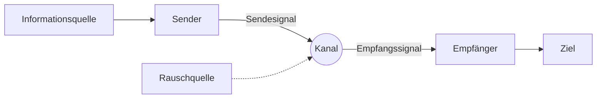

## 1. Bedeutung und Unsicherheit über eine Auswahl unterscheiden

Nachrichten, Mitteilungen von Freunden, DNA-Sequenzen und Radiosignale aus dem Weltall tragen Information. Die Bedeutung ihres Inhalts und die Zahl der zur Übertragung benötigten Bits sind jedoch verschiedene Größen.

Claude Shannon trennte in seiner Arbeit von 1948 die Bewertung der Bedeutung vom technischen Kommunikationsproblem und untersuchte Kompressions- und Übertragungsgrenzen anhand von Wahrscheinlichkeiten. Die Einleitung, die in diesem [Nachdruck](https://wucj.lab.westlake.edu.cn/Others/shannon1948.pdf) zugänglich ist, würdigt auch Vorarbeiten von Nyquist und Hartley. Wir unterscheiden im Folgenden Informationsgehalt, Entropie, verlustfreie Kompression und Kommunikation bei Rauschen.

## 2. Ein Kommunikationsmodell

Eine Informationsquelle erzeugt eine Nachricht, ein Sender wandelt sie in ein Signal um, das Signal durchläuft einen Kanal, und ein Empfänger rekonstruiert die Nachricht für ihr Ziel.



Quellencodierung nutzt statistische Struktur, um Redundanz zu verringern. Kanalcodierung fügt dagegen geeignete Redundanz hinzu, um Rauschen entgegenzuwirken. Beides ist Codierung, aber mit unterschiedlichen Zielen.

## 3. Informationsgehalt eines Ereignisses

Für ein Ereignis x mit positiver Wahrscheinlichkeit P(x) definieren wir den Informationsgehalt I(x) wie folgt. Bei Logarithmen zur Basis 2 lautet die Einheit Bit.

$$
I(x)=-\log_2P(x)=\log_2\frac1{P(x)},\qquad 0<P(x)\le1
$$

Weniger wahrscheinliche Ereignisse erhalten größere Werte. Das misst weder psychologische Überraschung noch den Wert des Inhalts. Die Definition weist einem Ereignis mit Wahrscheinlichkeit null keinen endlichen Informationsgehalt zu; Wahrscheinlichkeitsmodell und Definitionsbereich sind zu beachten.

Für das Ergebnis Kopf beim Wurf einer fairen Münze gilt:

$$
I=-\log_2(1/2)=1\ \mathrm{bit}
$$

## 4. Entropie ist der erwartete Informationsgehalt

Die Zufallsvariable X nehme Werte in einem endlichen Alphabet mit m Symbolen an, mit p_i=P(X=x_i). Die Wahrscheinlichkeiten sind nichtnegativ und summieren sich zu eins. Die Shannon-Entropie ist der Erwartungswert des Informationsgehalts.

$$
H(X)=\mathbb E[I(X)]=-\sum_{i=1}^{m}p_i\log_2p_i,\qquad \sum_{i=1}^{m}p_i=1
$$

Für Terme mit Wahrscheinlichkeit null verwenden wir die dem Grenzwert entsprechende Konvention 0log₂0=0. Die Einheit ist Bit pro Symbol. Für ein festes Alphabet mit m Symbolen gilt:

$$
0\le H(X)\le\log_2m
$$

Das Maximum wird bei der Gleichverteilung erreicht, das Minimum, wenn ein Symbol Wahrscheinlichkeit eins hat. Maximale Unsicherheit ist eine Bewertung innerhalb dieses Wahrscheinlichkeitsmodells und auf Grundlage der verfügbaren Information. Sie belegt keine kryptografische Unvorhersagbarkeit und garantiert nicht, dass andere Personen keine zusätzlichen Informationen besitzen.

Ist p die Wahrscheinlichkeit für Kopf, ergibt sich die folgende binäre Entropiefunktion. An den Randpunkten gilt dieselbe Konvention für Terme mit Wahrscheinlichkeit null.

$$
h_2(p)=-p\log_2p-(1-p)\log_2(1-p),\qquad 0\le p\le1
$$

Dieses Python-Beispiel verarbeitet eine endliche skalare Wahrscheinlichkeit und weist Werte außerhalb des Definitionsbereichs zurück. Für die Grafik wird Matplotlib benötigt.

```python
import math


def binary_entropy(p):
    if not math.isfinite(p) or not 0 <= p <= 1:
        raise ValueError("p must be finite and between 0 and 1")
    if p == 0 or p == 1:
        return 0.0
    return -p * math.log2(p) - (1 - p) * math.log2(1 - p)


if __name__ == "__main__":
    import matplotlib.pyplot as plt

    probabilities = [i / 100 for i in range(101)]
    entropies = [binary_entropy(p) for p in probabilities]
    plt.plot(probabilities, entropies)
    plt.title("Binary entropy")
    plt.xlabel("Probability of heads (p)")
    plt.ylabel("Entropy (bits per symbol)")
    plt.grid(True)
    plt.show()
```

Bei p=0 und p=1 ist der Wert null, bei p=0.5 erreicht er das Maximum von einem Bit. Die Kurve ist symmetrisch. Die englischen Beschriftungen bezeichnen die binäre Entropie, die Wahrscheinlichkeit für Kopf und die Entropie in Bit pro Symbol.

## 5. Quellencodierung: welcher Mittelwert unter welchen Annahmen?

Wir ordnen einem endlichen Alphabet binäre Codewörter zu, deren Verkettung eindeutig decodierbar ist. Hat das Codewort für Symbol i die Länge ℓ_i, dann erfüllt die erwartete Codelänge L die folgende Schranke. Ein Präfixcode ist ein eindeutig decodierbarer Code, bei dem kein Codewort der Anfang eines anderen ist.

$$
L=\sum_i p_i\ell_i,\qquad L\ge H(X)
$$

Das ist eine Aussage über einen Erwartungswert bezüglich einer festgelegten Verteilung. Sie bedeutet nicht, dass jede einzelne Datei mindestens diese Länge haben muss. Auch lässt sich die Kompressionsgrenze einer korrelierten Folge nicht allein aus der Randverteilung eines einzelnen Symbols bestimmen.

### Huffman-Codierung und die Bedingungen ihrer Optimalität

[David Huffmans Arbeit von 1952](https://compression.ru/download/articles/huff/huffman_1952_minimum-redundancy-codes.pdf) konstruiert Präfixcodes mit minimaler erwarteter Länge für vorgegebene Wahrscheinlichkeiten. Im binären Fall werden wiederholt die beiden kleinsten Gewichte zusammengefasst und ihre Summe in die Menge zurückgeführt. Gleiche Gewichte können zu verschiedenen optimalen Codes führen.

Bei mindestens zwei Symbolen mit positiver Wahrscheinlichkeit liegt die erwartete Länge L_H des optimalen binären Präfixcodes in diesem Bereich:

$$
H(X)\le L_{\mathrm H}<H(X)+1
$$

Diese Optimalität gilt innerhalb der symbolweisen Codierung mit bekannten Gewichten, nicht für sämtliche Kompressionsverfahren. Für eine nicht degenerierte Quelle mit unabhängigen, identisch verteilten Symbolen erhält man durch Zusammenfassen von n Symbolen und einen geeigneten Präfixcode die folgende Schranke pro Symbol. L_n ist die erwartete Bitzahl für den gesamten Block aus n Symbolen.

$$
H(X)\le\frac{L_n}{n}<H(X)+\frac1n
$$

Bei Abhängigkeiten verwendet man die gemeinsame Entropie des Blocks. Für eine stationäre Quelle mit endlichem Alphabet ist die Entropierate durch diesen Grenzwert definiert:

$$
\overline H=\lim_{n\to\infty}\frac{H(X_1,\ldots,X_n)}{n}
$$

Wählen wir beispielsweise zunächst ein gleichverteiltes Bit Z und wiederholen seinen Wert während eines Blocks bekannter Länge n. In diesem Modell gilt:

$$
P(Z=0)=P(Z=1)=\frac12,\qquad X_i=Z,\qquad H(X_i)=1,\qquad H(X_1,\ldots,X_n)=1
$$

Jede Position hat eine Randentropie von einem Bit. Ein Decoder, der n und dieses Modell kennt, kann jedoch den gesamten Block durch das eine Bit Z darstellen. Das unterscheidet die Entropie eines Symbols vom Informationsgehalt einer Folge. Bei ZIP und gzip spielen auch Header, Modelle, Verlauf und Bytegrenzen eine Rolle; ihre Grenzen folgen nicht allein aus den Häufigkeiten einzelner Zeichen.

### Ein Python-Beispiel für leere Eingaben und ein einziges Symbol

Das Beispiel zählt Python-Zeichen und verwendet einen gemeinsam bekannten Baum zum Codieren und Decodieren. Gleiche Häufigkeiten werden unabhängig von der Eingabereihenfolge behandelt; jeder Aufruf erzeugt ein neues Codebuch. Ein leerer String verwendet einen leeren Baum und eine leere Nutzlast.

```python
import heapq
from collections import Counter
from itertools import count


class Node:
    def __init__(self, char=None, left=None, right=None):
        self.char = char
        self.left = left
        self.right = right


def build_huffman_tree(text):
    if not isinstance(text, str):
        raise TypeError("text must be a string")
    order = count()
    heap = [(freq, next(order), Node(char))
            for char, freq in sorted(Counter(text).items())]
    heapq.heapify(heap)
    if not heap:
        return None
    while len(heap) > 1:
        freq_left, _, left = heapq.heappop(heap)
        freq_right, _, right = heapq.heappop(heap)
        parent = Node(left=left, right=right)
        heapq.heappush(heap, (freq_left + freq_right, next(order), parent))
    return heap[0][2]


def generate_huffman_codes(root):
    codes = {}
    stack = [] if root is None else [(root, "")]
    while stack:
        node, prefix = stack.pop()
        if node.char is not None:
            codes[node.char] = prefix or "0"
        else:
            stack.append((node.right, prefix + "1"))
            stack.append((node.left, prefix + "0"))
    return codes


def encode(text, codes):
    try:
        return "".join(codes[char] for char in text)
    except KeyError as exc:
        raise ValueError("symbol missing from codebook") from exc


def decode(bits, root):
    if any(bit not in "01" for bit in bits):
        raise ValueError("payload must contain only 0 and 1")
    if root is None:
        if bits:
            raise ValueError("nonempty payload with an empty tree")
        return ""
    if root.char is not None:
        if "1" in bits:
            raise ValueError("single-symbol code uses only 0")
        return root.char * len(bits)
    result = []
    node = root
    for bit in bits:
        node = node.left if bit == "0" else node.right
        if node.char is not None:
            result.append(node.char)
            node = root
    if node is not root:
        raise ValueError("truncated codeword")
    return "".join(result)


if __name__ == "__main__":
    text = "shannon_entropy_and_information_theory"
    root = build_huffman_tree(text)
    codes = generate_huffman_codes(root)
    payload = encode(text, codes)
    print("Huffman codes:")
    for char, code in sorted(codes.items()):
        print(f"{char!r}: {code}")
    print("Logical payload bits:", len(payload))
    print("Round trip:", decode(payload, root) == text)
```

Bei einem einzigen Symbol weist dieses Beispiel den nicht leeren Code 0 zu und stellt die Wiederholungszahl durch die Nutzlastlänge dar. Dann gilt H=0 und L=1; die strikte obere Schranke L_H<H+1 oben gilt daher nicht für diesen Ein-Symbol-Fall der Implementierung. Einen leeren Code zu erlauben und die Anzahl getrennt mitzuteilen, ist eine andere Konvention.

An decode ist ein von build_huffman_tree erzeugter Baum zu übergeben. Die Funktion weist ungültige Zeichen und abgeschnittene Codewörter zurück. Sie erkennt oder korrigiert aber nicht jede Beschädigung, die eine Nutzlast in eine andere gültige Codefolge verwandelt. Zeichen sind hier Unicode-Codepunkte, keine Graphemcluster und keine UTF-8-Bytes.

Die Nutzlast ist ein Python-String aus Nullen und Einsen, kein Dateiformat mit gepackten Bits. Logical payload bits misst die logische Länge, nicht den Speicherbedarf des Python-Objekts. Die Kosten für Speicherung oder Übertragung des Baums, Begrenzungen und Header sind nicht enthalten. Das Beispiel allein belegt daher keine Kompressionsrate für eine vollständige Datei.

## 6. Kanalcodierung: kleine Fehlerwahrscheinlichkeit und Fehlerfreiheit bei endlicher Länge

Betrachten wir zunächst einen diskreten gedächtnislosen Kanal mit endlichen Alphabeten: Jede Nutzung hat dieselben Übergangswahrscheinlichkeiten und hängt nicht von der Vergangenheit ab. U sei seine Eingabe und V seine Ausgabe. Die Kapazität ist die maximale gegenseitige Information über alle Eingabeverteilungen, gemessen in Bit pro Kanalnutzung.

$$
C=\max_{P_U}I(U;V),\qquad I(U;V)=H(U)-H(U\mid V)
$$

Ein Code, mit dem eine von M möglichen Nachrichten über n Kanalnutzungen übertragen wird, hat die Rate:

$$
R=\frac{\log_2 M}{n}\quad(\mathrm{bits/use})
$$

In diesem Modell lassen sich für R<C Codes wählen, deren Decodierfehlerwahrscheinlichkeit mit wachsender Blocklänge beliebig klein wird. Das verspricht weder genau null Fehler bei endlicher Länge noch das automatische Erreichen der Grenze durch einen bestimmten Code. Bei einer festen Rate oberhalb der Kapazität kann die Fehlerwahrscheinlichkeit unter denselben Annahmen nicht gegen null gehen. Beim Vergleich von Größen pro Sekunde muss auch die Zahl der Kanalnutzungen pro Sekunde konsistent berücksichtigt werden.

### Ein AWGN-Kanal mit Bandbreiten- und Leistungsbeschränkung

Für additives weißes gaußsches Rauschen, das vom Eingangssignal unabhängig ist, eine Bandbreite B Hz, eine mittlere Signalleistung S und die gesamte Rauschleistung N innerhalb dieses Bandes ergibt sich unter einer Beschränkung der mittleren Leistung folgende Kapazität. Es gelte B>0, S≥0 und N>0.

$$
C=B\log_2\left(1+\frac SN\right)\quad(\mathrm{bits/s})
$$

C wird in Bit pro Sekunde gemessen. S und N müssen in derselben Leistungseinheit angegeben werden; einzusetzen ist ihr lineares Verhältnis, nicht der Zahlenwert in dB. Beispielsweise ergeben B=1 MHz und das lineare Verhältnis S/N=15 diesen theoretischen Wert:

$$
10^6\log_2(1+15)=4\times10^6\ \mathrm{bits/s}
$$

Das ist keine Messung des Durchsatzes eines WLAN- oder Mobilfunknetzes. Modulation, erlaubte Eingaben, Verzögerung, endliche Längen, Fading, Interferenzen und Protokollaufwand können vom Modell abweichen und sind bei seiner Anwendung zu berücksichtigen.

## 7. Fragen bei der Anwendung der Informationstheorie

Die Informationstheorie bietet einen Rahmen zur Untersuchung von Grenzen und unterscheidet dabei die bei der Kompression entfernte Redundanz von der für zuverlässige Kommunikation hinzugefügten. Sie bildet eine Grundlage für Videostreaming und Satellitenkommunikation; eine einzige Formel bestimmt jedoch nicht die Leistung eines gesamten praktischen Systems.

Die Kreuzentropie beim maschinellen Lernen hängt auch von der Vorhersageverteilung ab und ist nicht identisch mit der Entropie der Quelle. Bei formalen Verbindungen zur thermodynamischen Entropie sind physikalische Modelle und Einheiten zu unterscheiden. Ausgangspunkt ist die Angabe der Zufallsvariablen, des vorausgesetzten Wissens und der berücksichtigten Kosten.
