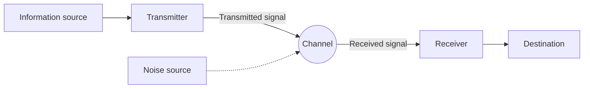

## 1. Separate meaning from uncertainty about a choice

News, messages from friends, DNA sequences and radio signals from space all carry information. But the importance of their content and the number of bits required to send them are different quantities.

Claude Shannon's 1948 paper separated the evaluation of meaning from the engineering problem of communication and studied compression and communication limits using probability. Its introduction, available in this [reprint](https://wucj.lab.westlake.edu.cn/Others/shannon1948.pdf), also credits earlier work by Nyquist and Hartley. We will distinguish self-information, entropy, lossless compression and communication with noise.

## 2. A model of communication

An information source produces a message, a transmitter converts it to a signal, the signal passes through a channel, and a receiver reconstructs the message for its destination.



Source coding uses statistical structure to reduce redundancy. Channel coding instead adds suitable redundancy to combat noise. Both are coding, but their purposes differ.

## 3. Self-information

For an event x with positive probability P(x), define its self-information I(x) as follows. Base-2 logarithms give units of bits.

$$
I(x)=-\log_2P(x)=\log_2\frac1{P(x)},\qquad 0<P(x)\le1
$$

Less probable events receive larger values. This does not measure psychological surprise or the value of the content. It does not assign finite self-information to an event of probability zero; the probability model and domain matter.

For heads from a fair coin:

$$
I=-\log_2(1/2)=1\ \mathrm{bit}
$$

## 4. Entropy is expected self-information

Let X take values in a finite alphabet of m symbols, with p_i=P(X=x_i). Probabilities are nonnegative and sum to one. Shannon entropy is expected self-information.

$$
H(X)=\mathbb E[I(X)]=-\sum_{i=1}^{m}p_i\log_2p_i,\qquad \sum_{i=1}^{m}p_i=1
$$

For a zero-probability term, use the limiting convention 0log₂0=0. Units are bits per symbol. For a fixed alphabet of m symbols:

$$
0\le H(X)\le\log_2m
$$

The maximum occurs at the uniform distribution; the minimum occurs when one symbol has probability one. Maximum uncertainty is an assessment under this probability model and the information available. It does not establish cryptographic unpredictability or guarantee that another party lacks extra information.

If heads has probability p, binary entropy is the following function. The same zero-term convention applies at the endpoints.

$$
h_2(p)=-p\log_2p-(1-p)\log_2(1-p),\qquad 0\le p\le1
$$

This Python example accepts a finite scalar probability and rejects values outside the domain. Drawing the plot requires Matplotlib.

```python
import math


def binary_entropy(p):
    if not math.isfinite(p) or not 0 <= p <= 1:
        raise ValueError("p must be finite and between 0 and 1")
    if p == 0 or p == 1:
        return 0.0
    return -p * math.log2(p) - (1 - p) * math.log2(1 - p)


if __name__ == "__main__":
    import matplotlib.pyplot as plt

    probabilities = [i / 100 for i in range(101)]
    entropies = [binary_entropy(p) for p in probabilities]
    plt.plot(probabilities, entropies)
    plt.title("Binary entropy")
    plt.xlabel("Probability of heads (p)")
    plt.ylabel("Entropy (bits per symbol)")
    plt.grid(True)
    plt.show()
```

The value is zero at p=0 and p=1, and reaches its maximum of one bit at p=0.5. The curve is symmetric.

## 5. Source coding: which average, under which assumptions?

Assign binary codewords to a finite alphabet so that concatenated codewords can be uniquely decoded. If symbol i has codeword length ℓ_i, the expected length L satisfies the following bound. A prefix code is a uniquely decodable code in which no codeword is the beginning of another.

$$
L=\sum_i p_i\ell_i,\qquad L\ge H(X)
$$

This is an expectation under a specified distribution. It does not mean that each individual file must be at least this long. Nor can one determine the compression limit for a correlated sequence from its single-symbol marginal distribution alone.

### Huffman coding and conditional optimality

[David Huffman's 1952 paper](https://compression.ru/download/articles/huff/huffman_1952_minimum-redundancy-codes.pdf) constructs prefix codes minimizing expected length for given probabilities. In the binary case, repeatedly combine the two smallest weights and return their sum to the collection. Ties can produce different optimal codebooks.

With at least two positive-probability symbols, the optimal binary prefix code's expected length L_H lies in this range:

$$
H(X)\le L_{\mathrm H}<H(X)+1
$$

This is optimality within symbol-by-symbol coding with known weights, not among all compression methods. For a nondegenerate independent, identically distributed source, grouping n symbols and choosing a suitable prefix code gives the following per-symbol range. L_n is the expected number of bits for the whole n-symbol block.

$$
H(X)\le\frac{L_n}{n}<H(X)+\frac1n
$$

With dependencies, use the block's joint entropy. For a stationary finite-alphabet source, the entropy rate is defined by this limit:

$$
\overline H=\lim_{n\to\infty}\frac{H(X_1,\ldots,X_n)}{n}
$$

For example, choose one fair bit Z initially, then repeat its value throughout a known block length n. In this model:

$$
P(Z=0)=P(Z=1)=\frac12,\qquad X_i=Z,\qquad H(X_i)=1,\qquad H(X_1,\ldots,X_n)=1
$$

Each position has marginal entropy one bit, but a decoder knowing n and this model can represent the whole block with Z's one bit. This distinguishes single-symbol entropy from information in a sequence. ZIP and gzip also involve headers, models, history and byte boundaries; their limits cannot be inferred from single-character frequencies alone.

### A Python example covering empty and single-symbol inputs

This example counts Python characters and uses a shared tree to encode and decode. Equal frequencies are handled independently of input order, and each call creates a fresh codebook. An empty string uses an empty tree and payload.

```python
import heapq
from collections import Counter
from itertools import count


class Node:
    def __init__(self, char=None, left=None, right=None):
        self.char = char
        self.left = left
        self.right = right


def build_huffman_tree(text):
    if not isinstance(text, str):
        raise TypeError("text must be a string")
    order = count()
    heap = [(freq, next(order), Node(char))
            for char, freq in sorted(Counter(text).items())]
    heapq.heapify(heap)
    if not heap:
        return None
    while len(heap) > 1:
        freq_left, _, left = heapq.heappop(heap)
        freq_right, _, right = heapq.heappop(heap)
        parent = Node(left=left, right=right)
        heapq.heappush(heap, (freq_left + freq_right, next(order), parent))
    return heap[0][2]


def generate_huffman_codes(root):
    codes = {}
    stack = [] if root is None else [(root, "")]
    while stack:
        node, prefix = stack.pop()
        if node.char is not None:
            codes[node.char] = prefix or "0"
        else:
            stack.append((node.right, prefix + "1"))
            stack.append((node.left, prefix + "0"))
    return codes


def encode(text, codes):
    try:
        return "".join(codes[char] for char in text)
    except KeyError as exc:
        raise ValueError("symbol missing from codebook") from exc


def decode(bits, root):
    if any(bit not in "01" for bit in bits):
        raise ValueError("payload must contain only 0 and 1")
    if root is None:
        if bits:
            raise ValueError("nonempty payload with an empty tree")
        return ""
    if root.char is not None:
        if "1" in bits:
            raise ValueError("single-symbol code uses only 0")
        return root.char * len(bits)
    result = []
    node = root
    for bit in bits:
        node = node.left if bit == "0" else node.right
        if node.char is not None:
            result.append(node.char)
            node = root
    if node is not root:
        raise ValueError("truncated codeword")
    return "".join(result)


if __name__ == "__main__":
    text = "shannon_entropy_and_information_theory"
    root = build_huffman_tree(text)
    codes = generate_huffman_codes(root)
    payload = encode(text, codes)
    print("Huffman codes:")
    for char, code in sorted(codes.items()):
        print(f"{char!r}: {code}")
    print("Logical payload bits:", len(payload))
    print("Round trip:", decode(payload, root) == text)
```

For a single symbol, this example assigns the nonempty code 0 and represents the repetition count through payload length. Then H=0 and L=1, so the strict upper bound L_H<H+1 above does not apply to this implementation's single-symbol case. A design allowing an empty code and sharing the count separately uses a different convention.

Pass decode a tree created by build_huffman_tree. It rejects invalid characters and truncated codewords, but does not detect or correct every corruption that changes a payload into another valid code sequence. Characters here are Unicode code points, not grapheme clusters or UTF-8 bytes.

The payload is a Python string of zeros and ones, not a bit-packed file format. Logical payload bits measures logical length, not Python object memory. It excludes the cost of storing or transmitting the tree, framing and headers, so this example alone does not establish whole-file compression ratios.

## 6. Channel coding: small error probability versus finite zero error

First consider a finite discrete memoryless channel: each use has the same transition probabilities and does not depend on the past. Let U be its input and V its output. Capacity is the maximum mutual information over input distributions, in bits per channel use.

$$
C=\max_{P_U}I(U;V),\qquad I(U;V)=H(U)-H(U\mid V)
$$

A code sending M messages through n channel uses has rate:

$$
R=\frac{\log_2 M}{n}\quad(\mathrm{bits/use})
$$

In this model, if R<C, codes can be selected with arbitrarily small decoding error probability as block length increases. This does not promise exactly zero errors at finite length or automatic achievement by a particular code. At a fixed rate above capacity, error probability cannot approach zero under the same assumptions. Comparing per-second quantities also requires a consistent number of channel uses per second.

### A bandwidth- and power-constrained AWGN channel

For independent additive white Gaussian noise, bandwidth B Hz, average signal power S and total noise power N within the band, the average-power-constrained capacity is as follows. Assume B>0, S≥0 and N>0.

$$
C=B\log_2\left(1+\frac SN\right)\quad(\mathrm{bits/s})
$$

Here C is in bits per second. Measure S and N in the same power units and use their linear ratio, not the numerical value in dB. For example, B=1 MHz and linear S/N=15 give this theoretical value:

$$
10^6\log_2(1+15)=4\times10^6\ \mathrm{bits/s}
$$

This is not a measurement of Wi-Fi or cellular throughput. Modulation, allowed inputs, delay, finite lengths, fading, interference and protocol overhead can differ from the model and must be checked when applying it.

## 7. Questions to ask when using information theory

Information theory provides a framework for studying limits while distinguishing the redundancy removed by compression from that added for communication reliability. It underpins video streaming and satellite communications, but one formula does not determine the performance of an entire practical system.

Cross-entropy in machine learning also depends on the prediction distribution and is not identical to the source's entropy. When considering formal connections with thermodynamic entropy, distinguish physical models and units. The starting point is to specify the random variables, what is known and which costs are counted.
