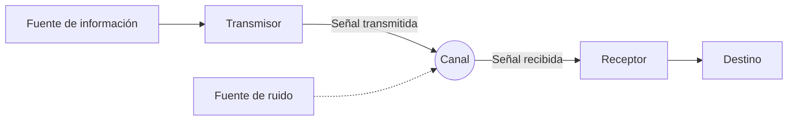

## 1. Separar el significado de la incertidumbre de una elección

Las noticias, los mensajes de amigos, las secuencias de ADN y las señales de radio del espacio transportan información. Pero la importancia de su contenido y los bits necesarios para enviarlo son cantidades diferentes.

El artículo de Claude Shannon de 1948 separó la evaluación del significado del problema de ingeniería de la comunicación y estudió límites de compresión y comunicación mediante probabilidades. Su introducción, disponible en esta [reimpresión](https://wucj.lab.westlake.edu.cn/Others/shannon1948.pdf), también reconoce trabajos anteriores de Nyquist y Hartley. Distinguiremos autoinformación, entropía, compresión sin pérdida y comunicación con ruido.

## 2. Un modelo de comunicación

Una fuente genera un mensaje, un transmisor lo convierte en señal, la señal atraviesa un canal y un receptor reconstruye el mensaje para su destino.



La codificación de fuente aprovecha la estructura estadística para reducir redundancia. La codificación de canal añade redundancia adecuada para combatir el ruido. Ambas son codificación, pero tienen objetivos distintos.

## 3. Autoinformación

Para un evento x con probabilidad positiva P(x), definimos su autoinformación I(x) así. Con logaritmos en base 2, la unidad es el bit.

$$
I(x)=-\log_2P(x)=\log_2\frac1{P(x)},\qquad 0<P(x)\le1
$$

Los eventos menos probables reciben valores mayores. Esto no mide sorpresa psicológica ni valor del contenido. La fórmula no asigna autoinformación finita a un evento de probabilidad cero; importan el modelo y su dominio.

Para obtener cara al lanzar una moneda equilibrada:

$$
I=-\log_2(1/2)=1\ \mathrm{bit}
$$

## 4. La entropía es la autoinformación esperada

Sea X una variable que toma valores en un alfabeto finito de m símbolos, con p_i=P(X=x_i). Las probabilidades son no negativas y suman uno. La entropía de Shannon es el valor esperado de la autoinformación.

$$
H(X)=\mathbb E[I(X)]=-\sum_{i=1}^{m}p_i\log_2p_i,\qquad \sum_{i=1}^{m}p_i=1
$$

Para términos de probabilidad cero se adopta la convención límite 0log₂0=0. Las unidades son bits por símbolo. Para un alfabeto fijo de m símbolos:

$$
0\le H(X)\le\log_2m
$$

El máximo corresponde a la distribución uniforme y el mínimo a un símbolo de probabilidad uno. La incertidumbre máxima se refiere a este modelo y a la información disponible. No establece impredecibilidad criptográfica ni garantiza que otra persona carezca de información adicional.

Si la probabilidad de cara es p, la entropía binaria es la siguiente función. La misma convención para términos nulos se aplica en los extremos.

$$
h_2(p)=-p\log_2p-(1-p)\log_2(1-p),\qquad 0\le p\le1
$$

Este ejemplo de Python acepta una probabilidad escalar finita y rechaza valores fuera del dominio. Dibujar el gráfico requiere Matplotlib.

```python
import math


def binary_entropy(p):
    if not math.isfinite(p) or not 0 <= p <= 1:
        raise ValueError("p must be finite and between 0 and 1")
    if p == 0 or p == 1:
        return 0.0
    return -p * math.log2(p) - (1 - p) * math.log2(1 - p)


if __name__ == "__main__":
    import matplotlib.pyplot as plt

    probabilities = [i / 100 for i in range(101)]
    entropies = [binary_entropy(p) for p in probabilities]
    plt.plot(probabilities, entropies)
    plt.title("Binary entropy")
    plt.xlabel("Probability of heads (p)")
    plt.ylabel("Entropy (bits per symbol)")
    plt.grid(True)
    plt.show()
```

El valor es cero en p=0 y p=1, y alcanza el máximo de un bit en p=0.5. La curva es simétrica. En el gráfico, Probability of heads significa probabilidad de cara y Entropy (bits per symbol), entropía en bits por símbolo.

## 5. Codificación de fuente: qué promedio y bajo qué condiciones

Asignamos palabras de código binarias a un alfabeto finito de modo que sus concatenaciones puedan decodificarse de forma única. Si el símbolo i tiene longitud ℓ_i, la longitud esperada L satisface la siguiente cota. Un código prefijo es un código unívocamente decodificable en el que ninguna palabra de código es el comienzo de otra.

$$
L=\sum_i p_i\ell_i,\qquad L\ge H(X)
$$

Es una afirmación sobre una esperanza bajo una distribución especificada. No significa que cada archivo individual deba tener al menos esa longitud. Tampoco se puede determinar el límite de compresión de una secuencia correlacionada solo a partir de la distribución marginal de un símbolo.

### Codificación de Huffman y optimalidad condicionada

El [artículo de David Huffman de 1952](https://compression.ru/download/articles/huff/huffman_1952_minimum-redundancy-codes.pdf) construye códigos prefijos que minimizan la longitud esperada para unas probabilidades dadas. En el caso binario se combinan repetidamente los dos pesos menores y se devuelve su suma al conjunto. Los empates pueden producir distintos códigos óptimos.

Con al menos dos símbolos de probabilidad positiva, la longitud esperada L_H del código prefijo binario óptimo está en este intervalo:

$$
H(X)\le L_{\mathrm H}<H(X)+1
$$

Es optimalidad dentro de la codificación símbolo a símbolo con pesos conocidos, no entre todos los métodos de compresión. Para una fuente no degenerada de símbolos independientes e idénticamente distribuidos, agrupar n símbolos y elegir un código prefijo adecuado permite alcanzar este intervalo por símbolo. L_n es el número esperado de bits del bloque completo de n símbolos.

$$
H(X)\le\frac{L_n}{n}<H(X)+\frac1n
$$

Con dependencias se utiliza la entropía conjunta del bloque. Para una fuente estacionaria de alfabeto finito, la tasa de entropía se define mediante este límite:

$$
\overline H=\lim_{n\to\infty}\frac{H(X_1,\ldots,X_n)}{n}
$$

Por ejemplo, elegimos inicialmente un bit equilibrado Z y repetimos su valor durante un bloque de longitud conocida n. En este modelo:

$$
P(Z=0)=P(Z=1)=\frac12,\qquad X_i=Z,\qquad H(X_i)=1,\qquad H(X_1,\ldots,X_n)=1
$$

Cada posición tiene entropía marginal de un bit, pero un decodificador que conoce n y el modelo puede representar el bloque entero con el bit Z. Esto distingue la entropía de un símbolo de la información de una secuencia. ZIP y gzip también implican cabeceras, modelos, historial y límites de bytes; sus límites no se deducen solo de las frecuencias de caracteres individuales.

### Un ejemplo de Python para entradas vacías y de un solo símbolo

El ejemplo cuenta caracteres de Python y usa un árbol compartido para codificar y decodificar. Los empates de frecuencia no dependen del orden de entrada y cada llamada crea una tabla de códigos nueva. Una cadena vacía utiliza árbol y carga útil vacíos.

```python
import heapq
from collections import Counter
from itertools import count


class Node:
    def __init__(self, char=None, left=None, right=None):
        self.char = char
        self.left = left
        self.right = right


def build_huffman_tree(text):
    if not isinstance(text, str):
        raise TypeError("text must be a string")
    order = count()
    heap = [(freq, next(order), Node(char))
            for char, freq in sorted(Counter(text).items())]
    heapq.heapify(heap)
    if not heap:
        return None
    while len(heap) > 1:
        freq_left, _, left = heapq.heappop(heap)
        freq_right, _, right = heapq.heappop(heap)
        parent = Node(left=left, right=right)
        heapq.heappush(heap, (freq_left + freq_right, next(order), parent))
    return heap[0][2]


def generate_huffman_codes(root):
    codes = {}
    stack = [] if root is None else [(root, "")]
    while stack:
        node, prefix = stack.pop()
        if node.char is not None:
            codes[node.char] = prefix or "0"
        else:
            stack.append((node.right, prefix + "1"))
            stack.append((node.left, prefix + "0"))
    return codes


def encode(text, codes):
    try:
        return "".join(codes[char] for char in text)
    except KeyError as exc:
        raise ValueError("symbol missing from codebook") from exc


def decode(bits, root):
    if any(bit not in "01" for bit in bits):
        raise ValueError("payload must contain only 0 and 1")
    if root is None:
        if bits:
            raise ValueError("nonempty payload with an empty tree")
        return ""
    if root.char is not None:
        if "1" in bits:
            raise ValueError("single-symbol code uses only 0")
        return root.char * len(bits)
    result = []
    node = root
    for bit in bits:
        node = node.left if bit == "0" else node.right
        if node.char is not None:
            result.append(node.char)
            node = root
    if node is not root:
        raise ValueError("truncated codeword")
    return "".join(result)


if __name__ == "__main__":
    text = "shannon_entropy_and_information_theory"
    root = build_huffman_tree(text)
    codes = generate_huffman_codes(root)
    payload = encode(text, codes)
    print("Huffman codes:")
    for char, code in sorted(codes.items()):
        print(f"{char!r}: {code}")
    print("Logical payload bits:", len(payload))
    print("Round trip:", decode(payload, root) == text)
```

Para un solo símbolo, este ejemplo asigna el código no vacío 0 y representa el número de repeticiones mediante la longitud de la carga útil. Entonces H=0 y L=1, por lo que la cota estricta L_H<H+1 anterior no se aplica a este caso de la implementación. Permitir un código vacío y compartir el número de repeticiones aparte corresponde a otra convención.

El árbol que recibe decode debe haber sido creado por build_huffman_tree. Se rechazan caracteres no válidos y palabras de código truncadas, pero no se detecta ni corrige toda corrupción que transforme la carga útil en otra secuencia válida. Los caracteres son puntos de código Unicode, no grupos de grafemas ni bytes UTF-8.

La carga útil es una cadena de Python de ceros y unos, no un formato de archivo con bits empaquetados. Logical payload bits mide longitud lógica, no la memoria del objeto de Python. Se excluyen los costes de almacenar o transmitir el árbol, delimitar mensajes y añadir cabeceras; por tanto, el ejemplo no establece por sí solo tasas de compresión de archivos completos.

## 6. Codificación de canal: error pequeño y error cero a longitud finita

Primero consideramos un canal discreto sin memoria con alfabetos finitos: cada uso tiene las mismas probabilidades de transición y no depende del pasado. Sean U su entrada y V su salida. La capacidad es la máxima información mutua sobre las distribuciones de entrada, en bits por uso del canal.

$$
C=\max_{P_U}I(U;V),\qquad I(U;V)=H(U)-H(U\mid V)
$$

Un código con M mensajes posibles y n usos del canal tiene tasa:

$$
R=\frac{\log_2 M}{n}\quad(\mathrm{bits/use})
$$

En este modelo, si R<C, se pueden elegir códigos con probabilidad de error de decodificación arbitrariamente pequeña al aumentar la longitud de bloque. No se promete error exactamente cero a longitud finita ni que un código concreto alcance automáticamente el límite. A una tasa fija superior a la capacidad, la probabilidad de error no puede tender a cero bajo las mismas hipótesis. Comparar cantidades por segundo también requiere un número coherente de usos del canal por segundo.

### Un canal AWGN con restricciones de ancho de banda y potencia

Con ruido gaussiano blanco aditivo independiente de la señal de entrada, ancho de banda B Hz, potencia media de señal S y potencia total de ruido N dentro de la banda, la capacidad bajo restricción de potencia media es la siguiente. Suponemos B>0, S≥0 y N>0.

$$
C=B\log_2\left(1+\frac SN\right)\quad(\mathrm{bits/s})
$$

Aquí C se mide en bits por segundo. S y N deben usar las mismas unidades de potencia y su cociente debe ser lineal; no se sustituye directamente el valor numérico en dB. Por ejemplo, B=1 MHz y S/N lineal de 15 dan este valor teórico:

$$
10^6\log_2(1+15)=4\times10^6\ \mathrm{bits/s}
$$

No es una medición del rendimiento de Wi-Fi o redes móviles. Al aplicar el modelo deben comprobarse diferencias en modulación, entradas permitidas, latencia, longitudes finitas, desvanecimiento, interferencias y sobrecarga de protocolos.

## 7. Preguntas al utilizar la teoría de la información

La teoría de la información permite estudiar límites distinguiendo la redundancia que elimina la compresión de la que se añade para mejorar la fiabilidad de la comunicación. Fundamenta la transmisión de vídeo y las comunicaciones por satélite, pero una fórmula no determina el rendimiento de un sistema práctico completo.

La entropía cruzada del aprendizaje automático también depende de la distribución predicha y no es idéntica a la entropía de la fuente. Al estudiar relaciones formales con la entropía termodinámica, deben distinguirse los modelos físicos y las unidades. El punto de partida es especificar las variables aleatorias, qué se conoce y qué costes se cuentan.
