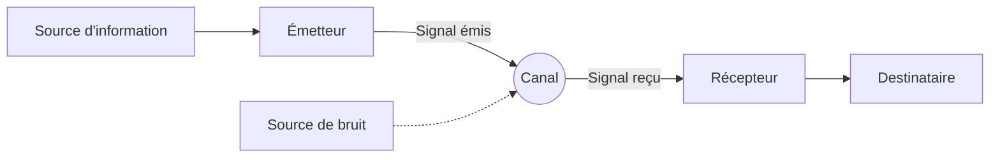

## 1. Distinguer le sens et l'incertitude d'un choix

Les actualités, les messages d'amis, les séquences d'ADN et les signaux radio venus de l'espace véhiculent de l'information. Mais l'importance du contenu et le nombre de bits nécessaires pour le transmettre sont deux grandeurs différentes.

Dans son article de 1948, Claude Shannon a séparé l'évaluation du sens du problème technique de la communication, puis étudié les limites de la compression et de la transmission à l'aide des probabilités. L'introduction, disponible dans cette [réimpression](https://wucj.lab.westlake.edu.cn/Others/shannon1948.pdf), reconnaît aussi les travaux antérieurs de Nyquist et Hartley. Nous distinguerons information propre, entropie, compression sans perte et communication en présence de bruit.

## 2. Un modèle de communication

Une source d'information produit un message, un émetteur le transforme en signal, le signal traverse un canal, puis un récepteur reconstitue le message pour son destinataire.



Le codage de source exploite la structure statistique pour réduire la redondance. Le codage de canal ajoute au contraire une redondance adaptée pour combattre le bruit. Ce sont deux formes de codage, dont les objectifs diffèrent.

## 3. Information propre

Pour un événement x de probabilité strictement positive P(x), on définit son information propre I(x) comme suit. Le logarithme en base 2 donne une mesure en bits.

$$
I(x)=-\log_2P(x)=\log_2\frac1{P(x)},\qquad 0<P(x)\le1
$$

Les événements moins probables reçoivent des valeurs plus élevées. Cette grandeur ne mesure ni la surprise psychologique ni la valeur du contenu. La définition n'attribue pas une information propre finie à un événement de probabilité nulle : le modèle probabiliste et le domaine doivent être précisés.

Pour le résultat face d'une pièce équilibrée :

$$
I=-\log_2(1/2)=1\ \mathrm{bit}
$$

## 4. L'entropie est l'espérance de l'information propre

Soit X une variable prenant ses valeurs dans un alphabet fini de m symboles, avec p_i=P(X=x_i). Les probabilités sont positives ou nulles et leur somme vaut un. L'entropie de Shannon est l'espérance de l'information propre.

$$
H(X)=\mathbb E[I(X)]=-\sum_{i=1}^{m}p_i\log_2p_i,\qquad \sum_{i=1}^{m}p_i=1
$$

Pour les termes de probabilité nulle, on utilise la convention par passage à la limite 0log₂0=0. L'unité est le bit par symbole. Pour un alphabet fixé de m symboles :

$$
0\le H(X)\le\log_2m
$$

Le maximum est atteint pour la loi uniforme ; le minimum, lorsqu'un symbole a une probabilité égale à un. Cette incertitude maximale s'évalue dans le modèle probabiliste et compte tenu des informations disponibles. Elle n'établit pas une imprévisibilité cryptographique et ne garantit pas qu'un tiers ne possède aucune information supplémentaire.

Si la probabilité d'obtenir face vaut p, l'entropie binaire est donnée par la fonction suivante. Aux extrémités, on applique la même convention pour les termes de probabilité nulle.

$$
h_2(p)=-p\log_2p-(1-p)\log_2(1-p),\qquad 0\le p\le1
$$

Cet exemple Python accepte une probabilité scalaire finie et rejette les valeurs hors du domaine. Le tracé nécessite Matplotlib.

```python
import math


def binary_entropy(p):
    if not math.isfinite(p) or not 0 <= p <= 1:
        raise ValueError("p must be finite and between 0 and 1")
    if p == 0 or p == 1:
        return 0.0
    return -p * math.log2(p) - (1 - p) * math.log2(1 - p)


if __name__ == "__main__":
    import matplotlib.pyplot as plt

    probabilities = [i / 100 for i in range(101)]
    entropies = [binary_entropy(p) for p in probabilities]
    plt.plot(probabilities, entropies)
    plt.title("Binary entropy")
    plt.xlabel("Probability of heads (p)")
    plt.ylabel("Entropy (bits per symbol)")
    plt.grid(True)
    plt.show()
```

La valeur est nulle pour p=0 et p=1 et atteint son maximum d'un bit pour p=0.5. La courbe est symétrique. Les libellés anglais désignent l'entropie binaire, la probabilité d'obtenir face et l'entropie en bits par symbole.

## 5. Codage de source : quelle moyenne, sous quelles hypothèses ?

Attribuons des mots de code binaires aux symboles d'un alphabet fini de manière que leur concaténation puisse être décodée de façon unique. Si le mot associé au symbole i a une longueur ℓ_i, la longueur moyenne L satisfait la borne ci-dessous. Un code préfixe est un code à décodage unique dans lequel aucun mot de code n'est le début d'un autre.

$$
L=\sum_i p_i\ell_i,\qquad L\ge H(X)
$$

Il s'agit d'une espérance sous une loi spécifiée. Cela ne signifie pas que chaque fichier individuel doit avoir au moins cette longueur. On ne peut pas non plus déterminer la limite de compression d'une séquence corrélée à partir de la seule loi marginale d'un symbole.

### Codage de Huffman et conditions d'optimalité

L'[article de David Huffman de 1952](https://compression.ru/download/articles/huff/huffman_1952_minimum-redundancy-codes.pdf) construit des codes préfixes minimisant la longueur moyenne pour des probabilités données. Dans le cas binaire, on regroupe à chaque étape les deux plus petits poids et on réintroduit leur somme dans l'ensemble. Des égalités de poids peuvent conduire à plusieurs codes optimaux.

Avec au moins deux symboles de probabilité strictement positive, la longueur moyenne L_H du code préfixe binaire optimal se situe dans cet intervalle :

$$
H(X)\le L_{\mathrm H}<H(X)+1
$$

Cette optimalité concerne le codage symbole par symbole avec des poids connus, et non l'ensemble des méthodes de compression. Pour une source non dégénérée de symboles indépendants et de même loi, regrouper n symboles et choisir un code préfixe adapté donne l'encadrement par symbole suivant. L_n est le nombre moyen de bits pour le bloc entier de n symboles.

$$
H(X)\le\frac{L_n}{n}<H(X)+\frac1n
$$

En présence de dépendances, on utilise l'entropie conjointe du bloc. Pour une source stationnaire à alphabet fini, le taux d'entropie est défini par cette limite :

$$
\overline H=\lim_{n\to\infty}\frac{H(X_1,\ldots,X_n)}{n}
$$

Par exemple, choisissons au départ un bit équiprobable Z, puis répétons sa valeur sur tout un bloc de longueur connue n. Dans ce modèle :

$$
P(Z=0)=P(Z=1)=\frac12,\qquad X_i=Z,\qquad H(X_i)=1,\qquad H(X_1,\ldots,X_n)=1
$$

Chaque position a une entropie marginale d'un bit, mais un décodeur connaissant n et ce modèle peut représenter tout le bloc par le seul bit Z. Cela distingue l'entropie d'un symbole de l'information contenue dans une séquence. ZIP et gzip font aussi intervenir en-têtes, modèles, historique et frontières d'octets ; leurs limites ne se déduisent pas des seules fréquences de caractères isolés.

### Un exemple Python traitant les entrées vides et à un seul symbole

L'exemple compte les caractères Python et utilise un arbre partagé pour coder et décoder. Les fréquences égales sont traitées indépendamment de l'ordre d'entrée, et chaque appel crée un nouveau dictionnaire de codes. Une chaîne vide utilise un arbre vide et une charge utile vide.

```python
import heapq
from collections import Counter
from itertools import count


class Node:
    def __init__(self, char=None, left=None, right=None):
        self.char = char
        self.left = left
        self.right = right


def build_huffman_tree(text):
    if not isinstance(text, str):
        raise TypeError("text must be a string")
    order = count()
    heap = [(freq, next(order), Node(char))
            for char, freq in sorted(Counter(text).items())]
    heapq.heapify(heap)
    if not heap:
        return None
    while len(heap) > 1:
        freq_left, _, left = heapq.heappop(heap)
        freq_right, _, right = heapq.heappop(heap)
        parent = Node(left=left, right=right)
        heapq.heappush(heap, (freq_left + freq_right, next(order), parent))
    return heap[0][2]


def generate_huffman_codes(root):
    codes = {}
    stack = [] if root is None else [(root, "")]
    while stack:
        node, prefix = stack.pop()
        if node.char is not None:
            codes[node.char] = prefix or "0"
        else:
            stack.append((node.right, prefix + "1"))
            stack.append((node.left, prefix + "0"))
    return codes


def encode(text, codes):
    try:
        return "".join(codes[char] for char in text)
    except KeyError as exc:
        raise ValueError("symbol missing from codebook") from exc


def decode(bits, root):
    if any(bit not in "01" for bit in bits):
        raise ValueError("payload must contain only 0 and 1")
    if root is None:
        if bits:
            raise ValueError("nonempty payload with an empty tree")
        return ""
    if root.char is not None:
        if "1" in bits:
            raise ValueError("single-symbol code uses only 0")
        return root.char * len(bits)
    result = []
    node = root
    for bit in bits:
        node = node.left if bit == "0" else node.right
        if node.char is not None:
            result.append(node.char)
            node = root
    if node is not root:
        raise ValueError("truncated codeword")
    return "".join(result)


if __name__ == "__main__":
    text = "shannon_entropy_and_information_theory"
    root = build_huffman_tree(text)
    codes = generate_huffman_codes(root)
    payload = encode(text, codes)
    print("Huffman codes:")
    for char, code in sorted(codes.items()):
        print(f"{char!r}: {code}")
    print("Logical payload bits:", len(payload))
    print("Round trip:", decode(payload, root) == text)
```

Pour un seul symbole, cet exemple attribue le code non vide 0 et représente le nombre de répétitions par la longueur de la charge utile. On a alors H=0 et L=1 : la borne supérieure stricte L_H<H+1 ci-dessus ne s'applique donc pas au cas à un seul symbole de cette implémentation. Autoriser un code vide et partager séparément le nombre de répétitions relève d'une autre convention.

Il faut fournir à decode un arbre créé par build_huffman_tree. La fonction rejette les caractères invalides et les mots de code tronqués, mais ne détecte ni ne corrige toutes les altérations transformant la charge utile en une autre séquence de codes valide. Les caractères sont ici des points de code Unicode, et non des groupes de graphèmes ni des octets UTF-8.

La charge utile est une chaîne Python de zéros et de uns, pas un format de fichier où les bits sont compactés. Logical payload bits mesure sa longueur logique, pas la mémoire occupée par l'objet Python. Le coût du stockage ou de la transmission de l'arbre, du délimitage et des en-têtes est exclu ; cet exemple seul ne démontre donc pas un taux de compression pour un fichier complet.

## 6. Codage de canal : faible probabilité d'erreur et erreur nulle à longueur finie

Considérons d'abord un canal discret sans mémoire à alphabets finis : chaque utilisation suit les mêmes probabilités de transition et ne dépend pas du passé. Notons U son entrée et V sa sortie. La capacité est le maximum de l'information mutuelle sur les lois d'entrée, en bits par utilisation du canal.

$$
C=\max_{P_U}I(U;V),\qquad I(U;V)=H(U)-H(U\mid V)
$$

Un code permettant de choisir parmi M messages possibles avec n utilisations du canal a pour débit :

$$
R=\frac{\log_2 M}{n}\quad(\mathrm{bits/use})
$$

Dans ce modèle, si R<C, on peut choisir des codes dont la probabilité d'erreur de décodage devient arbitrairement petite lorsque la longueur des blocs augmente. Cela ne promet pas exactement zéro erreur à longueur finie, ni qu'un code particulier atteindra automatiquement cette limite. À un débit fixé au-dessus de la capacité, la probabilité d'erreur ne peut pas tendre vers zéro sous les mêmes hypothèses. Comparer des grandeurs par seconde exige aussi de tenir compte d'un nombre cohérent d'utilisations du canal par seconde.

### Un canal AWGN sous contraintes de bande et de puissance

Pour un bruit blanc gaussien additif indépendant du signal d'entrée, une bande passante B Hz, une puissance moyenne du signal S et une puissance totale de bruit N dans cette bande, la capacité sous contrainte de puissance moyenne est la suivante. On suppose B>0, S≥0 et N>0.

$$
C=B\log_2\left(1+\frac SN\right)\quad(\mathrm{bits/s})
$$

C s'exprime en bits par seconde. Mesurez S et N dans les mêmes unités de puissance et utilisez leur rapport linéaire, pas la valeur numérique en dB. Par exemple, B=1 MHz et S/N=15 en échelle linéaire donnent cette valeur théorique :

$$
10^6\log_2(1+15)=4\times10^6\ \mathrm{bits/s}
$$

Il ne s'agit pas d'une mesure du débit d'un réseau Wi-Fi ou cellulaire. Modulation, entrées autorisées, délai, longueurs finies, évanouissement, interférences et surcoût des protocoles peuvent différer du modèle et doivent être examinés lors de son application.

## 7. Questions à poser pour appliquer la théorie de l'information

La théorie de l'information fournit un cadre pour étudier les limites tout en distinguant la redondance supprimée par la compression de celle ajoutée pour fiabiliser la communication. Elle fonde notamment la diffusion vidéo et les communications par satellite, mais une formule ne détermine pas les performances de tout un système réel.

L'entropie croisée en apprentissage automatique dépend aussi de la loi de prédiction et n'est pas identique à l'entropie de la source. Lorsque l'on considère des liens formels avec l'entropie thermodynamique, il faut distinguer les modèles physiques et les unités. Le point de départ consiste à préciser les variables aléatoires, les connaissances disponibles et les coûts comptabilisés.
