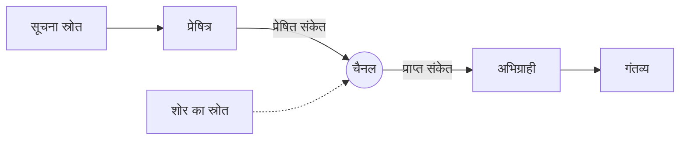

## 1. अर्थ और किसी विकल्प की अनिश्चितता को अलग समझें

समाचार, दोस्तों के संदेश, डीएनए अनुक्रम और अंतरिक्ष से आने वाले रेडियो संकेत सूचना ले जाते हैं। लेकिन उनके विषय का महत्व और उन्हें भेजने के लिए आवश्यक बिटों की संख्या अलग-अलग राशियाँ हैं।

क्लॉड शैनन (Claude Shannon) ने 1948 के अपने शोधपत्र में अर्थ के मूल्यांकन को संचार की इंजीनियरिंग समस्या से अलग किया और प्रायिकता के आधार पर संपीड़न तथा संचार की सीमाओं का अध्ययन किया। इस [पुनर्मुद्रित संस्करण](https://wucj.lab.westlake.edu.cn/Others/shannon1948.pdf) में उपलब्ध भूमिका में Nyquist और Hartley के पहले के काम का भी उल्लेख है। यहाँ हम स्व-सूचना, एन्ट्रापी, हानिरहित संपीड़न और शोर वाले संचार को अलग-अलग समझेंगे।

## 2. संचार का एक मॉडल

सूचना स्रोत संदेश उत्पन्न करता है, प्रेषित्र उसे संकेत में बदलता है, संकेत चैनल से होकर जाता है और अभिग्राही गंतव्य के लिए संदेश का पुनर्निर्माण करता है।



स्रोत कोडिंग सांख्यिकीय संरचना का उपयोग करके अतिरेक घटाती है। चैनल कोडिंग शोर से निपटने के लिए उपयुक्त अतिरेक जोड़ती है। दोनों कोडिंग हैं, लेकिन उनके उद्देश्य अलग हैं।

## 3. स्व-सूचना

धनात्मक प्रायिकता P(x) वाली घटना x के लिए स्व-सूचना I(x) इस प्रकार परिभाषित है। आधार 2 का लघुगणक लेने पर इकाई बिट होती है।

$$
I(x)=-\log_2P(x)=\log_2\frac1{P(x)},\qquad 0<P(x)\le1
$$

कम प्रायिकता वाली घटनाओं के लिए इसका मान अधिक होता है। यह मनोवैज्ञानिक आश्चर्य या विषय के महत्व का माप नहीं है। यह परिभाषा शून्य प्रायिकता वाली घटना को परिमित स्व-सूचना नहीं देती; प्रायिकता मॉडल और परिभाषा का क्षेत्र स्पष्ट होना चाहिए।

एक निष्पक्ष सिक्के में चित आने के लिए:

$$
I=-\log_2(1/2)=1\ \mathrm{bit}
$$

## 4. एन्ट्रापी स्व-सूचना का प्रत्याशित मान है

मान लें कि यादृच्छिक चर X, m प्रतीकों के एक परिमित वर्णसमूह में मान लेता है और p_i=P(X=x_i) है। सभी प्रायिकताएँ गैर-ऋणात्मक हैं और उनका योग एक है। शैनन एन्ट्रापी स्व-सूचना का प्रत्याशित मान है।

$$
H(X)=\mathbb E[I(X)]=-\sum_{i=1}^{m}p_i\log_2p_i,\qquad \sum_{i=1}^{m}p_i=1
$$

शून्य प्रायिकता वाले पद के लिए सीमा के अनुरूप परिपाटी 0log₂0=0 अपनाते हैं। इकाई बिट प्रति प्रतीक है। m प्रतीकों के एक निश्चित वर्णसमूह के लिए:

$$
0\le H(X)\le\log_2m
$$

अधिकतम मान एकसमान वितरण में मिलता है; न्यूनतम तब, जब एक प्रतीक की प्रायिकता एक हो। अधिकतम अनिश्चितता इस प्रायिकता मॉडल और उपलब्ध सूचना के अंतर्गत किया गया आकलन है। इससे क्रिप्टोग्राफिक अप्रत्याशितता सिद्ध नहीं होती और न ही यह सुनिश्चित होता है कि किसी दूसरे पक्ष के पास अतिरिक्त सूचना नहीं है।

यदि चित की प्रायिकता p हो, तो द्विआधारी एन्ट्रापी नीचे दी गई है। दोनों सिरों पर शून्य प्रायिकता वाले पद की वही परिपाटी लागू होती है।

$$
h_2(p)=-p\log_2p-(1-p)\log_2(1-p),\qquad 0\le p\le1
$$

यह Python उदाहरण एक परिमित अदिश प्रायिकता स्वीकार करता है और क्षेत्र से बाहर के मान अस्वीकार करता है। ग्राफ बनाने के लिए Matplotlib चाहिए।

```python
import math


def binary_entropy(p):
    if not math.isfinite(p) or not 0 <= p <= 1:
        raise ValueError("p must be finite and between 0 and 1")
    if p == 0 or p == 1:
        return 0.0
    return -p * math.log2(p) - (1 - p) * math.log2(1 - p)


if __name__ == "__main__":
    import matplotlib.pyplot as plt

    probabilities = [i / 100 for i in range(101)]
    entropies = [binary_entropy(p) for p in probabilities]
    plt.plot(probabilities, entropies)
    plt.title("Binary entropy")
    plt.xlabel("Probability of heads (p)")
    plt.ylabel("Entropy (bits per symbol)")
    plt.grid(True)
    plt.show()
```

p=0 और p=1 पर मान शून्य है तथा p=0.5 पर अधिकतम एक बिट है। वक्र सममित है। अंग्रेज़ी लेबल क्रमशः द्विआधारी एन्ट्रापी, चित की प्रायिकता और बिट प्रति प्रतीक में एन्ट्रापी बताते हैं।

## 5. स्रोत कोडिंग: किस औसत की तुलना, किन शर्तों पर?

एक परिमित वर्णसमूह के प्रतीकों को ऐसे द्विआधारी कोडशब्द दें कि उन्हें जोड़ने पर भी अद्वितीय रूप से डिकोड किया जा सके। प्रतीक i के कोडशब्द की लंबाई ℓ_i हो, तो प्रत्याशित लंबाई L नीचे की सीमा को संतुष्ट करती है। उपसर्ग कोड (prefix code) ऐसा अद्वितीय रूप से डिकोड होने वाला कोड है जिसमें कोई कोडशब्द किसी दूसरे कोडशब्द का आरंभ नहीं होता।

$$
L=\sum_i p_i\ell_i,\qquad L\ge H(X)
$$

यह एक निर्दिष्ट वितरण के अंतर्गत प्रत्याशित मान का कथन है। इसका अर्थ यह नहीं कि हर अलग फ़ाइल कम से कम इतनी लंबी होनी चाहिए। किसी सहसंबद्ध अनुक्रम की संपीड़न सीमा भी केवल एक प्रतीक के सीमांत वितरण से तय नहीं की जा सकती।

### हफमैन कोडिंग की इष्टतमता की शर्तें

[डेविड हफमैन का 1952 का शोधपत्र](https://compression.ru/download/articles/huff/huffman_1952_minimum-redundancy-codes.pdf) दी गई प्रायिकताओं के लिए प्रत्याशित लंबाई न्यूनतम करने वाले उपसर्ग कोड बनाता है। द्विआधारी स्थिति में बार-बार सबसे छोटे दो भार जोड़कर उनका योग समूह में वापस रखते हैं। समान भार होने पर अलग-अलग इष्टतम कोड मिल सकते हैं।

यदि धनात्मक प्रायिकता वाले कम से कम दो प्रतीक हों, तो इष्टतम द्विआधारी उपसर्ग कोड की प्रत्याशित लंबाई L_H इस अंतराल में होती है:

$$
H(X)\le L_{\mathrm H}<H(X)+1
$$

यह ज्ञात भारों के साथ एक-एक प्रतीक को कोड करने की श्रेणी में इष्टतमता है, सभी संपीड़न विधियों में नहीं। स्वतंत्र तथा एक ही प्रायिकता वितरण वाले प्रतीकों के ऐसे स्रोत के लिए, जिसमें कम से कम दो प्रतीकों की प्रायिकता धनात्मक हो, n प्रतीकों को एक साथ रखकर उपयुक्त उपसर्ग कोड चुनने पर प्रति प्रतीक निम्न अंतराल मिलता है। L_n पूरे n-प्रतीक ब्लॉक की प्रत्याशित बिट संख्या है।

$$
H(X)\le\frac{L_n}{n}<H(X)+\frac1n
$$

निर्भरताएँ होने पर ब्लॉक की संयुक्त एन्ट्रापी उपयोग करते हैं। परिमित वर्णसमूह वाले स्थिर (stationary) स्रोत की एन्ट्रापी दर इस सीमा से परिभाषित होती है। यहाँ स्थिरता का अर्थ है कि समय में खिसकाने पर संयुक्त वितरण नहीं बदलता; इसका अर्थ हर बार एक ही प्रतीक निकलना नहीं है।

$$
\overline H=\lim_{n\to\infty}\frac{H(X_1,\ldots,X_n)}{n}
$$

उदाहरण के लिए, आरंभ में एक समप्रायिक बिट Z चुनें और ज्ञात लंबाई n के पूरे ब्लॉक में उसका मान दोहराएँ। इस मॉडल में:

$$
P(Z=0)=P(Z=1)=\frac12,\qquad X_i=Z,\qquad H(X_i)=1,\qquad H(X_1,\ldots,X_n)=1
$$

हर स्थान की सीमांत एन्ट्रापी एक बिट है, लेकिन n और यह मॉडल जानने वाला डिकोडर पूरे ब्लॉक को Z के एक बिट से निरूपित कर सकता है। यह एक प्रतीक की एन्ट्रापी और अनुक्रम की कुल सूचना में अंतर दिखाता है। ZIP और gzip में हेडर, मॉडल, पिछला डेटा और बाइट की सीमाएँ भी शामिल होती हैं; केवल अलग-अलग अक्षरों की आवृत्तियों से उनकी सीमाएँ तय नहीं होतीं।

### खाली इनपुट और एक ही प्रतीक के लिए भी Python उदाहरण

यह उदाहरण Python के अक्षरों की आवृत्ति गिनता है और कोडिंग तथा डिकोडिंग के लिए साझा वृक्ष उपयोग करता है। समान आवृत्तियों का निपटारा इनपुट के क्रम से स्वतंत्र है और हर कॉल नया कोड शब्दकोश बनाती है। खाली स्ट्रिंग के लिए खाली वृक्ष और खाली पेलोड हैं।

```python
import heapq
from collections import Counter
from itertools import count


class Node:
    def __init__(self, char=None, left=None, right=None):
        self.char = char
        self.left = left
        self.right = right


def build_huffman_tree(text):
    if not isinstance(text, str):
        raise TypeError("text must be a string")
    order = count()
    heap = [(freq, next(order), Node(char))
            for char, freq in sorted(Counter(text).items())]
    heapq.heapify(heap)
    if not heap:
        return None
    while len(heap) > 1:
        freq_left, _, left = heapq.heappop(heap)
        freq_right, _, right = heapq.heappop(heap)
        parent = Node(left=left, right=right)
        heapq.heappush(heap, (freq_left + freq_right, next(order), parent))
    return heap[0][2]


def generate_huffman_codes(root):
    codes = {}
    stack = [] if root is None else [(root, "")]
    while stack:
        node, prefix = stack.pop()
        if node.char is not None:
            codes[node.char] = prefix or "0"
        else:
            stack.append((node.right, prefix + "1"))
            stack.append((node.left, prefix + "0"))
    return codes


def encode(text, codes):
    try:
        return "".join(codes[char] for char in text)
    except KeyError as exc:
        raise ValueError("symbol missing from codebook") from exc


def decode(bits, root):
    if any(bit not in "01" for bit in bits):
        raise ValueError("payload must contain only 0 and 1")
    if root is None:
        if bits:
            raise ValueError("nonempty payload with an empty tree")
        return ""
    if root.char is not None:
        if "1" in bits:
            raise ValueError("single-symbol code uses only 0")
        return root.char * len(bits)
    result = []
    node = root
    for bit in bits:
        node = node.left if bit == "0" else node.right
        if node.char is not None:
            result.append(node.char)
            node = root
    if node is not root:
        raise ValueError("truncated codeword")
    return "".join(result)


if __name__ == "__main__":
    text = "shannon_entropy_and_information_theory"
    root = build_huffman_tree(text)
    codes = generate_huffman_codes(root)
    payload = encode(text, codes)
    print("Huffman codes:")
    for char, code in sorted(codes.items()):
        print(f"{char!r}: {code}")
    print("Logical payload bits:", len(payload))
    print("Round trip:", decode(payload, root) == text)
```

एक ही प्रतीक के लिए यह उदाहरण गैर-खाली कोड 0 देता है और दोहराव की संख्या पेलोड की लंबाई से दर्शाता है। तब H=0 और L=1 है, इसलिए ऊपर की सख्त ऊपरी सीमा L_H<H+1 इस कार्यान्वयन की एक-प्रतीक स्थिति पर लागू नहीं होती। खाली कोड की अनुमति देकर गिनती अलग से साझा करना दूसरी परिपाटी है।

decode को build_huffman_tree से बना वृक्ष दें। यह अमान्य चिह्न और अधूरे कोडशब्द अस्वीकार करता है, लेकिन पेलोड को किसी दूसरे वैध कोड अनुक्रम में बदल देने वाली हर क्षति का पता नहीं लगाता और न ही उसे सुधारता है। यहाँ अक्षर Unicode कोड बिंदु हैं, ग्रैफीम समूह (grapheme clusters) या UTF-8 बाइट नहीं।

पेलोड शून्य और एक की Python स्ट्रिंग है, बिट पैक किया हुआ फ़ाइल प्रारूप नहीं। Logical payload bits तार्किक लंबाई बताता है, Python ऑब्जेक्ट की मेमोरी नहीं। इसमें वृक्ष को सहेजने या भेजने, सीमांकन और हेडर की लागत शामिल नहीं है; इसलिए केवल यह उदाहरण पूरी फ़ाइल का संपीड़न अनुपात सिद्ध नहीं करता।

## 6. चैनल कोडिंग: छोटी त्रुटि प्रायिकता और परिमित लंबाई पर शून्य त्रुटि

पहले परिमित इनपुट और आउटपुट वर्णसमूह वाले विविक्त स्मृतिरहित चैनल पर विचार करें: हर उपयोग में समान संक्रमण प्रायिकताएँ हैं और वह अतीत पर निर्भर नहीं है। इनपुट U और आउटपुट V हों। क्षमता, इनपुट वितरणों पर पारस्परिक सूचना का अधिकतम मान है, जिसकी इकाई बिट प्रति चैनल उपयोग है।

$$
C=\max_{P_U}I(U;V),\qquad I(U;V)=H(U)-H(U\mid V)
$$

M संभावित संदेशों में से एक को n चैनल उपयोगों में भेजने वाले कोड की दर है:

$$
R=\frac{\log_2 M}{n}\quad(\mathrm{bits/use})
$$

इस मॉडल में R<C होने पर, ब्लॉक की लंबाई बढ़ने के साथ मनचाही छोटी डिकोडिंग त्रुटि प्रायिकता वाले कोड चुने जा सकते हैं। इससे परिमित लंबाई पर बिल्कुल शून्य त्रुटि या किसी खास कोड से अपने-आप सीमा तक पहुँचने का वादा नहीं मिलता। क्षमता से ऊपर एक निश्चित दर पर, उन्हीं शर्तों में त्रुटि प्रायिकता शून्य की ओर नहीं जा सकती। प्रति सेकंड वाली राशियों से तुलना में प्रति सेकंड चैनल उपयोगों की संख्या भी सुसंगत रखनी होगी।

### बैंडविड्थ और शक्ति की शर्तों वाला AWGN चैनल

इनपुट संकेत से स्वतंत्र योगात्मक श्वेत गाऊसी शोर, बैंडविड्थ B Hz, औसत संकेत शक्ति S और उस बैंड के भीतर कुल शोर शक्ति N वाले मॉडल में औसत शक्ति की सीमा के अंतर्गत क्षमता निम्न है। मान लें B>0, S≥0 और N>0।

$$
C=B\log_2\left(1+\frac SN\right)\quad(\mathrm{bits/s})
$$

C की इकाई बिट प्रति सेकंड है। S और N को शक्ति की एक ही इकाई में मापें और उनका रैखिक अनुपात लें, dB में दिया संख्यात्मक मान नहीं। उदाहरण के लिए, B=1 MHz और रैखिक S/N=15 से यह सैद्धांतिक मान मिलता है:

$$
10^6\log_2(1+15)=4\times10^6\ \mathrm{bits/s}
$$

यह वास्तविक Wi-Fi या मोबाइल नेटवर्क की डेटा दर का मापन नहीं है। मॉड्यूलेशन, अनुमत इनपुट, विलंब, परिमित लंबाई, फेडिंग, व्यतिकरण और प्रोटोकॉल का अतिरिक्त खर्च मॉडल से अलग हो सकते हैं; लागू करते समय उनकी जाँच करनी होगी।

## 7. सूचना सिद्धांत का उपयोग करते समय पूछे जाने वाले प्रश्न

सूचना सिद्धांत सीमाओं का अध्ययन करने का ढाँचा देता है और संपीड़न से घटाए गए अतिरेक को संचार की विश्वसनीयता के लिए जोड़े गए अतिरेक से अलग रखता है। यह वीडियो स्ट्रीमिंग और उपग्रह संचार की नींव देता है, लेकिन एक सूत्र से पूरे वास्तविक तंत्र का प्रदर्शन तय नहीं होता।

मशीन लर्निंग में क्रॉस-एन्ट्रापी पूर्वानुमान वितरण पर भी निर्भर करती है और स्रोत की एन्ट्रापी के समान नहीं है। ऊष्मागतिक एन्ट्रापी से औपचारिक संबंध देखते समय भी भौतिक मॉडल और इकाइयाँ अलग पहचाननी चाहिए। शुरुआत इस बात को स्पष्ट करने से होती है कि यादृच्छिक चर क्या हैं, क्या पहले से ज्ञात है और किन लागतों को गिना जा रहा है।
