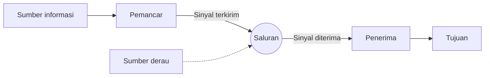

## 1. Membedakan makna dan ketidakpastian suatu pilihan

Berita, pesan dari teman, urutan DNA, dan sinyal radio dari luar angkasa membawa informasi. Namun, pentingnya isi dan jumlah bit yang diperlukan untuk mengirimkannya merupakan dua besaran berbeda.

Dalam makalahnya tahun 1948, Claude Shannon memisahkan penilaian makna dari persoalan rekayasa komunikasi dan mengkaji batas kompresi serta komunikasi menggunakan probabilitas. Pendahuluannya, yang tersedia dalam [cetak ulang ini](https://wucj.lab.westlake.edu.cn/Others/shannon1948.pdf), juga mengakui karya terdahulu Nyquist dan Hartley. Kita akan membedakan informasi diri, entropi, kompresi tanpa kehilangan data, dan komunikasi dengan derau.

## 2. Model komunikasi

Sumber informasi menghasilkan pesan, pemancar mengubahnya menjadi sinyal, sinyal melewati saluran, lalu penerima merekonstruksi pesan untuk tujuannya.



Pengodean sumber memanfaatkan struktur statistik untuk mengurangi redundansi. Pengodean saluran justru menambahkan redundansi yang sesuai untuk menghadapi derau. Keduanya merupakan pengodean, tetapi tujuannya berbeda.

## 3. Informasi diri

Untuk peristiwa x dengan probabilitas positif P(x), informasi diri I(x) didefinisikan sebagai berikut. Logaritma berbasis 2 memberikan satuan bit.

$$
I(x)=-\log_2P(x)=\log_2\frac1{P(x)},\qquad 0<P(x)\le1
$$

Peristiwa yang lebih kecil probabilitasnya memperoleh nilai lebih besar. Ini tidak mengukur kejutan psikologis atau nilai isi pesan. Definisi ini tidak memberikan informasi diri berhingga kepada peristiwa berprobabilitas nol; model probabilitas dan domainnya perlu diperhatikan.

Untuk hasil sisi kepala pada koin yang adil:

$$
I=-\log_2(1/2)=1\ \mathrm{bit}
$$

## 4. Entropi adalah nilai harapan informasi diri

Misalkan X mengambil nilai dalam alfabet berhingga yang terdiri atas m simbol, dengan p_i=P(X=x_i). Probabilitasnya tidak negatif dan berjumlah satu. Entropi Shannon adalah nilai harapan informasi diri.

$$
H(X)=\mathbb E[I(X)]=-\sum_{i=1}^{m}p_i\log_2p_i,\qquad \sum_{i=1}^{m}p_i=1
$$

Untuk suku berprobabilitas nol, gunakan konvensi berdasarkan limit 0log₂0=0. Satuannya bit per simbol. Untuk alfabet tetap berisi m simbol:

$$
0\le H(X)\le\log_2m
$$

Nilai maksimum tercapai pada distribusi seragam; minimum tercapai ketika satu simbol berprobabilitas satu. Ketidakpastian maksimum ini merupakan penilaian menurut model probabilitas dan informasi yang tersedia. Ini tidak membuktikan ketakterdugaan kriptografis atau menjamin bahwa pihak lain tidak memiliki informasi tambahan.

Jika probabilitas sisi kepala adalah p, entropi biner diberikan oleh fungsi berikut. Pada kedua titik ujung, konvensi suku berprobabilitas nol yang sama berlaku.

$$
h_2(p)=-p\log_2p-(1-p)\log_2(1-p),\qquad 0\le p\le1
$$

Contoh Python ini menerima probabilitas skalar berhingga dan menolak nilai di luar domain. Matplotlib diperlukan untuk menggambar grafik.

```python
import math


def binary_entropy(p):
    if not math.isfinite(p) or not 0 <= p <= 1:
        raise ValueError("p must be finite and between 0 and 1")
    if p == 0 or p == 1:
        return 0.0
    return -p * math.log2(p) - (1 - p) * math.log2(1 - p)


if __name__ == "__main__":
    import matplotlib.pyplot as plt

    probabilities = [i / 100 for i in range(101)]
    entropies = [binary_entropy(p) for p in probabilities]
    plt.plot(probabilities, entropies)
    plt.title("Binary entropy")
    plt.xlabel("Probability of heads (p)")
    plt.ylabel("Entropy (bits per symbol)")
    plt.grid(True)
    plt.show()
```

Nilainya nol pada p=0 dan p=1, serta mencapai maksimum satu bit pada p=0.5. Kurvanya simetris. Label berbahasa Inggris menyatakan fungsi entropi biner, probabilitas sisi kepala, dan entropi dalam bit per simbol.

## 5. Pengodean sumber: rata-rata apa dan dengan asumsi apa?

Berikan kata kode biner kepada simbol dalam alfabet berhingga sehingga gabungan kata-katanya dapat didekode secara unik. Jika panjang kata kode simbol i adalah ℓ_i, panjang harapan L memenuhi batas berikut. Kode prefiks adalah kode yang dapat didekode secara unik dan tidak memiliki kata kode yang menjadi awalan kata kode lain.

$$
L=\sum_i p_i\ell_i,\qquad L\ge H(X)
$$

Ini adalah nilai harapan menurut distribusi tertentu. Artinya bukan setiap berkas individual harus memiliki panjang sekurang-kurangnya sebesar itu. Batas kompresi urutan berkorelasi juga tidak dapat ditentukan hanya dari distribusi marginal satu simbol.

### Pengodean Huffman dan syarat optimalitasnya

[Makalah David Huffman tahun 1952](https://compression.ru/download/articles/huff/huffman_1952_minimum-redundancy-codes.pdf) membangun kode prefiks yang meminimalkan panjang harapan untuk probabilitas yang diberikan. Pada kasus biner, dua bobot terkecil digabungkan berulang kali dan jumlahnya dikembalikan ke kumpulan. Bobot yang sama dapat menghasilkan beberapa buku kode optimal yang berbeda.

Dengan sedikitnya dua simbol berprobabilitas positif, panjang harapan L_H untuk kode prefiks biner optimal berada dalam rentang ini:

$$
H(X)\le L_{\mathrm H}<H(X)+1
$$

Optimalitas ini berlaku dalam pengodean simbol demi simbol dengan bobot diketahui, bukan di antara semua metode kompresi. Untuk sumber tak degenerat dengan simbol-simbol independen dan berdistribusi identik, mengelompokkan n simbol dan memilih kode prefiks yang sesuai memberikan rentang per simbol berikut. L_n adalah jumlah bit harapan untuk seluruh blok n simbol.

$$
H(X)\le\frac{L_n}{n}<H(X)+\frac1n
$$

Jika ada ketergantungan, gunakan entropi gabungan blok. Untuk sumber stasioner dengan alfabet berhingga, laju entropi didefinisikan melalui limit ini:

$$
\overline H=\lim_{n\to\infty}\frac{H(X_1,\ldots,X_n)}{n}
$$

Sebagai contoh, pilih satu bit Z yang berpeluang sama untuk nol dan satu di awal, lalu ulangi nilainya sepanjang blok dengan panjang n yang diketahui. Dalam model ini:

$$
P(Z=0)=P(Z=1)=\frac12,\qquad X_i=Z,\qquad H(X_i)=1,\qquad H(X_1,\ldots,X_n)=1
$$

Setiap posisi mempunyai entropi marginal satu bit, tetapi dekoder yang mengetahui n dan model ini dapat merepresentasikan seluruh blok dengan satu bit Z. Ini membedakan entropi satu simbol dari informasi dalam suatu urutan. ZIP dan gzip juga melibatkan header, model, riwayat, dan batas byte; batasnya tidak dapat disimpulkan hanya dari frekuensi karakter individual.

### Contoh Python yang menangani masukan kosong dan satu simbol

Contoh ini menghitung karakter Python serta memakai pohon bersama untuk mengodekan dan mendekodekan. Frekuensi yang sama ditangani tanpa bergantung pada urutan masukan, dan setiap pemanggilan membuat buku kode baru. String kosong memakai pohon dan muatan kosong.

```python
import heapq
from collections import Counter
from itertools import count


class Node:
    def __init__(self, char=None, left=None, right=None):
        self.char = char
        self.left = left
        self.right = right


def build_huffman_tree(text):
    if not isinstance(text, str):
        raise TypeError("text must be a string")
    order = count()
    heap = [(freq, next(order), Node(char))
            for char, freq in sorted(Counter(text).items())]
    heapq.heapify(heap)
    if not heap:
        return None
    while len(heap) > 1:
        freq_left, _, left = heapq.heappop(heap)
        freq_right, _, right = heapq.heappop(heap)
        parent = Node(left=left, right=right)
        heapq.heappush(heap, (freq_left + freq_right, next(order), parent))
    return heap[0][2]


def generate_huffman_codes(root):
    codes = {}
    stack = [] if root is None else [(root, "")]
    while stack:
        node, prefix = stack.pop()
        if node.char is not None:
            codes[node.char] = prefix or "0"
        else:
            stack.append((node.right, prefix + "1"))
            stack.append((node.left, prefix + "0"))
    return codes


def encode(text, codes):
    try:
        return "".join(codes[char] for char in text)
    except KeyError as exc:
        raise ValueError("symbol missing from codebook") from exc


def decode(bits, root):
    if any(bit not in "01" for bit in bits):
        raise ValueError("payload must contain only 0 and 1")
    if root is None:
        if bits:
            raise ValueError("nonempty payload with an empty tree")
        return ""
    if root.char is not None:
        if "1" in bits:
            raise ValueError("single-symbol code uses only 0")
        return root.char * len(bits)
    result = []
    node = root
    for bit in bits:
        node = node.left if bit == "0" else node.right
        if node.char is not None:
            result.append(node.char)
            node = root
    if node is not root:
        raise ValueError("truncated codeword")
    return "".join(result)


if __name__ == "__main__":
    text = "shannon_entropy_and_information_theory"
    root = build_huffman_tree(text)
    codes = generate_huffman_codes(root)
    payload = encode(text, codes)
    print("Huffman codes:")
    for char, code in sorted(codes.items()):
        print(f"{char!r}: {code}")
    print("Logical payload bits:", len(payload))
    print("Round trip:", decode(payload, root) == text)
```

Anda juga dapat mengganti teks contoh dengan entropi_shannon_dan_teori_informasi untuk mencoba frasa berbahasa Indonesia dengan prosedur pengodean dan pendekodean yang sama.

Untuk satu simbol, contoh ini memberikan kode tidak kosong 0 dan menyatakan jumlah pengulangan melalui panjang muatan. Saat itu H=0 dan L=1, sehingga batas atas ketat L_H<H+1 di atas tidak berlaku untuk kasus satu simbol pada implementasi ini. Mengizinkan kode kosong dan membagikan jumlah pengulangan secara terpisah merupakan konvensi lain.

Berikan pohon hasil build_huffman_tree kepada decode. Fungsi ini menolak karakter tidak valid dan kata kode terpotong, tetapi tidak mendeteksi atau memperbaiki setiap kerusakan yang mengubah muatan menjadi urutan kode valid lain. Karakter di sini adalah titik kode Unicode, bukan gugus grafem atau byte UTF-8.

Muatan adalah string Python berisi nol dan satu, bukan format berkas dengan bit yang dipadatkan. Logical payload bits mengukur panjang logis, bukan memori objek Python. Biaya menyimpan atau mengirim pohon, pembingkaian, dan header tidak dihitung; contoh ini saja tidak membuktikan rasio kompresi seluruh berkas.

## 6. Pengodean saluran: probabilitas galat kecil dan nol galat pada panjang berhingga

Pertama, tinjau saluran diskret tanpa memori dengan alfabet berhingga: setiap penggunaan memiliki probabilitas transisi yang sama dan tidak bergantung pada masa lalu. Misalkan masukannya U dan keluarannya V. Kapasitas adalah maksimum informasi bersama atas distribusi masukan, dalam bit per penggunaan saluran.

$$
C=\max_{P_U}I(U;V),\qquad I(U;V)=H(U)-H(U\mid V)
$$

Kode yang mengirimkan satu dari M pesan yang mungkin melalui n penggunaan saluran mempunyai laju:

$$
R=\frac{\log_2 M}{n}\quad(\mathrm{bits/use})
$$

Dalam model ini, jika R<C, kode dapat dipilih sehingga probabilitas galat pendekodean menjadi sekecil yang diinginkan ketika panjang blok meningkat. Ini tidak menjanjikan tepat nol galat pada panjang berhingga atau pencapaian otomatis oleh kode tertentu. Pada laju tetap di atas kapasitas, probabilitas galat tidak dapat mendekati nol dengan asumsi yang sama. Perbandingan besaran per detik juga memerlukan jumlah penggunaan saluran per detik yang konsisten.

### Saluran AWGN dengan batasan lebar pita dan daya

Untuk derau Gaussian putih aditif yang independen dari sinyal masukan, lebar pita B Hz, daya sinyal rata-rata S, dan total daya derau N dalam pita tersebut, kapasitas dengan batasan daya rata-rata adalah sebagai berikut. Anggap B>0, S≥0, dan N>0.

$$
C=B\log_2\left(1+\frac SN\right)\quad(\mathrm{bits/s})
$$

Satuan C adalah bit per detik. Ukur S dan N dalam satuan daya yang sama dan gunakan rasio linearnya, bukan nilai numerik dalam dB. Misalnya, B=1 MHz dan S/N=15 dalam skala linear menghasilkan nilai teoretis berikut:

$$
10^6\log_2(1+15)=4\times10^6\ \mathrm{bits/s}
$$

Ini bukan pengukuran laju data Wi-Fi atau jaringan seluler. Modulasi, masukan yang diizinkan, penundaan, panjang berhingga, fading, interferensi, dan overhead protokol dapat berbeda dari model dan perlu ditinjau saat menerapkannya.

## 7. Pertanyaan saat menggunakan teori informasi

Teori informasi menyediakan kerangka untuk mempelajari batas sambil membedakan redundansi yang dihilangkan oleh kompresi dari redundansi yang ditambahkan untuk keandalan komunikasi. Teori ini mendasari streaming video dan komunikasi satelit, tetapi satu rumus tidak menentukan kinerja seluruh sistem nyata.

Entropi silang dalam pembelajaran mesin juga bergantung pada distribusi prediksi dan tidak identik dengan entropi sumber. Ketika meninjau hubungan formal dengan entropi termodinamika, bedakan model fisik dan satuannya. Titik awalnya adalah menentukan variabel acak, apa yang diketahui, dan biaya apa yang dihitung.
