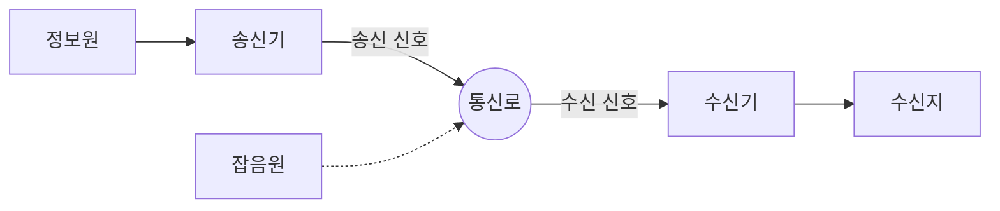

## 1. 정보의 의미와 선택의 불확실성 구분하기

뉴스, 친구의 메시지, DNA 서열, 우주에서 오는 전파는 모두 정보를 전달합니다. 하지만 내용의 중요성과 전송에 필요한 비트 수는 서로 다른 양입니다.

Claude Shannon의 1948년 논문은 의미의 평가와 통신의 공학적 문제를 분리하고 확률을 통해 압축과 통신의 한계를 연구했습니다. 이 [재록본](https://wucj.lab.westlake.edu.cn/Others/shannon1948.pdf)의 서두에서도 Nyquist와 Hartley의 선행 연구를 언급합니다. 여기서는 자기 정보량, 엔트로피, 무손실 압축, 잡음이 있는 통신을 구분합니다.

## 2. 통신 모형

정보원이 메시지를 만들고, 송신기가 신호로 바꾸고, 신호가 통신로를 거쳐, 수신기가 메시지를 복원해 수신지에 전달하는 모형입니다.



정보원 부호화는 데이터의 통계 구조를 이용해 중복성을 줄입니다. 반면 통신로 부호화는 잡음에 대응하도록 적절한 중복성을 추가합니다. 둘 다 부호화이지만 목적은 다릅니다.

## 3. 자기 정보량

확률 P(x)가 양수인 사건 x의 자기 정보량 I(x)를 다음과 같이 정의합니다. 밑이 2인 로그를 쓰면 단위는 비트입니다.

$$
I(x)=-\log_2P(x)=\log_2\frac1{P(x)},\qquad 0<P(x)\le1
$$

드문 사건일수록 이 값은 커집니다. 그러나 심리적 놀라움이나 내용의 가치를 측정하지는 않습니다. 확률 0인 사건에 유한한 자기 정보량을 부여하는 식도 아닙니다. 확률 모형과 정의역을 명확히 해야 합니다.

공정한 동전에서 앞면이 나오는 사건이라면 다음과 같습니다.

$$
I=-\log_2(1/2)=1\ \mathrm{bit}
$$

## 4. 엔트로피는 자기 정보량의 기댓값

확률변수 X가 유한 알파벳의 m개 기호 중 하나를 취하고 p_i=P(X=x_i)라고 합시다. 확률은 음이 아니며 합은 1입니다. 섀넌 엔트로피는 자기 정보량의 기댓값입니다.

$$
H(X)=\mathbb E[I(X)]=-\sum_{i=1}^{m}p_i\log_2p_i,\qquad \sum_{i=1}^{m}p_i=1
$$

확률 0인 항에는 극한에 대응하는 약속 0log₂0=0을 사용합니다. 단위는 기호당 비트입니다. 고정된 m개 기호에 대해 다음이 성립합니다.

$$
0\le H(X)\le\log_2m
$$

균등분포에서 최댓값을 가지며, 한 기호의 확률만 1일 때 최솟값을 가집니다. 최대 불확실성은 이 확률 모형과 이용 가능한 정보 아래의 평가입니다. 암호학적 예측 불가능성이나 상대에게 추가 정보가 없다는 사실까지 보장하지는 않습니다.

앞면 확률이 p일 때 이진 엔트로피 함수는 다음과 같습니다. 양 끝점에도 같은 영확률 항의 약속을 적용합니다.

$$
h_2(p)=-p\log_2p-(1-p)\log_2(1-p),\qquad 0\le p\le1
$$

다음 Python 예제는 유한한 스칼라 확률을 받아 정의역 밖의 값을 거부합니다. 그래프를 그리려면 Matplotlib이 필요합니다.

```python
import math


def binary_entropy(p):
    if not math.isfinite(p) or not 0 <= p <= 1:
        raise ValueError("p must be finite and between 0 and 1")
    if p == 0 or p == 1:
        return 0.0
    return -p * math.log2(p) - (1 - p) * math.log2(1 - p)


if __name__ == "__main__":
    import matplotlib.pyplot as plt

    probabilities = [i / 100 for i in range(101)]
    entropies = [binary_entropy(p) for p in probabilities]
    plt.plot(probabilities, entropies)
    plt.title("Binary entropy")
    plt.xlabel("Probability of heads (p)")
    plt.ylabel("Entropy (bits per symbol)")
    plt.grid(True)
    plt.show()
```

p=0과 p=1에서는 0이며, p=0.5에서 최대 1비트입니다. 곡선은 좌우 대칭입니다. 그래프의 Probability of heads는 앞면 확률, Entropy (bits per symbol)는 기호당 비트 단위의 엔트로피를 뜻합니다.

## 5. 정보원 부호화: 어떤 평균을 어떤 조건에서 비교하는가

유한 기호 집합에 이진 부호어를 배정하되, 이어 붙인 부호어도 유일하게 복호할 수 있게 합니다. 기호 i의 부호어 길이가 ℓ_i라면 평균 길이 L은 다음 하한을 만족합니다. 접두 부호는 어떤 부호어도 다른 부호어의 시작 부분이 되지 않는, 유일 복호 가능한 부호입니다.

$$
L=\sum_i p_i\ell_i,\qquad L\ge H(X)
$$

이는 주어진 분포에 대한 기댓값의 명제입니다. 개별 파일이 반드시 이 길이 이상이어야 한다는 뜻은 아닙니다. 한 기호의 주변분포만으로 상관관계가 있는 열의 압축 한계를 정할 수도 없습니다.

### 허프만 부호의 조건부 최적성

[David Huffman의 1952년 논문](https://compression.ru/download/articles/huff/huffman_1952_minimum-redundancy-codes.pdf)은 주어진 확률에서 평균 길이를 최소화하는 접두 부호를 구성합니다. 이진 부호에서는 가장 작은 두 가중치를 합치고, 그 합을 다시 집합에 넣는 과정을 반복합니다. 같은 가중치가 있으면 최적 부호표가 하나가 아닐 수 있습니다.

양의 확률을 가진 기호가 두 종류 이상이라면 최적 이진 접두 부호의 평균 길이 L_H는 다음 범위에 있습니다.

$$
H(X)\le L_{\mathrm H}<H(X)+1
$$

이는 알려진 가중치로 기호별 부호화를 하는 범위에서의 최적성이지 모든 압축 방식 사이의 최적성은 아닙니다. 비퇴화 독립 동일분포 정보원에서 n개 기호를 묶고 적절한 접두 부호를 선택하면, 기호당 평균 길이를 다음 범위까지 줄일 수 있습니다. L_n은 n개 기호 블록 전체의 평균 비트 수입니다.

$$
H(X)\le\frac{L_n}{n}<H(X)+\frac1n
$$

의존성이 있으면 블록의 결합 엔트로피를 사용합니다. 정상성(stationarity)을 갖는 유한 알파벳 정보원의 엔트로피율은 다음 극한으로 정의합니다.

$$
\overline H=\lim_{n\to\infty}\frac{H(X_1,\ldots,X_n)}{n}
$$

예를 들어 처음에 공정한 1비트 Z를 고르고, 알려진 길이 n 동안 같은 값을 반복하는 모형을 생각합시다. 이때 다음이 성립합니다.

$$
P(Z=0)=P(Z=1)=\frac12,\qquad X_i=Z,\qquad H(X_i)=1,\qquad H(X_1,\ldots,X_n)=1
$$

각 위치의 주변 엔트로피는 1비트지만 복호기가 n과 이 모형을 알면 블록 전체를 Z의 1비트로 나타낼 수 있습니다. 한 기호의 엔트로피와 열 전체의 정보량이 다른 이유입니다. 실제 ZIP과 gzip에는 헤더, 모형, 이력, 바이트 경계 등의 조건도 있어 한 글자의 빈도만으로 한계를 단정할 수 없습니다.

### 빈 입력과 단일 기호를 처리하는 Python 예제

다음 예제는 Python 문자 단위로 빈도를 세고 공유된 트리로 부호화와 복호화를 수행합니다. 같은 빈도의 처리는 입력 순서에 의존하지 않으며, 호출마다 새 부호표를 만듭니다. 빈 문자열은 빈 트리와 빈 페이로드를 사용합니다.

```python
import heapq
from collections import Counter
from itertools import count


class Node:
    def __init__(self, char=None, left=None, right=None):
        self.char = char
        self.left = left
        self.right = right


def build_huffman_tree(text):
    if not isinstance(text, str):
        raise TypeError("text must be a string")
    order = count()
    heap = [(freq, next(order), Node(char))
            for char, freq in sorted(Counter(text).items())]
    heapq.heapify(heap)
    if not heap:
        return None
    while len(heap) > 1:
        freq_left, _, left = heapq.heappop(heap)
        freq_right, _, right = heapq.heappop(heap)
        parent = Node(left=left, right=right)
        heapq.heappush(heap, (freq_left + freq_right, next(order), parent))
    return heap[0][2]


def generate_huffman_codes(root):
    codes = {}
    stack = [] if root is None else [(root, "")]
    while stack:
        node, prefix = stack.pop()
        if node.char is not None:
            codes[node.char] = prefix or "0"
        else:
            stack.append((node.right, prefix + "1"))
            stack.append((node.left, prefix + "0"))
    return codes


def encode(text, codes):
    try:
        return "".join(codes[char] for char in text)
    except KeyError as exc:
        raise ValueError("symbol missing from codebook") from exc


def decode(bits, root):
    if any(bit not in "01" for bit in bits):
        raise ValueError("payload must contain only 0 and 1")
    if root is None:
        if bits:
            raise ValueError("nonempty payload with an empty tree")
        return ""
    if root.char is not None:
        if "1" in bits:
            raise ValueError("single-symbol code uses only 0")
        return root.char * len(bits)
    result = []
    node = root
    for bit in bits:
        node = node.left if bit == "0" else node.right
        if node.char is not None:
            result.append(node.char)
            node = root
    if node is not root:
        raise ValueError("truncated codeword")
    return "".join(result)


if __name__ == "__main__":
    text = "shannon_entropy_and_information_theory"
    root = build_huffman_tree(text)
    codes = generate_huffman_codes(root)
    payload = encode(text, codes)
    print("Huffman codes:")
    for char, code in sorted(codes.items()):
        print(f"{char!r}: {code}")
    print("Logical payload bits:", len(payload))
    print("Round trip:", decode(payload, root) == text)
```

단일 기호에는 비어 있지 않은 부호 0을 배정하고 페이로드 길이로 반복 횟수를 나타냅니다. 이때 H=0, L=1이므로 앞의 엄격한 상한 L_H<H+1을 이 구현의 단일 기호 경우에 적용하지 않습니다. 빈 부호를 허용하고 개수를 별도로 공유하는 설계와는 약속이 다릅니다.

decode에는 build_huffman_tree가 만든 트리를 전달합니다. 잘못된 문자와 잘린 부호어를 거부하지만, 페이로드를 다른 유효한 부호열로 바꾸는 모든 손상을 검출하거나 정정하지는 않습니다. 여기서 문자는 Unicode 코드 포인트 단위이며 자소 클러스터 수나 UTF-8 바이트 수와 다릅니다.

페이로드는 0과 1로 된 Python 문자열로, 비트를 묶어 저장하는 파일 형식이 아닙니다. Logical payload bits는 논리적 길이지 Python 객체의 메모리 크기가 아닙니다. 트리를 저장하거나 전달하는 비용, 메시지 경계와 헤더 비용도 포함하지 않으므로 이 예제만으로 파일 전체의 압축률을 제시한 것은 아닙니다.

## 6. 통신로 부호화: 작은 오류 확률과 유한 길이 무오류의 차이

먼저 유한 이산 무기억 통신로를 생각합니다. 각 사용의 전이 확률이 같고 과거에 의존하지 않습니다. 입력을 U, 출력을 V라 하면 통신로 용량은 입력 분포에 대한 상호정보량의 최댓값이며, 단위는 통신로 1회 사용당 비트입니다.

$$
C=\max_{P_U}I(U;V),\qquad I(U;V)=H(U)-H(U\mid V)
$$

가능한 메시지가 M개이고 통신로를 n회 사용하는 부호의 전송률은 다음과 같습니다.

$$
R=\frac{\log_2 M}{n}\quad(\mathrm{bits/use})
$$

이 모형에서 R<C라면 블록 길이를 늘리면서 복호 오류 확률을 원하는 만큼 작게 하는 부호를 선택할 수 있습니다. 유한 길이에서 반드시 오류가 0이 된다거나 특정 부호가 자동으로 한계에 도달한다는 보장은 아닙니다. 같은 가정 아래 용량보다 큰 고정 전송률에서는 오류 확률을 0으로 수렴시킬 수 없습니다. 초당 수치와 비교하려면 초당 통신로 사용 횟수도 맞춰야 합니다.

### 대역폭과 전력이 제한된 AWGN 통신로

잡음이 입력 신호와 독립인 가산성 백색 가우스 잡음 모형에서 대역폭은 B Hz, 평균 신호 전력은 S, 대역 내 총 잡음 전력은 N이라고 합시다. 평균 전력 제약 아래 용량은 다음과 같으며 B>0, S≥0, N>0을 가정합니다.

$$
C=B\log_2\left(1+\frac SN\right)\quad(\mathrm{bits/s})
$$

여기서 C의 단위는 초당 비트입니다. S와 N은 같은 전력 단위로 측정하고 S/N에는 선형 비를 사용합니다. dB 수치를 그대로 대입하지 않습니다. 예를 들어 B=1 MHz, 선형 S/N=15이면 다음 이론값을 얻습니다.

$$
10^6\log_2(1+15)=4\times10^6\ \mathrm{bits/s}
$$

이 값은 Wi-Fi나 이동통신 처리량의 실측이 아닙니다. 적용할 때는 변조, 허용 입력, 지연, 유한 길이, 페이딩, 간섭, 프로토콜 오버헤드 등 모형과의 차이를 확인해야 합니다.

## 7. 정보 이론을 사용할 때 던질 질문

정보 이론은 압축이 줄이는 중복성과 통신 신뢰성을 위해 추가하는 중복성을 구분하며 각각의 한계를 살피는 틀입니다. 영상 스트리밍과 위성 통신의 기반도 제공하지만 하나의 식이 실제 시스템 전체의 성능을 정하지는 않습니다.

기계 학습의 교차 엔트로피는 예측 분포에도 의존하므로 정보원 자체의 엔트로피와 같지 않습니다. 열역학적 엔트로피와 형식적 관계를 논할 때도 물리 모형과 단위를 구분해야 합니다. 무엇을 확률변수로 보고 무엇을 알고 있으며 어떤 비용을 세는지 명확히 하는 것이 출발점입니다.
