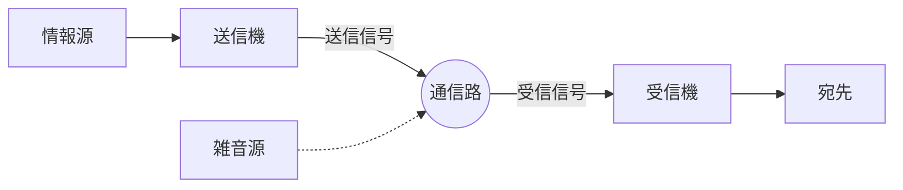

## 1. 情報の意味と、選択の不確実性を分ける

ニュース、友人のメッセージ、DNAの配列、宇宙からの電波は、いずれも情報を運びます。しかし、内容の重要性と、送るために必要なビット数は同じものではありません。

Claude Shannonの1948年の論文は、意味の評価を通信の工学的問題から切り離し、確率に基づいて圧縮と通信の限界を論じました。[同論文の再録版](https://wucj.lab.westlake.edu.cn/Others/shannon1948.pdf)の冒頭では、NyquistとHartleyの先行研究にも言及しています。ここでは、情報量、エントロピー、可逆圧縮、雑音のある通信を順に区別します。

## 2. 通信のモデル

情報源がメッセージを作り、送信機が信号に変え、通信路を通り、受信機がメッセージを復元して宛先へ届ける、というモデルです。



情報源符号化は、データの統計構造を利用して冗長性を減らす処理です。一方、通信路符号化は、雑音に対処するために適切な冗長性を加えます。どちらも符号化ですが、目的を区別します。

## 3. 自己情報量

確率P(x)が正である事象xについて、自己情報量I(x)を次で定義します。対数の底が2なら単位はビットです。

$$
I(x)=-\log_2P(x)=\log_2\frac1{P(x)},\qquad 0<P(x)\le1
$$

確率が小さい事象ほど、この数値は大きくなります。ただし、心理的な驚きや内容の価値を測っているわけではありません。確率0の事象に有限の自己情報量を割り当てる式ではなく、確率モデルの範囲を明示して使います。

公平なコインで表が出る事象なら、次の通りです。

$$
I=-\log_2(1/2)=1\ \mathrm{bit}
$$

## 4. エントロピーは自己情報量の期待値

有限のm種類の記号を発生する確率変数Xについて、p_i=P(X=x_i)とします。各p_iは非負で合計1です。シャノンエントロピーは自己情報量の期待値です。

$$
H(X)=\mathbb E[I(X)]=-\sum_{i=1}^{m}p_i\log_2p_i,\qquad \sum_{i=1}^{m}p_i=1
$$

確率0の項は、極限に対応する約束として0log₂0=0とします。単位は1記号当たりのビットです。固定したm種類の範囲では、次が成り立ちます。

$$
0\le H(X)\le\log_2m
$$

最大は一様分布で、最小は1種類だけが確率1で出る場合です。「最大の不確実性」は、この確率モデルと利用可能な情報の下での評価です。暗号学的な予測困難性や、相手が追加情報を持たないことまで保証しません。

表が出る確率をpとする二値エントロピーは次の式です。端点では同じ0log0の約束を使います。

$$
h_2(p)=-p\log_2p-(1-p)\log_2(1-p),\qquad 0\le p\le1
$$

次のPython例は有限のスカラー確率を受け取り、範囲外を拒否します。グラフの描画にはMatplotlibが必要です。

```python
import math


def binary_entropy(p):
    if not math.isfinite(p) or not 0 <= p <= 1:
        raise ValueError("p must be finite and between 0 and 1")
    if p == 0 or p == 1:
        return 0.0
    return -p * math.log2(p) - (1 - p) * math.log2(1 - p)


if __name__ == "__main__":
    import matplotlib.pyplot as plt

    probabilities = [i / 100 for i in range(101)]
    entropies = [binary_entropy(p) for p in probabilities]
    plt.plot(probabilities, entropies)
    plt.title("Binary entropy")
    plt.xlabel("Probability of heads (p)")
    plt.ylabel("Entropy (bits per symbol)")
    plt.grid(True)
    plt.show()
```

p=0とp=1では0、p=0.5では最大の1ビットです。曲線は左右対称です。

## 5. 情報源符号化：何の平均を、どの条件で比べるか

有限の記号集合に、連結しても一意に復号できる二進符号を割り当てます。符号語の長さをℓ_iとすると、平均符号長Lと下限は次の通りです。接頭語符号は、どの符号語も別の符号語の先頭にならない、一意復号可能な符号の一種です。

$$
L=\sum_i p_i\ell_i,\qquad L\ge H(X)
$$

これは指定した分布に対する期待値の主張です。個々のファイルが必ずこの長さ以上になるという意味ではありません。また、単一記号の周辺分布だけで、相関のある長い列の圧縮限界を決めることもできません。

### ハフマン符号と条件付きの最適性

[David Huffmanの1952年の論文](https://compression.ru/download/articles/huff/huffman_1952_minimum-redundancy-codes.pdf)は、与えられた確率に対して平均長を最小にする接頭語符号の構成を扱います。二進の場合は、最小の重みを持つ2つを併合し、その重みの和を戻す操作を繰り返します。同じ重みがある場合、最適な符号表が一つとは限りません。

正の確率を持つ記号が2種類以上なら、最適な二進接頭語符号の平均長L_Hは次の範囲に入ります。

$$
H(X)\le L_{\mathrm H}<H(X)+1
$$

これは、既知の重みで1記号ずつ符号化するクラスでの最適性です。あらゆる圧縮方式の最適性ではありません。独立同分布で非退化な記号をn個まとめ、適切な接頭語符号を作ると、1記号当たりの平均長を次の範囲まで近づけられます。L_nはn記号のブロック全体の平均ビット数です。

$$
H(X)\le\frac{L_n}{n}<H(X)+\frac1n
$$

相関がある場合は、ブロックの同時エントロピーを使います。定常な有限アルファベット情報源のエントロピー率は次の極限で定義されます。

$$
\overline H=\lim_{n\to\infty}\frac{H(X_1,\ldots,X_n)}{n}
$$

例えば最初に公平な1ビットZを選び、既知の長さnの間ずっと同じ値を繰り返すモデルなら、次の通りです。

$$
P(Z=0)=P(Z=1)=\frac12,\qquad X_i=Z,\qquad H(X_i)=1,\qquad H(X_1,\ldots,X_n)=1
$$

各位置の周辺エントロピーは1ビットですが、復号側がnとこのモデルを知っていれば、ブロック全体はZの1ビットで表せます。これは単一記号のエントロピーと列全体の情報量を混同しないための例です。実際のZIPやgzipにはヘッダー、モデル、履歴、バイト境界などの条件があり、1文字の頻度だけから限界を断定できません。

### 空入力と単一記号にも対応するPython例

次の例は、Pythonの文字単位で頻度を数え、木を共有して符号化・復号します。同じ頻度なら入力の並びに依存しないようにし、呼び出しごとに新しい符号表を作ります。空文字列には空の木と空のペイロードを使います。

```python
import heapq
from collections import Counter
from itertools import count


class Node:
    def __init__(self, char=None, left=None, right=None):
        self.char = char
        self.left = left
        self.right = right


def build_huffman_tree(text):
    if not isinstance(text, str):
        raise TypeError("text must be a string")
    order = count()
    heap = [(freq, next(order), Node(char))
            for char, freq in sorted(Counter(text).items())]
    heapq.heapify(heap)
    if not heap:
        return None
    while len(heap) > 1:
        freq_left, _, left = heapq.heappop(heap)
        freq_right, _, right = heapq.heappop(heap)
        parent = Node(left=left, right=right)
        heapq.heappush(heap, (freq_left + freq_right, next(order), parent))
    return heap[0][2]


def generate_huffman_codes(root):
    codes = {}
    stack = [] if root is None else [(root, "")]
    while stack:
        node, prefix = stack.pop()
        if node.char is not None:
            codes[node.char] = prefix or "0"
        else:
            stack.append((node.right, prefix + "1"))
            stack.append((node.left, prefix + "0"))
    return codes


def encode(text, codes):
    try:
        return "".join(codes[char] for char in text)
    except KeyError as exc:
        raise ValueError("symbol missing from codebook") from exc


def decode(bits, root):
    if any(bit not in "01" for bit in bits):
        raise ValueError("payload must contain only 0 and 1")
    if root is None:
        if bits:
            raise ValueError("nonempty payload with an empty tree")
        return ""
    if root.char is not None:
        if "1" in bits:
            raise ValueError("single-symbol code uses only 0")
        return root.char * len(bits)
    result = []
    node = root
    for bit in bits:
        node = node.left if bit == "0" else node.right
        if node.char is not None:
            result.append(node.char)
            node = root
    if node is not root:
        raise ValueError("truncated codeword")
    return "".join(result)


if __name__ == "__main__":
    text = "shannon_entropy_and_information_theory"
    root = build_huffman_tree(text)
    codes = generate_huffman_codes(root)
    payload = encode(text, codes)
    print("Huffman codes:")
    for char, code in sorted(codes.items()):
        print(f"{char!r}: {code}")
    print("Logical payload bits:", len(payload))
    print("Round trip:", decode(payload, root) == text)
```

この例では単一記号に空でない符号0を割り当て、個数をペイロード長で表します。その場合はH=0、L=1なので、上の厳密な上界L_H<H+1をこの実装の単一記号ケースに適用しません。個数を別途共有して空符号を許す設計とは約束が異なります。

decodeに渡す木はbuild_huffman_treeが作ったものを使います。不正な文字や途中で切れた符号語は拒否しますが、別の有効な符号列に変わる破損をすべて検出・訂正する仕組みではありません。文字数はUnicodeの符号位置単位で、書記素数やUTF-8バイト数とは異なります。

ペイロードは0と1からなるPython文字列であり、ビットを詰めたファイル形式ではありません。表示するLogical payload bitsは論理的な長さで、Pythonオブジェクトのメモリ量ではありません。木の伝達・保存、ファイル終端、ヘッダーの費用も含めていないため、この例だけでファイル全体の圧縮率を示したことにはなりません。

## 6. 通信路符号化：小さい誤り確率と有限長の無誤りは別

ここではまず、各利用で同じ遷移確率を持ち、過去に依存しない有限の離散無記憶通信路を考えます。入力をU、出力をVとし、通信路容量は入力分布を変えたときの相互情報量の最大値です。単位は1利用当たりのビットです。

$$
C=\max_{P_U}I(U;V),\qquad I(U;V)=H(U)-H(U\mid V)
$$

M個のメッセージをn回の通信路利用で送る符号のレートは次のように表せます。

$$
R=\frac{\log_2 M}{n}\quad(\mathrm{bits/use})
$$

このモデルでR<Cなら、ブロック長を大きくして、復号の誤り確率を任意に小さくする符号を選べます。有限の長さなら必ず誤り0になる、特定の符号を使えば自動的に達成する、という約束ではありません。逆に容量を超える一定のレートでは、同じ仮定の下で誤り確率を0へ近づけることはできません。1秒当たりの値と比べるには、通信路の利用回数毎秒もそろえる必要があります。

### 帯域と電力を制約したAWGN通信路

帯域幅B Hz、平均信号電力S、帯域内の総雑音電力Nを使う、独立な加法性白色ガウス雑音のモデルでは、平均電力制約の下で次の容量になります。B>0、S≥0、N>0とします。

$$
C=B\log_2\left(1+\frac SN\right)\quad(\mathrm{bits/s})
$$

このCの単位はビット毎秒です。SとNは同じ電力単位で測り、S/Nは線形比を使います。dBの数値をそのまま代入しません。例えばB=1 MHz、線形比S/N=15なら、次の理論値です。

$$
10^6\log_2(1+15)=4\times10^6\ \mathrm{bits/s}
$$

これは実際のWi-Fiや携帯通信の速度測定ではありません。変調、利用可能な入力、遅延、有限長、フェージングや干渉、プロトコルのオーバーヘッドなど、モデルとの違いを確認して適用します。

## 7. 情報理論を使うときの問い

情報理論は、圧縮で減らす冗長性と、通信の信頼性のために加える冗長性を区別しながら、それぞれの限界を調べる枠組みです。動画配信や衛星通信にも基礎を与えますが、一つの式だけで実際の方式全体の性能が決まるわけではありません。

機械学習の交差エントロピーは予測分布にも依存し、情報源そのもののエントロピーと同一ではありません。熱力学エントロピーとの形式的な関係を扱う場合も、物理モデルと単位を区別します。何を確率変数とし、何を既知とし、どのコストを数えるかを明確にすることが、モデルを役立てる出発点です。
