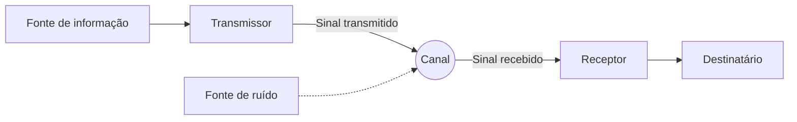

## 1. Distinguir significado e incerteza sobre uma escolha

Notícias, mensagens de amigos, sequências de DNA e sinais de rádio vindos do espaço contêm informação. Mas a importância do conteúdo e a quantidade de bits necessária para transmiti-lo são grandezas diferentes.

No artigo de 1948, Claude Shannon separou a avaliação do significado do problema de engenharia da comunicação e estudou os limites da compressão e da transmissão com ferramentas probabilísticas. A introdução, disponível nesta [reimpressão](https://wucj.lab.westlake.edu.cn/Others/shannon1948.pdf), também reconhece trabalhos anteriores de Nyquist e Hartley. Vamos distinguir autoinformação, entropia, compressão sem perdas e comunicação com ruído.

## 2. Um modelo de comunicação

Uma fonte de informação produz uma mensagem; o transmissor a converte em sinal; o sinal atravessa um canal; e o receptor reconstrói a mensagem para seu destinatário.



A codificação da fonte explora a estrutura estatística para reduzir a redundância. A codificação de canal, por sua vez, acrescenta redundância adequada para combater o ruído. Ambas são formas de codificação, com objetivos diferentes.

## 3. Autoinformação

Para um evento x com probabilidade positiva P(x), definimos a autoinformação I(x) como segue. O logaritmo de base 2 fornece a unidade bit.

$$
I(x)=-\log_2P(x)=\log_2\frac1{P(x)},\qquad 0<P(x)\le1
$$

Eventos menos prováveis recebem valores maiores. Isso não mede a surpresa psicológica nem o valor do conteúdo. A definição não atribui autoinformação finita a um evento de probabilidade zero; o modelo probabilístico e o domínio precisam ser especificados.

Para o resultado cara de uma moeda equilibrada:

$$
I=-\log_2(1/2)=1\ \mathrm{bit}
$$

## 4. Entropia é o valor esperado da autoinformação

Considere uma variável X com valores em um alfabeto finito de m símbolos, com p_i=P(X=x_i). As probabilidades são não negativas e somam um. A entropia de Shannon é o valor esperado da autoinformação.

$$
H(X)=\mathbb E[I(X)]=-\sum_{i=1}^{m}p_i\log_2p_i,\qquad \sum_{i=1}^{m}p_i=1
$$

Para termos de probabilidade zero, usamos a convenção por limite 0log₂0=0. A unidade é bits por símbolo. Para um alfabeto fixo de m símbolos:

$$
0\le H(X)\le\log_2m
$$

O máximo ocorre na distribuição uniforme; o mínimo, quando um símbolo tem probabilidade um. Essa incerteza máxima é uma avaliação sob o modelo probabilístico e as informações disponíveis. Não estabelece imprevisibilidade criptográfica nem garante que outra pessoa não disponha de informações adicionais.

Se a probabilidade de cara for p, a entropia binária será a função abaixo. Nos extremos, vale a mesma convenção para termos de probabilidade zero.

$$
h_2(p)=-p\log_2p-(1-p)\log_2(1-p),\qquad 0\le p\le1
$$

Este exemplo em Python aceita uma probabilidade escalar finita e rejeita valores fora do domínio. Para desenhar o gráfico, é necessário instalar Matplotlib.

```python
import math


def binary_entropy(p):
    if not math.isfinite(p) or not 0 <= p <= 1:
        raise ValueError("p must be finite and between 0 and 1")
    if p == 0 or p == 1:
        return 0.0
    return -p * math.log2(p) - (1 - p) * math.log2(1 - p)


if __name__ == "__main__":
    import matplotlib.pyplot as plt

    probabilities = [i / 100 for i in range(101)]
    entropies = [binary_entropy(p) for p in probabilities]
    plt.plot(probabilities, entropies)
    plt.title("Binary entropy")
    plt.xlabel("Probability of heads (p)")
    plt.ylabel("Entropy (bits per symbol)")
    plt.grid(True)
    plt.show()
```

O valor é zero em p=0 e p=1 e atinge o máximo de um bit em p=0.5. A curva é simétrica. Os rótulos em inglês indicam a entropia binária, a probabilidade de cara e a entropia em bits por símbolo.

## 5. Codificação da fonte: qual média e sob quais hipóteses?

Atribua palavras-código binárias a um alfabeto finito, de modo que a concatenação dessas palavras possa ser decodificada de maneira única. Se a palavra do símbolo i tem comprimento ℓ_i, o comprimento esperado L satisfaz o limite abaixo. Um código de prefixo é um código univocamente decodificável no qual nenhuma palavra-código é o início de outra.

$$
L=\sum_i p_i\ell_i,\qquad L\ge H(X)
$$

Trata-se de uma esperança sob uma distribuição especificada. Isso não significa que cada arquivo individual precise ter pelo menos esse comprimento. Também não se pode determinar o limite de compressão de uma sequência correlacionada apenas a partir de sua distribuição marginal de um símbolo.

### Codificação de Huffman e as condições de sua optimalidade

O [artigo de David Huffman de 1952](https://compression.ru/download/articles/huff/huffman_1952_minimum-redundancy-codes.pdf) constrói códigos de prefixo que minimizam o comprimento esperado para probabilidades dadas. No caso binário, combinam-se repetidamente os dois menores pesos, devolvendo a soma ao conjunto. Empates podem produzir diferentes códigos ótimos.

Com pelo menos dois símbolos de probabilidade positiva, o comprimento esperado L_H do código de prefixo binário ótimo está neste intervalo:

$$
H(X)\le L_{\mathrm H}<H(X)+1
$$

Essa optimalidade se refere à codificação símbolo a símbolo com pesos conhecidos, e não ao conjunto de todos os métodos de compressão. Para uma fonte não degenerada de símbolos independentes e identicamente distribuídos, agrupar n símbolos e escolher um código de prefixo adequado fornece o intervalo por símbolo abaixo. L_n é o número esperado de bits para o bloco inteiro de n símbolos.

$$
H(X)\le\frac{L_n}{n}<H(X)+\frac1n
$$

Quando há dependências, usa-se a entropia conjunta do bloco. Para uma fonte estacionária de alfabeto finito, a taxa de entropia é definida por este limite:

$$
\overline H=\lim_{n\to\infty}\frac{H(X_1,\ldots,X_n)}{n}
$$

Por exemplo, escolha inicialmente um bit equiprovável Z e repita seu valor ao longo de um bloco de comprimento conhecido n. Nesse modelo:

$$
P(Z=0)=P(Z=1)=\frac12,\qquad X_i=Z,\qquad H(X_i)=1,\qquad H(X_1,\ldots,X_n)=1
$$

Cada posição tem entropia marginal de um bit, mas um decodificador que conhece n e esse modelo pode representar o bloco inteiro com o único bit Z. Isso distingue a entropia de um símbolo da informação contida em uma sequência. ZIP e gzip também envolvem cabeçalhos, modelos, histórico e limites de bytes; suas limitações não podem ser inferidas apenas das frequências de caracteres isolados.

### Um exemplo em Python que inclui entradas vazias e de um único símbolo

O exemplo conta caracteres de Python e usa uma árvore compartilhada para codificar e decodificar. Frequências iguais são tratadas independentemente da ordem de entrada, e cada chamada cria um novo dicionário de códigos. Uma string vazia usa árvore e carga útil vazias.

```python
import heapq
from collections import Counter
from itertools import count


class Node:
    def __init__(self, char=None, left=None, right=None):
        self.char = char
        self.left = left
        self.right = right


def build_huffman_tree(text):
    if not isinstance(text, str):
        raise TypeError("text must be a string")
    order = count()
    heap = [(freq, next(order), Node(char))
            for char, freq in sorted(Counter(text).items())]
    heapq.heapify(heap)
    if not heap:
        return None
    while len(heap) > 1:
        freq_left, _, left = heapq.heappop(heap)
        freq_right, _, right = heapq.heappop(heap)
        parent = Node(left=left, right=right)
        heapq.heappush(heap, (freq_left + freq_right, next(order), parent))
    return heap[0][2]


def generate_huffman_codes(root):
    codes = {}
    stack = [] if root is None else [(root, "")]
    while stack:
        node, prefix = stack.pop()
        if node.char is not None:
            codes[node.char] = prefix or "0"
        else:
            stack.append((node.right, prefix + "1"))
            stack.append((node.left, prefix + "0"))
    return codes


def encode(text, codes):
    try:
        return "".join(codes[char] for char in text)
    except KeyError as exc:
        raise ValueError("symbol missing from codebook") from exc


def decode(bits, root):
    if any(bit not in "01" for bit in bits):
        raise ValueError("payload must contain only 0 and 1")
    if root is None:
        if bits:
            raise ValueError("nonempty payload with an empty tree")
        return ""
    if root.char is not None:
        if "1" in bits:
            raise ValueError("single-symbol code uses only 0")
        return root.char * len(bits)
    result = []
    node = root
    for bit in bits:
        node = node.left if bit == "0" else node.right
        if node.char is not None:
            result.append(node.char)
            node = root
    if node is not root:
        raise ValueError("truncated codeword")
    return "".join(result)


if __name__ == "__main__":
    text = "shannon_entropy_and_information_theory"
    root = build_huffman_tree(text)
    codes = generate_huffman_codes(root)
    payload = encode(text, codes)
    print("Huffman codes:")
    for char, code in sorted(codes.items()):
        print(f"{char!r}: {code}")
    print("Logical payload bits:", len(payload))
    print("Round trip:", decode(payload, root) == text)
```

Para um único símbolo, este exemplo atribui o código não vazio 0 e representa o número de repetições pelo comprimento da carga útil. Nesse caso H=0 e L=1, portanto o limite superior estrito L_H<H+1 acima não se aplica ao caso de um único símbolo desta implementação. Permitir um código vazio e compartilhar a contagem separadamente é outra convenção.

Passe a decode uma árvore criada por build_huffman_tree. A função rejeita caracteres inválidos e palavras-código truncadas, mas não detecta nem corrige toda alteração que transforme a carga útil em outra sequência válida de códigos. Os caracteres aqui são pontos de código Unicode, não agrupamentos de grafemas nem bytes UTF-8.

A carga útil é uma string de zeros e uns em Python, não um formato de arquivo com bits compactados. Logical payload bits indica o comprimento lógico, não a memória ocupada pelo objeto Python. Não inclui o custo de armazenar ou transmitir a árvore, o enquadramento e os cabeçalhos; por isso, o exemplo sozinho não determina a taxa de compressão de um arquivo completo.

## 6. Codificação de canal: probabilidade de erro pequena e erro zero em comprimento finito

Considere primeiro um canal discreto sem memória com alfabetos finitos: cada utilização tem as mesmas probabilidades de transição e não depende do passado. Sejam U a entrada e V a saída. A capacidade é o máximo da informação mútua sobre as distribuições de entrada, em bits por utilização do canal.

$$
C=\max_{P_U}I(U;V),\qquad I(U;V)=H(U)-H(U\mid V)
$$

Um código que permite escolher entre M mensagens possíveis usando n utilizações do canal tem taxa:

$$
R=\frac{\log_2 M}{n}\quad(\mathrm{bits/use})
$$

Nesse modelo, se R<C, podem-se escolher códigos com probabilidade de erro de decodificação arbitrariamente pequena à medida que o comprimento do bloco aumenta. Isso não promete exatamente zero erros com comprimento finito nem que um código específico atinja automaticamente esse limite. A uma taxa fixa acima da capacidade, a probabilidade de erro não pode tender a zero sob as mesmas hipóteses. Comparar grandezas por segundo exige também uma quantidade consistente de utilizações do canal por segundo.

### Um canal AWGN com restrições de banda e potência

Para ruído branco gaussiano aditivo independente do sinal de entrada, largura de banda B Hz, potência média do sinal S e potência total de ruído N dentro dessa banda, a capacidade sob restrição de potência média é a seguinte. Supomos B>0, S≥0 e N>0.

$$
C=B\log_2\left(1+\frac SN\right)\quad(\mathrm{bits/s})
$$

C é medido em bits por segundo. Meça S e N nas mesmas unidades de potência e use sua razão linear, não o valor numérico em dB. Por exemplo, B=1 MHz e S/N=15 em escala linear fornecem este valor teórico:

$$
10^6\log_2(1+15)=4\times10^6\ \mathrm{bits/s}
$$

Isso não é uma medição da vazão de Wi-Fi ou de uma rede celular. Modulação, entradas permitidas, atraso, comprimentos finitos, desvanecimento, interferência e sobrecarga de protocolo podem diferir do modelo e precisam ser verificados em sua aplicação.

## 7. Perguntas ao aplicar a teoria da informação

A teoria da informação fornece uma estrutura para estudar limites, distinguindo a redundância removida pela compressão daquela acrescentada para aumentar a confiabilidade da comunicação. Fundamenta a transmissão de vídeos e as comunicações por satélite, mas uma única fórmula não determina o desempenho de todo um sistema real.

A entropia cruzada em aprendizado de máquina também depende da distribuição de previsão e não é idêntica à entropia da fonte. Ao considerar conexões formais com a entropia termodinâmica, é preciso distinguir os modelos físicos e as unidades. O ponto de partida é especificar as variáveis aleatórias, o que se conhece e quais custos são contabilizados.
