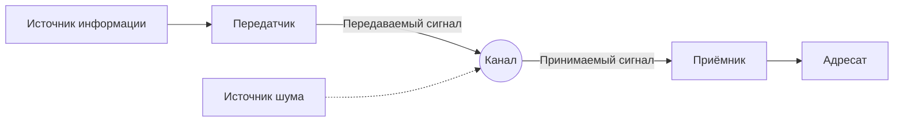

## 1. Разделяем смысл и неопределённость выбора

Новости, сообщения от друзей, последовательности ДНК и радиосигналы из космоса несут информацию. Но значимость содержания и число битов, необходимых для его передачи, — разные величины.

В статье 1948 года Клод Шеннон отделил оценку смысла от инженерной задачи связи и исследовал пределы сжатия и передачи с помощью вероятностей. Введение, доступное в этом [переиздании](https://wucj.lab.westlake.edu.cn/Others/shannon1948.pdf), также отмечает предшествующие работы Найквиста и Хартли. Далее мы разграничим собственную информацию, энтропию, сжатие без потерь и связь при наличии шума.

## 2. Модель связи

Источник информации создаёт сообщение, передатчик преобразует его в сигнал, сигнал проходит через канал, а приёмник восстанавливает сообщение для адресата.



Кодирование источника использует статистическую структуру для уменьшения избыточности. Канальное кодирование, напротив, добавляет подходящую избыточность для противодействия шуму. Оба процесса являются кодированием, но имеют разные цели.

## 3. Собственная информация

Для события x с положительной вероятностью P(x) определим собственную информацию I(x) следующим образом. Логарифм по основанию 2 даёт единицу измерения бит.

$$
I(x)=-\log_2P(x)=\log_2\frac1{P(x)},\qquad 0<P(x)\le1
$$

Менее вероятные события получают большие значения. Это не мера психологического удивления или ценности содержания. Определение не приписывает конечную собственную информацию событию с нулевой вероятностью; важны вероятностная модель и область определения.

Для выпадения орла при броске симметричной монеты:

$$
I=-\log_2(1/2)=1\ \mathrm{bit}
$$

## 4. Энтропия — математическое ожидание собственной информации

Пусть случайная величина X принимает значения в конечном алфавите из m символов, причём p_i=P(X=x_i). Вероятности неотрицательны и в сумме равны единице. Энтропия Шеннона — математическое ожидание собственной информации.

$$
H(X)=\mathbb E[I(X)]=-\sum_{i=1}^{m}p_i\log_2p_i,\qquad \sum_{i=1}^{m}p_i=1
$$

Для слагаемых с нулевой вероятностью используем соответствующее пределу соглашение 0log₂0=0. Единица измерения — бит на символ. Для фиксированного алфавита из m символов:

$$
0\le H(X)\le\log_2m
$$

Максимум достигается при равномерном распределении, минимум — когда один символ имеет вероятность единица. Максимальная неопределённость оценивается в рамках этой вероятностной модели и доступной информации. Она не устанавливает криптографическую непредсказуемость и не гарантирует, что у другого участника нет дополнительных сведений.

Если вероятность орла равна p, бинарная энтропия задаётся следующей функцией. На концах интервала действует то же соглашение о нулевых слагаемых.

$$
h_2(p)=-p\log_2p-(1-p)\log_2(1-p),\qquad 0\le p\le1
$$

Этот пример Python принимает конечную скалярную вероятность и отклоняет значения вне области определения. Для построения графика нужен Matplotlib.

```python
import math


def binary_entropy(p):
    if not math.isfinite(p) or not 0 <= p <= 1:
        raise ValueError("p must be finite and between 0 and 1")
    if p == 0 or p == 1:
        return 0.0
    return -p * math.log2(p) - (1 - p) * math.log2(1 - p)


if __name__ == "__main__":
    import matplotlib.pyplot as plt

    probabilities = [i / 100 for i in range(101)]
    entropies = [binary_entropy(p) for p in probabilities]
    plt.plot(probabilities, entropies)
    plt.title("Binary entropy")
    plt.xlabel("Probability of heads (p)")
    plt.ylabel("Entropy (bits per symbol)")
    plt.grid(True)
    plt.show()
```

При p=0 и p=1 значение равно нулю, а при p=0.5 достигает максимума в один бит. Кривая симметрична. Английские подписи обозначают бинарную энтропию, вероятность выпадения орла и энтропию в битах на символ.

## 5. Кодирование источника: какое среднее и при каких условиях?

Назначим символам конечного алфавита двоичные кодовые слова так, чтобы их последовательное соединение однозначно декодировалось. Если длина кодового слова символа i равна ℓ_i, средняя длина L удовлетворяет следующей границе. Префиксный код — однозначно декодируемый код, в котором ни одно кодовое слово не является началом другого.

$$
L=\sum_i p_i\ell_i,\qquad L\ge H(X)
$$

Это утверждение о математическом ожидании при заданном распределении. Оно не означает, что каждый отдельный файл должен быть не короче этой величины. Нельзя также определить предел сжатия коррелированной последовательности только по маргинальному распределению одного символа.

### Кодирование Хаффмана и условия оптимальности

В [статье Дэвида Хаффмана 1952 года](https://compression.ru/download/articles/huff/huffman_1952_minimum-redundancy-codes.pdf) строятся префиксные коды с минимальной средней длиной для заданных вероятностей. В двоичном случае последовательно объединяют два наименьших веса и возвращают их сумму в набор. Равные веса могут приводить к разным оптимальным кодам.

Если есть как минимум два символа с положительной вероятностью, средняя длина L_H оптимального двоичного префиксного кода находится в этом диапазоне:

$$
H(X)\le L_{\mathrm H}<H(X)+1
$$

Это оптимальность в классе посимвольного кодирования с известными весами, а не среди всех методов сжатия. Для невырожденного источника с независимыми одинаково распределёнными символами объединение n символов и выбор подходящего префиксного кода дают следующий диапазон в расчёте на символ. L_n — среднее число битов для всего блока из n символов.

$$
H(X)\le\frac{L_n}{n}<H(X)+\frac1n
$$

При наличии зависимостей используют совместную энтропию блока. Для стационарного источника с конечным алфавитом скорость энтропии определяется этим пределом:

$$
\overline H=\lim_{n\to\infty}\frac{H(X_1,\ldots,X_n)}{n}
$$

Например, сначала выберем равновероятный бит Z, а затем повторим его значение по всему блоку известной длины n. В этой модели:

$$
P(Z=0)=P(Z=1)=\frac12,\qquad X_i=Z,\qquad H(X_i)=1,\qquad H(X_1,\ldots,X_n)=1
$$

Каждая позиция имеет маргинальную энтропию один бит, но декодер, знающий n и эту модель, может представить весь блок одним битом Z. Это различает энтропию одного символа и информацию в последовательности. ZIP и gzip также учитывают заголовки, модели, историю и границы байтов; их пределы нельзя вывести только из частот отдельных символов.

### Пример Python для пустой строки и одного символа

Пример подсчитывает символы Python и использует общее дерево для кодирования и декодирования. Равные частоты обрабатываются независимо от порядка входных символов, а каждый вызов создаёт новый словарь кодов. Пустая строка использует пустое дерево и пустую полезную нагрузку.

```python
import heapq
from collections import Counter
from itertools import count


class Node:
    def __init__(self, char=None, left=None, right=None):
        self.char = char
        self.left = left
        self.right = right


def build_huffman_tree(text):
    if not isinstance(text, str):
        raise TypeError("text must be a string")
    order = count()
    heap = [(freq, next(order), Node(char))
            for char, freq in sorted(Counter(text).items())]
    heapq.heapify(heap)
    if not heap:
        return None
    while len(heap) > 1:
        freq_left, _, left = heapq.heappop(heap)
        freq_right, _, right = heapq.heappop(heap)
        parent = Node(left=left, right=right)
        heapq.heappush(heap, (freq_left + freq_right, next(order), parent))
    return heap[0][2]


def generate_huffman_codes(root):
    codes = {}
    stack = [] if root is None else [(root, "")]
    while stack:
        node, prefix = stack.pop()
        if node.char is not None:
            codes[node.char] = prefix or "0"
        else:
            stack.append((node.right, prefix + "1"))
            stack.append((node.left, prefix + "0"))
    return codes


def encode(text, codes):
    try:
        return "".join(codes[char] for char in text)
    except KeyError as exc:
        raise ValueError("symbol missing from codebook") from exc


def decode(bits, root):
    if any(bit not in "01" for bit in bits):
        raise ValueError("payload must contain only 0 and 1")
    if root is None:
        if bits:
            raise ValueError("nonempty payload with an empty tree")
        return ""
    if root.char is not None:
        if "1" in bits:
            raise ValueError("single-symbol code uses only 0")
        return root.char * len(bits)
    result = []
    node = root
    for bit in bits:
        node = node.left if bit == "0" else node.right
        if node.char is not None:
            result.append(node.char)
            node = root
    if node is not root:
        raise ValueError("truncated codeword")
    return "".join(result)


if __name__ == "__main__":
    text = "shannon_entropy_and_information_theory"
    root = build_huffman_tree(text)
    codes = generate_huffman_codes(root)
    payload = encode(text, codes)
    print("Huffman codes:")
    for char, code in sorted(codes.items()):
        print(f"{char!r}: {code}")
    print("Logical payload bits:", len(payload))
    print("Round trip:", decode(payload, root) == text)
```

Для единственного символа пример назначает непустой код 0 и передаёт число повторений через длину полезной нагрузки. Тогда H=0 и L=1, поэтому строгая верхняя граница L_H<H+1 выше не применима к этому случаю данной реализации. Разрешить пустой код и отдельно сообщить число повторений — другое соглашение.

В decode следует передавать дерево, созданное build_huffman_tree. Функция отклоняет недопустимые символы и оборванные кодовые слова, но не обнаруживает и не исправляет всякое повреждение, превращающее полезную нагрузку в другую допустимую последовательность кодов. Символы здесь — кодовые точки Unicode, а не графемные кластеры и не байты UTF-8.

Полезная нагрузка — строка Python из нулей и единиц, а не файловый формат с упакованными битами. Logical payload bits измеряет логическую длину, а не память, занимаемую объектом Python. Затраты на хранение или передачу дерева, обозначение границ и заголовки не учитываются. Поэтому один этот пример не доказывает коэффициент сжатия целого файла.

## 6. Канальное кодирование: малая вероятность ошибки и отсутствие ошибок при конечной длине

Сначала рассмотрим дискретный канал без памяти с конечными алфавитами: каждое использование имеет одинаковые переходные вероятности и не зависит от прошлого. Пусть U — вход, V — выход. Пропускная способность равна максимальной взаимной информации по распределениям входа и измеряется в битах на использование канала.

$$
C=\max_{P_U}I(U;V),\qquad I(U;V)=H(U)-H(U\mid V)
$$

Код, передающий одно из M возможных сообщений за n использований канала, имеет скорость:

$$
R=\frac{\log_2 M}{n}\quad(\mathrm{bits/use})
$$

В этой модели при R<C можно выбирать коды со сколь угодно малой вероятностью ошибки декодирования по мере увеличения длины блока. Это не обещает ровно нулевую вероятность ошибки при конечной длине или автоматическое достижение границы конкретным кодом. При фиксированной скорости выше пропускной способности вероятность ошибки не может стремиться к нулю при тех же предположениях. Для сравнения величин в расчёте на секунду необходимо согласованно учитывать число использований канала в секунду.

### AWGN-канал с ограничениями по полосе и мощности

Для аддитивного белого гауссова шума, независимого от входного сигнала, ширины полосы B Гц, средней мощности сигнала S и полной мощности шума N внутри этой полосы пропускная способность при ограничении средней мощности имеет следующий вид. Предполагается B>0, S≥0 и N>0.

$$
C=B\log_2\left(1+\frac SN\right)\quad(\mathrm{bits/s})
$$

C измеряется в битах в секунду. S и N нужно измерять в одинаковых единицах мощности, а подставлять следует их линейное отношение, не числовое значение в дБ. Например, B=1 МГц и линейное S/N=15 дают такое теоретическое значение:

$$
10^6\log_2(1+15)=4\times10^6\ \mathrm{bits/s}
$$

Это не измерение скорости Wi-Fi или сотовой сети. Модуляция, допустимые входы, задержка, конечные длины, замирания, помехи и протокольные накладные расходы могут отличаться от модели; при её применении это необходимо учитывать.

## 7. Вопросы при применении теории информации

Теория информации даёт основу для исследования пределов, различая избыточность, удаляемую сжатием, и избыточность, добавляемую для надёжности связи. Она лежит в основе потокового видео и спутниковой связи, но одна формула не определяет характеристики всей реальной системы.

Перекрёстная энтропия в машинном обучении зависит также от предсказанного распределения и не тождественна энтропии источника. При рассмотрении формальных связей с термодинамической энтропией нужно различать физические модели и единицы. Отправная точка — указать случайные величины, известные сведения и учитываемые затраты.
