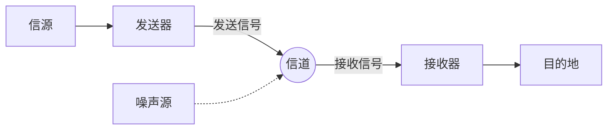

## 1. 区分信息的含义与选择的不确定性

新闻、朋友的消息、DNA序列和来自宇宙的无线电信号都承载信息。但内容的重要性与发送它所需的比特数，并不是同一个量。

Claude Shannon在1948年的论文中，把含义的评价与通信的工程问题分开，用概率研究压缩和通信的极限。[这份重印版](https://wucj.lab.westlake.edu.cn/Others/shannon1948.pdf)的开头也提到了Nyquist和Hartley的先行工作。下面区分自信息量、熵、无损压缩和有噪声的通信。

## 2. 通信模型

信源生成消息，发送器将其变成信号，信号经过信道，接收器重建消息并交给目的地。



信源编码利用数据的统计结构减少冗余。信道编码则加入适当的冗余来应对噪声。二者都叫编码，但目的不同。

## 3. 自信息量

对于概率P(x)为正的事件x，自信息量I(x)定义如下。以2为对数底时，单位是比特。

$$
I(x)=-\log_2P(x)=\log_2\frac1{P(x)},\qquad 0<P(x)\le1
$$

事件越不常见，这个数值越大。但它不测量心理上的惊讶或内容的价值。该式并不为概率0的事件赋予有限的自信息量，使用时需要明确概率模型和定义域。

公平硬币出现正面这一事件对应：

$$
I=-\log_2(1/2)=1\ \mathrm{bit}
$$

## 4. 熵是自信息量的期望

设随机变量X取有限字母表中的m种符号，p_i=P(X=x_i)。各概率非负且总和为1。香农熵是自信息量的期望。

$$
H(X)=\mathbb E[I(X)]=-\sum_{i=1}^{m}p_i\log_2p_i,\qquad \sum_{i=1}^{m}p_i=1
$$

对概率0的项，采用与极限相符的约定0log₂0=0。单位是每符号比特数。在固定的m种符号范围内：

$$
0\le H(X)\le\log_2m
$$

均匀分布达到最大值；只有一种符号的概率为1时达到最小值。“不确定性最大”依赖这个概率模型及可用信息，并不保证密码学上的不可预测性，也不保证另一方没有额外信息。

若出现正面的概率为p，二元熵函数如下。端点同样采用零概率项的约定。

$$
h_2(p)=-p\log_2p-(1-p)\log_2(1-p),\qquad 0\le p\le1
$$

下面的Python例子接受有限的标量概率，拒绝定义域以外的值。绘图需要Matplotlib。

```python
import math


def binary_entropy(p):
    if not math.isfinite(p) or not 0 <= p <= 1:
        raise ValueError("p must be finite and between 0 and 1")
    if p == 0 or p == 1:
        return 0.0
    return -p * math.log2(p) - (1 - p) * math.log2(1 - p)


if __name__ == "__main__":
    import matplotlib.pyplot as plt

    probabilities = [i / 100 for i in range(101)]
    entropies = [binary_entropy(p) for p in probabilities]
    plt.plot(probabilities, entropies)
    plt.title("Binary entropy")
    plt.xlabel("Probability of heads (p)")
    plt.ylabel("Entropy (bits per symbol)")
    plt.grid(True)
    plt.show()
```

p=0或p=1时为0，p=0.5时达到最大值1比特，曲线左右对称。

## 5. 信源编码：比较哪一种平均值，有什么条件

为有限符号集合分配二进制码字，要求码字连接后仍能唯一译码。若符号i的码长为ℓ_i，平均码长L满足下式。前缀码是一类可唯一译码的编码，其中任何码字都不是另一码字的开头。

$$
L=\sum_i p_i\ell_i,\qquad L\ge H(X)
$$

这是针对指定分布的期望值结论，不是说每个文件都必须至少这么长。仅凭单个符号的边缘分布，也不能确定相关序列的压缩极限。

### 哈夫曼编码的条件性最优

[David Huffman在1952年的论文](https://compression.ru/download/articles/huff/huffman_1952_minimum-redundancy-codes.pdf)研究了在给定概率下使平均码长最小的前缀码。二进制情形下，反复合并权重最小的两项，并把权重之和放回集合。存在相同权重时，最优码表不一定唯一。

当至少两种符号具有正概率时，最优二进制前缀码的平均长度L_H满足：

$$
H(X)\le L_{\mathrm H}<H(X)+1
$$

这里的最优性限于已知权重、逐符号编码的类别，不是所有压缩方法中的最优。对非退化的独立同分布信源，将n个符号组成一块并选择适当的前缀码，可以达到下列每符号范围。L_n是整个n符号块的平均比特数。

$$
H(X)\le\frac{L_n}{n}<H(X)+\frac1n
$$

存在依赖时，需要使用块的联合熵。平稳的有限字母表信源的熵率由下列极限定义：

$$
\overline H=\lim_{n\to\infty}\frac{H(X_1,\ldots,X_n)}{n}
$$

例如，开始时选择一个公平比特Z，然后在已知长度n内始终重复这个值。在此模型中：

$$
P(Z=0)=P(Z=1)=\frac12,\qquad X_i=Z,\qquad H(X_i)=1,\qquad H(X_1,\ldots,X_n)=1
$$

每个位置的边缘熵是1比特，但译码方知道n和这个模型时，可以用Z的1比特表示整块。这说明单个符号的熵与序列整体的信息量不同。实际ZIP和gzip还有头部、模型、历史和字节边界等条件，不能仅凭单字符频率断言其极限。

### 处理空输入和单一符号的Python例子

下面的例子按Python字符统计频率，使用共享的树进行编码和译码。相同频率的处理不依赖输入顺序，每次调用都会建立新的码表。空字符串使用空树和空载荷。

```python
import heapq
from collections import Counter
from itertools import count


class Node:
    def __init__(self, char=None, left=None, right=None):
        self.char = char
        self.left = left
        self.right = right


def build_huffman_tree(text):
    if not isinstance(text, str):
        raise TypeError("text must be a string")
    order = count()
    heap = [(freq, next(order), Node(char))
            for char, freq in sorted(Counter(text).items())]
    heapq.heapify(heap)
    if not heap:
        return None
    while len(heap) > 1:
        freq_left, _, left = heapq.heappop(heap)
        freq_right, _, right = heapq.heappop(heap)
        parent = Node(left=left, right=right)
        heapq.heappush(heap, (freq_left + freq_right, next(order), parent))
    return heap[0][2]


def generate_huffman_codes(root):
    codes = {}
    stack = [] if root is None else [(root, "")]
    while stack:
        node, prefix = stack.pop()
        if node.char is not None:
            codes[node.char] = prefix or "0"
        else:
            stack.append((node.right, prefix + "1"))
            stack.append((node.left, prefix + "0"))
    return codes


def encode(text, codes):
    try:
        return "".join(codes[char] for char in text)
    except KeyError as exc:
        raise ValueError("symbol missing from codebook") from exc


def decode(bits, root):
    if any(bit not in "01" for bit in bits):
        raise ValueError("payload must contain only 0 and 1")
    if root is None:
        if bits:
            raise ValueError("nonempty payload with an empty tree")
        return ""
    if root.char is not None:
        if "1" in bits:
            raise ValueError("single-symbol code uses only 0")
        return root.char * len(bits)
    result = []
    node = root
    for bit in bits:
        node = node.left if bit == "0" else node.right
        if node.char is not None:
            result.append(node.char)
            node = root
    if node is not root:
        raise ValueError("truncated codeword")
    return "".join(result)


if __name__ == "__main__":
    text = "shannon_entropy_and_information_theory"
    root = build_huffman_tree(text)
    codes = generate_huffman_codes(root)
    payload = encode(text, codes)
    print("Huffman codes:")
    for char, code in sorted(codes.items()):
        print(f"{char!r}: {code}")
    print("Logical payload bits:", len(payload))
    print("Round trip:", decode(payload, root) == text)
```

本例给单一符号分配非空码0，用载荷长度表示重复次数。此时H=0、L=1，所以不把上面的严格上界L_H<H+1应用于这个实现的单一符号情形。允许空码、另行共享次数的设计采用了不同约定。

传给decode的树应由build_huffman_tree生成。它会拒绝非法字符和被截断的码字，但不能检测或纠正所有把载荷变成另一合法码序列的损坏。这里的字符数按Unicode码点计算，不是字素簇数或UTF-8字节数。

载荷是由0和1组成的Python字符串，不是按位打包的文件格式。Logical payload bits表示逻辑长度，不是Python对象的内存大小。它没有包含保存或传输树、消息定界和头部的成本，因此不能仅用这个例子给出完整文件的压缩率。

## 6. 信道编码：小错误概率不等于有限长度零错误

先考虑有限离散无记忆信道：每次使用具有相同的转移概率，不依赖过去。用U表示输入、V表示输出，信道容量是对输入分布取最大值的互信息，单位为每次信道使用的比特数。

$$
C=\max_{P_U}I(U;V),\qquad I(U;V)=H(U)-H(U\mid V)
$$

用n次信道使用发送M种消息的编码，其码率为：

$$
R=\frac{\log_2 M}{n}\quad(\mathrm{bits/use})
$$

在这个模型中，R<C时，随着码块长度增大，可以选择使译码错误概率任意小的编码。这不保证有限长度下错误必定为0，也不保证某个具体编码会自动达到极限。反之，在相同假设下，以固定的超容量码率传输，错误概率不能趋于0。比较每秒的量时，还需要统一每秒的信道使用次数。

### 带宽和功率受限的AWGN信道

采用噪声与输入信号独立的加性高斯白噪声模型，设带宽为B Hz，平均信号功率为S，带宽内的总噪声功率为N。在平均功率约束下，容量如下，假设B>0、S≥0、N>0。

$$
C=B\log_2\left(1+\frac SN\right)\quad(\mathrm{bits/s})
$$

这里C的单位是比特每秒。S和N采用相同的功率单位，S/N使用线性比值，不能直接代入dB数值。例如B=1 MHz、线性S/N=15时，理论值为：

$$
10^6\log_2(1+15)=4\times10^6\ \mathrm{bits/s}
$$

这不是Wi-Fi或蜂窝通信吞吐量的实测。应用时需要检查调制、允许的输入、时延、有限码长、衰落、干扰和协议开销等与模型的差异。

## 7. 使用信息论时要问的问题

信息论提供了研究极限的框架，区分压缩要减少的冗余与通信为提高可靠性而加入的冗余。它也为视频流传输和卫星通信提供基础，但单个公式不能决定实际系统整体的性能。

机器学习中的交叉熵还依赖预测分布，并不等同于信源自身的熵。讨论它与热力学熵在形式上的联系时，也要区分物理模型和单位。明确随机变量是什么、哪些信息已知、计算哪些成本，是使用模型的起点。
