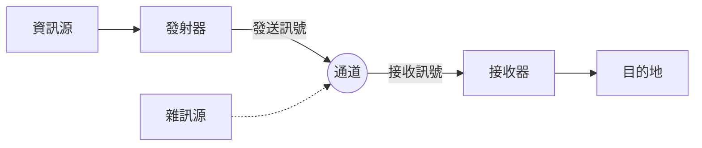

## 1. 區分資訊的意義與選擇的不確定性

新聞、朋友的訊息、DNA序列與來自宇宙的電波都承載資訊。但內容的重要性與傳送它所需的位元數，並不是同一個量。

Claude Shannon在1948年的論文中，把意義的評價與通訊的工程問題分開，以機率研究壓縮與通訊的極限。[這份重印版](https://wucj.lab.westlake.edu.cn/Others/shannon1948.pdf)的開頭也提到Nyquist與Hartley的先行工作。以下區分自我資訊量、熵、無損壓縮與有雜訊的通訊。

## 2. 通訊模型

資訊源產生訊息，發射器將它轉成訊號，訊號經過通道，接收器重建訊息並交給目的地。



資訊源編碼利用資料的統計結構減少冗餘。通道編碼則加入適當冗餘來對抗雜訊。兩者都叫編碼，但目的不同。

## 3. 自我資訊量

對機率P(x)為正的事件x，自我資訊量I(x)定義如下。對數以2為底時，單位是位元。

$$
I(x)=-\log_2P(x)=\log_2\frac1{P(x)},\qquad 0<P(x)\le1
$$

事件越罕見，這個數值越大。但它並不測量心理上的驚訝或內容的價值。這個式子不為機率0的事件指派有限的自我資訊量，使用時要明確說明機率模型與定義域。

公平硬幣出現正面這個事件對應：

$$
I=-\log_2(1/2)=1\ \mathrm{bit}
$$

## 4. 熵是自我資訊量的期望值

設隨機變數X取有限字母表中的m種符號，p_i=P(X=x_i)。各機率非負，總和為1。夏農熵是自我資訊量的期望值。

$$
H(X)=\mathbb E[I(X)]=-\sum_{i=1}^{m}p_i\log_2p_i,\qquad \sum_{i=1}^{m}p_i=1
$$

對機率0的項，採用與極限相符的約定0log₂0=0。單位是每符號的位元數。在固定的m種符號範圍內：

$$
0\le H(X)\le\log_2m
$$

均勻分布達到最大值；只有一種符號的機率為1時達到最小值。「不確定性最大」取決於這個機率模型與可用資訊，不保證密碼學上的不可預測性，也不保證另一方沒有額外資訊。

若出現正面的機率是p，二元熵函數如下。端點也採用零機率項的約定。

$$
h_2(p)=-p\log_2p-(1-p)\log_2(1-p),\qquad 0\le p\le1
$$

以下Python範例接受有限的純量機率，拒絕定義域以外的值。繪圖需要Matplotlib。

```python
import math


def binary_entropy(p):
    if not math.isfinite(p) or not 0 <= p <= 1:
        raise ValueError("p must be finite and between 0 and 1")
    if p == 0 or p == 1:
        return 0.0
    return -p * math.log2(p) - (1 - p) * math.log2(1 - p)


if __name__ == "__main__":
    import matplotlib.pyplot as plt

    probabilities = [i / 100 for i in range(101)]
    entropies = [binary_entropy(p) for p in probabilities]
    plt.plot(probabilities, entropies)
    plt.title("Binary entropy")
    plt.xlabel("Probability of heads (p)")
    plt.ylabel("Entropy (bits per symbol)")
    plt.grid(True)
    plt.show()
```

p=0或p=1時為0，p=0.5時達到最大值1位元，曲線左右對稱。圖中的Probability of heads是正面機率，Entropy (bits per symbol)是每符號的熵。

## 5. 資訊源編碼：比較哪種平均值，有哪些條件

對有限符號集合指派二進位碼字，要求串接後仍能唯一解碼。若符號i的碼長為ℓ_i，平均碼長L滿足下式。前綴碼是可唯一解碼的一類編碼，其中任何碼字都不是另一個碼字的開頭。

$$
L=\sum_i p_i\ell_i,\qquad L\ge H(X)
$$

這是對指定分布的期望值結論，不表示每個檔案都必須至少這麼長。只靠單一符號的邊際分布，也無法決定有相關性的序列能壓縮到多小。

### 哈夫曼編碼的條件性最優

[David Huffman於1952年的論文](https://compression.ru/download/articles/huff/huffman_1952_minimum-redundancy-codes.pdf)研究在給定機率下，使平均碼長最小的前綴碼。二進位情況下，反覆合併權重最小的兩項，再將權重之和放回集合。存在相同權重時，最佳碼表不一定唯一。

若至少兩種符號具有正機率，最佳二進位前綴碼的平均長度L_H滿足：

$$
H(X)\le L_{\mathrm H}<H(X)+1
$$

這裡的最優性限於已知權重、逐符號編碼的類別，不是所有壓縮方法中的最優。對非退化的獨立同分布資訊源，將n個符號組成區塊並選擇適當的前綴碼，可達到以下每符號範圍。L_n是整個n符號區塊的平均位元數。

$$
H(X)\le\frac{L_n}{n}<H(X)+\frac1n
$$

存在相依性時，需要使用區塊的聯合熵。平穩（stationary）的有限字母表資訊源，其熵率由下列極限定義：

$$
\overline H=\lim_{n\to\infty}\frac{H(X_1,\ldots,X_n)}{n}
$$

例如，起初選一個公平位元Z，接著在已知長度n內一直重複這個值。在這個模型中：

$$
P(Z=0)=P(Z=1)=\frac12,\qquad X_i=Z,\qquad H(X_i)=1,\qquad H(X_1,\ldots,X_n)=1
$$

每個位置的邊際熵是1位元，但解碼端知道n與這個模型時，整個區塊只需用Z的1位元表示。這區分了單一符號的熵與序列整體的資訊量。實際ZIP與gzip還涉及標頭、模型、歷史及位元組邊界，不能只從單一字元頻率斷言其極限。

### 處理空輸入與單一符號的Python範例

以下範例按Python字元統計頻率，透過共享的樹編碼與解碼。相同頻率的處理不依賴輸入順序，每次呼叫都建立新的碼表。空字串使用空樹與空酬載。

```python
import heapq
from collections import Counter
from itertools import count


class Node:
    def __init__(self, char=None, left=None, right=None):
        self.char = char
        self.left = left
        self.right = right


def build_huffman_tree(text):
    if not isinstance(text, str):
        raise TypeError("text must be a string")
    order = count()
    heap = [(freq, next(order), Node(char))
            for char, freq in sorted(Counter(text).items())]
    heapq.heapify(heap)
    if not heap:
        return None
    while len(heap) > 1:
        freq_left, _, left = heapq.heappop(heap)
        freq_right, _, right = heapq.heappop(heap)
        parent = Node(left=left, right=right)
        heapq.heappush(heap, (freq_left + freq_right, next(order), parent))
    return heap[0][2]


def generate_huffman_codes(root):
    codes = {}
    stack = [] if root is None else [(root, "")]
    while stack:
        node, prefix = stack.pop()
        if node.char is not None:
            codes[node.char] = prefix or "0"
        else:
            stack.append((node.right, prefix + "1"))
            stack.append((node.left, prefix + "0"))
    return codes


def encode(text, codes):
    try:
        return "".join(codes[char] for char in text)
    except KeyError as exc:
        raise ValueError("symbol missing from codebook") from exc


def decode(bits, root):
    if any(bit not in "01" for bit in bits):
        raise ValueError("payload must contain only 0 and 1")
    if root is None:
        if bits:
            raise ValueError("nonempty payload with an empty tree")
        return ""
    if root.char is not None:
        if "1" in bits:
            raise ValueError("single-symbol code uses only 0")
        return root.char * len(bits)
    result = []
    node = root
    for bit in bits:
        node = node.left if bit == "0" else node.right
        if node.char is not None:
            result.append(node.char)
            node = root
    if node is not root:
        raise ValueError("truncated codeword")
    return "".join(result)


if __name__ == "__main__":
    text = "shannon_entropy_and_information_theory"
    root = build_huffman_tree(text)
    codes = generate_huffman_codes(root)
    payload = encode(text, codes)
    print("Huffman codes:")
    for char, code in sorted(codes.items()):
        print(f"{char!r}: {code}")
    print("Logical payload bits:", len(payload))
    print("Round trip:", decode(payload, root) == text)
```

把範例中的text換成「夏農熵與資訊理論」，同樣能編碼並還原這段文字。

本例為單一符號指派非空碼0，以酬載長度表示重複次數。此時H=0、L=1，因此不把上面的嚴格上界L_H<H+1套用到這個實作的單一符號情況。允許空碼並另外共享次數的設計，採用了不同約定。

傳給decode的樹應由build_huffman_tree建立。它會拒絕不合法的字元與截斷的碼字，但不能偵測或更正所有把酬載變成另一合法碼序列的損壞。這裡的字元數按Unicode碼位（code point）計算，不是字素叢集（grapheme cluster）數或UTF-8位元組數。

酬載是由0與1組成的Python字串，不是將位元打包的檔案格式。Logical payload bits表示邏輯長度，不是Python物件的記憶體大小。它不包含儲存或傳送樹、訊息定界與標頭的成本，因此不能僅用這個範例說明完整檔案的壓縮率。

## 6. 通道編碼：低錯誤機率與有限長度零錯誤不同

先考慮有限離散無記憶通道：每次使用具有相同的轉移機率，不依賴過去。用U表示輸入、V表示輸出，通道容量是對輸入分布取最大值的互資訊量，單位為每次通道使用的位元數。

$$
C=\max_{P_U}I(U;V),\qquad I(U;V)=H(U)-H(U\mid V)
$$

用n次通道使用傳送M種訊息的編碼，碼率如下：

$$
R=\frac{\log_2 M}{n}\quad(\mathrm{bits/use})
$$

在這個模型中，R<C時，隨著區塊長度增大，可選擇讓解碼錯誤機率任意小的編碼。這不保證有限長度時錯誤必定為0，也不保證某個特定編碼自動達到極限。反之，在相同假設下，以固定的超容量碼率傳送，錯誤機率無法趨近0。比較每秒的量時，也必須統一每秒的通道使用次數。

### 頻寬與功率受限的AWGN通道

採用雜訊與輸入訊號獨立的加性白色高斯雜訊模型，設頻寬為B Hz、平均訊號功率為S、頻帶內總雜訊功率為N。在平均功率約束下，容量如下，假設B>0、S≥0、N>0。

$$
C=B\log_2\left(1+\frac SN\right)\quad(\mathrm{bits/s})
$$

這裡C的單位是位元每秒。S與N採相同功率單位，S/N使用線性比值，不可直接代入dB數值。例如B=1 MHz、線性S/N=15時，理論值為：

$$
10^6\log_2(1+15)=4\times10^6\ \mathrm{bits/s}
$$

這不是Wi-Fi或行動通訊吞吐量的實測。應用時要檢查調變、允許的輸入、延遲、有限碼長、衰落、干擾與協定額外負擔等和模型的差異。

## 7. 使用資訊理論時要問的問題

資訊理論提供研究極限的框架，區分壓縮要減少的冗餘與通訊為了可靠性而加入的冗餘。它也為影片串流與衛星通訊提供基礎，但單一公式無法決定實際系統整體的效能。

機器學習中的交叉熵也依賴預測分布，並不等同於資訊源本身的熵。討論與熱力學熵在形式上的關係時，也要區分物理模型與單位。明確說明隨機變數、哪些資訊已知，以及計入哪些成本，是使用模型的起點。
