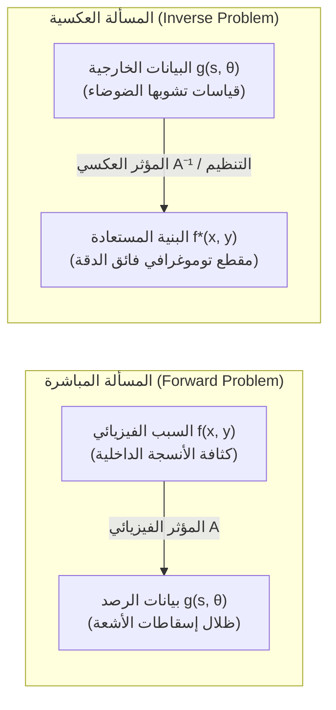

## مقدمة: سبر أغوار المجهول عبر الظلال

في التجربة الإنسانية اليومية، تسير سلسلة الأسباب والنتائج في مسار بديهي ومباشر: إذا علمنا الشكل الهندسي لجسم وموقع مصدر الضوء، فإن حساب شكل الظل الساقط على الجدار عملية سهلة تحكمها مبادئ البصريات الهندسية. وبالمثل، إذا عرفنا التوزيع الكثافي والمرن للطبقات الجيولوجية لباطن الأرض، يمكن محاكاة انتشار الموجات الزلزالية الناتجة عن بؤرة زلزال بدقة عبر معادلة الموجة. تُعرف هذه العملية التي تنتقل من <strong>السبب (الخصائص الفيزيائية الداخلية للمنظومة)</strong> إلى <strong>النتيجة (بيانات الرصد الخارجية)</strong> باسم <strong>المسألة المباشرة (Forward Problem)</strong>. تتميز المسائل المباشرة بكونها مستقرة وقابلة للتنبؤ ولها حل وحيد.

بيد أننا في الطب الحديث والاستكشاف الجيوفيزيائي وعلم الفلك نواجه التحدي المعاكس تماماً:
- <strong>التصوير المقطعي المحوسب (CT Scan)</strong>: دون اللجوء إلى أي تدخل جراحي، كيف يمكن إعادة بناء التوزيع الكثافي ثلاثي الأبعاد للأنسجة الرخوة والأوعية الدموية والأورام الدقيقة اعتماداً فقط على إسقاطات حزم الأشعة السينية المخترقة للجسم من زوايا متعددة؟
- <strong>الاستكشاف الزلزالي</strong>: كيف نستنتج البنية الجيولوجية ومصائد النفط على عمق آلاف الأمتار استناداً إلى ارتدادات الموجات المسجلة على سطح الأرض؟
- <strong>التداخل الفلكي الراديوي</strong>: كيف استطاع تلسكوب أفق الحدث (EHT) تخليق أول صورة لقرص الثقب الأسود الفائق اعتماداً على قياسات مكانية متفرقة ومحدودة للغاية؟

تُعرف المهمة الرياضية المتمثلة في الاستدلال على <strong>السبب الفيزيائي الداخلي</strong> من خلال <strong>البيانات المقاسة خارجياً</strong> باسم <strong>المسألة العكسية (Inverse Problem)</strong>.

---

## 1. ما هي المسألة العكسية؟：شروط هادامارد وكارثة الاعتلال

لماذا يُعد حل المسائل العكسية أصعب بمراحل لا تُقارن من حل المسائل المباشرة؟

### 1.1 الصياغة الرياضية عبر معادلات المؤثرات
في التحليل الدالي، يمكن صياغة المسألة المباشرة كمعادلة مؤثر بين فضاءات هيلبرت:
$$\mathcal{A} f = g$$
حيث $f \in \mathcal{X}$ هو التوزيع غير المعلوم لمعامل التوهين الخطي، و $g \in \mathcal{Y}$ هي بيانات الإسقاط، و $\mathcal{A}$ هو المؤثر التكاملي الخطي.

### 1.2 معايير هادامارد للسلامة الرياضية (1902)
عرّف عالم الرياضيات الفرنسي جاك هادامارد أن المسألة الفيزيائية الرياضية تُعد <strong>حسنة الطرح (Well-Posed)</strong> إذا استوفت ثلاثة شروط:
1. <strong>الوجود (Existence)</strong>: لكل مدخل قياسي $g$، يوجد حل واحد على الأقل $f$.
2. <strong>الوحدانية (Uniqueness)</strong>: الحل فريد لا شريك له ($\ker(\mathcal{A}) = \{0\}$).
3. <strong>الاستقرار (Stability)</strong>: المؤثر العكسي $\mathcal{A}^{-1}$ متصل، مما يضمن أن أي تشويش طفيف في القياس لا يسبب انفجاراً في خطأ الحل المستعاد: $\|\delta f\| \le C \|\delta g\|$.

وإذا اختل أي شرط من هذه الشروط الثلاثة، تُصنف المسألة على أنها <strong>معتلة الطرح (Ill-Posed)</strong>.

### 1.3 المؤثرات المتراصة وتضخيم الضوضاء
في معظم التطبيقات الفيزيائية، يكون المؤثر $\mathcal{A}$ <strong>مؤثراً متراصاً (Compact Operator)</strong> يعمل كمرشح لتمرير الترددات المنخفضة وتنعيم البيانات:
$$g(s) = \int_a^b K(s, t) f(t) \, dt$$
وبالتالي، تصبح محاولة العكس المباشر بمثابة مضخم فائق للترددات العالية. فمن خلال تفكيك القيم الشاذة (SVD) حيث تتناهى القيم الشاذة إلى الصفر $\sigma_n \to 0$:
$$f = \sum_{n=1}^\infty \frac{1}{\sigma_n} \langle g, u_n \rangle v_n$$
يؤدي وجود أي تشويش في القياسات إلى القسمة على الصفر تقريباً ($\frac{1}{\sigma_n} \to \infty$)، مما يطمس الحل الرياضي بالكامل في غياب التنظيم.

---

## 2. الهندسة التكاملية: يوهان رادون (1917)

في عام 1917، طرح عالم الرياضيات النمساوي يوهان رادون مسألة هندسية بحتة:
> "هل يمكن استعادة دالة متصلة ثنائية الأبعاد بشكل فريد إذا عرفنا تكاملاتها الخطية على طول جميع الخطوط المستقيمة في المستوي؟"

أثبت رادون ذلك رياضياً واشتق صيغة العكس التحليلي التام.

### تعريف تحويل رادون
يتم تمثيل الخط المستقيم $L(s, \theta)$ بزاوية العمود $\theta \in [0, \pi)$ وبُعده عن نقطة الأصل $s \in (-\infty, \infty)$:
$$x \cos\theta + y \sin\theta = s$$
يُعرف تحويل رادون $\mathcal{R}f$ بالتكامل الخطي للدالة $f(x, y)$:
$$(\mathcal{R}f)(s, \theta) = \iint_{\mathbb{R}^2} f(x, y) \, \delta(x \cos\theta + y \sin\theta - s) \, dx dy$$
في التصوير الطبي، يُطلق على المخطط ثنائي الأبعاد للبيانات $(\mathcal{R}f)(s, \theta)$ اسم <strong>المخطط الجيبي (Sinogram)</strong>.

---

## 3. الفيزياء الكامنة خلف الأشعة المقطعية: قانون بير-لامبرت

يخضع توهين حزمة الأشعة السينية الأحادية الطاقة عند اختراقها للأنسجة لقانون بير-لامبرت التفاضلي:
$$\frac{dI}{dt} = - f(\mathbf{x}) I \implies I_{\text{det}} = I_0 \exp\left( - \int_L f(\mathbf{x}) \, dt \right)$$
وبأخذ اللوغاريتم الطبيعي للنسبة بين الشدة المرسلة والشدة المستقبلة، يتحول النظام غير الخطي إلى تكامل خطي تام:
$$g(s, \theta) = \ln\left( \frac{I_0}{I_{\text{det}}} \right) = \int_L f(\mathbf{x}) \, dt = (\mathcal{R}f)(s, \theta)$$
ومن ثم، تتطابق مسألة إعادة بناء صور التصوير المقطعي تماماً مع مسألة عكس تحويل رادون.

---

## 4. نظرية شريحة فورييه (Fourier Slice Theorem)

الصلة الجوهرية بين بيانات الإسقاط أحادية البعد والصورة ثنائية الأبعاد تتجسد في <strong>نظرية شريحة فورييه</strong>:
$$\left( \mathcal{F}_1 [\mathcal{R}f(\cdot, \theta)] \right)(\omega) = \left( \mathcal{F}_2 f \right)(\omega \cos\theta, \; \omega \sin\theta)$$
وهي تنص على أن تحويل فورييه أحادي البعد لإسقاط عند زاوية $\theta$ يطابق تماماً قطاعاً قطرياً ماراً بنقطة الأصل لتحويل فورييه ثنائي الأبعاد للصورة الأصلية عند الزاوية ذاتها.

---

## 5. خوارزمية الإسقاط الخلفي المُرشح (Filtered Backprojection, FBP)

عبر التحويل إلى الإحداثيات القطبية، تُشتق الخوارزمية القياسية المستخدمة في الأجهزة الطبية:
$$f(x, y) = \int_0^\pi \left[ \int_{-\infty}^\infty G(\omega, \theta) \cdot |\omega| \cdot e^{i 2\pi \omega (x\cos\theta + y\sin\theta)} \, d\omega \right] d\theta$$
1. <strong>الترشيح المنحدر (Ram-Lak Filter)</strong>: ضرب الإشارة الترددية في $|\omega|$ لإزالة التعتيم الهندسي الناجم عن الإسقاط الخلفي البسيط ($1/r$).
2. <strong>الإسقاط الخلفي المكاني</strong>: نشر الإشارات المرشحة وتراكمها عبر جميع زوايا الفحص في شبكة الصورة.

---

## 6. ترويض الاعتلال: تنظيم تيخونوف

في وجود الضوضاء الميدانية وقلة زوايا الرصد، يتم حل النظام الخطي المتقطع $\mathbf{A}\mathbf{f} + \boldsymbol{\eta} = \mathbf{g}$ عبر <strong>تنظيم تيخونوف</strong> (1963):
$$\min_{\mathbf{f}} \left\{ \|\mathbf{A}\mathbf{f} - \mathbf{g}\|_2^2 + \alpha \|\mathbf{L}\mathbf{f}\|_2^2 \right\}$$
وحله المغلق هو:
$$\mathbf{f}_\alpha = (\mathbf{A}^T \mathbf{A} + \alpha \mathbf{L}^T \mathbf{L})^{-1} \mathbf{A}^T \mathbf{g}$$
يقوم معامل الترشيح $\frac{\sigma_i^2}{\sigma_i^2 + \alpha}$ بتثبيط القيم الشاذة المتناهية في الصغر، مانعاً تفجر الضوضاء.

---

## 7. الآفاق المعاصرة: التغير الكلي والاستشعار المضغوط

- <strong>التغير الكلي (Total Variation)</strong>: معيار $L_1$ لانحدار الصورة $\|\nabla \mathbf{f}\|_1$ يحفظ الحواف الحادة للأورام والأنسجة دون إحداث تشويش ضبابي.
- <strong>الاستشعار المضغوط (Compressed Sensing)</strong>: أثبت تاو وكانديس إمكانية استعادة الصورة بدقة متناهية من عدد ضئيل جداً من زوايا الإسقاط، مما يخفض جرعة الإشعاع على المريض بأكثر من 80%.
- <strong>البسط العميق (Deep Unfolding)</strong>: دمج مؤثر رادون الفيزيائي داخل شبكات التعلم العميق للجمع بين السرعة الفائقة والموثوقية الفيزيائية التامة.

## خاتمة

كما في أسطورة الكهف لأفلاطون حيث يرى السجناء الحقيقة من خلال الظلال المنعكسة، تُثبت رياضيات المسائل العكسية قدرة العقل البشري المذهلة: من ظلال الإسقاطات الخارجية العابرة، استطاع الإنسان أن يُعيد بناء الحقيقة الدفينة داخل أعماق المادة والجسد بنقاء لا تشوبه شائبة.
