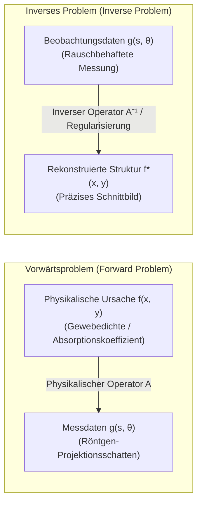

## Einleitung: Blick in die verborgene Tiefe durch Schatten

In der alltäglichen Erfahrung verläuft die Kausalität in eine intuitive Richtung: Kennt man die Geometrie eines Körpers und die Position der Lichtquelle, lässt sich der auf die Wand geworfene Schattenwurf elementar berechnen. Kennt man den inneren geologischen Schichtaufbau der Erde, lässt sich die Ausbreitung seismischer Wellen von einem Erdbebenherd exakt mit der Wellengleichung simulieren. Solche Prozesse, die von der <strong>Ursache (Systemparameter)</strong> auf die <strong>Wirkung (Messdaten)</strong> schließen, heißen <strong>Vorwärtsprobleme (Forward Problems)</strong>. Sie sind physikalisch wohlbestimmt, eindeutig und stabil.

Im Zentrum moderner Spitzenforschung und Medizindiagnostik stehen wir jedoch vor der exakten Umkehrung:
- <strong>Medizinische Computertomographie (CT)</strong>: Wie rekonstruiert man ohne operativen Eingriff aus eindimensionalen Projektionsschatten von Röntgenstrahlen die vollständige Dichteverteilung innerer Organe und Tumoren?
- <strong>Geophysikalische Erkundung</strong>: Wie rekonstruiert man aus seismischen Oberflächenmessungen Verwerfungen und Erdölreservoire in Kilometern Tiefe?
- <strong>Astronomische Interferometrie</strong>: Wie synthetisierte das Event Horizon Telescope (EHT) aus extrem spärlichen Messungen das erste Bild des Schwarzen Lochs?

Diese fundamentale mathematische Aufgabe, aus <strong>Beobachtungen (Daten)</strong> auf die <strong>physikalische Ursache (innerer Zustand)</strong> zu schließen, nennt man <strong>Inverse Probleme (Inverse Problems)</strong>. Sie bilden das theoretische Herzstück moderner zerstörungsfreier Bildgebung.

---

## 1. Was ist ein Inverses Problem?：Hadamard-Wohlgestelltheit und die Katastrophe der Schlechtgestelltheit

Warum ist das Lösen inverser Probleme fundamental schwieriger als das von Vorwärtsproblemen?

### 1.1 Operatorgleichung
In der Funktionalanalysis lässt sich das Problem als lineare Operatorgleichung zwischen Hilberträumen formulieren:
$$\mathcal{A} f = g$$
wobei $f \in \mathcal{X}$ der gesuchte interne Absorptionskoeffizient ist, $g \in \mathcal{Y}$ die gemessenen Projektionsdaten darstellen und $\mathcal{A}$ den Vorwärtsoperator beschreibt.

### 1.2 Die Kriterien von Jacques Hadamard (1902)
Ein mathematisches Problem heißt <strong>wohlgestellt (well-posed)</strong> im Sinne von Hadamard, wenn:
1. <strong>Existenz</strong>: Für jedes $g \in \mathcal{Y}$ existiert eine Lösung $f \in \mathcal{X}$.
2. <strong>Eindeutigkeit</strong>: Die Lösung ist eindeutig ($\ker(\mathcal{A}) = \{0\}$).
3. <strong>Stabilität</strong>: Die Inverse $\mathcal{A}^{-1}$ ist stetig. Kleine Datenstörungen führen nur zu kontrollierbaren Lösungsfehlern: $\|\delta f\| \le C \|\delta g\|$.

Ist auch nur eine dieser Bedingungen verletzt, spricht man von einem <strong>schlechtgestellten Problem (ill-posed problem)</strong>.

### 1.3 Kompakte Operatoren und Rauschkatastrophe
In fast allen physikalischen Feldproblemen ist der Vorwärtsoperator $\mathcal{A}$ ein <strong>kompakter Integraloperator</strong>:
$$g(s) = \int_a^b K(s, t) f(t) \, dt$$
Integration glättet hochfrequente Oszillationen extrem ab (Tiefpassverhalten). Bei der Invertierung kehrt sich dieses Verhalten in eine katastrophale Rauschverstärkung um. Über die Singulärwertzerlegung (SVD) mit $\sigma_n \to 0$:
$$f = \sum_{n=1}^\infty \frac{1}{\sigma_n} \langle g, u_n \rangle v_n$$
Da $\frac{1}{\sigma_n} \to \infty$ für $n \to \infty$, explodiert selbst das kleinste Messrauschen und zerstört die unregulierte naive Rekonstruktion vollständig.

---

## 2. Die Geburtsstunde der Integralgeometrie: Johann Radon (1917)

Der österreichische Mathematiker Johann Radon fragte 1917 aus rein geometrischem Interesse:
> "Lässt sich eine glatte Funktion in der Ebene eindeutig bestimmen, wenn man ihre Linienintegrale entlang aller Geraden kennt?"

### Definition der Radon-Transformation
Eine Gerade $L(s, \theta)$ in $\mathbb{R}^2$ wird parametrisiert durch den Normalenwinkel $\theta \in [0, \pi)$ und den Abstand zum Ursprung $s \in (-\infty, \infty)$:
$$x \cos\theta + y \sin\theta = s$$
Die Radon-Transformation $\mathcal{R}f$ ist das Linienintegral:
$$(\mathcal{R}f)(s, \theta) = \int_{-\infty}^\infty f(s\cos\theta - t\sin\theta, \; s\sin\theta + t\cos\theta) \, dt$$
In der Medizintechnik wird die zweidimensionale Darstellung $(\mathcal{R}f)(s, \theta)$ als <strong>Sinogramm</strong> bezeichnet.

---

## 3. Physikalische Grundlage: Das Lambert-Beersche Gesetz

Tritt ein monoenergetischer Röntgenstrahl durch Materie, beschreibt das Lambert-Beersche Gesetz die Schwächung der Intensität $I$:
$$\frac{dI}{dt} = - f(\mathbf{x}) I \implies I_{\text{det}} = I_0 \exp\left( - \int_L f(\mathbf{x}) \, dt \right)$$
Durch einfache Logarithmierung erhält man die linearen Radon-Integraldaten:
$$g(s, \theta) = \ln\left( \frac{I_0}{I_{\text{det}}} \right) = \int_L f(\mathbf{x}) \, dt = (\mathcal{R}f)(s, \theta)$$

---

## 4. Das Fourier-Schnitt-Theorem (Fourier Slice Theorem)

Das zentrale mathematische Bindeglied zwischen Radon-Projektionen und dem 2D-Bild ist das <strong>Fourier-Schnitt-Theorem</strong>:
$$\left( \mathcal{F}_1 [\mathcal{R}f(\cdot, \theta)] \right)(\omega) = \left( \mathcal{F}_2 f \right)(\omega \cos\theta, \; \omega \sin\theta)$$
Es besagt, dass die 1D-Fourier-Transformation einer Projektion unter dem Winkel $\theta$ exakt der radialen Scheibe der 2D-Fourier-Transformation des Objekts unter demselben Winkel entspricht.

---

## 5. Gefilterte Rückprojektion (Filtered Backprojection, FBP)

Die direkte Transformation führt auf den Standardalgorithmus moderner CT-Geräte:
$$f(x, y) = \int_0^\pi \left[ \int_{-\infty}^\infty G(\omega, \theta) \cdot |\omega| \cdot e^{i 2\pi \omega (x\cos\theta + y\sin\theta)} \, d\omega \right] d\theta$$
1. <strong>Ramp-Filterung</strong>: Multiplikation im Frequenzbereich mit dem Rampenfilter $|\omega|$ kompensiert die geometrische Unschärfe der einfachen Rückprojektion.
2. <strong>Rückprojektion</strong>: Aufsummierung der gefilterten Signale entlang aller Projektionswinkel über die Bildebene.

---

## 6. Zähmung der Schlechtgestelltheit: Tichonow-Regularisierung

Bei verrauschten oder unvollständigen Daten versagt die analytische FBP. Die algebraische Rekonstruktion löst das lineare Gleichungssystem $\mathbf{A}\mathbf{f} + \boldsymbol{\eta} = \mathbf{g}$ mittels <strong>Tichonow-Regularisierung</strong>:
$$\min_{\mathbf{f}} \left\{ \|\mathbf{A}\mathbf{f} - \mathbf{g}\|_2^2 + \alpha \|\mathbf{L}\mathbf{f}\|_2^2 \right\}$$
Die analytische Lösung lautet:
$$\mathbf{f}_\alpha = (\mathbf{A}^T \mathbf{A} + \alpha \mathbf{L}^T \mathbf{L})^{-1} \mathbf{A}^T \mathbf{g}$$
Der Filterfaktor $\frac{\sigma_i^2}{\sigma_i^2 + \alpha}$ dämpft kleine Singulärwerte und verhindert das Explodieren hochfrequenten Rauschens.

---

## 7. Moderne Paradigmen: Total Variation und Compressed Sensing

- <strong>Total Variation (TV-Regularisierung)</strong>: Bestraft die $L_1$-Norm des Gradienten $\|\nabla \mathbf{f}\|_1$, wodurch Kanten von Organen und Knochen messerscharf erhalten bleiben.
- <strong>Drucksensorik (Compressed Sensing)</strong>: Ermöglicht unter Ausnutzung der Bildspärlichkeit (Sparsity) die Rekonstruktion aus drastisch reduzierten Projektionswinkeln, was die Strahlenbelastung für Patienten um über 80 % senkt.
- <strong>Deep Unfolding</strong>: Verbindet die physikalische Strenge des Radon-Operators mit tiefen neuronalen Netzen zur Echtzeitrekonstruktion.

## Fazit

Wie in Platons Höhlengleichnis, in dem Gefangene die Wirklichkeit nur an den Schatten der Höhlenwand erahnen, beweist die Mathematik der inversen Probleme die Kraft des Verstandes: Aus flüchtigen äußeren Projektionsschatten rekonstruiert sie die unsichtbare innere Realität der Welt mit vollkommener Präzision.
