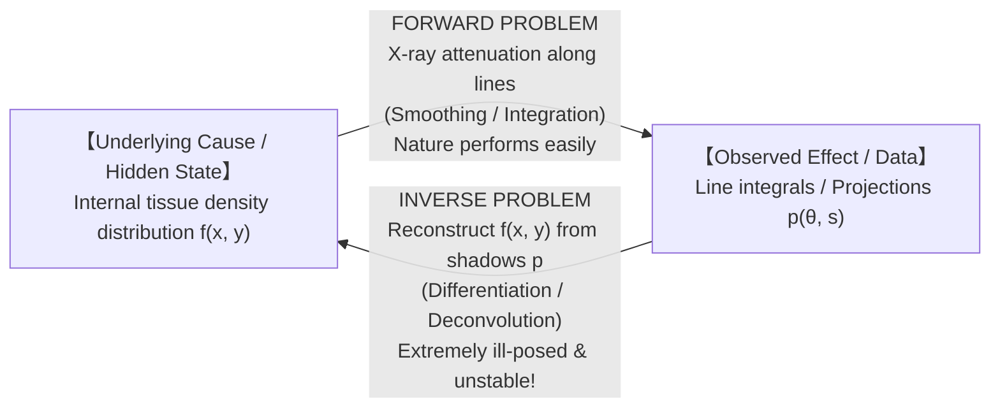
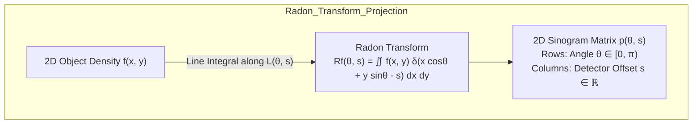
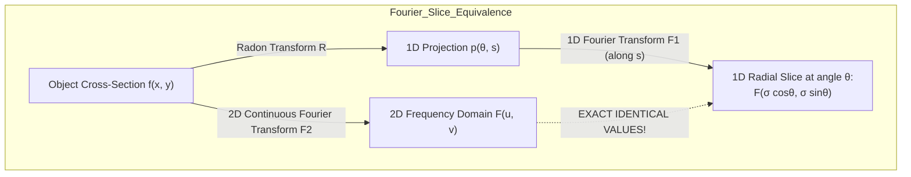
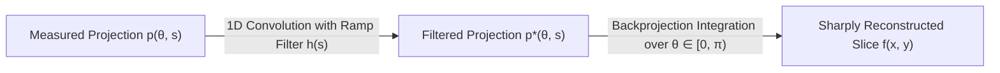
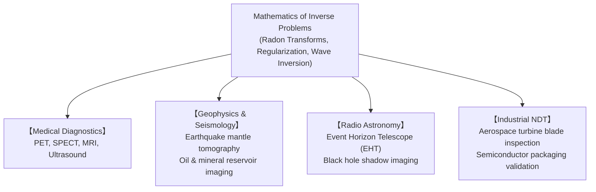

Can humanity peer deep inside an opaque physical object—a human skull, the solid mantle of the Earth, or a sealed shipping container—without breaking, cutting, or drilling it open?

In any modern hospital, a patient lies motionless within the rotating gantry of a Computed Tomography (CT) scanner. Within seconds, physicians inspect sub-millimeter three-dimensional cross-sectional imagery of living brain tissue, pulmonary nodules, and complex vascular networks.

Yet, from the perspective of fundamental physics, the CT scanner never measures an "image" directly. The rotating X-ray tube emits penetrating radiation, and the opposing detector arrays register nothing more than <strong>one-dimensional shadows: the total integrated attenuation of X-rays passing through the body from hundreds of rotational angles</strong>.

We measure only shadows.
How, then, is it mathematically possible to invert a collection of flat, overlapping one-dimensional shadows to reconstruct the vibrant, two-dimensional cross-sectional reality of human anatomy with flawless geometric fidelity?

This triumph belongs to one of the deepest, most conceptually demanding realms of modern mathematics: <strong>The Theory of Inverse Problems</strong>.

Unlike "forward problems"—where known physical causes yield predictable observable effects—"inverse problems" run the arrow of causality backwards. In doing so, they run headlong into a formidable mathematical pathology known as <strong>ill-posedness</strong>. In raw inverse problems, minuscule, microscopic measurement noise in the data explodes exponentially during reconstruction, threatening to annihilate the true signal beneath a catastrophic sea of numerical instability.

From Johann Radon's prophetic 1917 integral geometry to the Nobel Prize-winning engineering of Allan Cormack and Godfrey Hounsfield, through the Fourier Slice Theorem, Filtered Backprojection (FBP), Tikhonov regularization, and modern Compressed Sensing, this article presents an exhaustive, mathematically rigorous journey through the algorithms that transform shadows into life-saving vision.

---

## 1. The Duality of Forward and Inverse Problems

In classical Newtonian physics and engineering, the overwhelming majority of traditional models are <strong>Forward Problems (or Direct Problems)</strong>:

Given a complete mathematical description of a system's internal state, physical parameters, and governing equations (the <strong>cause</strong>), predict the resulting measurements (the <strong>effect</strong>).

- <strong>Examples of Forward Problems</strong>:
  - Knowing the initial position, mass, and velocity of a projectile, compute its parabolic trajectory under gravity and air resistance.
  - Knowing the spatial distribution of tissue densities $f(x, y)$ inside a patient's torso, calculate the attenuation of an X-ray beam along a line trajectory (governed by the Beer-Lambert law).
  - Knowing the exact elastic wave speeds and density structures of Earth's interior, compute the synthetic seismograms recorded by seismometers on the surface.

Forward problems are typically described by well-behaved partial differential equations with initial and boundary conditions. Nature executes forward problems effortlessly, continuously, and deterministically.

In stark contrast, practical empirical science almost always confronts an <strong>Inverse Problem</strong>:

Given indirect, noisy, external sensor observations (the <strong>effect</strong>), deduce the hidden internal structure or historical parameters that produced them (the <strong>cause</strong>).

- <strong>Examples of Inverse Problems</strong>:
  - <strong>Medical Tomography (CT / PET / MRI)</strong>: Given exterior photon counts or RF signals, deduce interior anatomical tissue densities.
  - <strong>Geophysical Tomography</strong>: Given arrival times of earthquake P-waves and S-waves at surface stations, reconstruct the three-dimensional thermal and compositional structure of Earth's mantle and core.
  - <strong>Astrophysical Imaging (Event Horizon Telescope)</strong>: Given sparse radio-frequency interferometric visibility phases across planetary baselines, reconstruct the event horizon shadow of a supermassive black hole.

### 1.1 Hadamard's Three Postulates of Well-Posedness

In 1902, the eminent French mathematician <strong>Jacques Hadamard</strong> formulated three foundational criteria that a mathematical model describing a physical phenomenon must satisfy to be deemed <strong>Well-Posed (良設定)</strong>:

1. <strong>Existence</strong>: For every feasible observation $g \in Y$, there exists at least one solution $f \in X$ such that $K f = g$.
2. <strong>Uniqueness</strong>: The solution $f$ is unique; that is, the forward operator $K$ is injective ($\ker(K) = \{0\}$). Distinct causes never produce identical effects.
3. <strong>Stability (Continuous Dependence on Data)</strong>: The inverse mapping $g \mapsto f$ is continuous. If a sequence of measurements $g_n$ converges to $g$, the corresponding solutions $f_n$ must converge to $f$. A small perturbation in the data produces an acceptably small perturbation in the reconstructed solution.

A problem that violates any one of these three criteria is termed <strong>Ill-Posed (不良設定)</strong>.

### 1.2 The Curse of Ill-Posedness: Spectral Smoothing and Noise Catastrophe

Virtually all linear inverse problems of continuous physics take the form of a Fredholm integral equation of the first kind:

$$
(K f)(s) = \int_\Omega k(s, t) f(t) \, dt = g(s)
$$

The forward operator $K$ is an <strong>integral operator</strong>. Integration is inherently a <strong>smoothing operation</strong>: it dampens, blurs, and averages out high-frequency spatial variations.

Consequently, the inverse operator $K^{-1}$ must act as a <strong>generalized differential operator</strong>. 
Consider what happens when our measured data $g(s)$ is corrupted by an infinitesimally small high-frequency measurement noise $\epsilon(s) = \delta \sin(\omega s)$, where $\delta > 0$ is tiny and $\omega \gg 1$:

$$
g_\delta(s) = g(s) + \delta \sin(\omega s)
$$

Under differentiation (the nature of inversion), the noise component transforms into:

$$
\frac{d}{ds} \left[ \delta \sin(\omega s) \right] = \delta \cdot \omega \cos(\omega s)
$$

Even if the noise amplitude $\delta$ is $10^{-6}$ (undetectable to the naked eye), if the frequency $\omega$ is $10^{9}$, the amplified noise in the reconstruction reaches an amplitude of $\delta \omega = 10^3$! As $\omega \to \infty$, the reconstructed solution diverges to infinity, completely obliterating the underlying anatomical signal.

This instability is the fundamental mathematical curse of tomography. Overcoming it requires deep analytical tools: Radon inversion, Fourier dualities, and regularization theory.

---

## 2. The Radon Transform: The Integral Geometry of Shadows

The mathematical foundation of Computed Tomography was established not by an engineer or a radiologist, but by Austrian mathematician <strong>Johann Radon</strong> in a purely theoretical 1917 paper titled *"Über die Bestimmung von Funktionen durch ihre Integralwerte längs gewisser Mannigfaltigkeiten"* (On the determination of functions by their integral values along certain manifolds).

### 2.1 Physics of X-Ray Attenuation: The Beer-Lambert Law

When a monochromatic beam of X-ray photons traverses a heterogeneous medium, photons are absorbed or scattered by atomic electrons. 
Let $f(x, y) \ge 0$ denote the local linear attenuation coefficient of the tissue at spatial coordinates $(x, y)$.

As the beam advances by an infinitesimal distance $dl$, the fractional loss of beam intensity $I$ is proportional to the local density:

$$
\frac{dI}{I} = -f(x, y) \, dl
$$

Integrating this differential equation along the straight-line trajectory $L$ traversed by the X-ray beam yields the <strong>Beer-Lambert Law</strong>:

$$
I = I_0 \exp\left( -\int_L f(x, y) \, dl \right)
$$

where $I_0$ is the unattenuated emitter intensity and $I$ is the detected intensity. Taking the negative natural logarithm of the transmission ratio isolates the line integral:

$$
p = -\ln\left(\frac{I}{I_0}\right) = \int_L f(x, y) \, dl
$$

Thus, external physical measurements of X-ray intensity provide exact line integrals of the unknown interior function $f(x, y)$.

### 2.2 Formal Definition of the Radon Transform

In $\mathbb{R}^2$, any directed straight line $L$ can be uniquely parameterized by two coordinates:
- An angle $\theta \in [0, \pi)$, defining the normal orientation of the line.
- A signed perpendicular distance $s \in \mathbb{R}$ from the origin to the line.

The line equation in Cartesian coordinates is:

$$
L(\theta, s) = \left\{ (x, y) \in \mathbb{R}^2 \;\middle|\; x \cos\theta + y \sin\theta = s \right\}
$$

The <strong>Radon Transform</strong> $\mathcal{R}$ maps a two-dimensional square-integrable function $f \in L^2(\mathbb{R}^2)$ into a function $\mathcal{R}f$ defined on the cylinder $[0, \pi) \times \mathbb{R}$:

$$
\mathcal{R}f(\theta, s) = \iint_{\mathbb{R}^2} f(x, y) \, \delta(x \cos\theta + y \sin\theta - s) \, dx \, dy
$$

where $\delta(\cdot)$ is the one-dimensional Dirac delta distribution. 

Parameterizing the line using a unit normal vector $\mathbf{\theta} = (\cos\theta, \sin\theta)^T$ and an orthogonal tangent vector $\mathbf{\theta}^\perp = (-\sin\theta, \cos\theta)^T$, spatial points are expressed as:

$$
\mathbf{x} = s \mathbf{\theta} + t \mathbf{\theta}^\perp = \begin{pmatrix} s\cos\theta - t\sin\theta \\ s\sin\theta + t\cos\theta \end{pmatrix}
$$

The Radon transform takes the explicit integral form:

$$
\mathcal{R}f(\theta, s) = \int_{-\infty}^{\infty} f(s\cos\theta - t\sin\theta, \; s\sin\theta + t\cos\theta) \, dt
$$

### 2.3 The Sinogram: Why Shadows Trace Sine Curves

The raw two-dimensional array representing $\mathcal{R}f(\theta, s)$—with detector position $s$ on the horizontal axis and projection angle $\theta$ on the vertical axis—is called a <strong>Sinogram</strong>.

To understand why it is named a sinogram, consider a point-like anatomical structure (such as a tiny calcification or metallic marker) located at polar coordinates $(r_0, \phi_0)$, corresponding to Cartesian coordinates $(x_0, y_0) = (r_0 \cos\phi_0, r_0 \sin\phi_0)$.

This point contributes to the line integral only when the line passes through $(x_0, y_0)$, satisfying:

$$
s(\theta) = x_0 \cos\theta + y_0 \sin\theta = r_0 \cos\phi_0 \cos\theta + r_0 \sin\phi_0 \sin\theta
$$

Using the trigonometric angle subtraction identity:

$$
s(\theta) = r_0 \cos(\theta - \phi_0)
$$

As the scanner rotates through $\theta \in [0, \pi)$, the single point $(r_0, \phi_0)$ traces a <strong>perfect sinusoidal curve</strong> across the projection domain! A full medical sinogram is the continuous superposition of millions of overlapping sinusoidal traces of varying amplitudes and phases.

---

## 3. The Fourier Slice Theorem: The Mathematical Rosetta Stone

How do we invert the Radon transform? The theoretical foundation of analytical image reconstruction is the <strong>Fourier Slice Theorem</strong> (also known as the <strong>Central Slice Theorem</strong> or <strong>Projection-Slice Theorem</strong>).

This theorem establishes a sublime equivalence between the <strong>one-dimensional spatial projections of an object</strong> and <strong>radial slices through its two-dimensional Fourier spectrum</strong>.

### 3.1 Formal Statement of the Theorem

Let $f \in L^1(\mathbb{R}^2) \cap L^2(\mathbb{R}^2)$ have two-dimensional continuous Fourier transform:

$$
\mathcal{F}_2\{f\}(u, v) = F(u, v) = \iint_{\mathbb{R}^2} f(x, y) \, e^{-i 2\pi (ux + vy)} \, dx \, dy
$$

Let $p(\theta, s) = \mathcal{R}f(\theta, s)$ be the projection at angle $\theta$. Its one-dimensional Fourier transform with respect to detector coordinate $s$ is:

$$
\mathcal{F}_1\{p(\theta, \cdot)\}(\sigma) = P(\theta, \sigma) = \int_{-\infty}^{\infty} p(\theta, s) \, e^{-i 2\pi \sigma s} \, ds
$$

> <strong>The Fourier Slice Theorem</strong>: The 1D Fourier transform of the projection at angle $\theta$ is identically equal to the 2D Fourier transform of the original object evaluated along a line passing through the origin at angle $\theta$ in frequency space:
> $$
> P(\theta, \sigma) = F(\sigma \cos\theta, \; \sigma \sin\theta)
> $$

### 3.2 Rigorous Proof

We expand the 1D Fourier transform of $p(\theta, s)$ by inserting the definition of the Radon transform:

$$
P(\theta, \sigma) = \int_{-\infty}^{\infty} \left[ \iint_{\mathbb{R}^2} f(x, y) \, \delta(x \cos\theta + y \sin\theta - s) \, dx \, dy \right] e^{-i 2\pi \sigma s} \, ds
$$

Because $f \in L^1(\mathbb{R}^2)$, Fubini's theorem permits the interchange of integration order:

$$
P(\theta, \sigma) = \iint_{\mathbb{R}^2} f(x, y) \left[ \int_{-\infty}^{\infty} \delta(x \cos\theta + y \sin\theta - s) \, e^{-i 2\pi \sigma s} \, ds \right] dx \, dy
$$

Evaluating the inner integral with respect to $s$ using the sifting property of the Dirac delta distribution ($\int \delta(s - s_0) e^{-i 2\pi \sigma s} ds = e^{-i 2\pi \sigma s_0}$ with $s_0 = x\cos\theta + y\sin\theta$):

$$
\int_{-\infty}^{\infty} \delta(x \cos\theta + y \sin\theta - s) \, e^{-i 2\pi \sigma s} \, ds = e^{-i 2\pi \sigma (x \cos\theta + y \sin\theta)}
$$

Substituting this back into the double integral:

$$
P(\theta, \sigma) = \iint_{\mathbb{R}^2} f(x, y) \, e^{-i 2\pi \left[ x(\sigma\cos\theta) + y(\sigma\sin\theta) \right]} \, dx \, dy
$$

Inspecting the exponent, define the 2D frequency coordinates:
$$
u = \sigma \cos\theta, \quad v = \sigma \sin\theta
$$
The right-hand side is precisely the definition of the 2D Fourier transform evaluated at $(u, v)$:

$$
P(\theta, \sigma) = F(u, v) = F(\sigma\cos\theta, \; \sigma\sin\theta)
$$

$\blacksquare$ <strong>Q.E.D.</strong>

### 3.3 The Conceptual Breakthrough
The Fourier Slice Theorem reveals that one projection measured at angle $\theta$ completely samples a straight 1D slice through the center of the object's 2D Fourier transform.

By rotating the scanner through all angles $\theta \in [0, \pi)$, we trace a dense collection of radial spokes that fill the entire 2D frequency plane $(u, v)$. Inverting the Radon transform is therefore mathematically equivalent to:
1. Taking the 1D FFT of each projection $p(\theta, s) \to P(\theta, \sigma)$.
2. Mapping polar spokes into Cartesian frequency space $(u, v)$.
3. Taking the 2D inverse FFT to recover $f(x, y)$.

---

## 4. Filtered Backprojection (FBP): The Workhorse of Clinical CT

While direct Fourier interpolation is conceptually straightforward, interpolating from radial polar samples onto a rectilinear Cartesian grid introduces severe interpolation errors and geometric artifacts.

The standard clinical algorithm used worldwide is <strong>Filtered Backprojection (FBP)</strong>, derived by reformulating the inverse Fourier transform directly in polar coordinates.

### 4.1 The Blurring of Simple Backprojection

The most intuitive attempt at reconstruction is <strong>Unfiltered Backprojection</strong> ($\mathcal{B}$). For every angle $\theta$, smear the projection profile $p(\theta, s)$ uniformly back across the reconstruction grid along the line of integration:

$$
(\mathcal{B}p)(x, y) = \int_0^\pi p(\theta, \; x\cos\theta + y\sin\theta) \, d\theta
$$

If we backproject a single point mass (a 2D Dirac delta $\delta(x, y)$), the resulting image is an intersection of rays radiating outward from the origin. The impulse response (Point Spread Function, PSF) of simple backprojection decays inversely with radial distance $r = \sqrt{x^2 + y^2}$:

$$
\text{PSF}_{\text{backprojection}}(r) = \frac{1}{\pi r}
$$

In 2D Fourier space, the Fourier transform of the radially symmetric function $1/r$ is:

$$
\mathcal{F}_2\left\{ \frac{1}{r} \right\} = \frac{1}{|\sigma|}
$$

Simple backprojection <strong>severely overweights low frequencies and attenuates high frequencies by $1/|\sigma|$</strong>. The resulting image resembles a sharp picture viewed through dense frosted glass: edges are blurred and fine anatomical detail is lost.

### 4.2 The Ramp Filter (Ram-Lak Filter)

To perfectly invert the $1/|\sigma|$ blurring kernel, we must multiply the frequency spectrum by its exact inverse:

$$
H(\sigma) = |\sigma|
$$

This filter is known as the <strong>Ramp Filter</strong> or the <strong>Ram-Lak Filter</strong> (introduced by G. N. Ramachandran and A. V. Lakshminarayanan in 1971).

### 4.3 Analytical Derivation of the FBP Formula

We write the 2D inverse Fourier transform of $f(x, y)$:

$$
f(x, y) = \iint_{\mathbb{R}^2} F(u, v) \, e^{i 2\pi (ux + vy)} \, du \, dv
$$

Transforming the Cartesian frequency variables $(u, v)$ to polar coordinates $(\sigma, \theta)$ via $u = \sigma\cos\theta, v = \sigma\sin\theta$:
The differential area element transforms via the Jacobian:
$$
du \, dv = |\sigma| \, d\sigma \, d\theta
$$
Integrating $\theta$ from $0$ to $\pi$ and $\sigma$ from $-\infty$ to $+\infty$:

$$
f(x, y) = \int_0^\pi \int_{-\infty}^{\infty} F(\sigma\cos\theta, \; \sigma\sin\theta) \, e^{i 2\pi \sigma(x\cos\theta + y\sin\theta)} \, |\sigma| \, d\sigma \, d\theta
$$

By the Fourier Slice Theorem, $F(\sigma\cos\theta, \sigma\sin\theta) = P(\theta, \sigma) = \mathcal{F}_1\{p(\theta, \cdot)\}(\sigma)$. Substituting this:

$$
f(x, y) = \int_0^\pi \underbrace{\left[ \int_{-\infty}^{\infty} P(\theta, \sigma) \, |\sigma| \, e^{i 2\pi \sigma s} \, d\sigma \right]_{s = x\cos\theta + y\sin\theta}}_{p_{\text{filtered}}(\theta, s)} d\theta
$$

The inner integral is the 1D inverse Fourier transform of the product of $P(\theta, \sigma)$ and the ramp filter $|\sigma|$. By the convolution theorem:

$$
p_{\text{filtered}}(\theta, s) = p(\theta, s) * h(s) = \int_{-\infty}^{\infty} p(\theta, s') h(s - s') \, ds'
$$

where $h(s) = \mathcal{F}_1^{-1}\{|\sigma|\}$. 

Therefore, <strong>Filtered Backprojection consists of two discrete stages</strong>:
1. <strong>Filtering</strong>: Convolve the 1D projection at each angle $\theta$ with the ramp filter kernel $h(s)$.
2. <strong>Backprojection</strong>: Accumulate (backproject) the filtered projections across all angles into the spatial grid.

---

## 5. Noise Amplification and Apodization Windows

While the ramp filter $|\sigma|$ is mathematically exact for noiseless continuous data, it poses a severe engineering hazard: <strong>$|\sigma|$ grows linearly toward infinity as $\sigma \to \infty$</strong>.

In actual medical scanners, physical projections are corrupted by Poisson photon counting noise and electronic noise. At high frequencies, noise dominates the anatomical signal. Unmodified ramp filtering results in unacceptable graininess and streaks.

To tame this high-frequency noise explosion, clinical CT systems multiply the ramp filter by an <strong>apodization window</strong> $W(\sigma)$ that rolls off toward zero near the detector Nyquist frequency $\sigma_m = \frac{1}{2\Delta s}$:

$$
H_{\text{windowed}}(\sigma) = |\sigma| \cdot W(\sigma)
$$

| Window Name | Mathematical Formulation $W(\sigma)$ for $|\sigma| \le \sigma_m$ | Clinical Trade-Off Profile |
| :---: | :---: | :---: |
| <strong>Ram-Lak</strong> | $W(\sigma) = 1$ | Maximum spatial resolution; highest noise level (used for dense bone/inner ear) |
| <strong>Shepp-Logan</strong> | $W(\sigma) = \text{sinc}\left(\frac{\pi\sigma}{2\sigma_m}\right) = \frac{\sin(\pi\sigma / 2\sigma_m)}{\pi\sigma / 2\sigma_m}$ | Softens highest frequencies; standard balance of resolution and noise |
| <strong>Cosine Window</strong> | $W(\sigma) = \cos\left(\frac{\pi\sigma}{2\sigma_m}\right)$ | Smooth noise reduction; moderate edge blurring |
| <strong>Hann Window</strong> | $W(\sigma) = 0.5 + 0.5\cos\left(\frac{\pi\sigma}{\sigma_m}\right)$ | Aggressive high-frequency suppression; ideal for low-contrast soft tissue (brain/liver) |

---

## 6. Discrete Formulations, Ill-Conditioning, and SVD

When projection data is acquired at a discrete, finite set of detector channels and projection angles, continuous integrals are discretized into a massive system of linear equations:

$$
A f = g + \epsilon
$$

where:
- $f \in \mathbb{R}^N$ is the vector of unknown image pixel values ($N \approx 512 \times 512 = 262{,}144$).
- $g \in \mathbb{R}^M$ is the vector of measured projection values ($M \approx 1000 \text{ angles} \times 800 \text{ detectors} = 800{,}000$).
- $A \in \mathbb{R}^{M \times N}$ is the system projection matrix, where $A_{ij}$ represents the length of X-ray ray $i$ passing through pixel $j$.
- $\epsilon \in \mathbb{R}^M$ represents measurement noise.

### 6.1 The Singular Value Decomposition (SVD) Diagnostics

To see why solving $A f = g$ directly is disastrous, perform the <strong>Singular Value Decomposition</strong> of the matrix $A$:

$$
A = U \Sigma V^T = \sum_{k=1}^{\min(M, N)} \sigma_k u_k v_k^T
$$

where $U = [u_1, \dots, u_M]$ and $V = [v_1, \dots, v_N]$ are orthogonal matrices, and singular values decay monotonically:

$$
\sigma_1 \ge \sigma_2 \ge \dots \ge \sigma_N > 0
$$

The classical Moore-Penrose pseudo-inverse solution $f^\dagger = A^\dagger g$ expands as:

$$
f^\dagger = \sum_{k=1}^N \frac{u_k^T g}{\sigma_k} v_k = \sum_{k=1}^N \frac{u_k^T (g_{\text{exact}} + \epsilon)}{\sigma_k} v_k = \sum_{k=1}^N \frac{u_k^T g_{\text{exact}}}{\sigma_k} v_k + \sum_{k=1}^N \frac{u_k^T \epsilon}{\sigma_k} v_k
$$

For tomographic projection matrices, <strong>the singular values $\sigma_k$ decay rapidly toward zero</strong> (due to the smoothing property of line integration). The vectors $v_k$ corresponding to tiny singular values $\sigma_k$ represent rapidly oscillating high spatial frequencies.

When the small noise vector $\epsilon$ is projected onto these singular vectors, the division by $\sigma_k \approx 10^{-6}$ amplifies noise by six orders of magnitude! The reconstruction explodes into chaotic static.

---

## 7. Regularization Theory: Taming the Explosion

To recover meaningful images from ill-conditioned systems, we apply <strong>Regularization Theory</strong>—systematic techniques that trade a small amount of bias to dramatically slash reconstruction variance.

### 7.1 Tikhonov Regularization ($L_2$ Penalty)

In 1963, Soviet mathematician <strong>Andrey Tikhonov</strong> proposed transforming the unstable least-squares problem into a penalized minimization problem:

$$
\min_{f} \left\{ \|A f - g\|_2^2 + \alpha \|L f\|_2^2 \right\}
$$

where $\alpha > 0$ is the <strong>regularization parameter</strong>, and $L$ is a regularization operator (often the identity matrix $I$ or a discrete gradient operator).

Setting the gradient of the objective function to zero yields the <strong>Regularized Normal Equations</strong>:

$$
(A^T A + \alpha L^T L) f = A^T g
$$

When $L = I$, the analytical solution expressed via SVD is:

$$
f_\alpha = \sum_{k=1}^N \left( \frac{\sigma_k^2}{\sigma_k^2 + \alpha} \right) \frac{u_k^T g}{\sigma_k} v_k
$$

Examine the <strong>filter factor</strong>:

$$
w_k = \frac{\sigma_k^2}{\sigma_k^2 + \alpha}
$$

- For large singular values ($\sigma_k^2 \gg \alpha$), $w_k \approx 1$: uncorrupted low-frequency components pass through untouched.
- For tiny singular values ($\sigma_k^2 \ll \alpha$), $w_k \approx \frac{\sigma_k^2}{\alpha} \to 0$: noise-dominated high-frequency components are smoothly attenuated to zero!

Tikhonov regularization is mathematically identical to Ridge Regression in statistics and machine learning.

### 7.2 Total Variation (TV) and Compressed Sensing

While Tikhonov regularization ($L_2$ norm) stabilizes noise, it penalizes large derivatives uniformly, resulting in blurred anatomical edges and softened organ boundaries.

In the mid-2000s, <strong>Emmanuel Candès, Terence Tao, and David Donoho</strong> introduced <strong>Compressed Sensing (CS)</strong>, revolutionizing medical tomography.

Human anatomical cross-sections are largely piecewise constant: uniform attenuation inside liver, muscle, or brain ventricles, interrupted by sharp discontinuities (edges) at tissue interfaces. While the image $f$ itself is not sparse, its spatial gradient $\nabla f$ <strong>is extremely sparse</strong> (zero almost everywhere except at edges).

This led to <strong>Total Variation (TV) Regularization</strong>:

$$
\min_f \left\{ \frac{1}{2} \|A f - g\|_2^2 + \lambda \|\nabla f\|_1 \right\}
$$

where the $L_1$ norm of the gradient is defined as:

$$
\|\nabla f\|_1 = \sum_{x, y} \sqrt{ (f_{x+1, y} - f_{x, y})^2 + (f_{x, y+1} - f_{x, y})^2 }
$$

Because the geometry of the $L_1$ ball possesses sharp vertices aligned with the coordinate axes, $L_1$ minimization forces non-essential gradient variations to be <strong>exactly zero</strong> (suppressing noise completely) while allowing large gradient spikes at true biological edges to remain crisp and unpenalized.

### 7.3 Clinical Impact: Massive Radiation Dose Reduction
Compressed sensing proved mathematically that <strong>exact image reconstruction is achievable with vastly fewer projection angles than mandated by the classical Nyquist-Shannon sampling theorem</strong>.

In clinical radiology, this enabled the transition from traditional FBP to <strong>Iterative Model-Based Reconstruction (IMBR)</strong>. Modern commercial scanners now produce pristine diagnostic scans while slashing patient radiation dose by <strong>$70\%$ to $90\%$</strong>, dramatically reducing cancer risk in pediatric and screening CT examinations.

---

## 8. Beyond X-Ray CT: The Vast Universe of Tomographic Inversion

The mathematics of Radon inversion and inverse problems underpins diverse frontiers across science and technology:

1. <strong>Positron Emission Tomography (PET) & SPECT</strong>:
   Injects radiotracers emitting gamma-ray photons from within the patient. Solves the <strong>Attenuated Radon Transform</strong>, mapping metabolic function rather than anatomy.
2. <strong>Magnetic Resonance Imaging (MRI)</strong>:
   Applies magnetic field gradients such that nuclear magnetic moments precess at frequencies proportional to spatial position. MRI <strong>directly acquires samples in the 2D or 3D spatial frequency domain (k-space)</strong>! Reconstruction is a direct inverse Fourier transform.
3. <strong>Seismic Tomography</strong>:
   Inverts the travel times of earthquake shockwaves across global seismic stations to reconstruct 3D mantle convection plumes, subducting tectonic slabs, and the core-mantle boundary (D'' layer).
4. <strong>The Event Horizon Telescope (EHT)</strong>:
   Combined radio telescopes across Earth into a virtual planetary-scale interferometer. Using sparse modeling ($L_1$ regularization) to solve an incomplete visibility inverse problem, humanity captured the first direct images of the supermassive black holes in M87 and Sagittarius A*.

---

## 9. Conclusion: Inverting Plato's Cave

In Plato's famous Allegory of the Cave, prisoners chained inside a cavern see only flickering shadows cast on the wall, mistaking those degraded two-dimensional projections for ultimate reality.

For centuries, natural philosophers assumed that when viewing shadows, the internal depth of the original object was irretrievably lost.

Yet, through the mathematical brilliance of Johann Radon, the Fourier Slice Theorem, and modern regularization theory, human intellect achieved the impossible: <strong>we learned to walk along the cavern wall, record the shadows from every perspective, and use the power of integral geometry to mathematically reconstruct the unseen three-dimensional world in total perfection.</strong>

The mathematics of inverse problems proves that invisibility is not an absolute barrier of nature. It is merely a boundary waiting to be dissolved by the transformative power of abstract thought.
