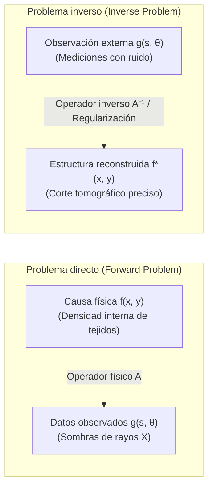

## Introducción: Escudriñar lo invisible a través de las sombras

En la experiencia cotidiana, la causalidad sigue una dirección natural e intuitiva: si conocemos la geometría exacta de un objeto y la posición de una fuente de luz, la silueta de la sombra proyectada en la pared se calcula fácilmente mediante la óptica geométrica elemental. De manera similar, si se conocen la densidad y las propiedades elásticas de las capas geológicas del subsuelo terrestre, la propagación de ondas sísmicas desde un epicentro hasta las estaciones de medición puede simularse con alta precisión mediante la ecuación de ondas. Este proceso de deducir el <strong>efecto (datos de medición externos)</strong> a partir de la <strong>causa (parámetros físicos internos del sistema)</strong> se denomina <strong>problema directo (Forward Problem)</strong>. Los problemas directos suelen ser estables, deterministas y con solución única.

Sin embargo, en la medicina moderna, la geofísica y la exploración espacial nos enfrentamos a la situación opuesta:
- <strong>Tomografía computarizada médica (TC / TAC)</strong>: Sin realizar una incisión quirúrgica, ¿cómo podemos reconstruir con precisión milimétrica la distribución de densidad de tejidos blandos, vasos sanguíneos o microtumores a partir de proyecciones unidimensionales de rayos X tomadas desde múltiples ángulos exteriores?
- <strong>Prospección geofísica</strong>: ¿Cómo determinar la presencia de fallas tectónicas o depósitos de petróleo a kilómetros bajo tierra a partir de ondas elásticas reflejadas en la superficie?
- <strong>Interferometría astronómica</strong>: ¿Cómo logró el Telescopio del Horizonte de Sucesos (EHT) sintetizar la primera imagen del agujero negro supermasivo a partir de datos espaciales extremadamente dispersos?

Esta tarea matemática de inferir la <strong>causa física interna</strong> a partir de los <strong>datos observados</strong> se denomina <strong>problema inverso (Inverse Problem)</strong>.

---

## 1. ¿Qué es un problema inverso?：El buen planteamiento de Hadamard y la catástrofe del mal condicionamiento

¿Por qué resolver un problema inverso es incomparablemente más difícil que resolver un problema directo?

### 1.1 Formulación mediante ecuaciones de operadores
En el marco del análisis funcional, un problema directo se modela como una ecuación de operador entre espacios de Hilbert:
$$\mathcal{A} f = g$$
donde $f \in \mathcal{X}$ es el coeficiente de atenuación tisular desconocido, $g \in \mathcal{Y}$ representa las proyecciones radiográficas medidas, y $\mathcal{A}$ es un operador integral lineal.

### 1.2 Criterios de buen planteamiento de Hadamard (1902)
El matemático francés Jacques Hadamard postuló que un problema físico-matemático está <strong>bien planteado (well-posed)</strong> si cumple simultáneamente tres condiciones:
1. <strong>Existencia</strong>: Para cualquier dato $g \in \mathcal{Y}$, existe al menos una solución $f \in \mathcal{X}$.
2. <strong>Unicidad</strong>: La solución es única ($\ker(\mathcal{A}) = \{0\}$).
3. <strong>Estabilidad</strong>: La solución depende continuamente de los datos de entrada. El operador inverso $\mathcal{A}^{-1}$ es continuo, garantizando que un error minúsculo en las mediciones no provoque una distorsión incontrolada en la solución: $\|\delta f\| \le C \|\delta g\|$.

Si alguna de estas condiciones falla, el problema se considera <strong>mal planteado (ill-posed)</strong>.

### 1.3 Operadores compactos y amplificación del ruido de alta frecuencia
En casi todos los problemas físicos continuos, el operador $\mathcal{A}$ es un <strong>operador compacto</strong> que actúa como un filtro pasabajo:
$$g(s) = \int_a^b K(s, t) f(t) \, dt$$
La integración suaviza fuertemente las discontinuidades y componentes de alta frecuencia. Por consiguiente, el operador inverso actúa como un amplificador extremo de altas frecuencias. Mediante la descomposición en valores singulares (SVD), con valores singulares $\sigma_n \to 0$:
$$f = \sum_{n=1}^\infty \frac{1}{\sigma_n} \langle g, u_n \rangle v_n$$
Como $\sigma_n \to 0$ cuando $n \to \infty$, cualquier ruido térmico o cuántico de medición se divide por $\sigma_n$, haciendo que $\frac{1}{\sigma_n} \to \infty$ y destruyendo por completo la solución calculada ingenuamente.

---

## 2. Los fundamentos de la geometría integral: Johann Radon (1917)

En 1917, el matemático austríaco Johann Radon planteó una cuestión geométrica pura:
> "¿Se puede reconstruir de manera única una función diferenciable en el plano si se conocen sus integrales a lo largo de todas las líneas rectas posibles?"

Radon demostró la unicidad y dedujo la fórmula analítica exacta de inversión.

### Definición de la transformada de Radon
Una línea recta $L(s, \theta)$ en $\mathbb{R}^2$ se parametriza por su ángulo normal $\theta \in [0, \pi)$ y su distancia orientada al origen $s \in (-\infty, \infty)$:
$$x \cos\theta + y \sin\theta = s$$
La transformada de Radon $\mathcal{R}f$ es la integral de línea:
$$(\mathcal{R}f)(s, \theta) = \iint_{\mathbb{R}^2} f(x, y) \, \delta(x \cos\theta + y \sin\theta - s) \, dx dy$$
En el campo del diagnóstico médico por imagen, la representación bidimensional de $(\mathcal{R}f)(s, \theta)$ se denomina <strong>sinograma</strong>.

---

## 3. Física de la tomografía computarizada: La ley de Beer-Lambert

La atenuación de un haz de rayos X que atraviesa el cuerpo sigue la ley de Beer-Lambert:
$$\frac{dI}{dt} = - f(\mathbf{x}) I \implies I_{\text{det}} = I_0 \exp\left( - \int_L f(\mathbf{x}) \, dt \right)$$
Aplicando el logaritmo natural al cociente de intensidades, la no linealidad exponencial se elimina por completo:
$$g(s, \theta) = \ln\left( \frac{I_0}{I_{\text{det}}} \right) = \int_L f(\mathbf{x}) \, dt = (\mathcal{R}f)(s, \theta)$$
Por lo tanto, la reconstrucción de imágenes en la tomografía computarizada es idéntica al problema matemático de invertir la transformada de Radon.

---

## 4. Teorema del corte de Fourier (Fourier Slice Theorem)

El puente matemático esencial entre las proyecciones 1D y la imagen bidimensional es el <strong>teorema del corte de Fourier</strong>:
$$\left( \mathcal{F}_1 [\mathcal{R}f(\cdot, \theta)] \right)(\omega) = \left( \mathcal{F}_2 f \right)(\omega \cos\theta, \; \omega \sin\theta)$$
Establece que la transformada de Fourier unidimensional de una proyección en el ángulo $\theta$ es exactamente igual a una rebanada radial que pasa por el origen en la transformada de Fourier 2D de la imagen original.

---

## 5. Algoritmo de retroproyección filtrada (Filtered Backprojection, FBP)

Expresando la transformada inversa de Fourier 2D en coordenadas polares, emerge el algoritmo FBP:
$$f(x, y) = \int_0^\pi \left[ \int_{-\infty}^\infty G(\omega, \theta) \cdot |\omega| \cdot e^{i 2\pi \omega (x\cos\theta + y\sin\theta)} \, d\omega \right] d\theta$$
1. <strong>Filtro Ram-Lak (Rampa)</strong>: Multiplica los datos en el dominio de la frecuencia por $|\omega|$ para eliminar el borrado intrínseco de la retroproyección simple ($1/r$).
2. <strong>Retroproyección</strong>: Asigna los valores filtrados de vuelta a lo largo de las trayectorias de los rayos en la cuadrícula de la imagen e integra en todos los ángulos.

---

## 6. Superar el mal condicionamiento: Regularización de Tikhonov

En presencia de ruido de medición y muestreo angular incompleto, los métodos analíticos se complementan con formulaciones algebraicas $\mathbf{A}\mathbf{f} + \boldsymbol{\eta} = \mathbf{g}$ mediante la <strong>regularización de Tikhonov</strong> (1963):
$$\min_{\mathbf{f}} \left\{ \|\mathbf{A}\mathbf{f} - \mathbf{g}\|_2^2 + \alpha \|\mathbf{L}\mathbf{f}\|_2^2 \right\}$$
Cuya solución analítica es:
$$\mathbf{f}_\alpha = (\mathbf{A}^T \mathbf{A} + \alpha \mathbf{L}^T \mathbf{L})^{-1} \mathbf{A}^T \mathbf{g}$$
El factor de filtrado $\frac{\sigma_i^2}{\sigma_i^2 + \alpha}$ atenúa los valores singulares infinitesimales, impidiendo que el ruido blanco se amplifique descontroladamente.

---

## 7. Fronteras modernas: Variación Total y Sensado Comprimido

- <strong>Variación Total (Regularización TV)</strong>: Minimiza la norma $L_1$ del gradiente $\|\nabla \mathbf{f}\|_1$, preservando contornos anatómicos nítidos sin generar desenfoque artificial.
- <strong>Sensado comprimido (Compressed Sensing)</strong>: Desarrollado por Candès, Romberg y Tao, permite reconstruir imágenes exactas a partir de un número mínimo de proyecciones angulares, reduciendo la exposición del paciente a la radiación en más de un 80 %.
- <strong>Deep Unfolding</strong>: Fusiona la física del operador de Radon con redes neuronales profundas para una reconstrucción ultrarrápida y clínicamente confiable.

## Conclusión

Al igual que en el mito de la caverna de Platón, donde las sombras revelan la forma del mundo exterior, la matemática de los problemas inversos demuestra la extraordinaria capacidad del intelecto humano para reconstruir, a partir de sutiles sombras proyectadas, la estructura interna y la verdad oculta de la naturaleza.
