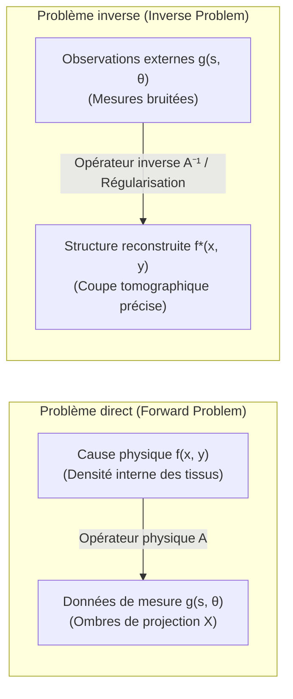

## Introduction : Sonder les profondeurs invisibles à travers les ombres

Dans notre expérience quotidienne, la causalité suit une direction naturelle : si l'on connaît la géométrie exacte d'un objet et la position de la source lumineuse, le calcul du contour de son ombre portée sur un mur relève de l'optique géométrique la plus élémentaire. De même, si l'on connaît la composition géologique et les densités du sous-sol terrestre, l'équation des ondes permet de simuler fidèlement les sismogrammes enregistrés en surface. Ce passage direct de la <strong>cause (les paramètres internes d'un système physique)</strong> vers l'<strong>effet (les données mesurables en surface)</strong> constitue ce que l'on nomme un <strong>problème direct (Forward Problem)</strong>. Les problèmes directs sont par nature stables, uniques et déterministes.

Cependant, dans la médecine moderne, la géophysique et l'astrophysique, le défi fondamental consiste à remonter le cours du temps et de la physique :
- <strong>La Tomodensitométrie médicale (Scanner CT)</strong> : sans inciser le corps humain, comment reconstruire la carte tridimensionnelle des densités tissulaires et détecter d'infimes tumeurs à partir de simples mesures d'atténuation de rayons X traversant le corps ?
- <strong>L'imagerie géophysique</strong> : comment déterminer la structure des failles tectoniques et des gisements d'hydrocarbures situés à des kilomètres sous terre à partir des échos sismiques ?
- <strong>L'interférométrie astronomique</strong> : comment le télescope Event Horizon (EHT) a-t-il pu synthétiser l'image du trou noir supermassif M87* à partir de données interférométriques extrêmement lacunaires ?

Cette démarche scientifique consistant à déduire la <strong>cause physique interne</strong> à partir de <strong>mesures externes</strong> s'appelle un <strong>problème inverse (Inverse Problem)</strong>.

---

## 1. Qu'est-ce qu'un problème inverse ? : Le caractère bien posé selon Hadamard

Pourquoi la résolution d'un problème inverse est-elle incomparablement plus complexe que celle d'un problème direct ?

### 1.1 Formulation opérationnelle
Dans le cadre de l'analyse fonctionnelle, le problème s'écrit sous la forme d'une équation opérationnelle entre espaces de Hilbert :
$$\mathcal{A} f = g$$
où $f \in \mathcal{X}$ représente la fonction inconnue d'atténuation tissulaire, $g \in \mathcal{Y}$ les données de projection recueillies par les détecteurs, et $\mathcal{A}$ l'opérateur intégral linéaire modélisant la physique de la mesure.

### 1.2 Les postulats d'Hadamard (1902)
Le mathématicien français Jacques Hadamard a établi qu'un problème mathématique n'est <strong>bien posé (well-posed)</strong> que s'il remplit trois conditions impératives :
1. <strong>Existence</strong> : Pour toute donnée $g$, il existe au moins une solution $f$.
2. <strong>Unicité</strong> : La solution est unique ($\ker(\mathcal{A}) = \{0\}$).
3. <strong>Stabilité</strong> : La solution dépend continûment des données. L'opérateur inverse $\mathcal{A}^{-1}$ est continu, de sorte qu'une perturbation infime des mesures n'engendre qu'une erreur bornée sur la solution : $\|\delta f\| \le C \|\delta g\|$.

Si l'une de ces conditions fait défaut, le problème est dit <strong>mal posé (ill-posed)</strong>.

### 1.3 Opérateurs compacts et catastrophe des hautes fréquences
Dans les systèmes physiques continus, $\mathcal{A}$ est presque toujours un <strong>opérateur compact</strong> agissant comme un filtre passe-bas (lissage par intégration). Par décomposition en valeurs singulières (SVD) avec des valeurs singulières $\sigma_n \to 0$ :
$$f = \sum_{n=1}^\infty \frac{1}{\sigma_n} \langle g, u_n \rangle v_n$$
L'inversion naïve impose de diviser par $\sigma_n$. Comme $\sigma_n \to 0$, le moindre bruit blanc de mesure se trouve multiplié par $\frac{1}{\sigma_n} \to \infty$, anéantissant toute tentative de reconstruction directe.

---

## 2. La géométrie intégrale de Johann Radon (1917)

En 1917, le mathématicien autrichien Johann Radon s'est posé une question de pure géométrie :
> « Peut-on reconstruire de manière unique une fonction continue à deux variables si l'on connaît ses intégrales le long de toutes les droites du plan ? »

Radon apporta une démonstration rigoureuse et découvrit la formule exacte d'inversion.

### Définition de la transformée de Radon
Une droite $L(s, \theta)$ est repérée par son angle polaire $\theta \in [0, \pi)$ et sa distance algébrique à l'origine $s \in (-\infty, \infty)$ :
$$x \cos\theta + y \sin\theta = s$$
La transformée de Radon $\mathcal{R}f$ est l'intégrale curviligne le long de cette droite :
$$(\mathcal{R}f)(s, \theta) = \iint_{\mathbb{R}^2} f(x, y) \, \delta(x \cos\theta + y \sin\theta - s) \, dx dy$$
En imagerie médicale, la représentation de $(\mathcal{R}f)(s, \theta)$ dans le plan $(s, \theta)$ est appelée <strong>sinogramme</strong>.

---

## 3. Physique du scanner : La loi de Beer-Lambert

L'atténuation d'un faisceau de rayons X traversant un milieu biologique hétérogène obéit à la loi de Beer-Lambert :
$$\frac{dI}{dt} = - f(\mathbf{x}) I \implies I_{\text{det}} = I_0 \exp\left( - \int_L f(\mathbf{x}) \, dt \right)$$
En prenant simplement le logarithme du rapport des intensités, on élimine l'exponentielle :
$$g(s, \theta) = \ln\left( \frac{I_0}{I_{\text{det}}} \right) = \int_L f(\mathbf{x}) \, dt = (\mathcal{R}f)(s, \theta)$$
Le problème de reconstruction du scanner CT est donc mathématiquement équivalent à l'inversion de la transformée de Radon.

---

## 4. Le théorème de coupe de Fourier (Fourier Slice Theorem)

Ce théorème fondamental relie la transformée de Fourier 1D d'une projection à la transformée de Fourier 2D de l'image originale :
$$\left( \mathcal{F}_1 [\mathcal{R}f(\cdot, \theta)] \right)(\omega) = \left( \mathcal{F}_2 f \right)(\omega \cos\theta, \; \omega \sin\theta)$$
Une projection selon l'angle $\theta$ fournit directement une ligne radiale de l'espace des fréquences 2D de l'objet.

---

## 5. La rétroprojection filtrée (Filtered Backprojection, FBP)

En exploitant le théorème de coupe de Fourier dans le cadre d'un changement de variable polaire, on aboutit à l'algorithme FBP :
$$f(x, y) = \int_0^\pi \left[ \int_{-\infty}^\infty G(\omega, \theta) \cdot |\omega| \cdot e^{i 2\pi \omega (x\cos\theta + y\sin\theta)} \, d\omega \right] d\theta$$
1. <strong>Filtrage Ram-Lak (Rampe)</strong> : On multiplie les données fréquentielles par $|\omega|$ pour compenser le suréchantillonnage des basses fréquences (effet de flou géométrique en $1/r$).
2. <strong>Rétroprojection spatiale</strong> : On projette en retour les signaux filtrés à travers le maillage de l'image sous chaque angle d'acquisition.

---

## 6. Dompter l'instabilité : La régularisation de Tikhonov

Face au bruit et aux projections incomplètes, la modélisation discrète $\mathbf{A}\mathbf{f} + \boldsymbol{\eta} = \mathbf{g}$ requiert la <strong>régularisation de Tikhonov</strong> (1963) :
$$\min_{\mathbf{f}} \left\{ \|\mathbf{A}\mathbf{f} - \mathbf{g}\|_2^2 + \alpha \|\mathbf{L}\mathbf{f}\|_2^2 \right\}$$
Dont la solution explicite s'écrit :
$$\mathbf{f}_\alpha = (\mathbf{A}^T \mathbf{A} + \alpha \mathbf{L}^T \mathbf{L})^{-1} \mathbf{A}^T \mathbf{g}$$
Le facteur de filtrage $\frac{\sigma_i^2}{\sigma_i^2 + \alpha}$ stabilise le système en atténuant les composantes singulières proches de zéro.

---

## 7. Avancées modernes : Variation Totale et Acquisition Comprimée

- <strong>Variation Totale (Régularisation TV)</strong> : En minimisant la norme $L_1$ du gradient $\|\nabla \mathbf{f}\|_1$, le modèle ROF préserve la netteté chirurgicale des contours et interfaces tissulaires sans lisser les détails anatomiques.
- <strong>Acquisition comprimée (Compressed Sensing)</strong> : Développée par Candès, Romberg et Tao, cette théorie prouve qu'un nombre restreint d'angles de projection suffit à reconstruire une image parfaite si celle-ci est parcimonieuse, diminuant ainsi les doses de rayonnement de plus de 80 %.
- <strong>Déploiement profond (Deep Unfolding)</strong> : Les réseaux de neurones intègrent désormais directement l'opérateur physique $\mathcal{A}$ dans leur architecture, combinant rigueur mathématique et vitesse d'inférence instantanée.

## Conclusion

Tout comme l'allégorie de la caverne de Platon où les ombres révèlent l'existence d'une vérité supérieure, les mathématiques des problèmes inverses démontrent la puissance de l'esprit humain : à partir de simples ombres projetées, elles reconstruisent avec une clarté absolue la réalité invisible du monde.
