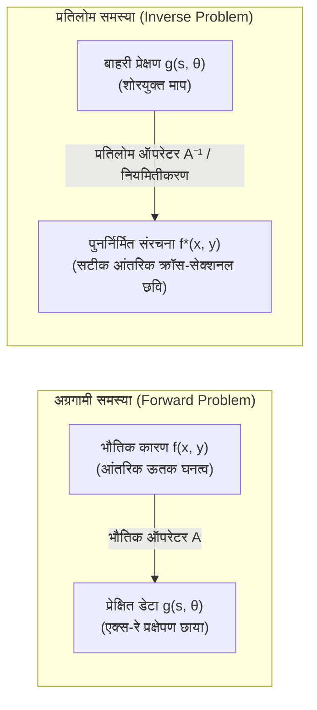

## प्रस्तावना: छायाओं के माध्यम से अदृश्य गहराइयों को देखना

हमारे दैनिक जीवन में कार्य-कारण का संबंध अत्यंत सीधा और सहज होता है: यदि हमें किसी वस्तु का आकार और प्रकाश स्रोत की स्थिति ज्ञात हो, तो दीवार पर पड़ने वाली छाया की रूपरेखा की गणना ज्यामितीय प्रकाशिकी के माध्यम से सरलता से की जा सकती है। इसी प्रकार, यदि पृथ्वी के आंतरिक भूगर्भीय घनत्व और लोचदार गुणों का ज्ञान हो, तो भूकंप के केंद्र से सतह तक पहुंचने वाली भूकंपीय तरंगों का सटीक अनुकरण तरंग समीकरण की सहायता से किया जा सकता है। इस प्रक्रिया को, जहां <strong>कारण (आंतरिक भौतिक पैरामीटर)</strong> से <strong>प्रभाव (बाहरी प्रेक्षण डेटा)</strong> प्राप्त किया जाता है, <strong>अग्रगामी समस्या (Forward Problem)</strong> कहा जाता है। अग्रगामी समस्याएं स्वभाव से स्थिर और अद्वितीय हल वाली होती हैं।

परंतु आधुनिक चिकित्सा विज्ञान, भूभौतिकी और खगोल विज्ञान में हमारे समक्ष इसके ठीक विपरीत चुनौती होती है:
- <strong>चिकित्सीय सीटी स्कैन (CT Scan)</strong>: रोगी के शरीर को चीरे बिना, केवल विभिन्न कोणों से शरीर से गुजरने वाली एक्स-रे किरणों के क्षीणन डेटा (1D छाया) से आंतरिक अंगों, कोमल ऊतकों और सूक्ष्म ट्यूमर का 3D चित्र कैसे तैयार किया जाए?
- <strong>भूभौतिकीय अन्वेषण</strong>: सतह पर दर्ज भूकंपीय परावर्तन तरंगों के आधार पर जमीन से कई किलोमीटर नीचे तेल और गैस के भंडारों या विवर्तनिक दरारों का मानचित्रण कैसे किया जाए?
- <strong>खगोलीय रेडियो इंटरफेरोमेट्री</strong>: इवेंट होराइजन टेलीस्कोप (EHT) ने अत्यंत विरल डेटा से सुपरमैसिव ब्लैक होल के अभिवृद्धि चक्र की पहली छवि कैसे बनाई?

बाहरी <strong>प्रेक्षित डेटा</strong> से आंतरिक <strong>भौतिक कारण</strong> को ज्ञात करने के इस गणितीय कार्य को <strong>प्रतिलोम समस्या (Inverse Problem)</strong> कहा जाता है।

---

## 1. प्रतिलोम समस्या क्या है?：हाडामार्ड सुस्थितता और अस्वस्थता की त्रासदी

प्रतिलोम समस्याओं को हल करना अग्रगामी समस्याओं की तुलना में अत्यधिक कठिन क्यों है?

### 1.1 ऑपरेटर समीकरण का स्वरूप
कार्यात्मक विश्लेषण में, समस्या को दो हिल्बर्ट स्थानों के बीच एक ऑपरेटर समीकरण के रूप में व्यक्त किया जाता है:
$$\mathcal{A} f = g$$
जहाँ $f \in \mathcal{X}$ आंतरिक अवशोषण गुणांक है, $g \in \mathcal{Y}$ मापा गया प्रक्षेपण डेटा है, और $\mathcal{A}$ एक रैखिक समाकल ऑपरेटर है।

### 1.2 हाडामार्ड के सुस्थितता मानदंड (1902)
फ्रांसीसी गणितज्ञ जाक हाडामार्ड ने कहा कि कोई समस्या <strong>सुस्थित (well-posed)</strong> तभी कहलाती है जब वह निम्नलिखित तीन शर्तों को पूरा करे:
1. <strong>अस्तित्व (Existence)</strong>: प्रत्येक डेटा $g$ के लिए कम से कम एक हल $f$ अवश्य हो।
2. <strong>अद्वितीयता (Uniqueness)</strong>: हल अद्वितीय हो ($\ker(\mathcal{A}) = \{0\}$)।
3. <strong>स्थिरता (Stability)</strong>: इनपुट डेटा में सूक्ष्म परिवर्तन होने पर हल में कोई अनियंत्रित विस्फोट न हो: $\|\delta f\| \le C \|\delta g\|$।

यदि इनमें से कोई भी शर्त पूरी नहीं होती, तो समस्या <strong>अस्वस्थ (ill-posed)</strong> कहलाती है।

### 1.3 कॉम्पैक्ट ऑपरेटर और उच्च-आवृत्ति शोर का संकट
वास्तविक भौतिकी में ऑपरेटर $\mathcal{A}$ लगभग हमेशा एक <strong>कॉम्पैक्ट ऑपरेटर (Compact Operator)</strong> होता है जो समाकलन के माध्यम से डेटा को अत्यधिक चिकना (smooth) बना देता है:
$$g(s) = \int_a^b K(s, t) f(t) \, dt$$
इसका प्रत्यक्ष प्रतिलोमन उच्च-आवृत्ति वाले शोर को बेतहाशा बढ़ा देता है। सिंगुलर वैल्यू अपघटन (SVD) के अनुसार जहाँ सिंगुलर मान शून्य की ओर अग्रसर होते हैं ($\sigma_n \to 0$):
$$f = \sum_{n=1}^\infty \frac{1}{\sigma_n} \langle g, u_n \rangle v_n$$
माप में उपस्थित मामूली सा शोर भी $\frac{1}{\sigma_n} \to \infty$ के कारण हजारों गुना बढ़ जाता है, जिससे बिना नियमितीकरण के पूरी छवि नष्ट हो जाती है।

---

## 2. समाकल ज्यामिति: जोहान रेडॉन (1917)

ऑस्ट्रियाई गणितज्ञ जोहान रेडॉन ने 1917 में एक ज्यामितीय प्रश्न का समाधान प्रस्तुत किया:
> "यदि हमें किसी समतल में सभी संभव सरल रेखाओं पर किसी फलन के रेखा-समाकल ज्ञात हों, तो क्या मूल फलन को अद्वितीय रूप से पुनर्निर्मित किया जा सकता है?"

### रेडॉन रूपांतरण की परिभाषा
एक सरल रेखा $L(s, \theta)$ को उसके अभिलंब कोण $\theta \in [0, \pi)$ और मूल बिंदु से दूरी $s \in (-\infty, \infty)$ द्वारा परिभाषित किया जाता है:
$$x \cos\theta + y \sin\theta = s$$
फलन $f(x, y)$ का रेडॉन रूपांतरण $\mathcal{R}f$ रेखा समाकल है:
$$(\mathcal{R}f)(s, \theta) = \iint_{\mathbb{R}^2} f(x, y) \, \delta(x \cos\theta + y \sin\theta - s) \, dx dy$$
चिकित्सा इमेजिंग में $(\mathcal{R}f)(s, \theta)$ के 2D निरूपण को <strong>साइनोग्राम (Sinogram)</strong> कहा जाता है।

---

## 3. सीटी स्कैन का भौतिक आधार: बीयर-लैम्बर्ट नियम

पदार्थ से गुजरने वाले एक्स-रे का क्षीणन बीयर-लैम्बर्ट नियम द्वारा निर्धारित होता है:
$$\frac{dI}{dt} = - f(\mathbf{x}) I \implies I_{\text{det}} = I_0 \exp\left( - \int_L f(\mathbf{x}) \, dt \right)$$
लघुगणक (logarithm) लेने से घातांकीय संबंध रैखिक समाकल में बदल जाता है:
$$g(s, \theta) = \ln\left( \frac{I_0}{I_{\text{det}}} \right) = \int_L f(\mathbf{x}) \, dt = (\mathcal{R}f)(s, \theta)$$
अतः सीटी स्कैन की समस्या गणितीय रूप से रेडॉन रूपांतरण के प्रतिलोमन के समतुल्य है।

---

## 4. फूरियर स्लाइस प्रमेय (Fourier Slice Theorem)

प्रक्षेपण डेटा और 2D छवि को जोड़ने वाला मुख्य गणितीय सूत्र फूरियर स्लाइस प्रमेय है:
$$\left( \mathcal{F}_1 [\mathcal{R}f(\cdot, \theta)] \right)(\omega) = \left( \mathcal{F}_2 f \right)(\omega \cos\theta, \; \omega \sin\theta)$$
यह दर्शाता है कि कोण $\theta$ पर 1D प्रक्षेपण का फूरियर रूपांतरण, मूल छवि के 2D फूरियर रूपांतरण के उसी कोण पर मूल बिंदु से गुजरने वाले स्लाइस के बिल्कुल बराबर होता है।

---

## 5. फ़िल्टर्ड बैकप्रोजेक्शन (Filtered Backprojection, FBP)

2D व्युत्क्रम फूरियर रूपांतरण को ध्रुवीय निर्देशांकों में बदलकर FBP कलन विधि प्राप्त होती है:
$$f(x, y) = \int_0^\pi \left[ \int_{-\infty}^\infty G(\omega, \theta) \cdot |\omega| \cdot e^{i 2\pi \omega (x\cos\theta + y\sin\theta)} \, d\omega \right] d\theta$$
1. <strong>रैंप फ़िल्टरिंग (Ramp Filter)</strong>: $|\omega|$ से गुणा करके साधारण बैकप्रोजेक्शन के धुंधलेपन ($1/r$) को समाप्त किया जाता है।
2. <strong>बैकप्रोजेक्शन</strong>: फ़िल्टर किए गए डेटा को सभी कोणों पर छवि ग्रिड पर वापस फैलाकर जोड़ा जाता है।

---

## 6. अस्वस्थता का समाधान: तिखोनोव नियमितीकरण

शोरयुक्त वातावरण में असतत समीकरण $\mathbf{A}\mathbf{f} + \boldsymbol{\eta} = \mathbf{g}$ को <strong>तिखोनोव नियमितीकरण</strong> (1963) द्वारा हल किया जाता है:
$$\min_{\mathbf{f}} \left\{ \|\mathbf{A}\mathbf{f} - \mathbf{g}\|_2^2 + \alpha \|\mathbf{L}\mathbf{f}\|_2^2 \right\}$$
इसका हल है:
$$\mathbf{f}_\alpha = (\mathbf{A}^T \mathbf{A} + \alpha \mathbf{L}^T \mathbf{L})^{-1} \mathbf{A}^T \mathbf{g}$$
फ़िल्टर कारक $\frac{\sigma_i^2}{\sigma_i^2 + \alpha}$ शून्य के निकट वाले सिंगुलर मानों को नियंत्रित करके शोर के विस्फोट को रोकता है।

---

## 7. आधुनिक क्षितिज: टोटल वेरिएशन और कम्प्रेस्ड सेंसिंग

- <strong>टोटल वेरिएशन (TV)</strong>: ग्रेडिएंट के $L_1$ मानक $\|\nabla \mathbf{f}\|_1$ का उपयोग करके किनारों को धुंधला किए बिना शोर को समाप्त करता है।
- <strong>कम्प्रेस्ड सेंसिंग (Compressed Sensing)</strong>: विरलता (sparsity) के सिद्धांत का उपयोग करके बहुत कम प्रक्षेपण कोणों से भी पूर्ण गुणवत्ता वाली छवि का पुनर्निर्माण करता है, जिससे एक्स-रे विकिरण का खतरा 80% से अधिक कम हो जाता है।
- <strong>डीप अनफोल्डिंग (Deep Unfolding)</strong>: रेडॉन ऑपरेटर को न्यूरल नेटवर्क में समाहित करके अत्यंत तेज़ और भौतिक रूप से विश्वसनीय पुनर्निर्माण प्रदान करता है।

## निष्कर्ष

प्लेटो की गुफा के रूपक की भांति, जहां केवल छायाएं दिखाई देती हैं, प्रतिलोम समस्याओं का गणित मानव बुद्धि की असीम शक्ति का प्रमाण है: केवल बाहरी छायाओं के विश्लेषण से हम प्रकृति और मानव शरीर के भीतर छिपी जटिल वास्तविकताओं को पूर्ण स्पष्टता के साथ उजागर कर सकते हैं।
