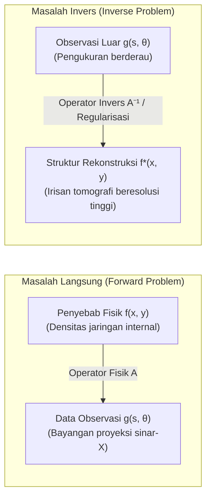

## Pendahuluan: Menatap Kedalaman Tak Terlihat Melalui Bayangan

Dalam pengalaman kita sehari-hari, hubungan sebab-akibat berlangsung secara alami dan searah: jika kita mengetahui bentuk geometris suatu objek dan posisi sumber cahaya, bentuk bayangan yang jatuh pada dinding dapat dihitung dengan mudah menggunakan optika geometris dasar. Demikian pula, jika kita mengetahui distribusi densitas dan sifat elastisitas lapisan batuan bumi, perambatan gelombang seismik dari pusat gempa menuju stasiun pengamatan dapat disimulasikan secara presisi menggunakan persamaan gelombang. Proses penarikan kesimpulan dari <strong>penyebab (parameter fisik internal sistem)</strong> menuju <strong>akibat (data observasi luar)</strong> disebut <strong>masalah langsung (Forward Problem)</strong>. Masalah langsung biasanya stabil, pasti, dan memiliki solusi unik.

Namun, di garda depan ilmu kedokteran, geofisika, dan astrofisika modern, kita menghadapi tantangan yang justru berkebalikan:
- <strong>Tomografi Terkomputasi Medis (CT Scan)</strong>: Tanpa membedah tubuh pasien, bagaimana cara merekonstruksi peta densitas jaringan lunak, pembuluh darah, atau tumor mikroskopis secara akurat hanya dari pengukuran proyeksi pelemahan sinar-X yang ditembakkan dari berbagai sudut di luar tubuh?
- <strong>Eksplorasi Geofisika</strong>: Bagaimana cara memetakan struktur patahan tektonik dan cadangan minyak ribuan meter di bawah tanah hanya dari data gelombang seismik yang dipantulkan ke permukaan bumi?
- <strong>Interferometri Astronomi</strong>: Bagaimana teleskop Event Horizon Telescope (EHT) berhasil menyintesis citra lubang hitam supermasif dari data korelasi spasial yang sangat terbatas?

Tugas matematika untuk membalikkan alur dari <strong>data observasi luar</strong> menuju <strong>penyebab fisik internal</strong> ini disebut <strong>masalah invers (Inverse Problems)</strong>.

---

## 1. Apa Itu Masalah Invers?：Kondisi Well-Posed Hadamard dan Bencana Ketidakstabilan

Mengapa menyelesaikan masalah invers jauh lebih menantang daripada masalah langsung?

### 1.1 Formulasi Persamaan Operator
Dalam analisis fungsional, masalah langsung dapat dimodelkan sebagai persamaan operator linear antara ruang Hilbert:
$$\mathcal{A} f = g$$
di mana $f \in \mathcal{X}$ adalah koefisien atenuasi jaringan biologis yang tidak diketahui, $g \in \mathcal{Y}$ adalah data proyeksi yang diukur detektor, dan $\mathcal{A}$ adalah operator integral linear.

### 1.2 Kriteria Well-Posed Hadamard (1902)
Matematikawan Prancis Jacques Hadamard menetapkan bahwa suatu masalah matematika-fisika dikatakan <strong>terdefinisi baik (well-posed)</strong> jika memenuhi tiga syarat berikut:
1. <strong>Keberadaan Solusi (Existence)</strong>: Untuk setiap data $g$, terdapat setidaknya satu solusi $f$.
2. <strong>Keunikan Solusi (Uniqueness)</strong>: Solusi bersifat unik ($\ker(\mathcal{A}) = \{0\}$).
3. <strong>Stabilitas Solusi (Stability)</strong>: Solusi bergantung secara kontinu pada data. Operator invers $\mathcal{A}^{-1}$ bersifat kontinu, sehingga galat kecil pada pengukuran tidak menyebabkan ledakan galat pada rekonstruksi: $\|\delta f\| \le C \|\delta g\|$.

Jika salah satu dari ketiga kondisi ini dilanggar, masalah tersebut disebut <strong>ill-posed (tidak terdefinisi baik)</strong>.

### 1.3 Operator Kompak dan Bencana Frekuensi Tinggi
Dalam medium kontinu, operator $\mathcal{A}$ hampir selalu berupa <strong>operator kompak</strong> yang melakukan perataan (smoothing) melalui integrasi:
$$g(s) = \int_a^b K(s, t) f(t) \, dt$$
Inversi langsung menyebabkan operator bekerja sebagai penguat frekuensi tinggi ekstrem. Melalui dekomposisi nilai singular (SVD) di mana nilai singular $\sigma_n \to 0$:
$$f = \sum_{n=1}^\infty \frac{1}{\sigma_n} \langle g, u_n \rangle v_n$$
Karena $\sigma_n \to 0$ saat $n \to \infty$, derau sekecil apa pun pada data akan dibagi dengan bilangan yang mendekati nol ($\frac{1}{\sigma_n} \to \infty$), menghancurkan solusi numerik sepenuhnya jika tanpa regularisasi.

---

## 2. Geometri Integral: Johann Radon (1917)

Pada tahun 1917, matematikawan Austria Johann Radon memecahkan masalah murni:
> "Dapatkah kita menentukan fungsi kontinu dua dimensi secara unik jika kita mengetahui nilai integral garis fungsi tersebut di sepanjang seluruh garis lurus di bidang?"

Radon membuktikan keunikan tersebut dan menemukan rumus inversi analitik eksak.

### Definisi Transformasi Radon
Suatu garis lurus $L(s, \theta)$ diparameterisasi oleh sudut normal $\theta \in [0, \pi)$ dan jarak berarah dari titik asal $s \in (-\infty, \infty)$:
$$x \cos\theta + y \sin\theta = s$$
Transformasi Radon $\mathcal{R}f$ didefinisikan sebagai integral garis:
$$(\mathcal{R}f)(s, \theta) = \iint_{\mathbb{R}^2} f(x, y) \, \delta(x \cos\theta + y \sin\theta - s) \, dx dy$$
Dalam pencitraan medis, visualisasi dua dimensi dari data $(\mathcal{R}f)(s, \theta)$ disebut <strong>sinogram</strong>.

---

## 3. Fisika CT Scan: Hukum Beer-Lambert

Pelemahan berkas sinar-X yang melewati jaringan tubuh mengikuti hukum eksponensial Beer-Lambert:
$$\frac{dI}{dt} = - f(\mathbf{x}) I \implies I_{\text{det}} = I_0 \exp\left( - \int_L f(\mathbf{x}) \, dt \right)$$
Dengan mengambil logaritma natural dari rasio intensitas, hubungan eksponensial diubah menjadi integral garis linear:
$$g(s, \theta) = \ln\left( \frac{I_0}{I_{\text{det}}} \right) = \int_L f(\mathbf{x}) \, dt = (\mathcal{R}f)(s, \theta)$$
Dengan demikian, rekonstruksi citra CT Scan secara matematis identik dengan inversi Transformasi Radon.

---

## 4. Teorema Irisan Fourier (Fourier Slice Theorem)

Hubungan fundamental antara proyeksi 1D dan citra 2D diberikan oleh <strong>Teorema Irisan Fourier</strong>:
$$\left( \mathcal{F}_1 [\mathcal{R}f(\cdot, \theta)] \right)(\omega) = \left( \mathcal{F}_2 f \right)(\omega \cos\theta, \; \omega \sin\theta)$$
Teorema ini menyatakan bahwa transformasi Fourier 1D dari proyeksi pada sudut $\theta$ setara dengan irisan radial melalui titik asal dari transformasi Fourier 2D objek asli pada sudut yang sama.

---

## 5. Algoritma Filtered Backprojection (FBP)

Dengan mengubah transformasi Fourier balik 2D ke koordinat polar, diperoleh algoritma FBP:
$$f(x, y) = \int_0^\pi \left[ \int_{-\infty}^\infty G(\omega, \theta) \cdot |\omega| \cdot e^{i 2\pi \omega (x\cos\theta + y\sin\theta)} \, d\omega \right] d\theta$$
1. <strong>Penyaringan Ram-Lak (Ramp Filter)</strong>: Mengalikan sinyal domain frekuensi dengan $|\omega|$ untuk menghilangkan efek kekaburan $1/r$ dari proyeksi balik sederhana.
2. <strong>Proyeksi Balik Spasial</strong>: Menyebarkan nilai-nilai terfilter kembali ke seluruh kisi citra di sepanjang semua sudut pengambilan data.

---

## 6. Mengatasi Masalah Ill-Posed: Regularisasi Tikhonov

Dalam kondisi praktis dengan derau pengukuran dan jumlah sudut terbatas, sistem diskret $\mathbf{A}\mathbf{f} + \boldsymbol{\eta} = \mathbf{g}$ diselesaikan menggunakan <strong>regularisasi Tikhonov</strong> (1963):
$$\min_{\mathbf{f}} \left\{ \|\mathbf{A}\mathbf{f} - \mathbf{g}\|_2^2 + \alpha \|\mathbf{L}\mathbf{f}\|_2^2 \right\}$$
Solusi analitiknya adalah:
$$\mathbf{f}_\alpha = (\mathbf{A}^T \mathbf{A} + \alpha \mathbf{L}^T \mathbf{L})^{-1} \mathbf{A}^T \mathbf{g}$$
Faktor filter $\frac{\sigma_i^2}{\sigma_i^2 + \alpha}$ menahan pertumbuhan nilai singular kecil, mencegah amplifikasi derau liar.

---

## 7. Arah Modern: Total Variation dan Compressed Sensing

- <strong>Total Variation (TV)</strong>: Meminimalkan norma $L_1$ dari gradien $\|\nabla \mathbf{f}\|_1$, menjaga ketajaman batas organ tanpa menimbulkan keburaman tepi.
- <strong>Compressed Sensing</strong>: Membuktikan bahwa citra dapat direkonstruksi secara sempurna dari sudut proyeksi yang jauh lebih sedikit, mengurangi paparan radiasi sinar-X pada pasien hingga lebih dari 80%.
- <strong>Deep Unfolding</strong>: Menggabungkan operator fisik Radon ke dalam arsitektur deep learning untuk rekonstruksi instan dan tepercaya secara klinis.

## Kesimpulan

Seperti perumpamaan gua Plato di mana manusia memahami kenyataan melalui bayangan di dinding gua, matematika masalah invers membuktikan keagungan rasio manusia: dari bayangan proyeksi eksternal yang terbatas, kita mampu merekonstruksi kenyataan tersembunyi di bagian dalam alam semesta dan tubuh manusia dengan kejernihan sempurna.
