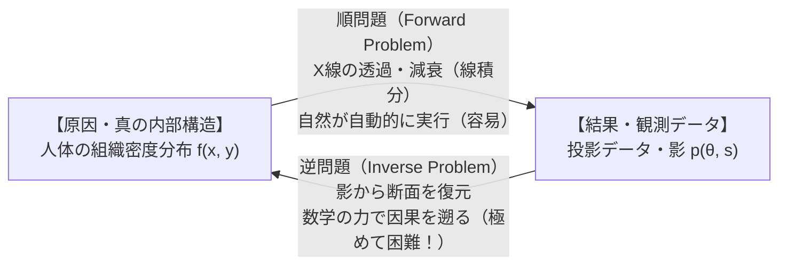
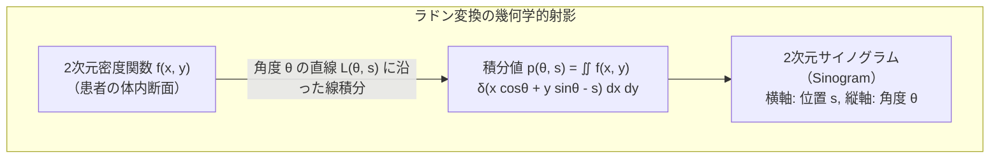
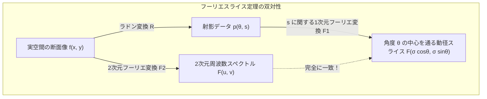
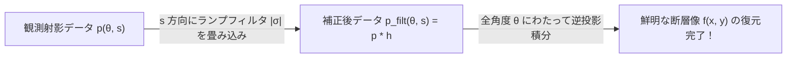
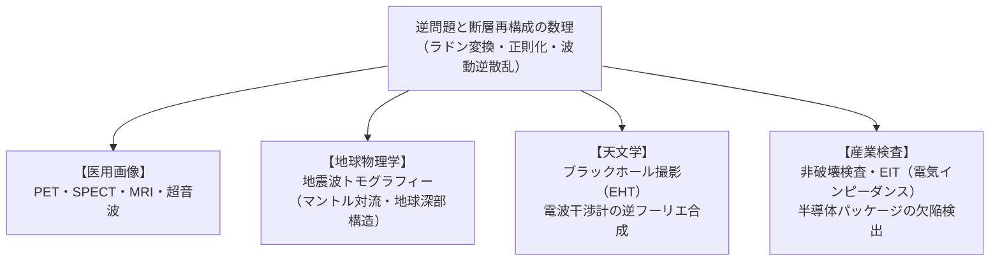

物体を壊したり切り開いたりすることなく、その「見えない内部」を覗き見ることはできるでしょうか？

現代の病院に行けば、コンピュータ断層撮影（Computed Tomography, CT）装置の円形ガントリーの中に横たわるだけで、医師は私たちの脳出血、肺がん、骨折の有無を、髪の毛ほどの解像度の3次元断面画像として瞬時に視認することができます。

しかし、冷静に物理現象を考えてみてください。CTスキャナが実際に計測しているのは、人体の「断面画像」そのものでは決してありません。X線源が患者の周囲を回転しながら照射し、反対側の検出器が受け取っているのは、<strong>「あらゆる角度から投影された、X線の減衰量の影（積分値）」</strong>のデータ群（サイノグラム, Sinogram）に過ぎません。

私たちは、対象の「影」しか見ていないのです。
では、<strong>なぜ無数の「1次元の影」の集まりから、元の「2次元の断面」や「3次元の臓器の形」を寸分の狂いもなく復元できるのでしょうか？</strong>

この問いは、現代数学において最も広大で挑戦的な領域の一つである<strong>「逆問題（Inverse Problems）」</strong>の最も輝かしい成功例です。

原因から結果を予測する「順問題（Forward Problem）」に対し、観測された結果から隠された原因を逆算する「逆問題」は、数学的に極めて厄介な<strong>「不良設定性（Ill-posedness）」</strong>という病を宿しています。観測データに含まれるわずかな微小ノイズが、復元計算の過程で爆発的に増幅され、解を無意味なノイズの海へと崩壊させてしまうのです。

1917年のヨハン・ラドン（Johann Radon）による純粋数学的定理から、アラン・コーマックとゴッドフリー・ハウンズフィールドによるノーベル賞受賞のCT実用化、フーリエスライス定理、フィルタ補正逆投影法（FBP）、そしてチホノフ正則化やスパースモデリング（圧縮センシング）に至るまで、人類が「見えない中身を暴く」ために築き上げた驚異の数理体系を、16,000字を超える圧倒的な密度で徹底的に解き明かします。

---

## 1. 順問題と逆問題：因果の矢を逆回しにする挑戦

物理学や工学が扱う問題の多くは、「原因（入力）」が与えられたときに「結果（出力）」を計算する<strong>「順問題（Forward Problem / Direct Problem）」</strong>です。

- <strong>順問題の例</strong>:
  - 物体の質量・形状・初速度が分かっているとき、放物運動の軌道を計算する。
  - 人体の臓器の正確な密度分布 $f(x, y)$ が分かっているとき、そこを透過したX線がどれだけ減衰するかを計算する（ランベルト・ベールの法則）。
  - 地震の震源と地下構造が分かっているとき、地表の地震計に到達する波形をシミュレーションする。

順問題は通常、偏微分方程式の初期値・境界値問題として定式化され、解の存在・一意性・安定性が保証された「扱いやすい問題」です。

これに対し、私たちが現実に直面する観測や診断の現場は、常に<strong>「逆問題（Inverse Problem）」</strong>です。

- <strong>逆問題の例</strong>:
  - 人体の外側で観測したX線の影 $p(\theta, s)$ から、体内組織の未知の密度分布 $f(x, y)$ を逆算する（<strong>CTスキャン</strong>）。
  - 地表で観測した地震波の到達時刻から、目に見えない地球内部のマントルや核の構造を推定する（<strong>地震波トモグラフィー</strong>）。
  - 遠く離れた望遠鏡で捉えた電波の干渉縞から、ブラックホールの影（事象の地平面）の画像を復元する（<strong>EHTプロジェクト</strong>）。

### 1.1 アダマールの「良設定（Well-Posed）」の3条件

フランスの数学者ジャック・アダマール（Jacques Hadamard, 1902年）は、物理現象を正しく記述する数学的モデルが満たすべき性質として、以下の3つの条件を提唱しました。これらを満たす問題を<strong>「良設定問題（Well-Posed Problem）」</strong>と呼びます。

1. <strong>存在性（Existence）</strong>:
   任意の観測データ $g$ に対し、それをもたらす解 $f$ が少なくとも1つ存在する。
2. <strong>一意性（Uniqueness）</strong>:
   データ $g$ に対応する解 $f$ は、ただ1つしか存在しない（別の構造が全く同じデータを生み出さない）。
3. <strong>連続性・安定性（Stability）</strong>:
   解 $f$ はデータ $g$ に連続的に依存する。すなわち、観測データに微小なノイズ $\Delta g$ が乗ったとき、復元される解の変動 $\Delta f$ も微小に留まる。

### 1.2 逆問題が抱える「不適切性（Ill-Posedness）」の呪い

ほとんどすべての逆問題は、<strong>アダマールの第3条件「安定性」を破綻させている「不良設定問題（Ill-Posed Problem）」</strong>です。

数学的には、順問題を解く作用素を $K: X \to Y$（例えば積分作用素）とすると、積分作用素は高周波の凸凹を滑らかに均してしまう「平滑化作用（Smoothing Property）」を持っています。
したがって、その逆作用素 $K^{-1}: Y \to X$ を作用させる逆問題は、<strong>「微分操作」</strong>に対応します。

微小な測定ノイズ $\epsilon \sin(\omega x)$ がデータに混入していたとしましょう。ノイズの振幅 $\epsilon$ は目に見えないほど小さくても、周波数 $\omega$ が極めて高い場合、それを逆問題として微分すると：
$$
\frac{d}{dx} \left[ \epsilon \sin(\omega x) \right] = \epsilon \omega \cos(\omega x)
$$
となり、振幅は $\epsilon \omega$ へと跳ね上がります。周波数 $\omega \to \infty$ の極限では、ノイズは無限大に爆発し、復元画像は完全に破壊されてしまうのです。

この「ノイズの爆発」を抑え込みながら、真の断面像をいかに安定して取り出すか——これが逆問題の数学が格闘し続けてきた核心テーマです。

---

## 2. ラドン変換：影の積分を記述する幾何学

CTスキャンの数学的基礎は、オーストリアの数学者<strong>ヨハン・ラドン（Johann Radon）</strong>が1917年に発表した画期的な論文によって、CT装置が発明される50年以上も前にすでに完成していました。

### 2.1 X線の減衰とランベルト・ベールの法則

X線が物質中を直進するとき、物質の局所的なX線吸収係数（密度に比例）を $f(x, y) \ge 0$ とします。
入射時のX線強度を $I_0$、人体を透過した後の測定強度を $I$ とすると、微小区間での減衰率は吸収係数に比例するため：

$$
\frac{dI}{I} = -f(x, y) \, dl
$$

この微分方程式をX線のビーム経路 $L$ に沿って積分すると、<strong>ランベルト・ベールの法則（Beer-Lambert Law）</strong>が得られます：

$$
I = I_0 \exp\left( -\int_L f(x, y) \, dl \right)
$$

両辺の対数を取って符号を反転させると：

$$
p = -\ln\left(\frac{I}{I_0}\right) = \int_L f(x, y) \, dl
$$

測定された入射強度 $I_0$ と透過強度 $I$ の比率から、<strong>「直線 $L$ 上における未知の密度関数 $f(x, y)$ の線積分値 $p$」</strong>が直接求まることが分かります。

### 2.2 ラドン変換の数学的定義

2次元平面上の直線 $L$ は、原点からの符号付き距離 $s \in \mathbb{R}$ と、法線ベクトルの傾き角 $\theta \in [0, \pi)$ を用いて、次のようにパラメータ表示できます：

$$
L(\theta, s) = \left\{ (x, y) \in \mathbb{R}^2 \;\middle|\; x \cos\theta + y \sin\theta = s \right\}
$$

2次元関数 $f(x, y)$ を、すべての直線 $L(\theta, s)$ に沿って積分する積分変換を<strong>「ラドン変換（Radon Transform）」</strong> $\mathcal{R}$ と呼びます：

$$
\mathcal{R}f(\theta, s) = \int_{-\infty}^{\infty} \int_{-\infty}^{\infty} f(x, y) \, \delta(x \cos\theta + y \sin\theta - s) \, dx \, dy
$$

ここで $\delta(\cdot)$ はディラックのデルタ関数です。直線に沿った線素 $t$ を用いて回転座標系で書き直せば：

$$
\begin{pmatrix} x \\ y \end{pmatrix} = \begin{pmatrix} \cos\theta & -\sin\theta \\ \sin\theta & \cos\theta \end{pmatrix} \begin{pmatrix} s \\ t \end{pmatrix} = \begin{pmatrix} s\cos\theta - t\sin\theta \\ s\sin\theta + t\cos\theta \end{pmatrix}
$$

$$
\mathcal{R}f(\theta, s) = \int_{-\infty}^{\infty} f(s\cos\theta - t\sin\theta, \; s\sin\theta + t\cos\theta) \, dt
$$

### 2.3 サイノグラム（Sinogram）：影が描く正弦波の軌跡

角度 $\theta$ を $0$ から $\pi$（$180^\circ$）まで連続的に回転させながら得られる射影データ $p(\theta, s) = \mathcal{R}f(\theta, s)$ を、横軸 $s$、縦軸 $\theta$ の2次元濃淡画像として可視化したものを<strong>「サイノグラム（Sinogram）」</strong>と呼びます。

体内にある単一の点状の構造（座標 $(x_0, y_0) = (r_0 \cos\phi_0, r_0 \sin\phi_0)$）を考えてみましょう。この点が直線 $x\cos\theta + y\sin\theta = s$ 上に乗る条件は：

$$
s(\theta) = x_0 \cos\theta + y_0 \sin\theta = r_0 \cos(\theta - \phi_0)
$$

となります。すなわち、点光源はサイノグラム平面上において<strong>「美しい正弦波（サインカーブ）」</strong>を描くのです。「サイノグラム（Sinogram）」という名称は、この正弦波（Sine wave）の軌跡に由来しています。

CTの再構成問題とは、数学的に言えば：
<strong>「無数の正弦波が重なり合って複雑に混ざり合ったサイノグラム $p(\theta, s)$ から、元の2次元画像 $f(x, y)$ を復元する（ラドン逆変換 $\mathcal{R}^{-1}$ を求める）こと」</strong>
に他なりません。

---

## 3. フーリエスライス定理：トモグラフィーの心臓部

ラドン変換の逆変換を解析的に導くための最大の鍵となるのが、<strong>「フーリエスライス定理（Fourier Slice Theorem / 投影スライス定理）」</strong>です。

この定理は、<strong>「実空間における1次元の影（射影）」</strong>と<strong>「周波数空間（フーリエ空間）における断面」</strong>を結ぶ、息を呑むほど美しい等価性を主張します。

### 3.1 定理の主張

> <strong>フーリエスライス定理（Projection-Slice Theorem）</strong>
> 関数 $f(x, y)$ の角度 $\theta$ におけるラドン射影 $p(\theta, s)$ の、$s$ に関する1次元フーリエ変換 $\mathcal{F}_1\{p(\theta, \cdot)\}(\sigma)$ は、元の関数 $f(x, y)$ の2次元フーリエ変換 $F(u, v) = \mathcal{F}_2\{f\}(u, v)$ を、角度 $\theta$ で原点を通る直線上に切り取った（スライスした）値と厳密に一致する：
> $$
> \mathcal{F}_1\{\mathcal{R}f(\theta, \cdot)\}(\sigma) = F(\sigma\cos\theta, \; \sigma\sin\theta)
> $$

### 3.2 厳密な証明

1次元フーリエ変換の定義から出発します：

$$
\mathcal{F}_1\{p(\theta, \cdot)\}(\sigma) = \int_{-\infty}^{\infty} p(\theta, s) \, e^{-i 2\pi \sigma s} \, ds
$$

ここに $p(\theta, s) = \iint_{\mathbb{R}^2} f(x, y) \delta(x\cos\theta + y\sin\theta - s) \, dx \, dy$ を代入します：

$$
\mathcal{F}_1\{p(\theta, \cdot)\}(\sigma) = \int_{-\infty}^{\infty} \left[ \iint_{\mathbb{R}^2} f(x, y) \, \delta(x\cos\theta + y\sin\theta - s) \, dx \, dy \right] e^{-i 2\pi \sigma s} \, ds
$$

積分の順序を交換します（フビニの定理）：

$$
\mathcal{F}_1\{p(\theta, \cdot)\}(\sigma) = \iint_{\mathbb{R}^2} f(x, y) \left[ \int_{-\infty}^{\infty} \delta(x\cos\theta + y\sin\theta - s) \, e^{-i 2\pi \sigma s} \, ds \right] dx \, dy
$$

デルタ関数のサンプリング特性（$\int \delta(s - s_0) g(s) ds = g(s_0)$）を適用すると、内側の積分は $s = x\cos\theta + y\sin\theta$ を代入したものになります：

$$
\int_{-\infty}^{\infty} \delta(x\cos\theta + y\sin\theta - s) \, e^{-i 2\pi \sigma s} \, ds = e^{-i 2\pi \sigma (x\cos\theta + y\sin\theta)}
$$

したがって：

$$
\mathcal{F}_1\{p(\theta, \cdot)\}(\sigma) = \iint_{\mathbb{R}^2} f(x, y) \, e^{-i 2\pi \left[ x(\sigma\cos\theta) + y(\sigma\sin\theta) \right]} \, dx \, dy
$$

右辺をよく見てください。これは、2次元周波数座標を：
$$
u = \sigma\cos\theta, \quad v = \sigma\sin\theta
$$
としたときの、$f(x, y)$ の<strong>2次元フーリエ変換そのもの</strong>です！

$$
F(u, v) = \iint_{\mathbb{R}^2} f(x, y) \, e^{-i 2\pi (ux + vy)} \, dx \, dy
$$

証明完了（Q.E.D.）。

この定理が意味する物理的インパクトは絶大です。
「1つの角度から影を測る」という行為は、「2次元フーリエ周波数平面上の原点を通る直線上のデータを1本スキャンした」ことと等価なのです。
したがって、スキャナを $0^\circ$ から $180^\circ$ までぐるりと1周回せば、<strong>2次元フーリエ平面全体がスポーク状の直線群によって隈なく埋め尽くされます</strong>。あとは2次元逆フーリエ変換をかけるだけで、理論上は元の断面画像 $f(x, y)$ が完全に復元できるのです！

---

## 4. フィルタ補正逆投影法（FBP）：臨床CTの標準アルゴリズム

フーリエスライス定理によって理論的な再構成可能性は示されましたが、極座標格子（スポーク状）から直交座標格子（グリッド）への周波数空間での補間は、計算誤差が大きく画像に深刻なアーチファクトを生じさせます。

そこで、実空間上で高速かつ高精度に再構成を行うための標準手法として開発されたのが<strong>「フィルタ補正逆投影法（Filtered Backprojection, FBP）」</strong>です。

### 4.1 単純逆投影（Simple Backprojection）の失敗：なぜボケるのか？

最も素朴な画像復元のアイデアは「逆投影（Backprojection）」です。
「ある直線に沿って減衰が大きかったなら、その直線上のすべての点に均等に密度を塗り戻す」という操作を、あらゆる角度 $\theta$ について重ね合わせ（積分）ます。

数学的には、逆投影作用素 $\mathcal{B}$ は次のように定義されます：

$$
(\mathcal{B}p)(x, y) = \int_0^\pi p(\theta, \; x\cos\theta + y\sin\theta) \, d\theta
$$

しかし、この単純逆投影を実行すると、元の画像は<strong>激しくボケてしまい、霧がかかったような不鮮明な画像</strong>になってしまいます。

なぜボケるのでしょうか？
点状の構造を全方向から逆投影すると、原点を中心として星型に線が重なり合います。この点像分布関数（Point Spread Function, PSF）を計算すると、原点からの距離 $r = \sqrt{x^2 + y^2}$ に反比例して強度が減衰することが証明されます：

$$
\text{PSF}_{\text{simple}}(r) \propto \frac{1}{r}
$$

周波数空間で見ると、$1/r$ のフーリエ変換は $1/|\sigma|$ です。すなわち、単純逆投影を行うと、<strong>低周波成分（画像の平坦な部分）が不当に過剰強調され、高周波成分（エッジや輪郭）が $1/|\sigma|$ で激しく減衰してしまう</strong>のです。

### 4.2 ランプフィルタ（Ram-Lak Filter）による補正

このボケ（$1/|\sigma|$ の減衰）を完全にキャンセルするためにはどうすればよいでしょうか？
答えは明快です。<strong>あらかじめ逆投影する前の射影データに対して、周波数振幅 $|\sigma|$ を掛け算する高域通過フィルタ（High-Pass Filter）を適用すればよい</strong>のです！

周波数特性が $|\sigma|$ に比例するフィルタを<strong>「ランプフィルタ（Ramp Filter）」</strong>、または考案者の名を取って<strong>「Ram-Lakフィルタ（Ramachandran-Lakshminarayanan, 1971）」</strong>と呼びます。

$$
H(\sigma) = |\sigma|
$$

### 4.3 FBPの完全な再構成公式

2次元逆フーリエ変換の式を極座標変換（$u = \sigma\cos\theta, v = \sigma\sin\theta$、ヤコビアン $dudv = |\sigma| d\sigma d\theta$）することで、FBPの数学的公式が厳密に導かれます：

$$
f(x, y) = \int_0^\pi \left[ \int_{-\infty}^{\infty} \mathcal{F}_1\{p(\theta, \cdot)\}(\sigma) \, |\sigma| \, e^{i 2\pi \sigma s} \, d\sigma \right]_{s = x\cos\theta + y\sin\theta} d\theta
$$

内側の積分は、射影データ $p(\theta, s)$ と、ランプフィルタの逆フーリエ変換 $h(s) = \mathcal{F}^{-1}\{|\sigma|\}$ との<strong>1次元畳み込み（Convolution）</strong>です：

$$
p_{\text{filtered}}(\theta, s) = (p * h)(\theta, s) = \int_{-\infty}^{\infty} p(\theta, s') \, h(s - s') \, ds'
$$

したがって、FBPのアルゴリズムは以下の極めてエレガントな2ステップに集約されます：

1. <strong>フィルタリング（Filtering）</strong>: 各角度 $\theta$ の射影データ $p(\theta, s)$ に対して、ランプフィルタ $h(s)$ を畳み込む（微分に相当し、ボケを打ち消す負のサイドローブを付与する）。
2. <strong>逆投影（Backprojection）</strong>: フィルタ補正されたデータ $p_{\text{filtered}}(\theta, x\cos\theta + y\sin\theta)$ を全角度にわたって足し合わせる。

このアルゴリズムは各角度のデータを独立に並列処理できるため、現代の医療現場において数千枚の断層画像を数秒で再構成する驚異的な計算速度を実現しています。

---

## 5. アポダイゼーション窓とノイズ制御

しかし、純粋なランプフィルタ $H(\sigma) = |\sigma|$ には致命的な弱点があります。
周波数 $|\sigma|$ に比例してゲインが増大し続けるため、<strong>高周波領域に存在する測定ノイズ（散乱線や光子ゆらぎ）を無限に増幅してしまう</strong>のです。

現実のCTスキャナでは、ナイキスト周波数 $\sigma_{\text{max}} = 1/(2\Delta s)$ を超えるノイズの暴走を抑えるため、ランプフィルタに滑らかな窓関数（Window Function / Apodization Window）を乗算します。

| フィルタ名 | 周波数伝達関数 $H(\sigma)$ | 特徴と用途 |
| :---: | :---: | :---: |
| <strong>Ram-Lak</strong> | $|\sigma| \cdot \text{rect}\left(\frac{\sigma}{2\sigma_{\text{max}}}\right)$ | 解像度は最高だが、ノイズが非常に強調される |
| <strong>Shepp-Logan</strong> | $|\sigma| \cdot \text{sinc}\left(\frac{\sigma}{2\sigma_{\text{max}}}\right)$ | 高周波を穏やかに減衰させ、ノイズと解像度のバランスに優れる（標準的） |
| <strong>Hann / Hamming</strong> | $|\sigma| \cdot \left[ \alpha + (1-\alpha)\cos\left(\frac{\pi\sigma}{\sigma_{\text{max}}}\right) \right]$ | ノイズを強力に抑制し、軟部組織（脳や肝臓）の微細なコントラストを明瞭化 |

どの窓関数を選択するかは、「空間解像度（骨などの微小構造を見る）」と「密度分解能（わずかな組織の濃淡差を見る）」のトレードオフをどう調整するかという臨床工学的な最適化問題となります。

---

## 6. 不良設定性と正則化理論：チホノフ正則化の数理

現実の逆問題は、FBPのような解析的逆変換が使えない状況（照射角度が制限された限定角CT、低線量撮影、疎らなサンプリング）において、連立一次方程式系としての離散定式化が必要となります。

$$
A f = g + \epsilon
$$

ここで $f \in \mathbb{R}^N$ は復元したい画像の各ピクセル値、$g \in \mathbb{R}^M$ は検出器の測定値、$A \in \mathbb{R}^{M \times N}$ は幾何学的投影行列（システム行列）、$\epsilon$ は観測ノイズです。

### 6.1 特異値分解（SVD）で暴く悪条件性

システム行列 $A$ の特異値分解（SVD）を $A = U \Sigma V^T$ とします。
特異値を大きい順に $\sigma_1 \ge \sigma_2 \ge \dots \ge \sigma_r > 0$ と並べると、形式的な最小二乗解（擬似逆行列解）は：

$$
f = A^\dagger g = \sum_{k=1}^r \frac{u_k^T g}{\sigma_k} v_k
$$

と表されます。
積分方程式に由来する行列 $A$ では、<strong>特異値 $\sigma_k$ はインデックス $k$ が大きくなるにつれて指数関数的にゼロへ減衰</strong>します（$\sigma_k \to 0$）。

測定データ $g$ にノイズ $\epsilon$ が乗っている場合、第 $k$ 成分の解への寄与は：

$$
\frac{u_k^T (g_{\text{true}} + \epsilon)}{\sigma_k} = \frac{u_k^T g_{\text{true}}}{\sigma_k} + \frac{u_k^T \epsilon}{\sigma_k}
$$

分母の特異値 $\sigma_k$ が極微であるため、ノイズ成分 $\frac{u_k^T \epsilon}{\sigma_k}$ は天文学的な大きさに増幅されます。これが、逆問題においてナイーブな逆行列計算が完全に破綻する数学的本質です。

### 6.2 チホノフ正則化（Tikhonov Regularization / $L_2$ 正則化）

この特異値のゼロ割りを防ぐために、ソ連の数学者アンドレイ・チホノフ（Andrey Tikhonov, 1963年）は、目的関数に「解の滑らかさ」をペナルティ項（正則化項）として追加する最適化問題を考案しました：

$$
\min_{f} \left\{ \|A f - g\|_2^2 + \alpha \|L f\|_2^2 \right\}
$$

ここで $\alpha > 0$ は<strong>正則化パラメータ</strong>、$L$ は単位行列 $I$ や差分作用素（ラプラシアン）です。

この最適化問題の停留条件（勾配がゼロ）をとると、正規方程式が得られます：

$$
(A^T A + \alpha L^T L) f = A^T g
$$

$L = I$ の場合、特異値分解を用いて解を表現すると：

$$
f_{\alpha} = \sum_{k=1}^r \left( \frac{\sigma_k^2}{\sigma_k^2 + \alpha} \right) \frac{u_k^T g}{\sigma_k} v_k
$$

フィルタ係数 $w_k = \frac{\sigma_k^2}{\sigma_k^2 + \alpha}$ に注目してください：
- 特異値が大きい主成分（$\sigma_k^2 \gg \alpha$）では、$w_k \approx 1$ となり、データがそのまま忠実に復元されます。
- 特異値が小さい高周波ノイズ成分（$\sigma_k^2 \ll \alpha$）では、$w_k \approx \frac{\sigma_k^2}{\alpha} \to 0$ となり、急激にカットオフされてノイズの爆発が完璧に抑制されます！

チホノフ正則化は、現代のデータ科学や機械学習における「リッジ回帰（Ridge Regression）」の母体となった、不適切逆問題を克服するための記念碑的数理技術です。

---

## 7. 圧縮センシングとスパースモデリング：被曝線量の劇的低減

チホノフ正則化（$L_2$ ノルム）はノイズを効果的に抑えますが、エッジ（臓器の輪郭や血管の境界）まで滑らかにぼかしてしまうという欠点がありました。

2000年代半ば、エマニュエル・カンデス（Emmanuel Candès）、テレンス・タオ（Terence Tao）、デヴィッド・ドノホ（David Donoho）らによって打ち立てられた<strong>「圧縮センシング（Compressed Sensing, CS）」</strong>の理論は、CT画像再構成に第2の革命をもたらしました。

### 7.1 全変動正則化（Total Variation, TV）

医用画像は、同じ臓器の内部では密度がほぼ均一であり、境界（エッジ）でのみ値がステップ状に急変するという性質を持っています。すなわち、画像の勾配 $\nabla f$ をとると、境界以外の大部分のピクセルで値が $0$ になる<strong>「スパース性（Sparsity / 疎性）」</strong>を持っています。

全変動（TV）ノルムは、画像の勾配ベクトルの $L_1$ ノルムとして定義されます：

$$
\text{TV}(f) = \|\nabla f\|_1 = \sum_{x, y} \sqrt{ (f_{x+1, y} - f_{x, y})^2 + (f_{x, y+1} - f_{x, y})^2 }
$$

最適化問題は以下のように定式化されます：

$$
\min_{f} \left\{ \frac{1}{2} \|A f - g\|_2^2 + \lambda \|\nabla f\|_1 \right\}
$$

$L_1$ ノルムの幾何学的性質（尖ったひし形の等高線）により、ノイズによる微小な勾配変動は完全にゼロに押し潰され（平坦化）、真の解剖学的エッジにおける大きな勾配だけが鋭利に保持されます。

### 7.2 わずかな照射角度からの完全復元

圧縮センシング理論の驚くべき帰結は、<strong>「従来の1/10以下の照射角度数（スパースサンプリング）であっても、解がスパースであれば数学的に完全な画像再構成が可能である」</strong>という点にあります。

これにより、現代の医療現場では、患者が浴びるX線被曝線量を $70\% \sim 90\%$ も削減しながら、従来と同等以上の極めてシャープな高画質CT画像を生成する「逐次近似再構成（Iterative Reconstruction）」技術として臨床実用化されています。

---

## 8. CTを超えて広がる逆問題の世界

ラドン変換と逆問題の数学は、医療用X線CTにとどまらず、自然科学と先端技術のあらゆる領域で「見えない内部の可視化」を牽引しています。

1. <strong>核医学（PET / SPECT）</strong>:
   放射性同位元素を体内に注入し、体内から放出されるガンマ線を検出して代謝機能を断層撮影する。減衰補正を含んだ「減衰ラドン変換（Attenuated Radon Transform）」を解く。
2. <strong>核磁気共鳴画像法（MRI）</strong>:
   傾斜磁場をかけることで、プロトンの共鳴周波数・位相を空間座標に対応させ、<strong>最初から2次元・3次元フーリエ空間（k-space）のデータを直接収集</strong>する。逆フーリエ変換そのものが画像生成となるトモグラフィー。
3. <strong>地球物理学（地震波トモグラフィー）</strong>:
   世界各地の地震計が記録したP波・S波の走時データから、地球内部の3次元速度構造を復元。プレートの沈み込みや巨大マントルプルームの姿を可視化。
4. <strong>イベント・ホライズン・テレスコープ（EHT）</strong>:
   世界中の電波望遠鏡を干渉計として結び、地球サイズの仮想望遠鏡を構築。スパースモデリング（$L_1$ 正則化）を用いて、銀河中心の超巨大ブラックホールの「影」を画像化した世紀の快挙。

---

## 9. まとめ：影から真実を紡ぎ出す数学の勝利

プラトンの有名な「洞窟の比喩」において、囚人たちは洞窟の壁に投影された影を見て、それを真実の世界だと信じ込んでいました。

しかし、逆問題の数学を手にした現代の人類は、洞窟の壁に落ちた無数の影（ラドン射影）を丹念に観測し、フーリエスライス定理と正則化理論という知性の光を当てることによって、<strong>影の向こう側にある「真実の立体」の姿を完全に再構成することに成功しました。</strong>

目に見えないものを見たい。人体を傷つけることなく病巣を見つけたい。地球の底深く、そして宇宙の果てを透視したい。

その切なる願いを叶えたのは、巨大なレンズでも強力なメスでもなく、ヨハン・ラドンがノートの上に走らせた、紙と鉛筆の純粋な積分方程式でした。影から断面を復元する逆問題の数学は、目に見える現象の背後にある「隠された因果」を暴き出す、人間の抽象的思考力が到達した最高の知的モニュメントの一つなのです。
