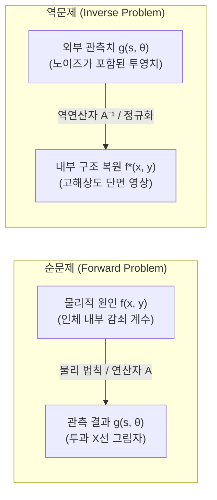

## 서론: 그림자를 통해 보이지 않는 심연을 들여다보다

일상의 자연스러운 인과적 직관에서, 원인으로부터 결과를 추론하는 과정은 명쾌하고 자연스럽습니다. 물체의 형태와 광원의 위치를 알고 있다면 벽면에 비치는 그림자의 형태를 계산하는 것은 단순한 기하광학의 문제입니다. 마찬가지로 지층의 밀도와 탄성 계수 분포를 알고 있다면, 지진원에서 발생한 탄성파가 지표면 각 관측점에 도달하는 파형을 파동 방정식으로 정밀하게 시뮬레이션할 수 있습니다. 이처럼 <strong>원인(물리적 시스템의 내부 매개변수)</strong>으로부터 <strong>결과(외부 관측 데이터 및 응답)</strong>를 계산하는 과정을 <strong>순문제(Forward Problem)</strong>라고 부릅니다. 순문제는 대개 물리 법칙에 의해 지배되며, 유일하고 안정적인 해를 갖습니다.

그러나 현대 과학과 의학 진단, 지구물리학의 최전선에서 마주하는 과제는 완전히 반대 방향의 역추론입니다:
- <strong>의학 컴퓨터 단층 촬영(CT / Computed Tomography)</strong>: 환자의 뇌나 흉부를 절개하지 않고, 외부에서 다양한 각도로 투과시킨 X선의 감쇠 데이터(1차원 투영 그림자)로부터 내부 장기와 미세 종양의 3차원 밀도 분포를 어떻게 정확히 복원할 것인가?
- <strong>지구물리 탐사</strong>: 지표면에서 인공 지진파를 발생시켜 기록한 반사파 데이터로부터 지하 수 킬로미터 깊이의 단층 구조나 유전 지층을 어떻게 역추정할 것인가?
- <strong>천문학적 간섭계 영상화</strong>: 사건의 지평선 망원경(EHT)이 전 지구에 분산된 전파망원경으로 수집한 극히 희소한 공간 간섭 데이터로부터 초대질량 블랙홀의 강착원반 이미지를 어떻게 합성할 것인가?

이처럼 <strong>관측 결과(데이터)</strong>로부터 <strong>물리적 원인(내부 상태)</strong>을 거꾸로 밝혀내는 수학적 과정을 <strong>역문제(Inverse Problems)</strong>라고 합니다. 역문제는 현대 응용수학에서 가장 지적 매력이 넘치는 분야이자, 비파괴 영상 진단 기술의 핵심 이론적 지주입니다.

본 글에서는 자크 아다마르(Jacques Hadamard)가 정립한 '불량 조건성(Ill-posedness)'의 본질부터 요한 라돈(Johann Radon)의 1917년 적분 기하학과 라돈 변환, 푸리에 슬라이스 정리(Fourier Slice Theorem), 여과 후역투영(Filtered Backprojection, FBP), 그리고 티호노프 정규화(Tikhonov Regularization)와 압축 센싱(Compressed Sensing)에 이르는 수학적 원리를 체계적으로 해설합니다.

---

## 1. 역문제란 무엇인가?：아다마르 적정성과 불량 조건성

역문제를 푸는 것이 순문제를 푸는 것보다 본질적으로 어려운 이유는 무엇일까요?

### 1.1 연산자 방정식의 정식화
함수해석학에서 순문제는 두 힐베르트 공간 사이의 연산자 매핑으로 표현됩니다:
$$g = \mathcal{A}(f)$$
여기서:
- $f \in \mathcal{X}$ 는 미지의 내부 물리적 특성 분포(예: X선 선형 감쇠 계수 $f(x, y) \ge 0$);
- $g \in \mathcal{Y}$ 는 외부 검출기로 측정한 투영 데이터;
- $\mathcal{A}: \mathcal{X} \to \mathcal{Y}$ 는 순방향 물리 연산자(적분 연산자).

<strong>역문제</strong>는 관측 데이터 $g$가 주어졌을 때 미지의 함수 $f$를 구하는 것입니다:
$$\mathcal{A} f = g$$

### 1.2 아다마르 적정성 조건 (Hadamard Well-Posedness)
1902년 프랑스의 수학자 자크 아다마르는 물리적 문제를 수학적으로 모델링할 때 다음 3가지 조건을 만족해야 한다고 정의했습니다:
1. <strong>해의 존재성(Existence)</strong>: 모든 가능한 데이터 $g \in \mathcal{Y}$에 대해 적어도 하나의 해 $f \in \mathcal{X}$가 존재한다.
2. <strong>해의 유일성(Uniqueness)</strong>: $\mathcal{A} f_1 = \mathcal{A} f_2$이면 $f_1 = f_2$이다(연산자 $\mathcal{A}$가 단사함수).
3. <strong>해의 안정성(Stability)</strong>: 역연산자 $\mathcal{A}^{-1}$가 연속이어야 한다. 즉, 입력 데이터의 미세한 오차 $\delta g$에 대해 복원된 해의 오차 $\delta f$가 상수로 제어되어야 한다:
   $$\|\delta f\|_{\mathcal{X}} \le C \|\delta g\|_{\mathcal{Y}}$$

이 조건 중 <strong>단 하나라도 만족하지 못하는 문제</strong>를 <strong>불량조건 문제(Ill-Posed Problem)</strong>라고 부릅니다.

### 1.3 콤팩트 연산자와 고주파 파국
물리적 역문제가 대부분 심각한 불량조건을 갖는 이유는 순방향 연산자 $\mathcal{A}$가 본질적으로 평활화(smoothing) 특성을 지닌 <strong>콤팩트 연산자(Compact Operator)</strong>이기 때문입니다:
$$g(s) = (\mathcal{A} f)(s) = \int_a^b K(s, t) f(t) \, dt$$
적분 연산은 고주파 성분을 강하게 감쇠시키는 저역통과 필터로 작용합니다. 따라서 그 역연산 $\mathcal{A}^{-1}$는 본질적으로 극단적인 고역통과 증폭기가 됩니다. 특이값 분해(SVD) 관점에서 특이값 $\sigma_n \to 0$ ($n \to \infty$)으로 감소하기 때문에, 역산 과정에서 노이즈 성분이 $\frac{1}{\sigma_n} \to \infty$로 폭발하여 유의미한 해를 파괴하게 됩니다.

---

## 2. 적분 기하학의 금자탑: 요한 라돈과 라돈 변환

1917년 오스트리아의 수학자 요한 라돈(Johann Radon)은 순수 수학적 호기심에서 다음과 같은 질문을 던졌습니다:
> "2차원 평면 위의 미지의 연속 함수에 대해, 평면 위의 모든 가능한 직선을 따라 계산된 선적분 값을 알고 있다면, 원래 함수를 유일하게 복원할 수 있는가?"

### 2.1 라돈 변환의 정의
평면 위의 직선 $L(s, \theta)$은 법선 각도 $\theta \in [0, \pi)$와 원점으로부터의 부호 있는 거리 $s \in (-\infty, \infty)$로 매개변수화됩니다:
$$x \cos\theta + y \sin\theta = s$$
함수 $f(x, y)$의 라돈 변환 $\mathcal{R}f$는 다음과 같이 정의됩니다:
$$(\mathcal{R}f)(s, \theta) = \int_{-\infty}^\infty f(s\cos\theta - t\sin\theta, \; s\sin\theta + t\cos\theta) \, dt$$
디랙 델타 함수를 이용하면 다음과 같이 표현할 수 있습니다:
$$(\mathcal{R}f)(s, \theta) = \iint_{\mathbb{R}^2} f(x, y) \, \delta(x \cos\theta + y \sin\theta - s) \, dx dy$$

검출기 위치 $s$와 회전 각도 $\theta$로 구성된 2차원 데이터를 의학 영상에서는 <strong>사이노그램(Sinogram)</strong>이라고 부릅니다.

---

## 3. 의학 CT의 물리적 기초: 비어-람베르트 법칙

단색 X선이 불균일한 물질을 통과할 때, 강도 $I$의 감쇠는 비어-람베르트 법칙을 따릅니다:
$$\frac{dI(t)}{dt} = - f(\mathbf{x}(t)) \, I(t) \implies I_{\text{det}} = I_0 \exp\left( - \int_L f(\mathbf{x}) \, dt \right)$$
여기서 검출된 강도에 로그를 취하면 비선형성이 완벽히 제거됩니다:
$$g(s, \theta) = \ln\left( \frac{I_0}{I_{\text{det}}} \right) = \int_L f(\mathbf{x}) \, dt = (\mathcal{R}f)(s, \theta)$$
따라서 CT 영상 복원은 사이노그램 $g(s, \theta)$로부터 인체 감쇠 계수 $f(x, y)$를 구하는 <strong>라돈 역변환 문제</strong>와 정확히 일치합니다.

---

## 4. 푸리에 슬라이스 정리 (Fourier Slice Theorem)

1차원 투영 데이터와 2차원 원본 이미지 사이를 잇는 핵심 수학적 정리는 <strong>푸리에 슬라이스 정리</strong>입니다.

### 4.1 정리의 내용
2차원 함수 $f(x, y)$의 2차원 푸리에 변환에서 각도 $\theta$를 지나는 원점 통과 단면(Slice)은, 동일한 각도 $\theta$에서 얻은 라돈 변환 $g(s, \theta)$의 1차원 푸리에 변환과 완벽히 일치합니다:
$$\left( \mathcal{F}_1 [\mathcal{R}f(\cdot, \theta)] \right)(\omega) = \left( \mathcal{F}_2 f \right)(\omega \cos\theta, \; \omega \sin\theta)$$

### 4.2 증명
$$G(\omega, \theta) = \int_{-\infty}^\infty g(s, \theta) e^{-i 2\pi \omega s} ds = \iint_{\mathbb{R}^2} f(x, y) e^{-i 2\pi \omega (x\cos\theta + y\sin\theta)} dx dy$$
$u = \omega \cos\theta$, $v = \omega \sin\theta$로 치환하면 바로 2차원 푸리에 변환 $\hat{f}(u, v)$의 정의가 유도됩니다.

---

## 5. 여과 후역투영법 (Filtered Backprojection, FBP)

2차원 역푸리에 변환을 극좌표계 $(u = \omega\cos\theta, v = \omega\sin\theta)$로 변환하면 야코비안 행렬식 $|\omega|$가 나타납니다:
$$f(x, y) = \int_0^\pi d\theta \int_{-\infty}^\infty \hat{f}(\omega\cos\theta, \omega\sin\theta) e^{i 2\pi \omega (x\cos\theta + y\sin\theta)} |\omega| d\omega$$
푸리에 슬라이스 정리를 대입하면 FBP 알고리즘의 2단계가 완성됩니다:
1. <strong>램프 필터링(Ramp Filtering)</strong>: $G(\omega, \theta)$에 고주파 필터 $|\omega|$를 곱하여 $1/r$ 역투영 번짐 효과를 제거합니다.
2. <strong>역투영(Backprojection)</strong>: 필터링된 신호를 원래 각도로 공간 전체에 역투영하여 적분합니다.

---

## 6. 불량 조건성의 극복: 티호노프 정규화

실제 측정 환경에서는 고주파 노이즈가 $|\omega|$ 필터에 의해 심각하게 증폭됩니다. 이를 극복하기 위해 대수적 정규화 모델이 도입됩니다:
$$\mathbf{A} \mathbf{f} + \boldsymbol{\eta} = \mathbf{g}$$

### 티호노프 정규화 (Tikhonov Regularization)
$$\min_{\mathbf{f}} \left\{ \|\mathbf{A}\mathbf{f} - \mathbf{g}\|_2^2 + \alpha \|\mathbf{L}\mathbf{f}\|_2^2 \right\}$$
해의 명시적 표현은 다음과 같습니다:
$$\mathbf{f}_\alpha = (\mathbf{A}^T \mathbf{A} + \alpha \mathbf{L}^T \mathbf{L})^{-1} \mathbf{A}^T \mathbf{g}$$
특이값 분해를 통해 보면 필터 계수 $q_i = \frac{\sigma_i^2}{\sigma_i^2 + \alpha}$가 0으로 수렴하는 미세 특이값에 의한 노이즈 폭발을 효과적으로 억제함을 알 수 있습니다.

---

## 7. 현대적 발전: 전변동(TV)과 압축 센싱

- <strong>전변동(Total Variation, TV)</strong>: $L_1$ 노름 기반의 경사도 제약 $\|\nabla \mathbf{f}\|_1$을 부여하여 경계면(Edge)을 완벽히 보존하면서 노이즈를 제거합니다.
- <strong>압축 센싱(Compressed Sensing)</strong>: 희소성(Sparsity) 원리를 활용하여 기존 샘플링 요구량의 10~20%에 불과한 소수의 투영 각도만으로 왜곡 없는 정밀 영상을 복원하여 피폭 선량을 획기적으로 낮춥니다.
- <strong>물리 정보 기반 딥러닝(Deep Unfolding)</strong>: 물리 연산자 $\mathcal{A}$를 신경망 내부에 결합하여 물리적 정합성과 초고속 계산을 동시에 달성합니다.

## 결론

동굴 벽면의 그림자로부터 실체를 통찰하려 했던 플라톤의 우화처럼, 현대 역문제의 수학은 외부의 불완전한 그림자 투영 데이터로부터 감추어진 내부의 심오한 물리적 진실을 밝혀내는 인간 이성의 가장 빛나는 승리 중 하나입니다.
