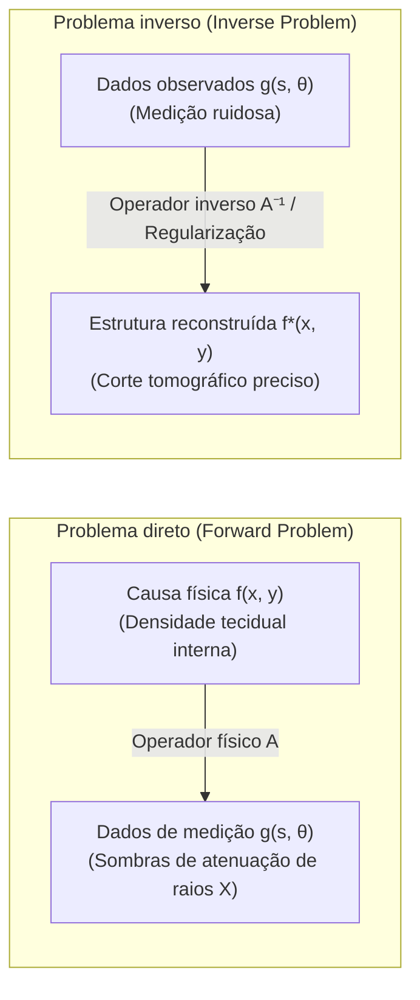

## Introdução: Desvendando o invisível através de sombras

Na experiência do dia a dia, a relação de causa e efeito segue um fluxo intuitivo: conhecendo a geometria tridimensional de um objeto e a posição da fonte luminosa, a projeção de sua sombra sobre uma superfície plana pode ser facilmente determinada pelas leis fundamentais da óptica geométrica. De forma análoga, se conhecemos a densidade das rochas e os módulos de elasticidade do subsolo terrestre, a propagação de ondas sísmicas originadas em um foco tectônico pode ser simulada com absoluta precisão através da equação da onda. O processo de determinar o <strong>efeito (dados de medição externos)</strong> a partir da <strong>causa (parâmetros físicos intrínsecos do sistema)</strong> é classificado como um <strong>problema direto (Forward Problem)</strong>. Problemas diretos são tradicionalmente estáveis, determinísticos e possuem solução única.

Contudo, nos domínios mais avançados da medicina diagnóstica, geofísica e astrofísica, o desafio é exatamente o inverso:
- <strong>Tomografia computadorizada médica (TC)</strong>: Sem realizar qualquer incisão cirúrgica, como podemos reconstruir com fidelidade milimétrica o mapa de densidades de tecidos moles, vasos sanguíneos e pequenos tumores cerebrais com base exclusivamente em projeções unidimensionais de raios X obtidas de múltiplos ângulos externos?
- <strong>Exploração geofísica</strong>: Como inferir a presença de falhas tectônicas ou reservatórios de petróleo a quilômetros de profundidade a partir dos ecos sísmicos registrados na superfície?
- <strong>Interferometria astronômica</strong>: Como os astrônomos do Event Horizon Telescope (EHT) sintetizaram a primeira imagem do disco de acreção de um buraco negro supermassivo a partir de medições de correlação espacial extremamente esparsas?

Essa tarefa matemática de inferir a <strong>causa física interna</strong> a partir dos <strong>dados observados externamente</strong> recebe o nome de <strong>problema inverso (Inverse Problem)</strong>.

---

## 1. O que é um problema inverso?：A boa postura de Hadamard e a catástrofe da instabilidade

Por que a resolução de um problema inverso é intrinsecamente mais desafiadora do que a de um problema direto?

### 1.1 Formulação em espaços funcionais
Na análise funcional, um problema direto pode ser expresso como uma equação de operador linear entre espaços de Hilbert:
$$\mathcal{A} f = g$$
onde $f \in \mathcal{X}$ representa a distribuição do coeficiente linear de atenuação dos tecidos biológicos, $g \in \mathcal{Y}$ representa os dados de projeção registrados pelos sensores detectores, e $\mathcal{A}$ é o operador integral linear.

### 1.2 Critérios de boa postura de Jacques Hadamard (1902)
O célebre matemático Jacques Hadamard postulou que um problema físico-matemático é considerado <strong>bem posto (well-posed)</strong> se satisfizer concomitantemente três propriedades fundamentais:
1. <strong>Existência</strong>: Para qualquer conjunto de dados $g \in \mathcal{Y}$, existe ao menos uma solução física $f \in \mathcal{X}$.
2. <strong>Unicidade</strong>: A solução é única ($\ker(\mathcal{A}) = \{0\}$).
3. <strong>Estabilidade</strong>: A solução depende continuamente dos dados de entrada. O operador inverso $\mathcal{A}^{-1}$ é contínuo, assegurando que pequenas perturbações e ruídos nas medições gerem apenas variações limitadas na solução reconstruída: $\|\delta f\| \le C \|\delta g\|$.

A violação de qualquer uma dessas três condições classifica o problema como <strong>mal posto (ill-posed)</strong>.

### 1.3 Operadores compactos e o desastre das altas frequências
Em modelos físicos contínuos, $\mathcal{A}$ é quase universalmente um <strong>operador compacto</strong>, que desempenha a função de um filtro passa-baixas (suavização por integração contínua):
$$g(s) = \int_a^b K(s, t) f(t) \, dt$$
Ao inverter esse operador, o processo se torna um amplificador descontrolado de altas frequências. Pela decomposição em valores singulares (SVD), os valores singulares convergem para zero: $\sigma_n \to 0$ conforme $n \to \infty$.
$$f = \sum_{n=1}^\infty \frac{1}{\sigma_n} \langle g, u_n \rangle v_n$$
Como $\sigma_n \to 0$, a inversão direta faz com que o menor ruído estatístico de contagem de fótons seja multiplicado por $\frac{1}{\sigma_n} \to \infty$, destruindo completamente a imagem sem uma intervenção regularizadora.

---

## 2. A genialidade da geometria integral: Johann Radon (1917)

Em 1917, o matemático austríaco Johann Radon formulou e resolveu um problema teórico fundamental:
> "É possível determinar de modo único uma função diferenciável no plano se conhecermos seus valores médios integrados ao longo de todas as retas possíveis do espaço?"

Radon não apenas demonstrou a unicidade como também deduziu a fórmula exata de inversão.

### Definição matemática da transformada de Radon
Qualquer linha reta $L(s, \theta)$ no plano $\mathbb{R}^2$ pode ser descrita por seu ângulo normal $\theta \in [0, \pi)$ e pela distância orientada à origem $s \in (-\infty, \infty)$:
$$x \cos\theta + y \sin\theta = s$$
A transformada de Radon $\mathcal{R}f$ é a integral de linha da função $f(x, y)$ ao longo dessa trajetória linear:
$$(\mathcal{R}f)(s, \theta) = \iint_{\mathbb{R}^2} f(x, y) \, \delta(x \cos\theta + y \sin\theta - s) \, dx dy$$
No processamento de imagens tomográficas, a matriz de projeções representada no plano $(s, \theta)$ é denominada <strong>sinograma</strong>.

---

## 3. Física da tomografia computadorizada: A lei de Beer-Lambert

A interação da radiação X com a matéria obedece à equação diferencial de atenuação de Beer-Lambert:
$$\frac{dI}{dt} = - f(\mathbf{x}) I \implies I_{\text{det}} = I_0 \exp\left( - \int_L f(\mathbf{x}) \, dt \right)$$
Ao aplicarmos o logaritmo natural sobre o quociente entre a intensidade emitida e a intensidade medida, cancelamos o comportamento exponencial:
$$g(s, \theta) = \ln\left( \frac{I_0}{I_{\text{det}}} \right) = \int_L f(\mathbf{x}) \, dt = (\mathcal{R}f)(s, \theta)$$
Portanto, a tomografia computadorizada é precisamente a implementação física do problema inverso da transformada de Radon.

---

## 4. O Teorema da Fatia de Fourier (Fourier Slice Theorem)

A pedra fundamental que conecta as projeções unidimensionais ao espaço bidimensional da imagem é o <strong>teorema da fatia de Fourier</strong>:
$$\left( \mathcal{F}_1 [\mathcal{R}f(\cdot, \theta)] \right)(\omega) = \left( \mathcal{F}_2 f \right)(\omega \cos\theta, \; \omega \sin\theta)$$
Ele estabelece que a transformada de Fourier 1D de uma projeção angular $\theta$ equivale rigorosamente a uma seção radial centrada na origem da transformada de Fourier 2D da imagem original.

---

## 5. Retroprojeção Filtrada (Filtered Backprojection, FBP)

Expressando a transformada inversa de Fourier 2D em coordenadas polares, obtém-se o algoritmo industrial clássico:
$$f(x, y) = \int_0^\pi \left[ \int_{-\infty}^\infty G(\omega, \theta) \cdot |\omega| \cdot e^{i 2\pi \omega (x\cos\theta + y\sin\theta)} \, d\omega \right] d\theta$$
1. <strong>Filtro Ram-Lak (Rampa)</strong>: Multiplicação no domínio de frequências por $|\omega|$, eliminando o desfoque intrínseco de densidade ($1/r$).
2. <strong>Retroprojeção</strong>: Redistribuição dos perfis filtrados através do grid da imagem ao longo de todas as direções angulares medidas.

---

## 6. Regularização de Tikhonov: Estabilizando a inversão discreta

Na presença de amostragem esparsa e ruído severo, o sistema algébrico $\mathbf{A}\mathbf{f} + \boldsymbol{\eta} = \mathbf{g}$ é estabilizado pelo método de <strong>regularização de Tikhonov</strong> (1963):
$$\min_{\mathbf{f}} \left\{ \|\mathbf{A}\mathbf{f} - \mathbf{g}\|_2^2 + \alpha \|\mathbf{L}\mathbf{f}\|_2^2 \right\}$$
Sua solução fechada é:
$$\mathbf{f}_\alpha = (\mathbf{A}^T \mathbf{A} + \alpha \mathbf{L}^T \mathbf{L})^{-1} \mathbf{A}^T \mathbf{g}$$
O fator de filtro $\frac{\sigma_i^2}{\sigma_i^2 + \alpha}$ amortece a divergência associada aos autovalores próximos de zero, preservando a fidelidade da imagem anatômica.

---

## 7. Fronteiras contemporâneas: Variação Total e Sensoriamento Comprimido

- <strong>Variação Total (Regularização TV)</strong>: Minimiza a norma $L_1$ do gradiente $\|\nabla \mathbf{f}\|_1$, preservando arestas e bordas de órgãos anatômicos com máxima nitidez.
- <strong>Sensoriamento Comprimido (Compressed Sensing)</strong>: Prova que imagens esparsas podem ser perfeitamente reconstruídas com uma fração mínima das projeções angulares tradicionais, reduzindo a dose de radiação ionizante em até 80-90%.
- <strong>Deep Unfolding</strong>: Redes neurais profundas que incorporam o operador analítico de Radon diretamente em suas camadas, unindo velocidade de processamento com confiabilidade física rigorosa.

## Conclusão

Assim como na célebre alegoria da caverna de Platão, onde os habitantes decifram o mundo por meio das sombras projetadas nas paredes, as matemáticas dos problemas inversos atestam o poder transformador da razão humana: a partir de tênues sombras de radiação externa, somos capazes de reconstruir com fidelidade cristalina a realidade invisível do interior do universo e do corpo humano.
