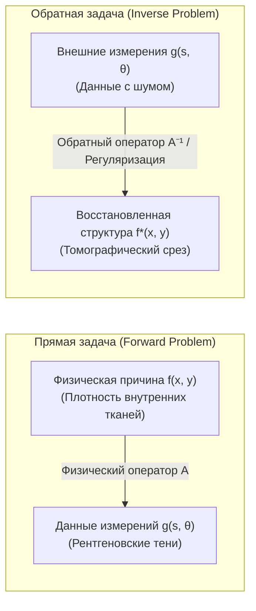

## Введение: Взгляд в невидимые глубины сквозь тени

В повседневном опыте причинно-следственная связь направлена естественным образом: зная геометрию объекта и положение источника света, профиль тени на стене можно элементарно рассчитать методами геометрической оптики. Аналогично, если известно геологическое строение и распределение плотностей пород в недрах Земли, распространение сейсмических волн от очага землетрясения моделируется с высокой точностью с помощью волнового уравнения. Такой переход от <strong>причины (внутренние параметры физической системы)</strong> к <strong>следствию (наблюдаемые внешние данные)</strong> называют <strong>прямой задачей (Forward Problem)</strong>. Прямые задачи обычно устойчивы, детерминированы и имеют единственное решение.

Однако в современной медицине, геофизике и астрофизике исследователи сталкиваются с принципиально обратной задачей:
- <strong>Медицинская компьютерная томография (КТ)</strong>: не разрезая череп и грудную клетку пациента, как восстановить пространственное распределение плотностей тканей, кровеносных сосудов и микроопухолей, располагая лишь одномерными проекциями ослабления рентгеновских лучей, измеренными снаружи?
- <strong>Сейсморазведка</strong>: как по сигналам отраженных упругих волн на поверхности восстановить структуру геологических пластов и границы залегания нефтяных месторождений на глубине нескольких километров?
- <strong>Астрономическая радиоинтерферометрия</strong>: как телескоп Event Horizon Telescope (EHT) сумел синтезировать изображение аккреционного диска сверхмассивной черной дыры по предельно разреженным интерферометрическим измерениям?

Математическая дисциплина, занимающаяся восстановлением <strong>физической причины</strong> по ее <strong>наблюдаемым следствиям</strong>, называется <strong>теорией обратных задач (Inverse Problems)</strong>.

---

## 1. Что такое обратная задача?：Корректность по Адамару и катастрофа некорректности

Почему решение обратных задач несоизмеримо сложнее решения прямых задач?

### 1.1 Операторная постановка задачи
В функциональном анализе задача записывается в виде операторного уравнения в гильбертовых пространствах:
$$\mathcal{A} f = g$$
где $f \in \mathcal{X}$ — искомый коэффициент поглощения в среде, $g \in \mathcal{Y}$ — измеренные проекционные данные, а $\mathcal{A}$ — линейный интегральный оператор.

### 1.2 Критерии корректности по Адамару (1902)
Французский математик Жак Адамар сформулировал три фундаментальных условия корректности математической модели:
1. <strong>Существование решения</strong>: Для любых входных данных $g$ существует решение $f$.
2. <strong>Единственность решения</strong>: Оператор $\mathcal{A}$ инъективен ($\ker(\mathcal{A}) = \{0\}$).
3. <strong>Устойчивость</strong>: Решение непрерывно зависит от входных данных: малые погрешности $\delta g$ порождают ограниченное отклонение решения: $\|\delta f\| \le C \|\delta g\|$.

Если хотя бы одно из этих условий нарушено, задача называется <strong>некорректно поставленной (ill-posed)</strong>.

### 1.3 Компактные операторы и катастрофа высокочастотного шума
В непрерывных физических средах оператор $\mathcal{A}$ почти всегда является <strong>вполне непрерывным (компактным) оператором</strong>, обладающим сглаживающим интегральным свойством. В базисе сингулярного разложения (SVD) сингулярные числа стремятся к нулю: $\sigma_n \to 0$ при $n \to \infty$:
$$f = \sum_{n=1}^\infty \frac{1}{\sigma_n} \langle g, u_n \rangle v_n$$
Поскольку $\sigma_n \to 0$, наивное обращение оператора приводит к делению шума измерения на $\sigma_n$, что вызывает взрыв $\frac{1}{\sigma_n} \to \infty$ и мгновенно уничтожает любое содержательное решение.

---

## 2. Интегральная геометрия Иоганна Радона (1917)

В 1917 году австрийский математик Иоганн Радон решил фундаментальную математическую задачу:
> «Можно ли однозначно восстановить гладкую функцию двух переменных, если известны ее интегралы по всем возможным прямым на плоскости?»

Радон строго доказал теорему единственности и вывел явную формулу обращения.

### Определение преобразования Радона
Прямая $L(s, \theta)$ параметризуется нормальным углом $\theta \in [0, \pi)$ и расстоянием до начала координат $s \in (-\infty, \infty)$:
$$x \cos\theta + y \sin\theta = s$$
Преобразование Радона $\mathcal{R}f$ определяется интегралом:
$$(\mathcal{R}f)(s, \theta) = \iint_{\mathbb{R}^2} f(x, y) \, \delta(x \cos\theta + y \sin\theta - s) \, dx dy$$
В медицинской визуализации график функции $(\mathcal{R}f)(s, \theta)$ в координатах $(s, \theta)$ называется <strong>синограммой</strong>.

---

## 3. Физика томографии: Закон Бугера — Ламберта — Бера

Ослабление пучка рентгеновского излучения описывается законом экспоненциального затухания:
$$\frac{dI}{dt} = - f(\mathbf{x}) I \implies I_{\text{det}} = I_0 \exp\left( - \int_L f(\mathbf{x}) \, dt \right)$$
Логарифмируя отношение интенсивности излучения, мы переходим к линейным интегральным данным:
$$g(s, \theta) = \ln\left( \frac{I_0}{I_{\text{det}}} \right) = \int_L f(\mathbf{x}) \, dt = (\mathcal{R}f)(s, \theta)$$
Таким образом, реконструкция томографического среза тождественна обращению преобразования Радона.

---

## 4. Теорема о центральном срезе Фурье (Fourier Slice Theorem)

Мостом между одномерными проекциями и двумерным изображением служит <strong>теорема о срезе Фурье</strong>:
$$\left( \mathcal{F}_1 [\mathcal{R}f(\cdot, \theta)] \right)(\omega) = \left( \mathcal{F}_2 f \right)(\omega \cos\theta, \; \omega \sin\theta)$$
Она утверждает, что 1D-преобразование Фурье проекции под углом $\theta$ в точности равно радиальному сечению 2D-преобразования Фурье исходного изображения под тем же углом.

---

## 5. Алгоритм фильтрованной обратной проекции (FBP)

Переходя в двумерном обратном преобразовании Фурье к полярным координатам, получаем канонический алгоритм FBP:
$$f(x, y) = \int_0^\pi \left[ \int_{-\infty}^\infty G(\omega, \theta) \cdot |\omega| \cdot e^{i 2\pi \omega (x\cos\theta + y\sin\theta)} \, d\omega \right] d\theta$$
1. <strong>Фильтрация Рам-Лак (Ramp-фильтр)</strong>: Умножение спектра на $|\omega|$ компенсирует избыточную плотность низких частот и устраняет геометрическое размытие $1/r$.
2. <strong>Обратное проецирование</strong>: Накопление отфильтрованных проекций обратно вдоль траекторий сканирования по всем углам.

---

## 6. Преодоление некорректности: Регуляризация Тихонова

При наличии высокого уровня шума и малого числа ракурсов дискретная система $\mathbf{A}\mathbf{f} + \boldsymbol{\eta} = \mathbf{g}$ решается методом <strong>регуляризации А. Н. Тихонова</strong> (1963):
$$\min_{\mathbf{f}} \left\{ \|\mathbf{A}\mathbf{f} - \mathbf{g}\|_2^2 + \alpha \|\mathbf{L}\mathbf{f}\|_2^2 \right\}$$
Явное решение уравнения Эйлера имеет вид:
$$\mathbf{f}_\alpha = (\mathbf{A}^T \mathbf{A} + \alpha \mathbf{L}^T \mathbf{L})^{-1} \mathbf{A}^T \mathbf{g}$$
Фильтрующий множитель $q_i = \frac{\sigma_i^2}{\sigma_i^2 + \alpha}$ подавляет сингулярные моды с околонулевыми значениями, гарантируя устойчивость вычислений.

---

## 7. Современные направления: Полная вариация и сжатое считывание

- <strong>Полная вариация (TV-регуляризация)</strong>: Использование $L_1$-нормы градиента $\|\nabla \mathbf{f}\|_1$ подавляет шум, сохраняя резкие перепады плотностей на границах органов.
- <strong>Сжатое считывание (Compressed Sensing)</strong>: Теория Тао и Кандеса доказывает возможность точной реконструкции по предельно малому числу ракурсов, снижая дозу облучения пациентов на 80–90%.
- <strong>Глубокое развертывание (Deep Unfolding)</strong>: Встраивание оператора Радона в слои нейронных сетей сочетает строгость физической модели с мгновенной скоростью вычислений.

## Заключение

Подобно платоновскому мифу о пещере, где узники судят о мире по теням на стене, математика обратных задач олицетворяет торжество научного разума: по тончайшим теням внешних проекций человеческий интеллект способен безошибочно воссоздать скрытую гармонию невидимого внутреннего мира.
