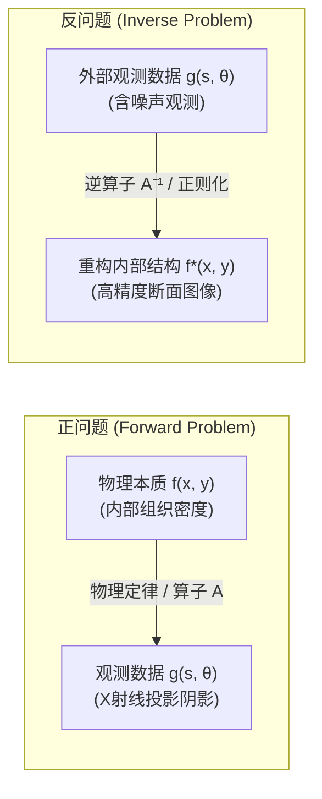
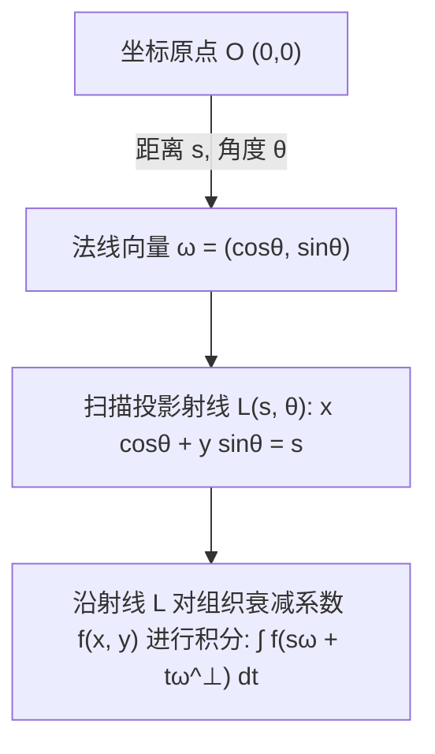
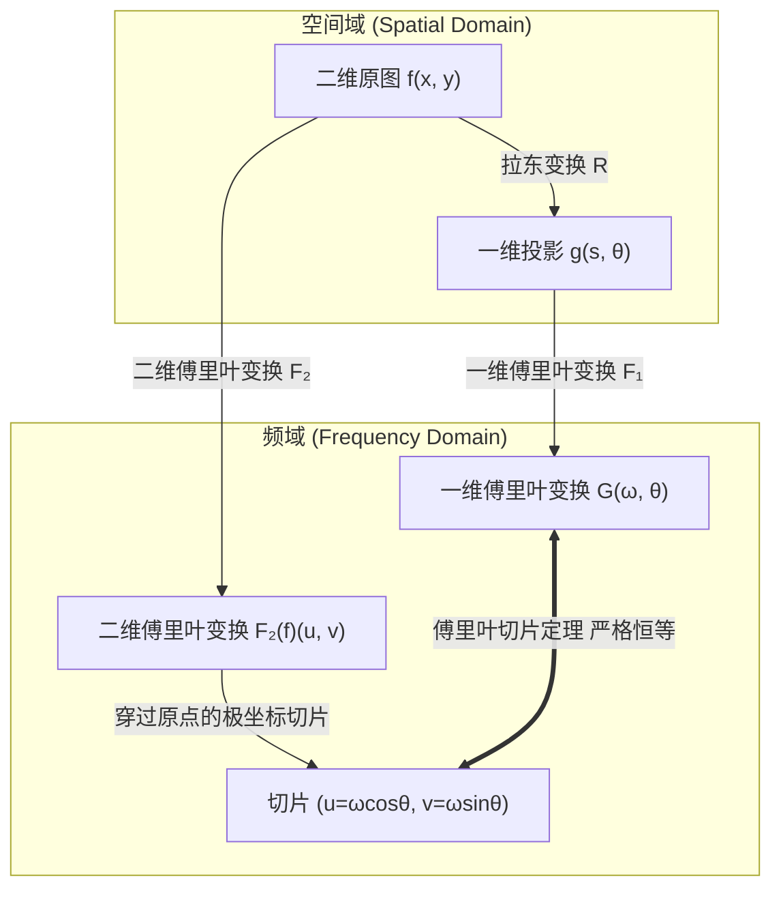
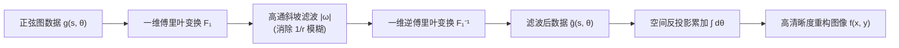

## 导言：透过阴影窥探不可见的深处

在日常经验中，因果逻辑的推进往往是单向且自然的：如果知道了物体的形状和光源的位置，投射在墙面上的阴影轮廓便能通过几何光学极其容易地计算出来；如果知道了地层的物质密度分布与弹性参数，地震波从震源传播到地面各个地震仪的走时与波形便能根据波动方程精确模拟。这种从<strong>原因（内在系统参数与几何构造）</strong>推导<strong>结果（外部观测数据与物理场响应）</strong>的过程，被称为<strong>正问题（Forward Problem）</strong>。正问题通常对应着大自然本身的物理运行规律，在数学上往往具有确定、稳定且唯一的解。

然而，在现代科学、医学诊断和工程勘探的核心场景中，我们面临的往往是截然相反的逆向挑战：
- <strong>医学计算机断层扫描（CT / Computed Tomography）</strong>：医生无法切开患者的颅骨或胸腔，只能从外部不同角度发射X射线并测量衰减后的透射强度。我们能否根据这些一维或二维的投影“阴影”，精确重构出大脑软组织、微小肿瘤或血管壁的内部三维密度分布？
- <strong>地球物理勘探</strong>：地质学家在地面引爆炸药或震源车，记录地面各处的地震波反射信号。我们能否据此反推地下数千米处石油构造、断层滑移面或地幔对流边界？
- <strong>天文干涉成像</strong>：事件视界望远镜（EHT）散布在地球各处的射电天线仅采集到了极其稀疏的空间相干度数据。我们能否逆向合成出超大质量黑洞事件视界周围吸积盘的真实图像？
- <strong>无损检测与材料科学</strong>：工业超声与中子断层成像如何在不破坏航空发动机单晶涡轮叶片的前提下，发现其微米级内部微裂纹？

这些从<strong>观测结果（数据）</strong>逆向推导<strong>物理原因（系统内部状态）</strong>的数学任务，统称为<strong>反问题（Inverse Problems）</strong>。反问题不仅是应用数学中最具智力挑战和美感的领域之一，更是现代无损成像技术的绝对理论支柱。

本文将带领读者深入反问题与现代成像的数学殿堂：从阿达马（Jacques Hadamard）定义的“不适定性灾难”，到约翰·拉东（Johann Radon）于1917年奠基的积分几何与拉东变换；从傅里叶切片定理（Fourier Slice Theorem）构建的对偶桥梁，到滤波反投影算法（FBP）的优雅推导；最终探索吉洪诺夫正则化（Tikhonov Regularization）、全变差正则化（Total Variation）以及压缩感知（Compressed Sensing）如何驯服高维噪声与病态矩阵，将不可能变为现实。

---

## 1. 什么是反问题？：阿达马适定性与不适定性的灾难

要理解反问题的深刻性，首先必须明晰为什么求解反问题比求解正问题困难千百倍。

### 1.1 算子方程的形式化表述

在泛函分析框架下，几乎所有正问题都可以抽象为两个函数空间（通常为希尔伯特空间或巴拿赫空间）之间的算子映射：
$$g = \mathcal{A}(f)$$
其中：
- $f \in \mathcal{X}$ 表示未知的系统内部物理参数分布（例如人体内部的X射线线性衰减系数分布 $f(x, y) \ge 0$）；
- $g \in \mathcal{Y}$ 表示观测仪器所收集到的外部测量数据（例如探测器阵列测得的光子衰减积分投影数据）；
- $\mathcal{A}: \mathcal{X} \to \mathcal{Y}$ 为正向物理算子。对于CT成像、热传导或线性波动而言，$\mathcal{A}$ 通常是一个连续的<strong>线性积分算子</strong>。

正问题即：已知模型 $f$ 与算子 $\mathcal{A}$，计算观测值 $g$。而<strong>反问题</strong>则是：已知观测数据 $g$（或包含噪声的实际测量值 $g^\delta$），求解未知函数 $f$，使得：
$$\mathcal{A} f = g$$

### 1.2 阿达马适定性准则（Hadamard Well-Posedness）

法国数学家雅克·阿达马在1902年系统研究偏微分方程边值问题时提出：一个数学物理问题被称为<strong>适定问题（Well-Posed Problem）</strong>，当且仅当满足以下三条基本准则：
1. <strong>解的存在性（Existence）</strong>：对于任意可能的数据 $g \in \mathcal{Y}$，方程 $\mathcal{A} f = g$ 至少存在一个解 $f \in \mathcal{X}$。
2. <strong>解的唯一性（Uniqueness）</strong>：方程 $\mathcal{A} f = g$ 的解至多只有一个。若 $\mathcal{A} f_1 = \mathcal{A} f_2$，则必然有 $f_1 = f_2$（即算子 $\mathcal{A}$ 必须是单射，其核空间 $\ker(\mathcal{A}) = \{0\}$）。
3. <strong>解的连续依赖性 / 稳定性（Stability）</strong>：解 $f$ 连续依赖于输入数据 $g$。具体而言，逆映射 $\mathcal{A}^{-1}: \mathcal{Y} \to \mathcal{X}$ 是连续算子。如果测量数据产生微小的扰动 $\delta g$（如仪器热噪声、光子散粒噪声），重构解的误差 $\delta f = \mathcal{A}^{-1}(g + \delta g) - \mathcal{A}^{-1}(g)$ 应当能够被常数控制，即：
   $$\|\delta f\|_{\mathcal{X}} \le C \|\delta g\|_{\mathcal{Y}}$$

如果上述三个条件中<strong>任何一个不满足</strong>，该数学问题就被称为<strong>不适定问题（Ill-Posed Problem）</strong>。

### 1.3 反问题的不适定性根源：紧算子与高频灾难

令人惊异的是，现实物理世界中的几乎所有反问题，天生都是<strong>严重不适定（Severely Ill-Posed）</strong>的，其根本原因在于物理正向过程的<strong>平滑效应（Smoothing Effect）</strong>。

在连续介质物理学中，正算子 $\mathcal{A}$ 几乎总是<strong>紧算子（Compact Operator）</strong>。例如，第一类弗雷德霍姆（Fredholm）积分方程：
$$g(s) = (\mathcal{A} f)(s) = \int_a^b K(s, t) f(t) \, dt$$
其中核函数 $K(s, t)$ 通常是光滑的高斯核、泊松核或波动格林函数。

根据积分算子的性质，积分操作本质上是一种<strong>低通加权平均</strong>。无论未知的原信号 $f(t)$ 包含多么剧烈的高频振荡、尖锐边缘或阶跃断层，经过连续核 $K(s, t)$ 的平滑积分之后，生成的数据 $g(s)$ 都会变得异常光滑。

然而，当我们试图逆向求解时，灾难降临了：
根据紧算子谱理论（奇异值分解 / SVD），无限维希尔伯特空间中的紧算子 $\mathcal{A}$ 拥有一组趋于零的奇异值序列：
$$\sigma_1 \ge \sigma_2 \ge \dots \ge \sigma_n \to 0 \quad (n \to \infty)$$
其正算子与反算子的谱表示形式为：
$$\mathcal{A} f = \sum_{n=1}^\infty \sigma_n \langle f, v_n \rangle u_n \implies f = \mathcal{A}^{-1} g = \sum_{n=1}^\infty \frac{1}{\sigma_n} \langle g, u_n \rangle v_n$$

由于奇异值 $\sigma_n \to 0$，分母中的项 $\frac{1}{\sigma_n} \to \infty$！
如果测量数据中含有极其微弱的宽带随机噪声 $\delta g = \epsilon u_n$（甚至可能是浮点运算的舍入误差 $10^{-16}$），反演公式计算出的解将包含：
$$\delta f = \frac{\epsilon}{\sigma_n} v_n$$
当模态阶数 $n$ 增大时，$\sigma_n$ 指数级或多项式级衰减至 0，导致放大的噪声项 $\frac{\epsilon}{\sigma_n} \to \infty$ 彻底吞噬整个解！没有任何直接求逆算子能够在不加干预的情况下从含噪数据中恢复真实物理量。

---

## 2. 积分几何的先驱：约翰·拉东与拉东变换

在X射线衍射和医学CT问世前半个世纪，奥地利数学家约翰·拉东（Johann Radon）于1917年在纯粹微分几何与数学分析的研究中，提出了一个极为优美的几何问题：
> “如果我们知道了定义在二维平面上的未知光滑函数沿着所有可能直线路径的线积分，我们能否唯一且精确地确定原函数本身？”

拉东不仅证明了其唯一性，更推导出了严格的解析逆变换公式。这一纯数学创举在半个世纪后成为了价值百亿美元的现代医学CT工业的数学地基。

### 2.1 平面直线的法线参数化

在二维欧几里得平面 $\mathbb{R}^2$ 上，任意一条直线 $L$ 都可以通过其法线倾角 $\theta \in [0, \pi)$ 以及该直线到坐标原点的有向垂直距离 $s \in (-\infty, \infty)$ 唯一定义：
$$L(s, \theta) = \left\{ (x, y) \in \mathbb{R}^2 \;\middle|\; x \cos\theta + y \sin\theta = s \right\}$$

引入单位法向量 $\boldsymbol{\omega} = (\cos\theta, \sin\theta)^T$ 与单位方向向量 $\boldsymbol{\omega}^\perp = (-\sin\theta, \cos\theta)^T$，直线上的任意点可以参数化表示为：
$$\mathbf{x}(t) = s \boldsymbol{\omega} + t \boldsymbol{\omega}^\perp = (s \cos\theta - t \sin\theta, \; s \sin\theta + t \cos\theta)$$
其中 $t \in (-\infty, \infty)$ 为直线上的局部线坐标。

### 2.2 拉东变换（Radon Transform）的数学定义

设未知物体密度分布为双变量可积函数 $f(x, y) \in C_0^\infty(\mathbb{R}^2)$（具有紧支集的光滑函数）。函数 $f$ 的<strong>拉东变换</strong> $\mathcal{R}f$ 定义为 $f$ 沿直线 $L(s, \theta)$ 的线积分：
$$(\mathcal{R}f)(s, \theta) = \int_{-\infty}^\infty f(s\cos\theta - t\sin\theta, \; s\sin\theta + t\cos\theta) \, dt$$
利用二维狄拉克 $\delta$ 分布（Dirac delta function），拉东变换亦可简洁地写作全局面积分形式：
$$(\mathcal{R}f)(s, \theta) = \iint_{\mathbb{R}^2} f(x, y) \, \delta(x \cos\theta + y \sin\theta - s) \, dx dy$$

在医学影像学中，将拉东变换的结果 $(\mathcal{R}f)(s, \theta)$ 绘制在以横坐标为探测器线位移 $s$、纵坐标为扫描旋转角 $\theta$ 的二维图像平面上，这种图像被称为<strong>正弦图（Sinogram）</strong>。之所以命名为正弦图，是因为被扫描物体内的任意孤立质点 $(x_0, y_0)$，在投影视角旋转过程中在探测器上留下的轨迹恰好是一条正弦曲线：
$$s(\theta) = x_0 \cos\theta + y_0 \sin\theta = r_0 \cos(\theta - \phi_0)$$

---

## 3. 医学CT的物理本质：比尔-朗伯定律与X射线投影

为什么拉东变换能直接对应现代医院里的CT机工作原理？这一切源于经典的电磁辐射吸收物理学。

### 3.1 比尔-朗伯定律（Beer-Lambert Law）

单能X射线束在穿透非均匀物质介质时，光子流会与物质中的原子发生光电效应和康普顿散射，导致射线强度衰减。设沿直线路径 $L$ 推进的局部距离为 $t$，在空间点 $\mathbf{x}$ 处介质的<strong>X射线线性衰减系数</strong>为 $f(\mathbf{x}) \ge 0$。根据微分吸收定律：
$$\frac{dI(t)}{dt} = - f(\mathbf{x}(t)) \, I(t)$$

积分分离变量：
$$\int_{I_0}^{I_{\text{det}}} \frac{dI}{I} = - \int_{L} f(\mathbf{x}) \, dt$$
得到穿透物体后被探测器接收到的剩余光强 $I_{\text{det}}$：
$$I_{\text{det}} = I_0 \exp\left( - \int_L f(\mathbf{x}) \, dt \right)$$
其中 $I_0$ 为X射线管发出的初始光强。

### 3.2 对数变换：从非线性测量到拉东投影

探测器硬件测得光强 $I_{\text{det}}$ 和基准强度 $I_0$ 后，只需进行一次初等对数运算，就能直接消除指数非线性，得到纯粹的线积分数据：
$$g(s, \theta) = \ln\left( \frac{I_0}{I_{\text{det}}} \right) = \int_L f(\mathbf{x}) \, dt = (\mathcal{R}f)(s, \theta)$$

因此，<strong>医学CT图像重构问题，在数学上等价于：已知全角度的拉东变换正弦图数据 $g(s, \theta) = (\mathcal{R}f)(s, \theta)$，求解未知的人体内部衰减系数分布 $f(x, y)$。</strong>

---

## 4. 傅里叶切片定理（Fourier Slice Theorem）：通往解析求逆的钥匙

如何从一维投影积分 $g(s, \theta)$ 恢复出二维图像 $f(x, y)$？连接投影空间与物理图像空间的极其关键的数学桥梁，就是<strong>傅里叶切片定理（Fourier Slice Theorem / 投影切片定理）</strong>。

### 4.1 定理的数学陈述

<strong>定理</strong>：未知二维函数 $f(x, y)$ 的二维连续傅里叶变换，在频域极坐标系下沿角度 $\theta$ 的一维径向切片，严格等于该函数在同角度 $\theta$ 下的一维投影拉东变换 $g(s, \theta)$ 关于探测器位移坐标 $s$ 的一维傅里叶变换！

设 $\mathcal{F}_2$ 为二维傅里叶变换，$\mathcal{F}_1$ 为沿 $s$ 变量的一维傅里叶变换。该定理可以用优雅的等式表示：
$$\left( \mathcal{F}_1 [\mathcal{R}f(\cdot, \theta)] \right)(\omega) = \left( \mathcal{F}_2 f \right)(\omega \cos\theta, \; \omega \sin\theta)$$

### 4.2 严密数学推导

我们直接从一维傅里叶变换的定义出发，计算投影函数 $g(s, \theta)$ 的频谱 $G(\omega, \theta)$：
$$G(\omega, \theta) = \int_{-\infty}^\infty g(s, \theta) \, e^{-i 2\pi \omega s} \, ds$$
将拉东变换的面积分定义代入：
$$G(\omega, \theta) = \int_{-\infty}^\infty \left[ \iint_{\mathbb{R}^2} f(x, y) \, \delta(x \cos\theta + y \sin\theta - s) \, dx dy \right] e^{-i 2\pi \omega s} \, ds$$
交换积分次序（利用富比尼定理 Fubini's Theorem）：
$$G(\omega, \theta) = \iint_{\mathbb{R}^2} f(x, y) \left[ \int_{-\infty}^\infty \delta(x \cos\theta + y \sin\theta - s) \, e^{-i 2\pi \omega s} \, ds \right] dx dy$$
利用狄拉克 $\delta$ 函数的筛选性质（Sifting Property），内层关于 $s$ 的积分直接令 $s = x \cos\theta + y \sin\theta$：
$$G(\omega, \theta) = \iint_{\mathbb{R}^2} f(x, y) \, e^{-i 2\pi \omega (x \cos\theta + y \sin\theta)} \, dx dy$$
令二维频域坐标为 $u = \omega \cos\theta, \; v = \omega \sin\theta$，上式变为：
$$G(\omega, \theta) = \iint_{\mathbb{R}^2} f(x, y) \, e^{-i 2\pi (u x + v y)} \, dx dy = \hat{f}(u, v) = \hat{f}(\omega \cos\theta, \omega \sin\theta)$$
证毕！这一结论不仅形式极其对称，更是整个解析重构算法的基石。

---

## 5. 滤波反投影算法（FBP）：工业CT的经典皇冠

拥有了傅里叶切片定理，在数学上似乎已经解决了反问题：我们只需对每一个测量角度 $\theta$ 的投影进行一维傅里叶变换，将频谱填充到二维频域平面 $(u, v)$ 上，最后做一次二维逆傅里叶变换（2D-IFFT），不就得到 $f(x, y)$ 了吗？

然而在工程实践中，由于频域采样点在极坐标下分布不均（低频处采样极度密集，高频处采样极度稀疏），直接插值到笛卡尔直角网格会引入严重的插值伪影和几何失真。为此，数学家推导出了更加鲁棒、高效且可实时流式计算的算法——<strong>滤波反投影算法（Filtered Backprojection / FBP）</strong>。

### 5.1 二维逆傅里叶变换的极坐标分解

原图像 $f(x, y)$ 可由其二维傅里叶逆变换严格重构：
$$f(x, y) = \iint_{\mathbb{R}^2} \hat{f}(u, v) \, e^{i 2\pi (u x + v y)} \, du dv$$
将频域平面坐标 $(u, v)$ 转换为极坐标系：
$$u = \omega \cos\theta, \quad v = \omega \sin\theta$$
雅可比行列式（面积元变换）为：
$$du dv = |\omega| \, d\omega d\theta$$
注意积分区域：$\theta \in [0, \pi)$，$\omega \in (-\infty, \infty)$。代入逆变换公式：
$$f(x, y) = \int_0^\pi d\theta \int_{-\infty}^\infty \hat{f}(\omega \cos\theta, \omega \sin\theta) \, e^{i 2\pi \omega (x \cos\theta + y \sin\theta)} \, |\omega| \, d\omega$$
由傅里叶切片定理，$\hat{f}(\omega \cos\theta, \omega \sin\theta) = G(\omega, \theta)$，且记空间投影位置 $s = x \cos\theta + y \sin\theta$：
$$f(x, y) = \int_0^\pi \left[ \int_{-\infty}^\infty G(\omega, \theta) \cdot |\omega| \cdot e^{i 2\pi \omega s} \, d\omega \right]_{\!s = x\cos\theta + y\sin\theta} d\theta$$

### 5.2 滤波与反投影的两步解耦

审视上式，整个重构过程被极其优美地解耦为两步操作：

#### 第一步：斜坡滤波（Ramp Filtering）
定义一维滤波投影信号：
$$\tilde{g}(s, \theta) = \mathcal{F}_1^{-1} \left\{ G(\omega, \theta) \cdot |\omega| \right\} = g(s, \theta) * h(s)$$
其中滤波器频域传递函数为 $H(\omega) = |\omega|$，被称为<strong>Ram-Lak（斜坡）滤波器</strong>。
为什么必须有斜坡滤波？因为在简单的未滤波反投影中，所有角度的射线在图像中心重叠，导致低频分量被过采样放大，使图像呈现严重的 $1/r$ 模糊晕圈。频域上的乘子 $|\omega|$ 正好是一个高通滤波器，它精准地抵消了 $1/r$ 的积分模糊，使边缘锐化恢复！

#### 第二步：反投影累加（Backprojection）
将滤波后的信号 $\tilde{g}(s, \theta)$ 沿原始投影射线涂抹回二维空间并对所有角度积分：
$$f(x, y) = \int_0^\pi \tilde{g}(x \cos\theta + y \sin\theta, \; \theta) \, d\theta = \mathcal{B} \tilde{g}$$
其中 $\mathcal{B}$ 称为反投影伴随算子（Backprojection Adjoint Operator）。

---

## 6. 不适定性的驯服：吉洪诺夫正则化与变分方法

滤波反投影虽然在全采样、低噪声的理想情况下极其完美，但在现实中，斜坡滤波器 $|\omega|$ 对高频的线性放大是一把双刃剑：当测量数据受到高频白噪声污染时，$|\omega|$ 会把微弱的噪声放大数千倍，导致重构图像被密密麻麻的条纹伪影摧毁。

当投影角度不足（稀疏视角 Sparse-view CT）、角度受限（有限角度 Limited-angle 断层成像）或辐射剂量极低（低剂量 CT）时，解析算法彻底失效，必须转向基于离散代数与变分法的现代<strong>正则化技术</strong>。

### 6.1 离散代数重构模型

将连续图像离散化为 $N \times N$ 的像素向量 $\mathbf{f} \in \mathbb{R}^M$（$M = N^2$），探测器测量值离散化为测量向量 $\mathbf{g} \in \mathbb{R}^K$。系统可表示为大型稀疏线性方程组：
$$\mathbf{A} \mathbf{f} + \boldsymbol{\eta} = \mathbf{g}$$
其中矩阵元 $A_{ij}$ 表示第 $i$ 条射线穿过第 $j$ 个像素的几何相交长度，$\boldsymbol{\eta} \sim \mathcal{N}(0, \sigma^2 \mathbf{I})$ 为测量加性噪声。

由于实际中往往 $K < M$（欠定问题）或者矩阵 $\mathbf{A}$ 具有极其巨大的条件数 $\kappa(\mathbf{A}) \gg 10^6$，直接求解最小二乘问题 $\min \|\mathbf{A}\mathbf{f} - \mathbf{g}\|_2^2$ 会产生毫无物理意义的振荡爆炸解。

### 6.2 吉洪诺夫正则化（Tikhonov Regularization）

苏联数学家安德烈·吉洪诺夫（Andrey Tikhonov）在1963年提出了划时代的<strong>正则化理论</strong>：通过在原本的目标泛函中加入一个先验约束惩罚项，改变问题的能谱结构，强行将不适定问题转化为稳定适定问题。

吉洪诺夫正则化的标准变分极值形式为：
$$\mathbf{f}_{\alpha} = \arg\min_{\mathbf{f}} \left\{ \|\mathbf{A} \mathbf{f} - \mathbf{g}\|_2^2 + \alpha \|\mathbf{L} \mathbf{f}\|_2^2 \right\}$$
其中：
- 第一项 $\|\mathbf{A}\mathbf{f} - \mathbf{g}\|_2^2$ 称为<strong>数据保真项（Data Fidelity Term）</strong>，保证重构结果符合物理测量；
- 第二项 $\|\mathbf{L}\mathbf{f}\|_2^2$ 称为<strong>正则化惩罚项（Regularization Penalty Term）</strong>，$\mathbf{L}$ 为先验正则化算子（如单位阵 $\mathbf{I}$ 惩罚能量，或离散梯度算子 $\nabla$ 惩罚高频粗糙度）；
- $\alpha > 0$ 称为<strong>正则化参数（Regularization Parameter）</strong>，负责在“贴近测量数据”与“抑制噪声平滑”之间寻求最佳权衡。

#### 解析正规方程与滤波性质
对目标函数关于 $\mathbf{f}$ 求梯度并令其为零：
$$\nabla \mathcal{J}(\mathbf{f}) = 2 \mathbf{A}^T (\mathbf{A}\mathbf{f} - \mathbf{g}) + 2\alpha \mathbf{L}^T \mathbf{L} \mathbf{f} = 0$$
得到严格的吉洪诺夫正规方程（Normal Equation）：
$$(\mathbf{A}^T \mathbf{A} + \alpha \mathbf{L}^T \mathbf{L}) \mathbf{f} = \mathbf{A}^T \mathbf{g}$$
当 $\mathbf{L} = \mathbf{I}$ 时：
$$\mathbf{f}_\alpha = (\mathbf{A}^T \mathbf{A} + \alpha \mathbf{I})^{-1} \mathbf{A}^T \mathbf{g}$$

利用奇异值分解 $\mathbf{A} = \mathbf{U} \boldsymbol{\Sigma} \mathbf{V}^T$（$\boldsymbol{\Sigma} = \operatorname{diag}(\sigma_i)$），重构解显式表示为：
$$\mathbf{f}_\alpha = \sum_{i=1}^r \left( \frac{\sigma_i}{\sigma_i^2 + \alpha} \right) (\mathbf{u}_i^T \mathbf{g}) \mathbf{v}_i = \sum_{i=1}^r \underbrace{\left( \frac{\sigma_i^2}{\sigma_i^2 + \alpha} \right)}_{\text{滤波因子 } q_i(\alpha)} \cdot \frac{\mathbf{u}_i^T \mathbf{g}}{\sigma_i} \mathbf{v}_i$$

审视滤波因子 $q_i(\alpha) = \frac{\sigma_i^2}{\sigma_i^2 + \alpha}$：
- 当奇异值很大（$\sigma_i^2 \gg \alpha$，主要低频信号）时，$q_i(\alpha) \approx 1$，完美保留信号结构；
- 当奇异值趋于零（$\sigma_i^2 \ll \alpha$，高频噪声模态）时，$q_i(\alpha) \approx \frac{\sigma_i^2}{\alpha} \to 0$，分母中的项被 $\alpha$ 强行托底，噪声被极其优雅地衰减截断！

---

## 7. 现代前沿：全变差（TV）、压缩感知与深度学习反演

进入21世纪，随着信息论、凸优化和人工智能的飞速发展，反问题与CT重构迎来了三次革命性的跃迁。

### 7.1 全变差正则化（Total Variation / ROF模型）与边缘保持

经典的吉洪诺夫正则化（$L_2$ 范数惩罚）有一个致命缺陷：过度平滑了物体的物理边缘。在医学CT中，肿瘤与健康组织的边界、血管轮廓往往体现为密度的剧烈阶跃跳变。若使用 $L_2$ 正则化，边缘会被像散焦镜头一样模糊化。

1992年，Rudin, Osher and Fatemi 提出了著名的 ROF 模型，引入了基于 $L_1$ 范数的<strong>全变差正则化（Total Variation）</strong>：
$$\min_{\mathbf{f}} \left\{ \frac{1}{2} \|\mathbf{A}\mathbf{f} - \mathbf{g}\|_2^2 + \lambda \|\nabla \mathbf{f}\|_1 \right\}$$
其中全变差范数定义为梯度的模之和：
$$\|\nabla \mathbf{f}\|_1 = \sum_{i, j} \sqrt{(f_{i+1, j} - f_{i, j})^2 + (f_{i, j+1} - f_{i, j})^2}$$
$L_1$ 范数的非线性稀疏诱导性质允许图像梯度在绝大多数平坦区域严格为 0（分块常数 Piecewise Constant），同时在真实物理边缘处允许极少数孤立的大梯度跳变存在！这彻底解决了去噪与保边缘之间的历史矛盾。

### 7.2 压缩感知理论（Compressed Sensing）：突破奈奎斯特极限

2006年，陶哲轩（Terence Tao）、戴维·多诺霍（David Donoho）和埃马纽埃尔·坎德斯（Emmanuel Candès）创立了颠覆性的<strong>压缩感知理论</strong>。传统信号采样定理（香农-奈奎斯特）要求采样频率必须大于最高频率的2倍。但压缩感知证明：<strong>只要未知图像在某种变换基底下（例如梯度域、小波域）是稀疏的，且测量矩阵满足有限等距性质（Restricted Isometry Property / RIP），就可以用远少于传统采样数量的投影视角，通过求解一个凸优化问题完全无失真地精确重构原图！</strong>

这在临床医学上引发了真正的革命：CT扫描的X射线辐射剂量可以降低80%到90%，只需几十个视角的稀疏投影，就能通过交替方向乘子法（ADMM）或原对偶算法（Primal-Dual Hybrid Gradient / PDHG）重构出媲美千次投影的精细断层图像，使儿科CT检查和孕期安全监测的风险大幅下降。

### 7.3 深度学习与物理驱动反问题（PINN / 深度展开）

近年来，深度神经网络在反问题领域展现出震撼的实力。但纯黑盒的端到端网络（如直接将正弦图映射到CT图像的UNet）在医学影像中面临“幻觉（Hallucination）”伪影与临床泛化失败的风险。

目前最前沿的方向是<strong>物理知情模型与深度展开算法（Deep Unfolding）</strong>：
- <strong>物理算子嵌入</strong>：将拉东变换 $\mathcal{A}$ 及其伴随算子 $\mathcal{A}^*$ 作为不可学习的严格物理先验层，直接内嵌在神经网络计算图中；
- <strong>优化算法展开</strong>：将经典近端梯度下降（Proximal Gradient Descent）或ADMM的迭代步展开为一个多级深度网络，将步长、阈值和自适应先验字典交由深度学习训练，同时每一步都严格受制于数据保真项的投影校正。这既保留了深度学习无与伦比的特征提取速度，又从根本上保证了解的物理严谨性与可靠性。

---

## 结语：在不可见的投影中构建理性之光

从柏拉图在《理想国》中著名的“洞穴寓言”——囚徒只能通过洞壁上摇曳的阴影来揣测外部真实世界的形体，到现代医学重症监护室中CT机以微秒级精度切片人体微米级毛细血管；从拉东百年前纯粹纸笔推导的积分几何，到航天运载火箭碳纤维复合材料无损超声探伤；<strong>反问题的数学历程，展现了人类理性最崇高的能力：即使我们永远无法直接用肉眼窥探事物的内在全貌，通过严谨的微积分、泛函分析、凸优化与计算科学，我们依然能够从最微弱、残缺的外部阴影之中，毫厘不差地逆向复原出隐藏在不可见深处的完整真实。</strong>
