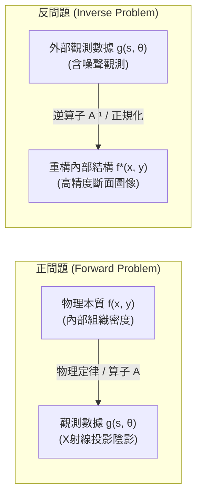

## 導言：透過陰影窺探不可見的深處

在日常經驗中，因果邏輯的推進往往是單向且自然的：如果知道了物體的形狀和光源的位置，投射在牆面上的陰影輪廓便能通過幾何光學極其容易地計算出來；如果知道了地層的物質密度分佈與彈性參數，地震波從震源傳播到地面各個地震儀的走時與波形便能根據波動方程精確模擬。這種從<strong>原因（內在系統參數與幾何構造）</strong>推導<strong>結果（外部觀測數據與物理場響應）</strong>的過程，被稱為<strong>正問題（Forward Problem）</strong>。正問題通常對應著大自然本身的物理運行規律，在數學上往往具有確定、穩定且唯一的解。

然而，在現代科學、醫學診斷和工程勘探的核心場景中，我們面臨的往往是截然相反的逆向挑戰：
- <strong>醫學電腦斷層掃描（CT / Computed Tomography）</strong>：醫生無法切開患者的顱骨或胸腔，只能從外部不同角度發射X射線並測量衰減後的透射強度。我們能否根據這些一維或二維的投影「陰影」，精確重構出大腦軟組織、微小腫瘤或血管壁的內部三維密度分佈？
- <strong>地球物理勘探</strong>：地質學家在地面引爆炸藥或震源車，記錄地面各處的地震波反射信號。我們能否據此反推地下數千米處石油構造、斷層滑移面或地幔對流邊界？
- <strong>天文干涉成像</strong>：事件視界望遠鏡（EHT）散佈在地球各處的射電天線僅採集到了極其稀疏的空間相干度數據。我們能否逆向合成出超大質量黑洞事件視界周圍吸積盤的真實圖像？
- <strong>無損檢測與材料科學</strong>：工業超聲與中子斷層成像如何在不破壞航空發動機單晶渦輪葉片的前提下，發現其微米級內部微裂紋？

這些從<strong>觀測結果（數據）</strong>逆向推導<strong>物理原因（系統內部狀態）</strong>的數學任務，統稱為<strong>反問題（Inverse Problems）</strong>。反問題不僅是應用數學中最具智力挑戰和美感的領域之一，更是現代無損成像技術的絕對理論支柱。

本文將帶領讀者深入反問題與現代成像的數學殿堂：從阿達馬（Jacques Hadamard）定義的「不適定性災難」，到約翰·拉東（Johann Radon）於1917年奠基的積分幾何與拉東變換；從傅立葉切片定理（Fourier Slice Theorem）構建的對偶橋樑，到濾波反投影演算法（FBP）的優雅推導；最終探索吉洪諾夫正規化（Tikhonov Regularization）、全變差正規化（Total Variation）以及壓縮感知（Compressed Sensing）如何馴服高維噪聲與病態矩陣，將不可能變為現實。

---

## 1. 什麼是反問題？：阿達馬適定性與不適定性的災難

要理解反問題的深刻性，首先必須明晰為什麼求解反問題比求解正問題困難千百倍。

### 1.1 算子方程的形式化表述

在泛函分析框架下，幾乎所有正問題都可以抽象為兩個函數空間（通常為希爾伯特空間或巴拿赫空間）之間的算子映射：
$$g = \mathcal{A}(f)$$
其中：
- $f \in \mathcal{X}$ 表示未知的系統內部物理參數分佈（例如人體內部的X射線線性衰減係數分佈 $f(x, y) \ge 0$）；
- $g \in \mathcal{Y}$ 表示觀測儀器所收集到的外部測量數據（例如探測器陣列測得的光子衰減積分投影數據）；
- $\mathcal{A}: \mathcal{X} \to \mathcal{Y}$ 為正向物理算子。對於CT成像、熱傳導或線性波動而言，$\mathcal{A}$ 通常是一個連續的<strong>線性積分算子</strong>。

正問題即：已知模型 $f$ 與算子 $\mathcal{A}$，計算觀測值 $g$。而<strong>反問題</strong>則是：已知觀測數據 $g$（或包含噪聲的實際測量值 $g^\delta$），求解未知函數 $f$，使得：
$$\mathcal{A} f = g$$

### 1.2 阿達馬適定性準則（Hadamard Well-Posedness）

法國數學家雅克·阿達馬在1902年系統研究偏微分方程邊值問題時提出：一個數學物理問題被稱為<strong>適定問題（Well-Posed Problem）</strong>，當且僅當滿足以下三條基本準則：
1. <strong>解的存在性（Existence）</strong>：對於任意可能的數據 $g \in \mathcal{Y}$，方程 $\mathcal{A} f = g$ 至少存在一個解 $f \in \mathcal{X}$。
2. <strong>解的唯一性（Uniqueness）</strong>：方程 $\mathcal{A} f = g$ 的解至多只有一個。若 $\mathcal{A} f_1 = \mathcal{A} f_2$，則必然有 $f_1 = f_2$（即算子 $\mathcal{A}$ 必須是單射，其核空間 $\ker(\mathcal{A}) = \{0\}$）。
3. <strong>解的連續依賴性 / 穩定性（Stability）</strong>：解 $f$ 連續依賴於輸入數據 $g$。具體而言，逆映射 $\mathcal{A}^{-1}: \mathcal{Y} \to \mathcal{X}$ 是連續算子。如果測量數據產生微小的擾動 $\delta g$（如儀器熱噪聲、光子散粒噪聲），重構解的誤差 $\delta f = \mathcal{A}^{-1}(g + \delta g) - \mathcal{A}^{-1}(g)$ 應當能夠被常數控制，即：
   $$\|\delta f\|_{\mathcal{X}} \le C \|\delta g\|_{\mathcal{Y}}$$

如果上述三個條件中<strong>任何一個不滿足</strong>，該數學問題就被稱為<strong>不適定問題（Ill-Posed Problem）</strong>。

### 1.3 反問題的不適定性根源：緊算子與高頻災難

令人驚異的是，現實物理世界中的幾乎所有反問題，天生都是<strong>嚴重不適定（Severely Ill-Posed）</strong>的，其根本原因在於物理正向過程的<strong>平滑效應（Smoothing Effect）</strong>。

在連續介質物理學中，正算子 $\mathcal{A}$ 幾乎總是<strong>緊算子（Compact Operator）</strong>。例如，第一類弗雷德霍姆（Fredholm）積分方程：
$$g(s) = (\mathcal{A} f)(s) = \int_a^b K(s, t) f(t) \, dt$$
其中核函數 $K(s, t)$ 通常是光滑的高斯核、泊松核或波動格林函數。

根據積分算子的性質，積分操作本質上是一種<strong>低通加權平均</strong>。無論未知的原信號 $f(t)$ 包含多麼劇烈的高頻振盪、尖銳邊緣或階躍斷層，經過連續核 $K(s, t)$ 的平滑積分之後，生成的數據 $g(s)$ 都會變得異常光滑。

然而，當我們試圖逆向求解時，災難降臨了：
根據緊算子譜理論（奇異值分解 / SVD），無限維希爾伯特空間中的緊算子 $\mathcal{A}$ 擁有一組趨於零的奇異值序列：
$$\sigma_1 \ge \sigma_2 \ge \dots \ge \sigma_n \to 0 \quad (n \to \infty)$$
其正算子與反算子的譜表示形式為：
$$\mathcal{A} f = \sum_{n=1}^\infty \sigma_n \langle f, v_n \rangle u_n \implies f = \mathcal{A}^{-1} g = \sum_{n=1}^\infty \frac{1}{\sigma_n} \langle g, u_n \rangle v_n$$

由於奇異值 $\sigma_n \to 0$，分母中的項 $\frac{1}{\sigma_n} \to \infty$！
如果測量數據中含有極其微弱的寬帶隨機噪聲 $\delta g = \epsilon u_n$（甚至可能是浮點運算的捨入誤差 $10^{-16}$），反演公式計算出的解將包含：
$$\delta f = \frac{\epsilon}{\sigma_n} v_n$$
當模態階數 $n$ 增大時，$\sigma_n$ 指數級或多項式級衰減至 0，導致放大的噪聲項 $\frac{\epsilon}{\sigma_n} \to \infty$ 徹底吞噬整個解！沒有任何直接求逆算子能夠在不加干預的情況下從含噪數據中恢復真實物理量。

---

## 2. 積分幾何的先驅：約翰·拉東與拉東變換

在X射線衍射和醫學CT問世前半個世紀，奧地利數學家約翰·拉東（Johann Radon）於1917年在純粹微分幾何與數學分析的研究中，提出了一個極為優美的幾何問題：
> 「如果我們知道了定義在二維平面上的未知光滑函數沿著所有可能直線路徑的線積分，我們能否唯一且精確地確定原函數本身？」

拉東不僅證明了其唯一性，更推導出了嚴格的解析逆變換公式。這一純數學創舉在半個世紀後成為了價值百億美元的現代醫學CT工業的數學地基。

### 2.1 平面直線的法線參數化

在二維歐幾里得平面 $\mathbb{R}^2$ 上，任意一條直線 $L$ 都可以通過其法線傾角 $\theta \in [0, \pi)$ 以及該直線到坐標原點的有向垂直距離 $s \in (-\infty, \infty)$ 唯一定義：
$$L(s, \theta) = \left\{ (x, y) \in \mathbb{R}^2 \;\middle|\; x \cos\theta + y \sin\theta = s \right\}$$

引入單位法向量 $\boldsymbol{\omega} = (\cos\theta, \sin\theta)^T$ 與單位方向向量 $\boldsymbol{\omega}^\perp = (-\sin\theta, \cos\theta)^T$，直線上的任意點可以參數化表示為：
$$\mathbf{x}(t) = s \boldsymbol{\omega} + t \boldsymbol{\omega}^\perp = (s \cos\theta - t \sin\theta, \; s \sin\theta + t \cos\theta)$$
其中 $t \in (-\infty, \infty)$ 為直線上的局部線坐標。

### 2.2 拉東變換（Radon Transform）的數學定義

設未知物體密度分佈為雙變量可積函數 $f(x, y) \in C_0^\infty(\mathbb{R}^2)$（具有緊支集的光滑函數）。函數 $f$ 的<strong>拉東變換</strong> $\mathcal{R}f$ 定義為 $f$ 沿直線 $L(s, \theta)$ 的線積分：
$$(\mathcal{R}f)(s, \theta) = \int_{-\infty}^\infty f(s\cos\theta - t\sin\theta, \; s\sin\theta + t\cos\theta) \, dt$$
利用二維狄拉克 $\delta$ 分佈（Dirac delta function），拉東變換亦可簡潔地寫作全局面積分形式：
$$(\mathcal{R}f)(s, \theta) = \iint_{\mathbb{R}^2} f(x, y) \, \delta(x \cos\theta + y \sin\theta - s) \, dx dy$$

在醫學影像學中，將拉東變換的結果 $(\mathcal{R}f)(s, \theta)$ 繪製在以橫坐標為探測器線位移 $s$、縱坐標為掃描旋轉角 $\theta$ 的二維圖像平面上，這種圖像被稱為<strong>正弦圖（Sinogram）</strong>。之所以命名為正弦圖，是因為被掃描物體內的任意孤立質點 $(x_0, y_0)$，在投影片角旋轉過程中在探測器上留下的軌跡恰好是一條正弦曲線：
$$s(\theta) = x_0 \cos\theta + y_0 \sin\theta = r_0 \cos(\theta - \phi_0)$$

---

## 3. 醫學CT的物理本質：比爾-朗伯定律與X射線投影

為什麼拉東變換能直接對應現代醫院裡的CT機工作原理？這一切源於經典的電磁輻射吸收物理學。

### 3.1 比爾-朗伯定律（Beer-Lambert Law）

單能X射線束在穿透非均勻物質介質時，光子流會與物質中的原子發生光電效應和康普頓散射，導致射線強度衰減。設沿直線路徑 $L$ 推進的局部距離為 $t$，在空間點 $\mathbf{x}$ 處介質的<strong>X射線線性衰減係數</strong>為 $f(\mathbf{x}) \ge 0$。根據微分吸收定律：
$$\frac{dI(t)}{dt} = - f(\mathbf{x}(t)) \, I(t)$$

積分分離變量：
$$\int_{I_0}^{I_{\text{det}}} \frac{dI}{I} = - \int_{L} f(\mathbf{x}) \, dt$$
得到穿透物體後被探測器接收到的剩餘光強 $I_{\text{det}}$：
$$I_{\text{det}} = I_0 \exp\left( - \int_L f(\mathbf{x}) \, dt \right)$$
其中 $I_0$ 為X射線管發出的初始光強。

### 3.2 對數變換：從非線性測量到拉東投影

探測器硬體測得光強 $I_{\text{det}}$ 和基準強度 $I_0$ 後，只需進行一次初等對數運算，就能直接消除指數非線性，得到純粹的線積分數據：
$$g(s, \theta) = \ln\left( \frac{I_0}{I_{\text{det}}} \right) = \int_L f(\mathbf{x}) \, dt = (\mathcal{R}f)(s, \theta)$$

因此，<strong>醫學CT圖像重構問題，在數學上等價於：已知全角度的拉東變換正弦圖數據 $g(s, \theta) = (\mathcal{R}f)(s, \theta)$，求解未知的人體內部衰減係數分佈 $f(x, y)$。</strong>

---

## 4. 傅立葉切片定理（Fourier Slice Theorem）：通往解析求逆的鑰匙

如何從一維投影積分 $g(s, \theta)$ 恢復出二維圖像 $f(x, y)$？連接投影空間與物理圖像空間的極其關鍵的數學橋樑，就是<strong>傅立葉切片定理（Fourier Slice Theorem / 投影切片定理）</strong>。

### 4.1 定理的數學陳述

<strong>定理</strong>：未知二維函數 $f(x, y)$ 的二維連續傅立葉變換，在頻域極坐標系下沿角度 $\theta$ 的一維徑向切片，嚴格等於該函數在同角度 $\theta$ 下的一維投影拉東變換 $g(s, \theta)$ 關於探測器位移坐標 $s$ 的一維傅立葉變換！

設 $\mathcal{F}_2$ 為二維傅立葉變換，$\mathcal{F}_1$ 為沿 $s$ 變量的一維傅立葉變換。該定理可以用優雅的等式表示：
$$\left( \mathcal{F}_1 [\mathcal{R}f(\cdot, \theta)] \right)(\omega) = \left( \mathcal{F}_2 f \right)(\omega \cos\theta, \; \omega \sin\theta)$$

### 4.2 嚴密數學推導

我們直接從一維傅立葉變換的定義出發，計算投影函數 $g(s, \theta)$ 的頻譜 $G(\omega, \theta)$：
$$G(\omega, \theta) = \int_{-\infty}^\infty g(s, \theta) \, e^{-i 2\pi \omega s} \, ds$$
將拉東變換的面積分定義代入：
$$G(\omega, \theta) = \int_{-\infty}^\infty \left[ \iint_{\mathbb{R}^2} f(x, y) \, \delta(x \cos\theta + y \sin\theta - s) \, dx dy \right] e^{-i 2\pi \omega s} \, ds$$
交換積分次序（利用富比尼定理 Fubini's Theorem）：
$$G(\omega, \theta) = \iint_{\mathbb{R}^2} f(x, y) \left[ \int_{-\infty}^\infty \delta(x \cos\theta + y \sin\theta - s) \, e^{-i 2\pi \omega s} \, ds \right] dx dy$$
利用狄拉克 $\delta$ 函數的篩選性質（Sifting Property），內層關於 $s$ 的積分直接令 $s = x \cos\theta + y \sin\theta$：
$$G(\omega, \theta) = \iint_{\mathbb{R}^2} f(x, y) \, e^{-i 2\pi \omega (x \cos\theta + y \sin\theta)} \, dx dy$$
令二維頻域坐標為 $u = \omega \cos\theta, \; v = \omega \sin\theta$，上式變為：
$$G(\omega, \theta) = \iint_{\mathbb{R}^2} f(x, y) \, e^{-i 2\pi (u x + v y)} \, dx dy = \hat{f}(u, v) = \hat{f}(\omega \cos\theta, \omega \sin\theta)$$
證畢！

---

## 5. 濾波反投影演算法（FBP）：工業CT的經典皇冠

擁有傅立葉切片定理後，推導出更加穩健、高效且可即時串流計算的演算法——<strong>濾波反投影演算法（Filtered Backprojection / FBP）</strong>。

### 5.1 二維逆傅立葉變換的極坐標分解

原圖像 $f(x, y)$ 可由其二維傅立葉逆變換嚴格重構：
$$f(x, y) = \iint_{\mathbb{R}^2} \hat{f}(u, v) \, e^{i 2\pi (u x + v y)} \, du dv$$
將頻域平面坐標 $(u, v)$ 轉換為極坐標系：
$$u = \omega \cos\theta, \quad v = \omega \sin\theta$$
面積元變換為：
$$du dv = |\omega| \, d\omega d\theta$$
注意積分區域：$\theta \in [0, \pi)$，$\omega \in (-\infty, \infty)$。代入逆變換公式：
$$f(x, y) = \int_0^\pi d\theta \int_{-\infty}^\infty \hat{f}(\omega \cos\theta, \omega \sin\theta) \, e^{i 2\pi \omega (x \cos\theta + y \sin\theta)} \, |\omega| \, d\omega$$
由傅立葉切片定理，$\hat{f}(\omega \cos\theta, \omega \sin\theta) = G(\omega, \theta)$，且記空間投影位置 $s = x \cos\theta + y \sin\theta$：
$$f(x, y) = \int_0^\pi \left[ \int_{-\infty}^\infty G(\omega, \theta) \cdot |\omega| \cdot e^{i 2\pi \omega s} \, d\omega \right]_{\!s = x\cos\theta + y\sin\theta} d\theta$$

### 5.2 濾波與反投影的兩步解耦

整個重構過程被優美地解耦為兩步操作：

#### 第一步：斜坡濾波（Ramp Filtering）
定義一維濾波投影信號：
$$\tilde{g}(s, \theta) = \mathcal{F}_1^{-1} \left\{ G(\omega, \theta) \cdot |\omega| \right\} = g(s, \theta) * h(s)$$
其中濾波器頻域傳遞函數為 $H(\omega) = |\omega|$，被稱為<strong>Ram-Lak（斜坡）濾波器</strong>。它精準地抵消了 $1/r$ 的幾何反投影模糊！

#### 第二步：反投影累加（Backprojection）
將濾波後的信號 $\tilde{g}(s, \theta)$ 沿原始投影射線塗抹回二維空間並對所有角度積分：
$$f(x, y) = \int_0^\pi \tilde{g}(x \cos\theta + y \sin\theta, \; \theta) \, d\theta = \mathcal{B} \tilde{g}$$

---

## 6. 不適定性的馴服：吉洪諾夫正規化與變分方法

當投影角度不足、噪聲劇烈或劑量極低時，解析算法失效，必須轉向現代<strong>正規化技術</strong>。

### 6.1 離散代數重構模型

將連續圖像離散化為像素向量 $\mathbf{f} \in \mathbb{R}^M$，探測器測量值離散化為測量向量 $\mathbf{g} \in \mathbb{R}^K$：
$$\mathbf{A} \mathbf{f} + \boldsymbol{\eta} = \mathbf{g}$$
其中矩陣元 $A_{ij}$ 表示第 $i$ 條射線穿過第 $j$ 個像素的相交長度。

### 6.2 吉洪諾夫正規化（Tikhonov Regularization）

蘇聯數學家吉洪諾夫於1963年提出正規化理論，其標準變分極值形式為：
$$\mathbf{f}_{\alpha} = \arg\min_{\mathbf{f}} \left\{ \|\mathbf{A} \mathbf{f} - \mathbf{g}\|_2^2 + \alpha \|\mathbf{L} \mathbf{f}\|_2^2 \right\}$$
其中第一項為數據保真項，第二項為正規化懲罰項，$\alpha > 0$ 為調節權衡的正規化參數。

當 $\mathbf{L} = \mathbf{I}$ 時，正則化解顯式表示為：
$$\mathbf{f}_\alpha = (\mathbf{A}^T \mathbf{A} + \alpha \mathbf{I})^{-1} \mathbf{A}^T \mathbf{g}$$
利用奇異值分解 $\mathbf{A} = \mathbf{U} \boldsymbol{\Sigma} \mathbf{V}^T$：
$$\mathbf{f}_\alpha = \sum_{i=1}^r \left( \frac{\sigma_i^2}{\sigma_i^2 + \alpha} \right) \cdot \frac{\mathbf{u}_i^T \mathbf{g}}{\sigma_i} \mathbf{v}_i$$
濾波因子 $\frac{\sigma_i^2}{\sigma_i^2 + \alpha}$ 在高頻噪聲模態（$\sigma_i \to 0$）時強行將增益截斷，避免了數值崩潰！

---

## 7. 現代前沿：全變差（TV）、壓縮感知與深度學習反演

### 7.1 全變差正規化（Total Variation）與邊緣保持
ROF 模型引入 $L_1$ 梯度範數懲罰：
$$\min_{\mathbf{f}} \left\{ \frac{1}{2} \|\mathbf{A}\mathbf{f} - \mathbf{g}\|_2^2 + \lambda \|\nabla \mathbf{f}\|_1 \right\}$$
在消除噪聲的同時，完美保留了腫瘤與器官邊緣的銳利跳變。

### 7.2 壓縮感知理論（Compressed Sensing）
陶哲軒與坎德斯證明：只要原圖像在某種基底下稀疏，即使僅採樣極少數稀疏角度，也能無失真重構，使人體承受的X射線輻射劑量劇降80%以上！

### 7.3 深度學習與物理知情模型（Deep Unfolding）
將經典近端梯度或ADMM演算法展開為深度網絡，把物理正向算子 $\mathcal{A}$ 作為嚴格先驗層內嵌，兼具深度學習的高速度與物理反演的嚴格可靠性。

---

## 結語：在不可見的投影中構建理性之光

從柏拉圖洞穴寓言中的陰影，到現代醫學以微米精度切片人體生命構造；反問題的數學歷程展现了人類理性的偉大光輝：即使肉眼無法直接透視內部，憑藉嚴謹的積分幾何、泛函分析與數值演算法，我們依然能夠從外部有限的投影陰影中，毫釐不差地重構出深藏內部的真實全貌。
