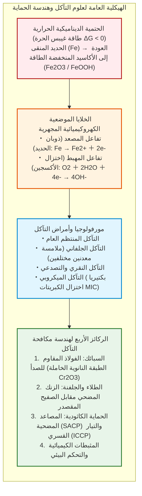
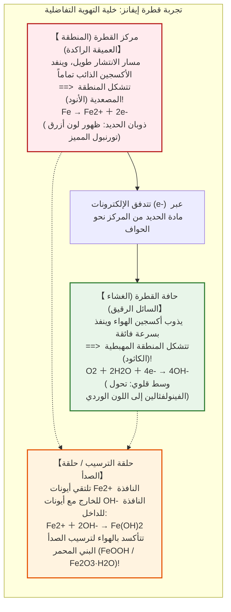
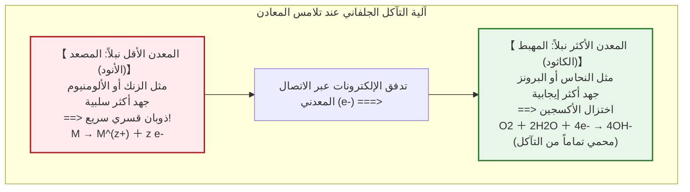
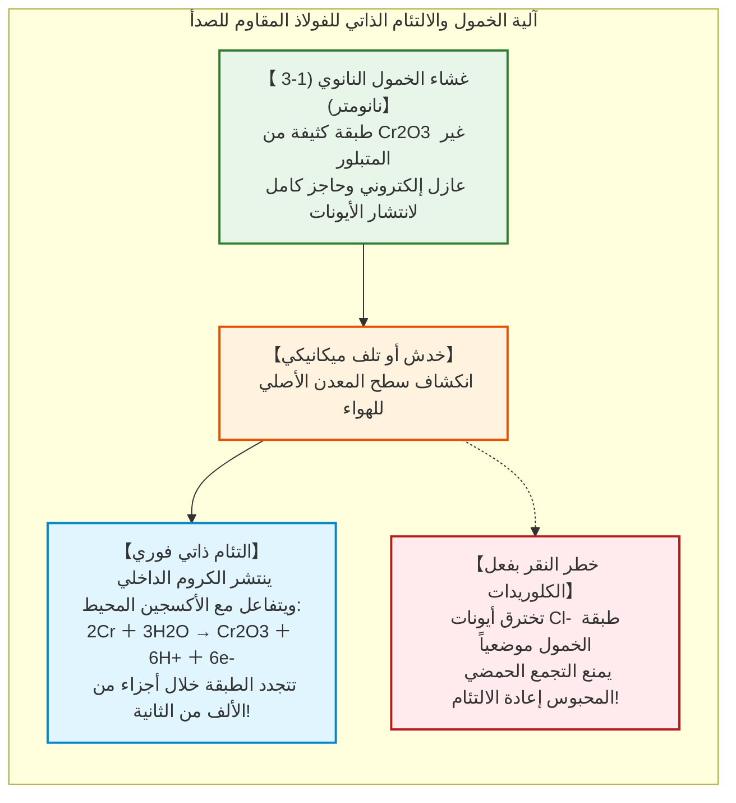

## مقدمة: الحتمية الديناميكية الحرارية لعودة الحديد إلى الأرض

يمثل الحديد ($\text{Fe}$) العمود الفقري للحضارة الإنسانية المعاصرة. فمن هياكل ناطحات السحاب العملاقة وشبكات السكك الحديدية العابرة للقارات، إلى ناقلات النفط العملاقة التي تزيح مئات آلاف الأطنان من المياه، وخطوط الأنابيب البحرية عالية الضغط وشبكات المياه البلدية—يشكل الحديد والصلب ما يزيد عن **95% من مجمل المعادن المصنعة والمستهلكة عالمياً** (نحو 1.9 مليار طن سنوياً).

ورغم هذه المكانة الحيوية، فإن هذه المادة تواجه لعنة كيميائية حتمية منذ لحظة صهرها الأولى: **التآكل، أو ما يُعرف شعبياً بالصدأ**.

فالعارضة الفولاذية غير المحمية المعرضة لماء المطر تتغطى خلال أيام بطبقات هشة بنية مائلة للحمرة، وتتعرض هياكل السفن في مياه البحار لنقر تآكلي مخرق. وطبقاً لتقارير الجمعية الدولية لحماية المواد والأداء (AMPP)، تتجاوز الخسائر الاقتصادية السنوية الناجمة عن تآكل المعادن **2.5 تريليون دولار أمريكي**—وهو ما يمثل **3.4% من الناتج المحلي الإجمالي العالمي**.

لماذا يصدأ الحديد بهذا الإصرار الذي لا هوادة فيه؟

من منظور الديناميكا الحرارية الكيميائية: **بالنسبة للحديد، فإن الصدأ هو المسار الأكثر طبيعية، وتفضيلاً وفق قانون الإنتروبيا، واستقراراً للعودة إلى حالة التوازن الكيميائي.**

ففي القشرة الأرضية، لا يتواجد الحديد كعنصر حر نقي $\text{Fe}^0$، بل كخامات مؤكسدة مستقرة (مثل الهيماتيت $\text{Fe}_2\text{O}_3$ والمغنيتيت $\text{Fe}_3\text{O}_4$)، حيث ترتبط ذرات الحديد ارتباطاً وثيقاً بالأكسجين عند أدنى مستوى طاقة. ولكي يحصل الإنسان على الحديد المعدني، شيد الأفران اللافحة العملاقة، مستهلكاً طاقة حرارية هائلة ($> 1500^\circ\text{C}$) لانتزاع الأكسجين قسراً.

وبالتالي، فإن الحديد المصنع يوجد في **حالة عالية الطاقة وغير مستقرة ديناميكياً**. ووفق القانون الثاني للديناميكا الحرارية، يسعى الحديد دوماً للتخلص من هذه الطاقة المكتسبة. وعند تلامسه مع الماء والأكسجين، يتأكسد تلقائياً ($\Delta G < 0$) ليعود إلى أصله المعدني الحجري.



---

## الفصل الأول: الكيمياء الكهربائية داخل قطرة ماء – الخلايا الموضعية المجهرية

بالعين المجردة، يبدو الفولاذ وكأنه يتأكسد مباشرة بفعل الهواء. إلا أن التحليل الكهروكيميائي الدقيق يظهر حقيقة مختلفة تماماً:

**صدأ الحديد هو تفاعل بطارية كهروكيميائية في حالة قصر كهربائي دائري.** تنشأ على سطح المعدن ملايين البطاريات المجهرية التلقائية—المسماة **الخلايا الموضعية**—التي تدير تدفقاً لا ينقطع من الإلكترونات والأيونات.

### 1.1 تجربة قطرة إيفانز وتأثير التهوية التفاضلية

في عشرينيات القرن العشرين، أجرى عالم الكيمياء الكهربائية البريطاني أوليك ريتشاردسون إيفانز في جامعة كامبريدج تجربة بارزة.

وضع إيفانز قطرة محلول ملحي مخفف ($\text{NaCl}$) على صفيحة فولاذية مصقولة، مع إضافة كواشف لونية (الفينولفثالين للكشف عن القلوية $\text{OH}^-$، وفيريسيانيد البوتاسيوم للكشف عن أيونات الحديدوز $\text{Fe}^{2+}$).

أثبتت النتائج حقيقة حاسمة:



أثبتت هذه التجربة مفهوم **خلية التهوية التفاضلية**: يذوب الحديد أنودياً حيث يقل الأكسجين (مركز القطرة)، بينما يحدث اختزال الأكسجين كاثودياً عند الحواف الغنية بالأكسجين.

### 1.2 خطوات التفاعلات الكيميائية لتشكل الصدأ

- **الأكسدة المصعدية**: $\text{Fe} \to \text{Fe}^{2+} + 2e^-$
- **الاختزال المهبطي**: $\text{O}_2 + 2\text{H}_2\text{O} + 4e^- \to 4\text{OH}^-$
- **الترسيب الأولي**: $\text{Fe}^{2+} + 2\text{OH}^- \to \text{Fe(OH)}_2$ (هيدروكسيد الحديدوز الأخضر الباهت)
- **الأكسدة الثانوية**: $4\text{Fe(OH)}_2 + \text{O}_2 + 2\text{H}_2\text{O} \to 4\text{Fe(OH)}_3$

ويتحول الهيدروكسيد بالتدريج إلى مركبات هيدروكسيد الأكسيد (الليبييدوكروكيت والغوثيت) والأكاسيد (المغنيتيت والهيماتيت).

وطبقاً لـ **نسبة بيلينغ-بيدورث**، فإن حجم الصدأ المتشكل يفوق حجم الحديد المعدني المستهلك **بمقدار ضعفين إلى ثلاثة أضعاف**. ويؤدي هذا التمدد الحجمي إلى تشقق قشرة الصدأ وتفتتها، مما يعرض سطح المعدن باستمرار لمزيد من التآكل.

---

## الفصل الثاني: الديناميكا الحرارية ومخطط بوربيه

قام العالم البلجيكي مارسيل بوربيه بوضع **مخططات الجهد والأس الهيدروجيني (مخطط بوربيه)** لتوضيح نطاقات استقرار الحديد في الأوساط المائية:
1. **نطاق الحصانة (Immunity)** عند ($E < -0{,}6\,\text{V}$): يكون الحديد النقي مستقراً ديناميكياً ويمتنع ذوبانه تماماً، وهو المبدأ الأساسي لـ **الحماية الكاثودية**.
2. **نطاق التآكل (Corrosion)**: يذوب الحديد كأيونات نشطة $\text{Fe}^{2+}$ أو $\text{Fe}^{3+}$.
3. **نطاق الخمول (Passivity)**: تتشكل طبقات أكسيد متماسكة تعطل سرعة التآكل (كما في الخرسانة القلوية ذات $\text{pH} \approx 13$).

---

## الفصل الثالث: التآكل الجلفاني وخطر نسبة المساحات

عند اتصال معدنين مختلفين كهربائياً في وسط موصل، يتحول المعدن الأكثر نشاطاً (الأقل جهداً) إلى مصعد ويتعرض لتآكل متسارع، بينما يتحول المعدن الأنبل إلى مهبط محمي.



### قانون نسبة المساحة القاتل: $A_\text{المهبط} / A_\text{المصعد}$

تتضاعف كثافة تيار التآكل على المصعد طردياً مع نسبة مساحة الكاثود إلى الأنود:

$$i_\text{المصعد} = i_\text{المهبط} \times \left( \frac{A_\text{المهبط}}{A_\text{المصعد}} \right)$$

إذا استخدمت براغٍ فولاذية صغيرة في ألواح نحاسية هائلة ($A_\text{المهبط} \gg A_\text{المصعد}$)، فإن البراغي ستتآكل وتنقصم خلال أسابيع معدودة.

---

## الفصل الرابع: الفولاذ المقاوم للصدأ وطبقة الخمول النانوية

تؤدي إضافة ما لا يقل عن **10.5% من الكروم ($\text{Cr}$)** إلى تكوين طبقة نانوية رقيقة جداً (1 إلى 3 نانومتر) من أكسيد الكروم ($\text{Cr}_2\text{O}_3$) ذاتية الالتئام.



في البيئات البحرية الغنية بأيونات الكلوريد ($\text{Cl}^-$)، قد يحدث ثقب موضعي لطبقة الخمول مسبباً **تآكلاً نقرياً (pitting)** كارثياً، ولذلك تضاف نسبة 2 إلى 3% من الموليبدينوم ($\text{Mo}$) لتعزيز الصمود (الفولاذ البحري 316).

---

## الفصل الخامس: الجلفنة والحماية الكاثودية

### 5.1 الفولاذ المجلفن مقابل الصفيح المقصدر

- **الفولاذ المجلفن (بالزنك)**: الزنك أكثر نشاطاً من الحديد ($E^\circ = -0{,}76\,\text{V}$). وعند حدوث خدش، يضحي الزنك بنفسه كـ **أنود مضحي** لحماية الفولاذ المكشوف.
- **الصفيح المقصدر (بالقصدير)**: القصدير أنبل من الحديد ($E^\circ = -0{,}14\,\text{V}$). إذا حدث خدش دقيق في العلبة، يصبح الحديد مصعداً صغيراً جداً أمام مهبط قصديري هائل، مما يؤدي إلى انثقاب الصفيحة بسرعة هائلة.

### 5.2 منظومات الحماية الكاثودية (CP)

```mermaid
flowchart TD
    subgraph CathodicSystems["نظم الحماية الكاثودية للبنى التحتية"]
        direction TB
        subgraph SACP["1. المصاعد المضحية (SACP)"]
            SACP_Block["قوالب سبائك الزنك أو الألومنيوم ملحومة بهيكل السفينة"]
            SACP_Block -->|تيار إلكترونات جلفاني تلقائي| SACP_Hull["هيكل السفينة يستقطب كمهبط محمي"]
        end
        
        subgraph ICCP["2. تيار الحماية القسري (ICCP)"]
            ICCP_Gen["مصدر تيار مستمر (محول مقوم/Rectifier)"]
            ICCP_Anode["مصاعد تيتانيوم خاملة (MMO) مدفونة في التربة"]
            ICCP_Pipe["أنبوب نقل غاز يمتد لآلاف الكيلومترات بجهد سالب محمي"]
            ICCP_Gen -->|القطب الموجب (+)| ICCP_Anode
            ICCP_Gen -->|القطب السالب (-)| ICCP_Pipe
        end
    end
    
    style SACP fill:#e1f5fe,stroke:#0288d1,stroke-width:2px
    style ICCP fill:#e8f5e9,stroke:#2e7d32,stroke-width:2px
```

1. **المصاعد المضحية (SACP)**: كتل من الزنك أو الألومنيوم تُركب على هياكل السفن والمنصات البحرية لتتآكل فداءً للحديد.
2. **التيار القسري (ICCP)**: استخدام مقومات كهربائية تضخ الإلكترونات عبر مصاعد تيتانيوم (MMO) لحماية خطوط الأنابيب الطويلة لآلاف الكيلومترات.

---

## الفصل السادس: التآكل الميكروبي والتآكل الإجهادي

- **بكتيريا اختزال الكبريتات (SRB)**: تعيش في البيئات اللاهوائية وتستهلك غشاء الهيدروجين المهبطي، منتجة كبريتيد الهيدروجين ($\text{H}_2\text{S}$) الذي يشكل كبريتيد الحديد ($\text{FeS}$)، مسبباً ثقوباً بمعدل ملليمترات سنوياً.
- **التآكل الإجهادي التشققي (SCC)**: التضافر القاتل بين الإجهاد الميكانيكي وبيئة التآكل يولد شقوقاً شعرية تنتشر بسرعة البرق دون تشوه مرئي مسبق.

---

## خاتمة: صراع الهندسة الأبدي ضد الإنتروبيا

الحديد هو دعامة العالم المبني. لكن كل غرام فولاذ يعيش في صراع ديناميكي حراري دائم لاسترجاع طاقته المسلوبة في الأفران. الصدأ هو صوت الطبيعة وهي تسترد خاماتها.

وبفضل علوم الكيمياء الكهربائية والأغشية النانوية والحماية الكاثودية، تواصل الهندسة المعاصرة وقوفها سداً منيعاً لحماية دعائم الحضارة الإنسانية.
