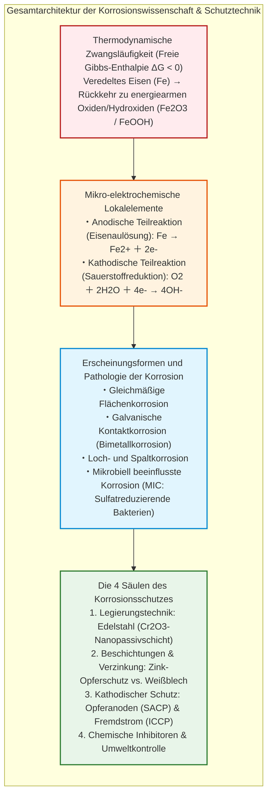
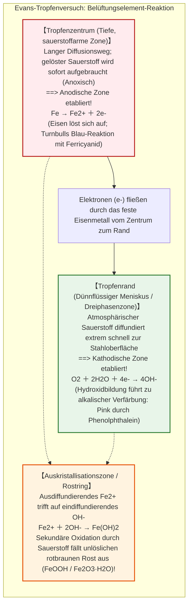
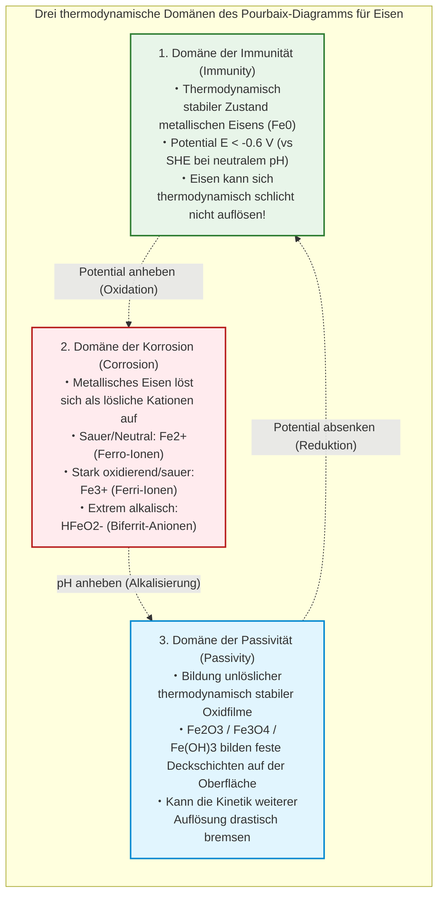
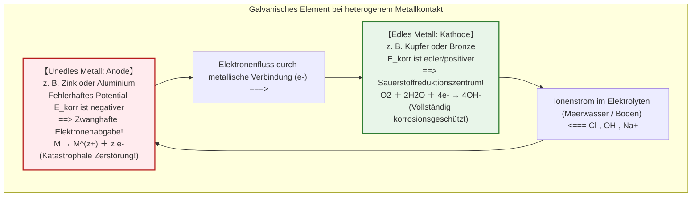
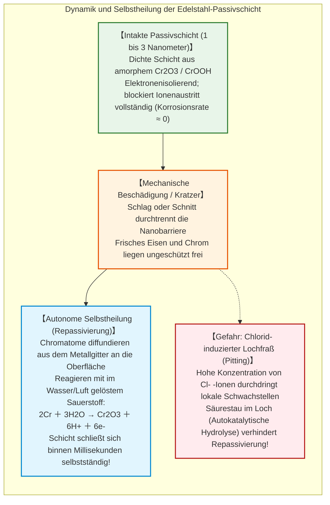
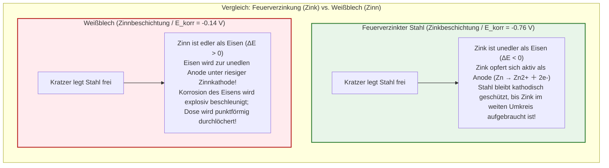
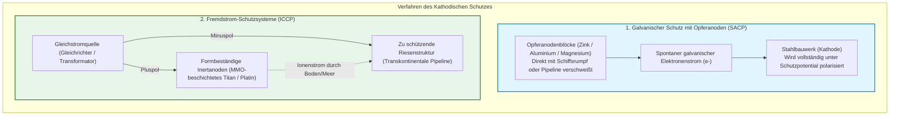

## Einleitung: Das thermodynamische Schicksal des Eisens zur Rückkehr in die Erde

Eisen ($\text{Fe}$) ist das strukturelle Rückgrat der modernen Zivilisation. Von den tragenden Pfeilern städtischer Wolkenkratzer und den transkontinentalen Schienensträngen über gigantische Hochsee-Öltanker mit Hunderttausenden Tonnen Verdrängung bis hin zu Hochdruck-Unterwasserpipelines, Trinkwasser-Fernleitungen und Automobilen: Eisen und Stahl stellen mehr als **95 % aller weltweit erzeugten und verbrauchten Metalle** (rund 1,9 Milliarden Tonnen pro Jahr).

Doch von der ersten Millisekunde seiner metallurgischen Entstehung an lastet auf diesem universellen Werkstoff ein unerbittlicher chemischer Fluch: **die Korrosion, im Volksmund schlicht als Rosten bekannt**.

Ein ungeschützter Stahlträger überzieht sich bei feuchtem Wetter binnen weniger Tage mit rotbraunem, abblätterndem Oxid. Schiffsrümpfe im Meerwasser werden von aggressiven Lochfraßnarben durchlöchert. Unterirdische gusseiserne Versorgungsleitungen erleiden Lochungen, durch die kostbares Trinkwasser unter Hochdruck in das umgebende Erdreich entweicht. Nach Untersuchungen der Association for Materials Protection and Performance (AMPP, ehemals NACE International) übersteigen die globalen wirtschaftlichen Gesamtschäden durch metallische Korrosion **2,5 Billionen US-Dollar pro Jahr** – das entspricht atemberaubenden **3,4 % des weltweiten Bruttoinlandsprodukts (BIP)**.

Warum rostet Eisen mit einer derart unerbittlichen Beständigkeit?

Aus der Perspektive der chemischen Thermodynamik lautet die Antwort schlicht: **Für metallisches Eisen ist das Rosten der natürlichste, entropisch bevorzugte und thermodynamisch stabilste Weg zurück zum chemischen Gleichgewicht.**

In der Erdkruste existiert Eisen natürlicherweise nicht als metallisches $\text{Fe}^0$. Es liegt fest gebunden in oxidischen Erzen vor – vor allem als Hämatit ($\text{Fe}_2\text{O}_3$) und Magnetit ($\text{Fe}_3\text{O}_4$), in denen die Eisenatome bei minimaler Enthalpie stabil an Sauerstoff gebunden sind. Um reines metallisches Eisen zu gewinnen, errichtete die Menschheit gewaltige Hochöfen. Unter gewaltigem Energieeinsatz ($> 1500^\circ\text{C}$) und dem Verbrennen von Koks wurde dem Erz der Sauerstoff unter Zwang entzogen.

Dadurch befindet sich veredeltes Eisen in einem **thermodynamisch instabilen Hochenergiezustand**. Dem Zweiten Hauptsatz der Thermodynamik folgend (dem universellen Streben nach maximaler Entropie und minimaler freier Gibbs-Enthalpie), strebt Eisen unaufhörlich danach, diese akkumulierte Reduktionsenergie wieder abzugeben. In Gegenwart von Wasser und Sauerstoff oxidiert Eisen spontan ($\Delta G < 0$) und kehrt in den energiearmen Gesteinszustand zurück, aus dem es einst befreit wurde. Rost ist der physikalische Ausdruck dieses thermodynamischen Gesetzes.

---

## Kapitel 1: Die Elektrochemie im Wassertropfen – Lokalelemente im Mikrokosmos

Für das unbewaffnete menschliche Auge scheint ein im Regen rostender Stahlträger einer direkten chemischen Oxidation durch die Umgebungsluft zu unterliegen. Moderne elektrochemische Analysen offenbaren jedoch eine völlig andere mikroskopische Realität:

**Das Rosten von Eisen ist eine geschlossene elektrochemische Batteriereaktion.** Auf der Metalloberfläche entstehen Millionen mikroskopischer, kurzgeschlossener galvanischer Elemente – sogenannte **Lokalelemente** –, die einen kontinuierlichen Elektronen- und Ionenfluss antreiben.

### 1.1 Der Evans-Tropfenversuch und Belüftungsunterschiede

In den 1920er Jahren führte der britische Elektrochemiker Ulick Richardson Evans an der Universität Cambridge – weithin als Begründer der modernen Korrosionswissenschaft geehrt – ein bahnbrechendes Experiment durch.

Evans platzierte einen einzelnen Tropfen einer schwach salzhaltigen Natriumchloridlösung auf eine unpolierte, horizontale Stahlplatte und fügte spezifische Farbindikatoren hinzu (Phenolphthalein zum Nachweis von Hydroxidionen $\text{OH}^-$ und Kaliumhexacyanidoferrat(III) zum Nachweis zweiwertiger Eisenionen $\text{Fe}^{2+}$).

Wäre die Korrosion eine homogene chemische Gasreaktion, so hätte sich der Stahl unter dem Tropfen vollkommen gleichförmig aufgelöst. Das experimentelle Ergebnis widerlegte dies eindrucksvoll:

Das Evans-Experiment belegte zwei grundlegende Gesetzmäßigkeiten:
1. **Räumliche Trennung von Anode und Kathode**: Eisen löst sich selektiv dort auf, wo der Sauerstoffgehalt am niedrigsten ist (Zentrum), während die Sauerstoffreduktion an den sauerstoffreichsten Stellen (Tropfenrand) stattfindet. Dies nennt man ein **Belüftungselement (Differential Aeration Cell)**.
2. **Die Entstehung von Rost als Sekundärfällung**: Rost bildet sich nicht unmittelbar auf der sich auflösenden Metalloberfläche, sondern als Fällungsreaktion in der Lösung, wo Eisenkationen und Hydroxidanionen aufeinandertreffen.

### 1.2 Die chemische Reaktionskaskade der Rostbildung

Die mikroskopische Kaskade der Eisenkorrosion verläuft in präzisen elektrochemischen und kollateralen chemischen Schritten:

$$\text{Anodische Auflösung: } \text{Fe} \to \text{Fe}^{2+} + 2e^- \quad (E^\circ = -0{,}44\,\text{V}_\text{SHE})$$

$$\text{Kathodische Sauerstoffreduktion: } \text{O}_2 + 2\text{H}_2\text{O} + 4e^- \to 4\text{OH}^- \quad (E^\circ = +0{,}40\,\text{V}_\text{SHE})$$

In neutralem oder leicht alkalischem Wasser treffen die freigesetzten Ionen aufeinander und fällen weißlich-grünes Eisen(II)-hydroxid aus:

$$\text{Fe}^{2+} + 2\text{OH}^- \to \text{Fe(OH)}_2 \downarrow$$

In Anwesenheit von gelöstem Sauerstoff wird dieses rasch zu Eisen(III)-Spezies oxidiert:

$$4\text{Fe(OH)}_2 + \text{O}_2 + 2\text{H}_2\text{O} \to 4\text{Fe(OH)}_3 \downarrow$$

Das voluminöse Eisen(III)-hydroxid verliert schrittweise Kristallwasser und wandelt sich in die typischen Mineralphasen des Rosts um:
- **Lepidokrokit ($\gamma\text{-FeOOH}$)** und **Goethit ($\alpha\text{-FeOOH}$)**
- Unter sauerstoffarmen Bedingungen im Kern dicker Rostschichten bildet sich schwarzer **Magnetit ($\text{Fe}_3\text{O}_4$)**
- Bei vollständiger Austrocknung schließlich **Hämatit ($\alpha\text{-Fe}_2\text{O}_3$)**

Ein verhängnisvoller struktureller Parameter ist der **Pilling-Bedworth-Koeffizient**: Das Volumen des entstehenden Eisenoxids ist **über zwei- bis dreimal größer** als das Volumen des verbrauchten metallischen Eisens. Durch diese gewaltige Volumenzunahme platzt der Rostfilm kontinuierlich ab, bildet Poren und Risse und bietet der Umwelt stetig frische Metalloberflächen zur weiteren Zerstörung dar.

---

## Kapitel 2: Thermodynamik und Kinetik – Das Pourbaix-Diagramm

### 2.1 Das Pourbaix-Diagramm (Potential-pH-Diagramm)

Um die thermodynamische Stabilität von Metallen in wässrigen Umgebungen systematisch vorherzusagen, entwickelte der belgische Elektrochemiker Marcel Pourbaix in den 1940er und 1950er Jahren die nach ihm benannten **Pourbaix-Diagramme (Potential-pH-Diagramme)**.

Das Pourbaix-Diagramm für das System Eisen-Wasser teilt den thermodynamischen Zustandsraum in drei fundamentale Zonen ein:

Aus diesem Diagramm lassen sich die beiden ingenieurtechnischen Grundstrategien zur Verhinderung von Korrosion ableiten:
1. **Verschiebung in die Domäne der Immunität**: Durch künstliches Absenken des elektrischen Potentials des Metalls unter das Gleichgewichtspotenzial der anodischen Eisenauflösung wird Korrosion thermodynamisch unmöglich gemacht. Dies ist das exakte Wirkungsprinzip des **kathodischen Schutzes (CP)**.
2. **Verschiebung in die Domäne der Passivität**: Durch gezielte Anhebung des pH-Wertes (wie im hochalkalischen Porenwasser von intaktem Beton, $\text{pH} \approx 12{,}5 - 13{,}5$) bildet Eisen eine dichte, schützende Eisenoxid-Passivschicht aus.

---

## Kapitel 3: Bimetallkorrosion – Die Katastrophe der galvanischen Kopplung

Wenn zwei unterschiedliche Metalle in einem gemeinsamen leitfähigen Elektrolyten in elektrischen Kontakt treten, entsteht ein makroskopisches galvanisches Element: **Bimetallkorrosion (Galvanische Korrosion)**.

Das unedlere Metall (mit negativerem Standard- bzw. freiem Korrosionspotential) wird zur reinen Anode und löst sich mit dramatisch erhöhter Geschwindigkeit auf. Das edlere Metall wird zur Kathode und bleibt geschützt.

### 3.1 Das verhängnisvolle Flächenverhältnis ($A_\text{Kathode} / A_\text{Anode}$)

Die Zerstörungskraft galvanischer Korrosion wird primär durch das **Flächenverhältnis von Kathode zu Anode** bestimmt:

$$i_\text{Anode} = i_\text{Kathode} \times \left( \frac{A_\text{Kathode}}{A_\text{Anode}} \right)$$

Ist die Kathodenfläche groß und die Anodenfläche winzig ($A_\text{Kathode} \gg A_\text{Anode}$), konzentriert sich der gesamte galvanische Strom auf eine minimale Fläche. Die lokale Korrosionsstromdichte explodiert regelrecht, und das unedle Bauteil wird in kürzester Zeit durchlöchert oder abgeschert.

| Konfiguration | Kathodenfläche ($A_\text{K}$) | Anodenfläche ($A_\text{A}$) | Flächenverhältnis | Korrosionsrisiko |
|---|---|---|---|---|
| Stahlträger mit Kupferschrauben | Sehr groß (Stahl) | Sehr klein (Kupfer) | Ungefährlich | Sehr gering (Stahl opfert sich minimal verteilt über Riesenfläche) |
| Kupferblech mit Stahlschrauben | Sehr groß (Kupfer) | Winzig (Stahlschrauben) | **Extrem gefährlich** | **Katastrophal** (Schrauben scheren binnen Wochen durch Lochfraß ab!) |
| Großes Aluminium-Schiffsdeck mit Bronzeschrauben | Riesig (Aluminium) | Klein (Bronze) | Gering | Beherrschbar bei entsprechender Isolation |
| Bronzeventil in Aluminiumrohrleitung | Groß (Bronze) | Rohrwand lokal winzig | **Hochgradig kritisch** | Rohr bricht am Flanschübergang schnell durch |

---

## Kapitel 4: Die Nanowelt des Edelstahls – Die Magie der Passivschicht

Stahl lässt sich durch geschickte metallurgische Legierungstechnik gegen gewöhnliche Korrosion immunisieren: durch Zugabe von mindestens **10,5 Masseprozent Chrom ($\text{Cr}$)** entsteht **Edelstahl (rostfreier Stahl)**.

### 4.1 Die selbstheilende Chromoxid-Nanobarriere

Wenn der Chromgehalt 10,5 % bis 12 % überschreitet, diffundieren Chromkationen an die Oberfläche und reagieren mit Sauerstoff und Hydroxidionen zu einem ultradünnen Film aus amorphem Chrom(III)-oxid und -hydroxid ($\text{Cr}_2\text{O}_3 \cdot n\text{H}_2\text{O}$).

Diese Passivschicht besitzt faszinierende physikochemische Eigenschaften:
- **Dicke von lediglich 1 bis 3 Nanometern**: Das entspricht etwa 10 bis 20 Atomlagen – absolut unsichtbar für das menschliche Auge.
- **Autonome Selbstheilung (Repassivierung)**: Wird die Oberfläche mechanisch zerkratzt, reagiert das im Substrat homogen gelöste Chrom binnen Millisekunden mit dem Sauerstoff der Umgebungsluft und baut die Passivschicht vollständig wieder auf.

### 4.2 Die tödliche Achillesferse: Chloridionen und Lochfraß

In Gegenwart hoher Konzentrationen von Halogenidionen – insbesondere **Chloridionen ($\text{Cl}^-$)** in Meerwasser oder Tausalzen – versagt selbst Standard-Edelstahl (wie AISI 304 / V2A).

Kleine Chloridionen dringen elektrostatisch in mikroskopische Gitterdefekte der Passivschicht ein, verdrängen Sauerstoff und bilden lösliche Eisenchloridkomplexe. An dieser winzigen Stelle bricht die Passivschicht zusammen: Ein mikro-anodischer Punkt entsteht, umgeben von einer gigantischen passiven Kathodenfläche. Durch Hydrolyse bildet sich Salzsäure im Inneren des Kratzers:

$$\text{Fe}^{2+} + 2\text{Cl}^- + 2\text{H}_2\text{O} \to \text{Fe(OH)}_2 \downarrow + 2\text{HCl}$$

Der pH-Wert im Inneren der Vertiefung stürzt auf unter 2 ab, was die Heilung unmöglich macht. Das Metall wird rasch senkrecht in die Tiefe gefressen – ein katastrophaler **Lochfraß (Pitting Corrosion)**. Aus diesem Grund legiert man maritime Stähle mit Molybdän (z. B. AISI 316 / V4A mit 2–3 % Mo) oder nutzt Duplex-Edelstähle.

---

## Kapitel 5: Schutzschichten und Kathodischer Schutz

### 5.1 Verzinkung vs. Verzinnung: Die fundamentale Asymmetrie

Zwei klassische Schutzmethoden verdeutlichen die Gesetze der Bimetallkorrosion:

- **Verzinkung (Feuerverzinkter Stahl / Galvanized Steel)**: Zink ist unedler als Eisen ($E^\circ_{\text{Zn}^{2+}/\text{Zn}} = -0{,}76\,\text{V}$). Wird die Zinkschicht zerkratzt, fungiert das umgebende Zink als **Opferanode**. Es gibt freiwillig Elektronen an das freiliegende Eisen ab und schützt dieses vor dem Rosten (kathodischer Fernschutz).
- **Verzinnung (Weißblech / Tinplate)**: Zinn ist edler als Eisen ($E^\circ_{\text{Sn}^{2+}/\text{Sn}} = -0{,}14\,\text{V}$). Solange die Zinnschicht perfekt intakt ist, bietet sie eine hervorragende chemische Barriere für Konservendosen. Weist sie jedoch eine winzige Fehlstelle auf, wird das darunterliegende Eisen zur winzigen Anode in Kontakt mit einer gigantischen Zinnkathode. Die Lochfraßgeschwindigkeit schießt empor und die Dose wird binnen kürzester Zeit punktförmig durchstochen.

### 5.2 Kathodischer Korrosionsschutz (KKS): Der Schutzschild globaler Infrastrukturen

Für gigantische Stahlbauwerke im Erdreich oder im Ozean – Schiffsrümpfe, Offshore-Bohrinseln, Unterseepipelines und Hafenkaimauern – reicht Farbe allein nicht aus. Hier kommt der **Kathodische Korrosionsschutz (Cathodic Protection, CP)** zum Einsatz.

1. **Galvanische Anoden (SACP - Sacrificial Anode Cathodic Protection)**:
   Auf die Außenhaut von Hochseeschiffen werden massive Barren aus Aluminium- oder Zinklegierungen aufgeschweißt. Der natürliche Potentialunterschied zum Stahl treibt ohne externe Stromquelle schützende Elektronen in den Schiffsrumpf. Nach einigen Jahren sind die Barren zerfressen und werden im Trockendock erneuert.
2. **Fremdstromanlagen (ICCP - Impressed Current Cathodic Protection)**:
   Bei transkontinentalen Gaspipelines oder gigantischen Hafenanlagen reicht das Eigenpotential von Opferanoden nicht aus. Stattdessen werden inerte Anoden (z. B. Titanstäbe mit Mischoxidbeschichtung, MMO) im Boden vergraben. Hochleistungsgleichrichter speisen kontinuierlich Gleichstrom ein: Der Pluspol wird an die Anoden angeschlossen, der Minuspol an die Stahlpipeline. Der Elektronenüberschuss zwingt das gesamte Rohrnetz in die Immunitätszone des Pourbaix-Diagramms.

---

## Kapitel 6: Mikrobielle Korrosion und Spannungsrisskorrosion

### 6.1 Mikrobiell beeinflusste Korrosion (MIC)

In tiefem sauerstofffreiem Schlamm oder anaeroben Rohrleitungsböden verursachen **Sulfatreduzierende Bakterien (SRB)** wie *Desulfovibrio* verheerende Schäden. Sie nutzen Enzyme (Hydrogenasen), um den schützenden Wasserstofffilm auf der Stahloberfläche zu verstoffwechseln (kathodische Depolarisation). Ihr Stoffwechselprodukt, Schwefelwasserstoff ($\text{H}_2\text{S}$), bildet schwarzen Eisensulfidschlamm ($\text{FeS}$), der extrem kathodisch gegenüber reinem Eisen wirkt und Lochfraßraten von mehreren Millimetern pro Jahr erzeugt.

### 6.2 Spannungsrisskorrosion (SpRK)

Das verhängnisvolle Zusammenspiel von mechanischer Zugspannung und spezifischen korrosiven Medien führt zur **Spannungsrisskorrosion (SCC)**. Ohne sichtbare äußere Materialabtragung wandern mikroskopische Risse mit rasanter Geschwindigkeit interkristallin oder transkristallin durch das Gefüge, bis das Bauteil plötzlich und ohne jede Vorwarnung katastrophal versagt.

---

## Fazit: Der ewige Kampf der Ingenieure gegen die Entropie

Eisen ist das Fundament unserer physischen Zivilisation. Doch jedes Gramm Stahl existiert in ständiger thermodynamischer Spannung mit seiner Umwelt. Rost ist kein bloßer Schönheitsfehler, sondern die makroskopische Manifestation des Zweiten Hauptsatzes der Thermodynamik: Die Natur fordert ihre freie Enthalpie zurück.

Die moderne Korrosionswissenschaft ist die Kunst, diesen thermodynamischen Zerfall mit den Mitteln der Elektrochemie, der Nanotechnologie und der Schutzstromtechnik über Generationen hinweg aufzuhalten.
