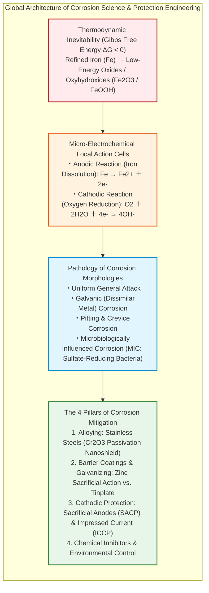
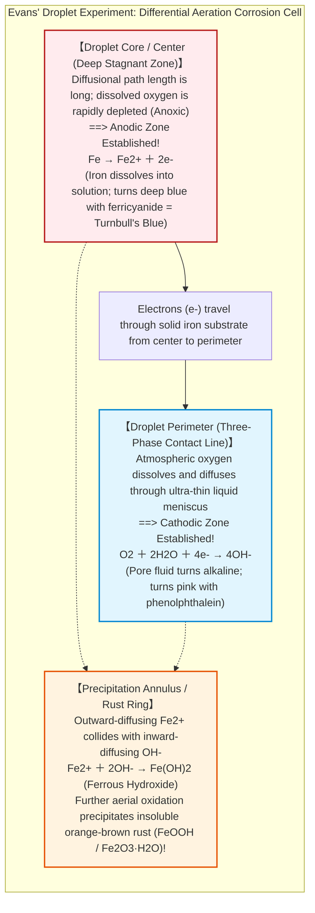
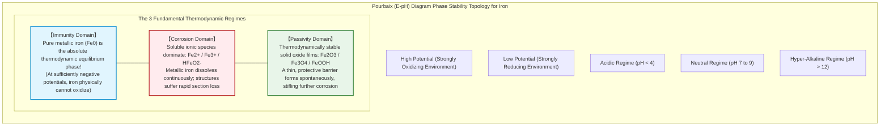
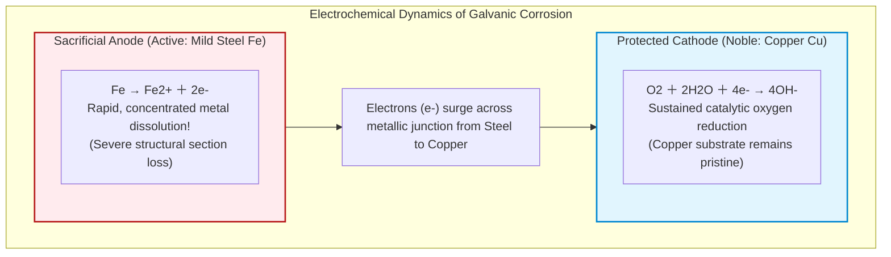
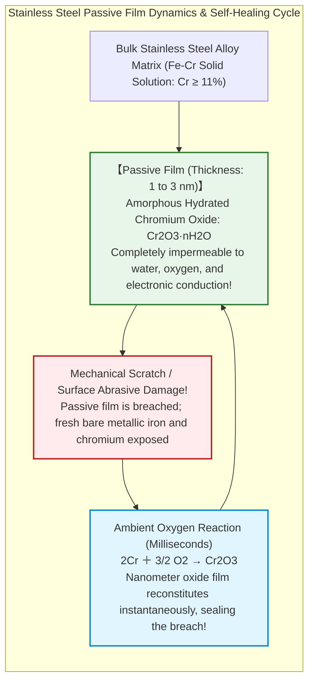
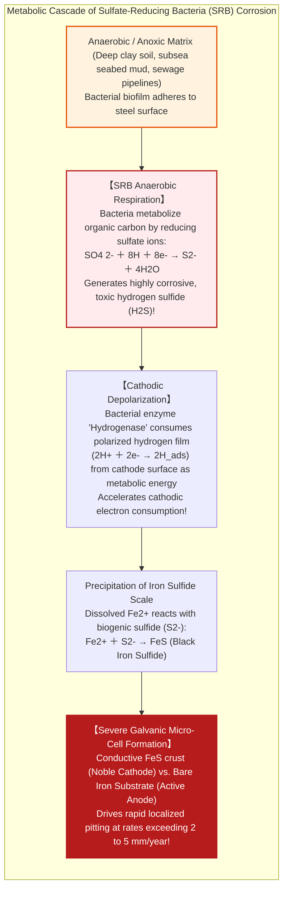

## Introduction: The Thermodynamic Destiny of Iron to Return to the Earth

Iron ($\text{Fe}$) is the structural backbone of modern human civilization. From the soaring framework of urban skyscrapers and the transcontinental ribbons of railway tracks to maritime supertankers displacing hundreds of thousands of tons, high-pressure subsea pipelines, municipal water aqueducts, and automobiles—iron and steel account for over **95% of all metal manufactured and consumed on Earth** (approximately 1.9 billion metric tons annually).

Yet, from the exact millisecond of its metallurgical birth, this ubiquitous structural material is burdened by a persistent chemical curse: **corrosion, commonly known as rusting**.

An unprotected steel beam exposed to ambient air develops flaky reddish-brown oxides within days. An unmaintained ship hull immersed in seawater is steadily excavated by localized pits. Underground ductile iron water mains suffer perforations that bleed pressurized municipal water into surrounding soil. According to global studies by the Association for Materials Protection and Performance (AMPP, formerly NACE International), the annual economic toll of metallic corrosion exceeds **$2.5 trillion USD**—an astounding **3.4% of global Gross Domestic Product (GDP)**.

Why does iron rust with such relentless persistence?

From the foundational perspective of chemical thermodynamics, the explanation is simple: **for iron, rusting represents the most natural, entropy-favored, and thermodynamically stable path back to equilibrium.**

In the Earth's lithosphere, iron does not naturally exist as metallic $\text{Fe}^0$. It is locked within geological ores as iron oxides—such as hematite ($\text{Fe}_2\text{O}_3$) and magnetite ($\text{Fe}_3\text{O}_4$)—where iron atoms are securely bonded to oxygen at minimum enthalpy. To liberate pure iron, human metallurgy constructed towering blast furnaces, burning coke and consuming massive thermal energy ($> 1500^\circ\text{C}$) to strip away oxygen atoms.

Consequently, refined metallic iron exists in a **thermodynamically unstable, high-energy state**. Governed by the Second Law of Thermodynamics (the universal drive toward maximum entropy and minimal Gibbs free energy), iron continuously seeks to release that stored metallurgical energy. In the presence of ambient water and oxygen, iron undergoes spontaneous oxidation ($\Delta G < 0$) to return to the stable mineral state from which it was extracted. Rust is simply the inevitable, energy-releasing journey of a refined metal returning to stone.

This treatise provides an exhaustive scientific breakdown of corrosion and its mitigation: from the micro-electrochemical galvanic cells operating inside microscopic droplets of rain to the structural catastrophe of dissimilar metal contact, the nanometer-thin self-healing passive films of stainless alloys, and the cathodic protection systems that preserve transcontinental pipelines and maritime fleets.

---

## Chapter 1: The Electrochemical Anatomy of a Water Droplet—Microscopic Local Action Cells

To the unaided human eye, a piece of steel rusting in the rain appears to degrade via a uniform, direct chemical reaction with ambient air. However, under high-resolution electrochemical instrumentation, an entirely different reality emerges:

**The rusting of iron is a closed-circuit electrochemical battery reaction.** Millions of microscopic short-circuited batteries—known as **local action cells**—spontaneously ignite across the metal surface, driving continuous electron and ion transfer.

### 1.1 Evans' Droplet Experiment and Differential Aeration

In the 1920s, British electrochemist Ulick Richardson Evans at Cambridge University—widely revered as the father of modern corrosion science—devised an elegant experiment that unlocked the electrochemical nature of rust.

Evans placed a single droplet of dilute sodium chloride electrolyte solution on an unpolished, horizontal sheet of mild steel, adding colorimetric indicators (phenolphthalein to detect basic hydroxyl ions $\text{OH}^-$, and potassium ferricyanide to detect dissolved ferrous ions $\text{Fe}^{2+}$).

If rusting were a simple, homogeneous chemical oxidation, the steel beneath the droplet would have corroded uniformly across its entire footprint. The experimental result shattered this assumption:

Evans discovered the principle of **differential aeration (oxygen concentration cell)**:
- At the **shallow outer meniscus** of the droplet, atmospheric oxygen dissolves rapidly due to the minimal diffusion distance. This oxygen-rich zone acts as a **cathode**, where oxygen reduction consumes electrons to generate basic $\text{OH}^-$ ions.
- At the **deep central core** of the droplet, dissolved oxygen is quickly exhausted and cannot be replenished across the thick liquid layer. This oxygen-starved zone becomes an **anode**, where iron atoms surrender electrons and dissolve into solution as ferrous ions ($\text{Fe}^{2+}$).

Electrons released at the center travel through the electrically conductive iron substrate toward the outer edge. Meanwhile, $\text{Fe}^{2+}$ cations and $\text{OH}^-$ anions migrate toward each other through the electrolyte droplet. Where the two ionic streams meet, insoluble ferrous hydroxide precipitates, oxidizing into a concentric ring of rusty iron oxyhydroxide.

This proves that **both water (an electrolyte) and oxygen are simultaneously required for atmospheric rusting**. If either component is eliminated—such as in the vacuum of deep space or inside deaerated pure water—iron cannot support a closed electrochemical circuit and remains immune to corrosion indefinitely.

### 1.2 Stoichiometry: The Multi-Step Cascade to Rust

Atmospheric rusting proceeds through a series of discrete electrochemical and coordination reactions:

1. **Anodic Metal Dissolution**:
   Solid iron atoms oxidize, shedding two valence electrons into the bulk metal:
   $$\text{Fe} \to \text{Fe}^{2+} + 2e^- \quad (E^\circ = -0.440\ \text{V vs. SHE})$$

2. **Cathodic Oxygen Reduction**:
   In neutral or alkaline moisture films, dissolved molecular oxygen absorbs the released electrons:
   $$\text{O}_2 + 2\text{H}_2\text{O} + 4e^- \to 4\text{OH}^- \quad (E^\circ = +0.401\ \text{V vs. SHE})$$
   *(Note: In acidic environments, hydrogen evolution dominates: $2\text{H}^+ + 2e^- \to \text{H}_2$)*

3. **Precipitation of Ferrous Hydroxide**:
   Electrostatically driven ion pairing forms a gelatinous greenish-white precipitate:
   $$\text{Fe}^{2+} + 2\text{OH}^- \to \text{Fe(OH)}_2$$

4. **Oxidative Conversion to Insoluble Rust**:
   Unstable ferrous hydroxide readily reacts with excess dissolved oxygen:
   $$4\text{Fe(OH)}_2 + \text{O}_2 \to 4\text{FeOOH} \text{ (Iron Oxyhydroxide)} + 2\text{H}_2\text{O}$$
   $$2\text{FeOOH} \to \text{Fe}_2\text{O}_3 \cdot \text{H}_2\text{O} \text{ (Hydrated Ferric Oxide = Common Red Rust)}$$

In oxygen-deprived underlayers, intermediate reactions precipitate black, ferromagnetic **magnetite ($\text{Fe}_3\text{O}_4$)**. Unlike aluminum or chromium oxides, common iron rust is voluminous, porous, and non-adherent. It cannot passivate the substrate; instead, it acts as a hydrophilic sponge that holds moisture against the steel, accelerating continuous decay.

### 1.3 Navigating Thermodynamics: The Pourbaix Diagram

The definitive thermodynamic map of aqueous corrosion is the **Pourbaix Diagram (Potential-pH Diagram)**, developed by Belgian electrochemist Marcel Pourbaix.

By plotting electrode potential ($E$, in volts) on the vertical axis against electrolyte $\text{pH}$ on the horizontal axis, the diagram establishes the thermodynamic phase stability of iron across three fundamental behavioral domains:

1. **Corrosion Domain**:
   Across neutral and acidic waters, soluble $\text{Fe}^{2+}$ and $\text{Fe}^{3+}$ ions are the lowest energy state. In this window, iron dissolves continuously until the metal is consumed.
2. **Passivity Domain**:
   Under alkaline conditions ($\text{pH} > 9 \sim 13$) and moderate oxidizing potentials, solid iron oxides ($\gamma\text{-Fe}_2\text{O}_3$ and $\text{Fe}_3\text{O}_4$) are stable. They precipitate as a protective surface layer, suppressing metal dissolution.
3. **Immunity Domain**:
   When the electrochemical potential is driven sufficiently negative (below approximately $-0.62\ \text{V vs. SHE}$), **metallic iron ($\text{Fe}^0$) becomes the thermodynamically stable phase**. In this state, the free energy change for oxidation is positive ($\Delta G > 0$). Iron cannot rust in this domain, regardless of moisture and oxygen availability.

This **Immunity Domain** provides the theoretical foundation for **Cathodic Protection**.

---

## Chapter 2: Dangerous Liaisons—Galvanic (Dissimilar Metal) Corrosion

When iron is placed in direct electrical contact with a different metal inside an electrolyte, corrosion rates can accelerate by orders of magnitude. This phenomenon is **Galvanic Corrosion**.

### 2.1 The Galvanic Series and Mixed Potential Theory

When two dissimilar metals are submerged in a common electrolyte, a potential difference emerges, driving an external current.

Under mixed potential theory, **the more active (less noble) metal becomes the anode**, sacrificing itself through accelerated dissolution. Conversely, **the more noble metal becomes the cathode**, receiving electrons and remaining completely protected from corrosion.

The practical Galvanic Series in aerated seawater is ranked below:

| Metal / Alloy System | Seawater Open-Circuit Potential (V vs. SCE) | Electrochemical Polarity |
| :--- | :--- | :--- |
| **Magnesium (Mg) Alloys** | $-1.60 \sim -1.63$ | **Most Active (Extremely sacrificial)** |
| **Zinc (Zn)** | $-0.98 \sim -1.03$ | Active (Prime sacrificial anode material) |
| **Aluminum (Al) Alloys** | $-0.75 \sim -1.00$ | Active (Marine sacrificial anodes) |
| **Carbon Steel / Cast Iron ($\text{Fe}$)** | **$-0.60 \sim -0.71$** | **Active Structural Base Metal** |
| Lead / Tin ($\text{Sn}$) | $-0.31 \sim -0.35$ | Noble relative to iron |
| Copper ($\text{Cu}$), Brass, Bronze | $-0.30 \sim -0.40$ | Noble (Strong cathode against iron) |
| **Passive Stainless Steels (304 / 316)** | **$-0.05 \sim -0.10$** | **Highly Noble (Severe galvanic hazard to mild steel)** |
| Titanium ($\text{Ti}$) | $+0.05 \sim -0.05$ | Highly Noble |
| Platinum ($\text{Pt}$), Gold ($\text{Au}$) | $> +0.20$ | Most Noble |

If structural mild steel ($-0.65\ \text{V}$) is bolted directly to copper ($-0.35\ \text{V}$) or passive stainless steel ($-0.08\ \text{V}$) in a marine environment, a significant driving voltage ($0.30 \sim 0.55\ \text{V}$) is established.

The iron steel serves as a **sacrificial battery**, corroding rapidly to protect the adjacent copper or stainless steel component.

### 2.2 The Geometric Multiplier: The Area Effect

In galvanic corrosion, geometry dictates structural survival.

Under charge conservation, the total anodic current ($I_a$) leaving the active metal must balance the total cathodic current ($I_c$) entering the noble metal:

$$I_a = I_c \implies i_a \cdot A_a = i_c \cdot A_c$$

Solving for the anodic corrosion current density ($i_a$):

$$i_a = i_c \cdot \left(\frac{A_c}{A_a}\right)$$

Where $A_a$ is the exposed anode surface area, $A_c$ is the cathode surface area, and $i_a, i_c$ represent respective current densities.

The engineering implications are profound:
1. **Benign Geometry (Large Anode, Small Cathode)**:
   A massive steel hull ($A_a \gg A_c$) joined by a small bronze drain plug ($A_c$). The galvanic current is distributed over an immense steel area; the increase in corrosion penetration rate on the steel is negligible.
2. **Catastrophic Geometry (Small Anode, Large Cathode)**:
   A massive copper hull paneling ($A_c \gg A_a$) fastened with carbon steel rivets ($A_a$). The entire cathodic current generated across square meters of copper is concentrated onto the tiny heads of the steel rivets. **The corrosion rate on the steel rivets is amplified by hundreds of times**, severing the rivets within weeks.

### 2.3 The Near-Collapse of the Statue of Liberty

The most famous historical demonstration of the galvanic area effect occurred inside the **Statue of Liberty** in New York Harbor.

Engineered by Gustave Eiffel and dedicated in 1886, the monument features an exterior envelope of approximately 350 hammered **copper plates ($2.4\ \text{mm}$ thick)**, supported by an internal skeleton of 1,800 forged **puddled iron armature bars**.

Eiffel understood galvanic corrosion and isolated the metals by sandwiching **asbestos sheets impregnated with shellac varnish** between the iron armature and copper skin.

Over a century of exposure to humid maritime winds and salt spray, the shellac broke down. The porous asbestos deteriorated into an absorbent sponge, trapping seawater. Electrical isolation failed completely.

The physical assembly created a classic galvanic disaster: **an immense copper cathode ($A_c \approx 1,000\ \text{m}^2$) connected to slender iron armature ribs ($A_a$)**.

By the 1980s, galvanic corrosion had consumed more than 50% of the cross-sectional thickness of many iron armature bars, threatening structural collapse. During the centennial restoration, engineers replaced the iron skeleton with **ferritic-austenitic duplex stainless steel (FERRALIUM 255)**, isolating every connection with Teflon dielectric bushings to permanently neutralize galvanic coupling.

---

## Chapter 3: Stainless Steel—The Nanometer-Thin Self-Healing Shield

Can iron be alloyed to achieve permanent corrosion immunity?

This pursuit culminated in the early 20th century with the invention of **Stainless Steel**.

### 3.1 Harry Brearley and the 12% Chromium Threshold

In 1913, Harry Brearley, chief metallurgist at the Brown-Firth Research Laboratory in Sheffield, England, was searching for erosion-resistant alloys for military rifle barrels.

Examining a scrap pile of experimental specimens that had been discarded in the damp courtyard months earlier, Brearley noticed a single metallic bar maintaining a brilliant, mirror-like polish while surrounding steel fragments were coated in red rust. The specimen was a low-carbon steel containing **12.8% chromium ($\text{Cr}$)**.

Why does adding chromium prevent iron from rusting?

Chromium possesses a far higher affinity for oxygen than iron does. When chromium content in a ferrous alloy exceeds **approximately 10.5% to 12% by weight**, a fundamental surface phase transition occurs.

The surface chromium atoms oxidize rapidly in contact with atmospheric oxygen, forming a continuous, amorphous **chromium oxide / oxyhydroxide ($\text{Cr}_2\text{O}_3 / \text{CrOOH}$)** film measuring only **$1 \sim 3\ \text{nm}$ thick**.

This is the **Passive Film**.

The passive film's defining engineering feature is its **autogenous self-healing capability**. If scratched or mechanically abraded, exposed chromium atoms react with ambient oxygen within milliseconds to reform the barrier:

Stainless steel does not resist corrosion because it is chemically inert; it resists corrosion because **it forms an ultra-thin, highly adherent, transparent ceramic barrier that reconstitutes itself instantly whenever ruptured**.

### 3.2 Vulnerabilities: Pitting and Sensitization

Stainless steel remains vulnerable to specific localized attack mechanisms:

1. **Pitting Corrosion**:
   In marine environments, small, aggressive **chloride ions ($\text{Cl}^-$)** penetrate and disrupt the passive film at atomic grain boundaries. A microscopic rupture turns into a severe galvanic cell: **a tiny active pit (anode) surrounded by an expansive passive film (cathode)**. The pit drills downward into the metal, causing deep structural perforations without visible warning on the surface.
   
   To quantify localized corrosion resistance, metallurgists utilize the **Pitting Resistance Equivalent Number (PREN)**:
   $$\text{PREN} = \%\text{Cr} + 3.3 \cdot \%\text{Mo} + 16 \cdot \%\text{N}$$
   Alloys with $\text{PREN} > 40$ (such as 254 SMO or 2507 Super Duplex) resist pitting even in warm, stagnant seawater.

2. **Sensitization and Intergranular Corrosion**:
   When standard austenitic stainless steels (such as AISI 304) are heated within the critical temperature window of **$500^\circ\text{C}$ to $800^\circ\text{C}$** (during welding), carbon diffuses toward grain boundaries to form **chromium carbides ($\text{Cr}_{23}\text{C}_6$)**. This precipitates chromium out of the neighboring grains, dropping local chromium concentration below the critical $10.5\%$ threshold. The resulting **chromium-depleted zones** along grain boundaries corrode preferentially, causing the weld heat-affected zone to disintegrate under stress.
   
   Modern engineering mitigates sensitization using low-carbon grades (e.g., 304L, $\text{C} \le 0.03\%$) or stabilized alloys containing titanium or niobium (e.g., 321, 347).

---

## Chapter 4: Industrial Surface Engineering—Barrier Coatings and Galvanizing

The most widely deployed defense against rust is isolating steel from the environment using applied surface coatings.

Engineering coatings divide into two philosophies: **passive barrier coatings** and **active sacrificial metallic coatings**.

The contrast is exemplified by the difference between **Galvanized Steel (Zinc on Iron)** and **Tinplate (Tin on Iron)**:

```mermaid
flowchart TD
    subgraph CoatingComparison["Galvanized Steel vs. Tinplate: The Divergence of Sacrificial vs. Barrier Action"]
        direction TB
        
        subgraph Galvanized["【Galvanized Steel (Zinc Coating on Iron)】"]
            ZnState["Zinc (Zn: -0.76 V) is Electrochemically Active Relative to Iron (Fe: -0.44 V)"]
            ZnScratch["Deep Scratch Breaches Zinc Layer!<br/>Bare iron substrate exposed to rain & atmospheric moisture"]
            ZnAction["【Sacrificial Anode Protection Activated】<br/>Zinc corrodes preferentially as the sacrificial anode:<br/>Zn → Zn2+ ＋ 2e-<br/>Released electrons polarize the exposed iron, maintaining it as a protected cathode!"]
            ZnResult["Outcome: The exposed iron cannot rust!<br/>Zinc sacrificed slowly while preserving structural steel"]
            ZnState --> ZnScratch --> ZnAction --> ZnResult
        end
        
        subgraph Tinplate["【Tinplate (Tin Coating on Iron)】"]
            SnState["Tin (Sn: -0.14 V) is Noble Relative to Iron (Fe: -0.44 V)"]
            SnScratch["Deep Scratch Breaches Tin Layer!<br/>Bare iron substrate exposed to oxygenated atmosphere"]
            SnAction["【Severe Galvanic Acceleration Triggered】<br/>Massive tin surface becomes cathode; tiny exposed iron scratch becomes anode:<br/>Fe → Fe2+ ＋ 2e-<br/>Corrosion concentrates violently into the scratch slot!"]
            SnResult["Outcome: Iron perforates rapidly within days!"]
            SnState --> SnScratch --> SnAction --> SnResult
        end
    end
    
    style Galvanized fill:#e8f5e9,stroke:#2e7d32,stroke-width:2px
    style Tinplate fill:#ffebee,stroke:#b71c1c,stroke-width:2px
```

### 4.1 Galvanized Steel: Sacrificial Anodic Defense

Hot-dip galvanizing immerses cleaned structural steel into molten zinc at $450^\circ\text{C}$, forming metallurgically bonded iron-zinc alloy layers topped by pure zinc.

Because zinc ($-0.76\ \text{V}$) is more active than iron ($-0.44\ \text{V}$), any breach exposing the underlying steel triggers **sacrificial galvanic protection**. Zinc supplies electrons to the exposed steel, suppressing iron dissolution:

$$\text{Zn} \to \text{Zn}^{2+} + 2e^-$$

The dissolving zinc reacts with atmospheric $\text{CO}_2$ and moisture to precipitate **basic zinc carbonate ($\text{Zn}_5(\text{OH})_6(\text{CO}_3)_2$)**, forming a low-solubility patina that slows further zinc consumption. Consequently, galvanized transmission towers and highway guardrails routinely achieve service lives of 40 to 60 years without painting.

### 4.2 Tinplate: The Physics of Food Preservation

Tinplate lines steel sheets with an ultra-thin layer of metallic tin ($\text{Sn}$).

Tin is more noble than iron in standard atmospheric conditions. If scratched in humid air, **tin forms a large cathode that drives rapid localized corrosion of the exposed iron**.

Why is tinplate ubiquitous in food canning?

Inside an airtight can, dissolved oxygen is eliminated during vacuum sealing. Under anoxic, acidic conditions with organic food acids (citric, malic, oxalic acids), tin complexes with organic ligands, driving its reversible potential negative relative to iron. **Inside a vacuum-sealed food can, tin becomes active (anodic) relative to steel**, providing sacrificial protection to the can wall while offering low toxicity and zero metallic taste transfer.

---

## Chapter 5: Cathodic Protection (CP) in Mega-Infrastructure

For buried cross-country oil pipelines, municipal water aqueducts, and marine vessel hulls, recoating is logistically impossible once commissioned.

These structures are protected by **Cathodic Protection (CP)**.

### 5.1 Electrochemistry of Cathodic Polarization

Cathodic protection shifts the operating potential of a steel structure into the **Immunity Domain** of the Pourbaix diagram.

Supplying a continuous direct current (DC) into the steel shifts its open-circuit potential negative until it reaches the internationally recognized polarization criterion: **$-0.850\ \text{V vs. Copper/Copper Sulfate Reference Electrode (CSE)}$** (equivalent to $-0.780\ \text{V vs. Ag/AgCl}$ in seawater).

At this potential, the anodic reaction $\text{Fe} \to \text{Fe}^{2+} + 2e^-$ is thermodynamically arrested. Iron cannot oxidize, regardless of soil salinity or moisture.

```mermaid
flowchart TD
    subgraph CathodicProtectionSystems["The Two Methodologies of Cathodic Protection (CP)"]
        direction TB
        
        subgraph SACP["1. Sacrificial Anode Cathodic Protection (SACP)"]
            SACP_Source["Zero External Power Required!<br/>Naturally active galvanic alloys (Al-Zn-In / High-Purity Zinc / Magnesium)"]
            SACP_Mechanism["Welded or bolted directly to steel hull or pile<br/>Spontaneous galvanic potential difference drives electrons into steel structure"]
            SACP_App["Applications: Ship hulls, offshore platform jackets, ballast tanks, harbor steel piles"]
            SACP_Source --> SACP_Mechanism --> SACP_App
        end
        
        subgraph ICCP["2. Impressed Current Cathodic Protection (ICCP)"]
            ICCP_Source["External Transformer-Rectifier (TR Unit)<br/>Converts grid AC to regulated DC power; automated potential feedback control"]
            ICCP_Anode["Non-Consumable Dimensionally Stable Anodes (DSA)<br/>Mixed Metal Oxide (MMO) coated titanium, platinized niobium, high-silicon cast iron"]
            ICCP_Mechanism["DC current forced from groundbed through soil/water into steel pipeline<br/>Pipeline serves as pure cathode returned to negative terminal"]
            ICCP_App["Applications: Cross-country gas pipelines, municipal water trunk lines, reinforced concrete bridges"]
            ICCP_Source --> ICCP_Anode --> ICCP_Mechanism --> ICCP_App
        end
    end
    
    style SACP fill:#e1f5fe,stroke:#0288d1,stroke-width:2px
    style ICCP fill:#e8f5e9,stroke:#2e7d32,stroke-width:2px
```

### 5.2 Sacrificial Anode Cathodic Protection (SACP)

In marine engineering, ships and offshore jacket structures rely on **Sacrificial Anode Cathodic Protection (SACP)**.

Blocks of **aluminum-zinc-indium (Al-Zn-In)** or high-purity zinc are welded to submerged hull plates, rudders, and propeller struts. Aluminum yields an electrochemical capacity of approximately $2,600\ \text{A}\cdot\text{h/kg}$. These blocks dissolve slowly over several years, driving protective current into the massive steel hull and preventing ocean corrosion. During scheduled drydock maintenance, depleted anodes are unbolted and replaced.

### 5.3 Impressed Current Cathodic Protection (ICCP)

For expansive infrastructure—such as 2,000-kilometer transcontinental pipelines—sacrificial anodes are impractical due to high current demand and soil resistance.

Engineers deploy **Impressed Current Cathodic Protection (ICCP)**:
- A **Transformer-Rectifier (TR)** unit converts utility AC power to controlled DC power.
- The negative terminal connects directly to the steel pipeline.
- The positive terminal connects to an array of **non-consumable Mixed Metal Oxide (MMO) titanium anodes** buried in a conductive coke breeze backfill groundbed tens of meters away.

The rectifier drives protective electrons through the earth and into the pipeline. Automated microprocessors monitor soil-to-pipe potential using permanent **Copper/Copper Sulfate Reference Electrodes (CSE)**, dynamically adjusting rectifier output to keep the pipe within the target window ($-0.85\ \text{V}$ to $-1.20\ \text{V vs. CSE}$).

Careful potential regulation prevents **overprotection**: driving the potential more negative than $-1.20\ \text{V}$ causes electrolysis of water into gaseous hydrogen ($2\text{H}_2\text{O} + 2e^- \to \text{H}_2 + 2\text{OH}^-$), inducing **cathodic disbondment** of protective epoxy coatings and risking catastrophic **hydrogen embrittlement** in high-strength pipeline steels.

---

## Chapter 6: Extreme Environments—Microbial Corrosion and Stress Cracking

Corrosion engineering extends beyond inorganic chemistry; biological activity and mechanical stress can induce aggressive failure modes.

### 6.1 Microbiologically Influenced Corrosion (MIC)

In anaerobic environments—such as waterlogged clay soils, stagnant cooling water loops, and sewage sumps—cast iron and steel pipes frequently develop rapid perforations despite the total absence of oxygen.

The primary culprit is **Microbiologically Influenced Corrosion (MIC)**, driven by **Sulfate-Reducing Bacteria (SRB)**, such as *Desulfovibrio*.

SRB utilize hydrogenase enzymes to consume the protective polarizing hydrogen layer on the steel surface (cathodic depolarization). Their metabolic byproduct, biogenic hydrogen sulfide ($\text{H}_2\text{S}$), reacts with iron to deposit a black crust of **iron sulfide ($\text{FeS}$)**.

Conductive $\text{FeS}$ scales are electrochemically noble relative to clean iron, establishing aggressive localized micro-galvanic cells that drive penetration rates exceeding several millimeters per year.

### 6.2 Stress Corrosion Cracking (SCC) and Hydrogen Embrittlement

When tensile stress acts concurrently with a specific corrosive environment, structural metals can experience **Stress Corrosion Cracking (SCC)**:
- Neither mechanical stress alone (below yield strength) nor the environment alone (minimal general corrosion) would cause failure.
- In combination, sub-microscopic surface pits focus tensile stress at crack tips. The localized high stress accelerates chemical dissolution, driving brittle intergranular or transgranular cleavage through the component at near-sonic speeds without plastic deformation.

In high-strength fasteners, offshore mooring chains, and nuclear steam generator tubing, SCC and **hydrogen embrittlement** remain primary design considerations.

---

## Conclusion: The Eternal Battle Between Iron and Entropy

From the meteoric iron forged into blades by ancient Hittites to modern oceanic energy networks, iron has served as the physical catalyst of human civilization for over three millennia.

Yet, every structural element cast in steel exists under constant thermodynamic tension. The oxygen in our atmosphere and the moisture in our clouds continuously exert chemical pull, seeking to strip away iron's electrons and return it to oxide ore.

Corrosion is the physical expression of natural entropy acting upon human construction.

Corrosion engineering is far more than applying paint; it is an applied discipline integrating the physics of electron transport, the metallurgy of nanometer-scale passive films, and the electrical orchestration of cathodic fields. In protecting the steel skeleton of the built world against thermodynamic decay, engineering preserves the enduring framework of modern civilization.
