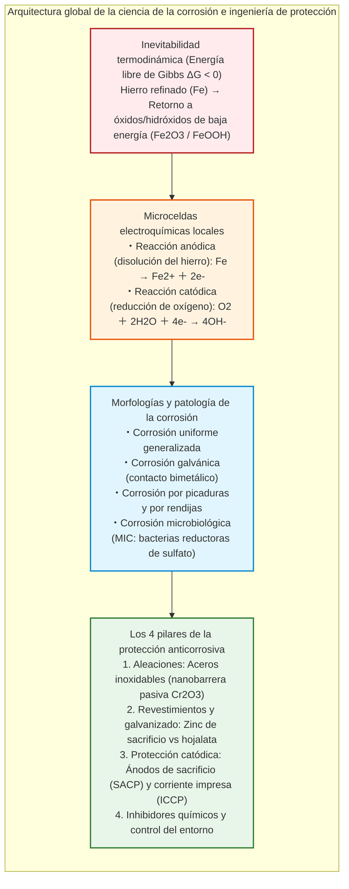
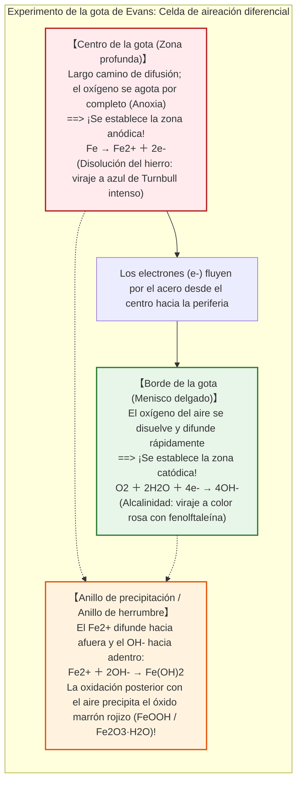
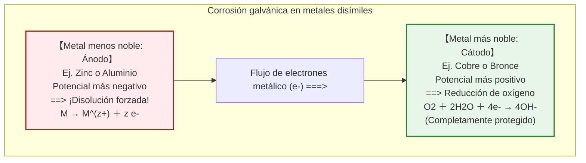
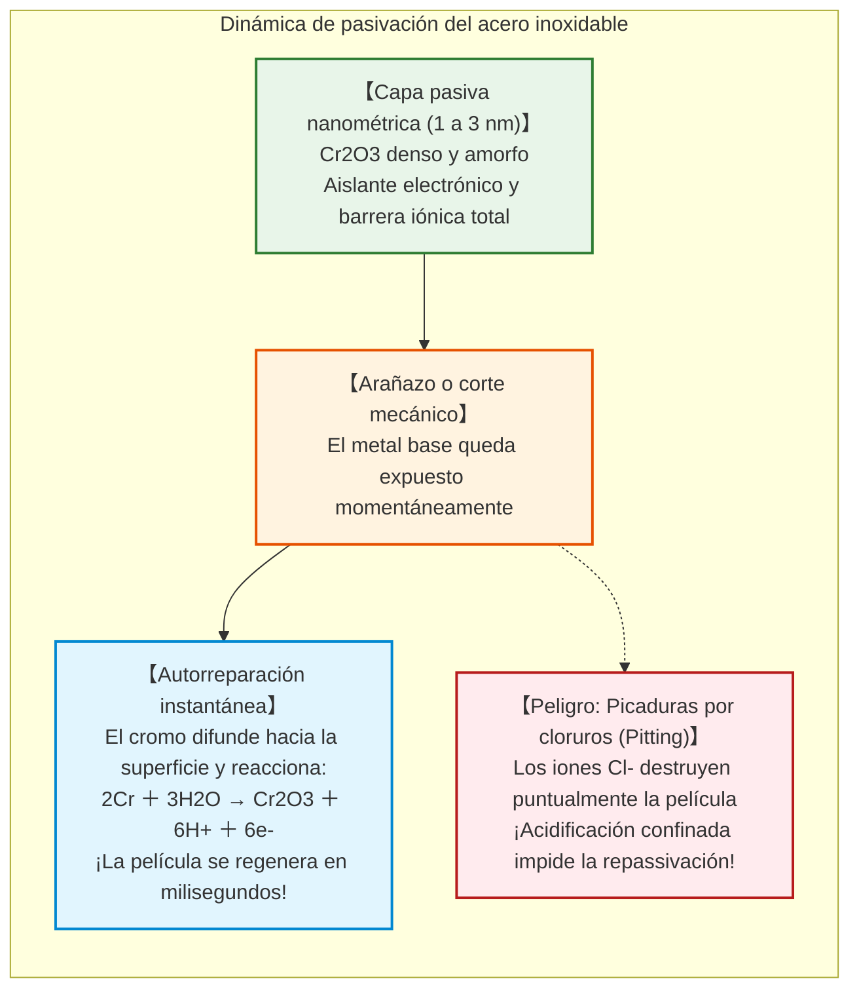

## Introducción: El destino termodinámico del hierro de regresar a la tierra

El hierro ($\text{Fe}$) es la columna vertebral de la civilización moderna. Desde los esqueletos de los rascacielos urbanos y las redes ferroviarias transcontinentales hasta los superpetroleros de cientos de miles de toneladas y los oleoductos submarinos de alta presión, el hierro y el acero constituyen más del **95 % de todos los metales fabricados y consumidos en la Tierra** (aproximadamente 1.900 millones de toneladas métricas anuales).

Sin embargo, desde el instante mismo de su producción metalúrgica, este material indispensable soporta una implacable maldición química: **la corrosión, conocida popularmente como oxidación o herrumbre**.

Una viga de acero expuesta a la lluvia adquiere en pocos días escamas de óxidos pardo-rojizos. El casco de un barco en agua marina es perforado por picaduras corrosivas. Según estimaciones de la Association for Materials Protection and Performance (AMPP), el coste económico global de la corrosión metálica supera los **2,5 billones de dólares anuales**, lo que representa un colosal **3,4 % del Producto Interior Bruto (PIB) mundial**.

¿Por qué el hierro se oxida con tanta persistencia?

Desde la termodinámica química, la respuesta es rotunda: **para el hierro, oxidarse representa el camino más natural, entrópico y termodinámicamente estable hacia el equilibrio químico.**

En la corteza terrestre, el hierro jamás se encuentra en estado elemental libre $\text{Fe}^0$. Permanece atrapado en minerales de óxido (hematita $\text{Fe}_2\text{O}_3$, magnetita $\text{Fe}_3\text{O}_4$), donde los átomos de hierro están firmemente enlazados al oxígeno con un mínimo de energía. Para liberar el hierro metálico, la humanidad construyó imponentes altos hornos, inyectando ingentes cantidades de calor ($> 1500^\circ\text{C}$) para arrancar el oxígeno.

Por tanto, el hierro refinado se halla en un **estado de alta energía e inestabilidad termodinámica**. Gobernado por la Segunda Ley de la Termodinámica (la tendencia universal hacia la máxima entropía y la mínima energía libre de Gibbs), el hierro busca continuamente liberar esa energía acumulada. En contacto con agua y oxígeno, se oxida espontáneamente ($\Delta G < 0$) para retornar a su estado de mineral de baja energía.



---

## Capítulo 1: La electroquímica en una gota de agua – Microceldas locales

A simple vista, un acero expuesto a la intemperie parece degradarse por un ataque químico directo con el aire. Sin embargo, el instrumental electroquímico demuestra lo contrario:

**La oxidación del hierro es una reacción de batería electroquímica en cortocircuito.** En la superficie del metal se activan millones de microceldas galvánicas —denominadas **celdas locales**— que canalizan flujos incesantes de electrones e iones.

### 1.1 El experimento de la gota de Evans y la aireación diferencial

En la década de 1920, el electroquímico británico Ulick Richardson Evans en la Universidad de Cambridge diseñó un experimento magistral.

Evans depositó una gota de agua salina diluida ($\text{NaCl}$) sobre una chapa pulida de acero, agregando fenolftaleína (indicador de iones básicos $\text{OH}^-$) y ferricianuro de potasio (indicador de iones ferrosos $\text{Fe}^{2+}$).

Si la oxidación fuera homogénea, toda la gota se habría teñido por igual. El resultado asombró a la comunidad científica:



Este fenómeno demostró la existencia de la **celda de aireación diferencial**: el hierro se disuelve donde falta el oxígeno (centro de la gota), mientras que la reducción de oxígeno se produce en los bordes aireados.

### 1.2 La cadena de reacciones químicas

- **Oxidación anódica**: $\text{Fe} \to \text{Fe}^{2+} + 2e^-$
- **Reducción catódica**: $\text{O}_2 + 2\text{H}_2\text{O} + 4e^- \to 4\text{OH}^-$
- **Precipitación**: $\text{Fe}^{2+} + 2\text{OH}^- \to \text{Fe(OH)}_2$ (hidróxido ferroso verde claro)
- **Oxidación secundaria**: $4\text{Fe(OH)}_2 + \text{O}_2 + 2\text{H}_2\text{O} \to 4\text{Fe(OH)}_3$

Por deshidratación se forman las fases clásicas del óxido: lepidocrocita ($\gamma\text{-FeOOH}$), goethita ($\alpha\text{-FeOOH}$), magnetita ($\text{Fe}_3\text{O}_4$) y hematita ($\text{Fe}_2\text{O}_3$).

Debido a la **relación de Pilling-Bedworth**, el volumen de la herrumbre resultante es **entre dos y tres veces mayor** que el volumen del hierro metálico original consumido. Esta formidable expansión genera tensiones mecánicas que quiebran y desprenden la capa de óxido, exponiendo continuamente material nuevo al ataque.

---

## Capítulo 2: Termodinámica y el Diagrama de Pourbaix

El electroquímico belga Marcel Pourbaix trazó los **diagramas de potencial-pH (diagramas de Pourbaix)**, mapas de estabilidad termodinámica del hierro en agua:

1. **Región de inmunidad** ($E < -0{,}6\,\text{V}$): El hierro metálico es termodinámicamente estable; la corrosión es físicamente imposible. Es la base de la **protección catódica**.
2. **Región de corrosión**: El hierro se disuelve activamente como $\text{Fe}^{2+}$, $\text{Fe}^{3+}$ o $\text{HFeO}_2^-$.
3. **Región de pasivación**: Se forman películas compactas de óxido insoluble que frenan la velocidad de ataque (típico en el hormigón armado con $\text{pH} \approx 13$).

---

## Capítulo 3: Corrosión galvánica y la catástrofe del cociente de áreas

Cuando entran en contacto eléctrico dos metales distintos en un medio conductor, el metal con potencial más negativo actúa de ánodo y se corroe aceleradamente, protegiendo al metal más noble (cátodo).



### La relación de áreas: $A_\text{Cátodo} / A_\text{Ánodo}$

La densidad de corriente anódica aumenta exponencialmente con el cociente de áreas:

$$i_\text{Ánodo} = i_\text{Cátodo} \times \left( \frac{A_\text{Cátodo}}{A_\text{Ánodo}} \right)$$

Tornillos de acero en planchas gigantescas de cobre ($A_\text{Cátodo} \gg A_\text{Ánodo}$) sufrirán una corrosión fulminante y se partirán en cuestión de semanas.

---

## Capítulo 4: Acero inoxidable y la nanobarrera pasiva

Al añadir al menos un **10,5 % de cromo ($\text{Cr}$)** al acero, los átomos de cromo reaccionan con el oxígeno para formar una nanobarrera autorreparable de óxido de cromo ($\text{Cr}_2\text{O}_3$) de solo 1 a 3 nanómetros de grosor.



En presencia de iones cloruro ($\text{Cl}^-$) marinos, la película puede perforarse de forma puntual dando lugar a la temida **corrosión por picaduras (pitting)**. Para contrarrestarlo, los aceros marinos (AISI 316) incorporan de un 2 % a un 3 % de molibdeno ($\text{Mo}$).

---

## Capítulo 5: Galvanizado y Protección Catódica

### 5.1 Acero galvanizado vs Hojalata

- **Galvanizado con zinc**: El zinc es más activo que el hierro ($E^\circ = -0{,}76\,\text{V}$). Si la capa se araña, el zinc actúa como **ánodo de sacrificio** cediendo electrones para blindar el acero expuesto.
- **Hojalata con estaño**: El estaño es más noble que el hierro ($E^\circ = -0{,}14\,\text{V}$). Ante una raya microscópica, el hierro se convierte en un ánodo minúsculo acoplado a un gran cátodo de estaño, perforando la lata en días.

### 5.2 Protección Catódica (CP) en grandes infraestructuras

```mermaid
flowchart TD
    subgraph CathodicSystems["Sistemas de Protección Catódica"]
        direction TB
        subgraph SACP["1. Ánodos de sacrificio (SACP)"]
            SACP_Block["Bloques de aleación de Zinc o Aluminio soldados al casco"]
            SACP_Block -->|Corriente galvánica espontánea| SACP_Hull["Casco de buque polarizado como cátodo inmune"]
        end
        
        subgraph ICCP["2. Corriente Impresa (ICCP)"]
            ICCP_Gen["Fuente de alimentación continua (Rectificador)"]
            ICCP_Anode["Ánodos inertes de titanio con óxidos mixtos (MMO)"]
            ICCP_Pipe["Gasoducto de miles de kilómetros mantenido a potencial inmune"]
            ICCP_Gen -->|Polo positivo (+)| ICCP_Anode
            ICCP_Gen -->|Polo negativo (-)| ICCP_Pipe
        end
    end
    
    style SACP fill:#e1f5fe,stroke:#0288d1,stroke-width:2px
    style ICCP fill:#e8f5e9,stroke:#2e7d32,stroke-width:2px
```

1. **Ánodos galvánicos de sacrificio (SACP)**: Lingotes de zinc o aluminio atornillados o soldados a las quillas de barcos que se consumen para salvar el casco de acero.
2. **Corriente impresa (ICCP)**: Empleada en tuberías enterradas transcontinentales y plataformas offshore mediante rectificadores y ánodos inertes de titanio (MMO).

---

## Capítulo 6: Corrosión biológica y agrietamiento por tensión

- **Bacterias reductoras de sulfato (BSR)**: Prosperan en suelos anóxicos, eliminando la película catódica de hidrógeno y segregando sulfuro de hidrógeno ($\text{H}_2\text{S}$) que forma sulfuro de hierro ($\text{FeS}$), desatando picaduras de varios milímetros anuales.
- **Corrosión bajo tensión (SCC)**: Fisuras microscópicas inducidas por tensiones mecánicas combinadas con químicos específicos se propagan a velocidades próximas a la del sonido, provocando fallos estructurales fulminantes sin deformación previa.

---

## Conclusión: La batalla incesante contra la entropía

El hierro es el armazón de nuestro entorno construido. Sin embargo, cada tonelada de acero vive bajo la tensión del Segundo Principio de la Termodinámica. El óxido es el reclamo inexorable de la naturaleza por recuperar la energía que invertimos en los altos hornos.

Comprender la electroquímica, las nanobarreras de pasivación y la protección catódica es la proeza técnica con la que la ingeniería preserva, día a día, la infraestructura del planeta.
