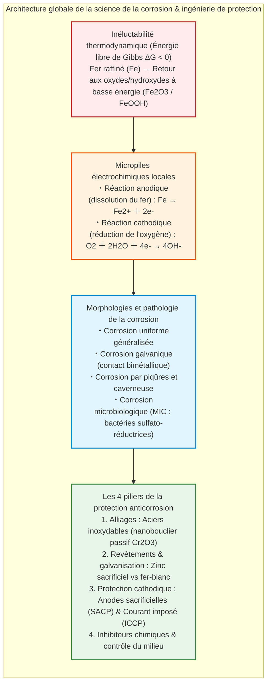
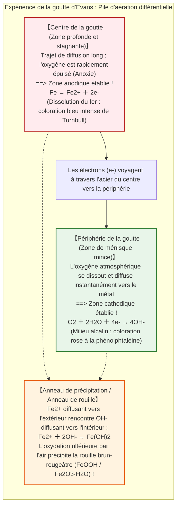
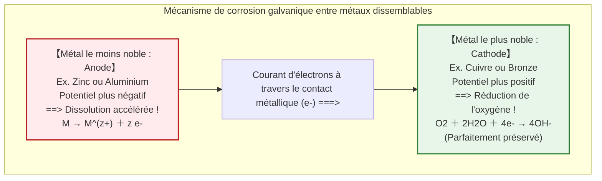
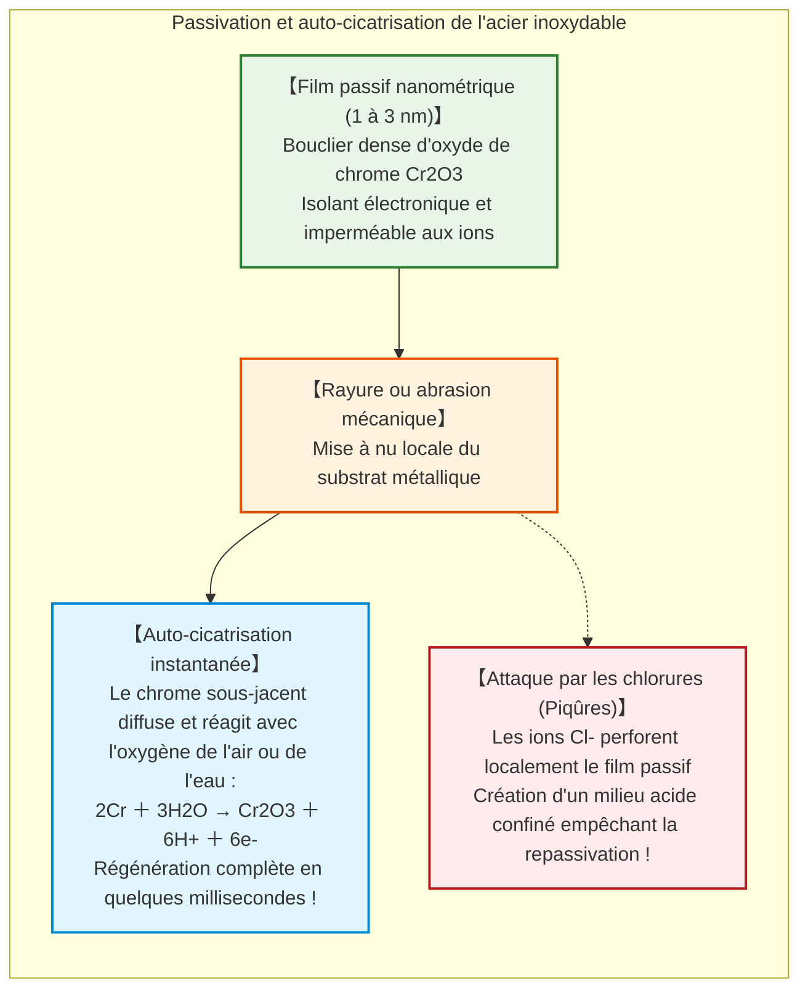

## Introduction : Le destin thermodynamique du fer à retourner à la terre

Le fer ($\text{Fe}$) est la colonne vertébrale structurelle de la civilisation moderne. De l'ossature des gratte-ciel urbains aux rails transcontinentaux, des superpétroliers fendant les océans aux pipelines sous-marins à haute pression, le fer et l'acier représentent plus de **95 % de tous les métaux produits et consommés sur Terre** (environ 1,9 milliard de tonnes par an).

Pourtant, dès la première milliseconde de sa naissance métallurgique, ce matériau indispensable est frappé d'une malédiction chimique inéluctable : **la corrosion, communément appelée la rouille**.

Une poutre en acier non protégée exposée à la pluie se couvre en quelques jours d'oxydes brun-rougeâtre pulvérulents. Une coque de navire immergée dans l'eau de mer est perforée par des piqûres d'attaque agressives. Selon l'Association for Materials Protection and Performance (AMPP), le coût économique mondial de la corrosion métallique dépasse **2 500 milliards de dollars par an**, soit **3,4 % du produit intérieur brut (PIB) mondial**.

Pourquoi le fer rouille-t-il avec un tel acharnement ?

Du point de vue de la thermodynamique chimique, l'explication est d'une limpidité absolue : **pour le fer, rouiller représente le chemin le plus naturel, favorisé par l'entropie et thermodynamiquement stable vers l'état d'équilibre.**

Dans la croûte terrestre, le fer n'existe pas à l'état métallique $\text{Fe}^0$. Il est enfermé dans des minerais oxydés (hématite $\text{Fe}_2\text{O}_3$, magnétite $\text{Fe}_3\text{O}_4$), solidement lié à l'oxygène au niveau d'énergie minimale. L'homme a bâti d'immenses hauts-fourneaux pour lui arracher cet oxygène à grand renfort d'énergie thermique ($> 1500^\circ\text{C}$).

Par conséquent, le fer métallique se trouve dans un **état de haute énergie thermodynamiquement instable**. Gouverné par le deuxième principe de la thermodynamique (la recherche spontanée de l'entropie maximale et de l'énergie libre de Gibbs minimale), le fer cherche continuellement à libérer cette énergie emmagasinée. En présence d'eau et d'oxygène, il s'oxyde spontanément ($\Delta G < 0$) pour redevenir le minerai dont il est issu.



---

## Chapitre 1 : L'électrochimie d'une goutte d'eau – Les micropiles locales

Pour l'œil humain, un acier rouillant sous la pluie semble subir une réaction chimique d'oxydation directe. Les mesures électrochimiques révèlent une vérité bien plus fascinante :

**La rouille du fer est une réaction de pile électrochimique en court-circuit.** Des millions de micropiles galvaniques spontanées — appelées **piles locales** — se forment à la surface du métal, entraînant un transfert continu d'électrons et d'ions.

### 1.1 L'expérience de la goutte d'Evans et l'aération différentielle

Dans les années 1920, le chimiste britannique Ulick Richardson Evans à l'Université de Cambridge réalisa une expérience fondamentale devenue classique.

Il déposa une gouttelette de solution d'eau salée ($\text{NaCl}$) sur une plaque d'acier poli, additionnée d'indicateurs colorés : la phénolphtaléine (virant au rose en présence d'ions basiques $\text{OH}^-$) et le ferricyanure de potassium (virant au bleu de Turnbull en présence d'ions $\text{Fe}^{2+}$).

Si la rouille résultait d'une réaction uniforme, la coloration aurait été homogène. Les résultats démontrèrent le contraire :



Cette expérience mit en lumière la **pile d'aération différentielle** : la dissolution anodique du fer se concentre là où l'oxygène manque le plus (au centre), tandis que la réduction cathodique de l'oxygène se produit là où il est le plus abondant (sur les bords).

### 1.2 La séquence des réactions chimiques

1. **Oxydation anodique** : $\text{Fe} \to \text{Fe}^{2+} + 2e^-$
2. **Réduction cathodique** : $\text{O}_2 + 2\text{H}_2\text{O} + 4e^- \to 4\text{OH}^-$
3. **Précipitation** : $\text{Fe}^{2+} + 2\text{OH}^- \to \text{Fe(OH)}_2$ (hydroxyde ferreux blanc verdâtre)
4. **Oxydation secondaire** : $4\text{Fe(OH)}_2 + \text{O}_2 + 2\text{H}_2\text{O} \to 4\text{Fe(OH)}_3$

L'hydroxyde ferrique se déshydrate en oxyhydroxydes de fer ($\alpha\text{-FeOOH}$ goethite, $\gamma\text{-FeOOH}$ lépidocrocite) et oxydes ($\text{Fe}_3\text{O}_4$ magnétite, $\text{Fe}_2\text{O}_3$ hématite).

En raison du **rapport de Pilling-Bedworth**, le volume spécifique de la rouille formée est **deux à trois fois plus élevé** que celui du fer consommé. Cette expansion volumétrique phénoménale fait cloquer et craqueler la rouille, créant des fissures microscopiques qui exposent constamment du métal frais à l'attaque.

---

## Chapitre 2 : Thermodynamique et diagramme de Pourbaix

Le chimiste belge Marcel Pourbaix a cartographié la thermodynamique du fer dans l'eau sous la forme de **diagrammes potentiel-pH (diagrammes de Pourbaix)**.

Ce diagramme délimite trois zones fondamentales :
1. **Zone d'immunité** ($E < -0{,}6\,\text{V}$) : Le fer métallique ($\text{Fe}^0$) est thermodynamiquement stable. La dissolution est impossible. C'est le principe fondamental de la **protection cathodique**.
2. **Zone de corrosion** : Le fer se dissout sous forme d'ions solubles $\text{Fe}^{2+}$, $\text{Fe}^{3+}$ ou $\text{HFeO}_2^-$.
3. **Zone de passivité** : Des oxydes insolubles ($\text{Fe}_2\text{O}_3$, $\text{Fe}_3\text{O}_4$) forment une couche protectrice dense barrant l'accès à l'eau, comme dans le béton armé sain ($\text{pH} \approx 13$).

---

## Chapitre 3 : Corrosion galvanique et le danger du rapport de surface

Lorsque deux métaux de potentiels différents sont en contact électrique dans un électrolyte, le métal le plus électronégatif (le plus réactif) devient l'anode et subit une corrosion accélérée, tandis que le plus noble devient la cathode et se trouve protégé.



### Le ratio destructeur : $A_\text{Cathode} / A_\text{Anode}$

La densité de courant de corrosion sur l'anode est amplifiée par le rapport des aires :

$$i_\text{Anode} = i_\text{Cathode} \times \left( \frac{A_\text{Cathode}}{A_\text{Anode}} \right)$$

Si l'anode est minuscule par rapport à la cathode (ex. rivets en acier sur des plaques de cuivre), toute la réaction cathodique se concentre sur les rivets qui sont cisaillés par corrosion en quelques semaines.

---

## Chapitre 4 : La nanostructure de l'acier inoxydable et la passivation

L'ajout d'au moins **10,5 % de chrome ($\text{Cr}$)** transforme l'acier vulnérable en **acier inoxydable**.

Le chrome réagit instantanément avec l'oxygène pour former une couche nanométrique (1 à 3 nanomètres d'épaisseur) d'oxyde de chrome amorphe ($\text{Cr}_2\text{O}_3 \cdot n\text{H}_2\text{O}$).



En milieu marin riche en ions chlorures ($\text{Cl}^-$), cette couche peut être localement perforée, provoquant une redoutable **corrosion par piqûres (pitting)**. L'adjonction de 2 à 3 % de molybdène ($\text{Mo}$) permet de stabiliser remarquablement le film protecteur (acier inox marin 316).

---

## Chapitre 5 : Galvanisation et Protection Cathodique

### 5.1 Acier galvanisé (Zinc) contre Fer-blanc (Étain)

- **Acier galvanisé** : Le zinc est plus électronégatif que le fer ($E^\circ = -0{,}76\,\text{V}$). En cas de rayure, le zinc se sacrifie préférentiellement en libérant ses électrons pour protéger l'acier exposé.
- **Fer-blanc** : L'étain est plus noble que le fer ($E^\circ = -0{,}14\,\text{V}$). Si la boîte de conserve subit la moindre rayure, le fer devient l'anode sous une immense cathode d'étain : la perforation du métal est fulgurante.

### 5.2 Les systèmes de protection cathodique (CP)

Pour les navires, plateformes pétrolières et gazoducs souterrains, la protection cathodique est indispensable :

```mermaid
flowchart TD
    subgraph CathodicSystems["Deux méthodes majeures de protection cathodique"]
        direction TB
        subgraph SACP["1. Anodes sacrificielles (SACP)"]
            SACP_Block["Blocs d'alliage de Zinc ou d'Aluminium soudés sur la coque"]
            SACP_Block -->|Flux spontané d'électrons| SACP_Hull["Coque du navire polarisée en cathode protégée"]
        end
        
        subgraph ICCP["2. Courant imposé (ICCP)"]
            ICCP_Gen["Générateur de courant continu (Redresseur)"]
            ICCP_Anode["Anodes inertes en titane MMO enfouies dans le sol"]
            ICCP_Pipe["Gazoduc transcontinental maintenu à potentiel négatif"]
            ICCP_Gen -->|Pôle positif (+)| ICCP_Anode
            ICCP_Gen -->|Pôle négatif (-)| ICCP_Pipe
        end
    end
    
    style SACP fill:#e1f5fe,stroke:#0288d1,stroke-width:2px
    style ICCP fill:#e8f5e9,stroke:#2e7d32,stroke-width:2px
```

1. **Anodes sacrificielles (SACP)** : Blocs de zinc ou d'aluminium fixés sur les coques de navires qui se consument naturellement pour maintenir le fer dans sa zone d'immunité.
2. **Courant imposé (ICCP)** : Redresseurs électriques injectant des ampères de courant continu à travers des anodes en titane vers de gigantesques pipelines enterrés, garantissant une protection pérenne sur des milliers de kilomètres.

---

## Chapitre 6 : Les cas extrêmes – Corrosion microbienne et fissurante

- **Bactéries sulfato-réductrices (BSR)** : Dans les boues anoxiques, ces micro-organismes consomment l'hydrogène cathodique et excrètent des sulfures corrosifs formant du sulfure de fer ($\text{FeS}$), entraînant des perforations de plusieurs millimètres par an.
- **Corrosion sous contrainte (CSC)** : Sous l'effet conjoint d'une tension mécanique et d'un environnement corrosif, des fissures microscopiques se propagent à vitesse sonique sans déformation plastique préalable, provoquant des ruptures brutales.

---

## Conclusion : L'éternel combat de l'ingénieur contre l'entropie

Le fer est la charpente de notre monde physique. Mais chaque tonne d'acier vit sous la menace permanente du deuxième principe de la thermodynamique. La rouille est la revanche de la nature cherchant à ramener le métal à son état minéral originel.

En maîtrisant la circulation des électrons, les nanostructures passives et la protection cathodique, les ingénieurs défient quotidiennement l'entropie pour préserver les fondations de notre civilisation.
