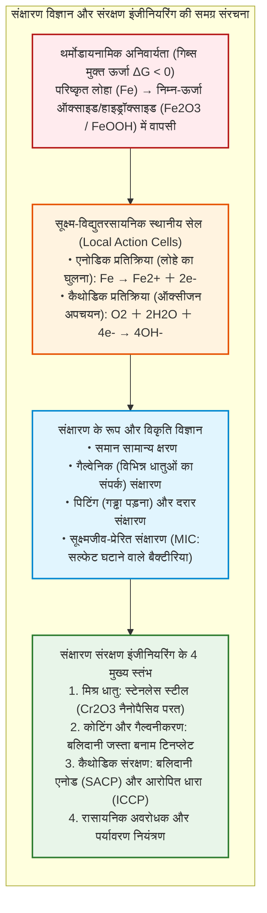
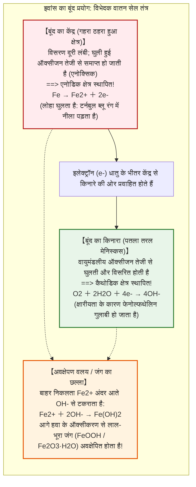
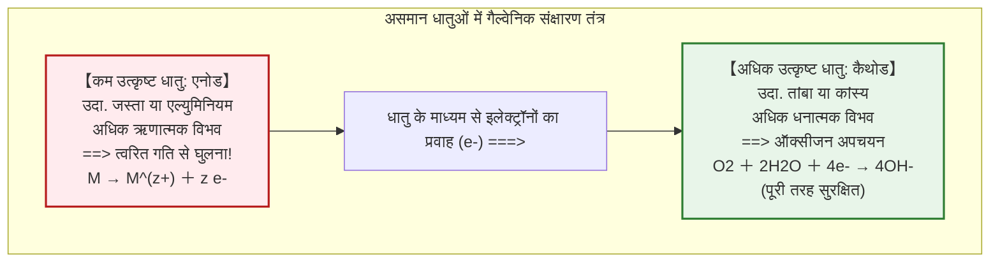
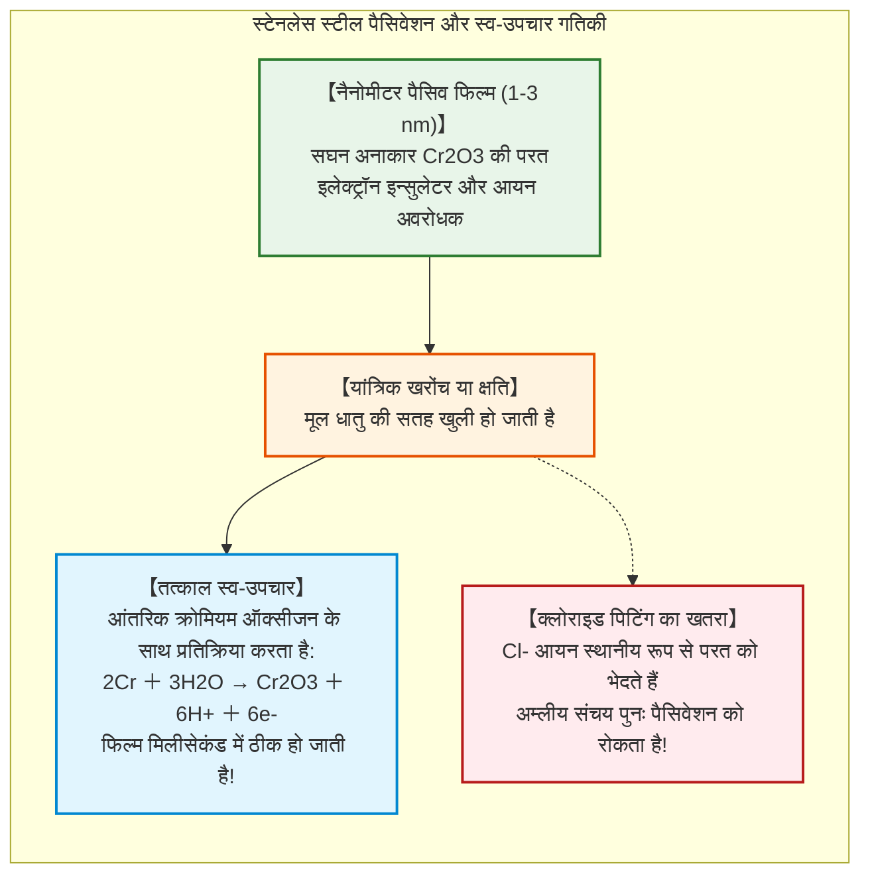

## प्रस्तावना: लोहे की धरती में लौटने की थर्मोडायनामिक नियति

लोहा ($\text{Fe}$) आधुनिक मानव सभ्यता की संरचनात्मक रीढ़ है। गगनचुंबी इमारतों के फ्रेमवर्क और अंतरमहाद्वीपीय रेल पटरियों से लेकर सैकड़ों हजार टन वजनी समुद्री सुपरटैंकरों, उच्च दबाव वाली पनडुब्बी पाइपलाइनों और पेयजल वितरण नेटवर्क तक—पृथ्वी पर उत्पादित और उपभोग किए जाने वाले सभी धातुओं में लोहे और इस्पात का हिस्सा **95% से अधिक (प्रति वर्ष लगभग 1.9 अरब मीट्रिक टन)** है।

फिर भी, अपने धातुकर्म जन्म के पहले मिलीसेकंड से ही यह आवश्यक संरचनात्मक सामग्री एक रासायनिक अभिशाप से ग्रस्त रहती है: **संक्षारण (Corrosion), जिसे आम बोलचाल में जंग (Rusting) कहा जाता है**।

खुली हवा और बारिश में रखा स्टील गर्डर कुछ ही दिनों में लाल-भूरे रंग के पपड़ीदार ऑक्साइड से ढक जाता है। समुद्री जल में डूबे जहाजों के पतवार छिद्रण (पिटिंग) से छलनी हो जाते हैं। एसोसिएशन फॉर मैटेरियल्स प्रोटेक्शन एंड परफॉर्मेंस (AMPP) के वैश्विक अध्ययनों के अनुसार, धात्विक संक्षारण से होने वाला वार्षिक आर्थिक नुकसान **2.5 ट्रिलियन अमेरिकी डॉलर** से अधिक है—जो कि **विश्व के सकल घरेलू उत्पाद (GDP) का 3.4%** है।

लोहा इतनी अडिग जिद के साथ जंग क्यों खाता है?

रासायनिक ऊष्माप्रवैगिकी (Thermodynamics) के दृष्टिकोण से इसका उत्तर बिल्कुल स्पष्ट है: **लोहे के लिए, जंग लगना संतुलन की स्थिति में लौटने का सबसे स्वाभाविक, एंट्रॉपी-अनुकूल और थर्मोडायनामिक रूप से स्थिर मार्ग है।**

पृथ्वी की पपड़ी में लोहा कभी भी धात्विक रूप $\text{Fe}^0$ में नहीं पाया जाता। यह हेमेटाइट ($\text{Fe}_2\text{O}_3$) और मैग्नेटाइट ($\text{Fe}_3\text{O}_4$) जैसे अयस्कों में ऑक्सीजन के साथ न्यूनतम ऊर्जा पर मजबूती से बंधा होता है। शुद्ध लोहा निकालने के लिए मानव ने विशाल वातभट्टियां (ब्लास्ट फर्नेस) बनाईं, जिसमें अत्यधिक तापीय ऊर्जा ($> 1500^\circ\text{C}$) और कोक की खपत करके ऑक्सीजन को जबरन अलग किया गया।

फलस्वरूप, परिष्कृत धात्विक लोहा **थर्मोडायनामिक रूप से अस्थिर उच्च-ऊर्जा अवस्था** में रहता है। थर्मोडायनामिक्स के दूसरे नियम के अनुसार, लोहा इस संचित ऊर्जा को मुक्त करने के लिए निरंतर लालायित रहता है। पानी और ऑक्सीजन की उपस्थिति में, लोहा स्वतः ऑक्सीकृत ($\Delta G < 0$) होकर अपनी मूल खनिज अवस्था में लौट जाता है।



---

## अध्याय 1: पानी की एक बूंद में इलेक्ट्रोकेमिस्ट्री—सूक्ष्म स्थानीय सेल

खुली आंखों से देखने पर ऐसा लगता है मानो स्टील हवा से सीधे रासायनिक प्रतिक्रिया करके सड़ रहा हो। लेकिन इलेक्ट्रोकेमिकल जांच एक पूरी तरह से अलग वास्तविकता दिखाती है:

**लोहे का जंग लगना एक शॉर्ट-सर्किट इलेक्ट्रोकेमिकल बैटरी प्रतिक्रिया है।** धातु की सतह पर अनायास ही लाखों सूक्ष्म शॉर्ट-सर्किट बैटरी—जिन्हें **लोकल एक्शन सेल** कहा जाता है—सक्रिय हो जाती हैं, जो इलेक्ट्रॉनों और आयनों का निरंतर प्रवाह संचालित करती हैं।

### 1.1 इवांस का बूंद प्रयोग और विभेदक वातन (Differential Aeration)

1920 के दशक में, कैम्ब्रिज विश्वविद्यालय के ब्रिटिश इलेक्ट्रोकेमिस्ट उलिक रिचर्डसन इवांस ने एक ऐतिहासिक प्रयोग किया।

इवांस ने स्टील की एक साफ प्लेट पर नमक के पानी ($\text{NaCl}$) की एक बूंद रखी, जिसमें फेनोल्फथेलिन ($\text{OH}^-$ आयनों का पता लगाने के लिए) और पोटेशियम फेरीसाइनाइड ($\text{Fe}^{2+}$ आयनों का पता लगाने के लिए) मिलाया।

यदि जंग एक समान रासायनिक क्रिया होती, तो पूरी बूंद एक जैसी रंगीन होती। लेकिन परिणाम चौंकाने वाले थे:



इस प्रयोग ने **विभेदक वातन (Differential Aeration)** की खोज की: लोहा वहां घुलता है जहां ऑक्सीजन सबसे कम होती है (बूंद का केंद्र), जबकि कैथोडिक अपचयन उस किनारे पर होता है जहां ऑक्सीजन प्रचुर मात्रा में होती है।

### 1.2 रासायनिक प्रतिक्रियाओं का क्रम

- **एनोडिक ऑक्सीकरण**: $\text{Fe} \to \text{Fe}^{2+} + 2e^-$
- **कैथोडिक अपचयन**: $\text{O}_2 + 2\text{H}_2\text{O} + 4e^- \to 4\text{OH}^-$
- **अवक्षेपण**: $\text{Fe}^{2+} + 2\text{OH}^- \to \text{Fe(OH)}_2$ (फेरस हाइड्रॉक्साइड)
- **द्वितीयक ऑक्सीकरण**: $4\text{Fe(OH)}_2 + \text{O}_2 + 2\text{H}_2\text{O} \to 4\text{Fe(OH)}_3$

यह निर्जलीकरण के बाद विभिन्न रूपों (लेपिडोक्रोसाइट, गोएथाइट, मैग्नेटाइट, हेमेटाइट) में बदल जाता है।

**पिलिंग-बेडवर्थ अनुपात** के अनुसार, बनने वाले जंग का आयतन नष्ट हुए लोहे के आयतन से **2 से 3 गुना बड़ा** होता है। इस आयतन विस्तार के कारण जंग की परत उखड़ जाती है, जिससे नीचे की धातु बार-बार उजागर होती रहती है।

---

## अध्याय 2: थर्मोडायनामिक्स और पौरबैक्स आरेख

बेल्जियम के वैज्ञानिक मार्सेल पौरबैक्स ने जल में लोहे की थर्मोडायनामिक स्थिरता को **पोटेंशियल-pH आरेख (पौरबैक्स आरेख)** में संहिताबद्ध किया:
1. **इम्युनिटी क्षेत्र (Immunity)** ($E < -0{,}6\,\text{V}$): धात्विक लोहा थर्मोडायनामिक रूप से स्थिर होता है; जंग लगना असंभव है (यही **कैथोडिक सुरक्षा** का आधार है)।
2. **संक्षारण क्षेत्र (Corrosion)**: लोहा आयनों ($\text{Fe}^{2+}$, $\text{Fe}^{3+}$) के रूप में सक्रिय रूप से घुलता है।
3. **निष्क्रियता क्षेत्र (Passivity)**: अघुलनशील ऑक्साइड की घनी सुरक्षात्मक परत बनती है (जैसे कंक्रीट के क्षारीय वातावरण में, $\text{pH} \approx 13$)।

---

## अध्याय 3: गैल्वेनिक संक्षारण और क्षेत्रफल अनुपात का विनाश

जब दो अलग-अलग धातुएं चालक माध्यम में संपर्क में आती हैं, तो अधिक सक्रिय धातु (अधिक ऋणात्मक विभव वाली) एनोड बन जाती है और तेजी से नष्ट होती है, जबकि उत्कृष्ट धातु कैथोड बनकर सुरक्षित रहती है।



### क्षेत्रफल अनुपात का घातक नियम: $A_\text{कैथोड} / A_\text{एनोड}$

एनोड पर संक्षारण धारा का घनत्व क्षेत्रफल अनुपात के सीधे आनुपातिक होता है:

$$i_\text{एनोड} = i_\text{कैथोड} \times \left( \frac{A_\text{कैथोड}}{A_\text{एनोड}} \right)$$

यदि विशाल तांबे की प्लेटों में छोटे स्टील के पेंच ($A_\text{कैथोड} \gg A_\text{एनोड}$) लगाए जाएं, तो वे पेंच कुछ ही हफ्तों में कटकर अलग हो जाएंगे।

---

## अध्याय 4: स्टेनलेस स्टील और नैनोमीटर पैसिव परत

स्टील में कम से कम **10.5% क्रोमियम ($\text{Cr}$)** मिलाने से धातु की सतह पर केवल 1 से 3 नैनोमीटर मोटी क्रोमियम ऑक्साइड ($\text{Cr}_2\text{O}_3$) की एक स्व-उपचार सुरक्षात्मक फिल्म बन जाती है।



क्लोराइड आयनों ($\text{Cl}^-$) वाले समुद्री वातावरण में यह फिल्म स्थानीय रूप से टूटकर **पिटिंग संक्षारण** उत्पन्न कर सकती है। इसे रोकने के लिए समुद्री स्टील में 2-3% मोलिब्डेनम ($\text{Mo}$) मिलाया जाता है (AISI 316)।

---

## अध्याय 5: गैल्वनीकरण और कैथोडिक संरक्षण

### 5.1 गैल्वेनाइज्ड स्टील बनाम टिनप्लेट

- **गैल्वेनाइज्ड स्टील (जस्ता)**: जस्ता लोहे से अधिक सक्रिय है ($E^\circ = -0{,}76\,\text{V}$)। खरोंच लगने पर जस्ता **बलिदानी एनोड** के रूप में कार्य करता है और खुले लोहे की रक्षा करता है।
- **टिनप्लेट (टिन)**: टिन लोहे से अधिक उत्कृष्ट है ($E^\circ = -0{,}14\,\text{V}$)। खरोंच लगते ही लोहा एक विशाल टिन कैथोड के सामने छोटा एनोड बन जाता है, जिससे डिब्बे में तेजी से छेद हो जाते हैं।

### 5.2 कैथोडिक संरक्षण प्रणालियां (CP)

```mermaid
flowchart TD
    subgraph CathodicSystems["बुनियादी ढांचे की कैथोडिक सुरक्षा प्रणालियां"]
        direction TB
        subgraph SACP["1. बलिदानी एनोड विधि (SACP)"]
            SACP_Block["जहाज के पतवार पर जस्ता या एल्युमिनियम मिश्र धातु के ब्लॉक वेल्ड किए जाते हैं"]
            SACP_Block -->|स्वतःस्फूर्त इलेक्ट्रॉन प्रवाह| SACP_Hull["जहाज का पतवार संरक्षित कैथोड बन जाता है"]
        end
        
        subgraph ICCP["2. आरोपित धारा विधि (ICCP)"]
            ICCP_Gen["दिष्ट धारा स्रोत (रेक्टिफायर)"]
            ICCP_Anode["जमीन में दबे अक्रिय टाइटेनियम एनोड (MMO)"]
            ICCP_Pipe["हजारों किलोमीटर लंबी पाइपलाइन सुरक्षित विभव पर"]
            ICCP_Gen -->|धनात्मक पोल (+)| ICCP_Anode
            ICCP_Gen -->|ऋणात्मक पोल (-)| ICCP_Pipe
        end
    end
    
    style SACP fill:#e1f5fe,stroke:#0288d1,stroke-width:2px
    style ICCP fill:#e8f5e9,stroke:#2e7d32,stroke-width:2px
```

1. **बलिदानी एनोड (SACP)**: जहाजों और अपतटीय प्लेटफार्मों पर जस्ता या एल्युमिनियम के ब्लॉक जो खुद गलकर लोहे को बचाते हैं।
2. **आरोपित धारा (ICCP)**: रेक्टिफायर और मिश्रित धातु ऑक्साइड टाइटेनियम (MMO) एनोड के माध्यम से भूमिगत लंबी पाइपलाइनों को निरंतर सुरक्षा धारा प्रदान की जाती है।

---

## अध्याय 6: माइक्रोबियल और तनाव संक्षारण

- **सल्फेट-अपचायक बैक्टीरिया (SRB)**: ऑक्सीजन-रहित कीचड़ में ये कैथोडिक हाइड्रोजन परत का उपभोग करते हैं और हाइड्रोजन सल्फाइड ($\text{H}_2\text{S}$) उत्पन्न कर आयरन सल्फाइड ($\text{FeS}$) बनाते हैं, जिससे प्रति वर्ष कई मिलीमीटर की दर से छेद होते हैं।
- **स्ट्रेस कोरोजन क्रैकिंग (SCC)**: यांत्रिक तनाव और संक्षारक माध्यम के संयोजन से धातु में बिना किसी पूर्व चेतावनी के ध्वनि की गति से दरारें फैलती हैं और घातक विफलता होती है।

---

## निष्कर्ष: एंट्रॉपी के विरुद्ध इंजीनियरिंग का शाश्वत संघर्ष

लोहा हमारी भौतिक सभ्यता का आधार है। लेकिन स्टील की प्रत्येक संरचना प्रकृति के साथ थर्मोडायनामिक तनाव में रहती है। जंग प्रकृति द्वारा अपनी ऊर्जा वापस मांगने की प्रक्रिया है।

इलेक्ट्रोकेमिस्ट्री, नैनो-पैसिव फिल्मों और कैथोडिक सुरक्षा के माध्यम से इंजीनियरिंग आधुनिक सभ्यता की संरचनाओं को अक्षुण्ण बनाए रखने के लिए इस प्राकृतिक क्षय को निरंतर थामे रखती है।
