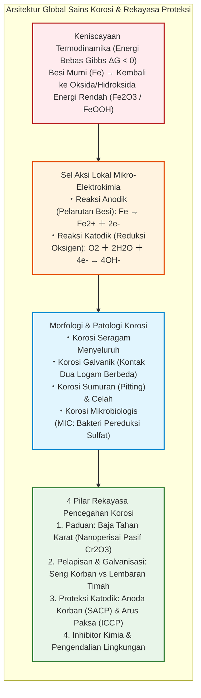
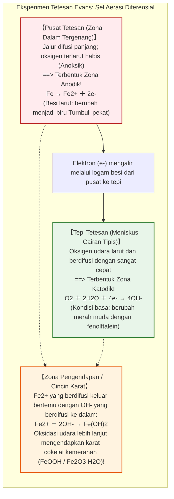
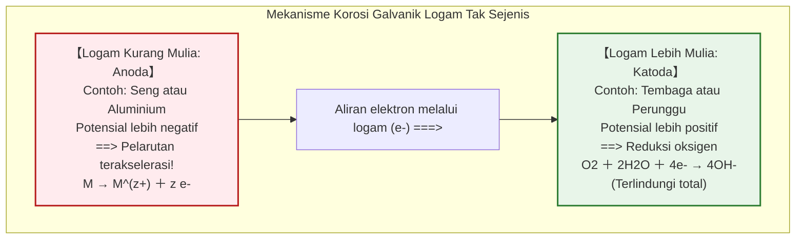
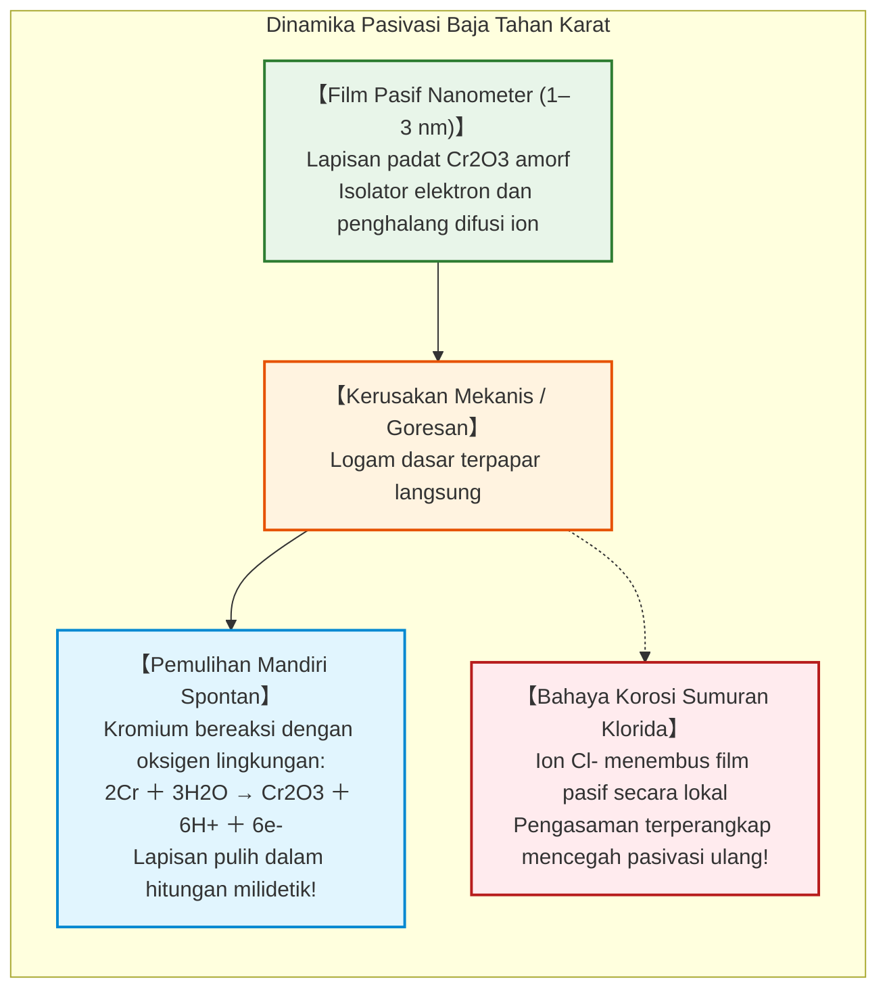

## Pendahuluan: Takdir Termodinamika Besi untuk Kembali ke Bumi

Besi ($\text{Fe}$) adalah tulang punggung struktural peradaban manusia modern. Dari kerangka pencakar langit perkotaan, rel kereta api lintas benua, kapal tanker raksasa pengangkut minyak, hingga jaringan pipa bawah laut bertekanan tinggi dan pipa air minum perkotaan—besi dan baja menyumbang lebih dari **95% dari seluruh logam yang diproduksi dan dikonsumsi di bumi** (sekitar 1,9 miliar metrik ton per tahun).

Namun, sejak detik pertama kelahirannya di pabrik peleburan, material esensial ini dibayangi oleh kutukan kimia yang tak terelakkan: **korosi, yang umumnya dikenal sebagai perkaratan**.

Balok baja tanpa pelindung yang terpapar hujan akan tertutup lapisan oksida cokelat kemerahan dalam hitungan hari. Lambung kapal di laut berlubang akibat serangan korosi sumuran. Kerugian ekonomi global akibat korosi logam melampaui **2,5 triliun dolar AS per tahun**—mencapai **3,4% dari Produk Domestik Bruto (PDB) dunia**.

Mengapa besi berkarat dengan kepastian yang begitu mutlak?

Dalam kacamata termodinamika kimia: **bagi besi, berkarat adalah rute yang paling alami, disukai oleh peningkatan entropi, dan stabil secara termodinamika untuk kembali ke titik keseimbangan.**

Di kerak bumi, besi tidak pernah ada dalam bentuk logam murni $\text{Fe}^0$. Ia terperangkap dalam bijih teroksidasi seperti hematit ($\text{Fe}_2\text{O}_3$) dan magnetit ($\text{Fe}_3\text{O}_4$), di mana atom besi terikat erat dengan oksigen pada tingkat energi terendah. Manusia mendirikan tanur tiup raksasa, mengorbankan energi panas yang sangat besar ($> 1500^\circ\text{C}$) untuk memisahkan oksigen dari bijih besi secara paksa.

Akibatnya, besi logam murni berada dalam **keadaan energi tinggi yang tidak stabil secara termodinamika**. Mengikuti Hukum Kedua Termodinamika (dorongan alami menuju entropi maksimum dan energi bebas Gibbs minimum), besi selalu berusaha melepaskan energi yang tersimpan tersebut. Di hadapan air dan oksigen, besi mengalami oksidasi spontan ($\Delta G < 0$) untuk kembali menjadi batu mineral asalnya.



---

## Bab 1: Elektrokimia dalam Setetes Air – Sel Aksi Lokal Mikroskopis

Secara kasat mata, baja yang berkarat di bawah hujan tampak mengalami reaksi kimia langsung dengan udara. Namun, analisis elektrokimia membuktikan hal yang jauh lebih menakjubkan:

**Perkaratan besi adalah reaksi baterai elektrokimia yang mengalami korsleting.** Jutaan baterai mikro spontan—dikenal sebagai **sel aksi lokal**—terbentuk di seluruh permukaan logam, mengalirkan arus elektron dan ion tanpa henti.

### 1.1 Eksperimen Tetesan Evans dan Aerasi Diferensial

Pada tahun 1920-an, ilmuwan elektrokimia Inggris Ulick Richardson Evans di Universitas Cambridge merancang eksperimen klasik yang membuktikan fenomena ini.

Evans meneteskan larutan garam natrium klorida ($\text{NaCl}$) encer ke atas pelat baja yang telah dibersihkan, dengan menambahkan indikator fenolftalein (mendeteksi ion basa $\text{OH}^-$) dan kalium ferisianida (mendeteksi ion besi $\text{Fe}^{2+}$).

Jika korosi terjadi secara seragam, seluruh tetesan akan berwarna sama. Hasilnya justru memecah asumsi tersebut:



Eksperimen ini mengungkap fenomena **sel aerasi diferensial**: pelarutan anodik besi terjadi justru di tempat yang paling miskin oksigen (tengah tetesan), sementara reduksi katodik oksigen terjadi di tepi yang kaya oksigen.

### 1.2 Tahapan Reaksi Kimia Karat

- **Oksidasi anodik**: $\text{Fe} \to \text{Fe}^{2+} + 2e^-$
- **Reduksi katodik**: $\text{O}_2 + 2\text{H}_2\text{O} + 4e^- \to 4\text{OH}^-$
- **Pengendapan awal**: $\text{Fe}^{2+} + 2\text{OH}^- \to \text{Fe(OH)}_2$ (besi(II) hidroksida)
- **Oksidasi sekunder**: $4\text{Fe(OH)}_2 + \text{O}_2 + 2\text{H}_2\text{O} \to 4\text{Fe(OH)}_3$

Hidroksida besi mengalami dehidrasi membentuk lepidokrosit ($\gamma\text{-FeOOH}$), goetit ($\alpha\text{-FeOOH}$), magnetit ($\text{Fe}_3\text{O}_4$), dan hematit ($\text{Fe}_2\text{O}_3$).

Berdasarkan **rasio Pilling-Bedworth**, volume karat yang terbentuk adalah **2 hingga 3 kali lebih besar** daripada volume logam besi yang terkorosi. Ekspansi volume ini meretakkan lapisan karat, mengekspos permukaan logam baru secara berulang.

---

## Bab 2: Termodinamika dan Diagram Pourbaix

Ilmuwan Belgia Marcel Pourbaix memetakan stabilitas termodinamika besi dalam air melalui **Diagram Potensial-pH (Diagram Pourbaix)**:
1. **Wilayah Imunitas** ($E < -0{,}6\,\text{V}$): Besi logam stabil secara termodinamika; pelarutan mustahil terjadi. Ini adalah prinsip dasar **proteksi katodik**.
2. **Wilayah Korosi**: Besi larut sebagai $\text{Fe}^{2+}$, $\text{Fe}^{3+}$, atau $\text{HFeO}_2^-$.
3. **Wilayah Pasivasi**: Terbentuk lapisan oksida rapat yang menghambat laju korosi (seperti pada beton bertulang bersuasana basa, $\text{pH} \approx 13$).

---

## Bab 3: Korosi Galvanik dan Bahaya Rasio Luas Permukaan

Ketika dua logam berbeda terhubung secara elektrik di dalam elektrolit konduktif, logam yang lebih aktif (potensial lebih negatif) menjadi anoda dan mengalami percepatan korosi, sedangkan logam yang lebih mulia terlindungi sebagai katoda.



### Rasio Luas Kritis: $A_\text{Katoda} / A_\text{Anoda}$

Kerapatan arus pada anoda berbanding lurus dengan rasio luas permukaan:

$$i_\text{Anoda} = i_\text{Katoda} \times \left( \frac{A_\text{Katoda}}{A_\text{Anoda}} \right)$$

Baut baja kecil yang dipasang pada pelat tembaga raksasa ($A_\text{Katoda} \gg A_\text{Anoda}$) akan mengalami korosi hebat dan patah dalam beberapa minggu.

---

## Bab 4: Baja Tahan Karat dan Nanoperisai Pasivasi

Dengan menambahkan sedikitnya **10,5% kromium ($\text{Cr}$)** ke dalam baja, terbentuk lapisan nanometer oksida kromium ($\text{Cr}_2\text{O}_3$) setebal 1 hingga 3 nanometer yang mampu memperbaiki dirinya sendiri.



Pada lingkungan air laut dengan kadar ion klorida ($\text{Cl}^-$) tinggi, lapisan ini dapat ditembus secara lokal menghasilkan **korosi sumuran (pitting)**. Penambahan 2–3% molibdenum ($\text{Mo}$) sangat efektif meningkatkan ketahanan terhadap klorida (baja laut AISI 316).

---

## Bab 5: Galvanisasi dan Proteksi Katodik

### 5.1 Baja Galvanis vs Kaleng Timah

- **Baja galvanis (Seng)**: Seng lebih aktif daripada besi ($E^\circ = -0{,}76\,\text{V}$). Ketika tergores, seng berfungsi sebagai **anoda korban**, mengalirkan elektron untuk melindungi besi yang terbuka.
- **Kaleng timah (Timah putih)**: Timah lebih mulia daripada besi ($E^\circ = -0{,}14\,\text{V}$). Jika timbul goresan kecil, besi menjadi anoda kecil di hadapan katoda timah yang luas, melubangi kaleng dengan sangat cepat.

### 5.2 Sistem Proteksi Katodik (CP)

```mermaid
flowchart TD
    subgraph CathodicSystems["Sistem Proteksi Katodik Infrastruktur"]
        direction TB
        subgraph SACP["1. Anoda Korban Galvanik (SACP)"]
            SACP_Block["Balok paduan Seng atau Aluminium dilas pada lambung kapal"]
            SACP_Block -->|Arus elektron galvanik spontan| SACP_Hull["Lambung kapal dipolarisasi sebagai katoda terlindungi"]
        end
        
        subgraph ICCP["2. Arus Paksa (ICCP)"]
            ICCP_Gen["Sumber arus searah (Penyearah Arus/Rectifier)"]
            ICCP_Anode["Anoda inert titanium (MMO) ditanam di tanah"]
            ICCP_Pipe["Pipa gas ribuan kilometer dipertahankan pada potensial aman"]
            ICCP_Gen -->|Kutub positif (+)| ICCP_Anode
            ICCP_Gen -->|Kutub negatif (-)| ICCP_Pipe
        end
    end
    
    style SACP fill:#e1f5fe,stroke:#0288d1,stroke-width:2px
    style ICCP fill:#e8f5e9,stroke:#2e7d32,stroke-width:2px
```

1. **Anoda Korban (SACP)**: Balok seng/aluminium yang dipasang pada lambung kapal dan anjungan lepas pantai yang mengorbankan dirinya sendiri.
2. **Arus Paksa (ICCP)**: Menggunakan suplai arus searah dan anoda titanium (MMO) untuk melindungi pipa bawah tanah ribuan kilometer.

---

## Bab 6: Korosi Mikrobiologis dan Korosi Retak Tegang

- **Bakteri Pereduksi Sulfat (SRB)**: Di dalam lumpur anaerobik, bakteri ini mengonsumsi hidrogen katodik dan menghasilkan hidrogen sulfida ($\text{H}_2\text{S}$) yang membentuk besi sulfida ($\text{FeS}$), mempercepat laju penetrasi pite hingga beberapa milimeter per tahun.
- **Korosi Retak Tegang (SCC)**: Kombinasi tegangan mekanis tarik dan lingkungan korosif menyebabkan perambatan retak rapuh berkecepatan tinggi tanpa peringatan deformasi plastis.

---

## Kesimpulan: Perjuangan Abadi Melawan Entropi

Besi adalah fondasi dunia modern kita. Namun setiap struktur baja hidup dalam ketegangan termodinamika abadi dengan alam. Karat adalah penegasan Hukum Termodinamika Kedua saat alam menuntut kembali energinya.

Melalui penguasaan elektrokimia, nanoperisai pasivasi, dan proteksi katodik, ilmu rekayasa terus membendung laju entropi demi mempertahankan infrastruktur penopang peradaban.
