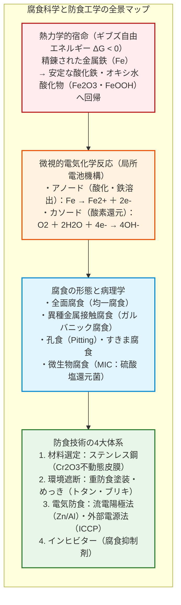
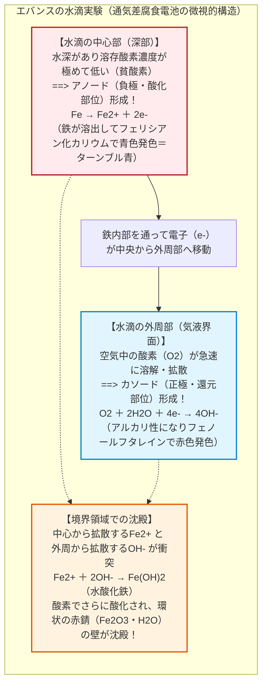
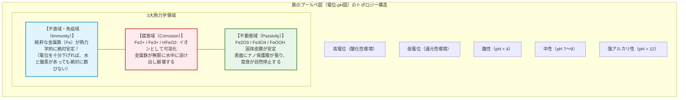
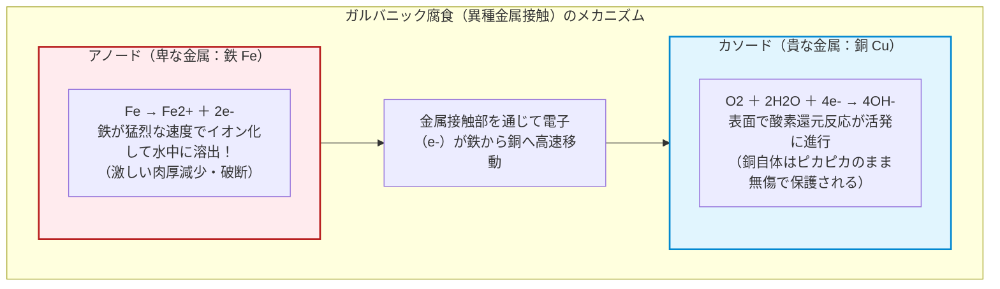
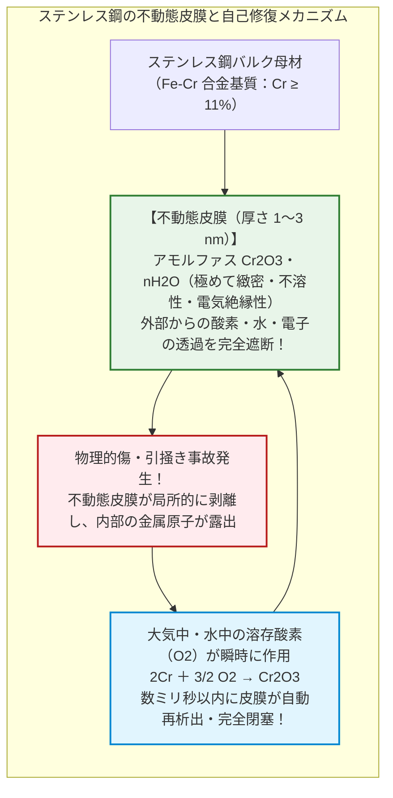
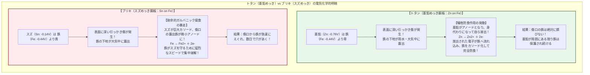
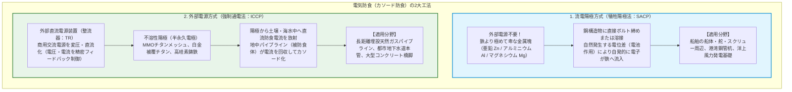
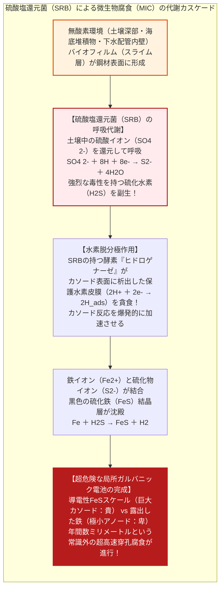

## はじめに：鉄が「大地へ還ろうとする」熱力学的宿命

鉄（Iron：$\text{Fe}$）は、人類文明の骨格そのものである。高層ビルの鉄骨、大地を疾走する鉄道のレール、海を渡る数万トンの巨大タンカー、地下に張り巡らされた水道管や天然ガスパイプライン、そして日夜乗客を乗せて走る自動車や産業機械に至るまで、人類が生産・消費する全金属材料の実に**95%以上（年間約19億トン）**を鉄鋼が占めている。

しかし、この地上最強にして最も安価な構造材料には、誕生した瞬間から逃れることのできない、呪いのような宿命が課せられている。

それが**「腐食（Corrosion）」、すなわち「錆びる（Rust）」という現象**である。

放置された鉄釘は数日で赤茶色の粉を吹き、海水に晒された船体は鉄板をえぐり取られ、地中の水道管は穴があいて漏水を引き起こす。世界の鉄鋼構造物を維持・補修し、腐食による破断事故を防ぐために費やされる経済的損失は、世界防食工学会（NACE）の試算によれば**年間およそ2兆5000億ドル（約370兆円：世界全体のGDPの約3.4%）**に達する。

なぜ鉄は、これほどまでに執拗に錆びようとするのか？

熱力学（Thermodynamics）の視点に立てば、その理由は極めて明快である。**鉄にとって「錆びること」こそが、宇宙で最も自然で心地よい安定状態への帰還だからである。**

地球の地殻に存在する鉄は、すべて酸化鉄（赤鉄鉱 $\text{Fe}_2\text{O}_3$ や磁鉄鉱 $\text{Fe}_3\text{O}_4$）という「酸素と結びついた安定した鉱石」として眠っている。人類はこれを発掘し、高炉の中にコークスとともに投入して $1500^\circ\text{C}$ を超える猛烈な熱エネルギーを注ぎ込み、酸素を無理やり引き剥がして純粋な金属鉄（$\text{Fe}$）へと還元した。

この精錬された鉄は、熱力学的に**「過剰なギブズ自由エネルギーを抱え込んだ、極めて不安定な興奮状態」**にある。自然界の普遍の法則である熱力学第二法則（エントロピー増大の法則）に従い、鉄は隙あらば周囲の酸素や水分と結びついてエネルギーを放出し、かつて眠っていた元の安定な酸化鉄（土）へと戻ろうとする。錆とは、人類が力づくで高エネルギー状態に引き上げた金属が、元の岩石へと帰還する壮大なエネルギー解放劇に他ならない。

本稿では、鉄の表面の微細な水滴の中で起きている電気化学的バッテリー反応から、異種金属が触れ合うことで起きる電食の悲劇、ステンレス鋼がまとう厚さ数ナノメートルの自己修復シールド、そして巨大インフラを腐食から守る電気防食の最先端技術まで、人類が錆と繰り広げてきた科学と工学の全貌を徹底解剖する。



---

## 第1章：水滴の中で起きていること——腐食の電気化学とミクロな「局所電池」

鉄の錆びを肉眼で見ると、表面全体が一様に酸化しているように見える。しかし、電子顕微鏡と電気化学のレベルで観察すると、そこには驚くべき現象が起きている。

鉄が錆びる現場とは、**「無数の目に見えない微小な乾電池（局所電池：Local Cell）が鉄の表面に形成され、ショートサーキット（短絡）を起こして電流が流れ続けている状態」**なのである。

### 1.1 エバンスの水滴実験と通気差電池

1920年代、イギリスのケンブリッジ大学の電気化学者ウリック・リチャードソン・エバンス（Ulick Richardson Evans）は、「近代腐食科学の父」と呼ばれる不滅の実験を行った。

平らな鉄板の表面に、純粋な水滴を1滴垂らし、指示薬（フェノールフタレインとフェリシアン化カリウム）を加えて観察したのである。

もし鉄の錆が単なる化学的結合（気体と固体の直接反応）であるなら、水滴の下の鉄板は均一に錆びるはずであった。しかし、現れた結果は劇的に異なっていた：



水滴の中心部は、水深があるため空気中の酸素が届きにくい（貧酸素部）。一方、水滴のへり（外周部）は空気と直に接しているため、酸素が極めて豊富に溶け込んでいる（富酸素部）。

この酸素濃度のわずかな差が、**「通気差電池（Differential Aeration Cell）」**と呼ばれる電位差を生み出す。
- **酸素の薄い中心部**が**アノード（酸化電極）**となり、鉄が電子を吐き出して鉄イオン（$\text{Fe}^{2+}$）として水の中に溶け出す。
- **酸素の濃い外周部**が**カソード（還元電極）**となり、鉄から導電体（鉄板）を通って流れてきた電子を受け取って、酸素が水酸化物イオン（$\text{OH}^-$）へと還元される。

そして、中心から泳ぎ出た $\text{Fe}^{2+}$ と外周から泳ぎ出た $\text{OH}^-$ が水滴の中間領域で出会った瞬間、不溶性の水酸化鉄が沈殿し、空気中の酸素とさらに反応して茶褐色の赤錆がリング状に析出する。

鉄が腐食するためには、**「水（電解液）」と「酸素」の双方が絶対に不可欠**である。どちらか一方を完全に遮断すれば、鉄は絶対に錆びない。宇宙空間の真空の中や、脱酸素された純水の中では、鉄は何千年経っても錆びることなく鏡面を保ち続ける。

### 1.2 錆の化学方程式：鉄が土へ還るステップ

鉄の腐食は、単一の化学反応ではなく、段階的な電気化学酸化プロセスである。

1. **アノード反応（鉄の酸化・イオン化）**:
   鉄原子が価電子を2個手放し、水溶液中に溶け出す。
   $$\text{Fe} \to \text{Fe}^{2+} + 2e^- \quad (E^\circ = -0.44\ \text{V vs. SHE})$$

2. **カソード反応（溶存酸素の還元）**:
   水滴中の溶存酸素が、アノードから鉄内部を伝わってきた電子を消費して水酸化物イオンを生成する（中性〜アルカリ性環境）。
   $$\text{O}_2 + 2\text{H}_2\text{O} + 4e^- \to 4\text{OH}^- \quad (E^\circ = +0.40\ \text{V vs. SHE})$$

3. **水酸化第一鉄の沈殿**:
   溶出した $\text{Fe}^{2+}$ と $\text{OH}^-$ が結合し、白色〜淡緑色のゲル状沈殿を生成する。
   $$\text{Fe}^{2+} + 2\text{OH}^- \to \text{Fe(OH)}_2$$

4. **赤錆への酸化（オキシ水酸化鉄および酸化鉄への転換）**:
   水酸化第一鉄は極めて酸化されやすく、周囲の酸素によって速やかに3価の鉄へと酸化される。
   $$4\text{Fe(OH)}_2 + \text{O}_2 \to 4\text{FeOOH} \text{（オキシ水酸化鉄）} + 2\text{H}_2\text{O}$$
   $$2\text{FeOOH} \to \text{Fe}_2\text{O}_3 \cdot \text{H}_2\text{O} \text{（含水酸化第二鉄＝典型的な赤錆）}$$

さらに酸素の供給が制限された深部では、黒色の**四三酸化鉄（磁鉄鉱：$\text{Fe}_3\text{O}_4$、黒錆）**が混在して形成される。

### 1.3 プールベ図（Pourbaix Diagram）が示す熱力学の地図

腐食科学において、特定の環境下で金属がどのような挙動をとるかを一目で判定できる究極の「熱力学の地図」が、ベルギーの化学者マルセル・プールベ（Marcel Pourbaix）が考案した**プールベ図（電位-pH図）**である。

縦軸に金属の電極電位（$E$：酸化還元電位）、横軸に水溶液の $\text{pH}$（水素イオン指数）をとると、鉄の熱力学的平衡状態は大きく3つの領域に明確に分かれる：



1. **腐食域（Corrosion）**:
   中性〜酸性の一般的な環境（雨水、河川水、海水など）において、鉄はイオン（$\text{Fe}^{2+}$ や $\text{Fe}^{3+}$）として水中に溶け出す状態が熱力学的に最も安定である。人間が何の手当てもしなければ、鉄はこの領域で溶解を続ける。
2. **不動態域（Passivity）**:
   アルカリ性環境（$\text{pH} > 9 \sim 13$）かつ適度な酸化性電位にあるとき、鉄の表面には不溶性の緻密な酸化物皮膜（$\text{Fe}_3\text{O}_4$ や $\gamma\text{-Fe}_2\text{O}_3$）が形成される。この皮膜がバリアとなり、内部の金属鉄の溶解を物理的に遮断する（前章で述べたコンクリート内部の鉄筋が錆びない理由がこれである）。
3. **不食域・免疫域（Immunity）**:
   電位を負の方向へ大きく引き下げた領域（水素発生電位以下、約 $-0.6\ \text{V vs. SHE}$ 以下）。この領域では、**金属鉄（$\text{Fe}$）そのものが水溶液中で最も安定な相となる**。水の中に浸かっていようと酸素が存在しようと、鉄がイオンになる反応のギブズ自由エネルギー変化が正（$\Delta G > 0$）となり、**物理化学的に錆びることが原理的に不可能になる**。

このプールベ図の「不食域」の存在こそが、後に述べる「電気防食（カソード防食）」の絶対的な理論的根拠となっている。

---

## 第2章：触れ合えば死を招く——異種金属接触腐食（ガルバニック腐食）

鉄が単独で存在しているときよりも、何十倍、何百倍もの凄まじいスピードで鉄を急速に腐食・消滅させる現象がある。

それが、**「異種金属接触腐食（ガルバニック腐食：Galvanic Corrosion）」**である。

### 2.1 ガルバニック系列と電位差

異なる2種類の金属を水（電解質溶液）の中で接触させると、両者の電極電位の違いによって強力な起電力が生じ、**巨大な電池**が完成する。

自然の摂理として、**「より卑な（イオン化傾向が大きく、電位が低い）金属」**がアノードとなって猛烈な勢いで電子を奪われ、急速に溶解する。一方、**「より貴な（イオン化傾向が小さく、電位が高い）金属」**はカソードとして電子を受け取り、自らは一切腐食することなく完全に守られる。

海水環境における代表的な金属のガルバニック系列（実用電位序列）を下表に示す：

| 金属材料 | 海水中の腐食電位（V vs. SCE） | 極性 |
| :--- | :--- | :--- |
| **マグネシウム（Mg）合金** | $-1.60 \sim -1.63$ | **極めて卑（最強力な自己犠牲アノード）** |
| **亜鉛（Zn）** | $-0.98 \sim -1.03$ | 卑（優れた犠牲アノード材料） |
| **アルミニウム（Al）合金** | $-0.75 \sim -1.00$ | 卑（海水構造物の犠牲陽極） |
| **炭素鋼・軟鋼（鉄：Fe）** | **$-0.60 \sim -0.71$** | **卑（一般的な構造用鋼材）** |
| 鋳鉄 | $-0.60 \sim -0.70$ | 卑 |
| スズ（Sn） | $-0.31 \sim -0.35$ | 貴 |
| 銅（Cu）および黄銅・青銅 | $-0.30 \sim -0.40$ | 貴（鉄に対して強力なカソードとなる） |
| **オーステナイト系ステンレス鋼（SUS304/316：不動態状態）** | **$-0.05 \sim -0.10$** | **極めて貴（鉄と接触させると鉄を激しく腐食）** |
| チタン（Ti） | $+0.05 \sim -0.05$ | 極めて貴 |
| 白金（Pt）・金（Au） | $> +0.20$ | 究極に貴 |

鉄（軟鋼：約 $-0.65\ \text{V}$）を、銅（約 $-0.35\ \text{V}$）やステンレス鋼（約 $-0.08\ \text{V}$）と直接ボルト締めして海水中や雨水中に放置すると、約 $0.3 \sim 0.6\ \text{V}$ もの電位差が発生する。

この結果、**鉄は銅やステンレスのために電子を供給する「生贄の生体バッテリー」**と化し、通常の何十倍もの速度で急速に溶けて消滅してしまう。



### 2.2 面積効果の恐怖：大カソード・小アノードの悲劇

ガルバニック腐食において、工学的に最も警戒しなければならないのが**「面積効果（Area Effect）」**である。

カソード表面で消費される全電流 $I_c$ と、アノードから流出する全電流 $I_a$ は、電気回路のキルヒホッフの法則により完全に一致しなければならない（$I_a = I_c$）。

電流密度（単位面積あたりの腐食速度）を $i_a, i_c$、表面積を $A_a, A_c$ とすると、次式が成り立つ：

$$i_a \cdot A_a = i_c \cdot A_c \implies i_a = i_c \cdot \left(\frac{A_c}{A_a}\right)$$

この式が意味するものは残酷である。**アノードの面積 $A_a$ が、カソードの面積 $A_c$ に対して小さければ小さいほど、アノードの腐食電流密度 $i_a$ は面積比に比例して天文学的に跳ね上がる**。

```
【面積効果の明暗】
1. 安全な設計（大アノード ＋ 小カソード）：
   広大な鉄板（Aa: 大）の上に、小さな銅のリベット（Ac: 小）を打った場合。
   ==> 鉄の表面積が広大なため、単位面積あたりの腐食増分は微小。構造的破断には至らない。

2. 致命的な欠陥設計（小アノード ＋ 大カソード）：
   巨大な銅板の船体（Ac: 巨大）を、鉄製のリベット（Aa: 極小）で留めた場合。
   ==> 銅板全体で受け取った膨大な電子を、わずか数本の鉄リベットが一人で供給しなければならない！
   ==> 鉄リベットの腐食速度が数百倍に爆発し、数週間でリベットの頭が吹き飛んで沈没する！
```

### 2.3 自由の女神像の崩壊危機

この面積効果とガルバニック腐食が引き起こした世界で最も有名な歴史的事件が、ニューヨーク港のリバティ島に立つ**「自由の女神像（Statue of Liberty）」の崩壊危機**である。

1886年にフランスからアメリカへ贈られた自由の女神像は、エッフェル塔の設計者ギュスターヴ・エッフェルが構造設計を手掛けた。外装の美しいドレープは厚さわずか $2.4\ \text{mm}$ の**銅板（Copper Skin）**約350枚で構成され、それを内部から支えているのは1800本もの**錬鉄製アーマチュア骨格（Puddled Iron Armature）**であった。

エッフェルはこの異種金属接触のリスクを熟知しており、銅板と鉄骨が直接触れ合わないよう、両者の間にシェラックニスを含浸させた**アスベスト（石綿）の絶縁シート**を挟み込んでいた。

しかし、大西洋の潮風と雨水に晒され続けること100年。アスベストシートは経年劣化でボロボロになり、スポンジのように海水を吸い込んで保持する「電解液の保持層」へと変貌してしまった。絶縁が完全に破壊され、海水を通じて**「巨大な銅の外装（広大なカソード）」と「細い鉄の骨格（小さなアノード）」が電気的にショートした**のである。

骨格の錬鉄リベットとバーは激しいガルバニック腐食に見舞われ、ある箇所では鉄骨の厚みの半分以上が錆へと消滅し、女神像は自重と風圧でいつ倒壊してもおかしくない危機的状況に陥っていた。1984年から始まった大改修において、腐食した数千本の鉄骨はすべて、銅と電位差が極めて小さく強靭な**フェライト・オーステナイト系二相ステンレス鋼（FERRALIUM 255）**へと総入れ替えされ、テフロン絶縁ワッシャーで徹底的に隔離されることで、ようやく倒壊の危機を脱したのである。

---

## 第3章：ステンレス鋼の奇跡——数ナノメートルの「自己修復シールド」

鉄が錆びる運命にあるなら、金属組織そのものを改質して「絶対に錆びない鉄」を作ることはできないのか？

この人類の夢を実現したのが、20世紀初頭に誕生した現代冶金学の最高傑作、**ステンレス鋼（Stainless Steel：錆びない鋼）**である。

### 3.1 ハリー・ブレアリーとクロム12%の閾値

1913年、イギリス・シェフィールドの冶金学者ハリー・ブレアリー（Harry Brearley）は、ライフル銃の銃身内部の耐摩耗性を高めるため、鉄に様々な元素を添加する実験を行っていた。

ブレアリーはある日、失敗作として廃棄場のスクラップの山に投げ捨てていた試験片の中で、数ヶ月の雨風に晒されながらも、周囲の鉄くずが真っ赤に錆び果てる中で**一本だけ鏡のように銀色に輝き続けている鋼の棒**を発見した。それが、炭素鋼に**約12.8%のクロム（$\text{Cr}$）**を添加した合金であった。

なぜ、鉄にクロムを混ぜるだけで、鉄は錆びなくなるのか？

その理由は、クロムが鉄よりも**はるかに酸素と結びつきやすい（酸素親和力が極めて強い）**という化学的性質にある。

鉄にクロムを $10.5\%$ 以上固溶させると、大気中の酸素に触れた瞬間、表面の鉄ではなくクロム原子が一斉に酸素と反応し、金属表面全体を隙間なく覆い尽くす**厚さわずか $1 \sim 3\ \text{nm}$（ナノメートル：1ミリの100万分の1）の超極薄皮膜**を自発的に形成する。

このナノ皮膜こそが、**「不動態皮膜（Passive Film）」**である。

皮膜の主成分は、アモルファス状の**オキシ水酸化クロムおよび酸化クロム（$\text{CrOOH} / \text{Cr}_2\text{O}_3$）**である。

この皮膜の真の驚異は、**「完全な自己修復能力（Self-Healing）」**にある。カッターナイフで表面をガリガリと引っ掻いて皮膜を機械的に削り取っても、大気中や水中にわずかでも酸素が存在していれば、傷口のクロム原子が数ミリ秒（1000分の数秒）のうちに瞬時に周囲の酸素を捕獲し、**完全な不動態皮膜をその場で再生して傷口を塞ぎ直す**。

ステンレス鋼とは、「錆びない金属」なのではない。**「表面に極めて薄く、無色透明で、絶対に破れない強靭な酸化物の鎧を常に羽織り、破れても一瞬で再生し続ける金属」**なのである。



### 3.2 不死身の金属の死角：孔食（Pitting）と鋭敏化

しかし、この無敵に見えるステンレス鋼にも、致命的なアキレス腱が存在する。

その最大の天敵が、海水や融雪剤に含まれる**塩化物イオン（$\text{Cl}^-$）**である。

塩化物イオンはイオン半径が極めて小さく、強力な浸透力を持つ。不動態皮膜の結晶欠陥や結晶粒界に塩化物イオンが吸着すると、局所的にクロム酸化物を破壊して金属母材に到達する。

皮膜にわずか数マイクロメートルの穴が開いた瞬間、**「巨大な健全皮膜（巨大カソード）」対「微小な穴あき部（極小アノード）」という最悪の面積効果**が成立する。穴の内部に腐食電流が集中し、金属が垂直方向に深く深くえぐり取られるように穿孔していく。これを**「孔食（ピッティング：Pitting Corrosion）」**と呼ぶ。

この孔食に対抗するため、近年の過酷な海洋環境や化学プラントでは、クロムに加えて**モリブデン（$\text{Mo}$）**と**窒素（$\text{N}$）**を添加した高耐食合金が使われる。その耐食性の指標となるのが**耐孔食指数（PREN：Pitting Resistance Equivalent Number）**である：

$$\text{PREN} = \%\text{Cr} + 3.3 \cdot \%\text{Mo} + 16 \cdot \%\text{N}$$

一般に $\text{PREN} > 40$ を超えるステンレス鋼は**「スーパーステンレス」**と呼ばれ、熱帯の濃厚な海水配管の中でも孔食を完全に克服している。

もう一つの弱点が、溶接時の熱影響によって生じる**「鋭敏化（Sensitization）」**である。

オーステナイト系ステンレス鋼（SUS304など）を $500 \sim 800^\circ\text{C}$ の温度域に加熱すると、鋼中の炭素（$\text{C}$）が結晶粒界に拡散し、周囲のクロムと結合して**炭化クロム（$\text{Cr}_{23}\text{C}_6$）**として析出してしまう。

この炭化物形成によって結晶粒界のすぐ隣の領域からクロムが強奪され、クロム濃度が耐食限界の $12\%$ を大きく割り込む**「クロム欠乏層」**が形成される。その結果、溶接部の周囲が粒界に沿ってボロボロに崩壊する**「粒界腐食（Intergranular Corrosion）」**が発生する。現代では、炭素量を極限まで減らした「極低炭素鋼（SUS304Lなど、$\text{C} \le 0.03\%$）」や、チタン・ニオブを添加して炭素をトラップする安定化鋼（SUS321/347）が標準採用されている。

---

## 第4章：塗料・めっきによる遮断と犠牲防食——トタンとブリキの決定的な差

鉄を錆から守る最も身近で古典的な手法は、表面を異物で覆い、水と酸素との接触を物理的に断ち切る「コーティング（被覆）」である。

しかし、コーティングには**「ただ壁を作るだけのバリア型」**と、**「傷ついても電気化学的に鉄を守るアクティブ型」**の2つの思想が根本的に対立している。

その違いを最も鮮やかに示すのが、昔ながらの建材である**「トタン」**と、缶詰に使われる**「ブリキ」**の比較である。



### 4.1 トタン（亜鉛めっき鋼板）：究極の自己犠牲システム

屋根材やガードレール、送電鉄塔に広く使われるトタンは、鋼板の表面に**亜鉛（$\text{Zn}$）**をめっきしたものである。

標準電極電位を見れば明らかなように、亜鉛（$E^\circ = -0.76\ \text{V}$）は鉄（$E^\circ = -0.44\ \text{V}$）よりも電位が低く、はるかにイオン化しやすい（卑な）金属である。

トタンの表面に小石が跳ねて深い傷がつき、下地の鉄がむき出しになって雨水が溜まったとしよう。

この瞬間、水の中で亜鉛と鉄のガルバニック電池が形成される。しかし、溶け出すのは露出した鉄ではない。**周囲の亜鉛が自ら身代わりとなって電子を放出し、酸化して水の中に溶け出す（犠牲陽極作用）**：

$$\text{Zn} \to \text{Zn}^{2+} + 2e^-$$

亜鉛から吐き出された過剰な電子は、鉄へと流れ込み、鉄の電位を強制的に引き下げてカソード（還元電極）に保つ。このため、**傷口の鉄は外気に晒されているにもかかわらず、一切錆びることができない**。

さらに素晴らしいことに、溶け出した亜鉛イオンは大気中の二酸化炭素や水酸化物イオンと反応し、**塩基性炭酸亜鉛（$\text{Zn}_5(\text{OH})_6(\text{CO}_3)_2$）**という水に溶けにくい緻密な白錆（保護皮膜）を自己形成して傷口を覆い、自らの溶解スピードをも穏やかに抑制する。この二重三重の防御により、溶融亜鉛めっき（ドブづけめっき）を施した送電鉄塔や道路防護柵は、風雨に晒されながらも30年から50年以上の完全メンテナンスフリーを実現している。

### 4.2 ブリキ（スズめっき鋼板）：なぜ缶詰の内面なのか

一方、食品の缶詰に使われるブリキは、鋼板の表面に**スズ（$\text{Sn}$：$E^\circ = -0.14\ \text{V}$）**をめっきしたものである。

スズは鉄よりも貴な（イオン化しにくい）金属である。したがって、スズの皮膜が完全に連続している限り、鉄を外敵から完全に遮断する極めて強固なバリアとなる。また、スズは人体に対して毒性が極めて低く、酸性の果汁や食品に触れても金属臭を発しないため、食品容器として理想的である。

しかし、もしブリキの表面に傷がついて鉄が露出したらどうなるか？

前述のガルバニック腐食の原理により、今度は**鉄がアノード、スズがカソード**となる。スズの広大な表面積に対して、傷口の露出した鉄の面積は極小である。**「大カソード・小アノード」の最悪の電池回路が瞬時に成立し、鉄は凄まじい勢いで集中的に腐食され、あっという間に缶に穴があいてしまう**。

ではなぜ、缶詰は穴があかないのか？

秘密は缶の**「密閉脱気」**にある。缶詰の製造工程では、蓋を巻き締める直前に内部の空気を水蒸気で追い出し、完全に無酸素状態にして密封する。酸素が存在しない環境下では、錯体形成などの影響によってスズと鉄の電位が逆転し、スズが鉄に対してわずかに卑として振る舞うようになるため、缶詰の内部では鉄が完璧に保護されるのである。

---

## 第5章：インフラを救う電子的マジック——電気防食（カソード防食：CP）

海を渡る巨大タンカーの船体、沖合数百メートルの海底油田プラットフォーム、地中に埋設された数千キロメートルの高圧天然ガスパイプライン、そして都市の地下を縦横に走る水道本管。

これら巨大なインフラは、塗料を塗り直すために掘り起こしたり、海から引き揚げたりすることは物理的・経済的に不可能である。

この過酷な極限環境において、鉄を半永久的に腐食から守り続けている究極のハイテク技術が、**「電気防食（カソード防食：Cathodic Protection：CP）」**である。

### 5.1 電位を下げて「不食域」へ叩き込む

電気防食の原理は、前述したプールベ図の熱力学に基づいている。

腐食とは「金属が電子を奪われて陽イオンとして溶け出す現象」である。ならば、**「外部から金属に対して、溶出速度を完全に上回る大量の電子（直流電流）を絶え間なく強制的に流し込み続ければよい」**。

電子を過剰に供給された金属構造物は、電位が負の方向へ強制的に分極（カソード分極）される。鉄の電位が基準電極（飽和硫酸銅電極：CSE）に対して**$-0.85\ \text{V vs. CSE}$ 以下（水素基準電極に対して約 $-0.53\ \text{V}$ 以下）**に達した瞬間、鉄はプールベ図の「不食域（Immunity）」へと突入する。

この状態下では、海水に浸かっていようと泥土に埋もれていようと、鉄の酸化反応の自由エネルギー変化が逆転し、**力学的に鉄原子がイオンとして溶け出すことが100%不可能になる**。

電気防食には、主に2つの工法が存在する。



### 5.2 流電陽極方式（SACP）：船底に貼り付く銀の延べ棒

大型船がドック入りした際、喫水線下の船体やスクリュープロペラの周囲の鋼板に、無数の長方形の銀色の金属ブロックがボルトで固定されているのを目にすることができる。

これが**流電陽極（犠牲陽極：Sacrificial Anode）**である。

ブロックの材質には、鉄よりもはるかに電位の低い**高純度アルミニウム合金（$\text{Al-Zn-In}$ 系）**や**亜鉛合金**が使用される。

海水という極めて導電性の高い電解液の中で、アルミニウム陽極と巨大な鋼鉄船体が短絡されると、自然の電位差によって陽極から海水中に向かって防食電流が湧き出し、船体へと流れ込む。

アルミニウムブロックは自らを犠牲にして数年間かけてゆっくりと溶けて消えていくが、その代償として**数万トンの巨大な船体鋼板は、海水の中に何年間浸かりっぱなしであっても全く錆びることなく無傷に保たれる**。定期検査のドック入り時に、痩せ細ったブロックを取り外して新しいブロックに交換するだけで、防食が完結する。

### 5.3 外部電源方式（ICCP）：地下パイプラインを走る防食電流

大陸を横断する数千キロメートルのガスパイプラインや、都市の道路地下に埋められた導水管のように、対象が長大かつ広大な場合、犠牲陽極ブロックでは電流の供給能力が追いつかず、交換もできない。

ここで活躍するのが**外部電源方式（Impressed Current Cathodic Protection：ICCP）**である。

地上に設置された**整流器（Transformer Rectifier：TR）**から、直流のマイナス極を地下のパイプラインに接続し、プラス極をパイプラインから数十メートル離れた地中に埋設された**不溶性陽極（MMO：酸化貴金属被覆チタン電極など）**に接続する。

電源装置から大地を通じてパイプラインへと強制的に直流電流を押し込むことで、パイプライン全体を均一にカソード化する。

地中にはパイプラインの電位を常時監視するための**照合電極（飽和硫酸銅電極：CSE）**が埋め込まれており、自動制御マイコンが電位をリアルタイムで測定。土壌の湿度や雨量によって変化する地中電気抵抗に合わせて電圧をミリボルト単位でインテリジェントに自動調整し、常にパイプライン全体を安全な「不食域（$-0.85\ \text{V} \sim -1.20\ \text{V vs. CSE}$）」に維持し続けている。

過剰な通電（過防食：Overprotection）を行うと、パイプライン表面で水が電気分解されて猛烈な水素ガスが発生し、高張力鋼の内部に水素原子が侵入して鋼材を突然脆性破壊させる「水素脆化」を引き起こすため、ICCPの制御には極めて高度な電気化学エンジニアリングが要求される。

---

## 第6章：極限環境の腐食科学——微生物腐食と応力腐食割れ

腐食の猛威は、水と酸素による純粋な無機化学反応だけにとどまらない。極限環境においては、生物や力学的外力が絡み合うことで、想像を絶する破壊的な腐食が発生する。

### 6.1 微生物腐食（MIC）：鉄を喰らうバクテリアの影

地中深く埋設された水道管や海底油田の配管、下水処理施設において、酸素が完全に遮断された無酸素のヘドロ環境であるにもかかわらず、鋼管にわずか数年でクレーターのような巨大な穴があいて漏水する怪現象が世界中で報告されてきた。

その主犯が、**微生物腐食（Microbiologically Influenced Corrosion：MIC）**を引き起こす細菌群、とりわけ**硫酸塩還元菌（SRB：Sulfate-Reducing Bacteria、代表種：*Desulfovibrio*）**である。



通常の無酸素中性水中では、カソード表面に水素原子の薄い被膜（分極）が張り、反応が自然に停止する。

しかしSRBは、その体内に持つ酵素「ヒドロゲナーゼ」によって、カソード表面の水素を自らのエネルギー代謝のために奪い去る（水素脱分極）。さらに、代謝物として猛烈な硫化水素（$\text{H}_2\text{S}$）を排出し、鉄と反応して黒色の**硫化鉄（$\text{FeS}$）**を生成する。

この硫化鉄スケールは電気を通す半導体であり、鉄母材に対して極めて貴な電位を持つ。その結果、バイオフィルムの下で**「FeSスケール（カソード）」対「剥き出しの鉄（アノード）」という凶悪なガルバニックマイクロ電池**が完成し、年間数ミリメートルという猛スピードで鉄を掘り進み、鋼管を貫通させてしまうのである。

### 6.2 応力腐食割れ（SCC）と水素脆化

さらに恐ろしいのが、力学的な引張応力と特定の腐食環境が同時に作用した時に発生する**応力腐食割れ（Stress Corrosion Cracking：SCC）**である。

単独の応力では破壊基準（降伏強度）を遥かに下回るような小さな引張力しかかかっておらず、かつ腐食環境としても表面がわずかに曇る程度の極めてマイルドな環境であっても、両者が組み合わさった瞬間、微小な孔食の先端に応力が集中。結晶粒界を切り裂くように一瞬で亀裂が音もなく音速近くで伝播し、高圧配管やボイラー容器が何の前触れもなく大爆発を起こす。

金属組織学、流体力学、電気化学が三位一体となった極限環境の腐食工学は、航空宇宙から原子力発電、深海掘削に至る最先端テクノロジーの最前線で今なお人類が挑み続けるフロンティアである。

---

## 第7章：結論——鉄とエントロピーの永遠の闘争が紡ぐ未来

古代ヒッタイト人が隕鉄から鉄器を生み出して以来、鉄は3000年以上にわたり人類文明を物質的に牽引してきた。

しかし、人間がどれほど強固な橋を架け、どれほど巨大な船を建造しようとも、地球の重力と大気の中に満ちる酸素と水は、一時も休むことなく鉄の電子を奪い、それを元の赤い土へと引き戻そうとし続けている。

腐食とは、**人類が誇る人工構造物に対する、自然界のエントロピー増大の法則からの絶え間ない挑戦状**である。

そして、その挑戦に対峙する防食工学の歩みとは、決して単なる「ペンキ塗り」の技術ではない。それは、原子レベルの電子の移動を解き明かした電気化学の知恵であり、クロムのナノ皮膜に自己修復を託した冶金学の精華であり、大地に微弱な電流を流して構造物を不食の聖域へと導く電磁気学の結晶である。

今日も世界中のビルの骨組みの中で、海の底に沈むパイプラインの中で、そして大海原を渡る巨大船の船底で、見えない電子の攻防戦が静かに繰り広げられている。自然の熱力学的宿命を手懐け、鉄を鉄のままに保ち続けるその静かな闘争の中にこそ、物質文明を守り抜く工学の最高の知性と誇りが息づいているのである。
