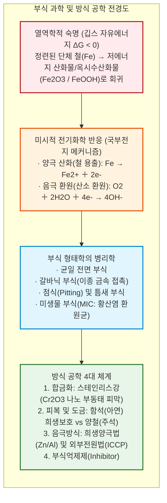
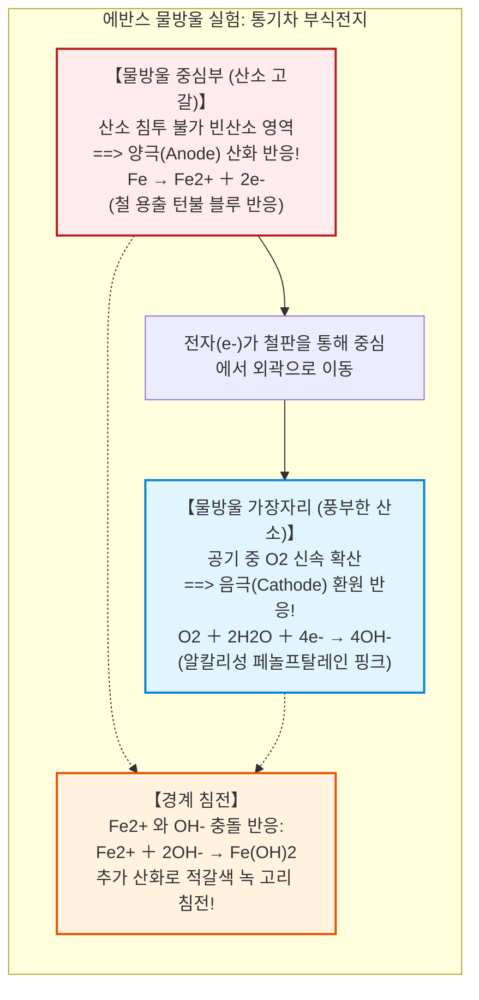
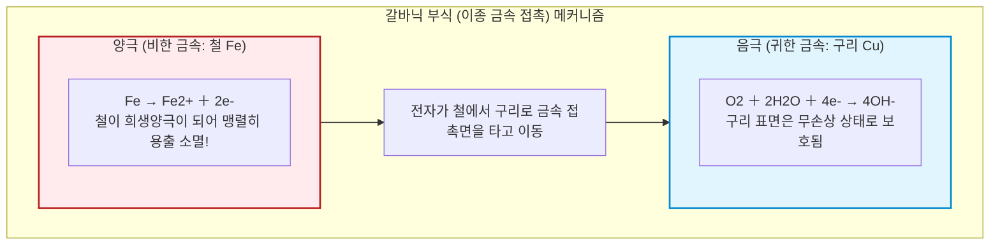
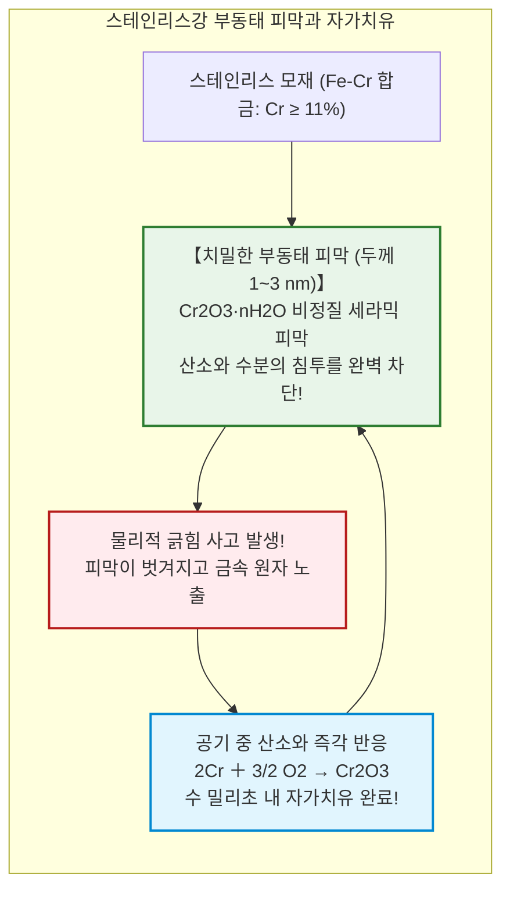
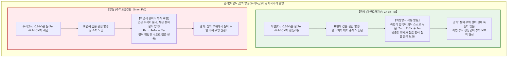
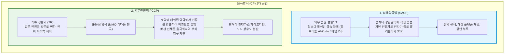

## 서론: 철이 '흙으로 돌아가려는' 열역학적 숙명

철(Iron: $\text{Fe}$)은 인류 문명의 뼈대다. 초고층 빌딩의 철골, 대륙을 달리는 철도 레일, 수십만 톤급 대형 유조선, 지하에 매설된 상하수도관과 가스관에 이르기까지 전 세계 금속 생산량의 **95% 이상(연간 약 19억 톤)**을 철강이 차지한다.

그러나 이 필수불가결한 소재는 태어난 순간부터 **'부식(Corrosion)', 즉 '녹(Rust)'**이라는 저주를 짊어지고 있다.

방치된 강재는 수일 만에 붉은 녹을 뿜어내고, 바닷물에 잠긴 선체는 구멍이 뚫리며, 지하 배관은 누수를 일으킨다. 세계 부식 기구에 따르면 금속 부식으로 인한 연간 경제적 손실은 **2조 5천억 달러(세계 GDP의 약 3.4%)**에 달한다.

철은 왜 녹스는가? 열역학적 관점에서 그 답은 명확하다: **철에게는 '녹스는 것'이야말로 우주에서 가장 자연스럽고 안락한 본래 상태로의 복귀이기 때문이다.**

자연계의 철은 적철석($\text{Fe}_2\text{O}_3$)이나 자철석($\text{Fe}_3\text{O}_4$) 같은 산화물(돌) 상태로 잠들어 있다. 인류는 거대한 고로에 열에너지를 쏟아부어 산소를 강제로 떼어내 순수한 금속 철($\text{Fe}$)로 환원시켰다.

따라서 정련된 철은 열역학적으로 **높은 깁스 자유에너지를 떠안은 불안정한 상태**다. 엔트로피 증가의 법칙에 따라 철은 틈만 나면 산소와 물을 결합시켜 에너지를 방출하고 원래의 안정된 산화물로 돌아가려 한다. 녹이란 철이 원래의 흙으로 회귀하는 거대한 에너지 방출 과정이다.

---

## 제1장: 물방울 속의 전기화학——미시적 '국부전지'

철 표면의 녹은 균일한 산화가 아니라, **표면에 수많은 미세 전지(국부전지: Local Cell)가 형성되어 단락 전류가 흐르는 현상**이다.

### 1.1 에반스의 물방울 실험과 통기차 전지

1920년대 에반스(Ulick R. Evans)는 철판 위에 식염수 물방울을 떨어뜨려 관찰했다:
- **물방울 가장자리**: 얇은 수막을 통해 공기 중 산소가 쉽게 확산(부산소부)되어 **음극(Cathode)**이 된다: $\text{O}_2 + 2\text{H}_2\text{O} + 4e^- \to 4\text{OH}^-$. 페놀프탈레인에 의해 분홍색을 띤다.
- **물방울 중심부**: 수심이 깊어 산소가 고갈(빈산소부)되어 **양극(Anode)**이 된다: $\text{Fe} \to \text{Fe}^{2+} + 2e^-$. 턴불 블루 청색 침전이 형성된다.

전자($e^-$)는 철 기판을 통해 중심에서 가장자리로 이동하고, 중심에서 나온 $\text{Fe}^{2+}$ 와 가장자리의 $\text{OH}^-$ 가 중간에서 만나 붉은 녹($\text{Fe}_2\text{O}_3 \cdot \text{H}_2\text{O}$)의 띠를 침전시킨다. 이를 **통기차 전지(Differential Aeration Cell)**라 부른다.

### 1.2 푸르베 다이어그램 (Pourbaix Diagram)

푸르베의 전위-pH도는 철의 3대 영역을 규정한다:
1. **부식역(Corrosion)**: 중성~산성 환경에서 철이 $\text{Fe}^{2+}$ 이온으로 용출되어 붕괴한다.
2. **부동태역(Passivity)**: 알칼리성($\text{pH} > 9 \sim 13$) 산화 환경에서 $\gamma\text{-Fe}_2\text{O}_3$ 산화 피막이 형성되어 부식을 멈춘다.
3. **불식역(Immunity)**: 전위를 $-0.62\ \text{V vs. SHE}$ 이하로 낮추면 철 금속 자체가 절대적 안정상이 되어 **물과 산소가 있어도 물리화학적으로 절대 녹슬지 않는다**.

---

## 제2장: 이종 금속 접촉 부식 (갈바닉 부식)

서로 다른 금속이 전해질 속에서 접촉하면 **비(卑)한 금속(전위가 낮은 금속)이 양극이 되어 급격히 용해**되고, 귀(貴)한 금속은 보호받는다.

해수 중 전위 서열:
- 마그네슘($-1.60\text{V}$) > 아연($-1.00\text{V}$) > 알루미늄($-0.80\text{V}$) > **탄소강($-0.65\text{V}$)** > 구리($-0.35\text{V}$)** > 부동태 스테인리스($-0.08\text{V}$)** > 티타늄($0.00\text{V}$).

면적 효과($i_a = i_c \cdot A_c / A_a$)에 따라 **'거대한 구리판(대음극)에 작은 철 리벳(소양극)'**을 박으면 철 리벳의 부식 전류밀도가 수백 배로 폭증해 절단된다.

1980년대 **자유의 여신상** 보수 공사는 거대한 구리 외피(음극)와 지지 철골(양극) 사이의 석면 절연체가 손상되어 철골이 절반 이상 부식되어 붕괴 직전에 이르렀던 역사적 사건이었다.

---

## 제3장: 스테인리스강의 기적——나노 부동태 피막

1913년 해리 브레얼리는 철에 **크롬(Cr)을 10.5~12% 이상** 첨가하면 공기 중에서 두께 **$1 \sim 3\ \text{nm}$의 치밀한 산화크롬($\text{Cr}_2\text{O}_3$) 부동태 피막**이 자발적으로 형성됨을 발견했다.

칼로 긁어 피막을 벗겨내도 산소가 있으면 수 밀리초 만에 피막이 **스스로 재생(Self-Healing)**된다.

다만 염화물 이온($\text{Cl}^-$)은 피막을 국부적으로 뚫어 극도로 위험한 점식(Pitting)을 유발하므로, 해수 배관에는 몰리브덴과 질소를 강화한 슈퍼 스테인리스($\text{PREN} > 40$)가 쓰인다.

---

## 제4장: 함석(아연도금) vs 양철(주석도금)의 진실

- **함석(아연도금)**: 흠집이 나도 아연이 대신 녹아 철에 전자를 주므로(희생양극 보호) 옥외에서 수십 년간 철을 녹슬지 않게 지킨다.
- **양철(주석도금)**: 흠집이 나면 대음극-소양극 효과로 철이 집중적으로 녹아 구멍이 뚫린다. 단, 캔 내부 무산소 밀폐 상태에서는 주석이 양극으로 전위 역전되므로 통조림 캔 내부용으로 완벽하다.

---

## 제5장: 인프라를 구하는 전기방식 (음극방식: CP)

철 구조물에 직류 전자를 강제로 주입해 전위를 **$-0.85\ \text{V vs. CSE}$ 이하**로 낮추면 푸르베도의 '불식역(Immunity)'에 들어가 부식이 100% 멈춘다.

선박 바닥에는 알루미늄 블록(희생양극)을 붙이고, 대륙 관통 파이프라인에는 정류기와 MMO 티타늄 양극을 이용한 **외부전원법(ICCP)**을 적용해 수천 킬로미터의 지하 배관을 보호한다.

---

## 제6장: 극한 환경의 미생물 부식(MIC)

혐기성 토양이나 배관 내부에서는 **황산염 환원균(SRB)**이 음극 수소를 갉아먹으며 황화수소를 배출해 전도성 황화철($\text{FeS}$) 스케일을 형성한다. 이 스케일과 철이 미시 전지를 이루어 연간 수 밀리미터 속도로 철을 뚫어버린다.

---

## 결론: 엔트로피에 맞서는 인간 지성의 방벽

철의 부식은 물질을 원래의 무질서하고 안정한 상태로 되돌리려는 자연계의 엔트로피 법칙의 표현이다.

방식 공학은 단순한 도장이 아니라 미시적 전자 이동을 다스리는 전기화학과 표면 나노물리학의 결정체다. 이 조용한 전자 방어선 위에서 현대 문명의 인프라는 오늘도 안전하게 지켜지고 있다.
