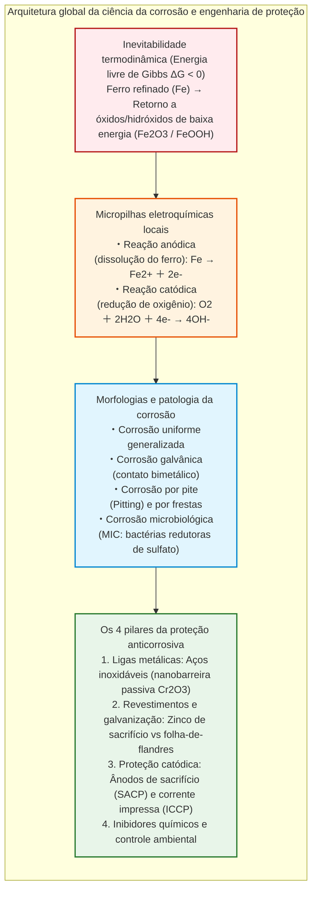
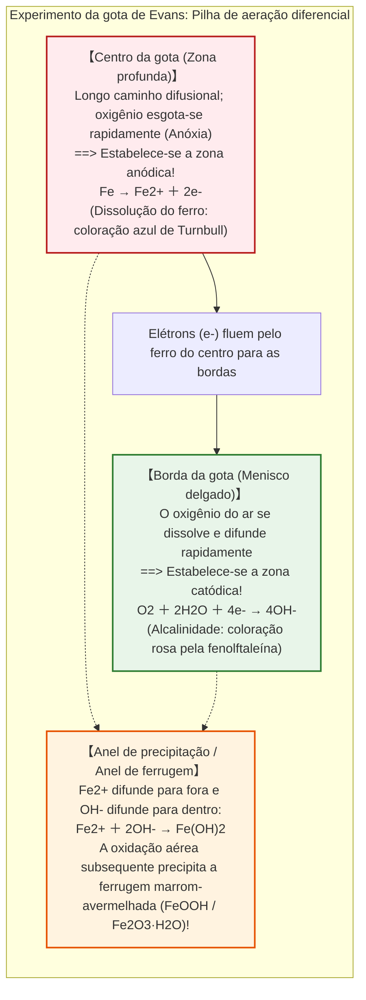
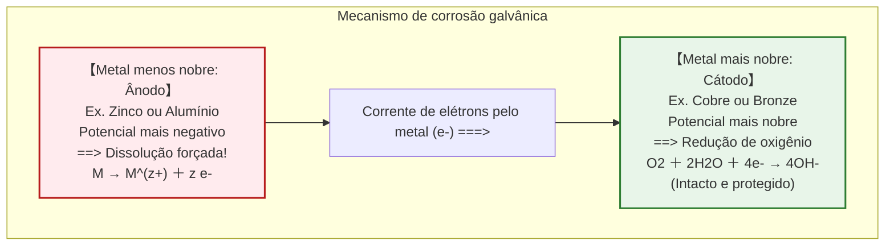
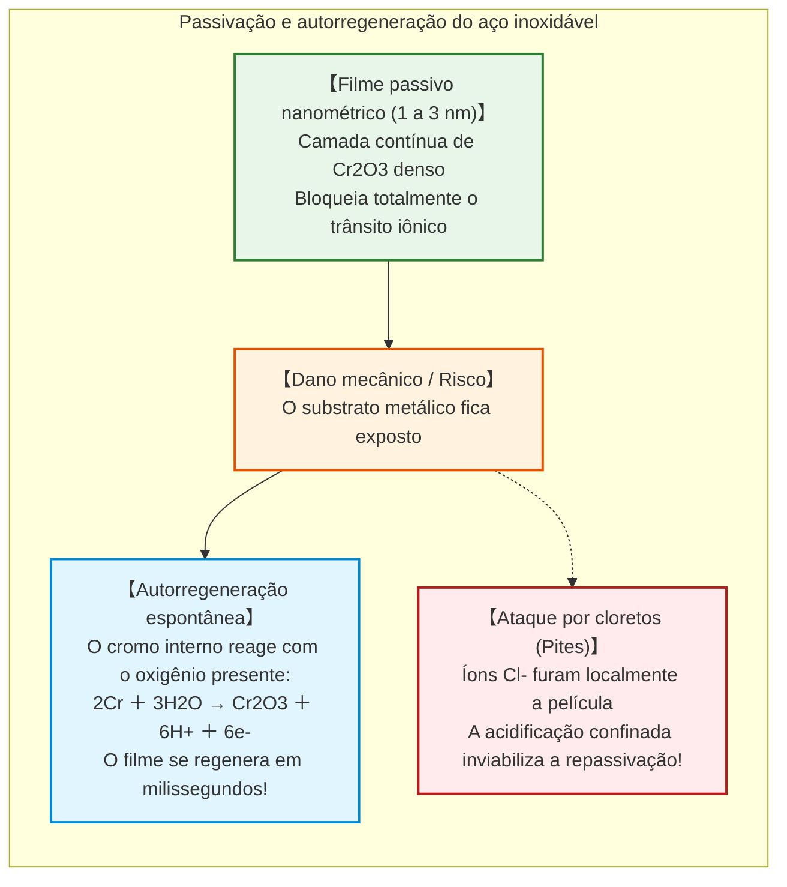

## Introdução: O destino termodinâmico do ferro de retornar à terra

O ferro ($\text{Fe}$) é a espinha dorsal estrutural da civilização moderna. Desde a estrutura dos arranha-céus urbanos e as malhas ferroviárias transcontinentais até superpetroleiros que deslocam centenas de milhares de toneladas, dutos submarinos de alta pressão e redes de distribuição de água, o ferro e o aço representam mais de **95% de todo o metal produzido e consumido no planeta** (cerca de 1,9 bilhão de toneladas anuais).

Contudo, desde o instante exato de sua manufatura metalúrgica, este material essencial carrega uma maldição química inexorável: **a corrosão, popularmente conhecida como ferrugem**.

Uma viga de aço exposta ao tempo desenvolve em poucos dias crostas avermelhadas de óxido. O casco de um navio no oceano sofre perfurações localizadas por corrosão por pite. De acordo com estudos globais da Association for Materials Protection and Performance (AMPP), o custo econômico anual da corrosão metálica ultrapassa **2,5 trilhões de dólares** — impressionantes **3,4% do Produto Interno Bruto (PIB) mundial**.

Por que o ferro enferruja com tamanha obstinação?

Sob a ótica da termodinâmica química, a resposta é inequívoca: **para o ferro, enferrujar representa o caminho mais natural, favorecido pela entropia e termodinamicamente estável de volta ao equilíbrio.**

Na crosta terrestre, o ferro não existe na forma metálica elementar $\text{Fe}^0$. Ele está aprisionado em minérios oxidados (hematita $\text{Fe}_2\text{O}_3$, magnetita $\text{Fe}_3\text{O}_4$), onde os átomos de ferro estão fortemente ligados ao oxigênio com mínima entalpia. Para obter o ferro metálico, a humanidade construiu altos-fornos imponentes, consumindo calor gigantesco ($> 1500^\circ\text{C}$) e coque para remover o oxigênio à força.

Assim, o ferro refinado encontra-se em um **estado de alta energia termodinamicamente instável**. Regido pela Segunda Lei da Termodinâmica (a tendência universal à máxima entropia e à mínima energia livre de Gibbs), o ferro busca continuamente liberar essa energia armazenada. Na presença de água e oxigênio, ele se oxida espontaneamente ($\Delta G < 0$) para retornar ao estado mineral originário.



---

## Capítulo 1: A eletroquímica em uma gota d'água – Micropilhas de ação local

A olho nu, um aço exposto à chuva parece sofrer uma oxidação química direta com o ar. Contudo, análises eletroquímicas detalhadas revelam uma realidade microscópica dinâmica:

**A ferrugem do ferro é uma reação de pilha eletroquímica em curto-circuito.** Milhões de micropilhas galvânicas espontâneas — chamadas **pilhas de ação local** — operam na superfície metálica conduzindo fluxos contínuos de elétrons e íons.

### 1.1 O experimento da gota de Evans e a aeração diferencial

Na década de 1920, o eletroquímico britânico Ulick Richardson Evans, na Universidade de Cambridge, realizou um experimento divisor de águas.

Evans depositou uma gota de solução salina diluída ($\text{NaCl}$) sobre uma chapa polida de aço, adicionando fenolftaleína (indicador de alcalinidade $\text{OH}^-$) e ferricianeto de potássio (indicador de íons ferrosos $\text{Fe}^{2+}$).

Se a corrosão fosse homogênea, toda a área sob a gota reagiria uniformemente. O resultado comprovou o contrário:



Este experimento evidenciou a **pilha de aeração diferencial**: o ferro se dissolve onde o oxigênio é escasso (centro anódico), enquanto a redução do oxigênio ocorre na borda aerada (catódica).

### 1.2 Cascata de reações químicas

- **Oxidação anódica**: $\text{Fe} \to \text{Fe}^{2+} + 2e^-$
- **Redução catódica**: $\text{O}_2 + 2\text{H}_2\text{O} + 4e^- \to 4\text{OH}^-$
- **Precipitação inicial**: $\text{Fe}^{2+} + 2\text{OH}^- \to \text{Fe(OH)}_2$ (hidróxido ferroso)
- **Oxidação secundária**: $4\text{Fe(OH)}_2 + \text{O}_2 + 2\text{H}_2\text{O} \to 4\text{Fe(OH)}_3$

O hidróxido férrico perde água para formar lepidocrocita ($\gamma\text{-FeOOH}$), goethita ($\alpha\text{-FeOOH}$), magnetita ($\text{Fe}_3\text{O}_4$) e hematita ($\text{Fe}_2\text{O}_3$).

Pela **relação de Pilling-Bedworth**, a ferrugem possui um volume específico **duas a três vezes maior** que o ferro consumido, gerando estresse volumétrico que esfarela a camada protetora, expondo continuamente novo metal.

---

## Capítulo 2: Termodinâmica e o Diagrama de Pourbaix

O cientista belga Marcel Pourbaix sintetizou a estabilidade do ferro em diagramas de potencial-pH (**Diagramas de Pourbaix**):
1. **Região de imunidade** ($E < -0{,}6\,\text{V}$): O ferro metálico é imune; a corrosão é termodinamicamente impossível (base da **proteção catódica**).
2. **Região de corrosão**: O ferro dissolve-se ativamente como $\text{Fe}^{2+}$, $\text{Fe}^{3+}$ ou $\text{HFeO}_2^-$.
3. **Região de passivação**: Películas de óxidos insolúveis estancam a degradação superficial (comum no concreto com $\text{pH} \approx 13$).

---

## Capítulo 3: Corrosão Galvânica e o Efeito Crítico de Área

Quando dois metais distintos são acoplados eletricamente em um eletrólito condutor, o metal com potencial de corrosão mais negativo atua como ânodo e sofre dissolução acelerada, poupando o metal mais nobre.



### O impacto da razão de áreas: $A_\text{Cátodo} / A_\text{Ânodo}$

A densidade de corrente no ânodo é ampliada proporcionalmente à relação entre as áreas:

$$i_\text{Ânodo} = i_\text{Cátodo} \times \left( \frac{A_\text{Cátodo}}{A_\text{Ânodo}} \right)$$

Parafusos de aço em placas maciças de cobre ($A_\text{Cátodo} \gg A_\text{Ânodo}$) sofrem corrosão violenta e se rompem em poucas semanas.

---

## Capítulo 4: Aço Inoxidável e a Nanobarreira de Passivação

Ao adicionar um mínimo de **10,5% de cromo ($\text{Cr}$)** ao aço, cria-se uma película nanométrica autorregenerativa de óxido de cromo ($\text{Cr}_2\text{O}_3$) com espessura de apenas 1 a 3 nanômetros.



Em ambientes salinos ricos em cloretos ($\text{Cl}^-$), o filme pode sofrer ruptura pontual, desencadeando **corrosão por pite (pitting)**. A adição de 2% a 3% de molibdênio ($\text{Mo}$) neutraliza essa vulnerabilidade (aço inoxidável marítimo AISI 316).

---

## Capítulo 5: Galvanização e Proteção Catódica

### 5.1 Aço Galvanizado vs Folha-de-flandres

- **Aço galvanizado (Zinco)**: O zinco é mais ativo que o ferro ($E^\circ = -0{,}76\,\text{V}$). Diante de um arranhão, ele atua como **ânodo de sacrifício**, oxidando-se para preservar o aço subjacente.
- **Folha-de-flandres (Estanho)**: O estanho é mais nobre que o ferro ($E^\circ = -0{,}14\,\text{V}$). Se a cobertura sofrer a menor trinca, o ferro torna-se um ânodo minúsculo frente a um enorme cátodo de estanho, perfurando a lata com rapidez catastrófica.

### 5.2 Sistemas de Proteção Catódica (CP)

```mermaid
flowchart TD
    subgraph CathodicSystems["Sistemas de Proteção Catódica"]
        direction TB
        subgraph SACP["1. Ânodos de sacrifício (SACP)"]
            SACP_Block["Blocos de Zinco ou Alumínio soldados ao casco"]
            SACP_Block -->|Corrente galvânica espontânea| SACP_Hull["Casco de aço polarizado como cátodo imune"]
        end
        
        subgraph ICCP["2. Corrente Impressa (ICCP)"]
            ICCP_Gen["Fonte geradora de corrente contínua (Retificador)"]
            ICCP_Anode["Ânodos inertes de titânio (MMO) enterrados no solo"]
            ICCP_Pipe["Gasoduto transcontinental mantido em potencial negativo"]
            ICCP_Gen -->|Pólo positivo (+)| ICCP_Anode
            ICCP_Gen -->|Pólo negativo (-)| ICCP_Pipe
        end
    end
    
    style SACP fill:#e1f5fe,stroke:#0288d1,stroke-width:2px
    style ICCP fill:#e8f5e9,stroke:#2e7d32,stroke-width:2px
```

1. **Ânodos galvânicos de sacrifício (SACP)**: Blocos de zinco/alumínio montados em cascos de navios que se oxidam voluntariamente.
2. **Corrente impressa (ICCP)**: Empregada em oleodutos e gasodutos enterrados através de retificadores e leitos de anodos de titânio (MMO).

---

## Capítulo 6: Corrosão Microbiológica e Sob Tensão

- **Bactérias redutoras de sulfato (BRS)**: Em ambientes sem oxigênio, consomem o hidrogênio polarizador e liberam sulfetos tóxicos que geram sulfeto de ferro ($\text{FeS}$), acelerando pites em vários milímetros anuais.
- **Corrosão sob tensão (SCC)**: A combinação simultânea de tensão mecânica e reagentes corrosivos propaga trincas frágeis em velocidades espantosas sem aviso perceptível.

---

## Conclusão: O combate perpétuo contra a entropia

O ferro é a armadura do mundo construído. No entanto, cada estrutura de aço permanece em constante tensão termodinâmica com a natureza. A ferrugem é o retorno inevitável à ordem mineral.

Dominando a eletroquímica, os nanofilmes e a proteção catódica, a engenharia civil e de materiais protege incansavelmente as fundações da sociedade moderna.
